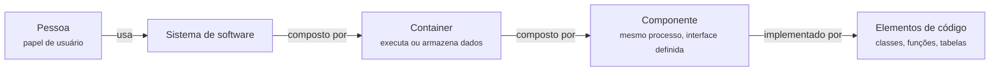
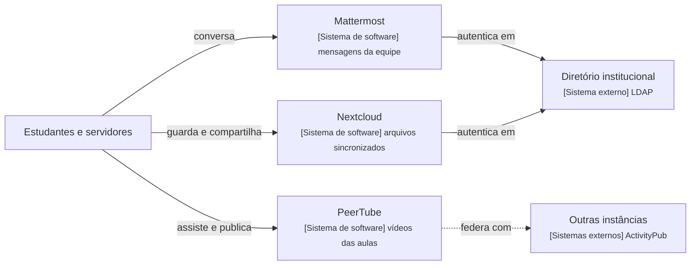

# Apêndice A - O modelo C4 e as altitudes

## Objetivos

Ao final deste apêndice, o leitor deverá ser capaz de:

- Explicar a origem e o propósito do modelo C4 e o princípio de "abstrações antes da notação".
- Distinguir os quatro níveis do C4 (contexto, *containers*, componentes e código) e os diagramas
  suplementares de paisagem de sistemas, de implantação e dinâmico.
- Aplicar as regras práticas de notação a diagramas próprios e criticar diagramas alheios.
- Comparar o C4 com o modelo 4+1, com a abordagem *Views and Beyond*, com a UML e com o ArchiMate.
- Relacionar os níveis do C4 aos conceitos de visão e ponto de vista da ISO/IEC/IEEE 42010.
- Ler e escrever diagramas segundo as convenções Mermaid adotadas neste livro.
- Avaliar as vantagens e os limites de tratar diagramas como código.
- Associar cada nível do C4 a uma altitude e aos capítulos em que ela é praticada.

## Introdução

Os diagramas de arquitetura costumam ser o primeiro artefato que uma equipe produz e o primeiro
que ela abandona. Caixas e setas desenhadas num quadro branco comunicam bem enquanto o autor está
presente para explicá-las; fotografadas e arquivadas, tornam-se ambíguas. Que significa uma caixa?
Um processo, uma biblioteca, um servidor, uma equipe? Que trafega por uma seta? Uma chamada
síncrona, um evento, uma dependência de compilação? A literatura de descrição de arquiteturas,
apresentada na Seção 1.3, respondeu a esse problema com normas e conjuntos de visões; a prática
profissional, sobretudo depois que a UML perdeu espaço fora das organizações que a exigiam
(RICHARDS; FORD, 2020, p. 318), respondeu em grande parte com o **modelo C4**, proposto por Simon
Brown (BROWN, 2018).

Este livro adota o C4 como espinha dorsal do seu método: cada nível corresponde a uma altitude do
voo descrito na Seção 1.11. Este apêndice é, por isso, a referência das convenções usadas em todo o
texto. As Seções A.1 a A.3 apresentam a origem do modelo, seus quatro níveis e os diagramas
suplementares; a Seção A.4 reúne as regras de notação; as Seções A.5 e A.6 situam o C4 diante de
outras abordagens e da ISO/IEC/IEEE 42010; as Seções A.7 e A.8 tratam das convenções Mermaid do livro
e dos diagramas como código; a Seção A.9 cataloga erros comuns, e a Seção A.10 fecha a
correspondência com as altitudes.

## A.1 Origem e propósito do C4

### A.1.1 O problema das caixas e linhas

Brown desenvolveu o C4 a partir de sua experiência em ensinar arquitetura de software a equipes de
desenvolvimento, cujos diagramas de "caixas e linhas" costumavam misturar níveis de abstração e
omitir o significado de formas e setas (BROWN, 2018). Richards e Ford (2020, p. 318) registram o
contexto por outro ângulo: a UML, que unificou três filosofias de projeto concorrentes, teve pouco
impacto fora das organizações que a impunham, e dela sobrevivem na prática sobretudo os diagramas de
classes e de sequência. Os autores apresentam o C4 como uma técnica criada para enfrentar as
deficiências da UML e modernizar sua abordagem. Segundo o sítio do modelo, o C4 inspira-se na UML e no
modelo 4+1 de Kruchten (1995), mas procura ser mais simples que ambos (BROWN, 2018). Seu alvo não é o
especialista em modelagem, e sim o desenvolvedor que precisa explicar um sistema a outros
desenvolvedores, a operadores ou a gestores; não por acaso, o SWEBOK v4 descreve o livro de Brown como
uma visão geral da arquitetura sob a perspectiva do desenvolvedor (WASHIZAKI, 2024, cap. 2).

### A.1.2 Abstrações antes da notação

A tese central do C4 é que a ambiguidade dos diagramas decorre menos da falta de uma notação
padronizada do que da falta de um **conjunto comum de abstrações**. Brown (2018) propõe que a equipe
concorde primeiro sobre os tipos de coisa que existem no sistema e só depois sobre como desenhá-las.
O modelo define cinco abstrações, organizadas hierarquicamente:

- **Pessoa**: um usuário humano do sistema, identificado por papel (cliente, moderador,
  administrador), e não por nome.
- **Sistema de software**: o nível mais alto de abstração, algo que entrega valor a seus usuários
  e que, em geral, pertence a uma equipe ou organização.
- ***Container***: uma unidade que precisa estar em execução para que o sistema funcione, ou que
  armazena dados, como uma aplicação web, um aplicativo móvel, um processo de *workers*, um banco
  de dados ou um *bucket* de armazenamento de objetos.
- **Componente**: um agrupamento de funcionalidades relacionadas, encapsulado por uma interface
  bem definida, que executa dentro de um *container* e não é implantado separadamente.
- **Elemento de código**: classes, interfaces, funções, tabelas, isto é, os elementos que
  implementam um componente.

A relação entre as abstrações é de composição: um sistema é formado por *containers*, um *container*
por componentes, e um componente é implementado por elementos de código (BROWN, 2018). A Figura
A.1 representa essa hierarquia. Como cada nível de diagrama mostra apenas um tipo de abstração e
suas relações com o nível imediatamente superior, o leitor sempre sabe "onde está", à semelhança
dos níveis de *zoom* de um mapa digital, analogia usada pelo próprio Brown.

**Figura A.1** – Hierarquia de abstrações do modelo C4.



Fonte: adaptado de Brown (2018).

!!! note "*Container* não é Docker"
    No C4, *container* é qualquer unidade que executa código ou armazena dados separadamente. O
    termo antecede a popularização dos contêineres Linux e não tem relação direta com eles. Um
    *container* C4 pode ser implantado num contêiner Docker, numa máquina virtual, num serviço
    gerenciado ou num dispositivo embarcado; inversamente, um contêiner Docker pode empacotar mais
    de um *container* C4.

## A.2 Os quatro níveis

### A.2.1 Nível 1: contexto

O **diagrama de contexto** mostra o sistema em foco como uma única caixa, cercado pelas pessoas que
o usam e pelos sistemas externos com que se comunica. Não mostra tecnologias, protocolos de baixo
nível nem estrutura interna. Seu público é amplo: desenvolvedores, operadores, gestores, clientes.
Richards e Ford (2020, p. 318) descrevem esse nível como o que representa o contexto inteiro do
sistema, incluindo os papéis dos usuários e as dependências externas. Neste livro, o diagrama de
contexto é o produto principal da altitude de 100.000 pés e evolui ao longo de uma conversa de
requisitos simulada (Seção 3.1.2). A Figura 3.2.4, contexto final do Mastodon, é um exemplo típico:
usuários locais, aplicativos de terceiros, moderadores, outras instâncias, *relays*, armazenamento de
objetos, e-mail e notificações *push* cercam uma única caixa, a instância.

O nível exige a disciplina de não descer: o banco de dados é uma decisão de 50.000 pés e só aparece
no contexto se for um sistema externo, mantido por outra organização. As versões sucessivas do
contexto do PeerTube (Figuras 3.4.1 a 3.4.5) mostram o uso pedagógico do nível: cada rodada da
conversa acrescenta um ator ou um sistema externo motivado por um requisito novo.

### A.2.2 Nível 2: *containers*

O **diagrama de *containers*** abre a caixa do sistema e mostra suas unidades de execução e de
armazenamento, as tecnologias de cada uma e os protocolos que as ligam. É o nível em que se tomam as
decisões mais caras de reverter: monólito ou distribuição, comunicação síncrona ou assíncrona, onde
residem os dados (Seção 4.1). Richards e Ford (2020, p. 318) observam que essa visão é um bom ponto
de encontro entre operações e arquitetura, porque nela aparecem as fronteiras de implantação. A
Figura 4.2.1 mostra os *containers* de uma instância Mastodon: *proxy* reverso, processo web Rails,
*workers* Sidekiq, servidor de *streaming* em Node.js, PostgreSQL, Redis e armazenamento de mídia.

Um bom diagrama de *containers* responde, sem consultar o código, a perguntas como "quais
*containers* compartilham um banco?", decisiva para o **quantum arquitetural** (Seção D.4): na Figura
4.2.1, os três processos de aplicação compartilham o PostgreSQL e o Redis e pertencem, portanto, ao
mesmo quantum (Seção 4.2.3).

### A.2.3 Nível 3: componentes

O **diagrama de componentes** abre um *container* e mostra os agrupamentos de código com
responsabilidade clara, suas interfaces e suas dependências. Componentes, no C4, não são
implantados separadamente: todos os componentes de um *container* executam no mesmo espaço de
processo (BROWN, 2018). Richards e Ford (2020, p. 318) consideram que esse nível é o que mais se
alinha à visão que o arquiteto tem do sistema. No livro, ele corresponde à altitude de 10.000 pés
(Capítulo 5). A Figura 5.3.1 mostra os componentes do servidor Mattermost; a Figura 5.2.1 mostra os
componentes de dois *containers* do Mastodon que participam do caminho de uma publicação, agrupados
por *container*.

O nível de componentes é o que mais exige julgamento, porque a fronteira de um componente não é
dada pelo ambiente de execução, como a de um *container*, mas por uma decisão de projeto. Um
componente pode coincidir com um pacote, com um diretório, com um conjunto de classes ligadas por
uma fachada ou com um contexto delimitado do DDD.

### A.2.4 Nível 4: código

O **nível de código** mostra como um componente é implementado: classes, interfaces, funções,
tabelas. Brown (2018) trata esse nível como opcional e recomenda que, quando necessário, seja gerado
por ferramentas a partir do código, e não desenhado à mão, pois diagramas de código desatualizam-se
no primeiro *commit*. Richards e Ford (2020, p. 319) notam que o C4 reaproveita aqui o estilo dos
diagramas de classes da UML, que são eficazes e não precisam ser substituídos.

Este livro segue a recomendação. Na altitude do solo (Capítulo 6), o nível 4 é representado
principalmente por **listagens literais** com *permalinks* para uma *tag* fixada do repositório e
por tabelas que associam componentes a arquivos, como a Tabela 6.3.1 do Mattermost e a Tabela 6.4.1
do PeerTube. Diagramas de classes aparecem apenas quando a estrutura não é evidente pela leitura
linear do código, como no modelo de domínio de arquivos do Nextcloud (Figura 6.5.1).

## A.3 Diagramas suplementares

Os quatro níveis descrevem a **estrutura estática** de um sistema. Brown (2018) acrescenta três
diagramas suplementares para aspectos que a hierarquia não captura: a paisagem de sistemas, a
implantação e o comportamento dinâmico.

### A.3.1 Paisagem de sistemas

O **diagrama de paisagem de sistemas** (*system landscape*) mostra vários sistemas de software de
uma organização ou de um ecossistema e as pessoas que os usam, sem foco em nenhum deles. É, na
prática, um diagrama de contexto sem sistema central, útil quando o interesse está nas relações
entre sistemas, e não no interior de um deles. Corresponde aproximadamente ao território da
arquitetura corporativa (Seção 1.2.3). A Figura A.2 esboça a paisagem de um instituto que adotasse
três dos sistemas estudados.

**Figura A.2** – Paisagem de sistemas de um instituto que adota três dos gêmeos do livro (ilustrativo).



Fonte: elaborado pelo autor (2026), com base nos Capítulos 3 e 4. Linhas contínuas: comunicação
síncrona; linhas tracejadas: comunicação assíncrona.

### A.3.2 Implantação

O **diagrama de implantação** mostra como instâncias de *containers* são mapeadas para a
infraestrutura: servidores, máquinas virtuais, contêineres, serviços gerenciados, dispositivos.
Brown (2018) o descreve em termos de **nós de implantação**, que podem ser aninhados (um contêiner
dentro de uma máquina virtual dentro de uma região de nuvem). Um mesmo diagrama de *containers*
admite vários diagramas de implantação, um por ambiente. A Figura 4.2.2, servidor único do Mastodon,
e a Figura 4.2.3, instância maior com PgBouncer, réplica e Redis separados, são dois diagramas de
implantação do mesmo diagrama de *containers*; a comparação entre eles sustenta o argumento da Seção
4.2.2 de que a instância cresce sem mudar de estilo. No PX4, a Figura 4.8.2 mostra nós físicos, e
não lógicos: o controlador de voo, o computador de missão, o rádio, a estação em solo.

### A.3.3 Dinâmico

O **diagrama dinâmico** mostra como elementos de um nível colaboram, em ordem, para realizar um
caso de uso, uma história ou uma operação. Brown (2018) admite duas formas: um diagrama de
colaboração, com setas numeradas sobre a estrutura estática, ou um diagrama de sequência no estilo
da UML. Este livro adota a segunda forma, com `sequenceDiagram` do Mermaid, sempre na altitude de
10.000 pés, para a **operação-chave** de cada sistema. A Figura 5.2.2 mostra a sequência de uma
publicação no Mastodon, e a Figura 5.5.3, o envio de um arquivo por WebDAV no Nextcloud. O diagrama
dinâmico evidencia o que o estático esconde, como o momento em que a resposta HTTP é devolvida antes
do *fanout* (Seção 5.2.2).

## A.4 Notação e regras práticas

### A.4.1 Recomendações de Brown

O C4 é deliberadamente **independente de notação**: não prescreve formas, cores nem ferramentas.
Em compensação, Brown (2018) propõe uma lista de verificação que todo diagrama deve satisfazer.
Todo diagrama deve ter um **título** que diga seu tipo e escopo e uma **legenda** que explique formas,
cores, estilos de linha e siglas. Todo elemento deve indicar seu **tipo** (pessoa, sistema,
*container*, componente), ter uma **descrição** curta da responsabilidade e, nos níveis 2 e 3,
indicar a **tecnologia**. Toda relação deve ser **unidirecional** e ter um **rótulo** que diga sua
intenção, coerente com a direção da seta, e, quando entre *containers*, o protocolo ou a tecnologia
de comunicação. Siglas e jargão devem ser evitados ou explicados.

A exigência de setas unidirecionais merece comentário. Uma seta com duas pontas é quase sempre a
fusão de duas relações distintas, como "envia pedido" e "notifica conclusão", e a fusão esconde
justamente a informação mais útil: quem inicia a comunicação. Quando a relação é genuinamente
simétrica, como a troca de mensagens de controle entre os nós do *cluster* do Mattermost (Figura
4.3.1), uma seta bidirecional com rótulo explícito é aceitável, mas deve ser exceção.

### A.4.2 Recomendações de Richards e Ford

Richards e Ford (2020, cap. 21) acrescentam princípios de comunicação. O principal é a
**consistência representacional**: antes de mudar de visão, mostrar a relação entre a parte detalhada
e o todo (RICHARDS; FORD, 2020, p. 315). O segundo é evitar o **apego irracional ao artefato**, que
cresce com o tempo gasto em produzi-lo; por isso, o início do projeto pede artefatos de baixa
fidelidade, como quadros brancos e notas adesivas (RICHARDS; FORD, 2020, p. 316-317). Os autores
pedem ainda títulos, rótulos, cor com moderação e legenda sempre que as formas forem ambíguas, pois um
diagrama que induz a erro é pior do que nenhum, e registram uma das poucas convenções difundidas:
linhas contínuas indicam comunicação síncrona, e tracejadas, assíncrona (RICHARDS; FORD, 2020, p.
319-321).

A Tabela A.1 consolida as duas fontes numa lista de verificação usada nas atividades do curso.

**Tabela A.1** – Lista de verificação para diagramas C4.

| Item | Pergunta de verificação | Fonte |
|---|---|---|
| Título | O título diz o nível e o escopo ("*Containers* de uma instância Mastodon")? | Brown (2018) |
| Legenda | Formas, cores e estilos de linha estão explicados ou são inequívocos? | Brown (2018); Richards e Ford (2020, p. 321) |
| Tipo | Cada caixa diz se é pessoa, sistema, *container* ou componente? | Brown (2018) |
| Responsabilidade | Cada caixa tem uma linha que diz o que ela faz? | Brown (2018) |
| Tecnologia | Nos níveis 2 e 3, a tecnologia está indicada? | Brown (2018) |
| Setas | Cada seta tem direção única e rótulo com intenção e, se for o caso, protocolo? | Brown (2018) |
| Nível único | O diagrama mostra apenas abstrações de um nível? | Brown (2018) |
| Consistência representacional | Está claro de que elemento do nível superior o diagrama é um detalhamento? | Richards e Ford (2020, p. 315) |
| Fonte | A legenda indica de que documentação ou versão do código o diagrama foi derivado? | Guia de redação do livro |

Fonte: elaborado pelo autor (2026), com base em Brown (2018) e Richards e Ford (2020, cap. 21).

## A.5 O C4 e outras abordagens

### A.5.1 O modelo 4+1

Kruchten (1995) propôs descrever a arquitetura em quatro visões concorrentes, cada uma dirigida a
um grupo de *stakeholders*: a **lógica**, para usuários finais, com a decomposição funcional; a **de
processo**, para integradores, com concorrência e distribuição; a **de desenvolvimento**, para
programadores, com a organização em módulos e subsistemas; e a **física**, para engenheiros de
sistemas, com o mapeamento para o *hardware*. Os **cenários**, o "+1", atravessam as quatro visões e
servem para descobri-las e validá-las. O SWEBOK v4 classifica o artigo como seminal e observa que
ele organiza a descrição em cinco pontos de vista (WASHIZAKI, 2024, cap. 2).

A diferença principal entre o 4+1 e o C4 é de eixo. O 4+1 é **ortogonal**: cada visão mostra o
sistema inteiro sob um interesse diferente. O C4 é **hierárquico**: cada nível mostra uma parte do
sistema com mais detalhe. As correspondências são, por isso, parciais. O diagrama de *containers*
mistura elementos da visão de processo (o que executa separadamente) e da física (onde executa); o
diagrama de implantação do C4 é a visão física; o de componentes aproxima-se da visão lógica e da de
desenvolvimento; e os diagramas dinâmicos cumprem o papel dos cenários.

### A.5.2 *Views and Beyond*

Clements *et al.* (2010) organizam as visões em três **tipos de visão** (*viewtypes*): **módulo**, que
descreve unidades de implementação e suas relações de uso, dependência e generalização;
**componente e conector**, que descreve entidades em tempo de execução e suas interações; e
**alocação**, que relaciona o software a ambientes externos, como *hardware*, sistemas de arquivos e
equipes. O "além das visões" (*beyond*) do título refere-se à documentação que se aplica a mais de
uma visão: o guia de leitura, o mapeamento entre visões e a justificativa das decisões. Para cada
visão, os autores propõem um modelo de documento com apresentação primária, catálogo de elementos,
diagrama de contexto, guia de variabilidade e justificativa.

Argumenta-se aqui que, nessa taxonomia, o C4 mistura os tipos componente e conector e módulo nos
níveis 2 e 3, cobre o tipo módulo no nível 4 e o tipo alocação apenas no diagrama de implantação, e que
sua lacuna mais sentida é a da justificativa: ele diz como o sistema é, mas não por que é assim. Os ADRs
do Apêndice B preenchem essa lacuna, à maneira da parte "além das visões" de Clements *et al.* (2010).

### A.5.3 UML

A UML oferece diagramas de componentes, de implantação, de sequência, de classes e de pacotes, entre
outros, com semântica definida pelo *Object Management Group* (OMG, 2017). É mais expressiva que o
C4 e permite verificação mecânica de modelos, mas a riqueza tem custo de aprendizagem, e seu
diagrama de componentes usa "componente" num sentido diferente do C4. O C4 e a UML não são
excludentes: o próprio C4 usa diagramas de classes no nível 4 e admite diagramas de sequência como
forma do diagrama dinâmico, e o SWEBOK v4 registra que a UML tem sido usada com frequência como
linguagem de descrição de arquiteturas (WASHIZAKI, 2024, cap. 2, seção 2.3).

### A.5.4 ArchiMate

O ArchiMate é uma linguagem de modelagem de arquitetura corporativa mantida pelo The Open Group
(THE OPEN GROUP, 2022). Richards e Ford (2020, p. 319) destacam seu objetivo de ser tão pequena quanto
possível, sem pretender cobrir todos os casos, o que a tornou popular entre arquitetos. Sua
organização em camadas de negócio, aplicação e tecnologia permite relacionar processos de negócio a
aplicações e estas à infraestrutura, algo fora do escopo do C4. O SWEBOK v4 cita o ArchiMate como
exemplo de linguagem de amplo espectro, capaz de enquadrar interesses de toda a empresa (WASHIZAKI,
2024, cap. 2, seção 2.3). Para a análise de um único sistema de software, como a feita neste livro, o
ArchiMate é mais do que o necessário; para relacionar dezenas de sistemas de uma organização, o
diagrama de paisagem do C4 é menos do que o necessário.

A Tabela A.2 resume a comparação.

**Tabela A.2** – O C4 comparado com outras abordagens de descrição.

| Abordagem | Organização | Público principal | Ponto forte | Limitação |
|---|---|---|---|---|
| C4 (Brown, 2018) | Hierárquica, por *zoom* | Equipes de desenvolvimento e operação | Simplicidade; abstrações comuns | Pouco sobre justificativa e comportamento; independência de notação exige disciplina |
| 4+1 (Kruchten, 1995) | Ortogonal, por interesse, com cenários | *Stakeholders* distintos por visão | Separação de interesses; validação por cenários | Notação não prescrita no nível da equipe; visões podem divergir |
| *Views and Beyond* (Clements *et al.*, 2010) | Tipos de visão e estilos, mais documentação transversal | Arquitetos e avaliadores | Completude; modelo de documento por visão | Custo de produção e de manutenção |
| UML (OMG, 2017) | Catálogo de tipos de diagrama com semântica formal | Projetistas e ferramentas | Precisão; verificação; geração de código | Curva de aprendizagem; baixa adesão fora de nichos |
| ArchiMate (The Open Group, 2022) | Camadas de negócio, aplicação e tecnologia | Arquitetos corporativos | Rastreabilidade do negócio à infraestrutura | Excessivo para um único sistema |

Fonte: elaborado pelo autor (2026), com base nas obras citadas e em Richards e Ford (2020, cap. 21).

Richards e Ford (2020, p. 319) fazem uma ressalva ao C4: como toda técnica de diagramação, ele não
expressa todo tipo de projeto, e seria mais adequado a arquiteturas monolíticas, em que as relações
entre *containers* e componentes podem diferir, do que a arquiteturas distribuídas como a de
microsserviços. A experiência deste livro qualifica a ressalva. Na topologia de microsserviços do
ThingsBoard (Figura 4.7.1), o diagrama de *containers* funciona bem, porque cada serviço é um
*container*; a dificuldade aparece no nível 3, em que o mesmo código empacotado de duas formas
(ADR 4.7-B) obriga a escolher se os componentes pertencem ao monólito ou a cada serviço. A Seção 5.7.1
resolve o problema focalizando dois *containers* de cada vez.

## A.6 O C4 e a ISO/IEC/IEEE 42010

A norma ISO/IEC/IEEE 42010 distingue **visão**, a parte de uma descrição de arquitetura que trata de
interesses de *stakeholders*, e **ponto de vista**, as convenções para construir, interpretar e
analisar um tipo de visão (Seção 1.3.1). O SWEBOK v4 acrescenta que cada ponto de vista liga um
público e seus interesses a um conjunto de convenções e que, na arquitetura baseada em modelos, cada
visão pode ser verificada mecanicamente contra seu ponto de vista (WASHIZAKI, 2024, cap. 2, seção
2.1).

A Seção 1.3.3 afirmou que o C4 não é um ponto de vista no sentido estrito da norma, porque não define
técnicas de análise. A afirmação pode ser refinada. Cada nível do C4 fornece parte do que a norma
exige de um ponto de vista: os elementos e relações admitidos, o público e uma regra de
correspondência com o nível superior. Falta-lhe a especificação dos interesses enquadrados e das
técnicas de análise. A Tabela A.3 completa essa especificação para o uso que este livro faz do modelo,
de modo que cada nível passe a funcionar como um ponto de vista no sentido da norma.

**Tabela A.3** – Os níveis do C4 especificados como pontos de vista, no uso deste livro.

| Ponto de vista | Interesses enquadrados | *Stakeholders* | Elementos e relações | Análises associadas | Correspondência |
|---|---|---|---|---|---|
| Contexto | Escopo, usuários, dependências externas, restrições | Todos, inclusive não técnicos | Pessoas, sistema em foco, sistemas externos; uso e integração | Características e cenários de qualidade (Apêndice D), estimativas (Apêndice F) | — |
| *Containers* | Distribuição, comunicação, dados, implantação | Arquitetos, desenvolvedores, operadores | *Containers*, armazenamentos; protocolos | Quantum, falácias, disponibilidade composta (Apêndice D) | Cada *container* pertence a um sistema do contexto |
| Componentes | Responsabilidades, dependências, fronteiras de domínio | Desenvolvedores, arquitetos | Componentes; dependências e chamadas | Coesão, acoplamento, *connascence* (Apêndice E), mapa de contextos | Cada componente pertence a um *container* |
| Código | Realização das decisões | Desenvolvedores | Classes, funções, tabelas | Padrões, funções de aptidão (Apêndice E, Capítulo 6) | Cada elemento realiza um componente |
| Implantação | Capacidade, disponibilidade, custo | Operadores | Nós de implantação, instâncias de *containers* | Redundância e pontos únicos de falha | Cada instância corresponde a um *container* |

Fonte: elaborado pelo autor (2026), com base em ISO/IEC/IEEE (2022), Brown (2018) e Washizaki (2024, cap. 2).

O SWEBOK v4 distingue ainda duas formas de construir as visões (WASHIZAKI, 2024, cap. 2, seção 2.1).
Na abordagem **sintética**, o arquiteto constrói cada visão separadamente e as integra por regras de
correspondência; na **projetiva**, cada visão é extraída de um modelo subjacente único. A primeira é
mais expressiva, mas sujeita ao "problema das múltiplas visões", isto é, a inconsistência entre elas;
a segunda limita as inconsistências ao custo de expressividade. Os diagramas deste livro, desenhados
um a um em Mermaid, seguem a abordagem sintética, e sua consistência é mantida por revisão. As
ferramentas baseadas em modelo, discutidas na Seção A.8, seguem a abordagem projetiva.

## A.7 Convenções de notação usadas no livro

### A.7.1 Por que `flowchart`

A maior parte dos diagramas do livro é escrita em Mermaid, linguagem textual renderizada no navegador
pelo tema do MkDocs; a exceção são as figuras de *containers* a 50.000 pés, tratadas na Seção A.7.5. O Mermaid oferece uma sintaxe específica para o C4 (`C4Context`, `C4Container`,
`C4Component`, `C4Dynamic`, `C4Deployment`), que sua documentação classifica como experimental
(MERMAID, 2026). Por isso, o livro adota o tipo `flowchart` com convenções próprias para os
diagramas estruturais e `sequenceDiagram` para os dinâmicos. A decisão tem as consequências usuais de
uma escolha conservadora: renderização estável e controle do *layout*, ao custo de não haver
validação do tipo dos elementos, que fica a cargo das convenções a seguir.

### A.7.2 Elementos e relações

A Tabela A.4 resume as convenções, e a Listagem A.1 mostra um esqueleto que as aplica.

**Tabela A.4** – Convenções Mermaid dos diagramas do livro.

| Elemento | Sintaxe | Exemplo no livro |
|---|---|---|
| Pessoa, sistema, *container* ou componente | Retângulo com nome em destaque e descrição ou tecnologia em `<small>`: `X["Web<br/><small>Rails + Puma</small>"]` | Figura 5.2.1 |
| Tipo explícito, quando ambíguo | Tipo entre colchetes na linha menor: `<small>[Sistema de software]</small>` | Figura A.2 |
| Armazenamento de dados | Cilindro: `PG[("PostgreSQL")]` | Figuras 4.2.2 e 4.3.2 |
| Fronteira de sistema, *container* ou nó | `subgraph` com rótulo | Figuras 5.2.1 e 4.3.2 |
| Nó de implantação aninhado | `subgraph` dentro de `subgraph` | Figura 4.8.2 |
| Comunicação síncrona (chamada HTTP, gRPC ou RPC, consulta a banco, chamada de método, leitura de *cache*) | Seta contínua com rótulo: `A -- "HTTPS" --> B` ou `A -->|"HTTPS"| B` | Figura 4.2.2 |
| Comunicação assíncrona (fila, tópico, evento publicado, *pub/sub*, *webhook* assíncrono, replicação assíncrona, notificação *push*) | Seta tracejada com rótulo: `A -. "enfileira" .-> B` ou `A -.->|"enfileira"| B` | Figuras 4.2.2, 5.7.1 e 5.8.1 |
| Relação que não é comunicação (implementa, depende de, gerencia, influência, retroalimentação de processo) | Seta contínua com rótulo explícito: `A -->|"implementa"| B`; nunca tracejada | Figuras 1.3, 3.8.4 e 7.4 |
| Relação simétrica | Seta dupla com rótulo, como exceção, contínua ou tracejada conforme a comunicação | Figura 4.3.2 |
| Interação no tempo | `sequenceDiagram` com participantes nomeados como componentes; `->>` para mensagem síncrona, `-->>` para retorno e `-)` para mensagem assíncrona | Figura 5.2.2 |
| Direção | `LR` para contexto e componentes; `TB` para *containers* e implantação | Capítulos 3 a 5 |

Fonte: elaborado pelo autor (2026).

**Listagem A.1** – Esqueleto de diagrama de *containers* segundo as convenções do livro.

```text
flowchart TB
    U["Usuário<br/><small>[Pessoa] navegador ou aplicativo</small>"]
    subgraph SIS["Sistema em foco"]
        W["Aplicação web<br/><small>[Container] tecnologia: responsabilidade</small>"]
        J["Workers<br/><small>[Container] tecnologia: responsabilidade</small>"]
        DB[("Banco relacional<br/><small>[Container] tecnologia</small>")]
    end
    EXT["Sistema externo<br/><small>[Sistema de software]</small>"]
    U -- "usa (HTTPS)" --> W
    W -- "lê e grava (SQL)" --> DB
    W -. "enfileira jobs" .-> J
    J -- "notifica (SMTP)" --> EXT
    J -- "lê réplica (opcional)" --> DB
```

Fonte: elaborado pelo autor (2026).

### A.7.3 Linhas contínuas e tracejadas

O livro adota uma convenção única para o estilo das linhas, a registrada por Richards e Ford (2020,
p. 319-321): **linha contínua indica comunicação síncrona; linha tracejada indica comunicação
assíncrona**. O tracejado tem exclusivamente esse sentido. São tracejadas as setas para uma fila,
um tópico ou um *broker* e as que saem dele, porque o produtor não espera o consumidor, como no
enfileiramento de *jobs* do Sidekiq e no *pub/sub* do Redis no Mastodon (Figura 4.2.1) e nos tópicos
do Kafka no ThingsBoard (Figura 4.7.1); também o são os eventos publicados, os tópicos uORB do PX4
(Figura 5.8.1), as mensagens MAVLink, os *webhooks* assíncronos, a replicação assíncrona e as
notificações *push*. Quando a fonte declara que uma interação é síncrona, como os *webhooks* do
*checkout* do Saleor (Figura 4.6.1), a linha é contínua.

Relações que não são comunicação, como "implementa", "depende de", "gerencia", as relações de um
mapa de contextos, a influência da regulação ou do risco físico em um diagrama de contexto e a
retroalimentação em diagramas de processo, usam linha contínua com rótulo explícito, e um componente
opcional é indicado por "(opcional)" no rótulo ou no nó, nunca pelo estilo da linha. Nos diagramas de
sequência, a mensagem síncrona usa a seta `->>`, o retorno usa `-->>` e a mensagem assíncrona usa a
seta de ponta aberta `-)`. Cada figura que contém setas tracejadas repete a convenção na linha de
fonte, conforme a recomendação de Brown (2018) e de Richards e Ford (2020, p. 321) de explicar formas
e estilos de linha em uma legenda.

### A.7.4 Legendas, fontes e numeração

Todas as figuras têm legenda numerada acima ("Figura N.M – título") e linha de fonte abaixo, com a
documentação ou a *tag* de que derivam. A fonte é uma exigência de rastreabilidade: o diagrama da
Figura 4.2.1, "com base no arquivo `docker-compose.yml` da *tag* v4.7.3", pode ser conferido por
qualquer leitor; um diagrama sem fonte só pode ser acreditado.

### A.7.5 Diagramas D2 a 50.000 pés

As figuras de *containers* da altitude de 50.000 pés (Figuras 4.2.1, 4.3.1, 4.4.1, 4.5.2, 4.6.1,
4.7.1 e 4.8.1) seguem outra notação. Elas adotam o estilo dos diagramas de Xu (2020): ícones dos
produtos reais (nginx, PostgreSQL, Redis, Kafka), faixas que agrupam os *containers* por camada e o
caminho de uma operação representativa marcado por setas numeradas, cujos passos são descritos em
lista logo abaixo da figura. Esse estilo privilegia a leitura do fluxo, que é o que interessa nessa
altitude, e é difícil de obter com o Mermaid, cujos nós não comportam ícones e cujo *layout* não
admite posicionamento por faixas.

Essas figuras são escritas em D2, outra linguagem de diagramas como código (TERRASTRUCT, 2026), e
renderizadas para SVG antes da publicação. As convenções são as mesmas das demais figuras:
linha contínua para comunicação síncrona, tracejada para assíncrona, e linhas finas sem número
para relações que existem, mas não pertencem ao fluxo descrito. As faixas seguem a ordem usuários e
sistemas externos, borda, aplicação e dados, da esquerda para a direita; os rótulos das setas trazem
apenas o número do passo. O código-fonte de cada figura está no diretório `diagramas/d2/` do
repositório, e as regras completas, em `diagramas/README.md`.

## A.8 Diagramas como código

Escrever diagramas em texto, e não desenhá-los em editores gráficos, traz para a documentação as
práticas do código-fonte: versionamento junto ao código, revisão por *pull request*, comparação de
versões, geração automática na integração contínua. O argumento é especialmente forte para a
arquitetura, cujos diagramas desatualizam-se justamente por estarem longe do código. Há, contudo,
duas famílias de ferramentas, que correspondem às abordagens sintética e projetiva da Seção A.6.

Ferramentas como o Mermaid e o PlantUML descrevem **diagramas**: cada arquivo é uma figura, e um
mesmo elemento que aparece em duas figuras é escrito duas vezes. É o caso deste livro, em que o
*container* "Web" do Mastodon aparece nas Figuras 4.2.1, 4.2.2 e 4.2.3 com rótulos ligeiramente
diferentes. A extensão C4-PlantUML acrescenta ao PlantUML macros para os elementos do C4 (PLANTUML,
2026), sem mudar essa natureza.

A ferramenta Structurizr, criada pelo próprio Brown, descreve um **modelo**: os elementos e as
relações são declarados uma vez, e as visões são projeções desse modelo (STRUCTURIZR, 2026). A
Listagem A.2 mostra, em Structurizr DSL, um modelo resumido da instância Mastodon do qual se
extraem as visões de contexto e de *containers*. Renomear um *container* no modelo atualiza todas as
visões; uma relação declarada entre *containers* é automaticamente elevada ao nível de sistema na
visão de contexto.

**Listagem A.2** – Modelo resumido do Mastodon em Structurizr DSL (ilustrativo e simplificado).

```text
workspace "Mastodon" "Instância do livro, tag v4.7.3" {
    model {
        usuario = person "Usuário local" "Lê e publica pelo navegador ou aplicativo."
        remota = softwareSystem "Instância remota" "Outro servidor ActivityPub."
        mastodon = softwareSystem "Instância Mastodon" {
            web = container "Web" "API REST, páginas e inbox." "Rails + Puma"
            workers = container "Workers" "Fanout, federação, mídia." "Sidekiq"
            streaming = container "Streaming" "Conexões longas com clientes." "Node.js"
            pg = container "Banco relacional" "Fonte da verdade." "PostgreSQL" "Database"
            redis = container "Memória" "Timelines, filas e pub/sub." "Redis" "Database"
        }
        usuario -> web "Publica e lê" "HTTPS"
        usuario -> streaming "Recebe eventos" "WebSocket"
        web -> pg "Lê e grava" "SQL"
        web -> redis "Enfileira jobs"
        workers -> redis "Consome filas; grava timelines"
        workers -> remota "Entrega atividades" "ActivityPub/HTTPS"
        streaming -> redis "Assina canais"
    }
    views {
        systemContext mastodon "Contexto" {
            include *
            autolayout lr
        }
        container mastodon "Containers" {
            include *
            autolayout tb
        }
    }
}
```

Fonte: elaborado pelo autor (2026), com base na Figura 4.2.1 e na sintaxe de Structurizr (2026).

Como o modelo é um dado estruturado, regras como "nenhum *container* acessa o banco de outro
sistema" podem ser verificadas sobre ele, à maneira de uma função de aptidão (Seção 7.4); o limite é o
já apontado pelo SWEBOK, o de que o modelo pode não capturar interesses arbitrários. Argumenta-se aqui
que, num livro-texto, em que cada figura tem propósito didático próprio, a abordagem sintética basta;
num sistema mantido por várias equipes, o modelo único compensa o custo de adoção.

## A.9 Erros comuns

A prática de revisão de diagramas em sala de aula e a literatura convergem para um conjunto de erros
recorrentes. Argumenta-se aqui que quase todos derivam de violar o princípio de um nível por
diagrama ou de omitir informação que o autor considera óbvia.

**Misturar níveis.** O diagrama de contexto que mostra o banco de dados, ou o de *containers* que
mostra classes, obriga o leitor a decidir sozinho o que é estrutura e o que é detalhe. É a versão
gráfica do erro de **discutir na altitude errada** (Seção 1.11).

**Confundir *container* com contêiner.** Desenhar um *container* por imagem Docker produz diagramas
corretos por coincidência. No Mastodon, os processos web e Sidekiq usam a mesma imagem com comandos
diferentes (Seção 4.2.2), mas são *containers* C4 distintos, com responsabilidades e escalabilidade
diferentes.

**Tomar diretórios por componentes.** A árvore `app/controllers`, `app/models`, `app/services` do
Mastodon descreve um particionamento técnico (Seção 5.1.2), e não as responsabilidades de negócio.
A Figura 5.2.1 agrupa os componentes pelo caminho de uma publicação, o que exige ler o código, e não
apenas listar as pastas.

**Setas e caixas mudas.** Setas sem rótulo não dizem quem inicia a comunicação nem o que trafega;
caixas sem tipo, tecnologia ou responsabilidade, como uma caixa chamada "Core", não dizem se são um
processo, uma biblioteca ou uma equipe.

**Ausência de legenda.** O estilo das linhas, as cores e as formas carregam significado apenas por
convenção local, como mostrou a Seção A.7.3.

**Excesso de elementos.** Um diagrama com quarenta caixas é um inventário, não uma explicação.
Quando isso ocorre, em geral há dois diagramas misturados, como na solução adotada na Seção 5.2.1,
que restringe os componentes aos que participam de uma operação.

**Diagramas sem pergunta.** Todo diagrama deveria responder a uma pergunta explícita. Os diagramas
de contexto do Capítulo 3 respondem a perguntas da conversa de requisitos; os de componentes do
Capítulo 5, a "como esta operação acontece?". Um diagrama que não responde a nenhuma pergunta é
candidato ao descarte.

## A.10 A correspondência com as altitudes

A Tabela A.5 consolida a correspondência entre os níveis do C4, as altitudes do livro, os capítulos
e os exemplos mais representativos.

**Tabela A.5** – Níveis do C4, altitudes e capítulos do livro.

| Altitude | Nível C4 | Pergunta | Capítulo | Diagramas suplementares | Exemplos |
|---|---|---|---|---|---|
| <span class="altitude a100">100.000 pés</span> | 1. Contexto | Quem usa e com quem o sistema conversa? | 3 | Paisagem (eventual) | Figuras 3.2.4, 3.4.5, 3.8.4 |
| <span class="altitude a50">50.000 pés</span> | 2. *Containers* | Que partes rodam separadamente, como se comunicam e onde ficam os dados? | 4 | Implantação | Figuras 4.2.1 a 4.2.3, 4.3.1, 4.8.1, 4.8.2 |
| <span class="altitude a10">10.000 pés</span> | 3. Componentes | Como um *container* está organizado e como seus componentes colaboram? | 5 | Dinâmico | Figuras 5.2.1, 5.2.2, 5.3.1, 5.5.3 |
| <span class="altitude solo">Solo</span> | 4. Código | Onde cada decisão se materializa? | 6 | — | Tabelas 6.3.1 e 6.4.1; listagens com *permalink* |

Fonte: elaborado pelo autor (2026).

A **descida** usa a regra de correspondência da Tabela A.3 como roteiro: cada *container* do
Capítulo 4 precisa pertencer ao sistema do Capítulo 3, e cada componente do Capítulo 5, a um
*container* do Capítulo 4. A **subida de verificação** (Seção 6.1.4) percorre a regra em sentido
inverso, da linha de código ao componente, à decisão e à característica; quando se interrompe, falta
um diagrama ou um ADR (Apêndice B). A consistência representacional de Richards e Ford (2020, p. 315)
é a versão comunicativa da mesma regra.

## Síntese do apêndice

O modelo C4 organiza a descrição de uma arquitetura em quatro níveis (contexto, *containers*,
componentes e código), complementados por diagramas de paisagem, de implantação e dinâmicos. Sua
contribuição principal é um vocabulário comum de abstrações, com regras que tornam cada diagrama
autoexplicativo. Comparado com o 4+1, troca a ortogonalidade das visões por uma hierarquia de *zoom*;
com *Views and Beyond* e a UML, troca completude e precisão por simplicidade; com o ArchiMate,
restringe-se a sistemas de software.

Em relação à ISO/IEC/IEEE 42010, cada nível do C4 pode ser especificado como ponto de vista quando se
explicitam os interesses enquadrados e as análises associadas, como faz a Tabela A.3 para o uso deste
livro. As convenções Mermaid adotadas seguem a abordagem sintética, com diagramas escritos
individualmente, e seguem, no estilo das linhas, a convenção de Richards e Ford (2020): linhas
contínuas para comunicação síncrona e tracejadas para comunicação assíncrona, explicada na linha de
fonte de cada figura. Ferramentas baseadas em modelo, como o Structurizr,
oferecem a alternativa projetiva. Por fim, os níveis do C4 correspondem às altitudes do livro, e a
regra de correspondência entre níveis sustenta tanto a descida dos Capítulos 3 a 6 quanto a subida de
verificação.

## Exercícios

1. Explique por que Brown afirma que o problema dos diagramas de arquitetura é de abstrações, e não
   de notação. Dê um exemplo de caixa ambígua num diagrama que você já tenha visto.
2. Classifique como pessoa, sistema de software, *container*, componente ou elemento de código: (a)
   o Redis do Mastodon; (b) o `PostStatusService`; (c) o QGroundControl; (d) o diretório
   `apps/files_external` do Nextcloud; (e) um moderador de instância.
3. Aplique a Tabela A.1 à Figura 4.6.1 do Saleor e liste as melhorias que você faria.
4. Desenhe o diagrama de implantação do Mattermost em servidor único a partir da Figura 4.3.1 e da
   Seção 4.3.5, segundo as convenções da Tabela A.4.
5. Estabeleça a correspondência entre as visões do modelo 4+1 e os diagramas do C4. Que visão do 4+1
   não tem equivalente direto no C4?
6. Avalie a ressalva de Richards e Ford de que o C4 se adequa melhor a monólitos do que a
   microsserviços, usando as Figuras 4.7.1 e 5.7.2 do ThingsBoard.
7. Escreva a especificação de um ponto de vista de **segurança** para um dos sete sistemas, no formato
   da Tabela A.3. Que elementos e relações ele exige que o C4 não oferece?
8. Escreva, em Structurizr DSL, o modelo do PX4 da Figura 4.8.1 com uma visão de *containers* e uma
   visão de implantação.

## Glossário do apêndice

`Modelo C4`
:   Modelo hierárquico de descrição de arquiteturas, proposto por Simon Brown, com os níveis de
    contexto, *containers*, componentes e código.

`Container (C4)`
:   Unidade que executa código ou armazena dados separadamente e que precisa estar em funcionamento
    para que o sistema funcione. Não se confunde com contêiner Docker.

`Componente (C4)`
:   Agrupamento de funcionalidades relacionadas, com interface bem definida, que executa no mesmo
    processo que os demais componentes do seu *container*.

`Paisagem de sistemas`
:   Diagrama suplementar do C4 que mostra vários sistemas de software e seus usuários, sem foco em
    um sistema particular.

`Consistência representacional`
:   Prática de mostrar sempre a relação entre a parte detalhada e o todo antes de mudar de visão.

`Abordagem projetiva`
:   Construção das visões como projeções de um modelo único, em oposição à abordagem sintética, em
    que as visões são construídas separadamente e integradas por correspondência.

## Referências

BROWN, S. **The C4 model for visualising software architecture**. 2018. Disponível em:
<https://c4model.com>. Acesso em: 18 out. 2026.

CLEMENTS, P. *et al.* **Documenting software architectures**: views and beyond. 2. ed. Boston:
Addison-Wesley, 2010.

ISO/IEC/IEEE. **ISO/IEC/IEEE 42010:2022**: software, systems and enterprise: architecture
description. Geneva: ISO, 2022.

KRUCHTEN, P. The 4+1 view model of architecture. **IEEE Software**, v. 12, n. 6, p. 42-50, 1995.

MERMAID. **C4 diagrams**. Documentação do Mermaid. 2026. Disponível em:
<https://mermaid.js.org/syntax/c4.html>. Acesso em: 18 out. 2026.

OMG. **OMG Unified Modeling Language (OMG UML)**: version 2.5.1. Needham: Object Management
Group, 2017. Disponível em: <https://www.omg.org/spec/UML/2.5.1>. Acesso em: 18 out. 2026.

PLANTUML. **C4-PlantUML**: repositório de código-fonte. GitHub, 2026. Disponível em:
<https://github.com/plantuml-stdlib/C4-PlantUML>. Acesso em: 18 out. 2026.

RICHARDS, M.; FORD, N. **Fundamentals of software architecture**: an engineering approach.
Sebastopol: O'Reilly, 2020.

STRUCTURIZR. **Structurizr DSL**: language reference. 2026. Disponível em:
<https://docs.structurizr.com/dsl>. Acesso em: 18 out. 2026.

TERRASTRUCT. **D2 documentation**. 2026. Disponível em: <https://d2lang.com/>. Acesso em: 20 out. 2026.

THE OPEN GROUP. **ArchiMate 3.2 specification**. Reading: The Open Group, 2022. Disponível em:
<https://pubs.opengroup.org/architecture/archimate32-doc/>. Acesso em: 18 out. 2026.

WASHIZAKI, H. (ed.). **Guide to the software engineering body of knowledge (SWEBOK Guide)**:
version 4.0. Los Alamitos: IEEE Computer Society, 2024.

XU, A. **System design interview**: an insider's guide. 2. ed. [*S. l.*]: Byte Code LLC, 2020.

## Material complementar

O interativo a seguir percorre os quatro níveis do C4 numa instância Mastodon, reproduzindo as
Figuras 3.2.4, 4.2.1 e 5.2.1 e trechos literais das listagens da Seção 6.2. A cada descida, o leitor
escolhe o elemento a detalhar, que permanece destacado no nível superior, conforme o princípio da
consistência representacional (RICHARDS; FORD, 2020, p. 315). Ao lado de cada diagrama, indicam-se os
itens da Tabela A.1 que se aplicam àquele nível; as linhas seguem a convenção da Seção A.7.3.

<iframe src="../interativos/niveis-c4.html" title="Os quatro níveis do C4 numa instância Mastodon" style="width:100%; height:720px; border:1px solid #2A4468; border-radius:10px;" loading="lazy"></iframe>

!!! todo "Para desenvolver"
    Vídeo curto sobre as regras práticas da Tabela A.1.
