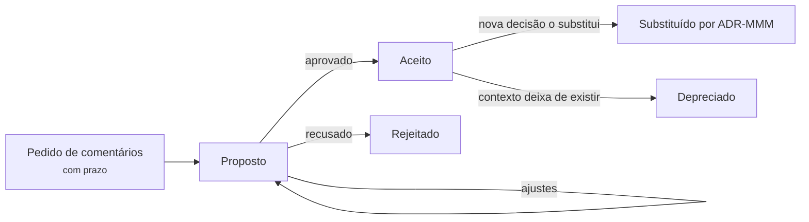

# Apêndice B - Registro de decisão arquitetural (ADR)

## Objetivos

Ao final deste apêndice, o leitor deverá ser capaz de:

- Explicar a concepção da arquitetura como conjunto de decisões e o problema da evaporação do
  conhecimento arquitetural.
- Descrever o modelo de ADR de Nygard e a extensão de Richards e Ford, justificando cada seção.
- Comparar o modelo do livro com variantes conhecidas: o modelo de Tyree e Akerman, o MADR e as
  declarações em Y.
- Conduzir um ADR ao longo de seu ciclo de vida, com os *status* adequados.
- Escrever a seção de conformidade de um ADR e ligá-la a uma função de aptidão.
- Decidir onde guardar os ADRs e como revisá-los.
- Reconhecer antipadrões de decisão e de registro.
- Ler criticamente os ADRs reconstruídos neste livro e escrever novos ADRs a partir do modelo em
  branco.

## Introdução

Um diagrama mostra como um sistema é; raramente mostra por que ele é assim. Quem examina a Figura
4.2.1 vê que o Mastodon tem um servidor de *streaming* separado, escrito em outra linguagem, mas não
vê as razões nem as alternativas descartadas. Richards e Ford (2020, p. 289) formulam a questão como
um princípio: compreender por que uma decisão foi tomada é muito mais importante do que compreender
como algo funciona, porque o "como" pode ser redescoberto lendo diagramas e código, e o "porquê", não.
O exemplo dos autores é o de uma equipe que, anos depois, substitui por mensageria uma comunicação
gRPC entre dois serviços para reduzir o acoplamento e provoca *timeouts* em cascata, porque ninguém
registrara que o gRPC fora escolhido justamente para reduzir a latência.

O **registro de decisão arquitetural** (*Architecture Decision Record*, ADR) é a prática leve que se
difundiu para preservar esse "porquê". Um ADR é um texto curto, de uma ou duas páginas, que registra
uma única decisão com seu contexto, a decisão tomada e suas consequências (NYGARD, 2011). A Seção 1.10
apresentou a ideia, e a Seção D.7 tratou das decisões, de sua significância e de seus antipadrões.
Este apêndice é a referência do formato. A Seção B.1 retoma a concepção da arquitetura como conjunto
de decisões. A Seção B.2 apresenta o modelo original de Nygard, e a Seção B.3, a extensão de Richards
e Ford. A Seção B.4 compara variantes. As Seções B.5 a B.7 tratam do ciclo de vida, da conformidade e
da guarda dos registros. A Seção B.8 cataloga antipadrões, a Seção B.9 examina os ADRs reconstruídos
no livro, e a Seção B.10 traz o modelo em branco.

## B.1 Arquitetura como decisões

### B.1.1 Da justificativa à decisão

A ideia de que a justificativa faz parte da arquitetura é antiga. Perry e Wolf (1992) já incluíam a
**justificativa** (*rationale*) entre os três constituintes de uma arquitetura, ao lado dos elementos
e da forma (Seção 1.1.1). Durante a década seguinte, porém, a pesquisa e a prática concentraram-se nas
estruturas e em sua documentação, e a justificativa ficou relegada a seções opcionais de documentos
extensos. A virada ocorreu em meados dos anos 2000, quando vários autores, de modo quase simultâneo,
passaram a tratar as **decisões** como objeto de primeira classe.

Jansen e Bosch (2005) propuseram ver a arquitetura de software como uma composição de decisões de
projeto arquitetural. Para os autores, uma decisão descreve as adições, remoções e modificações feitas
na arquitetura, a justificativa e as regras, restrições e requisitos adicionais que dela decorrem. O
diagnóstico que motivou a proposta é o da **evaporação do conhecimento**: as decisões ficam implícitas
nas estruturas resultantes, e as razões, as alternativas e as premissas perdem-se à medida que as
pessoas deixam o projeto. Os efeitos são conhecidos: mudanças caras, porque a equipe não sabe que
regras uma estrutura deve respeitar; erosão, porque decisões são violadas sem que se perceba; e pouca
reutilização do raciocínio.

Kruchten (2004) contribuiu com uma ontologia das decisões. Ele distinguiu as **decisões de
existência**, que afirmam que um elemento ou comportamento existirá no sistema, e seu caso negativo,
as **decisões de proibição**, que afirmam que algo não existirá; as **decisões de propriedade**, que
enunciam uma qualidade ou restrição geral, como uma regra de projeto; e as **decisões executivas**,
ditadas pelo ambiente de negócio, pela organização ou pela tecnologia, como a escolha de uma
plataforma ou de um processo. Kruchten propôs também atributos para cada decisão, entre eles a
justificativa, o escopo, o autor e um estado, que podia passar por ideia, tentativa, decidida,
aprovada, contestada, rejeitada e obsoleta. A taxonomia é útil para ler os ADRs deste livro: o ADR-PX4-001
(Seção 4.8.5), "módulos não chamam funções uns dos outros", é uma decisão de proibição; o ADR-003 do
Saleor (Seção 4.6.6), "um único banco relacional para o núcleo", é uma decisão de existência.

### B.1.2 Tyree e Akerman: decisões como documentação

Tyree e Akerman (2005), em artigo de título programático, *Architecture decisions: demystifying
architecture*, defenderam que documentar explicitamente as decisões é a forma mais eficaz de tornar a
arquitetura compreensível e de ligá-la aos requisitos. Os autores propuseram um modelo detalhado, com
campos para a **questão** a decidir, a **decisão**, o *status*, o **grupo** a que a decisão pertence,
as **premissas**, as **restrições**, as **posições** consideradas, o **argumento** que leva à escolha,
as **implicações**, as decisões, os requisitos, os artefatos e os princípios **relacionados**, e
**notas**. O modelo é mais rico que os posteriores e explicita relações entre decisões, algo que os
modelos leves deixam implícito. Seu custo de preenchimento, porém, é maior, o que ajuda a entender
por que a prática só se difundiu com formatos mais curtos.

### B.1.3 O que merece registro

Nem toda decisão é arquitetural. Nygard (2011) propôs registrar as decisões **arquiteturalmente
significativas**, isto é, as que afetam a estrutura, as características não funcionais, as
dependências, as interfaces ou as técnicas de construção. Richards e Ford (2020, p. 284) acrescentam
que o envolvimento de uma tecnologia não torna uma decisão meramente técnica: se a tecnologia é
escolhida porque sustenta uma característica arquitetural, a decisão é arquitetural. O SWEBOK v4
observa que o projeto arquitetural produz uma **rede de decisões**, algumas derivadas de outras, e que
cada decisão não trivial deve ser documentada com sua justificativa: premissas, alternativas
consideradas e critérios de escolha (WASHIZAKI, 2024, cap. 2, seção 2.4). O guia acrescenta que
registrar decisões rejeitadas pode evitar que uma má escolha, descartada por razões esquecidas, seja
repetida, ou mostrar que as condições mudaram e que a decisão pode ser revista. A Seção D.7.2
aprofunda o critério de significância.

## B.2 O modelo de Nygard

Nygard (2011) partiu de uma observação sobre projetos ágeis. Uma pessoa que chega a um projeto
encontra decisões passadas que a deixam perplexa e, sem conhecer sua motivação e suas consequências,
tem apenas duas opções: aceitá-las cegamente ou alterá-las cegamente. A primeira paralisa a
evolução; a segunda arrisca desfazer algo que tinha boas razões. Documentos extensos não resolvem o
problema, porque raramente são lidos e quase nunca são atualizados. A proposta foi manter, junto ao
código, uma coleção de registros curtos, cada um descrevendo um conjunto de forças e uma única decisão
tomada em resposta a elas, num formato que o autor aproximou dos padrões de Alexander.

O formato de Nygard tem cinco partes. O **título** é uma frase nominal curta, e os registros são
numerados sequencialmente, sem reutilização de números. O **contexto** descreve as forças em jogo,
tecnológicas, políticas, sociais e do projeto, numa linguagem neutra quanto a valores, isto é, sem
argumentar a favor da decisão. A **decisão** descreve a resposta a essas forças em voz ativa e
afirmativa: "Vamos...". O ***status*** indica se a decisão está proposta, aceita, depreciada ou
substituída. As **consequências** descrevem o contexto resultante, depois de aplicada a decisão, e
devem incluir todas as consequências, e não apenas as positivas. O autor recomenda escrever cada
registro como se fosse uma conversa com um desenvolvedor futuro, em linguagem simples e com frases
completas, e guardá-los no repositório do projeto, em arquivos de texto em formato leve como o
Markdown. Quando uma decisão é revertida, o registro antigo é mantido e marcado como substituído
(NYGARD, 2011).

Três escolhas do modelo explicam sua difusão. A primeira é a **unidade**: uma decisão por registro, o
que torna cada registro curto, citável e substituível. A segunda é a **imutabilidade**: registros
aceitos não são reescritos, o que transforma a coleção num histórico do raciocínio, e não num
documento que tenta descrever o presente. A terceira é a **proximidade do código**: no repositório,
o registro é versionado, revisado e encontrado com as mesmas ferramentas que o código. Richards e Ford
(2020, p. 285) registram que a prática foi divulgada inicialmente por Nygard num texto de *blog* e
depois classificada como "adotar" no *Technology Radar* da ThoughtWorks.

## B.3 A extensão de Richards e Ford

Richards e Ford (2020, p. 285) mantêm as cinco seções de Nygard e acrescentam duas, **conformidade** e
**notas**, admitindo ainda uma seção de **alternativas** quando a análise das opções precisar de
detalhe, desde que o modelo continue consistente e conciso. O modelo deste livro adota as oito
seções. A seguir, cada uma é comentada à luz da fonte.

**Título.** Numerado sequencialmente, com uma frase curta, descritiva o bastante para não deixar
ambiguidade sobre a natureza e o contexto da decisão, como "42. Uso de mensageria assíncrona entre os
serviços de pedidos e de pagamentos" (RICHARDS; FORD, 2020, p. 286).

***Status*.** Proposto, aceito ou substituído. **Proposto** significa que a decisão precisa ser
aprovada por alguém de nível superior ou por um órgão de governança, como um comitê de revisão de
arquitetura. **Substituído** pressupõe que a decisão anterior estava aceita: um ADR proposto nunca é
substituído, mas modificado até ser aceito (RICHARDS; FORD, 2020, p. 286). Os autores sugerem ainda um
*status* de **pedido de comentários** (*Request for Comments*), com prazo, para submeter um rascunho a
um público amplo sem cair na paralisia por análise (RICHARDS; FORD, 2020, p. 287). O *status* tem um
efeito organizacional: obriga o arquiteto a combinar com sua chefia os critérios sob os quais pode
aprovar sozinho uma decisão. Custo, impacto sobre outras equipes e implicações de segurança são os três
critérios iniciais sugeridos; uma decisão que exceda o limite de custo combinado, afete outras equipes
ou tenha implicação de segurança não pode ser aprovada pelo próprio autor (RICHARDS; FORD, 2020, p.
287-288).

**Contexto.** Responde à pergunta "que situação me obriga a tomar esta decisão?" e descreve
concisamente as alternativas possíveis. Ao descrever o contexto, o arquiteto também documenta a
arquitetura daquela área do sistema (RICHARDS; FORD, 2020, p. 288).

**Decisão.** Enunciada em voz afirmativa e imperativa, à maneira de Nygard: "vamos usar mensageria
assíncrona entre os serviços", e não "acho que mensageria seria a melhor escolha", formulação que não
deixa claro se houve decisão. A seção deve conter a justificativa completa, com ênfase no porquê
(RICHARDS; FORD, 2020, p. 288-289).

**Consequências.** Documentam o impacto global, bom e ruim, e obrigam o autor a pesar se os
benefícios superam os custos. São também o lugar da análise de *trade-off*. No exemplo dos autores,
publicar avaliações de um site por mensageria assíncrona reduziria o tempo de resposta de 3.100 ms
para 25 ms, ao custo de um tratamento de erros mais complexo; registrar que esse compromisso foi
discutido com o negócio e aceito evita que a decisão seja contestada por quem desconhece a discussão
(RICHARDS; FORD, 2020, p. 289-290).

**Conformidade.** Não faz parte do modelo original, mas os autores a recomendam enfaticamente. A seção
obriga o arquiteto a pensar em como a decisão será medida e governada, decidindo se a verificação
será manual ou automatizada por uma função de aptidão e, neste caso, como a função será escrita, onde
ficará, quando será executada e que mudanças no código ela exige (RICHARDS; FORD, 2020, p. 290-291). A
Seção B.6 desenvolve o tema.

**Notas.** Também ausente do modelo original, reúne metadados: autor, data e responsável pela
aprovação, data de substituição, data e autor da última modificação. Os autores recomendam a seção
mesmo quando os ADRs estão no Git, porque parte dessa informação não é capturada pelo repositório
(RICHARDS; FORD, 2020, p. 291).

**Alternativas.** O modelo do livro torna explícita essa seção opcional. Argumenta-se aqui que ela é a
principal defesa contra o antipadrão *Groundhog Day* (Seção D.7.1): sem a lista do que foi descartado,
e por quê, a pergunta "e se usássemos X?" volta a cada reunião.

Richards e Ford (2020, p. 293) dão ainda dois usos aos ADRs além do registro. O primeiro é servir
como **documentação de arquitetura**: na ausência de um padrão consolidado para documentar
arquiteturas, o contexto descreve a área do sistema, a decisão diz por que ela é como é, e as
consequências registram os compromissos. O segundo é registrar **padrões** (*standards*) de equipe:
um padrão cuja justificativa não sobrevive à seção de decisão talvez não devesse existir, e um padrão
cuja razão é conhecida tende a ser mais respeitado.

## B.4 Variantes conhecidas

O formato de Nygard inspirou numerosas variantes. Três delas ajudam a situar o modelo deste livro.

O modelo de **Tyree e Akerman** (2005), já descrito na Seção B.1.2, é o mais completo dos três e o mais
antigo. Seus campos de premissas, restrições e decisões relacionadas fazem dele um bom ponto de
partida para organizações reguladas, em que a rastreabilidade entre decisões e requisitos é
exigida.

O **MADR**, sigla de *Markdown Architectural Decision Records* (na versão 3, *Markdown Any Decision
Records*), é um modelo mantido por uma comunidade dedicada aos registros de decisão (ADR
GITHUB ORGANIZATION, 2026). Ele organiza o registro em metadados (*status*, data, responsáveis pela
decisão, pessoas consultadas e informadas), **contexto e enunciado do problema**, **fatores de
decisão** (*decision drivers*), **opções consideradas**, **resultado da decisão**, com a opção escolhida
e o motivo, **consequências**, uma seção de **confirmação**, que indica como a implementação da decisão
será verificada, e **prós e contras de cada opção**. O MADR torna a análise de alternativas central, em
vez de opcional, e sua seção de confirmação desempenha papel análogo ao da conformidade de Richards e
Ford.

As **declarações em Y** (*Y-statements*), propostas por Zdun *et al.* (2013), condensam uma decisão
numa única frase estruturada: no contexto de um caso de uso ou componente, diante de uma preocupação,
decidimos pela opção escolhida e descartamos outras, para alcançar uma qualidade, aceitando uma
desvantagem. Os autores defendem registros sustentáveis, isto é, cujo custo de produção seja
proporcional ao seu valor. Uma declaração em Y é útil como resumo no topo de um ADR ou como registro
mínimo de decisões menores, que não justificam um documento próprio. O ADR-PT-02 do PeerTube (Seção
4.4.6), por exemplo, cabe numa declaração: no contexto da transcodificação de vídeos, diante da
competição por recursos com a API em servidores modestos, decidimos por *runners* remotos que pedem
tarefas por HTTP e descartamos mais *workers* locais e serviços de nuvem comerciais, para alcançar
elasticidade do processamento a custo controlado, aceitando um protocolo novo e a necessidade de
confiar em quem opera o *runner*.

A Tabela B.1 compara os modelos.

**Tabela B.1** – Seções dos modelos de registro de decisão.

| Seção | Nygard (2011) | Richards e Ford (2020) | Tyree e Akerman (2005) | MADR | Modelo do livro |
|---|---|---|---|---|---|
| Título numerado | sim | sim | questão | sim | sim |
| *Status* | sim | sim, com pedido de comentários | sim | sim | sim |
| Contexto | sim | sim | questão, premissas, restrições | contexto e problema; fatores | sim |
| Decisão | sim | sim | decisão e argumento | resultado | sim |
| Alternativas | no contexto | opcional | posições | central, com prós e contras | sim |
| Consequências | sim | sim | implicações | sim | sim |
| Verificação | não | conformidade | não | confirmação | conformidade |
| Metadados e relações | não | notas | grupo, relacionados, notas | metadados | notas |

Fonte: elaborado pelo autor (2026), com base nas obras citadas.

## B.5 Ciclo de vida e *status*

O *status* é o que transforma uma coleção de ADRs num histórico. A Figura B.1 mostra o ciclo de vida
adotado no livro, que combina os *status* de Nygard (2011) e de Richards e Ford (2020, p. 286-287).

**Figura B.1** – Ciclo de vida de um ADR.



Fonte: elaborado pelo autor (2026), com base em Nygard (2011) e Richards e Ford (2020, p. 286-287).

Quatro regras decorrem da figura. Primeira: um ADR **aceito não é editado** quanto à substância;
correções de redação são admissíveis, mas mudar a decisão exige um novo ADR. Segunda: a
**substituição é bidirecional**: o ADR antigo recebe "Substituído por ADR-68", e o novo, "Aceito;
substitui ADR-42", como no exemplo de Richards e Ford (2020, p. 287), em que a troca de mensageria por
REST entre pedidos e pagamentos fica rastreada e a pergunta "e a mensageria?" já tem resposta.
Terceira: **depreciado** difere de substituído, porque indica que a decisão deixou de valer sem que
outra tomasse seu lugar, por exemplo, quando o componente a que se referia foi removido. Quarta: o
livro acrescenta o *status* **rejeitado**, ausente das duas fontes, para propostas recusadas; a
inclusão segue a recomendação do SWEBOK v4 de registrar decisões rejeitadas e seus motivos (WASHIZAKI,
2024, cap. 2, seção 2.4).

Os ADRs reconstruídos neste livro usam um *status* adicional, implícito na expressão "aceito
(reconstruído)". Trata-se de uma convenção de honestidade, e não de uma etapa do ciclo: indica que o
registro foi inferido do código e da documentação pelo autor, e não escrito pelos mantenedores no
momento da decisão. O ADR-002 do Saleor (Seção 4.6.6) usa ainda "em implantação", porque o mecanismo
antigo de *plug-ins* está marcado como obsoleto mas não foi removido, situação intermediária que os
modelos canônicos não preveem.

## B.6 Conformidade e funções de aptidão

Uma decisão registrada e não verificada tende a ser violada gradualmente, por esquecimento ou por
pressão de prazo. Ford, Parsons e Kua (2017) chamam de **função de aptidão** (*fitness function*)
qualquer mecanismo que forneça uma avaliação objetiva de uma característica arquitetural, como um
teste automatizado de dependências, uma métrica monitorada ou uma verificação no *pipeline* de
entrega. A seção de conformidade é o elo entre o ADR e essas funções: ela diz que função protege a
decisão ou, se a verificação for manual, quem a fará e quando.

Richards e Ford (2020, p. 290-291) ilustram com uma decisão numa arquitetura em camadas: todos os
objetos compartilhados usados pela camada de negócio devem residir na camada de serviços
compartilhados. A conformidade é um teste ArchUnit que verifica se as classes anotadas com uma anotação
própria residem no pacote de serviços. Os autores observam que a função exige trabalho adicional, a
criação da anotação e sua aplicação às classes, e que esse trabalho deve virar histórias no
*backlog*. A Listagem B.1 aplica a mesma ideia a uma decisão análoga ao ADR-001 do Nextcloud (Seção
4.5.7), em que *apps* só podem depender da API pública.

**Listagem B.1** – Função de aptidão citada na conformidade de um ADR (ilustrativo e simplificado).

```java
import com.tngtech.archunit.junit.AnalyzeClasses;
import com.tngtech.archunit.junit.ArchTest;
import com.tngtech.archunit.lang.ArchRule;

import static com.tngtech.archunit.lang.syntax.ArchRuleDefinition.noClasses;

// Protege o ADR-001: "Entregar toda funcionalidade além do núcleo como app".
@AnalyzeClasses(packages = "br.edu.ifal.arquivos")
class Adr001ConformidadeTest {

    // Apps enxergam apenas a API pública; o núcleo privado é invisível para eles.
    @ArchTest
    static final ArchRule appsDependemSoDaApiPublica =
        noClasses().that().resideInAPackage("..apps..")
            .should().dependOnClassesThat().resideInAPackage("..nucleo.privado..")
            .because("ADR-001: apps dependem apenas da API pública (pacote api)");

    // O núcleo não conhece nenhum app concreto (inversão da dependência).
    @ArchTest
    static final ArchRule nucleoNaoDependeDeApps =
        noClasses().that().resideInAPackage("..nucleo..")
            .should().dependOnClassesThat().resideInAPackage("..apps..")
            .because("ADR-001: o núcleo evolui sem conhecer os apps");
}
```

Fonte: elaborado pelo autor (2026), com base em Richards e Ford (2020, p. 290-291).

Nem toda decisão admite verificação estática. Decisões sobre características operacionais pedem
funções **contínuas** ou **dinâmicas**, como a do ADR 4.7-A do ThingsBoard (Seção 4.7.4), cuja
conformidade é o monitoramento do atraso dos consumidores e um teste de caos que derruba um nó do
motor de regras e verifica a ausência de perda, ou a do ADR-PT-02 do PeerTube, que monitora *jobs*
parados e o tempo entre envio e publicação. A taxonomia das funções de aptidão está na Seção 7.4.2, e a
Tabela 7.9 associa uma função a uma decisão de cada sistema. Duas regras práticas resumem a ligação: um
ADR que afirma uma regra estrutural sem função de aptidão correspondente está incompleto; e uma função
de aptidão que não protege nenhuma decisão registrada é um teste sem justificativa, que será removido
na primeira vez em que incomodar. A cláusula `because` do ArchUnit, como na Listagem B.1, é o lugar
natural para citar o ADR, o que fecha o ciclo: a falha do teste aponta para o registro, e o registro
aponta para o teste.

## B.7 Onde guardar os ADRs

Nygard (2011) propôs guardar os registros no repositório do projeto, num diretório próprio, com um
arquivo por decisão. A ferramenta de linha de comando *adr-tools*, de Nat Pryce, automatiza a
numeração, a criação a partir de um modelo e a marcação de substituições (RICHARDS; FORD, 2020, p.
285). Guardar os ADRs junto ao código tem as vantagens já mencionadas: versionamento, revisão por *pull
request*, busca com as ferramentas do desenvolvedor e a possibilidade de que um mesmo *pull request*
altere o código e registre a decisão que motivou a alteração.

Richards e Ford (2020, p. 291-293) fazem uma ressalva para organizações grandes. Nem todos os
interessados têm acesso ao repositório, e decisões cujo contexto excede uma aplicação, como decisões
de integração ou corporativas, não têm lugar natural num repositório de aplicação. Os autores
recomendam, nesses casos, uma *wiki* ou um diretório compartilhado, organizado em três partes:
**aplicação**, com um subdiretório comum a todas as aplicações e um por aplicação; **integração**, para
decisões sobre a comunicação entre sistemas; e **corporativa**, para decisões globais, como "todo acesso
a um banco de dados só pode ser feito pelo sistema que o possui". Qualquer que seja o lugar, cada
decisão deve ter seu próprio arquivo ou página.

O livro adota o repositório, pelas razões de Nygard e porque o contexto do curso é o de projetos de
código aberto e de uma equipe pequena. A convenção é a da Listagem B.2. O índice (`README.md`) é
mantido manualmente ou gerado pela ferramenta e é o ponto de entrada recomendado para quem chega ao
projeto.

**Listagem B.2** – Organização dos ADRs no repositório do projeto final.

```text
docs/adr/
├── README.md                         # índice: número, título, status, data
├── 0001-registrar-decisoes-em-adrs.md
├── 0002-monolito-modular-com-banco-unico.md
├── 0003-mensageria-entre-pedidos-e-pagamentos.md   # Status: Substituído por 0007
├── ...
└── 0007-rest-entre-pedidos-e-pagamentos.md         # Status: Aceito; substitui 0003
```

Fonte: elaborado pelo autor (2026), com base em Nygard (2011).

O primeiro ADR de um projeto costuma registrar a própria decisão de usar ADRs, prática que a
*adr-tools* adota ao inicializar um diretório (PRYCE, 2026). Argumenta-se aqui que o costume tem uma função além da
ironia: o ADR-0001 diz onde ficam os registros, que modelo seguem, quem os aprova e que critérios de
custo, impacto e segurança exigem aprovação superior, conforme a Seção B.3.

## B.8 Antipadrões

A Seção D.7.1 apresentou os três antipadrões de **decisão** descritos por Richards e Ford (2020, p.
281-284): *Covering Your Assets*, em que o arquiteto adia a decisão por medo de errar; *Groundhog Day*,
em que a decisão é rediscutida indefinidamente porque ninguém sabe por que foi tomada; e
*Email-Driven Architecture*, em que a decisão se perde em mensagens. Os ADRs são o remédio para os dois
últimos. Há, porém, antipadrões do próprio **registro**, que esvaziam os ADRs mesmo quando existem. Os
seis a seguir são uma sistematização do autor a partir da prática de revisão no curso, e não um
catálogo da literatura.

**O ADR justificativa.** Escrito depois da implementação, apenas para cumprir uma exigência, com um
contexto montado para levar à decisão já tomada. Distingue-se de uma reconstrução honesta, como as
deste livro, por não declarar que é retrospectivo e por omitir as alternativas que teriam sido
razoáveis.

**O ADR sem alternativas.** Registra a decisão e as consequências, mas não o que foi descartado. É a
porta de entrada do *Groundhog Day*. A Tabela B.2 mostra que muitos ADRs reconstruídos do livro têm esse
defeito, o que é compreensível em reconstruções, em que as alternativas nem sempre podem ser
conhecidas, mas não em registros escritos no momento da decisão.

**O ADR sem custo.** Lista apenas consequências positivas. Nygard (2011) é explícito ao exigir todas as
consequências; uma decisão sem desvantagens provavelmente não foi analisada.

**O ADR sem conformidade.** Afirma uma regra estrutural, como "o núcleo não depende dos *apps*", sem
indicar como ela será verificada. A regra dura até o primeiro prazo apertado.

**O ADR reescrito.** Um ADR aceito tem a decisão alterada no lugar, em vez de ser substituído. O
histórico do raciocínio, que era o objetivo do registro, é destruído.

**O ADR romance.** Um documento de dez páginas com várias decisões entrelaçadas. Não é citável, não é
substituível por partes e não é lido. Se o texto precisa de subtítulos, provavelmente há mais de uma
decisão.

Um último cuidado diz respeito à justificativa de negócio. Richards e Ford (2020, p. 282-283)
lembram que toda decisão precisa de justificativa técnica e de negócio, como custo, tempo de chegada ao
mercado, satisfação do usuário ou posicionamento estratégico. Um ADR que só tem razões técnicas é
vulnerável à pergunta "por que a empresa deveria pagar por isso?", e a seção de notas ou de contexto é o
lugar para respondê-la.

## B.9 ADRs reconstruídos no livro

Nenhum dos sete sistemas estudados publica, para as decisões discutidas, registros no formato de ADR;
os Capítulos 4 e 5 o declaram explicitamente para o Mastodon (Seção 4.2.6), o Mattermost (Seção
4.3.8), o PeerTube (Seção 4.4.6) e o Nextcloud (Seção 4.5.7). As decisões foram, por isso,
**reconstruídas** pelo autor a partir do código, da documentação e do histórico de versões, segundo
o roteiro de exploração do Apêndice C. A Tabela B.2 lista os registros e indica quais seções do
modelo cada um preenche.

**Tabela B.2** – ADRs reconstruídos nos Capítulos 4 e 5.

| Sistema | ADR | Decisão | Seção | Alternativas | Conformidade |
|---|---|---|---|---|---|
| Mastodon | ADR-M1 | Monólito Rails com processamento assíncrono em Sidekiq | 4.2.6 | não | não |
| Mastodon | ADR-M2 | Servidor de *streaming* em processo Node.js separado | 4.2.6 | não | não |
| Mastodon | ADR-M3 | Redis como armazenamento derivado e multifuncional | 4.2.6 | não | não |
| Mastodon | ADR-M4 | *Fanout* às *timelines* na escrita, de forma assíncrona | 5.2.8 | não | não |
| Mattermost | ADR-MM-01 | *Plugins* de servidor em processos separados | 4.3.8 | sim | sim |
| PeerTube | ADR-PT-01 | Fila de *jobs* entre publicação e processamento | 4.4.6 | não | não |
| PeerTube | ADR-PT-02 | *Runners* remotos de transcodificação | 4.4.6 | sim | sim |
| PeerTube | ADR-PT-03 | P2P apenas sobre HLS | 4.4.6 | não | não |
| Nextcloud | ADR-001 | Toda funcionalidade além do núcleo é um *app* | 4.5.7 | sim | sim |
| Nextcloud | ADR-002 | Redis como provedor de *locks* transacionais | 4.5.7 | sim | não |
| Nextcloud | ADR-003 | WebDAV como protocolo de sincronização | 4.5.7 | sim | não |
| Saleor | ADR-001 | A loja é um cliente da API GraphQL | 4.6.6 | não | sim |
| Saleor | ADR-002 | Extensões como *apps* externas | 4.6.6 | não | não |
| Saleor | ADR-003 | Um único banco relacional para o núcleo | 4.6.6 | não | não |
| ThingsBoard | ADR 4.7-A | Fila durável entre transportes e motor de regras | 4.7.4 | sim | sim |
| ThingsBoard | ADR 4.7-B | Uma base de código, duas topologias | 4.7.5 | não | não |
| ThingsBoard | ADR 4.7-C | Telemetria em banco de séries temporais separado | 4.7.6 | sim | não |
| PX4 | ADR-PX4-001 | Módulos comunicam-se apenas por tópicos uORB | 4.8.5 | não | sim |
| PX4 | ADR-PX4-002 | Modos críticos executam apenas no controlador de voo | 4.8.3 | não | não |

Fonte: elaborado pelo autor (2026), a partir dos Capítulos 4 e 5.

A tabela permite três observações. A primeira é que os registros variam em completude: o ADR-MM-01, o
ADR-PT-02, o ADR-001 do Nextcloud e o ADR 4.7-A preenchem todas as seções e servem de modelo; os
demais omitem alternativas, conformidade ou ambas. A omissão é, em parte, inerente à reconstrução,
porque as alternativas efetivamente consideradas pelos mantenedores raramente estão documentadas, e
as que aparecem nos registros, quando aparecem, são inferências do autor, assinaladas como tais, como
faz a Seção 4.4.6 a propósito da alternativa (c) do ADR-PT-02. A segunda observação é que a ausência
de conformidade nos ADRs do Capítulo 4 é suprida, em parte, no Capítulo 7: a Tabela 7.9 propõe uma
função de aptidão para a decisão principal de cada sistema. A terceira é que as decisões
reconstruídas alimentam a subida de verificação do Capítulo 6, em que trechos de código são
associados à decisão que concretizam, como o `DistributionWorker.perform_async` do Mastodon,
associado ao ADR-M1 e ao ADR-M4 na Seção 6.2.9, e a interface `API` dos *plugins* do Mattermost,
associada ao ADR-MM-01 na Seção 6.3.11.

A reconstrução de decisões é, ela própria, uma técnica de arquitetura com regras éticas. O registro
reconstruído deve declarar que é reconstruído; os fatos devem ter fonte verificável (*tag*, arquivo,
documentação, *changelog*); as inferências devem ser assinaladas como tais; e o resultado não deve
ser apresentado como posição oficial do projeto. As reconstruções deste livro seguem essas regras, e o
exercício 8 pede que o leitor as aplique a um oitavo sistema.

## B.10 Modelo em branco

A Listagem B.3 é o modelo adotado no livro. As instruções entre os sinais `<` e `>` devem ser
substituídas; as seções marcadas como opcionais podem ser omitidas apenas quando não se aplicarem,
nunca por falta de análise.

**Listagem B.3** – Modelo de ADR adotado no livro.

```markdown
# ADR-NNNN: <título curto: a decisão, não o problema>

**Status:** Pedido de comentários (prazo AAAA-MM-DD) | Proposto | Aceito |
            Rejeitado | Depreciado | Substituído por ADR-MMMM
**Data:** AAAA-MM-DD
**Resumo (declaração em Y, opcional):** No contexto de <...>, diante de <...>,
decidimos por <...> e descartamos <...>, para alcançar <...>, aceitando <...>.

## Contexto
Que situação obriga a decidir? Forças em jogo, em linguagem neutra:
requisitos, características prioritárias (Top-3), restrições técnicas,
de prazo, de equipe, legais. Indique o ponto do sistema (altitude e
elemento C4) a que a decisão se refere.

## Decisão
Em voz ativa e afirmativa: "Vamos ...". Inclua a justificativa técnica
e a justificativa de negócio.

## Alternativas consideradas
Para cada uma: o que é e por que não foi escolhida.

## Consequências
Positivas e negativas. Que trade-off está sendo aceito? O que fica mais
fácil e o que fica mais difícil? Que dívida técnica se contrai, e em que
condição deve ser paga?

## Conformidade
Como a decisão será verificada: função de aptidão (onde está, quando
roda) ou verificação manual (quem, quando). Indique o trabalho necessário
para tornar a verificação possível.

## Notas
Autor; aprovado por e em; ADRs relacionados (substitui, é substituído
por, depende de); links para discussões; última modificação.
```

Fonte: elaborado pelo autor (2026), adaptado de Nygard (2011), Richards e Ford (2020, p. 285-291) e
Zdun *et al.* (2013).

Duas orientações completam o modelo. A primeira é escrever o ADR **quando a decisão é tomada**, no
último momento responsável (Seção D.7.1), e não depois da implementação; um ADR proposto pode, e
deve, circular antes de a decisão ser aceita. A segunda é manter o registro **curto**: se o contexto
exige mais de meia página, é provável que ele esteja descrevendo a arquitetura inteira, e não as forças
que pesam sobre esta decisão. A Listagem D.3, no Apêndice D, mostra um ADR completo escrito com este
modelo para o *kata* Silicon Sandwiches.

## Síntese do apêndice

A concepção da arquitetura como conjunto de decisões, formulada por Jansen e Bosch (2005), Kruchten
(2004) e Tyree e Akerman (2005), deslocou o foco da documentação das estruturas para as razões que as
justificam. O ADR de Nygard (2011) tornou essa concepção praticável: um registro curto por decisão,
imutável depois de aceito e guardado junto ao código. Richards e Ford (2020) estenderam o modelo com
conformidade e notas e explicitaram o papel do *status* na governança, ao exigir critérios combinados
de aprovação. Variantes como o MADR e as declarações em Y mostram que o formato admite mais ou menos
detalhe, desde que preserve contexto, decisão, alternativas e consequências.

O ciclo de vida, com substituição em vez de edição, transforma a coleção de ADRs num histórico do
raciocínio arquitetural, e a seção de conformidade liga cada decisão a uma função de aptidão,
fechando o ciclo entre o que se decidiu e o que se verifica. Os ADRs reconstruídos neste livro
mostram tanto o valor quanto os limites da reconstrução: eles tornam explícitas decisões que os
projetos não documentaram, mas raramente podem recuperar as alternativas efetivamente consideradas, o
que reforça o argumento central do apêndice, o de que o melhor momento para registrar uma decisão é
aquele em que ela é tomada.

## Exercícios

1. Explique o fenômeno da evaporação do conhecimento arquitetural e dê um exemplo, real ou
   hipotético, de mudança mal feita por desconhecimento de uma decisão.
2. Classifique segundo a ontologia de Kruchten (2004) os ADRs ADR-M2, ADR-PT-03, ADR-002 do Nextcloud e
   ADR-PX4-002.
3. Reescreva o ADR-M1 (Seção 4.2.6) acrescentando alternativas consideradas e uma seção de
   conformidade. Assinale o que é inferência sua.
4. Escreva a declaração em Y de três ADRs da Tabela B.2.
5. Converta o ADR-MM-01 para o formato MADR. Que informação o MADR obriga a explicitar que o modelo do
   livro deixa implícita?
6. Proponha critérios de aprovação, no espírito de Richards e Ford (2020, p. 287-288), para os ADRs do
   projeto final da disciplina.
7. Escreva um ADR que **substitua** o ADR-003 do Saleor, supondo que o volume de escrita cresceu cem
   vezes, e atualize o *status* do ADR original.
8. Escolha um sistema de código aberto fora do livro e reconstrua uma decisão arquitetural, seguindo as
   regras éticas da Seção B.9.
9. Escreva, em Java 17 com ArchUnit, a função de aptidão para o ADR-PX4-001 numa versão didática do
   PX4, citando o ADR na cláusula `because`.
10. Identifique, num ADR escrito por um colega, a presença de algum antipadrão da Seção B.8 e proponha
    a correção.

## Glossário do apêndice

`ADR`
:   Registro de decisão arquitetural: documento curto que descreve uma única decisão, com contexto,
    decisão, *status* e consequências.

`Decisão arquiteturalmente significativa`
:   Decisão que afeta a estrutura, as características não funcionais, as dependências, as interfaces
    ou as técnicas de construção de um sistema.

`Evaporação do conhecimento arquitetural`
:   Perda das razões, alternativas e premissas de uma decisão quando apenas suas estruturas
    resultantes são documentadas.

`Conformidade`
:   Seção do ADR que indica como a decisão será verificada, de forma manual ou por função de
    aptidão.

`Substituição`
:   Mudança de *status* de um ADR aceito, que deixa de valer em favor de outro ADR, preservando-se
    ambos os registros.

`Declaração em Y`
:   Forma condensada de registrar uma decisão numa frase com contexto, preocupação, opção escolhida,
    opções descartadas, qualidade buscada e desvantagem aceita.

`ADR reconstruído`
:   Registro inferido retrospectivamente do código e da documentação de um sistema, declarado como
    tal.

## Referências

ADR GITHUB ORGANIZATION. **MADR**: Markdown Architectural Decision Records. 2026. Disponível em:
<https://adr.github.io/madr/>. Acesso em: 18 out. 2026.

FORD, N.; PARSONS, R.; KUA, P. **Building evolutionary architectures**: support constant
change. Sebastopol: O'Reilly, 2017.

JANSEN, A.; BOSCH, J. Software architecture as a set of architectural design decisions. *In*:
WORKING IEEE/IFIP CONFERENCE ON SOFTWARE ARCHITECTURE (WICSA), 5., 2005, Pittsburgh.
**Proceedings** [...]. Los Alamitos: IEEE, 2005. p. 109-120.

KRUCHTEN, P. An ontology of architectural design decisions in software-intensive systems. *In*:
GRONINGEN WORKSHOP ON SOFTWARE VARIABILITY, 2., 2004, Groningen. **Proceedings** [...]. [S. l.: s.
n.], 2004. p. 54-61.

NYGARD, M. **Documenting architecture decisions**. 2011. Disponível em:
<https://cognitect.com/blog/2011/11/15/documenting-architecture-decisions>. Acesso em:
18 out. 2026.

PERRY, D. E.; WOLF, A. L. Foundations for the study of software architecture. **ACM SIGSOFT
Software Engineering Notes**, v. 17, n. 4, p. 40-52, 1992.

PRYCE, N. **adr-tools**: command-line tools for working with architecture decision records.
GitHub, 2026. Disponível em: <https://github.com/npryce/adr-tools>. Acesso em: 18 out. 2026.

RICHARDS, M.; FORD, N. **Fundamentals of software architecture**: an engineering approach.
Sebastopol: O'Reilly, 2020.

TYREE, J.; AKERMAN, A. Architecture decisions: demystifying architecture. **IEEE Software**, v. 22,
n. 2, p. 19-27, 2005.

WASHIZAKI, H. (ed.). **Guide to the software engineering body of knowledge (SWEBOK Guide)**:
version 4.0. Los Alamitos: IEEE Computer Society, 2024.

ZDUN, U. *et al.* Sustainable architectural design decisions. **IEEE Software**, v. 30, n. 6,
p. 46-53, 2013.

## Material complementar

!!! todo "Para desenvolver"
    Vídeo curto sobre o ciclo de vida de um ADR, com a substituição do ADR 42 pelo ADR 68 de Richards
    e Ford, e um interativo que gera o esqueleto de um ADR a partir de uma declaração em Y.
