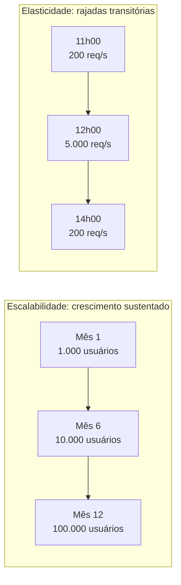
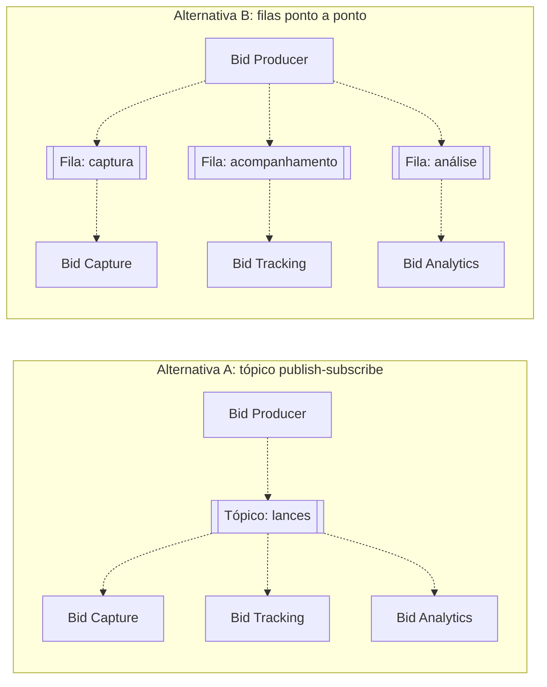
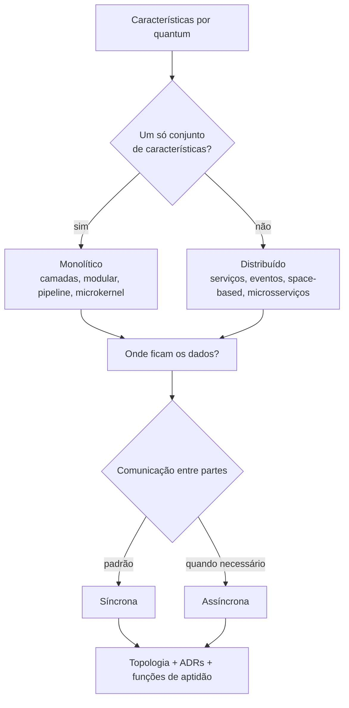
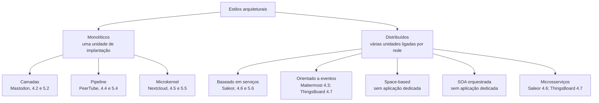
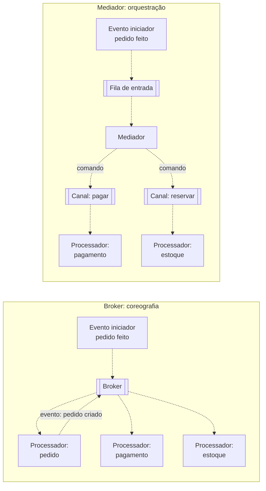
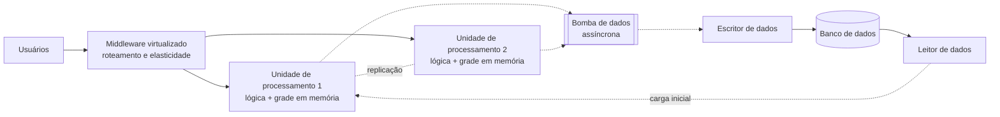
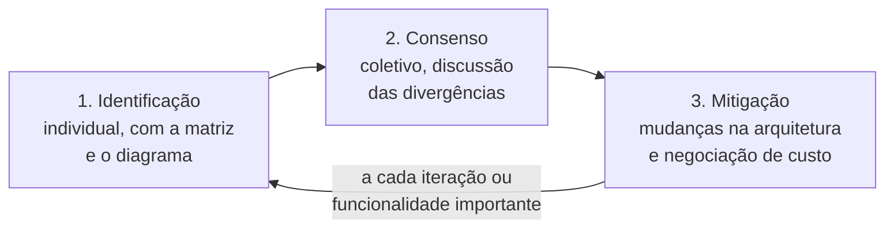

# Apêndice D - Características arquiteturais, estilos e decisões

## Objetivos

Ao final deste apêndice, o leitor deverá ser capaz de:

- Definir **característica arquitetural** pelos três critérios de Richards e Ford e comparar as
  taxonomias de Richards e Ford, da ISO/IEC 25010:2023 e do *Microsoft Application Architecture
  Guide*.
- Distinguir características **explícitas** e **implícitas**, traduzir preocupações de negócio
  em características e escolher as **três mais importantes** de um sistema.
- Diferenciar **escalabilidade** de **elasticidade**.
- Tornar uma característica mensurável por **cenários de qualidade**, **táticas** e objetivos de
  nível de serviço (SLO/SLA), calculando "noves" de disponibilidade.
- Analisar e comunicar um *trade-off* arquitetural.
- Explicar o **quantum arquitetural** e usá-lo para decidir entre arquitetura monolítica e
  distribuída.
- Descrever topologia, usos e perfil de características dos oito estilos do catálogo de
  Richards e Ford.
- Reconhecer as **oito falácias da computação distribuída**.
- Identificar decisões arquiteturalmente significativas, evitar os antipadrões de decisão e
  registrar decisões em **ADRs**.
- Qualificar riscos com a **matriz impacto × probabilidade** e conduzir um ***risk storming***.

## Introdução

Este apêndice aprofunda os conceitos que sustentam a análise nas duas altitudes mais elevadas.
O Capítulo 1 apresentou a arquitetura de software como um conjunto de estruturas,
características, decisões e princípios (Seção 1.1.1), e a análise de sistemas como uma descida
em quatro altitudes (Seção 1.11). O Capítulo 3 usa características e cenários de qualidade para
examinar os sete sistemas a 100.000 pés, e o Capítulo 4 usa estilos, quanta e ADRs para examiná-los
a 50.000 pés; aqui, esses instrumentos são tratados em profundidade, independentemente dos casos. A <span class="altitude a100">100.000 pés</span>, o sistema é
uma única caixa cercada por usuários, organizações e outros sistemas, e a pergunta central é
quais propriedades não podem falhar. A <span class="altitude a50">50.000 pés</span>, o sistema
aparece decomposto em unidades de implantação e de dados, e as perguntas passam a ser se ele deve
ser monolítico ou distribuído, como suas partes se comunicam e onde residem os dados.

Essas altitudes concentram as decisões mais caras de reverter. Por isso, seus instrumentos não
são diagramas, mas critérios de raciocínio: o que é uma característica arquitetural e como
medi-la, como explicitar um compromisso, em que unidade as características se aplicam, que
estilos favorecem quais características, que armadilhas a distribuição introduz, como registrar
uma decisão e como qualificar seu risco. A Seção D.1 define e classifica as características e
mostra como extraí-las do negócio. A Seção D.2 trata de sua medição e governança. A Seção D.3
examina os *trade-offs*, e a Seção D.4, o quantum arquitetural. A Seção D.5 apresenta o
catálogo de estilos, e a Seção D.6, as falácias da computação distribuída. As Seções D.7 e D.8
tratam das decisões e do risco.

Como fio condutor, o apêndice adota o *kata* arquitetural **Silicon Sandwiches** (RICHARDS;
FORD, 2020, p. 69). Um *kata*, termo das artes marciais japonesas, é um exercício de treino em que
importa a forma correta. Os *katas* arquiteturais foram concebidos por Ted Neward para que
arquitetos iniciantes praticassem a derivação de características a partir de descrições de
domínio, já que um profissional raramente projeta mais de meia dúzia de sistemas na carreira
(RICHARDS; FORD, 2020, p. 68). Cada *kata* traz descrição, usuários, requisitos e um contexto
adicional com informações que não costumam aparecer em requisitos, mas afetam o projeto.

## D.1 Características arquiteturais

### D.1.1 Da "não funcionalidade" às características

A literatura usa vários nomes para as propriedades de um sistema que não correspondem a uma
funcionalidade específica: **requisitos não funcionais**, **atributos de qualidade**, ***-ilities***
e **características arquiteturais**. Richards e Ford (2020, p. 55-56) rejeitam as duas primeiras
expressões. "Não funcional" seria autodepreciativo: é difícil convencer uma equipe a dar atenção
a algo definido pela negação. "Atributo de qualidade" sugeriria uma avaliação posterior à
construção, e não um insumo do projeto. Este livro adota **característica arquitetural**, sem
deixar de reconhecer que Bass, Clements e Kazman (2021), a ISO/IEC 25010 e o SWEBOK usam
"atributo de qualidade" no mesmo sentido.

A divergência terminológica esconde uma questão de fundo: nem toda propriedade desejável é
arquitetural. Todo sistema deveria ser seguro, rápido e fácil de manter, mas isso não significa
que essas propriedades devam orientar a estrutura de todo sistema. Richards e Ford (2020, p.
56-57) propõem três critérios que devem ser satisfeitos simultaneamente.

!!! note "Definição D.1 – Característica arquitetural"
    Uma **característica arquitetural** é uma propriedade do sistema que (i) especifica uma
    consideração de projeto que não pertence ao domínio, (ii) influencia algum aspecto
    estrutural do projeto e (iii) é crítica ou importante para o sucesso da aplicação
    (RICHARDS; FORD, 2020, p. 56).

O primeiro critério separa as características dos requisitos funcionais: os requisitos dizem o
que o sistema faz; as características, **como** os requisitos serão atendidos. Nenhum documento
de requisitos pede para "evitar dívida técnica", e, no entanto, essa é uma preocupação constante
de quem projeta (RICHARDS; FORD, 2020, p. 56). O segundo critério é o mais discriminante: uma
propriedade só se torna arquitetural quando exige **estrutura especial**. Se o sistema delega
pagamentos a um provedor externo, a segurança é atendida pela higiene habitual, como criptografia
em trânsito e nenhum número de cartão em texto claro. Se o próprio sistema processa pagamentos, o
arquiteto pode isolar essa função em um módulo ou serviço próprio para conter estruturalmente o
risco; só então a segurança é, em sentido estrito, característica arquitetural daquele sistema
(RICHARDS; FORD, 2020, p. 57). O terceiro critério impõe economia: cada característica suportada
acrescenta complexidade, e a tarefa do arquiteto é escolher **o menor número possível** delas
(RICHARDS; FORD, 2020, p. 57).

Os três critérios formam um sistema. Uma propriedade que não pertence ao domínio, mas não exige
estrutura, é tratada no projeto detalhado; uma que exige estrutura, mas não é crítica, deve ser
questionada; uma que é do domínio pertence aos requisitos funcionais. A leitura se articula com o
critério de Eden e Kazman (2003), visto na Seção 1.1.3: características que satisfazem os três
critérios dão origem a decisões não locais, que podem ser violadas em qualquer parte do código.

### D.1.2 Taxonomias de características

Não existe lista universal de características. Richards e Ford (2020, p. 58) afirmam que cada
organização cria sua própria interpretação dos termos e que a evolução do ecossistema faz surgir
novas características e novas formas de medi-las. Três taxonomias, contudo, circulam em
comunidades diferentes e estruturam o vocabulário dos voos.

**Richards e Ford.** Os autores agrupam as características em **operacionais**, que tratam do
comportamento em execução e se sobrepõem às preocupações de operações e DevOps; **estruturais**,
que tratam da qualidade interna do código; e **transversais** (*cross-cutting*), que resistem a
uma classificação simples (RICHARDS; FORD, 2020, p. 58-60). A Tabela D.1 apresenta uma seleção.

**Tabela D.1** – Características arquiteturais segundo Richards e Ford (seleção).

| Categoria | Característica | Pergunta que a caracteriza |
|---|---|---|
| Operacional | Disponibilidade | Por quanto tempo o sistema precisa estar disponível e com que rapidez volta após uma falha? |
| Operacional | Desempenho | Que tempos de resposta, capacidade e picos o sistema deve suportar? |
| Operacional | Recuperabilidade | Em quanto tempo, após um desastre, o sistema precisa voltar a operar? |
| Operacional | Confiabilidade/*safety* | Uma falha custa vidas ou grandes somas? |
| Operacional | Escalabilidade | O sistema opera bem à medida que crescem usuários e requisições? |
| Estrutural | Extensibilidade | Quão importante é acoplar novas funcionalidades? |
| Estrutural | Manutenibilidade | Quão fácil é aplicar mudanças e melhorias? |
| Estrutural | Portabilidade | O sistema precisa executar em mais de uma plataforma? |
| Estrutural | Localização | O sistema suporta vários idiomas, moedas e unidades? |
| Transversal | Acessibilidade | Todos os usuários, inclusive pessoas com deficiência, têm acesso? |
| Transversal | Conformidade legal | Que leis e regulamentos restringem a construção, a implantação e os dados? |
| Transversal | Privacidade | As transações estão ocultas até de funcionários internos? |
| Transversal | Segurança | Os dados precisam ser cifrados em repouso e em trânsito? Que autenticação é exigida? |

Fonte: adaptado de Richards e Ford (2020, p. 58-60).

No Brasil, a conformidade legal tem conteúdo concreto: a Lei Geral de Proteção de Dados Pessoais
(BRASIL, 2018) impõe princípios como finalidade, necessidade e segurança no tratamento de dados
pessoais, o que pode exigir segregação de dados sensíveis, trilhas de auditoria e mecanismos de
eliminação. É a exigência de estrutura, e não a mera existência da lei, que faz da conformidade
uma característica arquitetural. Os autores ilustram ainda a natureza aberta da lista com a
*Italy-ility*: um cliente que, depois de perder a comunicação com suas filiais italianas, passou
a perguntar diante de cada proposta "e se perdermos a Itália?", nome que a equipe deu a uma
combinação específica de disponibilidade, recuperabilidade e resiliência (RICHARDS; FORD, 2020,
p. 60). Características podem ser locais e historicamente motivadas.

**ISO/IEC 25010.** O modelo normativo foi apresentado na Seção 1.4.1. Richards e Ford (2020, p.
61-62) reproduzem as definições da edição de 2011 e ressalvam que a **adequação funcional** não
deveria figurar entre as características arquiteturais, pois corresponde à motivação para
construir o software. A Tabela D.2 resume a edição de 2023 e a relaciona com a taxonomia dos
autores.

**Tabela D.2** – Características da ISO/IEC 25010:2023 e correspondência aproximada com Richards
e Ford.

| Característica ISO/IEC 25010:2023 | Subcaracterísticas principais | Categoria em Richards e Ford |
|---|---|---|
| Adequação funcional | Completude, correção, adequação | Fora do escopo (requisito funcional) |
| Eficiência de desempenho | Comportamento no tempo, utilização de recursos, capacidade | Operacional |
| Compatibilidade | Coexistência, interoperabilidade | Estrutural e transversal |
| Capacidade de interação | Apreensibilidade, operabilidade, inclusividade, entre outras | Transversal |
| Confiabilidade | Ausência de falhas, disponibilidade, tolerância a falhas, recuperabilidade | Operacional |
| Segurança (*security*) | Confidencialidade, integridade, não repúdio, responsabilização, autenticidade, resistência | Transversal |
| Manutenibilidade | Modularidade, reusabilidade, analisabilidade, modificabilidade, testabilidade | Estrutural |
| Flexibilidade | Adaptabilidade, escalabilidade, instalabilidade, substituibilidade | Estrutural e operacional |
| Segurança física (*safety*) | Restrição operacional, identificação de risco, falha segura, entre outras | Operacional |

Fonte: elaborado pelo autor (2026), com base em ISO/IEC (2023) e Richards e Ford (2020, p.
58-62).

As taxonomias diferem em propósito e em granularidade. A norma busca um modelo completo para
especificar e avaliar produtos; Richards e Ford buscam um vocabulário de trabalho para quem decide
a estrutura. Na norma, a escalabilidade é subcaracterística da flexibilidade e a elasticidade nem
é nomeada, embora ambas estejam entre as características que mais determinam a forma dos sistemas
contemporâneos. O SWEBOK v4 adota o modelo da norma e registra que reforçar a segurança por
criptografia pode prejudicar o desempenho (WASHIZAKI, 2024, cap. 12).

**Microsoft.** O guia da Microsoft organiza os atributos segundo o momento em que se manifestam
(MICROSOFT, 2009, cap. 16, p. 191-194): **qualidades de projeto** (integridade conceitual,
manutenibilidade, reusabilidade), **de tempo de execução** (disponibilidade, interoperabilidade,
gerenciabilidade, desempenho, confiabilidade, escalabilidade, segurança), **de sistema**
(suportabilidade, testabilidade) e **do usuário** (usabilidade). Apesar de datado em tecnologia,
o guia tem dois méritos: nomeia a **integridade conceitual**, noção de Brooks (1975) ausente das
outras taxonomias, e dá definições operacionais, como a disponibilidade medida em percentual de
tempo e o desempenho medido em latência e vazão (MICROSOFT, 2009, p. 193).

Por fim, os termos se sobrepõem. Interoperabilidade implica APIs publicadas; compatibilidade, a
aderência a padrões do setor. O UDP está disponível sobre IP sem ser confiável (RICHARDS; FORD,
2020, p. 60). Os autores recomendam, por isso, uma **linguagem ubíqua** também para as
características (Seção 1.9.1), com definições acordadas na organização (RICHARDS; FORD, 2020,
p. 63).

### D.1.3 Escalabilidade e elasticidade

A **escalabilidade** é a capacidade de atender a um número crescente de usuários ou requisições
simultâneos sem degradação séria de desempenho. A **elasticidade** é a capacidade de suportar
**rajadas** de requisições (RICHARDS; FORD, 2020, p. 70-71). A primeira trata de uma curva de
crescimento; a segunda, de picos transitórios (Figura D.1).

**Figura D.1** – Perfis de carga que exigem escalabilidade e elasticidade.



Fonte: elaborado pelo autor (2026), com base em Richards e Ford (2020, p. 70-71). Valores
ilustrativos.

Um sistema de reservas de hotel, sem promoções ou eventos especiais, tem carga estável: precisa
ser escalável, não necessariamente elástico. Um sistema de venda de ingressos para shows recebe
uma multidão no instante em que as vendas abrem e precisa de alta elasticidade (RICHARDS; FORD,
2020, p. 71). A história da Pets.com, narrada pelos autores, ilustra o custo de ignorar a
elasticidade: segundo eles, a empresa gastou seus recursos em marketing, e não em
infraestrutura, e, quando os pedidos chegaram, o site ficou lento, transações se perderam e a
empresa fechou pouco depois de uma desastrosa temporada de Natal; antes da nuvem, "sucesso demais"
podia matar o negócio (RICHARDS; FORD, 2020, p. 13-14). O relato simplifica as causas do fracasso,
mas mostra que a elasticidade é condição de sobrevivência em domínios com picos.

A distinção tem consequências estruturais. A escalabilidade pode ser obtida por réplicas
permanentes, particionamento de dados e balanceamento de carga. A elasticidade exige criar e
destruir unidades de processamento rapidamente, o que favorece unidades pequenas, sem estado
local e de inicialização rápida. Como se verá na Seção D.5, os estilos monolíticos recebem as
piores avaliações em elasticidade, e os estilos *space-based* e de microsserviços, as melhores.

### D.1.4 Características explícitas e implícitas

Características **explícitas** aparecem em requisitos ou instruções específicas; **implícitas**
raramente são escritas, mas são necessárias ao sucesso, como disponibilidade, confiabilidade e
segurança. Uma empresa de negociação de alta frequência pode não declarar baixa latência em
requisito algum, mas seus arquitetos sabem quanto ela é crítica (RICHARDS; FORD, 2020, p. 57).
As implícitas só são descobertas por quem conhece o domínio. Em um sistema de matrícula com 1.000
estudantes e janela de 10 horas, supor que os estudantes se distribuirão uniformemente seria
ingênuo: boa parte tentará se matricular nos últimos 10 minutos (RICHARDS; FORD, 2020, p. 67-68).
Essa informação, ausente de qualquer requisito, desloca a característica dominante de
escalabilidade para elasticidade. Inversamente, características explícitas nem sempre vêm em
linguagem técnica: o Silicon Sandwiches não pede "escalabilidade", apenas informa que os usuários
serão "milhares, talvez um dia milhões" (RICHARDS; FORD, 2020, p. 70).

### D.1.5 Das preocupações de negócio às características

Arquitetos falam de escalabilidade e tolerância a falhas; *stakeholders* de negócio, de fusões,
satisfação do usuário e tempo de chegada ao mercado. O resultado é um problema de tradução
(RICHARDS; FORD, 2020, p. 66), que os autores enfrentam com a Tabela D.3.

**Tabela D.3** – Tradução de preocupações de negócio em características arquiteturais.

| Preocupação de negócio | Características arquiteturais |
|---|---|
| Fusões e aquisições | Interoperabilidade, escalabilidade, adaptabilidade, extensibilidade |
| Tempo de chegada ao mercado (*time to market*) | Agilidade, testabilidade, implantabilidade |
| Satisfação do usuário | Desempenho, disponibilidade, tolerância a falhas, testabilidade, implantabilidade, agilidade, segurança |
| Vantagem competitiva | Agilidade, testabilidade, implantabilidade, escalabilidade, disponibilidade, tolerância a falhas |
| Prazo e orçamento | Simplicidade, viabilidade |

Fonte: Richards e Ford (2020, p. 67, Tabela 5-1).

A tabela não é um dicionário um a um. *Time to market* não equivale à agilidade, mas à combinação
de agilidade, testabilidade e implantabilidade (RICHARDS; FORD, 2020, p. 67). O exemplo dos
autores é instrutivo: um *stakeholder* diz que, por exigência regulatória, o cálculo diário do
preço das cotas de fundos precisa terminar no prazo. Focar apenas o desempenho fracassaria,
porque o sistema também precisa estar disponível na hora do cálculo, escalar com o número de
fundos, não cair durante o processamento, retomar de onde parou se cair e calcular preços
corretos. Uma frase de negócio desdobra-se em desempenho, disponibilidade, escalabilidade,
confiabilidade, recuperabilidade e auditabilidade.

### D.1.6 O *kata* Silicon Sandwiches

A Tabela D.4 apresenta o *kata* que serve de fio condutor ao apêndice.

**Tabela D.4** – O *kata* Silicon Sandwiches.

| Seção | Conteúdo |
|---|---|
| Descrição | Uma rede nacional de lanchonetes quer oferecer pedidos *on-line*, além do atual serviço por telefone. |
| Usuários | Milhares, talvez um dia milhões. |
| Requisitos | (1) O usuário faz o pedido e recebe horário de retirada e trajeto até a loja, integrado a serviços externos de mapas com tráfego. (2) Se a loja entregar, despachar o entregador. (3) Acesso por dispositivos móveis. (4) Promoções diárias nacionais. (5) Promoções diárias locais. (6) Pagamento *on-line*, presencial ou na entrega. |
| Contexto adicional | (7) As lojas são franquias, cada uma com um proprietário. (8) A matriz planeja expandir para o exterior. (9) A meta é contratar mão de obra barata para maximizar o lucro. |

Fonte: adaptado de Richards e Ford (2020, p. 69).

A análise percorre cada item e pergunta se ele implica característica com impacto estrutural
(RICHARDS; FORD, 2020, p. 70-75). O número de usuários aponta para a **escalabilidade**; o domínio
implica **elasticidade**, pelos picos no horário das refeições. A integração com mapas afeta a
**confiabilidade**, mas o arquiteto deve evitar fragilidade desnecessária: se o serviço de tráfego
cair, o sistema deve apenas oferecer instruções menos precisas. O acesso móvel aponta para metas
de **desempenho**, como o tempo de carregamento. As promoções nacionais e locais e os trajetos por
endereço sugerem **customizabilidade**. O pagamento implica segurança, mas, com provedor externo,
nada exige estrutura especial. As franquias impõem verificação de **viabilidade** e custo; a
expansão internacional e a mão de obra barata são questões de projeto (internacionalização e
usabilidade). Entre as implícitas, ficam a **disponibilidade** e a **confiabilidade** (RICHARDS;
FORD, 2020, p. 73). A Tabela D.5 resume o resultado.

**Tabela D.5** – Características candidatas do Silicon Sandwiches.

| Característica | Tipo | Origem | Exige estrutura? |
|---|---|---|---|
| Escalabilidade | Explícita | "Milhares, talvez milhões" de usuários | Sim |
| Elasticidade | Implícita | Picos nos horários de refeição | Sim |
| Desempenho | Explícita | Acesso móvel, picos | Sim, junto com a escalabilidade |
| Customizabilidade | Explícita | Promoções locais e nacionais, trajetos | Depende: microkernel ou padrão de projeto |
| Disponibilidade | Implícita | Qualquer comércio *on-line* | Sim |
| Confiabilidade | Implícita | Conexões não podem cair durante o pedido | Sim |
| Segurança | Implícita | Pagamento *on-line* | Não, se o pagamento for terceirizado |
| Viabilidade (custo) | Explícita | Franquias, orçamento restrito | Restringe o estilo |

Fonte: elaborado pelo autor (2026), com base em Richards e Ford (2020, p. 69-75).

### D.1.7 As três mais importantes e o caso Vasa

Priorizar a lista inteira com os *stakeholders* é, segundo Richards e Ford (2020, p. 66), quase
sempre uma tarefa inglória. A alternativa é pedir que escolham as **três características mais
importantes**, em qualquer ordem: o consenso é mais fácil, e a discussão ajuda a analisar os
compromissos das decisões seguintes. Uma técnica complementar é perguntar qual característica
seria eliminada se fosse preciso eliminar uma; tende-se a cortar as explícitas, pois muitas
implícitas sustentam o sucesso geral (RICHARDS; FORD, 2020, p. 75). No Silicon Sandwiches, os
autores sugerem que a customizabilidade, tratável no projeto da aplicação, ou o desempenho,
provavelmente a menos crítica das operacionais, poderiam sair. Um Top-3 defensável seria
**escalabilidade, elasticidade e disponibilidade**.

A razão para a parcimônia é ilustrada pelo Vasa, navio de guerra sueco construído entre 1626 e
1628 por ordem de um rei que desejava o navio mais magnífico já criado. Seria ao mesmo tempo
transporte de tropas e navio de artilharia, com dois conveses de canhões, maiores que os de navios
semelhantes. Os construtores não conseguiram dizer não ao rei; na viagem inaugural, ao disparar uma
salva, o navio emborcou por excesso de peso nas partes altas e afundou no porto de Estocolmo
(RICHARDS; FORD, 2020, p. 66). O casco foi resgatado em 1961 e está exposto em um museu na mesma
cidade (VASAMUSEET, 2026). O caso é a metáfora do antipadrão de sobre-especificação: um projeto que
tenta atender a todas as características falha na mais elementar delas, que, para um navio, é
flutuar. Sobre-especificar é tão danoso quanto sub-especificar, porque complica o projeto
(RICHARDS; FORD, 2020, p. 73), e, nas palavras dos autores, "There are no wrong answers in
architecture, only expensive ones." (RICHARDS; FORD, 2020, p. 74).

## D.2 Tornando as características mensuráveis

Uma característica que não pode ser medida não pode ser verificada, comparada entre alternativas
nem governada. Esta seção reúne quatro instrumentos: cenários de qualidade, que especificam o que
se espera; táticas, que indicam como obtê-lo; objetivos e acordos de nível de serviço, que
traduzem expectativas em números contratáveis; e medidas que acompanham as características no
sistema real.

### D.2.1 Cenários de qualidade revisitados

A Seção 1.4.2 apresentou os **cenários de qualidade** de Bass, Clements e Kazman (2021, cap. 3),
com seis partes: fonte do estímulo, estímulo, ambiente, artefato, resposta e medida da resposta.
Os autores distinguem o **cenário geral**, independente de sistema e útil como lista de
verificação na elicitação, do **cenário concreto**, que preenche as seis partes com valores
verificáveis e serve como critério de aceitação arquitetural. A Tabela D.6 apresenta dois cenários
concretos para o Silicon Sandwiches.

**Tabela D.6** – Cenários de qualidade concretos para o Silicon Sandwiches.

| Parte | Cenário de elasticidade | Cenário de disponibilidade |
|---|---|---|
| Fonte do estímulo | Clientes de todo o país | Infraestrutura de uma zona de nuvem |
| Estímulo | A taxa de pedidos sobe de 200 para 5.000 por minuto em 15 minutos | A zona que hospeda metade das instâncias fica indisponível |
| Ambiente | Horário de almoço em dia útil | Horário de pico |
| Artefato | Serviço de recebimento de pedidos | Aplicação web e serviço de pedidos |
| Resposta | Novas instâncias são alocadas e depois liberadas | O tráfego é redirecionado às instâncias remanescentes |
| Medida da resposta | 95% dos pedidos confirmados em até 2 s; nenhuma instância ociosa 30 min após o pico | Nenhum pedido confirmado é perdido; recuperação em até 5 min |

Fonte: elaborado pelo autor (2026), com base em Bass, Clements e Kazman (2021) e Richards e Ford
(2020). Valores ilustrativos.

Um bom cenário tem medida **observável** em operação, e não uma intenção ("o sistema deve ser
rápido"), e ambiente explícito, pois o mesmo estímulo pode exigir respostas diferentes em
operação normal ou durante uma falha parcial. No método ATAM (*Architecture Tradeoff Analysis
Method*), os cenários são organizados em uma **árvore de utilidade**, em que cada um recebe uma
classificação de importância para o negócio e de dificuldade técnica, concentrando a análise nos
cenários importantes e difíceis (KAZMAN; KLEIN; CLEMENTS, 2000). O Capítulo 3 aplica os cenários
aos sete sistemas, e o Capítulo 7 retoma o ATAM.

### D.2.2 Táticas

Um cenário diz o que se espera; uma **tática** diz como obtê-lo. Bass, Clements e Kazman (2021)
definem a tática como decisão de projeto que influencia a resposta a um estímulo relativo a um
único atributo de qualidade (ver Seção 1.6.4). Para a disponibilidade, as táticas se organizam em
**detectar falhas** (*heartbeat*, *ping/echo*, monitoramento), **recuperar-se de falhas**
(redundância ativa ou passiva, nova tentativa, degradação graciosa) e **prevenir falhas**. Para o
desempenho, em **controlar a demanda por recursos** (limitar a taxa de eventos, priorizar
requisições) e **gerenciar recursos** (aumentar recursos, introduzir concorrência, manter cópias de
dados ou de computação, como em *caches*) (BASS; CLEMENTS; KAZMAN, 2021, caps. 4 e 9).

A tática é a ponte entre características e estilos. A degradação graciosa diante da queda do
serviço de mapas no Silicon Sandwiches é uma tática de recuperação; a fila entre leilão e
pagamento no Going, Going, Gone (Seção D.4.2) é uma tática de controle de demanda; a réplica de
dados em memória do estilo *space-based* (Seção D.5.8) é gerenciamento de recursos levado ao
extremo. Argumenta-se aqui que pensar em táticas evita atribuir ao estilo propriedades que, na
verdade, vêm de táticas aplicáveis, ou não, dentro de qualquer estilo.

### D.2.3 SLI, SLO, SLA e os "noves" de disponibilidade

Na operação de serviços, um **indicador de nível de serviço** (SLI) é uma medida quantitativa de
um aspecto do serviço, como a latência no percentil 99; um **objetivo de nível de serviço** (SLO)
é um valor-alvo para o indicador, como "99,9% das requisições bem-sucedidas em 30 dias"; e um
**acordo de nível de serviço** (SLA) é um contrato que prevê consequências, em geral financeiras,
se os objetivos não forem atingidos (BEYER *et al.*, 2016, cap. 4). Richards e Ford (2020, p. 311)
registram que o SLA costuma ser juridicamente vinculante, e o SLO, não.

Xu (2020, cap. 2) observa que a disponibilidade é medida como percentual do tempo em operação, que
a maioria dos serviços fica entre 99% e 100% e que os grandes provedores de nuvem fixam seus SLAs
em 99,9% ou mais, medidos em **"noves"**. A Tabela D.7 apresenta a correspondência.

**Tabela D.7** – Disponibilidade e tempo de indisponibilidade admitido.

| Disponibilidade | Noves | Por ano (365 dias) | Por mês (30 dias) |
|---|---|---|---|
| 99% | dois | 3,65 dias (87,6 h) | 7,2 h |
| 99,9% | três | 8,76 h | 43,2 min |
| 99,99% | quatro | 52,56 min | 4,32 min |
| 99,999% | cinco | 5,26 min | 25,9 s |

Fonte: elaborado pelo autor (2026), com base em Xu (2020, cap. 2). Cálculo: indisponibilidade =
(1 − disponibilidade) × período.

Com três noves, há quase nove horas anuais para manutenções e incidentes; com cinco, pouco mais de
cinco minutos, o que inviabiliza recuperação manual e exige redundância, detecção automática e
implantação sem interrupção. Outro fato menos intuitivo é a **composição**: componentes em série
multiplicam suas disponibilidades, ao passo que réplicas em paralelo multiplicam suas
indisponibilidades (supondo falhas independentes). A Listagem D.1 implementa o cálculo.

**Listagem D.1** – Disponibilidade composta de componentes em série e em paralelo.

```java
import java.util.List;

/** Disponibilidade expressa como fração entre 0 e 1 (por exemplo, 0.999). */
public record Disponibilidade(double valor) {

    public Disponibilidade {
        if (valor < 0.0 || valor > 1.0) throw new IllegalArgumentException("fora de [0,1]");
    }

    /** Componentes em série: todos precisam estar de pé. */
    public static Disponibilidade emSerie(List<Disponibilidade> partes) {
        double a = 1.0;
        for (Disponibilidade d : partes) a *= d.valor();
        return new Disponibilidade(a);
    }

    /** Réplicas em paralelo, com falhas independentes: basta uma de pé. */
    public static Disponibilidade emParalelo(List<Disponibilidade> replicas) {
        double indisponivel = 1.0;
        for (Disponibilidade d : replicas) indisponivel *= (1.0 - d.valor());
        return new Disponibilidade(1.0 - indisponivel);
    }

    /** Minutos de indisponibilidade admitidos em um ano de 365 dias. */
    public double minutosParadoPorAno() {
        return (1.0 - valor) * 365 * 24 * 60;
    }

    public static void main(String[] args) {
        var web = new Disponibilidade(0.999);
        var banco = new Disponibilidade(0.999);
        var mapas = new Disponibilidade(0.995);          // serviço externo de tráfego
        var serie = emSerie(List.of(web, banco, mapas));
        System.out.printf("Série: %.5f (%.0f min/ano)%n", serie.valor(), serie.minutosParadoPorAno());
        var duasWeb = emParalelo(List.of(web, web));
        System.out.printf("Duas réplicas web: %.7f%n", duasWeb.valor());
    }
}
```

Fonte: elaborado pelo autor (2026).

Três componentes de 99,9%, 99,9% e 99,5% em série resultam em cerca de 99,3%, mais de 60 horas de
indisponibilidade por ano; duas réplicas de 99,9% em paralelo atingem 99,9999%. Se o serviço
externo de mapas for dependência obrigatória, rebaixa a disponibilidade de todo o fluxo de pedidos;
tratado como opcional, com degradação graciosa, sai da cadeia em série. A suposição de
independência é otimista: réplicas na mesma zona de nuvem ou com o mesmo defeito tendem a falhar
juntas, e os números são limites superiores.

### D.2.4 Medição e governança

Richards e Ford (2020, p. 77-78) apontam três problemas na definição de características: **elas
não são física**, pois muitas têm significados vagos; **as definições variam**, até dentro de uma
organização; e **muitas são compostas**, como a agilidade, que se decompõe em modularidade,
implantabilidade e testabilidade. A resposta é a mesma para os três: definições objetivas e
acordadas, que desdobrem as compostas em propriedades mensuráveis. Os autores distinguem
**medidas operacionais**, como tempos de resposta, em que médias escondem caudas e se acompanham
percentis e orçamentos de desempenho; **medidas estruturais**, como a complexidade ciclomática,
para a qual preferem valores abaixo de 5, contra o limiar usual de 10; e **medidas de processo**,
como cobertura de testes e taxa de implantações bem-sucedidas, com a ressalva de que 100% de
cobertura com asserções fracas nada garante (RICHARDS; FORD, 2020, p. 78-82).

Medir não basta; é preciso **governar**, termo que os autores derivam do grego *kubernan*,
"pilotar". A modularidade é o exemplo de algo importante, mas não urgente, que tende a ser
sacrificado pelas urgências. O instrumento proposto é a **função de aptidão** (*fitness function*):
qualquer mecanismo que forneça uma avaliação objetiva da integridade de uma característica ou
combinação de características (RICHARDS; FORD, 2020, p. 82-83). Testes de dependência, métricas
monitoradas e engenharia do caos são funções de aptidão. O Capítulo 6 as aplica ao código, com
ArchUnit, e o Capítulo 7 discute seu uso contínuo. Aqui, basta reter que cada característica do
Top-3 deveria vir com ao menos uma forma objetiva de verificação; sem ela, é apenas intenção.

## D.3 *Trade-offs*

### D.3.1 Tópicos ou filas?

Richards e Ford (2020, p. 30-34) ilustram a análise de *trade-offs* com um sistema de leilão em
que um produtor de lances (*Bid Producer*) envia cada lance a três consumidores: captura,
acompanhamento e análise. As opções são um **tópico** *publish-subscribe* ou três **filas** ponto a
ponto (Figura D.2).

**Figura D.2** – Duas alternativas de mensageria para o sistema de leilão.



Fonte: adaptado de Richards e Ford (2020, p. 31-32). Linhas contínuas: comunicação síncrona;
linhas tracejadas: comunicação assíncrona.

O tópico parece a escolha óbvia: um novo serviço de histórico se inscreve sem alterar o produtor,
que ignora quem usa os lances. Os autores citam, então, Rich Hickey: programadores conhecem os
benefícios de tudo e os compromissos de nada; arquitetos precisam conhecer ambos. O tópico tem três
desvantagens: qualquer um pode escutá-lo, ao passo que um intruso em uma fila "roubaria" mensagens
e seria notado; todos os inscritos compartilham o mesmo contrato; e não se monitora a profundidade
por consumidor para escalar cada um, limitação que depende da tecnologia, pois o AMQP separa
*exchange* e fila (RICHARDS; FORD, 2020, p. 32-33). A Tabela D.8 sintetiza a análise.

**Tabela D.8** – Matriz de *trade-off*: tópico versus filas.

| Critério | Tópico | Filas |
|---|---|---|
| Extensibilidade | **Vantagem**: novos consumidores sem alterar o produtor | Nova fila e alteração do produtor |
| Desacoplamento | **Vantagem**: o produtor ignora os consumidores | O produtor conhece cada consumidor |
| Segurança dos dados | Fácil de grampear | **Vantagem**: entrega a um só consumidor |
| Contratos | Contrato único para todos | **Vantagem**: contrato por canal |
| Monitoramento e escala | Profundidade não observável por consumidor (depende da tecnologia) | **Vantagem**: cada fila escalada separadamente |

Fonte: adaptado de Richards e Ford (2020, p. 33, Tabela 2-1).

Qual é melhor? Depende de o que importa mais ao negócio: extensibilidade ou segurança (RICHARDS;
FORD, 2020, p. 34). A matriz é também um instrumento de **comunicação**: converte uma discussão que
tenderia a ser vencida por quem fala mais alto em uma pergunta que os *stakeholders* podem
responder. Argumenta-se aqui que uma boa matriz usa como critérios características nomeadas,
preferencialmente do Top-3; registra em cada célula uma consequência observável, e não um
adjetivo; e explicita a dependência de tecnologia, como na ressalva sobre o AMQP. A mesma matriz
alimenta o contexto e as alternativas de um ADR (Seção D.7.3).

### D.3.2 A arquitetura menos pior

Richards e Ford (2020, p. 63) comparam o equilíbrio entre características à pilotagem de um
helicóptero, em que mexer em um comando afeta todos os outros.

!!! quote "A arquitetura menos pior"
    "Never shoot for the best architecture, but rather the least worst architecture."
    (RICHARDS; FORD, 2020, p. 63)

    Nunca busque a melhor arquitetura, mas a menos pior.

A expressão desloca o critério de um ótimo inalcançável para um conjunto aceitável de
desvantagens e tem uma consequência de processo: vale mais uma arquitetura fácil de mudar do que
acertar tudo na primeira tentativa (RICHARDS; FORD, 2020, p. 63-64). No Silicon Sandwiches, a
customizabilidade das promoções locais pode ser atendida estruturalmente por um **microkernel**,
com variações em *plug-ins*, ou no projeto, por um ***Template Method***, em que uma classe-mãe
define o fluxo e subclasses sobrescrevem passos (RICHARDS; FORD, 2020, p. 72-74). A Listagem D.2
mostra a segunda opção.

**Listagem D.2** – Customização de promoções por *Template Method*.

```java
import java.math.BigDecimal;

/** Fluxo fixo de aplicação de promoções; os passos variáveis ficam nas subclasses. */
public abstract class AplicadorDePromocao {

    public final BigDecimal precoFinal(Pedido pedido) {          // método-modelo
        BigDecimal preco = pedido.subtotal();
        preco = aplicarPromocaoNacional(pedido, preco);
        preco = aplicarPromocaoLocal(pedido, preco);              // gancho variável
        return preco.max(BigDecimal.ZERO);
    }

    protected BigDecimal aplicarPromocaoNacional(Pedido pedido, BigDecimal preco) {
        return pedido.temCombo() ? preco.multiply(new BigDecimal("0.90")) : preco;
    }

    protected abstract BigDecimal aplicarPromocaoLocal(Pedido pedido, BigDecimal preco);
}

/** Variação de uma franquia: compilada e implantada com o sistema inteiro. */
public class PromocaoMaceio extends AplicadorDePromocao {
    @Override
    protected BigDecimal aplicarPromocaoLocal(Pedido pedido, BigDecimal preco) {
        return pedido.contemItem("tapioca") ? preco.subtract(new BigDecimal("3.00")) : preco;
    }
}
```

Fonte: elaborado pelo autor (2026), com base em Richards e Ford (2020, p. 74).

O *Template Method* é simples e mantém uma única unidade de implantação, mas cada promoção local
exige alteração de código e reimplantação do sistema inteiro. O microkernel permite acrescentar e
remover variações de forma independente, ao custo de contrato de *plug-in*, registro e mais
complexidade. Os autores respondem com perguntas: há razões, como desempenho e acoplamento, para
não adotar o microkernel? Outras características ficam mais difíceis em uma das opções? Quanto
custa cada uma? E recomendam decidir com desenvolvedores e analistas de domínio, sob pena de cair
no antipadrão do arquiteto da torre de marfim (RICHARDS; FORD, 2020, p. 74).

## D.4 Quantum arquitetural

### D.4.1 O escopo das características

Até a década de 2010, supunha-se que as características se aplicavam ao sistema inteiro, o que era
razoável quando quase todos os sistemas eram monolíticos. Com os microsserviços, partes de um
mesmo sistema passaram a poder ter características diferentes (RICHARDS; FORD, 2020, p. 91). Além
disso, métricas de código não capturam dependências externas como o banco de dados: não adianta um
código elástico sobre um banco que não o é. Os autores de *Building Evolutionary Architectures*
(FORD; PARSONS; KUA, 2017) criaram, por isso, o **quantum arquitetural**.

A definição usa a noção de ***connascence***, de Page-Jones (1996 *apud* RICHARDS; FORD, 2020, p.
92): dois componentes são conascentes se a mudança em um exigir a modificação do outro para manter
a correção do sistema. Richards e Ford distinguem, na *connascence* dinâmica entre serviços, a
**síncrona**, em que quem chama espera a resposta, da **assíncrona**, do tipo "dispare e esqueça".

!!! note "Definição D.2 – Quantum arquitetural"
    Um **quantum arquitetural** é um artefato implantável de forma independente, com alta
    coesão funcional e *connascence* síncrona (RICHARDS; FORD, 2020, p. 92).

**Implantável de forma independente** significa incluir tudo de que precisa, inclusive o banco;
daí todo sistema legado sobre um único banco ser um quantum único. **Alta coesão funcional**
significa fazer algo com propósito, tipicamente um contexto delimitado. ***Connascence* síncrona**
significa que componentes que se chamam sincronamente não podem ter características operacionais
muito diferentes durante a chamada: se quem chama escala muito mais que quem é chamado, surgem
*timeouts* (RICHARDS; FORD, 2020, p. 93). No exemplo dos autores, um serviço de pagamento processa
um pagamento a cada 500 ms; se muitos leilões terminam juntos e as chamadas são síncronas, quase
todas expiram. Uma fila absorve a diferença de ritmo, e a *connascence* assíncrona separa os dois
serviços em quanta distintos (RICHARDS; FORD, 2020, p. 94).

### D.4.2 O *kata* Going, Going, Gone

O segundo *kata* trata de uma casa de leilões que quer levar seus leilões à internet em escala
nacional, com centenas ou milhares de participantes por leilão, tantos leilões simultâneos quanto
possível, lances "tão em tempo real quanto possível", cobrança automática no cartão do vencedor,
índice de reputação, vídeo ao vivo e lances recebidos na ordem em que foram dados. O contexto diz
que a empresa cresce por fusões, que o orçamento não é restrito e que acabou de encerrar um
processo por fraude (RICHARDS; FORD, 2020, p. 95).

A análise produz escalabilidade e elasticidade, pois os lances se intensificam no fim do leilão;
desempenho; segurança; auditabilidade; e interoperabilidade. O ponto decisivo é que a
disponibilidade não é uniforme: perder um entre centenas de licitantes é lamentável, mas perder o
leiloeiro impede o leilão para todos. Tratar as características como avaliação do sistema inteiro
é, concluem os autores, fútil; eles identificam três quanta (Tabela D.9).

**Tabela D.9** – Quanta e características do Going, Going, Gone.

| Quantum | Escopo | Características |
|---|---|---|
| Retorno ao licitante | Fluxo de lances e de vídeo para os licitantes | Disponibilidade, escalabilidade, desempenho |
| Leiloeiro | O leiloeiro ao vivo | Disponibilidade, confiabilidade, escalabilidade, elasticidade, desempenho, segurança |
| Licitante | Licitantes *on-line* e seus lances | Confiabilidade, disponibilidade, escalabilidade, elasticidade |

Fonte: Richards e Ford (2020, p. 98).

### D.4.3 Monolítico ou distribuído?

Uma arquitetura **monolítica** tem uma única unidade de implantação, em geral ligada a um banco;
uma **distribuída** compõe-se de vários serviços que se comunicam por rede (RICHARDS; FORD, 2020,
p. 116). A regra dos autores é direta: se um único conjunto de características basta, o monólito
oferece muitas vantagens; se partes diferentes exigem características diferentes, é necessária uma
arquitetura distribuída (RICHARDS; FORD, 2020, p. 116, 270). A Figura D.3 resume a sequência de
determinações proposta para a escolha de um estilo.

**Figura D.3** – Sequência de determinações na escolha de um estilo.



Fonte: adaptado de Richards e Ford (2020, p. 269-271).

A comunicação síncrona é mais simples de projetar e depurar; a assíncrona traz desempenho e escala,
mas também condições de corrida e dificuldade de depuração. Daí a recomendação: "Use synchronous by
default, asynchronous when necessary." (RICHARDS; FORD, 2020, p. 271). O resultado não é só uma
topologia, mas também ADRs e funções de aptidão.

Os dois *katas* ilustram os dois ramos. No Silicon Sandwiches, um único quantum bastava, e a
simplicidade era atraente. Os autores esboçam um **monólito modular**, com componentes de domínio,
banco único e um componente de sobrescrita para a customização, cuja referência obrigatória por
todos os componentes seria, segundo eles, uma função de aptidão perfeita, e um **microkernel**, com
customizações em *plug-ins* e uma camada de *Backends for Frontends* por tipo de dispositivo; em
ambos, a comunicação pode ser síncrona (RICHARDS; FORD, 2020, p. 271-274). No Going, Going, Gone,
as características diferentes de leiloeiro e licitantes levaram a **microsserviços**, com
comunicação assíncrona onde os ritmos divergem, e o desenho final resultou em cinco quanta:
pagamento, leiloeiro, licitante, transmissões ao licitante e acompanhamento de lances. Os autores
ressalvam que não é o desenho "correto", mas o que lhes pareceu ter o conjunto menos pior de
compromissos (RICHARDS; FORD, 2020, p. 274-277). O Capítulo 4 aplica esse raciocínio aos sete
sistemas estudados.

## D.5 Catálogo de estilos

### D.5.1 Como ler o catálogo

A Seção 1.7 apresentou um panorama dos estilos. Esta seção aprofunda o catálogo de Richards e
Ford (2020, caps. 9-17). Os autores definem o **estilo** como a estrutura abrangente de como a
interface com o usuário e o código de *back-end* se organizam, em camadas de uma implantação
monolítica ou em serviços implantados separadamente, e de como esse código interage com os dados;
os **padrões** são estruturas de nível mais baixo que formam soluções dentro de um estilo
(RICHARDS; FORD, 2020, p. 117). Cada nome de estilo é uma abreviação que evoca topologia,
características favorecidas e prejudicadas, implantação e estratégia de dados (RICHARDS; FORD,
2020, p. 119).

Três dimensões estruturam a comparação: a divisão entre estilos **monolíticos** e **distribuídos**
(Figura D.4); o **particionamento** de mais alto nível, **técnico**, por papel técnico, ou **por
domínio**, por fluxos de trabalho ou subdomínios (RICHARDS; FORD, 2020, p. 104-107); e o
**número de quanta** que o estilo tende a produzir.

**Figura D.4** – Classificação dos estilos do catálogo e seções em que são estudados.



Fonte: elaborado pelo autor (2026), com base em Richards e Ford (2020, p. 123).

Uma advertência metodológica é necessária. Richards e Ford resumem o perfil de cada estilo em uma
tabela de uma a cinco estrelas, em que uma estrela indica característica mal suportada e cinco,
um ponto forte. Essas tabelas são figuras no livro e não estão disponíveis na versão textual
consultada. As avaliações a seguir foram, por isso, **derivadas do texto** que comenta cada
figura: quando o texto atribui estrelas, elas são reproduzidas; quando apenas qualifica a
característica, usa-se "alta", "média" ou "baixa"; quando silencia, a célula fica vazia ou a
inferência é declarada. As avaliações indicam tendências, e não destinos.

### D.5.2 *Big ball of mud* e os padrões fundamentais

A ausência de estrutura discernível é a ***big ball of mud***, antipadrão descrito por Foote e
Yoder (1997). Em termos modernos, seria uma aplicação de *scripts* com tratadores de eventos
ligados diretamente ao banco, sem estrutura interna. Muitas aplicações triviais começam assim e
se tornam incontroláveis; poucos arquitetos pretendem criar uma, mas muitos projetos chegam a ela
por falta de governança sobre a estrutura do código. A falta de estrutura compromete
implantação, testabilidade, escalabilidade e desempenho (RICHARDS; FORD, 2020, p. 120). Os demais
padrões fundamentais são históricos: a arquitetura **unitária**, hoje restrita a sistemas
embarcados; a **cliente/servidor**, nas formas *desktop* com servidor de banco e navegador com
servidor web; e a **três camadas físicas**, popular no fim dos anos 1990, ao lado de CORBA e DCOM
(RICHARDS; FORD, 2020, p. 121-122). Os autores registram que os projetistas de Java, supondo eterna
a arquitetura em três camadas, embutiram a serialização no núcleo da linguagem, herança que ainda
hoje restringe sua evolução; e concluem que o conselho de favorecer projetos simples é, em grande
medida, uma defesa contra consequências de longo prazo que não sabemos prever (RICHARDS; FORD,
2020, p. 123).

### D.5.3 Camadas

**Topologia.** Camadas lógicas horizontais, cada uma com um papel técnico, tipicamente
apresentação, negócio, persistência e banco de dados, implantadas juntas ou separadas. Camadas
**fechadas** não podem ser puladas; o conceito de **camadas de isolamento** exige que as do fluxo
principal sejam fechadas, para que mudanças em uma não afetem as demais. Uma camada de serviços
compartilhados pode ser acrescentada como camada **aberta** (RICHARDS; FORD, 2020, p. 133-138). A
Seção 1.8.1 discutiu o sentido das dependências; aqui, o foco é o perfil de características.

**Quando usar.** É o padrão de fato da maioria das aplicações, por simplicidade, familiaridade e
baixo custo, e espelha a divisão das organizações em especialistas de interface, *back-end* e
banco, em consonância com a lei de Conway. Serve a aplicações pequenas, a orçamentos e prazos
restritos e como ponto de partida quando o estilo definitivo ainda é incerto, caso em que se deve
manter o reúso mínimo e as hierarquias rasas (RICHARDS; FORD, 2020, p. 133, 138-139).

**Quando evitar.** Em sistemas grandes, pois manutenibilidade, agilidade, testabilidade e
implantabilidade se deterioram com o crescimento; em domínios ricos, pois o particionamento
técnico espalha cada conceito por todas as camadas e combina mal com o *Domain-Driven Design*; e
quando a maioria das requisições é mera passagem pelas camadas, o antipadrão ***architecture
sinkhole***, para o qual os autores sugerem a regra 80-20: 20% de passagens é aceitável; 80% indica
estilo inadequado (RICHARDS; FORD, 2020, p. 135, 139).

**Perfil.** Custo e simplicidade são os pontos fortes. Implantabilidade muito baixa; testabilidade
com duas estrelas; confiabilidade, três; elasticidade e escalabilidade, uma, por ser sempre um
quantum único; desempenho, duas. Não há tolerância a falhas, pois um erro de memória derruba toda a
aplicação, e a disponibilidade sofre com o tempo médio de recuperação, com inicializações de 2 a
15 minutos ou mais (RICHARDS; FORD, 2020, p. 140-141). O estilo é examinado no Mastodon (Seções
4.2 e 5.2).

### D.5.4 *Pipeline*

**Topologia.** Também chamada *pipes and filters*: **filtros** autocontidos, independentes e em
geral sem estado, de quatro tipos (produtor, transformador, testador e consumidor), ligados por
**canos** unidirecionais e ponto a ponto (RICHARDS; FORD, 2020, p. 143-144). É o princípio dos
*shells* Unix; os autores recontam a história em que Doug McIlroy resolveu em seis comandos
encadeados o problema de contar as palavras mais frequentes de um texto, para o qual Donald Knuth
escrevera mais de dez páginas de Pascal (RICHARDS; FORD, 2020, p. 144-145).

**Quando usar.** Processamento simples e unidirecional: intercâmbio eletrônico de documentos,
ferramentas de ETL, orquestradores como o Apache Camel e processamento de telemetria recebida do
Apache Kafka, em que novos filtros se acrescentam com facilidade (RICHARDS; FORD, 2020, p. 145-146).

**Quando evitar.** Quando se exige escalabilidade, elasticidade ou tolerância a falhas, limitações
que herda das camadas por ser monolítico. Argumenta-se aqui que é também inadequado quando o fluxo
exige interação bidirecional ou estado compartilhado entre filtros, o que anula sua independência.

**Perfil.** Custo, simplicidade e modularidade são os pontos fortes; qualquer filtro pode ser
substituído sem afetar os outros. Implantabilidade e testabilidade em torno da média; confiabilidade,
três estrelas; elasticidade e escalabilidade, uma; sem tolerância a falhas. Particionamento técnico
e quantum único (RICHARDS; FORD, 2020, p. 146-148). O estilo é estudado no PeerTube (Seções 4.4 e
5.4).

### D.5.5 Microkernel

**Topologia.** Um **sistema núcleo**, com a funcionalidade mínima ou o "caminho feliz", e
**componentes *plug-in*** independentes, localizados por um **registro** e acessados por
**contratos** (RICHARDS; FORD, 2020, p. 149-158). O núcleo do Eclipse, lembram os autores, é pouco
mais que um editor de texto. Uma cadeia de condicionais que trata cada modelo de aparelho em uma
aplicação de reciclagem pode ser substituída por um *plug-in* por modelo, retirando a
complexidade ciclomática do núcleo.

**Quando usar.** Em produtos empacotados e instalados no cliente e quando há forte isomorfismo
entre domínio e arquitetura: configurações diferentes por local ou cliente, produtos com ênfase em
customização, como o Jira ou uma IDE, e softwares de declaração de impostos, em que cada
formulário auxiliar é um *plug-in* (RICHARDS; FORD, 2020, p. 159-161).

**Quando evitar.** Quando se exige alta escalabilidade, elasticidade ou tolerância a falhas, pois
todas as requisições passam pelo núcleo e o quantum é único (RICHARDS; FORD, 2020, p. 160).

**Perfil.** Simplicidade e custo são os pontos fortes; escalabilidade e tolerância a falhas, os
fracos. Testabilidade, implantabilidade, confiabilidade, modularidade, extensibilidade e desempenho
recebem três estrelas. É o único estilo que pode ser particionado tanto por domínio quanto
tecnicamente (RICHARDS; FORD, 2020, p. 160-161). O texto dos autores menciona a extensibilidade
também entre as fraquezas, o que contradiz a avaliação de três estrelas; a leitura do conjunto
indica que ela é uma força relativa do estilo, e assim é tratada aqui. O estilo é estudado no
Nextcloud (Seções 4.5 e 5.5).

### D.5.6 Baseado em serviços

**Topologia.** Uma estrutura distribuída em macrocamadas: interface com o usuário implantada
separadamente, **serviços de domínio** remotos e de granularidade grossa, em geral de 4 a 12, e um
banco de dados compartilhado (RICHARDS; FORD, 2020, p. 163-164). Interface e banco podem ser
federados, produzindo mais de um quantum (RICHARDS; FORD, 2020, p. 175).

**Quando usar.** É um dos estilos mais pragmáticos: natural para quem pratica *Domain-Driven
Design*, preserva transações ACID melhor que qualquer outro estilo distribuído, porque a maioria
fica restrita a um serviço, e oferece modularidade sem os problemas de granularidade, orquestração
e coreografia dos serviços finos. Muitas organizações, dizem os autores, não precisam de uma
Ferrari para ir ao trabalho no trânsito (RICHARDS; FORD, 2020, p. 177).

**Quando evitar.** Argumenta-se aqui, a partir do perfil, que é inadequado quando partes do
sistema exigem elasticidade extrema ou quando o banco compartilhado vira gargalo ou ponto de
acoplamento entre equipes.

**Perfil.** Sem cinco estrelas, mas com quatro em agilidade, testabilidade e implantabilidade, que
favorecem o *time to market*, e em tolerância a falhas e disponibilidade, porque os serviços pouco
se comunicam entre si. Escalabilidade, três; elasticidade, duas. Simplicidade e custo o
diferenciam dos distribuídos mais caros, e a confiabilidade é maior que a destes. Particionamento
por domínio (RICHARDS; FORD, 2020, p. 174-176). O estilo é examinado no Saleor (Seções 4.6 e 5.6).

### D.5.7 Orientado a eventos

**Topologia.** Processadores de eventos desacoplados e assíncronos. Os autores contrastam o modelo
**baseado em requisições**, determinístico e síncrono, com o **baseado em eventos**, em que o
sistema reage a algo que aconteceu, como um lance (RICHARDS; FORD, 2020, p. 179). Há duas
topologias (Figura D.5).

**Figura D.5** – Topologias *broker* e mediador da arquitetura orientada a eventos.



Fonte: adaptado de Richards e Ford (2020, p. 180-186). Linhas contínuas: comunicação síncrona;
linhas tracejadas: comunicação assíncrona.

Na topologia ***broker***, não há mediador: um processador aceita o evento, executa sua tarefa e
anuncia o que fez com um **evento de processamento**, ao qual outros reagem, em geral por tópicos.
Na topologia **mediador**, um mediador conhece os passos do fluxo e envia **comandos** a canais
dedicados, em geral filas. A diferença é também semântica: eventos são coisas que já aconteceram e
podem ser ignoradas; comandos são coisas que precisam acontecer (RICHARDS; FORD, 2020, p. 180-195).
A Tabela D.10 compara as topologias.

**Tabela D.10** – *Trade-offs* das topologias *broker* e mediador.

| Topologia | Vantagens | Desvantagens |
|---|---|---|
| *Broker* | Processadores altamente desacoplados; alta escalabilidade, capacidade de resposta, desempenho e tolerância a falhas | Sem controle do fluxo; tratamento de erros difícil; sem recuperabilidade nem reinício; inconsistência de dados |
| Mediador | Controle do fluxo; tratamento de erros; recuperabilidade; reinício; melhor consistência | Mais acoplamento; menor escalabilidade, desempenho e tolerância a falhas; dificuldade de modelar fluxos complexos |

Fonte: adaptado de Richards e Ford (2020, p. 185, 195, Tabelas 14-1 e 14-2).

A escolha resume-se a controle do fluxo e tratamento de erros, de um lado, contra desempenho e
escalabilidade, de outro (RICHARDS; FORD, 2020, p. 195). No *broker*, ninguém sabe quando a
transação terminou, e, se o processador de pagamento cair, o processo para enquanto os demais
seguem como se tudo estivesse bem. No mediador, o mediador pode virar gargalo, razão pela qual se
usam vários, um por domínio, e híbridos das duas topologias.

**Quando usar.** Para eventos flexíveis e orientados a ações, que exigem capacidade de resposta e
escala com processamento dinâmico; o modelo baseado em requisições segue preferível para
requisições bem estruturadas, quando se precisa de certeza sobre o fluxo (RICHARDS; FORD, 2020,
p. 206).

**Quando evitar.** Quando se exige consistência imediata, pois o modelo só suporta consistência
eventual, e quando o resultado precisa ser previsível e fácil de testar e depurar (RICHARDS; FORD,
2020, p. 207, Tabela 14-3).

**Perfil.** Cinco estrelas em desempenho, escalabilidade, tolerância a falhas e capacidade
evolutiva, graças à assincronia, ao paralelismo e à possibilidade de acrescentar funcionalidades
escutando eventos já publicados. Simplicidade e testabilidade são baixas, pelos fluxos não
determinísticos. Particionamento técnico; de um a muitos quanta, pois processadores que
compartilham um banco ou dependem de respostas síncronas pertencem ao mesmo quantum, ainda que
troquem mensagens assíncronas (RICHARDS; FORD, 2020, p. 207-209). O estilo é estudado no Mattermost
(Seções 4.3 e 5.3) e no ThingsBoard (Seções 4.7 e 5.7).

### D.5.8 *Space-based*

**Topologia.** Em aplicações web tradicionais, o gargalo migra do servidor web para o de aplicação
e, por fim, para o banco de dados, o mais difícil de escalar (RICHARDS; FORD, 2020, p. 211-212). O
estilo remove o banco como restrição síncrona. O nome vem de *tuple space*, processadores paralelos
que se comunicam por memória compartilhada. Há **unidades de processamento**, com a lógica e uma
grade de dados em memória replicada; um ***middleware* virtualizado**, que roteia requisições e
cria ou destrói unidades conforme a carga; **bombas de dados**, que enviam as atualizações ao banco
de forma assíncrona; e **escritores** e **leitores de dados** (RICHARDS; FORD, 2020, p. 212-213),
como na Figura D.6.

**Figura D.6** – Topologia básica da arquitetura *space-based*.



Fonte: adaptado de Richards e Ford (2020, p. 212-213). Linhas contínuas: comunicação síncrona;
linhas tracejadas: comunicação assíncrona.

**Quando usar.** Em aplicações com picos de volume e mais de 10.000 usuários simultâneos, como
venda de ingressos para shows, em que o volume salta de centenas para dezenas de milhares no
momento da abertura das vendas, e leilões *on-line* (RICHARDS; FORD, 2020, p. 231-232).

**Quando evitar.** Com orçamento restrito, dada a complexidade e o custo, e quando a consistência
imediata é essencial e a taxa de atualização é alta, pois a replicação pode não acompanhar as
atualizações; para dados muito dinâmicos ou *caches* grandes, os autores recomendam *cache*
distribuído, com perda de desempenho e de tolerância a falhas (RICHARDS; FORD, 2020, p. 228-230).

**Perfil.** Cinco estrelas em elasticidade, escalabilidade e desempenho. Simplicidade baixa;
testabilidade com uma estrela, porque simular centenas de milhares de usuários é tão caro que boa
parte dos testes de alto volume ocorre em produção; custo alto. Particionamento considerado de
ambos os tipos; os quanta são delimitados pela associação entre interfaces e unidades, pois o
banco não participa de forma síncrona (RICHARDS; FORD, 2020, p. 233-234). Nenhum dos sete sistemas
estudados adota o estilo em forma pura; ele é discutido como alternativa no Capítulo 7.

### D.5.9 SOA orquestrada

**Topologia.** A arquitetura orientada a serviços orientada à orquestração surgiu no fim dos anos
1990, quando empresas cresciam por fusões e recursos computacionais eram escassos e licenciados por
máquina; a filosofia dominante era o **reúso corporativo** (RICHARDS; FORD, 2020, p. 235-236). Os
serviços formam uma taxonomia: **de negócio**, de granularidade grossa e sem código, como
`PlaceOrder`; **corporativos**, finos e compartilhados, como `CreateCustomer`; **de aplicação**, de
uso único; e **de infraestrutura**, como monitoramento, *logging* e autenticação. Um **motor de
orquestração**, que também é *hub* de integração, compõe os serviços corporativos e define as
fronteiras de transação (RICHARDS; FORD, 2020, p. 236-238).

**Quando usar e quando evitar.** O estilo interessa hoje sobretudo como lição: estilos, como
movimentos artísticos, devem ser compreendidos no contexto de sua época (RICHARDS; FORD, 2020, p.
235). O reúso trouxe acoplamento: uma mudança no serviço único de cliente propagava-se a todos os
serviços, exigindo implantações coordenadas, e uma tarefa como acrescentar uma linha de endereço ao
*checkout* podia envolver dezenas de serviços e o esquema do banco (RICHARDS; FORD, 2020, p.
240-241). Deve ser evitado sempre que agilidade, testabilidade e implantabilidade importem.

**Perfil.** É talvez a arquitetura de propósito geral mais particionada tecnicamente já tentada.
Tem um quantum único, apesar de distribuída, porque usa poucos bancos e porque o motor de
orquestração é um gigantesco ponto de acoplamento; reúne, assim, as desvantagens dos monólitos e
dos sistemas distribuídos. Implantabilidade e testabilidade têm avaliação desastrosa; elasticidade
e escalabilidade foram de algum modo suportadas pelo esforço dos fornecedores; o desempenho era
extremamente ruim; e simplicidade e custo estão na relação inversa da desejada (RICHARDS; FORD,
2020, p. 242-243). A reação a esse estilo abriu caminho para os microsserviços.

### D.5.10 Microsserviços

**Topologia.** O estilo foi nomeado cedo e popularizado por Lewis e Fowler (2014). Sua inspiração
é o **contexto delimitado** (Seção 1.9.2): cada serviço modela um domínio ou fluxo e inclui tudo de
que precisa, inclusive o esquema do banco, sem acoplar-se a nada fora de seu contexto (RICHARDS;
FORD, 2020, p. 245-247). Daí preferir **duplicação a acoplamento**: o reúso, que sempre traz
acoplamento, deixa de ser prioridade. Os serviços são pequenos e executam em processos próprios,
hoje em máquinas virtuais e contêineres.

**Quando usar.** Quando partes do sistema exigem características operacionais diferentes, quando
escalabilidade, elasticidade e capacidade evolutiva estão no Top-3 e quando a organização domina a
automação de implantação e operação: os microsserviços, dizem os autores, não existiriam sem a
revolução DevOps (RICHARDS; FORD, 2020, p. 263).

**Quando evitar.** Em domínios com muito acoplamento semântico, como uma aplicação de seguros de
formulários com várias páginas, cada uma dependente das anteriores, que ficaria melhor em uma
arquitetura baseada em serviços (RICHARDS; FORD, 2020, p. 270); e quando as transações entre
serviços predominam: algumas são às vezes necessárias, mas, se forem a característica dominante,
erros foram cometidos (RICHARDS; FORD, 2020, p. 263). O erro mais comum é fazer serviços pequenos
demais; os autores citam Fowler para lembrar que "microsserviço" é um rótulo, e não uma descrição
(RICHARDS; FORD, 2020, p. 248).

**Perfil.** Os pontos altos são escalabilidade, elasticidade e capacidade evolutiva, com alto
suporte a implantação automatizada e testabilidade e avaliação alta em tolerância a falhas,
embora a confiabilidade sofra com comunicação excessiva entre serviços. O desempenho é
frequentemente um problema, pelas chamadas de rede e verificações de segurança, o que também
explica a preferência por coreografia. O estilo é centrado no domínio e tem o maior número de
quanta de qualquer arquitetura moderna (RICHARDS; FORD, 2020, p. 263-265). Simplicidade e custo não
são comentados nesse trecho; infere-se, pelas considerações gerais sobre sistemas distribuídos
(Seção D.6), que sejam desfavoráveis. O estilo é examinado no Saleor (Seção 4.6) e no ThingsBoard
(Seção 4.7).

### D.5.11 Quadro comparativo

A Tabela D.11 reúne os perfis. Números entre parênteses indicam estrelas atribuídas explicitamente
por Richards e Ford; os demais valores são qualificações derivadas do texto (Seção D.5.1).

**Tabela D.11** – Perfil comparativo dos estilos, derivado do texto de Richards e Ford.

| Característica | Camadas | *Pipeline* | Microkernel | Serviços | Eventos | *Space-based* | SOA | Microsserviços |
|---|---|---|---|---|---|---|---|---|
| Tipo | Mono. | Mono. | Mono. | Distr. | Distr. | Distr. | Distr. | Distr. |
| Particionamento | Técnico | Técnico | Ambos | Domínio | Técnico | Ambos | Técnico | Domínio |
| Quanta | 1 | 1 | 1 | 1 ou mais | 1 a muitos | 1 a muitos | 1 | Muitos |
| Custo e simplicidade | Alta | Alta | Alta | Alta (para distribuído) | Baixa simplicidade | Baixa | Baixa | Baixa (inferida) |
| Implantabilidade | Muito baixa | Média | Média (3) | Alta (4) | — | — | Muito baixa | Alta |
| Testabilidade | Baixa (2) | Média | Média (3) | Alta (4) | Baixa | Muito baixa (1) | Muito baixa | Alta |
| Confiabilidade | Média (3) | Média (3) | Média (3) | Alta para distribuído | — | — | — | Média |
| Desempenho | Baixa (2) | — | Média (3) | — | Muito alta (5) | Muito alta (5) | Muito baixa | Baixa |
| Escalabilidade | Muito baixa (1) | Muito baixa (1) | Baixa | Média (3) | Muito alta (5) | Muito alta (5) | Média | Muito alta |
| Elasticidade | Muito baixa (1) | Muito baixa (1) | Baixa | Baixa (2) | — | Muito alta (5) | Média | Muito alta |
| Tolerância a falhas | Muito baixa | Muito baixa | Baixa | Alta (4) | Muito alta (5) | — | — | Alta |
| Capacidade evolutiva | — | Média | Média (3) | Alta (agilidade 4) | Muito alta (5) | — | Muito baixa | Muito alta |
| Onde é estudado | 4.2, 5.2 | 4.4, 5.4 | 4.5, 5.5 | 4.6, 5.6 | 4.3, 4.7 | — | — | 4.6, 4.7 |

Fonte: elaborado pelo autor (2026), com base em Richards e Ford (2020, caps. 10-17). "—" indica
que o texto não qualifica a característica para o estilo.

Os monolíticos ganham em custo e simplicidade e perdem em escalabilidade, elasticidade e tolerância
a falhas, porque formam um quantum único. Os distribuídos invertem o quadro, exceto a SOA
orquestrada, cujo motor central reproduz o quantum único com o custo da distribuição. O estilo
baseado em serviços ocupa posição intermediária, sem extremos, o que explica sua fama de
pragmático. E nenhum estilo é bem avaliado em todas as linhas: é a primeira lei em forma de tabela.

O comparador a seguir permite marcar as características desejadas, de preferência um *Top-3*, e
observar a ordenação dos oito estilos pela média das avaliações da Tabela D.11. As estrelas
atribuídas explicitamente por Richards e Ford são mantidas, e as qualificações verbais são
convertidas para a mesma escala de 1 a 5. Convém reiterar que as avaliações são tendências
derivadas do texto dos autores, e não medições: o ranking serve de ponto de partida para a
discussão, e não substitui a análise dos quanta e do contexto.

<iframe src="../interativos/comparador-estilos.html" title="Comparador de estilos arquiteturais"
  style="width:100%; height:660px; border:1px solid #2A4468; border-radius:10px;"
  loading="lazy"></iframe>

## D.6 As falácias da computação distribuída

Os estilos distribuídos são, segundo Richards e Ford (2020, p. 124), muito mais poderosos que os
monolíticos em desempenho, escalabilidade e disponibilidade, mas pagam por isso com problemas que
os monolíticos não têm, sintetizados nas **falácias da computação distribuída**, formuladas por L.
Peter Deutsch e colegas da Sun Microsystems em 1994. A lista original tinha sete itens; a oitava,
sobre a homogeneidade da rede, é atribuída a James Gosling (ROTEM-GAL-OZ, 2006). A Tabela D.12
apresenta as oito e indica onde serão observadas.

**Tabela D.12** – As oito falácias da computação distribuída.

| # | Falácia | O que de fato ocorre | Onde será observada |
|---|---|---|---|
| 1 | A rede é confiável | Requisições e respostas se perdem; daí *timeouts* e *circuit breakers* | Federação do Mastodon (4.2); dispositivos IoT (4.7) |
| 2 | A latência é zero | Chamadas remotas levam milissegundos; 10 chamadas de 100 ms somam 1 s; a cauda (p95-p99) domina | Mensagens em tempo real no Mattermost (4.3) |
| 3 | A banda é infinita | Contratos que devolvem mais que o necessário (*stamp coupling*) consomem banda em escala | Vídeo no PeerTube (4.4); arquivos no Nextcloud (4.5) |
| 4 | A rede é segura | Cada ponto de acesso precisa ser protegido; a superfície de ataque cresce em ordens de grandeza | Pagamentos e APIs no Saleor (4.6) |
| 5 | A topologia nunca muda | Uma "pequena" atualização de rede invalida suposições de latência | Nuvem e borda no ThingsBoard (4.7) |
| 6 | Há um só administrador | Há dezenas de administradores; coordenar é parte do custo | Instâncias federadas do Mastodon (4.2) |
| 7 | O custo de transporte é zero | Distribuir exige mais *hardware*, *gateways*, *firewalls* e *proxies* | Todos os sistemas distribuídos (Cap. 4) |
| 8 | A rede é homogênea | Equipamentos de fornecedores diferentes nem sempre interoperam; pacotes se perdem | Protocolos de dispositivos (4.7, 4.8) |

Fonte: elaborado pelo autor (2026), com base em Richards e Ford (2020, p. 124-131) e Rotem-Gal-Oz
(2006).

Sobre a **latência**, os autores insistem que o arquiteto precisa conhecer a média e os percentis
95 a 99 de uma chamada REST em produção: uma média de 60 ms pode esconder um p95 de 400 ms
(RICHARDS; FORD, 2020, p. 125). Sobre a **banda**, um serviço de lista de desejos chama um serviço
de perfil 2.000 vezes por segundo para obter o nome do cliente, cerca de 200 *bytes*, mas recebe
500 kB por resposta, o que consome cerca de 1 Gb por segundo; seletores de campo, GraphQL e
contratos orientados ao consumidor resolvem o problema (RICHARDS; FORD, 2020, p. 126-127). O **custo
de transporte** não é latência, mas dinheiro gasto em infraestrutura (RICHARDS; FORD, 2020, p. 130).

Os autores listam ainda três desafios próprios da distribuição (RICHARDS; FORD, 2020, p. 131-132):
o ***logging* distribuído**, com dezenas de *logs* em formatos e lugares diferentes; as
**transações distribuídas**, em que as garantias ACID de um banco único dão lugar à **consistência
eventual**, gerida por *sagas* ou transações BASE, o compromisso central da distribuição; e a
**manutenção e o versionamento de contratos** entre equipes diferentes. Argumenta-se aqui que as
falácias funcionam como lista de verificação a <span class="altitude a50">50.000 pés</span>: para
cada seta entre *containers* que atravessa uma rede, pergunta-se o que acontece se ela falhar,
quanto leva no p99, quantos *bytes* transporta, quem pode escutá-la, quem a administra e quanto
custa. O Capítulo 4 faz essas perguntas para os sete sistemas.

## D.7 Decisões arquiteturais

Richards e Ford (2020, p. 281) definem uma boa decisão arquitetural como aquela que orienta as
equipes a fazer as escolhas técnicas certas, o que envolve reunir informação suficiente,
justificar, documentar e comunicar a decisão. A Seção 1.10 apresentou a decisão como constitutiva
da arquitetura; esta seção trata de seus antipadrões, de sua significância, de seu registro e dos
processos em que se insere.

### D.7.1 Antipadrões de decisão

Os autores descrevem três antipadrões que costumam surgir em sequência: superar o primeiro leva ao
segundo, e superar o segundo, ao terceiro (RICHARDS; FORD, 2020, p. 281).

O ***Covering Your Assets*** ocorre quando o arquiteto adia uma decisão por medo de errar. Supera-se
esperando o **último momento responsável**, com informação suficiente para justificar a decisão,
mas sem bloquear as equipes nem cair na paralisia por análise, e colaborando continuamente com os
desenvolvedores para detectar cedo decisões inexequíveis. No exemplo dos autores, a decisão de
replicar em memória os dados de produtos em todas as instâncias esbarra na memória disponível, e o
arquiteto, próximo das equipes, ajusta-a a tempo (RICHARDS; FORD, 2020, p. 282).

O ***Groundhog Day***, nome tirado do filme em que o protagonista revive o mesmo dia, ocorre quando
a mesma decisão é rediscutida indefinidamente porque ninguém sabe por que foi tomada. Toda decisão
precisa de justificativa **técnica** e **de negócio**: separar um monólito para permitir
implantação independente é justificativa técnica; entregar funcionalidades mais rápido explica por
que a empresa deveria pagar por isso. As justificativas de negócio mais comuns são custo, *time to
market*, satisfação do usuário e posicionamento estratégico; uma decisão sem valor de negócio
talvez não devesse ser tomada (RICHARDS; FORD, 2020, p. 282-283).

O ***Email-Driven Architecture*** ocorre quando as pessoas perdem, esquecem ou desconhecem uma
decisão. A mensagem eletrônica deve mencionar apenas a natureza e o contexto da decisão e apontar
para um **registro único**, e ser enviada apenas a quem é diretamente afetado (RICHARDS; FORD, 2020,
p. 283-284).

### D.7.2 Significância arquitetural

O envolvimento de uma tecnologia específica não torna uma decisão meramente técnica: se a
tecnologia é escolhida porque suporta uma característica arquitetural, a decisão é arquitetural
(RICHARDS; FORD, 2020, p. 284). Nygard (2011) propôs que são **arquiteturalmente significativas** as
decisões que afetam a **estrutura**, as **características não funcionais**, as **dependências**, as
**interfaces** ou as **técnicas de construção**. Richards e Ford (2020, p. 284-285) exemplificam:
compartilhar dados entre microsserviços afeta a estrutura; dependências são pontos de acoplamento
que afetam escalabilidade, modularidade e testabilidade; interfaces incluem contratos,
versionamento e descontinuação; técnicas de construção abrangem plataformas, *frameworks* e até
processos.

O SWEBOK v4 chega a noção análoga pelo lado dos requisitos. Na **análise arquitetural**, formulam-se
os **requisitos arquiteturalmente significativos** (ASRs) a partir dos interesses, dos requisitos
conhecidos, das necessidades dos *stakeholders* e das restrições do ambiente (WASHIZAKI, 2024, cap.
2, seção 3.2.1). A definição adotada pelo guia vem do relatório SARA: qualquer requisito sobre um
sistema de software que influencie sua arquitetura (OBBINK *et al.*, 2002). Quando requisitos e
restrições não podem ser satisfeitos sem consequências para custo e prazo, a negociação com os
*stakeholders* modifica as expectativas. Os ASRs estão para o espaço do problema como as decisões
significativas estão para o espaço da solução: uma característica do Top-3 é um ASR; a escolha de
um estilo para atendê-la, uma decisão significativa.

### D.7.3 Registro de decisões

O ADR, proposto por Nygard (2011), é um arquivo curto que descreve uma decisão; sua estrutura
básica tem título, *status*, contexto, decisão e consequências, às quais Richards e Ford acrescentam
**conformidade**, **notas** e, se necessário, **alternativas** (RICHARDS; FORD, 2020, p. 285). O
modelo deste livro está no [Apêndice B](../apendice-b-adr/index.md). Destacam-se três aspectos.

O ***status*** pode ser **proposto**, quando exige aprovação superior, **aceito** ou
**substituído**. A substituição preserva a história: o ADR 42, que adotava mensageria entre pedidos
e pagamentos, é marcado "substituído pelo 68", que adota REST, o que evita a inevitável pergunta "e
se usássemos mensageria?". O *status* também força a conversa sobre quem pode aprovar quê, com
critérios iniciais de custo, impacto entre equipes e segurança (RICHARDS; FORD, 2020, p. 286-288).
O **contexto** responde "que situação me obriga a decidir?" e, ao fazê-lo, documenta a arquitetura
(RICHARDS; FORD, 2020, p. 288). A **conformidade** diz como a decisão será verificada, idealmente
por uma função de aptidão (Seção D.2.4). A Listagem D.3 registra a decisão discutida na Seção
D.3.2.

**Listagem D.3** – ADR para a customização de promoções no Silicon Sandwiches.

```markdown
# ADR-003: Implementar promoções locais como plug-ins de um microkernel

**Status:** Proposto (afeta todas as franquias: requer aprovação do comitê)
**Data:** 2026-10-18

## Contexto
Cada franquia define promoções locais diárias, além das nacionais. Há centenas de
franquias, e a matriz planeja expandir para o exterior. O Top-3 é escalabilidade,
elasticidade e disponibilidade; a customização foi tratada até aqui por Template
Method, e cada nova promoção local exige reimplantar o sistema inteiro.

## Decisão
Vamos estruturar o cálculo de promoções como um núcleo com o fluxo nacional e um
plug-in por franquia, carregado a partir de um registro, com contrato `PromocaoLocal`.

## Alternativas consideradas
- Template Method (situação atual): simples, mas acopla as variações ao ciclo de
  implantação do núcleo.
- Regras configuráveis em banco: flexível, mas desloca a lógica para dados não testados.

## Consequências
+ Promoções novas sem reimplantar o núcleo; variações testáveis separadamente.
- Mais complexidade: registro, versionamento do contrato, carregamento de plug-ins.
- Um plug-in defeituoso pode afetar o processo do núcleo (quantum único).

## Conformidade
Função de aptidão (ArchUnit): o pacote `nucleo` não depende de nenhum pacote `plugins..`.

## Notas
Justificativa de negócio: reduzir o tempo de chegada ao mercado de promoções locais.
Revisar se menos de 10% das franquias tiverem promoções próprias.
```

Fonte: elaborado pelo autor (2026), segundo o modelo do Apêndice B.

O ADR tem justificativa técnica e de negócio, o que previne o *Groundhog Day*, e explicita o
compromisso aceito, inclusive o fato de que *plug-ins* em processo pertencem ao mesmo quantum.

### D.7.4 Justificativa e dívida técnica arquitetural

O SWEBOK v4 observa que o projeto arquitetural produz uma **rede de decisões**, algumas derivadas de
outras, frequentemente baseadas no impacto sobre atributos de qualidade e nos compromissos entre
eles, e que cada decisão não trivial deve ser documentada com sua **justificativa**: premissas,
alternativas consideradas e critérios de escolha. Registrar decisões **rejeitadas** pode evitar,
no futuro, repetir uma má escolha descartada por razões esquecidas, ou mostrar que as condições
mudaram e a decisão pode ser revista (WASHIZAKI, 2024, cap. 2, seção 2.4). A mesma seção introduz a
**dívida técnica arquitetural**: decisões tomadas ou adiadas hoje podem comprometer a
manutenibilidade e a evolução, com uma dívida paga tipicamente por outros. O exemplo do guia é o
projeto que, pressionado por prazo, entrega uma primeira versão com pouca modularidade e depois só
consegue evoluir com extensa refatoração. Argumenta-se aqui que o ADR é o instrumento natural para
tornar essa dívida visível, registrando nas consequências o que se toma emprestado e em que
condição deve ser pago.

### D.7.5 Processos de decisão arquitetural

O *Microsoft Application Architecture Guide* propõe uma técnica iterativa em cinco passos
(MICROSOFT, 2009, cap. 4, p. 37-49): (1) **identificar os objetivos da arquitetura**; (2)
**identificar os cenários-chave**, aqueles que representam área de risco ou desconhecida,
correspondem a casos de uso arquiteturalmente significativos ou cruzam funcionalidade e atributos
de qualidade; (3) **criar uma visão geral da aplicação**, com tipo de aplicação, restrições de
implantação, estilos e tecnologias, desenhável em um quadro branco; (4) **identificar as
questões-chave**, a partir dos atributos de qualidade e das preocupações transversais; e (5)
**definir soluções candidatas**, avaliadas com *spikes* e protótipos contra os cenários-chave antes
da próxima iteração. Em processos ágeis, cada iteração deve abranger arquitetura e desenvolvimento,
para evitar o grande projeto antecipado.

O SWEBOK v4 baseia sua descrição no **modelo geral** de Hofmeister *et al.* (2007), derivado de
cinco abordagens industriais, com três atividades iterativas e frequentemente concorrentes
(WASHIZAKI, 2024, cap. 2, seção 3.2): a **análise**, que formula os ASRs; a **síntese**, que
desenvolve soluções candidatas e faz compromissos entre elas, realimentando a análise; e a
**avaliação**, que valida se as soluções satisfazem os ASRs. A Figura D.7 e a Tabela D.13
relacionam os modelos.

**Figura D.7** – O modelo geral de projeto arquitetural adotado pelo SWEBOK.


Fonte: adaptado de Hofmeister *et al.* (2007) e Washizaki (2024, cap. 2, seção 3.2).

**Tabela D.13** – Correspondência entre os modelos de processo e os instrumentos deste apêndice.

| Atividade (Hofmeister *et al.*) | Passos do guia da Microsoft | Instrumentos | Onde são aplicados |
|---|---|---|---|
| Análise | 1. Objetivos; 2. Cenários-chave; 4. Questões-chave | Características, Top-3, cenários, SLOs, ASRs (D.1, D.2, D.7.2) | Capítulo 3 |
| Síntese | 3. Visão geral; 5. Soluções candidatas | Quantum, estilos, *trade-offs*, ADR (D.3, D.4, D.5, D.7.3) | Capítulo 4 |
| Avaliação | 5. Avaliação das candidatas | Falácias, *risk storming*, funções de aptidão, ATAM (D.6, D.8) | Capítulos 4, 6 e 7 |

Fonte: elaborado pelo autor (2026), com base em Microsoft (2009, cap. 4), Hofmeister *et al.*
(2007) e Washizaki (2024, cap. 2).

## D.8 Risco

Toda arquitetura carrega riscos, de disponibilidade, escalabilidade ou integridade de dados, e
analisá-los continuamente permite corrigir deficiências antes da produção (RICHARDS; FORD, 2020, p.
297).

### D.8.1 A matriz de risco

Para reduzir a subjetividade, Richards e Ford (2020, p. 297-298) qualificam o risco pelo produto de
**impacto** e **probabilidade**, cada um baixo (1), médio (2) ou alto (3): 1 e 2 são risco baixo, 3
e 4 médio, e 6 a 9 alto (Tabela D.14).

**Tabela D.14** – Matriz de risco: impacto × probabilidade.

| Impacto \ Probabilidade | Baixa (1) | Média (2) | Alta (3) |
|---|---|---|---|
| **Alto (3)** | 3 – médio | 6 – alto | 9 – alto |
| **Médio (2)** | 2 – baixo | 4 – médio | 6 – alto |
| **Baixo (1)** | 1 – baixo | 2 – baixo | 3 – médio |

Fonte: adaptado de Richards e Ford (2020, p. 297-298).

Considera-se primeiro o impacto, depois a probabilidade. A indisponibilidade de um banco central
tem impacto alto, mas, se o banco roda em *cluster* de alta disponibilidade, a probabilidade é
baixa, e o risco é 3 (RICHARDS; FORD, 2020, p. 298). A matriz alimenta **avaliações de risco** que
cruzam critérios com áreas do sistema e acompanham sua **direção**; como metade das pessoas lê uma
seta para cima como melhora e a outra metade como piora, os autores preferem sinais de mais e menos
ou setas com o número para o qual o risco tende, obtido por funções de aptidão (RICHARDS; FORD,
2020, p. 298-302).

### D.8.2 *Risk storming*

O ***risk storming*** é um exercício colaborativo para identificar riscos em uma **dimensão**, como
tecnologia não comprovada, desempenho, escalabilidade, disponibilidade, perda de dados, pontos
únicos de falha ou segurança, com arquitetos, desenvolvedores seniores e líderes técnicos (RICHARDS;
FORD, 2020, p. 302). Tem três atividades (Figura D.8).

**Figura D.8** – As três atividades do *risk storming*.



Fonte: adaptado de Richards e Ford (2020, p. 302-308).

Na **identificação**, cada participante classifica sozinho os riscos sobre o diagrama, para que
ninguém influencie os demais; recomenda-se uma única dimensão por sessão (RICHARDS; FORD, 2020, p.
303-304). No **consenso**, discutem-se apenas as divergências e os riscos apontados por um só
participante. No exemplo dos autores, alguém classificou um *cache* Redis com risco 9 porque não
sabia o que era o Redis; daí a regra de que **tecnologias desconhecidas ou não comprovadas recebem
sempre risco 9**, e de que o desconhecimento de um desenvolvedor é, ele próprio, informação sobre o
risco (RICHARDS; FORD, 2020, p. 305-306). Na **mitigação**, propõem-se mudanças cujo custo é
negociado com o negócio: uma solução de US$ 20.000 é recusada, e uma parcial de US$ 8.000, aceita
(RICHARDS; FORD, 2020, p. 307-308). O *risk storming* é também, assim, instrumento de negociação.

### D.8.3 O caso da central de enfermagem

Richards e Ford (2020, p. 308-314) aplicam o exercício a uma central em que enfermeiros orientam
pacientes. O sistema usa um motor de diagnóstico de terceiros que suporta cerca de 500 requisições
por segundo, atende 250 enfermeiros e até centenas de milhares de pacientes no autoatendimento,
deve restringir os prontuários aos enfermeiros, conforme a legislação norte-americana de dados de
saúde (HIPAA), e enfrenta picos em surtos e na temporada de gripe. A arquitetura inicial tinha um
banco central consultado pelo roteador de chamadas, um único *gateway* de API e comunicação REST.
Três sessões a transformaram (Tabela D.15).

**Tabela D.15** – Resultados do *risk storming* na central de enfermagem.

| Dimensão | Risco identificado | Classificação | Mitigação |
|---|---|---|---|
| Disponibilidade | Banco central, do qual o roteador depende | 6 (3 × 2) | Dois bancos: perfis em *cluster* e notas de casos em instância única |
| Disponibilidade | Motor de diagnóstico externo | 9 (probabilidade desconhecida) | Consulta aos SLAs: 99,99% para o motor e 99,9% para a central de prontuários |
| Elasticidade | Interface com o motor, limitada a 500 req/s, nos surtos | 9 | Filas como contrapressão, com prioridade para enfermeiros (*Ambulance Pattern*), e *cache* de perguntas de surtos |
| Segurança | *Gateway* único para administradores, pacientes e enfermeiros | 6 (3 × 2) | Um *gateway* por tipo de usuário, isolando os prontuários |

Fonte: adaptado de Richards e Ford (2020, p. 310-314).

O arquiteto julgava a arquitetura pronta e, na sessão de segurança, classificara o risco como 2,
até ser convencido pelo grupo de que era 6. As mitigações combinam táticas da Seção D.2.2 e, no caso
da segurança, uma separação estrutural que ilustra o segundo critério da Definição D.1. Os autores
concluem que o *risk storming* é contínuo, repetido após funcionalidades importantes ou a cada
iteração (RICHARDS; FORD, 2020, p. 314).

Em ilustração elaborada pelo autor, uma sessão de disponibilidade sobre o monólito modular do
Silicon Sandwiches poderia classificar o banco gerenciado com réplica como risco 3 e a integração
com o serviço de mapas como risco 6, se o pedido só fosse confirmado após o cálculo do trajeto. A
mitigação barata, confirmar o pedido antes e degradar graciosamente o trajeto, tira o serviço de
mapas da cadeia em série da Listagem D.1 e reduz o risco a 2. A análise de risco raramente troca o
estilo; mais frequentemente, revela as setas em que a primeira falácia ainda não foi levada a sério.

## Síntese

Este apêndice aprofundou os instrumentos de alta altitude. Uma característica arquitetural
distingue-se de requisito funcional e de boa prática por três critérios simultâneos: não pertence
ao domínio, exige estrutura e é crítica. As taxonomias de Richards e Ford, da ISO/IEC 25010:2023 e
da Microsoft foram comparadas; discutiu-se como extrair características explícitas e implícitas,
traduzir preocupações de negócio e reduzi-las a um Top-3, sob a advertência do Vasa; e distinguiu-se
escalabilidade de elasticidade.

As características foram tornadas mensuráveis por cenários, realizadas por táticas e traduzidas em
SLIs, SLOs, SLAs e "noves". A análise de *trade-offs* foi ilustrada por tópicos versus filas e por
microkernel versus *Template Method*, sob o critério da arquitetura menos pior. O quantum
arquitetural foi apresentado como a unidade em que as características se aplicam e como critério
para escolher entre monólito e distribuição. O catálogo de oito estilos foi percorrido com perfis
derivados do texto de Richards e Ford e sintetizado em um quadro comparativo, e as falácias da
computação distribuída, apresentadas como lista de verificação. Por fim, trataram-se as decisões,
seus antipadrões, sua significância, seu registro em ADRs, a dívida técnica arquitetural, os
processos de decisão e a análise de risco. O Capítulo 3 aplica características e cenários aos sete
sistemas; o Capítulo 4, estilos, quanta e ADRs.

## Diagramas e animações

**Figura D.9** – Do negócio à decisão: o ciclo dos instrumentos de alta altitude.


Fonte: elaborado pelo autor (2026).

!!! todo "Para desenvolver"
    Calculadora de disponibilidade composta baseada na Listagem D.1. O comparador de estilos já
    está incorporado na Seção D.5.11.

## Vídeos

!!! todo "Para desenvolver"
    Vídeo curto sobre o quantum arquitetural com o *kata* Going, Going, Gone; vídeo sobre ADRs e
    os antipadrões de decisão.

## Exercícios

1. Aplique os três critérios da Definição D.1 a cada propriedade de um sistema de matrícula e
   decida se é característica arquitetural: (a) acessibilidade para estudantes com deficiência
   visual; (b) cálculo correto do coeficiente de rendimento; (c) conformidade com a LGPD; (d)
   suporte a picos na rematrícula.
2. Compare as taxonomias de Richards e Ford, da ISO/IEC 25010:2023 e da Microsoft. Que
   característica cada uma nomeia e as outras não?
3. **Kata Silicon Sandwiches.** Refaça a análise da Seção D.1.6 supondo que a rede processa os
   pagamentos internamente. Que características mudam e qual seria o novo Top-3?
4. Para um aplicativo de *delivery*, escreva dois cenários de qualidade concretos, de elasticidade e
   de disponibilidade, e indique uma tática para cada um.
5. Quantos "noves" correspondem a 4 horas de indisponibilidade por ano? E a 4 horas por mês?
6. Um fluxo passa em série por um *gateway* (99,95%), um serviço (99,9%) e um banco (99,95%).
   Calcule a disponibilidade composta e a indisponibilidade anual. Quanto melhora com duas réplicas
   independentes do serviço? Use a Listagem D.1.
7. Monte uma matriz de *trade-off* no formato da Tabela D.8 para REST síncrono versus mensageria
   assíncrona entre um serviço de lances e um de pagamentos.
8. Desenhe os quanta do Going, Going, Gone e indique as características de cada um. Que
   comunicações precisam ser assíncronas para que os quanta sejam independentes?
9. Para cada estilo da Tabela D.11, descreva um sistema para o qual ele seria a arquitetura menos
   pior e um para o qual seria claramente inadequado.
10. Para cada uma das oito falácias, dê um exemplo de defeito que ela provocaria em um sistema de
    *delivery* distribuído.
11. Escreva um ADR, segundo o Apêndice B, para "usar mensageria assíncrona entre o serviço de
    lances e o de pagamentos", com justificativa técnica e de negócio.
12. Conduza um *risk storming* de elasticidade sobre o sistema de matrícula de sua instituição na
    semana de rematrícula, registrando identificação, consenso e mitigações com custo estimado.

## Glossário

`Característica arquitetural`
:   Propriedade que especifica uma consideração de projeto não pertencente ao domínio, influencia
    algum aspecto estrutural e é crítica para o sucesso.

`Característica implícita`
:   Característica necessária ao sucesso, mas raramente declarada, descoberta pelo conhecimento do
    domínio.

`Escalabilidade`
:   Capacidade de atender a um número crescente de usuários ou requisições sem degradação séria de
    desempenho.

`Elasticidade`
:   Capacidade de suportar rajadas súbitas de requisições, alocando e liberando recursos.

`Top-3`
:   As três características mais importantes de um sistema ou quantum, escolhidas pelos
    *stakeholders* em qualquer ordem.

`Tática`
:   Decisão de projeto elementar que influencia a resposta a um estímulo relativo a um único
    atributo de qualidade.

`SLI, SLO e SLA`
:   Indicador, objetivo e acordo de nível de serviço: a medida, o valor-alvo e o contrato com
    consequências se o alvo não for atingido.

`Arquitetura menos pior`
:   Critério que busca um conjunto aceitável de compromissos, e não um ótimo absoluto.

`Quantum arquitetural`
:   Artefato implantável de forma independente, com alta coesão funcional e *connascence*
    síncrona; unidade em que as características se aplicam.

`Particionamento por domínio`
:   Organização dos componentes de mais alto nível por fluxos de trabalho ou subdomínios, em
    oposição ao particionamento técnico.

`Architecture sinkhole`
:   Antipadrão em que as requisições atravessam camadas que nada acrescentam.

`Topologia broker`
:   Topologia orientada a eventos sem mediador, em que processadores reagem a eventos publicados
    por outros.

`Topologia mediador`
:   Topologia orientada a eventos em que um mediador envia comandos aos processadores segundo um
    fluxo conhecido.

`Consistência eventual`
:   Garantia de que dados processados por unidades separadas ficarão consistentes em algum momento
    não especificado.

`Decisão arquiteturalmente significativa`
:   Decisão que afeta estrutura, características, dependências, interfaces ou técnicas de
    construção.

`ASR`
:   Requisito arquiteturalmente significativo: qualquer requisito que influencie a arquitetura.

`Último momento responsável`
:   Momento em que há informação suficiente para justificar uma decisão, antes que o adiamento
    bloqueie as equipes.

`Risk storming`
:   Exercício colaborativo de identificação, consenso e mitigação de riscos em uma dimensão.

## Referências

BASS, L.; CLEMENTS, P.; KAZMAN, R. **Software architecture in practice**. 4. ed. Boston:
Addison-Wesley, 2021.

BEYER, B. *et al.* (ed.). **Site reliability engineering**: how Google runs production systems.
Sebastopol: O'Reilly, 2016.

BRASIL. Lei nº 13.709, de 14 de agosto de 2018. Lei Geral de Proteção de Dados Pessoais (LGPD).
**Diário Oficial da União**, Brasília, DF, 15 ago. 2018.

BROOKS, F. P. **The mythical man-month**: essays on software engineering. Reading:
Addison-Wesley, 1975.

EDEN, A. H.; KAZMAN, R. Architecture, design, implementation. *In*: INTERNATIONAL CONFERENCE ON
SOFTWARE ENGINEERING (ICSE), 25., 2003, Portland. **Proceedings** [...]. Los Alamitos: IEEE,
2003. p. 149-159.

FOOTE, B.; YODER, J. Big ball of mud. *In*: CONFERENCE ON PATTERN LANGUAGES OF PROGRAMS (PLoP),
4., 1997, Monticello. **Proceedings** [...]. 1997.

FORD, N.; PARSONS, R.; KUA, P. **Building evolutionary architectures**: support constant
change. Sebastopol: O'Reilly, 2017.

HOFMEISTER, C. *et al.* A general model of software architecture design derived from five
industrial approaches. **The Journal of Systems and Software**, v. 80, n. 1, p. 106-126, 2007.

ISO/IEC. **ISO/IEC 25010:2023**: systems and software engineering: systems and software
Quality Requirements and Evaluation (SQuaRE): product quality model. Geneva: ISO, 2023.

KAZMAN, R.; KLEIN, M.; CLEMENTS, P. **ATAM**: method for architecture evaluation. Pittsburgh:
Software Engineering Institute, Carnegie Mellon University, 2000. (Technical Report
CMU/SEI-2000-TR-004).

LEWIS, J.; FOWLER, M. **Microservices**: a definition of this new architectural term. 2014.
Disponível em: <https://martinfowler.com/articles/microservices.html>. Acesso em: 18 out. 2026.

MICROSOFT PATTERNS & PRACTICES. **Microsoft application architecture guide**. 2. ed. Redmond:
Microsoft Press, 2009.

NYGARD, M. **Documenting architecture decisions**. 2011. Disponível em:
<https://cognitect.com/blog/2011/11/15/documenting-architecture-decisions>. Acesso em:
18 out. 2026.

OBBINK, H. *et al.* **Report on software architecture review and assessment (SARA)**: version
1.0. 2002. Disponível em: <https://philippe.kruchten.com/architecture/SARAv1.pdf>. Acesso em:
18 out. 2026.

RICHARDS, M.; FORD, N. **Fundamentals of software architecture**: an engineering approach.
Sebastopol: O'Reilly, 2020.

ROTEM-GAL-OZ, A. **Fallacies of distributed computing explained**. 2006. Disponível em:
<https://arnon.me/wp-content/uploads/Files/fallacies.pdf>. Acesso em: 18 out. 2026.

VASAMUSEET. **Salvage**. Estocolmo, 2026. Disponível em: <https://www.vasamuseet.se/en/vasa-history/salvage>.
Acesso em: 18 out. 2026.

WASHIZAKI, H. (ed.). **Guide to the software engineering body of knowledge (SWEBOK Guide)**:
version 4.0. Los Alamitos: IEEE Computer Society, 2024.

XU, A. **System design interview**: an insider's guide. 2. ed. [*S. l.*]: Byte Code LLC, 2020.

## Material complementar

!!! todo "Para desenvolver"
    Seleção de materiais de acesso aberto, com duração e comentário: o site de *katas*
    arquiteturais de Neal Ford, o texto de Nygard sobre ADRs, o texto de Lewis e Fowler sobre
    microsserviços e o capítulo sobre objetivos de nível de serviço do livro de SRE do Google.
