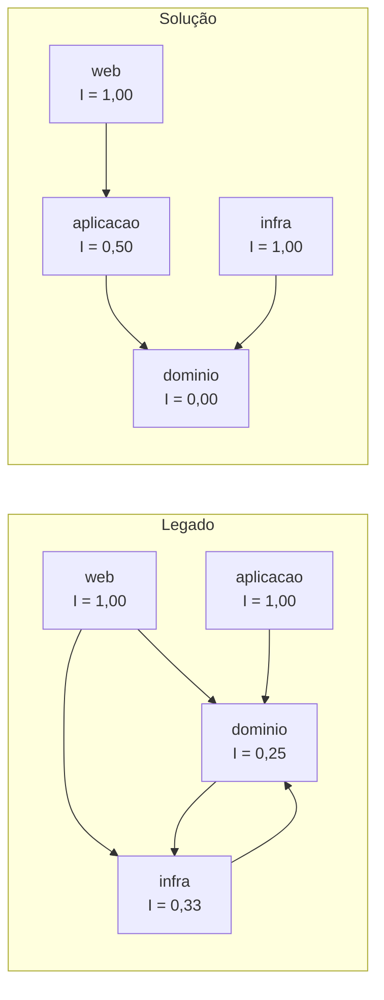
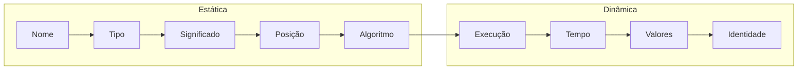
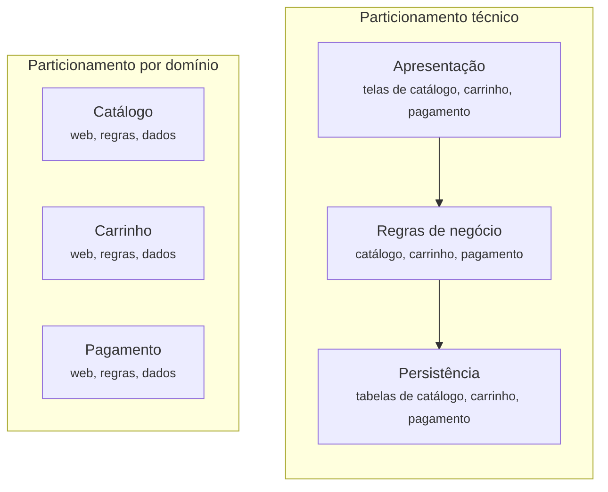
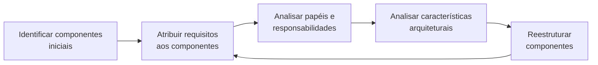
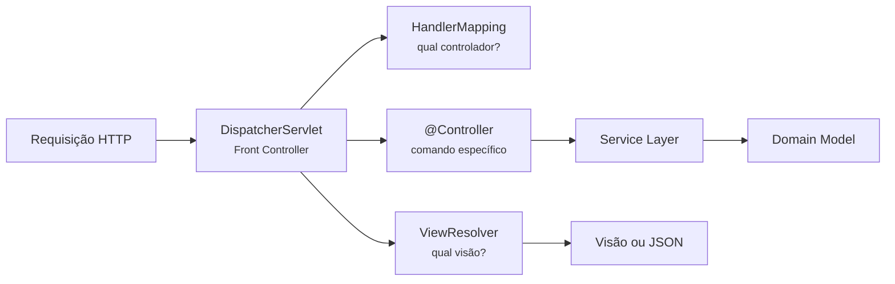
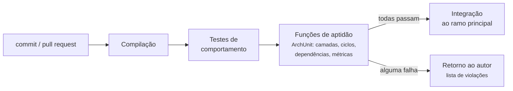
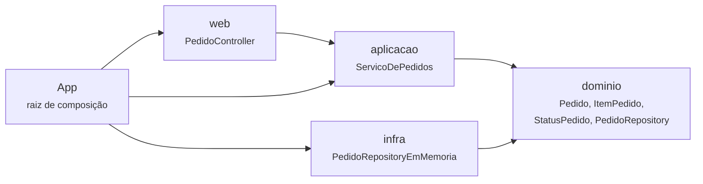

# Apêndice E - Modularidade, padrões de aplicação e governança arquitetural

## Objetivos

Ao final deste apêndice, o leitor deverá ser capaz de:

- Distinguir os tipos de coesão e calcular e interpretar a métrica LCOM, reconhecendo suas
  limitações.
- Calcular o acoplamento aferente e eferente, a abstração, a instabilidade e a distância da
  sequência principal de um pacote, situando-o em relação à zona de dor e à zona de
  inutilidade.
- Classificar ocorrências de *connascence* estática e dinâmica segundo força, localidade e
  grau, e usar as regras de Page-Jones e de Weirich para orientar refatorações.
- Comparar o particionamento técnico e o particionamento por domínio, relacioná-los à Lei de
  Conway e aplicar técnicas de identificação de componentes, evitando a armadilha da entidade.
- Escolher, de forma justificada, entre os padrões de lógica de domínio (*Transaction Script*,
  *Table Module* e *Domain Model*) e entre os padrões de fonte de dados (*Table Data Gateway*,
  *Row Data Gateway*, *Active Record* e *Data Mapper*) do catálogo de Fowler.
- Explicar *Unit of Work*, *Identity Map*, *Lazy Load*, *Front Controller*, *Remote Facade*,
  *Data Transfer Object* e os bloqueios *offline*, e reconhecê-los em *frameworks* de uso
  corrente.
- Projetar agregados com fronteiras transacionais adequadas, referências por identidade,
  repositórios, fábricas e eventos de domínio.
- Escrever funções de aptidão (*fitness functions*) com ArchUnit e integrá-las a um *pipeline*
  de integração contínua.

## Introdução

Este apêndice é um aprofundamento conceitual. O Capítulo 1 apresentou os princípios de
projeto, os padrões do catálogo GoF, as arquiteturas centradas no domínio e o vocabulário do
*Domain-Driven Design* em visão geral, e os Capítulos 3 e 4 trataram das decisões tomadas a
<span class="altitude a100">100.000 pés</span> e a <span class="altitude a50">50.000 pés</span>
para as sete aplicações estudadas no livro. Os Capítulos 5 e 6 descem às duas últimas altitudes
da aproximação: <span class="altitude a10">10.000 pés</span>, onde se decide como cada
*container* se divide em componentes e como eles se comunicam, e o
<span class="altitude solo">solo</span>, onde essas decisões se materializam em pacotes, classes
e dependências. Este apêndice reúne, em um só lugar e com mais profundidade do que aqueles
capítulos comportam, os instrumentos de que eles se servem. Ele foi escrito para ser consultado
a partir dos Capítulos 5 e 6, mas pode também ser lido de forma independente. A pergunta que o
orienta é de natureza instrumental: como saber se uma decisão tomada nas altitudes superiores
realmente chegou ao código, e como impedir que ela se perca com o tempo?

A pergunta é mais séria do que parece. Myers, citado por Richards e Ford (2020, p. 37), já
observava em 1978 que quase tudo o que se escrevia sobre arquitetura exaltava os benefícios da
modularidade e quase nada dizia sobre como alcançá-la. Os autores acrescentam uma analogia
física: sistemas de software tendem à entropia, e é preciso gastar energia continuamente para
preservar sua ordem estrutural, que não surge por acaso (RICHARDS; FORD, 2020, p. 37). A
modularidade é, nesse sentido, uma característica arquitetural **implícita**: quase nenhum
requisito a menciona, mas nenhuma base de código sobrevive sem ela.

Os instrumentos deste apêndice dividem-se em três famílias. A primeira é a das **medidas**:
coesão, acoplamento, abstração, instabilidade e *connascence* (Seções E.1 e E.2), que
permitem descrever objetivamente a forma de um código. A segunda é a dos **padrões**: os
critérios para identificar componentes (Seção E.3), os padrões de aplicação corporativa de
Fowler (2002) (Seção E.4) e os blocos táticos do DDD (Seção E.5), que oferecem formas
conhecidas para organizar o interior de um componente. A terceira é a da **governança**: as
funções de aptidão (Seção E.6), que transformam decisões arquiteturais em testes executados a
cada alteração do código. A Seção E.7 reúne as três famílias em um estudo de caso, o
exercício-modelo com correção automática que acompanha este livro. Ao longo do texto, as
remissões indicam onde cada instrumento é aplicado às aplicações estudadas: Mastodon (Seções
5.2 e 6.2), Mattermost (5.3 e 6.3), PeerTube (5.4 e 6.4), Nextcloud (5.5 e 6.5), Saleor (5.6 e
6.6), ThingsBoard (5.7 e 6.7) e PX4 (5.8 e 6.8).

A metáfora do voo ajuda a situar o apêndice. Um piloto experiente não confia apenas na memória
para executar a aproximação final: segue um *checklist*, consulta instrumentos e compara o que
lê com o que planejou. Richards e Ford (2020, p. 89) recorrem exatamente a essa imagem para
explicar as funções de aptidão. Os instrumentos de baixa altitude não substituem o julgamento
arquitetural; eles impedem que erros conhecidos se repitam por descuido.

## E.1 Modularidade e sua medição

### E.1.1 Módulo, componente e o problema da definição

Não há definição consensual de módulo. Richards e Ford (2020, p. 38) adotam uma formulação
deliberadamente ampla: **modularidade** designa um agrupamento lógico de código relacionado, que
pode ser um conjunto de classes, de funções ou de qualquer outra unidade, sem implicar
separação física. A separação física recebe outro nome, **componente**: a manifestação
empacotada de um módulo, como um arquivo `jar` em Java, uma `dll` em .NET ou uma *gem* em Ruby
(RICHARDS; FORD, 2020, p. 99). A distinção é útil porque as duas coisas variam de forma
independente. Um monólito pode ter excelente modularidade lógica em um único artefato
implantável, e um sistema distribuído em dezenas de serviços pode ter péssima modularidade se os
serviços conhecerem os detalhes uns dos outros.

O SWEBOK v4 define acoplamento como uma medida da interdependência entre módulos e coesão como
uma medida da força de associação entre os elementos de um módulo, e registra que a maioria dos
métodos de projeto recomenda acoplamento fraco e coesão máxima (WASHIZAKI, 2024, cap. 3, seção
1.4). O Capítulo 1 apresentou a origem desses conceitos em Stevens, Myers e Constantine (1974)
(ver Seção 1.5.3). O que este apêndice acrescenta é a passagem do conceito para a **medida**:
como dizer, com números, que um pacote é mais coeso ou mais acoplado do que outro, e o que esses
números deixam de dizer.

### E.1.2 Coesão: tipos e a métrica LCOM

Richards e Ford (2020, p. 40) definem coesão como a medida em que as partes de um módulo devem
estar contidas no mesmo módulo, isto é, o quanto elas se relacionam. Um módulo coeso é aquele
cuja divisão só aumentaria o acoplamento, pois as partes separadas precisariam chamar umas às
outras para produzir qualquer resultado útil. Os autores retomam a escala ordinal herdada do
projeto estruturado, apresentada na Tabela E.1 da melhor para a pior forma.

**Tabela E.1** – Tipos de coesão, da mais desejável à menos desejável.

| Tipo | Os elementos estão juntos porque... | Exemplo |
|---|---|---|
| Funcional | todos contribuem para uma única função e nada essencial falta | `CalculadoraDeFrete` |
| Sequencial | a saída de um é a entrada do outro | ler arquivo → validar → importar |
| Comunicacional | operam sobre a mesma informação ou contribuem para a mesma saída | gravar o pedido e enviar o e-mail de confirmação |
| Procedural | precisam executar em determinada ordem | rotina de fechamento de caixa |
| Temporal | executam no mesmo momento | inicializações feitas na partida do sistema |
| Lógica | fazem coisas da mesma categoria, mas funcionalmente diferentes | `StringUtils`, com métodos estáticos sem relação entre si |
| Coincidental | apenas estão no mesmo arquivo | `Util` ou `Helpers` genéricos |

Fonte: adaptado de Richards e Ford (2020, p. 40-41).

A escala é pouco precisa, e os próprios autores reconhecem que o grau de coesão de um módulo
fica, muitas vezes, a critério do arquiteto. No exemplo que discutem, um módulo de manutenção de
clientes contém também as operações "obter pedidos do cliente" e "cancelar pedidos do cliente".
Se essas operações devem ou não migrar para um módulo de pedidos depende de perguntas que nenhuma
escala responde sozinha: são as únicas operações sobre pedidos? O módulo de clientes deve
crescer? Separá-los exigiria que o novo módulo conhecesse tanto sobre clientes que o acoplamento
resultante anularia o ganho? (RICHARDS; FORD, 2020, p. 41-42).

Para obter uma medida estrutural, Chidamber e Kemerer (1994) propuseram, em seu conjunto de
métricas para software orientado a objetos, a **falta de coesão em métodos** (*Lack of Cohesion
in Methods*, LCOM). Na formulação original, consideram-se todos os pares de métodos de uma
classe: seja $P$ o número de pares que não compartilham nenhum atributo e $Q$ o número de pares
que compartilham ao menos um. Então:

$$
\text{LCOM} = \begin{cases} P - Q, & \text{se } P > Q \\ 0, & \text{caso contrário} \end{cases}
$$

A métrica passou por diversas revisões. Richards e Ford (2020, p. 42-43) reproduzem a variante
LCOM96b, atribuída a Henderson-Sellers (1996), em que $m$ é o número de métodos, $a$ o número de
atributos e $\mu(A_j)$ o número de métodos que acessam o atributo $A_j$:

$$
\text{LCOM96b} = \frac{1}{a}\sum_{j=1}^{a}\frac{m - \mu(A_j)}{m}
$$

O valor varia de 0, quando todos os métodos usam todos os atributos, até valores próximos de 1,
quando cada atributo é usado por um único método. Os autores oferecem uma paráfrase mais
intuitiva: a LCOM é a soma dos conjuntos de métodos que **não** se relacionam por meio de
atributos compartilhados. Uma classe com dois atributos, em que metade dos métodos usa apenas o
primeiro e a outra metade apenas o segundo, tem LCOM alta e é candidata a ser dividida em duas
(RICHARDS; FORD, 2020, p. 43). A Listagem E.1 mostra um caso típico.

**Listagem E.1** – Classe com baixa coesão estrutural: dois grupos de métodos que não
compartilham atributos.

```java
public class ServicoDoAluno {
    private final Map<String, List<Double>> notas = new HashMap<>();   // usado pelo grupo 1
    private final Map<String, String> enderecos = new HashMap<>();     // usado pelo grupo 2

    // Grupo 1: desempenho acadêmico
    public void lancarNota(String matricula, double nota) {
        notas.computeIfAbsent(matricula, k -> new ArrayList<>()).add(nota);
    }
    public double media(String matricula) {
        return notas.getOrDefault(matricula, List.of()).stream()
                .mapToDouble(Double::doubleValue).average().orElse(0);
    }

    // Grupo 2: cadastro
    public void atualizarEndereco(String matricula, String endereco) {
        enderecos.put(matricula, endereco);
    }
    public String etiquetaDeCorreio(String matricula) {
        return matricula + "\n" + enderecos.get(matricula);
    }
}
// m = 4, a = 2; cada atributo é usado por 2 métodos:
// LCOM96b = (1/2) * [ (4-2)/4 + (4-2)/4 ] = 0,5
```

Fonte: elaborado pelo autor (2026).

O cálculo indica que a classe é composta por dois "aglomerados" independentes, o que sugere
extraí-los em `DesempenhoAcademico` e `CadastroDoAluno`. Fox e Patterson (2021, seção 11.3)
associam a LCOM ao princípio da responsabilidade única: uma LCOM alta é o sintoma quantitativo de
uma classe que acumulou mais de um motivo para mudar. Richards e Ford (2020, p. 44) apontam um
uso arquitetural específico. Em migrações entre estilos, por exemplo de um monólito para
serviços, as classes utilitárias compartilhadas costumam ser o maior obstáculo, e a LCOM ajuda a
localizar classes que nunca deveriam ter sido uma só.

A métrica tem, entretanto, uma limitação de princípio. Ela só detecta a falta de coesão
**estrutural** e não tem como avaliar se as partes **logicamente** pertencem ao mesmo lugar
(RICHARDS; FORD, 2020, p. 44). Uma classe com LCOM zero pode reunir responsabilidades de
negócio distintas que por acaso manipulam o mesmo atributo, e uma classe com LCOM alta pode ser
um objeto de valor perfeitamente legítimo cujos métodos consultam campos diferentes. Os autores
relacionam essa limitação à segunda lei da arquitetura: o porquê importa mais do que o como.

### E.1.3 Acoplamento aferente e eferente

O acoplamento é mais fácil de medir do que a coesão porque as chamadas entre módulos formam um
grafo, sobre o qual é possível raciocinar matematicamente (RICHARDS; FORD, 2020, p. 44). Yourdon
e Constantine (1979) definiram duas medidas básicas:

- **acoplamento aferente** ($C_a$): o número de conexões que **chegam** a um artefato, isto é,
  quantos outros dependem dele;
- **acoplamento eferente** ($C_e$): o número de conexões que **saem** do artefato, isto é, de
  quantos outros ele depende.

Os nomes, quase idênticos, são fonte permanente de confusão. Richards e Ford (2020, p. 44)
lembram dois mnemônicos: *a* vem antes de *e* no alfabeto, assim como "entrar" vem antes de
"sair"; e o *e* de *efferent* é o mesmo de *exit*. Em português, pode-se associar **a**ferente a
**a**poio recebido e **e**ferente a **e**xportação de dependências.

A unidade de contagem varia entre ferramentas e autores, e convém sempre explicitá-la. Martin
(2017, cap. 14) conta classes: $C_a$ é o número de classes externas ao componente que dependem
de classes internas, e $C_e$ é o número de classes internas que dependem de classes externas.
Ferramentas como JDepend e o módulo de métricas do ArchUnit contam **componentes**: quantos
outros pacotes dependem deste, e de quantos outros pacotes este depende. Os números deste
apêndice seguem a segunda convenção e desconsideram as dependências da biblioteca padrão do
Java.

### E.1.4 Abstração, instabilidade e distância da sequência principal

A partir das medidas brutas, Martin derivou três métricas que permitem uma avaliação mais
holística de cada componente (MARTIN, 2017, cap. 14; RICHARDS; FORD, 2020, p. 44-47).

A **instabilidade** mede a suscetibilidade de um componente a mudanças provocadas por outros:

$$
I = \frac{C_e}{C_e + C_a}
$$

O valor $I = 0$ indica um componente **estável**: muitos dependem dele e ele não depende de
ninguém, de modo que tem fortes razões para não mudar e nenhuma razão externa para ser forçado a
mudar. O valor $I = 1$ indica um componente **instável**: ninguém depende dele, e ele depende de
outros, que podem forçá-lo a mudar a qualquer momento. "Instável", aqui, não é um juízo de valor.
Um controlador web ou um adaptador de banco de dados **devem** ser instáveis, pois são os
detalhes que se quer poder trocar.

A **abstração** mede a proporção de elementos abstratos no componente. Na formulação de Martin
(2017, cap. 14), $N_a$ é o número de classes abstratas e interfaces e $N_c$ é o número total de
classes:

$$
A = \frac{N_a}{N_c}
$$

Richards e Ford (2020, p. 45) apresentam a fórmula como a razão entre a soma dos elementos
abstratos e a soma dos concretos. A diferença é de denominador, e o leitor deve conferir qual
variante a ferramenta em uso adota.

Martin combina as duas métricas em dois princípios de projeto de componentes. O **princípio das
dependências estáveis** (*Stable Dependencies Principle*, SDP) estabelece que as dependências
devem apontar no sentido da estabilidade, isto é, de componentes com $I$ maior para componentes
com $I$ menor. O **princípio das abstrações estáveis** (*Stable Abstractions Principle*, SAP)
estabelece que um componente deve ser tão abstrato quanto é estável, pois só assim sua
estabilidade não impede que ele seja estendido (MARTIN, 2017, cap. 14). O mesmo capítulo
enuncia o **princípio das dependências acíclicas** (*Acyclic Dependencies Principle*, ADP): o
grafo de dependências entre componentes não deve conter ciclos.

O SAP sugere uma relação ideal entre $A$ e $I$: os componentes saudáveis estariam sobre a reta
$A + I = 1$, que Martin chama de **sequência principal** (*main sequence*). A **distância da
sequência principal** mede o afastamento de um componente em relação a essa reta:

$$
D = |A + I - 1|
$$

Richards e Ford (2020, p. 46) escrevem a fórmula sem o valor absoluto; com ele, $D$ varia de 0
(sobre a reta) a 1 (no ponto mais distante). Os extremos do plano recebem nomes sugestivos,
resumidos na Tabela E.2. Componentes próximos do canto $(I = 0, A = 0)$ estão na **zona de
dor**: são concretos e estáveis, muitos dependem deles, e por isso qualquer mudança é dolorosa.
Componentes próximos do canto $(I = 1, A = 1)$ estão na **zona de inutilidade**: são abstratos e
ninguém depende deles, o que geralmente indica abstrações especulativas que nunca foram usadas
(RICHARDS; FORD, 2020, p. 47).

**Tabela E.2** – Interpretação das regiões do plano abstração × instabilidade.

| Região | $I$ | $A$ | Diagnóstico | Exemplo típico |
|---|---|---|---|---|
| Zona de dor | próximo de 0 | próximo de 0 | Concreto e muito usado: rígido e caro de mudar | Esquema de banco compartilhado por vários módulos; classe utilitária concreta usada em todo o sistema |
| Zona de inutilidade | próximo de 1 | próximo de 1 | Abstrato e não usado: generalidade especulativa | Pacote de interfaces que nenhum código implementa nem consome |
| Sequência principal, polo estável | próximo de 0 | próximo de 1 | Abstrações estáveis, extensíveis por implementação | Pacote de interfaces de portas (Seção 1.8.2) |
| Sequência principal, polo instável | próximo de 1 | próximo de 0 | Detalhes concretos fáceis de trocar | Adaptadores, controladores, raiz de composição |

Fonte: elaborado pelo autor (2026), com base em Martin (2017, cap. 14) e Richards e Ford (2020,
p. 44-47).

Martin (2017, cap. 14) faz uma ressalva importante: estar na zona de dor só é um problema para
componentes **voláteis**. A classe `String` do Java é concreta e extremamente estável, mas não
causa dor, porque praticamente não muda. O diagnóstico depende, portanto, de uma terceira
variável que as métricas não capturam: a probabilidade de mudança, que é exatamente o critério
de Parnas (1972) para decompor sistemas (ver Seção 1.5.2).

### E.1.5 Um exemplo medido

As métricas ganham sentido quando aplicadas a um código conhecido. A Tabela E.3 apresenta os
valores medidos com o módulo de métricas do ArchUnit sobre as duas versões do exercício-modelo
deste livro, analisado em detalhe na Seção E.7: o código "legado", entregue ao aluno, e a
solução de referência. Os componentes são os quatro pacotes `web`, `aplicacao`, `dominio` e
`infra`.

**Tabela E.3** – Métricas de Martin nas duas versões do exercício-modelo.

| Pacote | Legado: $C_a$ / $C_e$ / $I$ | Solução: $C_a$ / $C_e$ / $I$ |
|---|---|---|
| `web` | 0 / 2 / 1,00 | 0 / 1 / 1,00 |
| `aplicacao` | 0 / 1 / 1,00 | 1 / 1 / 0,50 |
| `dominio` | 3 / 1 / 0,25 | 2 / 0 / 0,00 |
| `infra` | 2 / 1 / 0,33 | 0 / 1 / 1,00 |

Fonte: elaborado pelo autor (2026), medido com `ArchitectureMetrics.componentDependencyMetrics`
do ArchUnit 1.3.0 sobre `atividades/modelo-exercicio` e `atividades/modelo-exercicio-solucao`.

A Figura E.1 desenha os mesmos dados como grafos de dependência, anotando a instabilidade de
cada pacote.

**Figura E.1** – Grafos de dependência do exercício-modelo, com a instabilidade de cada pacote.



Fonte: elaborado pelo autor (2026).

A leitura do grafo do legado revela três problemas. Há um ciclo entre `dominio` e `infra`,
violando o ADP. A dependência `dominio → infra` aponta de um pacote mais estável ($I = 0,25$)
para um menos estável ($I = 0,33$), violando o SDP. E a camada `aplicacao` é instável no pior
sentido: ninguém a usa no código de produção, o que indica que a camada existe no desenho, mas foi
contornada no código. Na solução, todas as setas apontam no sentido da estabilidade decrescente
de $I$: `web` (1,00) → `aplicacao` (0,50) → `dominio` (0,00) ← `infra` (1,00). O domínio tornou-se
o componente mais estável, e a infraestrutura, o mais instável, que é exatamente o que as
arquiteturas centradas no domínio prescrevem (ver Seção 1.8.5).

A abstração, por outro lado, revela os limites das métricas. O pacote `dominio` tem uma
interface (`PedidoRepository`) entre quatro tipos, o que dá $A = 0,25$ pela fórmula de Martin. O
ArchUnit relatou $A = 0,40$, porque contou também o tipo *array* `StatusPedido[]`, gerado pelo
compilador para o método `values()` do `enum`, como uma classe abstrata adicional. Com
$A = 0,25$, a distância do domínio é $D = 0,50$ no legado e $D = 0,75$ na solução: a métrica
**piorou** depois de uma refatoração que corrigiu todas as violações arquiteturais. A explicação
é que, pela régua de Martin, um domínio totalmente estável deveria ser também altamente
abstrato, ao passo que, no DDD, o núcleo do sistema é composto de entidades e objetos de valor
concretos, deliberadamente ricos em comportamento. O exemplo ilustra a advertência de Richards
e Ford (2020, p. 48) de que praticamente todas as métricas de código exigem interpretação, e a
ressalva de Martin sobre a volatilidade: o que importa não é a posição no plano, mas se o
componente que está na zona de dor muda com frequência.

### E.1.6 Limites das métricas

Três limitações merecem registro. A primeira é a **cegueira semântica**: as métricas olham a
estrutura e não o significado, como se viu com a LCOM e com a abstração. A segunda é a
**dependência de convenções**: cada ferramenta conta de um jeito, e valores absolutos só podem
ser comparados quando medidos da mesma forma. A terceira é a **escala**: em sistemas pequenos,
como o exercício-modelo, um único tipo altera radicalmente os valores. Richards e Ford (2020,
p. 48) observam que mesmo a complexidade ciclomática, uma das métricas mais consolidadas, não
distingue complexidade essencial de acidental. A recomendação dos autores não é abandonar as
métricas, mas usá-las como **linhas de base**: registrar seus valores ao longo do tempo e
investigar as variações bruscas, como se faz na Seção E.6.

## E.2 *Connascence*

### E.2.1 Origem e definição

As medidas de acoplamento do projeto estruturado contam **quantas** dependências existem, mas
não dizem **de que tipo** elas são. Page-Jones (1996) propôs um conceito que preenche essa lacuna
para o projeto orientado a objetos, a ***connascence*** (do latim, "nascer junto"). Richards e
Ford (2020, p. 48) reproduzem a definição.

!!! quote "Connascence (Page-Jones)"
    "Two components are connascent if a change in one would require the other to be modified in
    order to maintain the overall correctness of the system." (PAGE-JONES, 1996 *apud* RICHARDS;
    FORD, 2020, p. 48)

    Dois componentes são connascentes se uma mudança em um exigir que o outro seja modificado
    para manter a correção do sistema como um todo.

A definição é mais exigente do que a de dependência. Duas classes podem depender uma da outra
sem que toda mudança em uma afete a outra; a *connascence* nomeia, especificamente, **o que**
precisa permanecer de acordo entre elas. Page-Jones distinguiu duas grandes famílias: a
*connascence* **estática**, visível no código-fonte, e a **dinâmica**, que só se manifesta em
tempo de execução.

### E.2.2 *Connascence* estática

A Tabela E.4 resume as cinco formas estáticas, com exemplos em Java.

**Tabela E.4** – Formas de *connascence* estática.

| Forma | Os componentes precisam concordar quanto... | Exemplo em Java |
|---|---|---|
| De nome (CoN) | ao nome de uma entidade | todo chamador de `pedido.fechar()` depende do nome `fechar` |
| De tipo (CoT) | ao tipo de uma entidade | o parâmetro `long pedidoId` exige que o chamador passe um `long` |
| De significado ou convenção (CoM) | ao significado de valores específicos | `status == 3` significa "faturado"; `long preco` significa "centavos" |
| De posição (CoP) | à ordem dos valores | `adicionarItem(long pedidoId, String produto, int qtd, long preco)` |
| De algoritmo (CoA) | a um algoritmo específico | cliente e servidor precisam calcular o mesmo *hash* ou o mesmo dígito verificador |

Fonte: adaptado de Richards e Ford (2020, p. 48-49).

A *connascence* de nome é a mais comum e a mais desejável, pois as ferramentas de refatoração
tornam trivial renomear um método em todo o sistema (RICHARDS; FORD, 2020, p. 49). A de
significado é traiçoeira porque o acordo não aparece em lugar algum: Richards e Ford (2020,
p. 49) citam a definição de constantes `TRUE = 1` e `FALSE = 0` e convidam a imaginar o que
aconteceria se alguém invertesse os valores. A de posição sobrevive mesmo em linguagens com
tipagem estática: os autores mostram um método `updateSeat(String name, String seatLocation)`
chamado com os argumentos invertidos, o que compila sem erro e produz um resultado errado. O
exemplo de reconhecimento de receita de Fowler (2002, cap. 9), discutido na Seção E.4.2, contém
um caso clássico de *connascence* de significado: o código testa `type.equals("S")` para
decidir se um produto é uma planilha.

### E.2.3 *Connascence* dinâmica

As formas dinâmicas, resumidas na Tabela E.5, são mais difíceis de detectar porque não há
ferramentas que analisem chamadas em tempo de execução com a mesma eficácia com que se analisa o
grafo estático de chamadas (RICHARDS; FORD, 2020, p. 50).

**Tabela E.5** – Formas de *connascence* dinâmica.

| Forma | Os componentes dependem... | Exemplo |
|---|---|---|
| De execução (CoE) | da ordem de execução | configurar o destinatário de um e-mail **depois** de chamar `enviar()` |
| De tempo (CoT) | do momento da execução | condição de corrida entre duas *threads* |
| De valores (CoV) | de valores que precisam mudar juntos | os quatro vértices de um retângulo; um valor replicado em vários bancos que deve ser atualizado atomicamente |
| De identidade (CoI) | de referenciar a mesma instância | dois componentes que compartilham e atualizam a mesma fila distribuída ou o mesmo objeto global |

Fonte: adaptado de Richards e Ford (2020, p. 50).

A *connascence* de valores tem uma consequência arquitetural direta. Quando um mesmo valor
precisa ser atualizado em bancos de dados distintos, "todos os valores precisam mudar juntos ou
nenhum muda", o que exige transações distribuídas ou mecanismos de compensação (RICHARDS; FORD,
2020, p. 50). O conceito de agregado, discutido na Seção E.5, pode ser lido como uma forma de
confinar a *connascence* de valores a uma fronteira transacional explícita.

### E.2.4 Força, localidade e grau

Page-Jones atribuiu três propriedades a cada ocorrência de *connascence* (RICHARDS; FORD, 2020,
p. 51-52):

- **Força**: a facilidade com que um desenvolvedor consegue refatorar aquele tipo de
  acoplamento. As formas estáticas são mais fracas do que as dinâmicas, e, entre as estáticas,
  a de nome é a mais fraca. A Figura E.2 ordena as formas.
- **Localidade**: a proximidade entre os elementos connascentes. Uma forma forte é tolerável
  dentro de um mesmo método ou classe e perigosa entre componentes distantes.
- **Grau**: o tamanho do impacto, isto é, quantos elementos são afetados. Uma *connascence*
  dinâmica entre dois módulos pode ser aceitável; a mesma forma espalhada por cinquenta módulos,
  não.

**Figura E.2** – Formas de *connascence* ordenadas da mais fraca à mais forte.



Fonte: adaptado de Richards e Ford (2020, p. 51). As setas indicam força crescente, isto é,
maior dificuldade de refatoração.

Page-Jones propôs três diretrizes para melhorar a modularidade com base nessas propriedades:
minimizar a *connascence* total, decompondo o sistema em elementos encapsulados; minimizar a
*connascence* que atravessa fronteiras de encapsulamento; e maximizar a *connascence* dentro
dessas fronteiras (RICHARDS; FORD, 2020, p. 52). Jim Weirich, que popularizou o conceito na
comunidade Ruby, sintetizou o raciocínio em duas regras.

!!! quote "As regras de Weirich"
    "Rule of Degree: convert strong forms of connascence into weaker forms of connascence."

    "Rule of Locality: as the distance between software elements increases, use weaker forms of
    connascence." (WEIRICH *apud* RICHARDS; FORD, 2020, p. 52)

    Regra do grau: converta formas fortes de *connascence* em formas mais fracas. Regra da
    localidade: à medida que a distância entre os elementos aumenta, use formas mais fracas de
    *connascence*.

Note-se que a primeira regra, apesar do nome, trata da força; a nomenclatura é a registrada pelos
autores. A terceira diretriz de Page-Jones merece atenção porque contraria uma leitura ingênua
de "baixo acoplamento". O objetivo não é eliminar a *connascence*, o que é impossível, mas
**concentrá-la** dentro dos módulos, onde ela é sinônimo de coesão, e **enfraquecê-la** entre os
módulos, onde ela é sinônimo de acoplamento.

### E.2.5 Refatorando pela *connascence*

As regras de Weirich funcionam como um roteiro de refatoração. A Listagem E.2 mostra uma
assinatura extraída do exercício-modelo (Seção E.7) e duas refatorações possíveis.

**Listagem E.2** – Enfraquecendo *connascence* de posição e de significado.

```java
// ANTES: dois parâmetros long, o primeiro e o último (CoP), e a convenção implícita de que
// o preço está em centavos (CoM). Compila mesmo com os argumentos trocados:
servico.adicionarItem(15990, "Teclado", 2, pedidoId);   // erro silencioso

// DEPOIS (1): objetos de valor transformam CoP e CoM em connascence de TIPO.
public record IdPedido(long valor) {}
public record Dinheiro(long centavos) {
    public static Dinheiro reais(long reais, int centavos) {
        return new Dinheiro(reais * 100 + centavos);
    }
}
public void adicionarItem(IdPedido pedido, String produto, int quantidade, Dinheiro preco) { /* ... */ }

servico.adicionarItem(id, "Teclado", 2, Dinheiro.reais(159, 90)); // trocar a ordem não compila

// DEPOIS (2): um enum transforma CoM ("S", "W", "D") em connascence de NOME.
public enum TipoDeProduto { PROCESSADOR_DE_TEXTO, PLANILHA, BANCO_DE_DADOS }
```

Fonte: elaborado pelo autor (2026).

As duas refatorações seguem a regra do grau. Na primeira, o acordo implícito sobre a ordem e o
significado dos números passa a ser verificado pelo compilador, pois `IdPedido` e `Dinheiro` são
tipos distintos. Na segunda, a constante mágica `"S"` dá lugar a um nome que as ferramentas de
refatoração conhecem. O custo é o de sempre: mais tipos a compreender. A regra da localidade
indica onde esse custo compensa. Dentro de um método privado, um parâmetro `long centavos` é
aceitável; na interface pública de uma camada de aplicação, chamada por vários clientes, a forma
mais fraca justifica o investimento.

### E.2.6 Acoplamento, *connascence* e seus limites

Richards e Ford (2020, p. 52-53) observam que as duas tradições se sobrepõem: o que o projeto
estruturado chamava de acoplamento por dados corresponde às formas estáticas de *connascence*,
que dizem **como** esse acoplamento deve se manifestar, ao passo que o projeto estruturado não
tinha vocabulário para a *connascence* dinâmica. Os mesmos autores apontam dois limites. As
medidas de *connascence* foram concebidas para o nível do código e dizem mais sobre higiene do
que sobre estrutura arquitetural. E elas não tratam de uma decisão central da arquitetura
contemporânea: se a comunicação entre componentes distribuídos deve ser síncrona ou assíncrona
(RICHARDS; FORD, 2020, p. 53). Essa questão pertence à altitude dos *containers* e da comunicação
entre componentes, e é retomada nos Capítulos 4 e 5, nos quais a troca de mensagens
assíncronas aparece como forma deliberada de enfraquecer a *connascence* de tempo entre partes do
sistema.

A ponte com os princípios do Capítulo 1 é direta. Fox e Patterson (2021, seção 11.1) associam
cada princípio SOLID a um "cheiro de projeto" (*design smell*) que denuncia sua violação: a LCOM
alta denuncia violações do princípio da responsabilidade única; o cheiro *case statement*,
violações do aberto-fechado; o *refused bequest*, violações de Liskov; a *inappropriate
intimacy*, violações da Lei de Demeter. Os autores resumem os sintomas de uma arquitetura de
classes ruim em quatro: viscosidade (é mais fácil remendar do que corrigir), imobilidade (é
difícil reaproveitar), repetição desnecessária e complexidade desnecessária. A *connascence*
oferece uma linguagem mais fina para descrever o que esses cheiros têm em comum: em todos eles,
há acordos fortes que atravessam fronteiras de encapsulamento.

## E.3 De módulos a componentes

### E.3.1 O papel do arquiteto na altitude dos componentes

A <span class="altitude a10">10.000 pés</span>, o objeto de análise é o componente. Richards e
Ford (2020, p. 101) observam que, em geral, o componente é o nível mais baixo do sistema com o
qual o arquiteto interage diretamente. As classes e funções que o compõem são responsabilidade
compartilhada com líderes técnicos e desenvolvedores, e um arquiteto que pretenda decidir tudo,
de cima a baixo, impede a formação da próxima geração de arquitetos. Uma das primeiras decisões
de um projeto novo, contudo, é inequivocamente arquitetural: o **particionamento de nível
superior**, isto é, o critério que define quais são os componentes de primeiro nível
(RICHARDS; FORD, 2020, p. 102).

### E.3.2 Particionamento técnico e particionamento por domínio

Há duas grandes alternativas. No **particionamento técnico**, os componentes de primeiro nível
correspondem a capacidades técnicas: apresentação, regras de negócio, serviços, persistência. É
o caso do monólito em camadas. No **particionamento por domínio**, os componentes de primeiro
nível correspondem a domínios ou fluxos de trabalho do negócio, como catálogo, pagamento e
entrega, e cada um deles pode conter internamente suas próprias camadas. É o caso do monólito
modular, popularizado por Simon Brown, e dos microsserviços (RICHARDS; FORD, 2020, p. 102-104).

**Figura E.3** – O mesmo fluxo de negócio em uma partição técnica e em uma partição por domínio.



Fonte: adaptado de Richards e Ford (2020, p. 103-105).

A diferença decisiva aparece quando se acompanha uma mudança. Um fluxo como "finalizar compra"
fica, na partição técnica, espalhado por todas as camadas; na partição por domínio, concentra-se
em um componente (RICHARDS; FORD, 2020, p. 104-105). Como a maioria das mudanças pedidas por um
negócio diz respeito a um fluxo, e não a uma tecnologia, a partição por domínio tende a
localizar melhor as mudanças. A partição técnica, por sua vez, facilita encontrar todo o código
de um mesmo tipo e combina com a familiaridade dos desenvolvedores com o padrão MVC. A Tabela
E.6 resume os compromissos.

**Tabela E.6** – Compromissos entre as duas formas de particionamento.

| Critério | Técnico | Por domínio |
|---|---|---|
| Correspondência com o negócio | Fraca: um fluxo atravessa todas as camadas | Forte: o fluxo está contido em um componente |
| Equipes | Por especialidade (front-end, back-end, DBA) | Multifuncionais, por domínio |
| Migração para estilo distribuído | Difícil: alto acoplamento global e de dados | Mais fácil: as fronteiras já existem |
| Código transversal (personalização, auditoria) | Fica separado e fácil de achar | Aparece repetido em vários componentes |
| Estilos afins | Camadas, MVC | Monólito modular, microsserviços |

Fonte: adaptado de Richards e Ford (2020, p. 107).

Richards e Ford (2020, p. 105) registram uma tendência recente da indústria em favor do
particionamento por domínio, tanto em monólitos quanto em arquiteturas distribuídas, mas
insistem que nenhuma das alternativas é intrinsecamente mais correta. O exercício-modelo da
Seção E.7 adota deliberadamente o particionamento técnico, por ser o mais familiar aos
estudantes e o mais fácil de verificar com regras de camadas. A Seção E.6 mostra como verificar
também uma partição por domínio.

### E.3.3 A Lei de Conway e a manobra inversa

O particionamento técnico tem um efeito colateral organizacional. Em empresas que adotam
arquiteturas em camadas, é comum agrupar os desenvolvedores de *back-end* em um departamento, os
administradores de banco de dados em outro e a equipe de apresentação em um terceiro
(RICHARDS; FORD, 2020, p. 103). A relação entre essa organização e a forma do software foi
observada por Conway (1968) e ficou conhecida como Lei de Conway.

!!! quote "Lei de Conway"
    "Organizations which design systems … are constrained to produce designs which are copies of
    the communication structures of these organizations." (CONWAY, 1968 *apud* RICHARDS; FORD,
    2020, p. 103)

    Organizações que projetam sistemas são levadas a produzir projetos que copiam as estruturas
    de comunicação dessas organizações.

A lei tem uma leitura descritiva e uma leitura prescritiva. Na descritiva, ela explica por que
sistemas desenvolvidos por equipes separadas por especialidade tendem a se organizar em camadas
técnicas, e por que a comunicação difícil entre duas equipes costuma reaparecer como uma
interface mal definida entre dois componentes. Na prescritiva, ela sugere que, se a estrutura da
organização molda a estrutura do sistema, é possível escolher a estrutura da organização em
função da arquitetura desejada. Essa segunda leitura, atribuída por Richards e Ford (2020,
p. 104) a Jonny Leroy, da ThoughtWorks, chama-se **manobra inversa de Conway** (*Inverse Conway
Maneuver*): evoluir a estrutura das equipes e a arquitetura em conjunto, por exemplo criando
equipes multifuncionais por domínio quando se pretende uma arquitetura particionada por domínio.
Skelton e Pais (2019) desenvolveram essa ideia em um modelo de tipos de equipe e de modos de
interação entre elas. Para o arquiteto, a consequência prática é que uma decisão de
particionamento que contrarie a estrutura da organização tende a ser erodida, e que o desenho
das equipes faz parte do desenho da arquitetura.

### E.3.4 O ciclo de identificação de componentes

A identificação de componentes é iterativa. Richards e Ford (2020, p. 108-109) descrevem um
ciclo em cinco etapas, representado na Figura E.4.

**Figura E.4** – Ciclo de identificação de componentes.



Fonte: adaptado de Richards e Ford (2020, p. 108).

Os componentes iniciais são, inevitavelmente, um palpite; os autores advertem que a chance de
acertar a primeira versão é pequena. A atribuição de histórias de usuário aos componentes revela
componentes sobrecarregados ou vazios. A análise de papéis verifica se a granularidade dos
componentes corresponde à dos atores. A análise de características arquiteturais, tratadas no
Capítulo 3, pode forçar uma divisão que a análise funcional não sugeria: duas partes do sistema
que lidam com entrada de usuários podem precisar de componentes distintos se uma delas atende
centenas de usuários simultâneos e a outra, poucos (RICHARDS; FORD, 2020, p. 109). A
granularidade é o problema mais difícil de todo o ciclo. Componentes finos demais exigem
comunicação excessiva entre si; componentes grossos demais acumulam acoplamento interno e
prejudicam a implantabilidade e a testabilidade (RICHARDS; FORD, 2020, p. 110).

### E.3.5 A armadilha da entidade

O antipadrão mais comum na identificação de componentes é a **armadilha da entidade** (*entity
trap*). Ele ocorre quando o arquiteto toma cada entidade identificada nos requisitos, como
cliente, leilão, lance e pagamento, e cria para cada uma um componente "gerenciador":
`GerenciadorDeClientes`, `GerenciadorDeLeiloes` e assim por diante. Richards e Ford (2020,
p. 110-111) são categóricos: isso não é uma arquitetura, mas um mapeamento objeto-relacional do
banco de dados. Se o sistema realmente se resume a operações CRUD (*create, read, update,
delete*), um *framework* que gera telas a partir das tabelas, como o *scaffolding* do Ruby on
Rails, resolve o problema sem necessidade de arquitetura.

O antipadrão revela, segundo os autores, que os fluxos de trabalho reais da aplicação não foram
pensados. Os componentes resultantes também tendem a ser grossos demais, pois todo o
comportamento relacionado a uma entidade, de qualquer fluxo, acaba no mesmo gerenciador
(RICHARDS; FORD, 2020, p. 111). Há uma relação com a Seção E.1: um `GerenciadorDeClientes` que
cadastra clientes, calcula o limite de crédito e envia campanhas de marketing apresenta coesão
apenas lógica, no sentido da Tabela E.1, e LCOM alta.

### E.3.6 Técnicas de identificação: *actor/actions*, *event storming* e *workflow*

Richards e Ford (2020, p. 111-112) descrevem três técnicas para evitar a armadilha.

A abordagem ***actor/actions***, originária do *Rational Unified Process*, identifica os atores
que interagem com o sistema e as ações que cada um realiza. No caso didático de um sistema de
leilões *online* discutido pelos autores, os atores são o licitante, o leiloeiro e o próprio
sistema; as ações do licitante incluem acompanhar o vídeo e os lances ao vivo e dar um lance, e
as do sistema incluem iniciar o leilão e processar o pagamento. Dessas ações derivam
componentes como transmissor de vídeo, transmissor de lances, captura de lances, registro de
lances, sessão de leilão e pagamento (RICHARDS; FORD, 2020, p. 112-114). A técnica é genérica e
funciona bem quando os papéis são bem definidos.

O ***event storming*** foi proposto por Brandolini (2021) como uma oficina colaborativa em que
especialistas do negócio e desenvolvedores reconstroem, em uma parede coberta de notas adesivas,
a sequência de **eventos de domínio** relevantes, escritos no passado, como "pedido realizado",
"pagamento aprovado" e "pedido despachado". Em torno dos eventos são identificados os comandos
que os provocam, os atores que emitem os comandos e os pontos de conflito ou dúvida. Como
técnica de descoberta de componentes, ela parte do pressuposto de que os componentes se
comunicarão por mensagens ou eventos e agrupa em componentes os produtores e consumidores desses
eventos, o que a torna especialmente adequada a arquiteturas orientadas a eventos e a
microsserviços (RICHARDS; FORD, 2020, p. 112).

A abordagem de ***workflow*** é uma alternativa mais genérica para quem não usa DDD nem
mensageria: identificam-se os papéis-chave, os fluxos de trabalho de que participam e as
atividades desses fluxos, e os componentes são construídos em torno dessas atividades
(RICHARDS; FORD, 2020, p. 112). A Tabela E.7 compara as três técnicas.

**Tabela E.7** – Técnicas de identificação de componentes.

| Técnica | Ponto de partida | Quando funciona melhor | Risco |
|---|---|---|---|
| *Actor/actions* | Atores e o que cada um faz | Papéis bem definidos; processos com projeto inicial significativo | Derivar componentes por ator e repetir comportamento comum |
| *Event storming* | Eventos de domínio e comandos | DDD, arquiteturas orientadas a eventos e microsserviços | Exige a presença real de especialistas do negócio |
| *Workflow* | Papéis e fluxos de trabalho | Sistemas sem mensageria explícita | Fluxos longos que atravessam muitos componentes |

Fonte: elaborado pelo autor (2026), com base em Richards e Ford (2020, p. 111-112) e
Brandolini (2021).

As três técnicas têm em comum o deslocamento da atenção dos **dados** para o **comportamento**,
que é precisamente o que a armadilha da entidade ignora. O critério de Parnas (1972) continua
válido nesta altitude: um bom componente esconde uma decisão sujeita a mudança, e os fluxos de
trabalho mudam com muito mais frequência do que a lista de entidades.

## E.4 Padrões de aplicação corporativa

### E.4.1 O catálogo de Fowler

Fowler (2002) catalogou cerca de cinquenta padrões recorrentes em aplicações corporativas, isto
é, sistemas que manipulam grandes volumes de dados persistentes, acessados concorrentemente
por muitos usuários, com muitas telas e com lógica de negócio frequentemente ilógica. O livro
tem duas partes: uma narrativa, que discute os problemas e quando aplicar cada padrão, e um
catálogo de referência. Os padrões situam-se, quase todos, entre os
<span class="altitude a10">10.000 pés</span> e o <span class="altitude solo">solo</span>: eles
definem como um componente se organiza internamente e como conversa com o banco de dados, com a
interface e com outros processos. O Capítulo 1 já apresentou as três camadas principais de
Fowler (apresentação, domínio e fonte de dados) e a distinção entre camada lógica (*layer*) e
nível físico (*tier*) (ver Seção 1.8.1). O guia de arquitetura de aplicações da Microsoft adota a
mesma distinção: camadas descrevem agrupamentos lógicos de funcionalidade, e níveis descrevem a
distribuição física em servidores e redes (MICROSOFT, 2009, cap. 5).

Vale registrar, contudo, os custos das camadas segundo o próprio Fowler (2002, cap. 1). Elas
encapsulam bem algumas coisas, mas não todas, e produzem mudanças em cascata: o exemplo clássico
é acrescentar um campo que precisa aparecer na tela e ser gravado no banco, o que obriga a
alterar todas as camadas intermediárias. Camadas extras também podem prejudicar o desempenho,
pois em cada fronteira os dados costumam ser convertidos de uma representação para outra. Para
o autor, a parte mais difícil de uma arquitetura em camadas é decidir quais camadas ter e qual a
responsabilidade de cada uma.

### E.4.2 Organização da lógica de domínio

A primeira decisão dentro da camada de domínio é como organizar a lógica de negócio. Fowler
(2002, cap. 2) apresenta três alternativas.

O ***Transaction Script*** organiza a lógica como um procedimento por transação de negócio: o
procedimento recebe a entrada da apresentação, valida, calcula, grava no banco e devolve a
resposta. Um sistema de varejo teria *scripts* para finalizar a compra, adicionar ao carrinho e
consultar a entrega. As vantagens são a simplicidade, a compatibilidade com uma camada de dados
simples e a clareza das fronteiras transacionais, que coincidem com o início e o fim do
procedimento. A desvantagem aparece com o crescimento: transações semelhantes duplicam código, e
o resultado pode virar uma teia de rotinas sem estrutura clara (FOWLER, 2002, cap. 2).

O ***Domain Model*** organiza a lógica em torno dos substantivos do domínio. Um sistema de
*leasing* teria classes para contrato e ativo, e o cálculo do valor do frete ficaria no objeto
que representa a remessa. Em vez de uma rotina com toda a lógica de uma ação, cada objeto
assume a parte que lhe cabe. Fowler (2002, cap. 2) reconhece que essa é a essência da "mudança
de paradigma" da orientação a objetos e que ela cobra um preço: quem não está habituado se
frustra ao perseguir o comportamento de objeto em objeto, e quanto mais rico o modelo, mais
complexo o mapeamento para o banco relacional, em geral feito com um *Data Mapper*.

O ***Table Module*** é um meio-termo: uma única instância por tabela, que opera sobre um
conjunto de registros (*Record Set*) obtido de uma consulta. Ele estrutura melhor do que
procedimentos soltos, mas não permite o uso de herança, estratégias e outros padrões
orientados a objetos no nível de cada registro. Sua principal vantagem é encaixar-se em
ambientes cujas ferramentas de interface operam sobre *Record Sets*, como os da plataforma .NET
da época (FOWLER, 2002, cap. 2).

Para comparar as alternativas, Fowler usa um único problema: o **reconhecimento de receita**.
Uma empresa vende três tipos de produto. Para processadores de texto, toda a receita é
reconhecida na assinatura do contrato; para planilhas, um terço na assinatura, um terço em 60
dias e um terço em 90 dias; para bancos de dados, um terço na assinatura, um terço em 30 dias e
um terço em 60 dias. O autor admite que as regras são fruto da sua imaginação, mas observa que as
reais são igualmente arbitrárias, numerosas e voláteis (FOWLER, 2002, cap. 9). As Listagens E.3 e
E.4 reconstroem as duas soluções extremas em Java 17.

**Listagem E.3** – Reconhecimento de receita como *Transaction Script*.

```java
public class ServicoDeReconhecimento {
    private final GatewayDeContratos db;   // Table Data Gateway: apenas SQL

    public ServicoDeReconhecimento(GatewayDeContratos db) { this.db = db; }

    /** Um procedimento por transação de negócio. */
    public void calcularReconhecimentos(long contrato) {
        LinhaContrato c = db.buscarContrato(contrato);
        BigDecimal[] partes = dividirEmTres(c.receita());
        switch (c.tipoProduto()) {                              // connascence de significado
            case "P" -> db.inserirReconhecimento(contrato, c.receita(), c.dataAssinatura());
            case "S" -> {
                db.inserirReconhecimento(contrato, partes[0], c.dataAssinatura());
                db.inserirReconhecimento(contrato, partes[1], c.dataAssinatura().plusDays(60));
                db.inserirReconhecimento(contrato, partes[2], c.dataAssinatura().plusDays(90));
            }
            case "B" -> {
                db.inserirReconhecimento(contrato, partes[0], c.dataAssinatura());
                db.inserirReconhecimento(contrato, partes[1], c.dataAssinatura().plusDays(30));
                db.inserirReconhecimento(contrato, partes[2], c.dataAssinatura().plusDays(60));
            }
            default -> throw new IllegalStateException("tipo desconhecido: " + c.tipoProduto());
        }
    }

    static BigDecimal[] dividirEmTres(BigDecimal total) {     // o resto vai para a 1a parcela
        BigDecimal terco = total.divide(BigDecimal.valueOf(3), 2, RoundingMode.DOWN);
        BigDecimal primeira = total.subtract(terco.multiply(BigDecimal.valueOf(2)));
        return new BigDecimal[] { primeira, terco, terco };
    }
}
```

Fonte: adaptado de Fowler (2002, cap. 9).

**Listagem E.4** – Reconhecimento de receita como *Domain Model*, com o padrão *Strategy*.

```java
public interface EstrategiaDeReconhecimento {
    List<Reconhecimento> reconhecer(Contrato contrato);
}

public final class ReconhecimentoIntegral implements EstrategiaDeReconhecimento {
    @Override public List<Reconhecimento> reconhecer(Contrato c) {
        return List.of(new Reconhecimento(c.receita(), c.dataAssinatura()));
    }
}

public final class ReconhecimentoEmTresParcelas implements EstrategiaDeReconhecimento {
    private final int diasSegunda, diasTerceira;
    public ReconhecimentoEmTresParcelas(int diasSegunda, int diasTerceira) {
        this.diasSegunda = diasSegunda; this.diasTerceira = diasTerceira;
    }
    @Override public List<Reconhecimento> reconhecer(Contrato c) {
        BigDecimal terco = c.receita().divide(BigDecimal.valueOf(3), 2, RoundingMode.DOWN);
        BigDecimal primeira = c.receita().subtract(terco.multiply(BigDecimal.valueOf(2)));
        LocalDate d = c.dataAssinatura();
        return List.of(new Reconhecimento(primeira, d),
                       new Reconhecimento(terco, d.plusDays(diasSegunda)),
                       new Reconhecimento(terco, d.plusDays(diasTerceira)));
    }
}

public record Produto(String nome, EstrategiaDeReconhecimento estrategia) {
    public static Produto processadorDeTexto(String nome) {
        return new Produto(nome, new ReconhecimentoIntegral());
    }
    public static Produto planilha(String nome) {
        return new Produto(nome, new ReconhecimentoEmTresParcelas(60, 90));
    }
    public static Produto bancoDeDados(String nome) {
        return new Produto(nome, new ReconhecimentoEmTresParcelas(30, 60));
    }
}

public record Reconhecimento(BigDecimal valor, LocalDate data) {
    public boolean reconhecivelAte(LocalDate limite) { return !data.isAfter(limite); }
}

public class Contrato {
    private final Produto produto;
    private final BigDecimal receita;
    private final LocalDate dataAssinatura;
    private final List<Reconhecimento> reconhecimentos = new ArrayList<>();

    public Contrato(Produto produto, BigDecimal receita, LocalDate dataAssinatura) {
        this.produto = produto; this.receita = receita; this.dataAssinatura = dataAssinatura;
    }
    public void calcularReconhecimentos() {               // o contrato delega ao produto
        reconhecimentos.addAll(produto.estrategia().reconhecer(this));
    }
    public BigDecimal receitaReconhecidaAte(LocalDate data) {
        return reconhecimentos.stream().filter(r -> r.reconhecivelAte(data))
                .map(Reconhecimento::valor).reduce(BigDecimal.ZERO, BigDecimal::add);
    }
    public BigDecimal receita() { return receita; }
    public LocalDate dataAssinatura() { return dataAssinatura; }
}
```

Fonte: adaptado de Fowler (2002, cap. 9).

A comparação torna concreta a discussão de Fowler (2002, cap. 2). No *Transaction Script*, um
quarto tipo de produto exige um novo ramo no `switch`, e a regra de três parcelas aparece
duplicada com números diferentes. No *Domain Model*, o mesmo acréscimo exige apenas uma nova
fábrica em `Produto`, possivelmente reaproveitando uma estratégia existente, e o `switch`
desaparece, levando consigo a *connascence* de significado dos códigos `"P"`, `"S"` e `"B"`. Em
contrapartida, para entender o *Domain Model* é preciso percorrer cinco tipos, e persistir
`Contrato` com sua lista de `Reconhecimento` e sua referência a uma estratégia exigirá um
mapeamento objeto-relacional mais elaborado do que as três tabelas do *script*.

Fowler (2002, cap. 2) sintetiza o dilema em um gráfico, que ele mesmo descreve como não
científico, de esforço de desenvolvimento em função da complexidade da lógica de domínio. Com
lógica simples, o *Domain Model* é menos atraente, pois o custo de compreendê-lo e a complexidade
da camada de dados acrescentam esforço que não se paga. À medida que a complexidade cresce, o
*Transaction Script* e, um pouco mais adiante, o *Table Module* "batem em uma parede", a partir da
qual cada nova funcionalidade fica exponencialmente mais difícil, enquanto a curva do *Domain
Model* cresce de forma moderada. O autor reconhece que não há como medir onde, no eixo da
complexidade, uma aplicação se situa: resta recorrer a pessoas experientes que analisem os
requisitos e façam um julgamento. A Tabela E.8 resume a comparação.

**Tabela E.8** – Padrões de organização da lógica de domínio.

| Critério | *Transaction Script* | *Table Module* | *Domain Model* |
|---|---|---|---|
| Unidade de organização | Uma transação de negócio | Uma tabela (uma instância) | Um conceito do domínio (uma instância por registro) |
| Custo inicial | Baixo | Baixo a médio | Alto (curva de aprendizado e mapeamento) |
| Comportamento com lógica crescente | Duplicação e "parede" de complexidade | Melhor que o *script*, sem polimorfismo por registro | Cresce de forma moderada |
| Camada de dados típica | *Table/Row Data Gateway* | *Table Data Gateway* com *Record Set* | *Active Record* (simples) ou *Data Mapper* (rico) |
| Fronteira transacional | Óbvia: o procedimento | Óbvia: a operação sobre a tabela | Exige uma camada de serviço ou *Unit of Work* |

Fonte: elaborado pelo autor (2026), com base em Fowler (2002, caps. 2 e 9).

Há duas observações finais de Fowler (2002, cap. 2) que merecem destaque. A primeira é que a
decisão não é irreversível, mas é assimétrica: partindo de um *Transaction Script*, refatorar
para um *Domain Model* compensa quando o *script* começa a doer; o caminho inverso raramente
compensa, a menos que simplifique a camada de dados. A segunda é que, na prática, as aplicações
misturam *scripts* e objetos de domínio, e o autor desaconselha o meio-termo em que a lógica
específica de cada caso de uso fica em "controladores de caso de uso" e só a lógica comum vai
para as entidades: os controladores, como qualquer *script*, tendem a duplicar código.

### E.4.3 *Service Layer*

Quando a lógica de domínio está em um *Domain Model*, falta um lugar para definir as operações
que a aplicação oferece a seus clientes e para coordenar cada uma delas: abrir e fechar a
transação, carregar os objetos, invocar o domínio, gravar o resultado, disparar notificações. O
padrão ***Service Layer***, contribuído por Randy Stafford ao catálogo de Fowler (2002, cap. 9),
define a fronteira da aplicação com uma camada de serviços que estabelece o conjunto de operações
disponíveis e coordena a resposta da aplicação a cada uma delas. É a "camada de aplicação" de
Evans (2003, cap. 4), que o autor caracteriza como deliberadamente fina: ela coordena tarefas e
delega o trabalho aos objetos de domínio, sem conter regras de negócio (ver Seção 1.8.1).

A Listagem E.5 mostra a camada de serviço do exercício-modelo, transcrita literalmente da
solução de referência. Ela recebe o repositório pela interface definida no domínio,
orquestra os casos de uso e não contém nenhuma regra: as invariantes "pedido fechado não aceita
itens" e "pedido vazio não pode ser fechado" estão em `Pedido`.

**Listagem E.5** – Camada de serviço do exercício-modelo (solução de referência).

```java
public class ServicoDePedidos {

    private final PedidoRepository repositorio;

    public ServicoDePedidos(PedidoRepository repositorio) {
        this.repositorio = repositorio;
    }

    public long criarPedido(String cliente) {
        Pedido pedido = new Pedido(repositorio.proximoId(), cliente);
        repositorio.salvar(pedido);
        return pedido.id();
    }

    public void adicionarItem(long pedidoId, String produto, int quantidade, long precoCentavos) {
        Pedido pedido = carregar(pedidoId);
        pedido.adicionarItem(new ItemPedido(produto, quantidade, precoCentavos));
        repositorio.salvar(pedido);
    }
```

Fonte: `atividades/modelo-exercicio-solucao/src/main/java/br/edu/ifal/arqsw/pedidos/aplicacao/ServicoDePedidos.java`,
linhas 12-29.

Em aplicações Spring, a camada de serviço costuma ser marcada com `@Service` e é o lugar natural
para a anotação `@Transactional`, que delimita a transação de sistema de cada caso de uso. O
perigo do padrão é o oposto do *Transaction Script*: uma camada de serviço que concentra todas as
decisões e trata as entidades como meros portadores de dados degenera no que Fowler (2003) chamou
de **modelo de domínio anêmico** (*anemic domain model*), discutido na Seção E.5.1.

### E.4.4 Padrões de fonte de dados

A segunda decisão é como a lógica de domínio conversa com o banco de dados. Fowler (2002,
cap. 10) descreve quatro padrões arquiteturais de fonte de dados.

- ***Table Data Gateway***: um objeto por tabela que concentra todo o SQL de acesso a ela
  (consultas, inserções, atualizações e remoções) e devolve estruturas de dados simples. Combina
  com *Transaction Script* e *Table Module*.
- ***Row Data Gateway***: um objeto por registro que se parece exatamente com o registro e
  encapsula o SQL de acesso a ele, mas não contém lógica de domínio.
- ***Active Record***: um objeto que encapsula um registro, o acesso a ele no banco **e** a
  lógica de domínio sobre esses dados. Fowler (2002, cap. 10) o descreve como um *Domain Model*
  em que as classes correspondem muito de perto à estrutura das tabelas. A diferença para o *Row
  Data Gateway* está em onde fica o SQL: se está no objeto de domínio, é *Active Record*; se está
  em uma classe separada, é *Row Data Gateway*.
- ***Data Mapper***: uma camada de mapeadores que transfere dados entre os objetos em memória e o
  banco, mantendo-os independentes entre si. Com ele, os objetos de domínio não precisam saber
  que existe um banco de dados, nem conter SQL, nem conhecer o esquema (FOWLER, 2002, cap. 10).

O critério de escolha entre *Active Record* e *Data Mapper* é, novamente, a complexidade do
domínio. O *Active Record* é simples de construir e de entender, e funciona bem para CRUD e para
validações e derivações baseadas em um único registro. Seu problema é que só funciona bem quando
o esquema de objetos é isomórfico ao esquema relacional; quando o domínio passa a exigir
coleções, relacionamentos diretos e herança, acrescentá-los aos poucos "fica bagunçado"
rapidamente, e o *Data Mapper* se torna preferível (FOWLER, 2002, cap. 10). Há ainda um
argumento de acoplamento: o *Active Record* acopla o projeto dos objetos ao projeto do banco, o
que dificulta refatorar qualquer um dos dois. Fowler resume: não escolheria um *Data Mapper*
sem um *Domain Model*, e recomenda, para a maioria dos casos, comprar uma camada de mapeamento
pronta em vez de construí-la. A Listagem E.6 contrasta os dois padrões.

**Listagem E.6** – A mesma entidade como *Active Record* e com *Data Mapper*
(ilustrativo e simplificado).

```java
// ---------- Active Record: o objeto sabe se ler e se gravar ----------
public class ClienteAR {
    private Long id;
    private String nome;
    private long limiteCentavos;

    public static ClienteAR buscar(long id) { /* SELECT ... WHERE id = ? */ return null; }
    public void salvar()                    { /* INSERT ou UPDATE */ }
    public boolean podeComprar(long valorCentavos) { return valorCentavos <= limiteCentavos; }
}

// ---------- Data Mapper: o objeto de domínio ignora o banco ----------
public class Cliente {                                   // domínio puro
    private final IdCliente id;
    private final String nome;
    private Dinheiro limite;
    public Cliente(IdCliente id, String nome, Dinheiro limite) {
        this.id = id; this.nome = nome; this.limite = limite;
    }
    public boolean podeComprar(Dinheiro valor) { return !valor.maiorQue(limite); }
    public IdCliente id() { return id; }
    public String nome() { return nome; }
    public Dinheiro limite() { return limite; }
}

public class ClienteMapper {                             // camada de dados
    private final DataSource ds;
    public ClienteMapper(DataSource ds) { this.ds = ds; }
    public Optional<Cliente> buscar(IdCliente id) { /* SELECT e montagem do objeto */ return Optional.empty(); }
    public void inserir(Cliente c)  { /* INSERT com c.id(), c.nome(), c.limite() */ }
    public void atualizar(Cliente c){ /* UPDATE */ }
}
```

Fonte: elaborado pelo autor (2026), com base em Fowler (2002, cap. 10).

A Tabela E.9 resume os quatro padrões.

**Tabela E.9** – Padrões arquiteturais de fonte de dados.

| Padrão | Granularidade | Onde fica o SQL | Lógica de domínio | Par natural |
|---|---|---|---|---|
| *Table Data Gateway* | Tabela | No *gateway* | Fora (em *scripts* ou *Table Module*) | *Transaction Script*, *Table Module* |
| *Row Data Gateway* | Registro | No *gateway* | Fora | *Transaction Script* |
| *Active Record* | Registro | No próprio objeto de domínio | No objeto | *Domain Model* simples, isomórfico ao esquema |
| *Data Mapper* | Objeto ou agregado | No mapeador | No objeto, que ignora o banco | *Domain Model* rico |

Fonte: elaborado pelo autor (2026), com base em Fowler (2002, cap. 10).

Fox e Patterson (2021, seção 5.4) apresentam a mesma dicotomia do ponto de vista de quem usa
Rails, o *framework* do Mastodon, cujo uso do *Active Record* é examinado na Seção 6.2: no *Active Record*, implementado pelo módulo `ActiveRecord`, o modelo sabe como é armazenado
e como suas associações são representadas; no *Data Mapper*, uma classe separada isola o
modelo da camada de armazenamento, e "cada abordagem tem prós e contras". O exercício-modelo da
Seção E.7 começa com um *Active Record* degenerado, em que `Pedido` se grava sozinho em um
repositório global, e a refatoração exigida consiste, em essência, em migrar para a separação do
*Data Mapper*, com a interface do repositório no domínio.

### E.4.5 *Unit of Work*, *Identity Map* e *Lazy Load*

Uma camada de mapeamento precisa resolver três problemas comportamentais, aos quais Fowler (2002,
cap. 11) dedica três padrões.

O primeiro é **saber o que gravar**. Gravar no banco a cada alteração de um objeto produz muitas
chamadas pequenas e lentas, e exige manter uma transação aberta durante toda a interação. O
***Unit of Work*** mantém a lista dos objetos afetados por uma transação de negócio (novos,
alterados e removidos) e, ao final, coordena a gravação de todas as mudanças e a resolução de
problemas de concorrência (FOWLER, 2002, cap. 11).

O segundo é **não carregar o mesmo registro duas vezes**. Fowler ilustra o problema com um
provérbio: quem tem dois relógios nunca sabe que horas são. Se o mesmo registro é carregado em
dois objetos e ambos são alterados, gravar as mudanças corretamente vira um problema, além do
custo de ler o mesmo dado duas vezes. O ***Identity Map*** mantém um registro de todos os objetos
lidos do banco em uma transação de negócio e, antes de cada leitura, verifica se o objeto já está
em memória (FOWLER, 2002, cap. 11).

O terceiro é **não carregar o banco inteiro**. Como os objetos são interligados, carregar um
pedido pode levar a carregar o cliente, que leva a carregar todos os pedidos do cliente, e assim
por diante. O ***Lazy Load*** interrompe esse processo deixando um marcador na estrutura, de modo
que os dados só são buscados quando forem efetivamente usados. Fowler (2002, cap. 11) descreve
quatro implementações: inicialização preguiçosa, *proxy* virtual, *value holder* e *ghost*.

Na especificação Jakarta Persistence (JPA), os três padrões estão reunidos no **contexto de
persistência** gerenciado pelo `EntityManager`. A especificação define o contexto de
persistência como um conjunto de instâncias de entidades no qual, para cada identidade
persistente, existe uma única instância, o que corresponde ao *Identity Map*; as alterações nas
entidades gerenciadas são detectadas e sincronizadas com o banco no *flush* ou no *commit*, o
que corresponde ao *Unit of Work*; e as associações podem ser carregadas sob demanda, sendo
`FetchType.LAZY` o padrão para `@OneToMany` e `@ManyToMany` (JAKARTA EE, 2022). O Hibernate, a
implementação mais difundida da especificação, realiza o carregamento preguiçoso por meio de
*proxies* e coleções especiais.

O *Lazy Load* tem um efeito colateral conhecido: o **problema N+1**. Fox e Patterson (2021,
seção 12.7) o definem como a situação em que percorrer uma associação um-para-muitos resulta em
$N + 1$ consultas curtas em vez de uma única consulta maior, e observam que o problema é mais
provável quando o código de acesso se infiltra nas *views*, que não têm como saber o estrago que
estão causando. A Listagem E.7 mostra o problema e duas correções em JPA.

**Listagem E.7** – O problema N+1 com JPA e duas formas de evitá-lo (ilustrativo e simplificado).

```java
@Entity
public class Pedido {
    @Id private Long id;
    @OneToMany(mappedBy = "pedido")        // LAZY por padrão
    private List<ItemPedido> itens;
    public List<ItemPedido> getItens() { return itens; }
}

// Problema: 1 consulta para os pedidos + N consultas, uma para os itens de cada pedido.
List<Pedido> pedidos = em.createQuery("select p from Pedido p", Pedido.class).getResultList();
for (Pedido p : pedidos) {
    total += p.getItens().size();          // cada acesso dispara um SELECT ... WHERE pedido_id = ?
}

// Correção 1: carregamento antecipado na própria consulta (uma única consulta com JOIN).
List<Pedido> comItens = em.createQuery(
        "select distinct p from Pedido p join fetch p.itens", Pedido.class).getResultList();

// Correção 2 (Spring Data JPA): grafo de entidade declarado no repositório.
public interface PedidoJpaRepository extends JpaRepository<Pedido, Long> {
    @EntityGraph(attributePaths = "itens")
    List<Pedido> findByClienteId(Long clienteId);
}
```

Fonte: elaborado pelo autor (2026).

O problema não é exclusivo do mundo Java. Em Rails, a correção usual é `Pedido.includes(:itens)`;
no ORM do Django, `select_related` (para chaves estrangeiras) e `prefetch_related` (para
relações um-para-muitos e muitos-para-muitos) cumprem o mesmo papel. Fox e Patterson (2021,
seção 12.7) lembram que o excesso oposto, carregar antecipadamente dados que não serão usados, é
igualmente prejudicial. O *Lazy Load* não é, portanto, bom nem ruim: é uma decisão de
desempenho que depende do padrão de acesso de cada caso de uso, e por isso merece ser explícita.

O interativo a seguir executa, passo a passo, o laço da Listagem E.7 e registra as consultas SQL
enviadas ao banco. No modo preguiçoso, cada acesso a `getItens()` inicializa um *proxy* e dispara
uma nova consulta; no modo `join fetch`, uma única consulta carrega pedidos e itens. O contador
de consultas e o tempo de rede estimado tornam visível o custo que o código do laço esconde.

<iframe src="../interativos/lazy-load-n-mais-1.html" title="Lazy Load e o problema N+1"
  style="width:100%; height:660px; border:1px solid #2A4468; border-radius:10px;"
  loading="lazy"></iframe>

### E.4.6 Apresentação web: MVC e *Front Controller*

O ***Model View Controller*** (MVC) teve origem em um *framework* desenvolvido por Trygve
Reenskaug para Smalltalk no final dos anos 1970 e é, segundo Fowler (2002, cap. 14), um dos
padrões mais citados e mais mal citados. Ele separa três papéis: o **modelo**, objeto não visual
que contém os dados e o comportamento do domínio; a **visão**, que exibe o modelo; e o
**controlador**, que recebe a entrada do usuário, manipula o modelo e atualiza a visão. Fowler
destaca duas separações, das quais a mais importante é a entre apresentação e modelo, e observa
que o ponto central é o sentido da dependência: a apresentação depende do modelo, mas não o
contrário.

Em aplicações web, a entrada passa por um controlador, que pode ser organizado de duas formas. No
*Page Controller*, há um controlador por página ou ação. No ***Front Controller***, um único
objeto recebe todas as requisições, executa o comportamento comum (segurança,
internacionalização, seleção de visões) e despacha para comandos específicos de cada requisição
(FOWLER, 2002, cap. 14). O Spring MVC adota explicitamente o segundo modelo: sua documentação
descreve o *framework* como projetado em torno do padrão *front controller*, no qual um *servlet*
central, o `DispatcherServlet`, fornece um algoritmo compartilhado de processamento das
requisições e delega o trabalho efetivo a componentes configuráveis (SPRING, 2024). A Figura
E.5 mostra esse fluxo.

**Figura E.5** – O `DispatcherServlet` do Spring MVC como *Front Controller*.



Fonte: elaborado pelo autor (2026), com base em Fowler (2002, cap. 14) e Spring (2024).

Fox e Patterson (2021, seção 11.11) tiram dessa observação uma lição pedagógica: os
*frameworks* capturam padrões de projeto. Embora os autores do GoF tenham se esforçado para
distinguir padrões de *frameworks*, examinar os padrões instanciados no código de um *framework*
é, para um iniciante, uma boa maneira de ganhar experiência com eles.

### E.4.7 Distribuição: *Remote Facade* e *Data Transfer Object*

O Capítulo 1 já citou a primeira lei de Fowler para objetos distribuídos: não distribua seus
objetos (ver Seção 1.8.1). Quando a distribuição é inevitável, dois padrões entram em cena
(FOWLER, 2002, cap. 15). O problema de fundo é que um bom modelo orientado a objetos é composto
de objetos pequenos com métodos pequenos, o que implica muitas chamadas. Dentro de um processo,
isso é barato; entre processos, cada chamada exige serialização, verificações de segurança e
roteamento pela rede, e Fowler afirma que qualquer chamada entre processos é ordens de grandeza
mais cara do que uma chamada local, mesmo na mesma máquina.

O ***Remote Facade*** oferece uma fachada de granularidade grossa sobre objetos de granularidade
fina, de modo que uma única chamada remota realize o que exigiria dezenas de chamadas locais. O
***Data Transfer Object*** (DTO) é o portador de dados dessa chamada: um objeto que reúne todos
os dados necessários, geralmente serializável, sem comportamento. Fowler (2002, cap. 15)
reconhece, com humor, que um DTO é "um daqueles objetos que nossas mães nos disseram para nunca
escrever", mas que se justifica porque permite transportar muita informação em uma única
chamada. O autor registra ainda uma confusão terminológica: na comunidade Java da época, o padrão
era chamado de *Value Object*, nome que Fowler e Evans reservam para outra coisa.

**Listagem E.8** – *Remote Facade* e DTO para consulta de um pedido.

```java
// DTO: só dados, imutável, desenhado para o consumidor remoto.
public record ItemDTO(String produto, int quantidade, long precoUnitarioCentavos) {}
public record PedidoDTO(long id, String cliente, String status, long totalCentavos,
                        List<ItemDTO> itens) {}

// Remote Facade: uma chamada grossa substitui várias chamadas finas ao domínio.
@RestController
@RequestMapping("/pedidos")
public class PedidoFacadeRemota {
    private final ConsultaDePedidos consulta;               // serviço de aplicação
    public PedidoFacadeRemota(ConsultaDePedidos consulta) { this.consulta = consulta; }

    @GetMapping("/{id}")
    public PedidoDTO detalhar(@PathVariable long id) {
        return consulta.detalhar(id);                         // montagem feita por um assembler
    }
}
```

Fonte: elaborado pelo autor (2026), com base em Fowler (2002, cap. 15).

O DTO tem uma função arquitetural adicional à de reduzir chamadas: ele desacopla o formato da
interface remota do modelo de domínio. Expor diretamente as entidades JPA em uma API REST cria
*connascence* de nome e de tipo entre os clientes externos e o esquema interno, de modo que
renomear um campo do domínio quebra clientes que a equipe nem conhece. Pela regra da localidade
de Weirich, quanto mais distante o consumidor, mais fraca deve ser a forma de acoplamento, e o
DTO é o ponto em que essa fronteira se torna explícita.

### E.4.8 Concorrência *offline*: bloqueios otimista e pessimista

Uma transação de negócio, como editar um pedido em várias telas, costuma atravessar várias
requisições e, portanto, várias transações de sistema. Fora de uma única transação de sistema, o
gerenciador do banco não garante mais a consistência, e duas sessões que editam os mesmos
registros podem produzir atualizações perdidas ou leituras inconsistentes (FOWLER, 2002,
cap. 16). Os padrões de concorrência *offline*, escritos por David Rice para o catálogo, tratam
desse problema.

O ***Optimistic Offline Lock*** detecta o conflito no momento da gravação: antes de confirmar,
verifica-se se os dados não foram alterados por outra sessão desde que foram lidos, tipicamente
comparando um número de versão. O ***Pessimistic Offline Lock*** evita o conflito: a transação de
negócio precisa adquirir um bloqueio sobre os dados antes de começar a usá-los. O primeiro deve
ser a primeira opção, mas tem um custo humano: quando o conflito é frequente, o usuário só
descobre ao final que todo o seu trabalho foi perdido. O segundo é apropriado quando a chance de
conflito é alta ou quando o custo de um conflito é inaceitável, mas bloquear tudo cria problemas
sérios de contenção (FOWLER, 2002, cap. 16). Em JPA, o bloqueio otimista é implementado
declarando um atributo de versão, como na Listagem E.9.

**Listagem E.9** – Bloqueio otimista com `@Version` em JPA (ilustrativo e simplificado).

```java
@Entity
public class Pedido {
    @Id private Long id;
    @Version private long versao;          // incrementada a cada atualização
    // ...
}
// O provedor gera algo como:
//   UPDATE pedido SET ..., versao = versao + 1 WHERE id = ? AND versao = ?
// Se nenhuma linha for afetada, outra sessão gravou antes: lança OptimisticLockException.
```

Fonte: elaborado pelo autor (2026).

Convém observar que `LockModeType.PESSIMISTIC_WRITE`, também disponível em JPA, bloqueia
registros apenas durante uma transação de sistema; um verdadeiro *Pessimistic Offline Lock*, que
atravessa várias requisições, exige um gerenciador de bloqueios próprio da aplicação, por exemplo
uma tabela de bloqueios com dono e prazo de expiração.

### E.4.9 Os padrões nos *frameworks*

A Tabela E.10 reúne onde os padrões desta seção aparecem em *frameworks* amplamente usados. O
exercício proposto ao final do apêndice pede que o leitor confira cada linha na documentação ou no
código-fonte.

**Tabela E.10** – Padrões de Fowler em *frameworks* de uso corrente.

| Padrão | Onde aparece | Observação |
|---|---|---|
| *Active Record* | Rails (`ActiveRecord::Base`); Django (`django.db.models.Model`) | O guia do Rails apresenta o módulo como implementação do padrão de Fowler; a filosofia de projeto do Django declara que os modelos seguem o padrão *Active Record* |
| *Data Mapper* | Hibernate e demais implementações de JPA | Entidades anotadas, mapeadas por um `EntityManager` |
| *Unit of Work* e *Identity Map* | Contexto de persistência JPA; `Session` do Hibernate | Detecção de alterações e unicidade de instância por identidade |
| *Lazy Load* | `FetchType.LAZY` em JPA; associações em Rails e Django | Fonte do problema N+1 |
| *Repository* | Spring Data (`Repository`, `JpaRepository`) | Interface declarada pela aplicação, implementação gerada pelo *framework* |
| *Front Controller* | `DispatcherServlet` do Spring MVC | Declarado na documentação oficial |
| *Optimistic Offline Lock* | `@Version` em JPA; coluna `lock_version` no Rails | Verificação de versão na gravação |
| *Service Layer* | Classes `@Service` com `@Transactional` no Spring | Convenção, não imposição do *framework* |

Fonte: elaborado pelo autor (2026), com base em Fowler (2002), Rails (2024), Django Software
Foundation (2024), Jakarta EE (2022) e Spring (2024).

Três das aplicações estudadas no livro permitem observar esses padrões em código real: o
Mastodon, escrito em Ruby on Rails (Seção 6.2); o Saleor, escrito em Python sobre o Django
(Seção 6.6); e o ThingsBoard, escrito em Java sobre o Spring (Seção 6.7).

## E.5 DDD tático aprofundado

### E.5.1 Modelo rico, modelo anêmico e *Smart UI*

O Capítulo 1 apresentou os blocos de construção táticos do DDD: entidade, objeto de valor,
serviço, agregado, fábrica, repositório e módulo (ver Seção 1.9.3). Esta seção aprofunda os que
têm consequências arquiteturais mais diretas. O ponto de partida é uma distinção que a Seção E.4
preparou: o DDD pressupõe um *Domain Model* no sentido de Fowler, isto é, objetos que contêm o
comportamento do negócio, e não apenas dados.

Dois antipadrões delimitam esse território. O primeiro é o ***Smart UI***, que Evans (2003,
cap. 4) descreve, com ironia, como um "antipadrão" legítimo: colocar toda a lógica de negócio na
interface com o usuário, dividir a aplicação em pequenas funções implementadas como interfaces
separadas e usar o banco de dados como repositório compartilhado. Evans reconhece que a
abordagem tem vantagens para aplicações simples e equipes sem experiência em modelagem, mas
mostra que ela é incompatível com o projeto orientado por modelo. O controlador do código legado
do exercício-modelo, que calcula o total do pedido por conta própria, é um exemplo em miniatura.

O segundo é o **modelo de domínio anêmico**, descrito por Fowler (2003): classes com nomes do
domínio e relacionamentos ricos, mas sem comportamento, cercadas por uma camada de serviços que
contém toda a lógica. Fowler argumenta que esse desenho reúne os custos de um *Domain Model*,
sobretudo o mapeamento objeto-relacional, sem seus benefícios, pois a lógica volta a ser
procedural. Do ponto de vista da *connascence*, o modelo anêmico espalha pelo sistema o
conhecimento sobre as invariantes de cada entidade: todo serviço que altera um pedido precisa
saber, por conta própria, que pedidos fechados não aceitam itens.

### E.5.2 Projeto de agregados

O agregado é o bloco tático com maior impacto arquitetural, porque define as **fronteiras
transacionais** do sistema. Evans (2003, cap. 6) parte de um problema de consistência: em um
modelo com associações complexas, é difícil garantir a consistência das alterações, e as
soluções técnicas ad hoc, como esquemas de bloqueio, desviam a atenção do modelo. O autor
argumenta que o problema, embora apareça como dificuldade técnica de transações, está enraizado
no modelo, na falta de fronteiras definidas.

Um **agregado** é um grupo de objetos associados tratado como unidade para fins de alteração de
dados, com uma **raiz**, uma entidade específica, e uma **fronteira**, que define o que está
dentro. O exemplo de Evans (2003, cap. 6) é o de um carro em uma oficina mecânica: o carro é uma
entidade com identidade global (o número do chassi), e os pneus também precisam de identidade,
para que se possa acompanhar o rodízio, mas ninguém consulta o sistema para encontrar um pneu e
depois descobrir em que carro ele está. O carro é, portanto, a raiz de um agregado que contém os
pneus. O motor, que tem número de série gravado e às vezes é rastreado independentemente, pode
ser a raiz de seu próprio agregado. Evans formula as regras de implementação reproduzidas na
Tabela E.11, ao lado das heurísticas de projeto propostas por Vernon (2013, cap. 10) uma década
depois.

**Tabela E.11** – Regras de agregado segundo Evans e heurísticas de Vernon.

| Evans (2003, cap. 6): regras de implementação | Vernon (2013, cap. 10): heurísticas de projeto |
|---|---|
| A raiz tem identidade global e é responsável por verificar as invariantes | Modele as invariantes verdadeiras dentro de fronteiras de consistência |
| Entidades internas têm identidade local, única apenas dentro do agregado | Projete agregados pequenos |
| Nada fora da fronteira mantém referência para o interior; referências internas só podem ser usadas transitoriamente | Referencie outros agregados apenas pela identidade |
| Somente raízes são obtidas diretamente por consultas ao banco | Use consistência eventual fora da fronteira |
| A remoção elimina tudo o que está dentro da fronteira | |
| Ao confirmar uma alteração, todas as invariantes do agregado devem estar satisfeitas | |

Fonte: elaborado pelo autor (2026), com base em Evans (2003, cap. 6) e Vernon (2013, cap. 10).

Evans (2003, cap. 6) acrescenta uma observação que antecipa as heurísticas de Vernon: as regras
que atravessam agregados não precisam estar sempre atualizadas e podem ser resolvidas, dentro de
um prazo especificado, por processamento de eventos, processamento em lote ou outros mecanismos;
já as invariantes de dentro do agregado são garantidas ao final de cada transação. Vernon (2013,
cap. 10) transforma essa observação em uma regra prática: uma transação deve, em princípio,
modificar uma única instância de agregado.

O exemplo de Evans sobre ordens de compra mostra como o conhecimento do negócio decide a
fronteira. Uma ordem de compra tem um limite aprovado, e a soma dos itens não pode ultrapassá-lo.
Se a peça (com seu preço) estivesse dentro do agregado da ordem, alterar o preço de uma peça
exigiria bloquear todas as ordens que a usam. A análise do domínio revela que as peças são usadas
em muitas ordens (alta contenção), mudam menos do que as ordens, e mudanças de preço não se
propagam necessariamente para ordens existentes. A solução é **copiar** o preço para o item da
ordem no momento da compra e deixar a peça fora da fronteira (EVANS, 2003, cap. 6). A Listagem
E.10 aplica as quatro heurísticas de Vernon a um agregado `Pedido`.

**Listagem E.10** – Agregado `Pedido` com invariante de limite, referência por identidade e
evento de domínio.

```java
// Dinheiro: objeto de valor (ver Listagem E.2) com as operações mais, vezes e maiorQue.
public record IdCliente(long valor) {}
public record IdProduto(long valor) {}
public record IdPedido(long valor) {}

/** Item interno: identidade local, preço COPIADO do catálogo no momento da compra. */
public record ItemPedido(IdProduto produto, int quantidade, Dinheiro precoUnitario) {
    public ItemPedido {
        if (quantidade <= 0) throw new IllegalArgumentException("quantidade deve ser positiva");
    }
    public Dinheiro subtotal() { return precoUnitario.vezes(quantidade); }
}

/** Evento de domínio: algo que aconteceu, no passado, imutável. */
public record PedidoFechado(IdPedido pedido, IdCliente cliente, Dinheiro total, Instant quando) {}

/** Raiz do agregado: único ponto de entrada e guardiã das invariantes. */
public class Pedido {
    private final IdPedido id;
    private final IdCliente cliente;            // outro agregado: referência por IDENTIDADE
    private final Dinheiro limiteAprovado;
    private final List<ItemPedido> itens = new ArrayList<>();
    private final List<Object> eventos = new ArrayList<>();
    private boolean fechado;

    Pedido(IdPedido id, IdCliente cliente, Dinheiro limiteAprovado) {   // criado pela fábrica
        this.id = id; this.cliente = cliente; this.limiteAprovado = limiteAprovado;
    }

    public void adicionar(IdProduto produto, int quantidade, Dinheiro precoAtual) {
        if (fechado) throw new IllegalStateException("pedido fechado não aceita itens");
        ItemPedido novo = new ItemPedido(produto, quantidade, precoAtual);
        if (total().mais(novo.subtotal()).maiorQue(limiteAprovado))      // invariante verdadeira
            throw new IllegalStateException("limite aprovado excedido");
        itens.add(novo);
    }

    public void fechar(Clock relogio) {
        if (itens.isEmpty()) throw new IllegalStateException("pedido vazio não pode ser fechado");
        fechado = true;
        eventos.add(new PedidoFechado(id, cliente, total(), relogio.instant()));
    }

    public Dinheiro total() {
        return itens.stream().map(ItemPedido::subtotal).reduce(Dinheiro.ZERO, Dinheiro::mais);
    }
    public List<ItemPedido> itens() { return List.copyOf(itens); }      // cópia: nada vaza
    public List<Object> eventosPendentes() { return List.copyOf(eventos); }
    public void limparEventos() { eventos.clear(); }
    public IdPedido id() { return id; }
}
```

Fonte: elaborado pelo autor (2026), com base em Evans (2003, cap. 6) e Vernon (2013, caps. 8 e
10).

Três decisões da listagem merecem comentário. O cliente é referenciado por `IdCliente`, e não por
um objeto `Cliente`: alterar o cadastro do cliente não interfere nas transações sobre pedidos, e
o agregado não carrega acidentalmente o grafo de objetos do cliente. O preço é copiado para o
item, como no exemplo de Evans. E a lista de itens nunca é exposta diretamente: `itens()` devolve
uma cópia imutável, o que garante que toda alteração passe pela raiz. Em termos da Seção E.2, o
agregado é uma fronteira de encapsulamento que concentra no seu interior a *connascence* de
valores (o total depende dos itens, e ambos devem mudar juntos) e expõe ao exterior apenas
*connascence* de nome.

O tamanho do agregado é um compromisso. Agregados grandes, que reúnem muitas entidades
"porque estão relacionadas", aumentam a contenção, pois qualquer alteração em qualquer parte
bloqueia o todo, e tornam o carregamento caro. Agregados pequenos demais empurram invariantes
verdadeiras para fora da fronteira, onde só podem ser garantidas eventualmente. O critério de
Vernon (2013, cap. 10) é perguntar, para cada regra, se ela precisa ser verdadeira **ao final de
cada transação** ou se pode ser verdadeira **em algum momento posterior**, e consultar os
especialistas do negócio sobre o prazo aceitável. O exercício 9 deste apêndice pede essa análise
para um carrinho de compras, e a Seção 6.6 aplica o mesmo raciocínio aos agregados do Saleor.

### E.5.3 Repositórios

O **repositório** oferece, para cada tipo de objeto que precisa de acesso global, a ilusão de uma
coleção em memória de todos os objetos daquele tipo, acessível por uma interface conhecida
(EVANS, 2003, cap. 6). Evans recomenda repositórios apenas para as raízes de agregado, o que é
coerente com a regra segundo a qual só as raízes são obtidas diretamente por consultas. O
benefício arquitetural decisivo é a possibilidade de definir a **interface** do repositório no
domínio e a **implementação** na infraestrutura, aplicando o princípio da inversão de
dependência (ver Seção 1.5.4). Evans lista entre as vantagens a facilidade de substituir a
implementação por uma versão em memória nos testes, o que o exercício-modelo faz com
`PedidoRepositoryEmMemoria`.

Fowler (2002, cap. 13) cataloga o padrão como uma camada que medeia entre o domínio e os
mapeadores de dados, oferecendo uma interface semelhante à de uma coleção. Vernon (2013, cap. 12)
distingue duas variantes. No repositório **orientado a coleção**, a interface imita uma coleção
(adicionar, remover, obter), e as alterações nos objetos obtidos são persistidas implicitamente
por um mecanismo de *Unit of Work*. No repositório **orientado a persistência**, a interface
exige que o cliente chame explicitamente um método de gravação após cada alteração. O
`PedidoRepository` do exercício-modelo é do segundo tipo, como se vê na chamada a
`repositorio.salvar(pedido)` da Listagem E.5.

O Spring Data leva a ideia ao extremo: a aplicação declara apenas a interface, estendendo
`Repository` ou `JpaRepository`, e o *framework* gera a implementação em tempo de execução,
inclusive para métodos de consulta derivados do nome, como `findByClienteId`. A documentação do
Spring Data JDBC declara que os módulos do Spring Data se inspiram nos conceitos de repositório,
agregado e raiz de agregado do DDD (SPRING DATA, 2024). Há aqui, porém, uma tensão arquitetural
que o leitor deve reconhecer. Se a interface do domínio estender `JpaRepository`, o domínio
passa a depender do Spring Data, e a regra "o domínio não depende de *frameworks*" é violada. A
alternativa purista mantém uma interface própria no domínio e um adaptador na infraestrutura que
a implementa delegando a uma interface Spring Data, ao custo de mais um tipo. A escolha é uma
decisão a ser registrada e, como se verá na Seção E.6, verificada.

### E.5.4 Fábricas

A **fábrica** desloca a responsabilidade de criar objetos complexos e agregados para um objeto
separado, que pode não ter responsabilidade no modelo, mas faz parte do projeto do domínio. Sua
interface deve encapsular toda a montagem, não exigir que o cliente conheça as classes concretas
e criar agregados inteiros de uma vez, garantindo suas invariantes (EVANS, 2003, cap. 6). Na
Listagem E.10, o construtor de `Pedido` tem visibilidade de pacote justamente para obrigar o uso
de uma fábrica, que pode, por exemplo, consultar o limite de crédito do cliente e gerar o
identificador. A fábrica pode ser um método estático na própria raiz, uma classe separada ou um
método em outro agregado, como `Cliente.novoPedido(...)`. Evans observa que a criação é um caso
em que o padrão GoF *Factory Method* ou *Abstract Factory* (ver Seção 1.6.3) encontra um papel
natural no domínio.

### E.5.5 Serviços de domínio, de aplicação e de infraestrutura

Evans (2003, cap. 5) define um **serviço de domínio** como uma operação que representa um
processo ou transformação significativa do domínio que não é responsabilidade natural de uma
entidade nem de um objeto de valor. Um bom serviço tem três características: a operação se
relaciona a um conceito do domínio que não pertence naturalmente a uma entidade ou objeto de
valor; a interface é definida em termos de outros elementos do modelo; e a operação não tem
estado. O exemplo canônico é a transferência de fundos entre contas, que não pertence nem à conta
de origem nem à de destino.

Evans distingue cuidadosamente os serviços de domínio dos de outras camadas. Os **serviços de
aplicação** coordenam casos de uso e correspondem ao *Service Layer* de Fowler (Seção E.4.3). Os
**serviços de infraestrutura** são puramente técnicos, como enviar um e-mail ou publicar uma
mensagem em uma fila (EVANS, 2003, cap. 5). A confusão entre os três é comum e tem um sintoma
reconhecível: um "serviço de domínio" que importa classes de HTTP, de banco ou de mensageria é,
na verdade, um serviço de aplicação ou de infraestrutura mal posicionado. Esse sintoma é
exatamente o que uma regra ArchUnit consegue detectar.

### E.5.6 Eventos de domínio

Os **eventos de domínio** não constam do livro de Evans de 2003 e foram incorporados à
literatura posteriormente (ver Seção 1.9.3). Vernon (2013, cap. 8) os trata como registros
imutáveis de algo que aconteceu no domínio e que interessa aos especialistas, nomeados no
passado com termos da linguagem ubíqua, como `PedidoFechado`. Eles são o mecanismo natural da
consistência eventual entre agregados: em vez de o agregado `Pedido` alterar o agregado
`Estoque` na mesma transação, o que violaria a heurística de uma alteração por transação, ele
registra um evento, e um manipulador o consome depois, em outra transação.

A Listagem E.10 adota uma técnica comum de implementação: o agregado acumula os eventos em uma
lista interna, e a camada de aplicação os publica depois de gravar o agregado, como mostra a
Listagem E.11. O Spring Data oferece suporte nativo à mesma técnica: uma raiz que estende
`AbstractAggregateRoot` registra eventos com `registerEvent`, e eles são publicados quando o
agregado é salvo pelo repositório.

**Listagem E.11** – Serviço de aplicação que grava o agregado e publica seus eventos.

```java
public class FecharPedido {                             // serviço de aplicação (caso de uso)
    private final RepositorioDePedidos pedidos;          // porta definida no domínio
    private final PublicadorDeEventos publicador;        // porta definida na aplicação
    private final Clock relogio;

    public FecharPedido(RepositorioDePedidos pedidos, PublicadorDeEventos publicador, Clock relogio) {
        this.pedidos = pedidos; this.publicador = publicador; this.relogio = relogio;
    }

    public void executar(IdPedido id) {
        Pedido pedido = pedidos.buscar(id)
                .orElseThrow(() -> new IllegalArgumentException("pedido inexistente"));
        pedido.fechar(relogio);                          // a regra está no agregado
        pedidos.salvar(pedido);                          // uma transação, um agregado
        pedido.eventosPendentes().forEach(publicador::publicar);
        pedido.limparEventos();
    }
}
// Em outro componente, em outra transação:
//   ao receber PedidoFechado -> reservar estoque; enviar e-mail; emitir nota fiscal.
```

Fonte: elaborado pelo autor (2026), com base em Vernon (2013, cap. 8).

A listagem expõe um problema que os capítulos sobre as aplicações retomam: se a gravação do agregado tiver
sucesso e a publicação do evento falhar, o sistema fica inconsistente. As soluções, como gravar o
evento na mesma transação em uma tabela de saída e publicá-lo depois, pertencem à altitude dos
*containers* e da comunicação entre componentes, tratadas nos Capítulos 4 e 5.

### E.5.7 DDD e PoEAA: o mapa das correspondências

Os blocos táticos do DDD e os padrões de Fowler foram escritos quase ao mesmo tempo e se
completam. A Tabela E.12 explicita as correspondências.

**Tabela E.12** – Correspondências entre DDD tático e padrões de Fowler.

| DDD (Evans, 2003) | PoEAA (Fowler, 2002) | Relação |
|---|---|---|
| Modelo de domínio rico, com entidades e objetos de valor | *Domain Model*, *Value Object* | O DDD pressupõe um *Domain Model* |
| Camada de aplicação | *Service Layer* | Mesma responsabilidade: coordenar casos de uso |
| Repositório | *Repository*, apoiado em *Data Mapper* | O repositório oculta o mapeador do domínio |
| Agregado | *Unit of Work*, *Optimistic Offline Lock* | O agregado define o que o *Unit of Work* grava junto e o que a versão protege |
| Fábrica | *Factory Method*, *Abstract Factory* (GoF) | Criação de agregados válidos |
| *Smart UI* (antipadrão) | *Transaction Script* na apresentação | O que o DDD pretende evitar quando o domínio é complexo |

Fonte: elaborado pelo autor (2026).

## E.6 Governança arquitetural e funções de aptidão

### E.6.1 O importante que não é urgente

Uma vez definidas as características e decisões arquiteturais, como garantir que os
desenvolvedores as respeitem? Richards e Ford (2020, p. 82) observam que a modularidade é o
exemplo perfeito de um aspecto da arquitetura que é importante, mas não urgente: na maioria dos
projetos, o urgente domina. A palavra **governança**, derivada do grego *kubernan* (pilotar,
conduzir), designa a responsabilidade do arquiteto de exercer influência sobre qualquer aspecto do
processo de desenvolvimento que esteja no escopo da arquitetura. Os autores situam a governança
automatizada como o desdobramento mais recente de uma linha histórica: a automação introduzida
pela *Extreme Programming* levou à integração contínua, que levou à automação das operações
(*DevOps*) e, finalmente, à automação da governança arquitetural (RICHARDS; FORD, 2020, p. 82).

As revisões de código ajudam, mas chegam tarde. Richards e Ford (2020, p. 85) descrevem um
cenário familiar: os ambientes de desenvolvimento oferecem importar automaticamente qualquer
classe referenciada, e os desenvolvedores criam o hábito de aceitar a sugestão como um reflexo.
Se a revisão só ocorre uma semana depois, o estrago à modularidade já está feito. A Figura 6-3
dos autores mostra o resultado típico, uma rede de componentes em que cada um referencia os
demais, de modo que nenhum pode ser reutilizado sem trazer os outros consigo, e que tende à
*big ball of mud* (ver Seção 1.6.5).

### E.6.2 Funções de aptidão: definição e taxonomia

Ford, Parsons e Kua (2017) tomaram emprestado da computação evolutiva o conceito de **função de
aptidão** (*fitness function*). Em um algoritmo genético, a função de aptidão é a medida objetiva
que indica quão perto uma solução candidata está do objetivo, por exemplo o comprimento total da
rota no problema do caixeiro-viajante. Na arquitetura, o conceito foi adaptado assim:

!!! note "Definição E.1 – Função de aptidão arquitetural"
    "Any mechanism that provides an objective integrity assessment of some architecture
    characteristic or combination of architecture characteristics." (RICHARDS; FORD, 2020,
    p. 83)

    Qualquer mecanismo que forneça uma avaliação objetiva da integridade de alguma
    característica arquitetural ou de alguma combinação de características arquiteturais.

A expressão "qualquer mecanismo" é deliberada. As funções de aptidão não são um novo
*framework*, mas uma nova perspectiva sobre ferramentas existentes: métricas, monitores,
bibliotecas de teste unitário, engenharia do caos (RICHARDS; FORD, 2020, p. 83-84). O exemplo
mais conhecido de função de aptidão em produção é o conjunto de ferramentas da Netflix conhecido
como *Simian Army*, que inclui, além do *Chaos Monkey*, um *Conformity Monkey* que verifica regras
de governança nos serviços em produção, um *Security Monkey* que procura defeitos de segurança
conhecidos e um *Janitor Monkey* que localiza e remove serviços órfãos (RICHARDS; FORD, 2020,
p. 88). Ford, Parsons e Kua (2017) classificam as funções de aptidão segundo várias dimensões,
resumidas na Tabela E.13.

**Tabela E.13** – Dimensões de classificação das funções de aptidão.

| Dimensão | Polos | Exemplo |
|---|---|---|
| Escopo | Atômica × holística | Regra de camadas sobre o código × teste de carga do sistema inteiro |
| Gatilho | Disparada × contínua | Executada a cada *commit* × monitoramento permanente em produção |
| Resultado | Estática × dinâmica | Limite fixo ("sem ciclos") × limite que varia com o contexto (latência aceitável conforme a carga) |
| Execução | Automatizada × manual | Teste ArchUnit × revisão jurídica de conformidade |
| Tempo | Temporal | Lembrete para atualizar uma biblioteca após certo prazo |
| Origem | Intencional × emergente | Definida no início × descoberta à medida que o sistema evolui |

Fonte: elaborado pelo autor (2026), com base em Ford, Parsons e Kua (2017).

As funções de aptidão deste apêndice são, em sua maioria, atômicas, disparadas, estáticas e
automatizadas, o tipo mais simples e mais barato. Richards e Ford (2020, p. 86) fazem uma
advertência que vale para todas: o arquiteto precisa garantir que os desenvolvedores entendam o
propósito de uma função de aptidão antes de impô-la. A intenção não é que arquitetos em uma torre
de marfim produzam regras esotéricas, mas que a equipe codifique, de forma verificável, princípios
que ela mesma reconhece como importantes.

A metáfora do *checklist* completa a definição. Gawande (2009), citado por Richards e Ford
(2020, p. 89), descreveu como pilotos e cirurgiões usam listas de verificação não porque
desconheçam seu trabalho, mas porque, em tarefas detalhadas e repetitivas, é fácil deixar
escapar um passo. É essa a perspectiva correta sobre as funções de aptidão: não um mecanismo
pesado de controle, mas um lembrete automático de princípios que competem, no dia a dia, com
dezenas de outras prioridades.

### E.6.3 ArchUnit: anatomia de uma regra

O ArchUnit é uma biblioteca Java que permite escrever regras de arquitetura como testes
unitários, executados com o JUnit (RICHARDS; FORD, 2020, p. 87; ARCHUNIT, 2024). Uma regra tem
três partes: a **importação** das classes compiladas a analisar, a **definição** da regra em uma
API fluente e a **verificação** (`check`), que lança um erro listando cada violação encontrada. A
Listagem E.12 mostra regras típicas no estilo declarativo, com anotações.

**Listagem E.12** – Regras ArchUnit para uma arquitetura em cebola com particionamento por
domínio (compilada com ArchUnit 1.3.0).

```java
@AnalyzeClasses(packages = "br.edu.ifal.loja", importOptions = ImportOption.DoNotIncludeTests.class)
class RegrasDaLojaTest {

    @ArchTest
    static final ArchRule cebola = onionArchitecture()
            .domainModels("..dominio.modelo..")
            .domainServices("..dominio.servico..")
            .applicationServices("..aplicacao..")
            .adapter("web", "..adaptador.web..")
            .adapter("persistencia", "..adaptador.persistencia..");

    @ArchTest
    static final ArchRule dominioSemFramework = noClasses()
            .that().resideInAPackage("..dominio..")
            .should().dependOnClassesThat()
            .resideInAnyPackage("org.springframework..", "jakarta.persistence..");

    @ArchTest
    static final ArchRule adaptadoresNoLugar = classes()
            .that().haveSimpleNameEndingWith("Jpa")
            .should().resideInAPackage("..adaptador.persistencia..");

    @ArchTest
    static final ArchRule semCiclosNoLegado = freeze(
            slices().matching("br.edu.ifal.loja.(*)..").should().beFreeOfCycles());
}
```

Fonte: elaborado pelo autor (2026), com base em ArchUnit (2024).

Cada regra corresponde a uma decisão discutida neste apêndice ou no Capítulo 1. A regra `cebola`
verifica a regra da dependência das arquiteturas centradas no domínio (ver Seção 1.8): modelos
de domínio não dependem de nada externo, serviços de domínio só dependem de modelos, e
adaptadores não dependem uns dos outros. A regra `dominioSemFramework` torna verificável a
decisão discutida na Seção E.5.3 sobre o Spring Data e as anotações JPA; uma equipe que decida,
pragmaticamente, admitir anotações JPA no domínio simplesmente retira `jakarta.persistence..` da
lista e registra a decisão em um ADR. A regra `adaptadoresNoLugar` verifica uma convenção de
nomes. A regra `semCiclosNoLegado` usa o recurso de **congelamento** do ArchUnit: na primeira
execução, as violações existentes são registradas como linha de base, e a partir daí a regra só
falha para violações **novas**. Esse recurso é a forma prática de introduzir funções de aptidão
em código legado sem exigir que toda a dívida seja paga de uma vez.

Richards e Ford (2020, p. 87) apresentam uma regra de camadas equivalente para uma arquitetura
com controladores, serviços e persistência, e mencionam a biblioteca NetArchTest como
equivalente para a plataforma .NET. Para regras de ciclos, os autores mostram também um teste
com a ferramenta JDepend, que falha se houver ciclos entre pacotes (RICHARDS; FORD, 2020,
p. 85-86).

### E.6.4 Métricas como funções de aptidão

As métricas da Seção E.1 também podem ser transformadas em funções de aptidão. Richards e Ford
(2020, p. 86) apresentam um teste com JDepend que falha se algum pacote se afastar da sequência
principal além de uma tolerância, observando que o limite depende do projeto. O ArchUnit oferece,
desde as versões recentes, um módulo de métricas que calcula as medidas de Martin, usado para
produzir a Tabela E.3. A Listagem E.13 mostra como transformá-lo em uma função de aptidão.

**Listagem E.13** – Função de aptidão sobre a distância da sequência principal (testada com
ArchUnit 1.3.0 sobre o exercício-modelo).

```java
@Test
void pacotesPertoDaSequenciaPrincipal() {
    JavaClasses classes = new ClassFileImporter()
            .withImportOption(ImportOption.Predefined.DO_NOT_INCLUDE_TESTS)
            .importPackages("br.edu.ifal.arqsw.pedidos");
    MetricsComponents<JavaClass> pacotes = MetricsComponents.fromPackages(
            classes.getPackage("br.edu.ifal.arqsw.pedidos").getSubpackages());
    ComponentDependencyMetrics m = ArchitectureMetrics.componentDependencyMetrics(pacotes);

    double tolerancia = 0.7;                      // definida e revista pela equipe
    for (String p : List.of("web", "aplicacao", "dominio", "infra")) {
        String nome = "br.edu.ifal.arqsw.pedidos." + p;
        assertTrue(m.getNormalizedDistanceFromMainSequence(nome) <= tolerancia,
                () -> "distância excessiva em " + nome);
    }
}
```

Fonte: elaborado pelo autor (2026).

A discussão da Seção E.1.5 recomenda cautela com esse tipo de regra. Uma regra estrutural como
"o domínio não depende da infraestrutura" exprime uma decisão inequívoca; uma regra numérica como
"$D \le 0,7$" exprime uma heurística, cujo limite precisa ser calibrado e revisto. Como linha de
base para detectar variações bruscas, a segunda é útil; como critério de aprovação, pode punir
refatorações corretas.

### E.6.5 Integração contínua

Uma função de aptidão só governa se for executada sempre, e não apenas quando alguém se lembra
dela. Richards e Ford (2020, p. 86) recomendam conectá-las ao *build* contínuo, para que o
arquiteto possa "parar de se preocupar" com a introdução acidental de ciclos. Em Java, como as
regras ArchUnit são testes JUnit, basta que o *pipeline* execute os testes. A Listagem E.14
transcreve o *workflow* do GitHub Actions do exercício-modelo, que executa o corretor a cada
envio.

**Listagem E.14** – *Workflow* de integração contínua do exercício-modelo (trecho).

```yaml
on:
  push:
    branches: [ main, master ]
  workflow_dispatch:

# Se o aluno enviar varias vezes seguidas, cancela as execucoes anteriores.
concurrency:
  group: ${{ github.workflow }}-${{ github.ref }}
  cancel-in-progress: true

# SEGURANCA: privilegio minimo. O corretor executa codigo do aluno; o token do job
# fica somente-leitura, para que esse codigo nao consiga escrever no repositorio.
permissions:
  contents: read

jobs:
  corrigir:
    runs-on: ubuntu-latest
    timeout-minutes: 10
    steps:
      - name: Baixar o codigo do aluno
        uses: actions/checkout@v4

      - name: Configurar Java 17 (com cache do Maven)
        uses: actions/setup-java@v4
        with:
          distribution: temurin
          java-version: "17"
          cache: maven

      - name: Rodar o corretor
        run: |
          chmod +x scripts/run_tests.sh
          ./scripts/run_tests.sh
```

Fonte: `atividades/modelo-exercicio/.github/workflows/autograding.yml`, linhas 4-37.

A Figura E.6 situa as funções de aptidão no fluxo de entrega. Em um projeto real, a etapa de
verificação arquitetural impede a integração de uma alteração que viole uma regra, exatamente
como um teste funcional que falha.

**Figura E.6** – Funções de aptidão no *pipeline* de integração contínua.



Fonte: elaborado pelo autor (2026).

## E.7 Estudo de caso: o exercício *pedidos em camadas*

### E.7.1 A situação

O exercício-modelo deste livro, disponível em `atividades/modelo-exercicio`, materializa os
instrumentos do apêndice em um código pequeno o suficiente para ser lido inteiro. O enunciado
apresenta ao aluno o módulo de pedidos de uma loja virtual, herdado de uma equipe anterior, que
"funciona", mas não respeita a arquitetura pretendida, representada na Figura E.7: a camada web
usa a camada de aplicação, que usa o domínio, e a infraestrutura implementa as interfaces
definidas no domínio. A correção é automática e tem três partes: compilação (10 pontos),
comportamento (50 pontos, proporcionais aos testes JUnit que passam) e arquitetura (40 pontos,
proporcionais às funções de aptidão ArchUnit que passam), conforme descrito em
`atividades/README.md`.

**Figura E.7** – Arquitetura pretendida do exercício-modelo.



Fonte: elaborado pelo autor (2026), com base em `atividades/modelo-exercicio/README.md`.

### E.7.2 Diagnóstico do código legado

O enunciado descreve três "atalhos" do código legado. O controlador fala diretamente com o
repositório da infraestrutura e calcula o total do pedido por conta própria; a entidade `Pedido`
sabe se gravar sozinha e, para isso, depende da infraestrutura, criando um ciclo; e duas regras de
negócio nunca foram implementadas. A Listagem E.15 transcreve os trechos relevantes.

**Listagem E.15** – Trechos do código legado do exercício-modelo.

```java
// dominio/Pedido.java, linhas 35-52
    public void adicionarItem(ItemPedido item) {
        // TODO (regra 2): pedido FECHADO nao aceita novos itens -> IllegalStateException
        itens.add(item);
    }

    public long totalCentavos() {
        return itens.stream().mapToLong(ItemPedido::subtotalCentavos).sum();
    }

    public void fechar() {
        // TODO (regra 1): pedido sem itens nao pode ser fechado -> IllegalStateException
        status = StatusPedido.FECHADO;
    }

    /** O pedido se salva sozinho... no repositorio GLOBAL da infraestrutura. */
    public void salvar() {
        PedidoRepositoryEmMemoria.instancia().salvar(this);
    }

// web/PedidoController.java, linhas 16 e 24-33
    private final PedidoRepositoryEmMemoria repositorio = PedidoRepositoryEmMemoria.instancia();

    public String postItem(long pedidoId, String produto, int quantidade, long precoCentavos) {
        Pedido pedido = repositorio.buscar(pedidoId).orElseThrow();
        pedido.adicionarItem(new ItemPedido(produto, quantidade, precoCentavos));
        pedido.salvar();
        long total = 0;
        for (ItemPedido item : pedido.itens()) {
            total += item.quantidade() * item.precoUnitarioCentavos();
        }
        return "200 OK: total " + formatar(total);
    }
```

Fonte: `atividades/modelo-exercicio/src/main/java/br/edu/ifal/arqsw/pedidos/dominio/Pedido.java`
e `atividades/modelo-exercicio/src/main/java/br/edu/ifal/arqsw/pedidos/web/PedidoController.java`.

Com os instrumentos deste apêndice, o diagnóstico pode ser feito em quatro vocabulários
complementares.

Do ponto de vista dos **padrões de Fowler**, `Pedido.salvar()` é um *Active Record* degenerado: o
objeto de domínio contém o acesso a dados, mas, em vez de encapsular o SQL, delega a um
*Singleton* da infraestrutura. O controlador implementa, ao lado do repositório, uma pequena
*Smart UI* no sentido de Evans (2003, cap. 4), pois contém lógica de negócio.

Do ponto de vista da ***connascence***, o laço do controlador recalcula o subtotal com a mesma
fórmula de `ItemPedido.subtotalCentavos()`: é uma *connascence* de algoritmo entre dois pacotes
distantes, a forma estática mais forte, na pior localidade. A chamada a
`PedidoRepositoryEmMemoria.instancia()` em duas classes de pacotes diferentes cria uma
*connascence* de identidade: o sistema só funciona porque domínio e controlador usam,
implicitamente, a **mesma** instância global. Com um repositório real, a obrigação de chamar
`salvar()` depois de cada alteração seria ainda uma *connascence* de execução. E a assinatura
`postItem(long pedidoId, String produto, int quantidade, long precoCentavos)` tem *connascence*
de posição entre os dois parâmetros `long` e de significado na convenção de centavos, como
discutido na Seção E.2.5.

Do ponto de vista das **métricas**, a Tabela E.3 e a Figura E.1 já mostraram o ciclo
`dominio ⇄ infra`, a violação do princípio das dependências estáveis e a camada de aplicação sem
nenhum dependente no código de produção.

Do ponto de vista do **DDD**, o agregado `Pedido` existe no desenho, mas não protege suas
invariantes: as regras 1 e 2 estão marcadas com `TODO`. A raiz deveria ser o único lugar onde se
garante que pedidos fechados não aceitam itens e que pedidos vazios não podem ser fechados.

### E.7.3 As funções de aptidão do exercício

A Listagem E.16 transcreve integralmente a classe de testes de arquitetura, que é idêntica no
código entregue ao aluno e na solução de referência.

**Listagem E.16** – Funções de aptidão do exercício-modelo.

```java
package br.edu.ifal.arqsw.pedidos;

import com.tngtech.archunit.core.domain.JavaClasses;
import com.tngtech.archunit.core.importer.ClassFileImporter;
import com.tngtech.archunit.core.importer.ImportOption;
import org.junit.jupiter.api.BeforeAll;
import org.junit.jupiter.api.DisplayName;
import org.junit.jupiter.api.Test;

import static com.tngtech.archunit.lang.syntax.ArchRuleDefinition.noClasses;
import static com.tngtech.archunit.library.Architectures.layeredArchitecture;
import static com.tngtech.archunit.library.dependencies.SlicesRuleDefinition.slices;

/**
 * FITNESS FUNCTIONS (Richards & Ford, cap. 6): testes que verificam a ARQUITETURA.
 * Eles falham quando uma dependencia proibida entre camadas aparece no codigo.
 */
class ArquiteturaTest {

    private static final String BASE = "br.edu.ifal.arqsw.pedidos";
    private static JavaClasses classes;

    @BeforeAll
    static void importar() {
        classes = new ClassFileImporter()
                .withImportOption(ImportOption.Predefined.DO_NOT_INCLUDE_TESTS)
                .importPackages(BASE);
    }

    @Test
    @DisplayName("camadas: web -> aplicacao -> dominio <- infra")
    void camadas() {
        layeredArchitecture().consideringOnlyDependenciesInLayers()
                .layer("Web").definedBy(BASE + ".web..")
                .layer("Aplicacao").definedBy(BASE + ".aplicacao..")
                .layer("Dominio").definedBy(BASE + ".dominio..")
                .layer("Infra").definedBy(BASE + ".infra..")
                .whereLayer("Web").mayNotBeAccessedByAnyLayer()
                .whereLayer("Aplicacao").mayOnlyBeAccessedByLayers("Web")
                .whereLayer("Infra").mayNotBeAccessedByAnyLayer()
                .check(classes);
    }

    @Test
    @DisplayName("o dominio nao depende da infraestrutura")
    void dominioIndependente() {
        noClasses().that().resideInAPackage(BASE + ".dominio..")
                .should().dependOnClassesThat().resideInAnyPackage(BASE + ".infra..", BASE + ".web..")
                .check(classes);
    }

    @Test
    @DisplayName("o controller nao acessa o repositorio diretamente")
    void controllerSemAtalho() {
        noClasses().that().resideInAPackage(BASE + ".web..")
                .should().dependOnClassesThat().resideInAPackage(BASE + ".infra..")
                .check(classes);
    }

    @Test
    @DisplayName("nao ha ciclos entre os pacotes")
    void semCiclos() {
        slices().matching(BASE + ".(*)..").should().beFreeOfCycles().check(classes);
    }
}
```

Fonte: `atividades/modelo-exercicio/src/test/java/br/edu/ifal/arqsw/pedidos/ArquiteturaTest.java`.

Alguns detalhes da listagem merecem leitura cuidadosa, pois ilustram decisões de projeto das
próprias funções de aptidão.

- A opção `DO_NOT_INCLUDE_TESTS` exclui o código de teste da análise. Isso é necessário porque o
  `ComportamentoTest` instancia diretamente `PedidoRepositoryEmMemoria`, da infraestrutura, o que
  é legítimo em um teste, mas violaria as regras se fosse analisado.
- A cláusula `consideringOnlyDependenciesInLayers()` faz a regra de camadas ignorar dependências
  de e para classes fora das quatro camadas. É ela que permite à classe `App`, no pacote raiz,
  conhecer todas as camadas para montá-las, papel de **raiz de composição**.
- A regra de camadas não restringe quem acessa `Dominio`, e por isso não proíbe que `web` use
  tipos do domínio. A decisão de que o controlador só converse com a aplicação fica a cargo da
  regra mais específica `controllerSemAtalho`, que proíbe apenas a dependência `web → infra`.
- A regra `dominioIndependente` é parcialmente redundante com a de camadas, mas tem valor
  didático e diagnóstico: quando falha, a mensagem aponta diretamente a decisão violada.
- A regra `semCiclos` usa *slices*: o padrão `BASE + ".(*).."` agrupa as classes pelo primeiro
  subpacote abaixo da base, e a regra exige que o grafo entre esses grupos seja acíclico, o que
  corresponde ao princípio das dependências acíclicas de Martin (2017, cap. 14).

A Tabela E.14 relaciona cada regra às decisões arquiteturais e aos conceitos do apêndice.

**Tabela E.14** – Funções de aptidão do exercício e os conceitos que elas verificam.

| Regra | Decisão verificada | Conceito |
|---|---|---|
| `camadas` | Web → aplicação → domínio ← infra | Camadas de Fowler e Evans com inversão de dependência (Seções 1.8 e E.4.1) |
| `dominioIndependente` | O domínio não conhece detalhes técnicos | Regra da dependência; princípio das dependências estáveis (Seção E.1.4) |
| `controllerSemAtalho` | A apresentação não acessa a persistência | Contra a *Smart UI*; *Service Layer* (Seções E.4.3 e E.5.1) |
| `semCiclos` | O grafo de pacotes é acíclico | Princípio das dependências acíclicas (Seção E.1.4) |

Fonte: elaborado pelo autor (2026).

### E.7.4 O que o corretor relata

Executado sobre o código legado, o corretor atribui 45 pontos: 10 pela compilação, 35 pelo
comportamento (cinco de sete testes passam, falhando justamente os das regras 1 e 2) e zero pela
arquitetura, pois as quatro funções de aptidão falham. As mensagens de erro do ArchUnit são
precisas o bastante para guiar a refatoração. O trecho a seguir, obtido pela execução local do
exercício, é a mensagem da regra de ciclos.

```text
Architecture Violation [Priority: MEDIUM] - Rule 'slices matching 'br.edu.ifal.arqsw.pedidos.(*)..' should be free of cycles' was violated (1 times):
Cycle detected: Slice dominio ->
                Slice infra ->
                Slice dominio
  1. Dependencies of Slice dominio
    - Method <br.edu.ifal.arqsw.pedidos.dominio.Pedido.salvar()> calls method <br.edu.ifal.arqsw.pedidos.infra.PedidoRepositoryEmMemoria.instancia()> in (Pedido.java:51)
    - Method <br.edu.ifal.arqsw.pedidos.dominio.Pedido.salvar()> calls method <br.edu.ifal.arqsw.pedidos.infra.PedidoRepositoryEmMemoria.salvar(br.edu.ifal.arqsw.pedidos.dominio.Pedido)> in (Pedido.java:51)
  2. Dependencies of Slice infra
    - Class <br.edu.ifal.arqsw.pedidos.infra.PedidoRepositoryEmMemoria> implements interface <br.edu.ifal.arqsw.pedidos.dominio.PedidoRepository> in (PedidoRepositoryEmMemoria.java:0)
```

A mensagem nomeia o ciclo, as duas direções da dependência e a linha exata da violação. A regra
de camadas relata sete violações, cinco no controlador e duas em `Pedido.salvar()`; a regra
`controllerSemAtalho`, cinco; a regra `dominioIndependente`, duas. Essa granularidade permite ao
aluno, e a qualquer equipe, tratar a dívida por partes. Pela construção das regras, um aluno que
removesse apenas `Pedido.salvar()` faria passar `semCiclos` e `dominioIndependente`, mas
continuaria reprovado em `camadas` e `controllerSemAtalho` enquanto o controlador acessasse a
infraestrutura.

### E.7.5 A solução de referência

A solução de referência, em `atividades/modelo-exercicio-solucao`, executa quatro mudanças. As
regras 1 e 2 passam a ser verificadas pela raiz do agregado; o método `salvar()` e a importação
da infraestrutura desaparecem de `Pedido`; o controlador recebe o serviço de aplicação pelo
construtor e delega a ele todas as operações; e a classe `App` passa a montar as camadas. A
Listagem E.17 transcreve o controlador e a raiz de composição da solução.

**Listagem E.17** – Controlador e raiz de composição na solução de referência.

```java
// web/PedidoController.java, linhas 10-29
public class PedidoController {

    private final ServicoDePedidos servico;

    public PedidoController(ServicoDePedidos servico) {
        this.servico = servico;
    }

    public String post(String cliente) {
        return "201 Created: pedido " + servico.criarPedido(cliente);
    }

    public String postItem(long pedidoId, String produto, int quantidade, long precoCentavos) {
        servico.adicionarItem(pedidoId, produto, quantidade, precoCentavos);
        return "200 OK: total " + formatar(servico.totalCentavos(pedidoId));
    }

    public String postFechar(long pedidoId) {
        servico.fechar(pedidoId);
        return "200 OK: pedido " + pedidoId + " fechado";
    }

// App.java, linhas 11-13
public class App {
    public static void main(String[] args) {
        var controller = new PedidoController(new ServicoDePedidos(new PedidoRepositoryEmMemoria()));
```

Fonte: `atividades/modelo-exercicio-solucao/src/main/java/br/edu/ifal/arqsw/pedidos/web/PedidoController.java`
e `atividades/modelo-exercicio-solucao/src/main/java/br/edu/ifal/arqsw/pedidos/App.java`.

O comentário da classe `App` na solução registra que, num projeto Spring, quem faz esse papel é o
contêiner de inversão de controle. Executado sobre a solução, o corretor atribui 100 pontos. A
mudança mais significativa não é visível em nenhuma linha isolada: o cálculo do total, antes
duplicado no controlador, passou a existir em um único lugar, eliminando a *connascence* de
algoritmo; o *Singleton* deixou de ser acessado fora da raiz de composição, eliminando a
*connascence* de identidade; e o grafo de pacotes passou a ter a forma da Figura E.1, com todas as
dependências apontando no sentido da estabilidade.

### E.7.6 Limites do estudo de caso

O exercício também ensina o que as funções de aptidão **não** fazem. Elas verificam a estrutura,
não o significado: um controlador que chamasse o serviço de aplicação, mas recalculasse o total
com uma fórmula errada, passaria em todas as regras de arquitetura e seria apanhado, se fosse,
pelos testes de comportamento. Elas verificam apenas o que foi codificado: nenhuma das quatro
regras impede, por exemplo, que um novo pacote `relatorios` acesse diretamente a infraestrutura,
pois ele não pertence a nenhuma camada declarada e a cláusula
`consideringOnlyDependenciesInLayers()` o ignora. E elas não substituem o julgamento sobre
métricas: como se viu na Seção E.1.5, a distância da sequência principal do domínio piorou com a
refatoração correta. As funções de aptidão são, como o *checklist* do piloto, necessárias, mas
não suficientes.

O exercício também deixa de lado, deliberadamente, a *connascence* de posição de
`adicionarItem(long, String, int, long)`, que permanece na solução. Ela é um bom ponto de
partida para uma extensão: introduzir os objetos de valor `IdPedido` e `Dinheiro` da Listagem
E.2 e escrever uma função de aptidão que impeça o reaparecimento de parâmetros `long` com sufixo
`Centavos` na interface pública da camada de aplicação. O exercício 13 propõe essa extensão.

## Síntese do apêndice

Este apêndice apresentou os instrumentos que permitem verificar se as decisões tomadas nas
altitudes superiores chegam ao código e permanecem nele. A primeira família de instrumentos é a
das medidas. A coesão foi examinada em sua escala ordinal e na métrica LCOM, que detecta a falta
de coesão estrutural, mas não a lógica. O acoplamento foi decomposto em aferente e eferente, e
dele derivaram a instabilidade, a abstração e a distância da sequência principal, com os
princípios das dependências estáveis, das abstrações estáveis e das dependências acíclicas. A
*connascence* refinou o acoplamento ao nomear o que precisa permanecer de acordo entre dois
elementos, e as regras de Page-Jones e de Weirich transformaram a classificação em um roteiro de
refatoração: enfraquecer a *connascence* entre módulos e concentrá-la dentro deles.

A segunda família é a dos padrões. Na altitude dos componentes, o particionamento técnico e o
particionamento por domínio foram comparados à luz da Lei de Conway e da manobra inversa, e as
técnicas *actor/actions*, *event storming* e *workflow* foram apresentadas como alternativas à
armadilha da entidade. No interior dos componentes, os padrões de Fowler organizam a lógica de
domínio, cuja escolha depende da complexidade do negócio, o acesso a dados, a apresentação web, a
distribuição e a concorrência; *frameworks* como Rails, Django, Hibernate e Spring os
materializam. O DDD tático aprofundou o *Domain Model*: agregados pequenos, que referenciam uns aos
outros por identidade e definem as fronteiras transacionais; repositórios cuja interface pertence
ao domínio; fábricas que criam agregados válidos; serviços cuidadosamente separados por camada; e
eventos de domínio que viabilizam a consistência eventual.

A terceira família é a da governança. As funções de aptidão transformam decisões arquiteturais em
verificações objetivas e automatizadas, e o ArchUnit permite escrevê-las como testes comuns,
executados a cada alteração pela integração contínua. O estudo de caso mostrou os três
instrumentos operando juntos sobre um mesmo código e mostrou também seus limites: as métricas
exigem interpretação, e as funções de aptidão verificam apenas a estrutura que foi codificada. Os
Capítulos 5 e 6 usam esses instrumentos na descida até o componente e o código das sete
aplicações, e o Capítulo 7 retoma as funções de aptidão como mecanismo de arquitetura
evolutiva.

## Diagramas e animações

As figuras do apêndice estão incorporadas ao texto. O interativo do altímetro, que ilustra a
descida às altitudes de componentes e de código, está no Capítulo 1.

### Interativo: *Lazy Load* e o problema N+1

Já incorporado na Seção E.4.5.

### Interativo: a sequência principal

O plano abstração × instabilidade da Seção E.1.4 recebe, a seguir, os quatro pacotes do
exercício-modelo, com os valores medidos da Tabela E.3, antes e depois da refatoração. O leitor
pode alternar entre as duas versões, comparar as distâncias $D$ e arrastar os pacotes para
observar as zonas de dor e de inutilidade. O interativo torna visível o resultado discutido na
Seção E.1.5: a refatoração corrige as violações arquiteturais e, ainda assim, afasta o domínio da
sequência principal.

<iframe src="../interativos/sequencia-principal.html" title="A sequência principal"
  style="width:100%; height:660px; border:1px solid #2A4468; border-radius:10px;"
  loading="lazy"></iframe>

## Vídeos

!!! todo "Para desenvolver"
    - Vídeo (10–15 min) sobre *connascence*, refatorando a assinatura de `adicionarItem` da
      Listagem E.2.
    - Vídeo (10–15 min) sobre *Active Record* × *Data Mapper*, com o problema N+1 demonstrado
      ao vivo.
    - Vídeo (10 min) com a resolução comentada do exercício *pedidos em camadas*, mostrando as
      mensagens do ArchUnit.

<!-- Modelo de incorporacao (substituir VIDEO_ID):
<div class="video-wrapper"><iframe width="100%" height="400" src="https://www.youtube.com/embed/VIDEO_ID" title="..." frameborder="0" allowfullscreen></iframe></div> -->

## Exercícios

1. **Atividade com correção automática:** resolva o exercício *pedidos em camadas*
   (`atividades/modelo-exercicio`), implementando as regras de negócio pendentes e refatorando o
   código até que o corretor atribua 100 pontos. Registre, para cada função de aptidão, qual
   alteração a fez passar.
2. Classifique, segundo a Tabela E.1, a coesão de três classes de um projeto seu. Calcule a
   LCOM96b de uma delas e discuta se o valor confirma ou contradiz sua classificação.
3. Usando JDepend ou o módulo de métricas do ArchUnit (Listagem E.13), calcule $C_a$, $C_e$,
   $I$, $A$ e $D$ para os pacotes de um projeto Java seu. Identifique um pacote na zona de dor e
   argumente se ele é volátil ou não.
4. Explique por que a distância da sequência principal do pacote `dominio` aumentou depois da
   refatoração do exercício-modelo (Seção E.1.5). Isso indica que a refatoração foi ruim? Que
   informação ausente das métricas resolve a questão?
5. Identifique cinco ocorrências de *connascence* no código legado do exercício-modelo,
   classifique cada uma quanto ao tipo, à força, à localidade e ao grau, e proponha como
   enfraquecê-las segundo as regras de Weirich.
6. Para um sistema de biblioteca universitária, proponha os componentes de primeiro nível em uma
   partição técnica e em uma partição por domínio. Que mudanças plausíveis de requisito cada
   partição torna mais baratas?
7. Descreva uma situação, observada ou hipotética, em que a Lei de Conway explicaria a forma de
   um sistema. Como a manobra inversa de Conway poderia ser usada para chegar a outra forma?
8. Aplique a abordagem *actor/actions* a um sistema de agendamento de consultas médicas e
   compare o resultado com um desenho que caia na armadilha da entidade.
9. Projete o agregado `Carrinho` de uma loja virtual. Para cada regra (limite de itens, preço
   vigente, estoque disponível, cupom válido), decida se ela é uma invariante a ser garantida ao
   final de cada transação ou se pode ser garantida eventualmente, e justifique.
10. Implemente o reconhecimento de receita (Listagens E.3 e E.4) e acrescente um quarto tipo de
    produto, "assinatura anual", reconhecido em doze parcelas mensais. Compare o número de
    arquivos alterados e de linhas modificadas em cada versão.
11. Construa um exemplo do problema N+1 com JPA (ou com Rails ou Django), meça o número de
    consultas com o *log* de SQL habilitado e corrija-o. Em que caso o carregamento antecipado
    seria pior do que o preguiçoso?
12. Confira cada linha da Tabela E.10 na documentação oficial ou no código-fonte do *framework*
    correspondente, registrando o *link* permanente (com versão fixada) que comprova a
    afirmação.
13. Estenda o exercício-modelo introduzindo os objetos de valor `IdPedido` e `Dinheiro` e
    escreva uma nova regra ArchUnit que impeça métodos públicos da camada de aplicação de
    receberem parâmetros `long` cujo nome termine em `Centavos`. A regra é estrutural ou
    heurística? Que custo ela impõe?
14. Escreva três funções de aptidão ArchUnit para um projeto seu: uma de camadas ou de cebola,
    uma de ausência de ciclos e uma de convenção. Use `freeze` na que tiver violações
    preexistentes e explique por quê.
15. Escreva um ADR, segundo o modelo do Apêndice B, para a decisão de admitir ou não anotações
    JPA nas classes do domínio, incluindo na seção de conformidade a função de aptidão que a
    verifica.

## Glossário do apêndice

`Modularidade`
:   Agrupamento lógico de código relacionado, independente de separação física.

`Componente`
:   Manifestação física e empacotada de um módulo, como um `jar`, uma biblioteca ou um serviço.

`Coesão`
:   Medida da força de associação entre os elementos de um módulo.

`LCOM`
:   Falta de coesão em métodos: métrica que mede o quanto os métodos de uma classe deixam de
    compartilhar atributos.

`Acoplamento aferente`
:   Número de elementos externos que dependem de um módulo ($C_a$).

`Acoplamento eferente`
:   Número de elementos externos dos quais um módulo depende ($C_e$).

`Instabilidade`
:   Razão $C_e / (C_e + C_a)$; indica a suscetibilidade de um componente a mudanças provocadas
    por outros.

`Abstração`
:   Proporção de classes abstratas e interfaces em um componente.

`Sequência principal`
:   Reta $A + I = 1$ no plano abstração × instabilidade, sobre a qual estariam os componentes
    equilibrados.

`Zona de dor`
:   Região de componentes concretos e estáveis, rígidos e caros de mudar quando voláteis.

`Zona de inutilidade`
:   Região de componentes abstratos dos quais ninguém depende.

`Connascence`
:   Relação entre dois elementos tal que uma mudança em um exige mudar o outro para manter a
    correção do sistema.

`Particionamento por domínio`
:   Organização dos componentes de primeiro nível em torno de domínios ou fluxos de negócio.

`Lei de Conway`
:   Observação de que as organizações tendem a produzir sistemas que copiam suas estruturas de
    comunicação.

`Armadilha da entidade`
:   Antipadrão em que cada entidade de dados se torna um componente gerenciador, ignorando os
    fluxos de trabalho.

`Transaction Script`
:   Padrão que organiza a lógica de negócio como um procedimento por transação.

`Domain Model`
:   Padrão que organiza a lógica de negócio em objetos do domínio que reúnem dados e
    comportamento.

`Active Record`
:   Padrão em que o objeto de domínio encapsula um registro, o acesso a ele no banco e a lógica
    sobre esses dados.

`Data Mapper`
:   Padrão em que uma camada separada transfere dados entre objetos e banco, mantendo-os
    independentes.

`Unit of Work`
:   Padrão que mantém a lista de objetos afetados por uma transação de negócio e coordena a
    gravação das mudanças.

`Identity Map`
:   Padrão que garante que cada registro seja carregado em um único objeto por transação.

`Lazy Load`
:   Padrão em que um objeto não contém todos os dados de que precisa, mas sabe como obtê-los
    quando necessário.

`Problema N+1`
:   Execução de uma consulta para uma coleção e de mais uma consulta para cada elemento ao
    percorrer uma associação.

`Data Transfer Object`
:   Objeto sem comportamento que transporta dados entre processos para reduzir o número de
    chamadas.

`Raiz de agregado`
:   Entidade que é o único ponto de acesso externo a um agregado e que garante suas invariantes.

`Evento de domínio`
:   Registro imutável de algo significativo que aconteceu no domínio, nomeado no passado.

`Função de aptidão`
:   Qualquer mecanismo que forneça uma avaliação objetiva da integridade de uma característica
    arquitetural.

`Raiz de composição`
:   Único ponto do sistema que conhece as classes concretas de todas as camadas e as conecta.

## Referências

ARCHUNIT. **ArchUnit user guide**. 2024. Disponível em:
<https://www.archunit.org/userguide/html/000_Index.html>. Acesso em: 18 out. 2026.

BRANDOLINI, A. **Introducing EventStorming**: an act of deliberate collective learning.
Victoria: Leanpub, 2021.

CHIDAMBER, S. R.; KEMERER, C. F. A metrics suite for object oriented design. **IEEE
Transactions on Software Engineering**, v. 20, n. 6, p. 476-493, 1994.

CONWAY, M. E. How do committees invent? **Datamation**, v. 14, n. 4, p. 28-31, 1968.

DJANGO SOFTWARE FOUNDATION. **Design philosophies**. Django documentation. 2024. Disponível em:
<https://docs.djangoproject.com/en/stable/misc/design-philosophies/>. Acesso em: 18 out. 2026.

EVANS, E. **Domain-driven design**: tackling complexity in the heart of software. Boston:
Addison-Wesley, 2003.

FORD, N.; PARSONS, R.; KUA, P. **Building evolutionary architectures**: support constant
change. Sebastopol: O'Reilly, 2017.

FOWLER, M. **Patterns of enterprise application architecture**. Boston: Addison-Wesley, 2002.

FOWLER, M. **Anemic domain model**. 2003. Disponível em:
<https://martinfowler.com/bliki/AnemicDomainModel.html>. Acesso em: 18 out. 2026.

FOX, A.; PATTERSON, D. **Engineering software as a service**: an agile approach using cloud
computing. 2. ed. [S. l.]: Strawberry Canyon, 2021. Versão 2.0b7.

GAWANDE, A. **The checklist manifesto**: how to get things right. New York: Metropolitan Books,
2009.

HENDERSON-SELLERS, B. **Object-oriented metrics**: measures of complexity. Upper Saddle River:
Prentice Hall, 1996.

JAKARTA EE. **Jakarta Persistence 3.1**: specification. Eclipse Foundation, 2022. Disponível
em: <https://jakarta.ee/specifications/persistence/3.1/>. Acesso em: 18 out. 2026.

MARTIN, R. C. **Clean architecture**: a craftsman's guide to software structure and design.
Boston: Prentice Hall, 2017.

MICROSOFT. **Microsoft application architecture guide**. 2. ed. Redmond: Microsoft Press,
2009.

PAGE-JONES, M. **What every programmer should know about object-oriented design**. New York:
Dorset House, 1996.

PARNAS, D. L. On the criteria to be used in decomposing systems into modules.
**Communications of the ACM**, v. 15, n. 12, p. 1053-1058, 1972.

RAILS. **Active Record basics**. Ruby on Rails guides. 2024. Disponível em:
<https://guides.rubyonrails.org/active_record_basics.html>. Acesso em: 18 out. 2026.

RICHARDS, M.; FORD, N. **Fundamentals of software architecture**: an engineering approach.
Sebastopol: O'Reilly, 2020.

SKELTON, M.; PAIS, M. **Team topologies**: organizing business and technology teams for fast
flow. Portland: IT Revolution, 2019.

SPRING. **Spring Framework reference documentation**: DispatcherServlet. 2024. Disponível em:
<https://docs.spring.io/spring-framework/reference/web/webmvc/mvc-servlet.html>. Acesso em:
18 out. 2026.

SPRING DATA. **Spring Data relational reference documentation**. 2024. Disponível em:
<https://docs.spring.io/spring-data/relational/reference/>. Acesso em: 18 out. 2026.

STEVENS, W. P.; MYERS, G. J.; CONSTANTINE, L. L. Structured design. **IBM Systems Journal**,
v. 13, n. 2, p. 115-139, 1974.

VERNON, V. **Implementing domain-driven design**. Upper Saddle River: Addison-Wesley, 2013.

WASHIZAKI, H. (ed.). **Guide to the software engineering body of knowledge (SWEBOK Guide)**:
version 4.0. Los Alamitos: IEEE Computer Society, 2024.

YOURDON, E.; CONSTANTINE, L. L. **Structured design**: fundamentals of a discipline of computer
program and systems design. Englewood Cliffs: Prentice-Hall, 1979.

## Material complementar

!!! todo "Para desenvolver"
    Seleção comentada de materiais de acesso aberto: o guia do usuário do ArchUnit; o catálogo
    *online* de padrões de Fowler (martinfowler.com/eaaCatalog); a documentação do Spring Data
    sobre repositórios e agregados; e uma palestra sobre *connascence* e sobre *event storming*.
