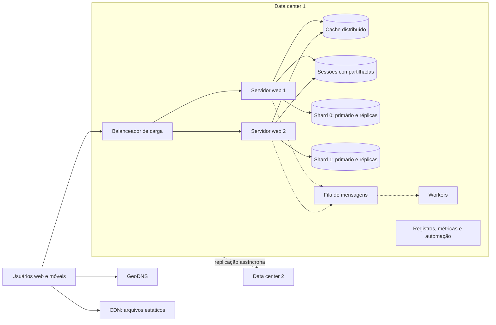
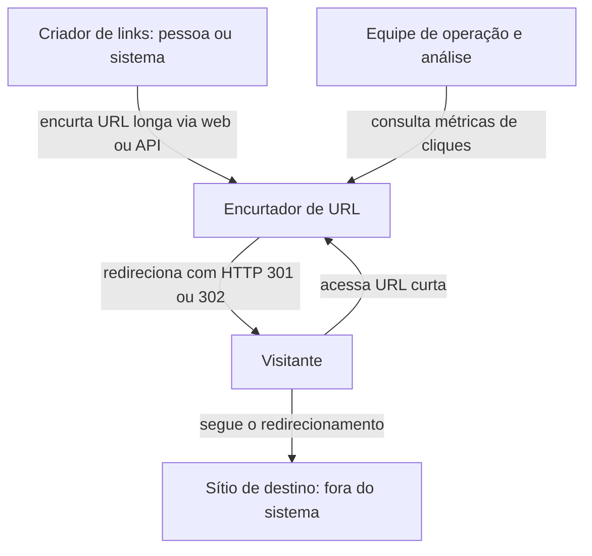
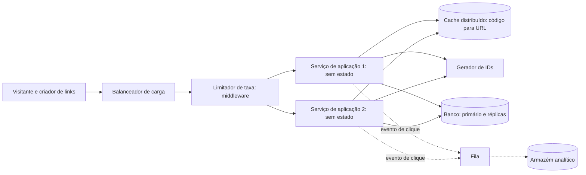
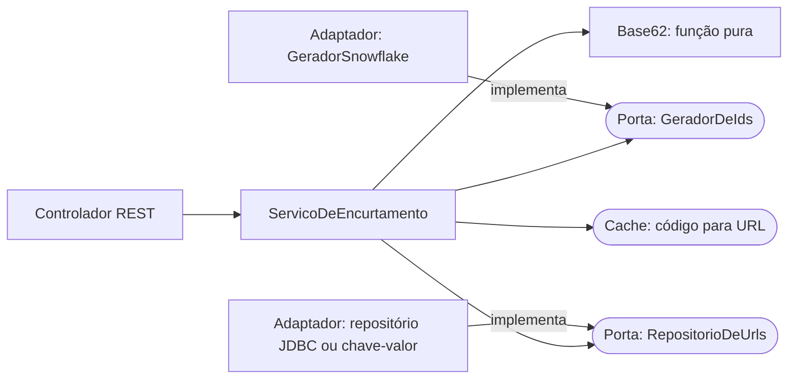

# Apêndice F - Sistemas em escala: blocos de construção e um voo de instrução

## Objetivos

Ao final deste apêndice, o leitor deverá ser capaz de:

- Aplicar o método em quatro passos de Alex Xu para o projeto de sistemas e relacioná-lo às
  quatro altitudes de análise adotadas neste livro.
- Explicar como um sistema evolui de um único servidor para uma arquitetura com balanceador de
  carga, réplicas, *cache*, CDN, filas, múltiplos *data centers* e *sharding*, identificando,
  em cada passo, a característica arquitetural que melhora e o novo problema que surge.
- Relacionar cada passo dessa evolução às falácias da computação distribuída e antecipar, por
  meio do teorema CAP, o compromisso entre consistência e disponibilidade.
- Fazer estimativas de guardanapo de vazão (QPS), armazenamento, memória e disponibilidade a
  partir de números de negócio, e criticar estimativas publicadas.
- Projetar um encurtador de URL descendo do contexto ao código, justificar a escolha entre
  *hash* com resolução de colisões e base 62 sobre identificadores únicos, e comparar
  geradores de identificadores (UUID, servidor de *tickets* e Snowflake).
- Implementar em Java, com testes automatizados, um codificador base 62 e uma família de
  algoritmos de limitação de taxa organizados segundo o padrão *Strategy*.
- Realizar uma subida de verificação, ligando um trecho de código à decisão e à característica
  arquitetural que ele sustenta, e reconhecer quando essa cadeia se rompe.

## Introdução

Pilotos não começam sua formação aos comandos de um avião de linha. Antes, realizam voos de
instrução em aeronaves simples, sob condições controladas, para praticar cada manobra até que
ela se torne natural. Este apêndice cumpre papel análogo no livro. Os Capítulos 3 a 6 percorrem
as sete aplicações apresentadas no Capítulo 2 altitude por altitude, e em cada uma delas o leitor
encontra balanceadores, réplicas, *caches*, filas, *shards*, estimativas de capacidade e
decisões entre consistência e disponibilidade. Este apêndice reúne esses **blocos de
construção** em um único lugar, como referência, e os exercita sobre um sistema didático,
pequeno o bastante para caber inteiro na cabeça do leitor, mas exigente o bastante para que as
decisões arquiteturais importem. Os Capítulos 3 (100.000 pés) e 4 (50.000 pés) remetem a ele
sempre que um desses blocos aparece.

O sistema escolhido para o voo de instrução é um **encurtador de URL**, serviço que associa um
endereço longo a um código curto e redireciona quem acessa o código para o endereço original. A
funcionalidade é trivial: duas operações, uma tabela de duas colunas. O que torna o problema
interessante é a escala. Um encurtador público precisa aceitar milhões de novos endereços por
dia, responder a um volume de leituras dez ou cem vezes maior, permanecer disponível por anos e
nunca devolver o endereço errado. É justamente nessa distância entre a simplicidade funcional e
a exigência operacional que se manifesta a tese de Richards e Ford (2020, cap. 4): as
características arquiteturais, e não as funcionalidades, determinam a forma de um sistema.

A principal fonte do apêndice é o livro de Xu (2020), concebido como preparação para entrevistas
de projeto de sistemas (*system design interviews*) e amplamente adotado como introdução ao
projeto de sistemas distribuídos; o mesmo estilo de conversa com o cliente orienta o Capítulo 3.
O livro de Xu tem méritos didáticos evidentes, mas também limites: ele para no nível dos
componentes, raramente desce ao código, e algumas de suas contas contêm erros que o leitor
atento pode e deve identificar. O material de Xu é aqui complementado com o vocabulário de
características arquiteturais e de falácias da computação distribuída de Richards e Ford (2020),
com a discussão da arquitetura em três camadas de Fox e Patterson (2021) e com as fontes
primárias sempre que possível.

O apêndice está organizado da seguinte forma. A Seção F.1 apresenta o método em quatro passos de
Xu e o relaciona às altitudes. A Seção F.2 percorre a evolução de um sistema de um servidor até
milhões de usuários, examinando o que cada passo melhora e o que cada passo complica, e encerra
com uma prévia do teorema CAP. A Seção F.3 trata das estimativas de guardanapo. A Seção F.4
conduz o caso guiado do encurtador de URL pelas quatro altitudes, terminando com a subida de
verificação. A Seção F.5 projeta e implementa um limitador de taxa (*rate limiter*), componente
que protege o encurtador e quase todo serviço exposto na internet.

## F.1 O método em quatro passos e as altitudes

### F.1.1 Origem e propósito do método

Xu (2020, cap. 3) propõe um roteiro em quatro passos para conduzir uma entrevista de projeto de
sistemas, situação em que um candidato dispõe de cerca de 45 minutos para esboçar a arquitetura
de um produto conhecido diante de um entrevistador. O autor reconhece que nenhum entrevistador
espera ver em uma hora o projeto de algo que consumiu o trabalho de centenas de engenheiros. O
objetivo da entrevista, argumenta, é observar como o candidato colabora diante de um problema
ambíguo, defende suas escolhas e reage a críticas, o que torna o processo mais importante que o
desenho final. O roteiro é, portanto, uma disciplina de raciocínio, e não um algoritmo que
produz arquiteturas.

O **primeiro passo** consiste em entender o problema e delimitar o escopo. Xu insiste que
responder rapidamente, sem compreender os requisitos, é um sinal negativo, e recomenda perguntar
quais funcionalidades serão construídas, quantos usuários o produto tem, com que velocidade se
espera crescer e que tecnologias e serviços já existem na organização. Quando o entrevistador
devolve a pergunta, o candidato deve registrar suas hipóteses por escrito. O **segundo passo**
consiste em propor um projeto de alto nível e obter a concordância do interlocutor: desenhar
caixas com os componentes principais (clientes, APIs, servidores, bancos, *cache*, CDN, filas),
fazer estimativas para verificar se o esboço comporta a escala e percorrer alguns casos de uso
concretos. O **terceiro passo** é o aprofundamento (*deep dive*) nos componentes mais críticos
ou mais interessantes, escolhidos em conjunto com o interlocutor. O **quarto passo** é o
fechamento: identificar gargalos, discutir falhas, operação e monitoramento, e indicar o que
mudaria se a escala crescesse mais uma ordem de grandeza (XU, 2020, cap. 3).

Dois alertas de Xu merecem destaque por valerem muito além das entrevistas. O primeiro é contra
o excesso de engenharia (*over-engineering*), que o autor descreve como uma doença comum entre
engenheiros que se encantam com a pureza do projeto e ignoram os compromissos e os custos
acumulados de sistemas superdimensionados. O segundo é a recomendação de nunca declarar um
projeto perfeito: sempre há algo a melhorar, e reconhecer os pontos fracos do próprio desenho é
demonstração de pensamento crítico (XU, 2020, cap. 3). Ambos os alertas são aplicações diretas
da primeira lei de Richards e Ford, segundo a qual tudo em arquitetura de software é um
compromisso (Seção 1.1.2).

### F.1.2 Correspondência com as altitudes

Os quatro passos de Xu têm correspondência quase direta com as altitudes de análise deste livro,
como mostra a Tabela F.1. A correspondência não é coincidência. Tanto o método de Xu quanto o
modelo C4 (Seção 1.3.3) partem do princípio de que se deve ir do geral ao particular, fixando o
contexto e as restrições antes de desenhar estruturas, e as estruturas antes de escrever código.

**Tabela F.1** – Os passos de Xu e as altitudes de análise.

| Passo (Xu, cap. 3) | Tempo sugerido em uma entrevista de 45 min | Altitude | Produto típico |
|---|---|---|---|
| 1. Entender o problema e delimitar o escopo | 3 a 10 min | <span class="altitude a100">100.000 pés</span> | Requisitos, hipóteses, estimativas, características prioritárias |
| 2. Propor o projeto de alto nível e obter acordo | 10 a 15 min | <span class="altitude a50">50.000 pés</span> | Diagrama de *containers*, API, escolha de armazenamento |
| 3. Aprofundar os componentes críticos | 10 a 25 min | <span class="altitude a10">10.000 pés</span> | Componentes, algoritmos, modelo de dados, fluxos detalhados |
| — (não previsto por Xu) | — | <span class="altitude solo">Solo</span> | Código e testes que materializam as decisões |
| 4. Fechamento | 3 a 5 min | Subida de verificação | Gargalos, falhas, próxima escala, revisão das decisões |

Fonte: adaptado de Xu (2020, cap. 3).

Duas diferenças entre o método de Xu e o deste livro merecem atenção. A primeira é que Xu para
no terceiro passo: o aprofundamento discute algoritmos e esquemas de dados, mas não chega ao
código. Neste livro, o voo prossegue até o solo, porque é no código que as decisões se
confirmam ou se desfazem. Uma escolha que parece elegante em um diagrama, como "converter o
identificador para base 62", pode revelar-se inconsistente com outra escolha quando se escreve
e se testa a implementação, como a Seção F.4.6 mostrará. A segunda diferença é que o fechamento
de Xu se torna, aqui, uma **subida de verificação**: em vez de apenas listar melhorias, o
analista parte do código e sobe as altitudes perguntando que componente o código realiza, que
decisão o componente concretiza e que característica a decisão protege (Seção 1.11).

O primeiro passo de Xu também se aproxima de uma prática que Richards e Ford (2020, cap. 5)
recomendam para treinar arquitetos: as *katas* arquiteturais, criadas por Ted Neward e adaptadas
pelos autores. Uma *kata* descreve um problema em termos do domínio, com seções fixas para
descrição, usuários, requisitos e contexto adicional, e pede que pequenas equipes derivem dela
as características arquiteturais. Os autores observam que os requisitos raramente pedem
"escalabilidade" de forma explícita. Eles mencionam números de usuários, picos sazonais ou
restrições de prazo, e cabe ao arquiteto traduzir a linguagem do domínio em características de
engenharia (RICHARDS; FORD, 2020, p. 68-70). A ficha do caso guiado, na Seção F.4.1, segue esse
formato.

### F.1.3 Limites do método

O roteiro de Xu foi concebido para uma situação artificial, e convém reconhecer o que ele deixa
de fora quando transportado para projetos reais. Em uma entrevista, há um único interlocutor que
detém todos os requisitos e responde prontamente. Em um projeto, há vários *stakeholders* com
interesses conflitantes (Seção 1.3.1), requisitos que mudam e informações que ninguém possui.
Em uma entrevista, o sistema nasce do zero. Na prática, quase todo sistema é a evolução de outro,
com restrições herdadas de código, dados e contratos existentes. Por fim, a entrevista termina
com um desenho no quadro, enquanto um projeto real precisa registrar as decisões e seus motivos
(Seção 1.10 e Apêndice B) para que alguém, meses depois, consiga entender por que o sistema é
como é.

Argumenta-se aqui que essas limitações não invalidam o método, mas definem seu uso adequado.
O roteiro é excelente para estruturar o raciocínio e para treinar a passagem entre níveis de
abstração. Não substitui, contudo, os métodos de avaliação arquitetural baseados em cenários,
retomados no Capítulo 7, nem a governança contínua por funções de aptidão, tratada no
Capítulo 6. Neste apêndice, o método é aplicado com dois acréscimos: as decisões relevantes são
registradas em forma de ADR resumido, e a descida termina no código e é verificada por testes.

## F.2 Do zero a milhões de usuários

O primeiro capítulo de Xu (2020, cap. 1) narra a evolução de um sistema que começa atendendo a
um único usuário e cresce, passo a passo, até atender milhões. Cada passo introduz um elemento
de infraestrutura para resolver um gargalo concreto, o que mostra que as arquiteturas de grande
escala não surgem prontas, mas resultam de respostas sucessivas a limites encontrados. Esta
seção reproduz a sequência por uma lente que Xu não usa de forma sistemática: para cada passo,
pergunta-se **que característica arquitetural melhora** e **que novo problema surge**, com
atenção às falácias da computação distribuída (RICHARDS; FORD, 2020, p. 123-131).

A lente é necessária porque nenhum passo é gratuito. Segundo Richards e Ford (2020, cap. 9), as
arquiteturas distribuídas superam as monolíticas em desempenho, escalabilidade e
disponibilidade, mas pagam por isso com problemas inexistentes em uma unidade única de
implantação. As oito falácias, atribuídas a L. Peter Deutsch e colegas da Sun Microsystems em
1994, são crenças falsas que os projetistas tendem a assumir: a rede é confiável; a latência é
zero; a largura de banda é infinita; a rede é segura; a topologia nunca muda; há um único
administrador; o custo de transporte é zero; a rede é homogênea. Cada passo desta seção torna o
sistema mais distribuído e, portanto, mais exposto a pelo menos uma delas.

### F.2.1 Servidor único

No ponto de partida, tudo roda em um único servidor: a aplicação *web*, o banco de dados e,
eventualmente, um *cache*. O serviço de DNS, normalmente mantido por terceiros, resolve o nome
do domínio para o IP do servidor, e o navegador ou o aplicativo móvel envia requisições HTTP
diretamente a ele (XU, 2020, cap. 1). Fox e Patterson (2021, seção 3.1) caracterizam essa
organização como a forma mais difundida da arquitetura cliente-servidor, em que o cliente se
especializa na interação com o usuário e o servidor, no atendimento simultâneo a muitos
clientes.

A característica maximizada é a **simplicidade**: um único artefato para implantar, um único
registro de erros, transações locais e nenhuma comunicação remota entre partes do sistema. Para
um produto que ainda procura seus primeiros usuários, essa é frequentemente a escolha correta, e
o alerta de Xu contra o excesso de engenharia aplica-se aqui. O problema é que o servidor é um
**ponto único de falha** (*single point of failure*, SPOF): se ele cair, o sistema inteiro cai.
Nenhuma falácia distribuída se aplica ainda, porque não há rede entre as partes do sistema, e
isso é parte do que o torna tão simples.

### F.2.2 Separação entre a camada *web* e a camada de dados

Com o crescimento da base de usuários, o primeiro movimento é separar o tráfego *web* e móvel do
banco de dados, cada um em seu servidor, o que permite escalá-los de forma independente (XU,
2020, cap. 1). Fox e Patterson (2021, p. 375-377) observam que as camadas da arquitetura em três
camadas (apresentação, lógica e persistência) são **lógicas**: em desenvolvimento, as três podem
rodar em um único computador; em produção, cada uma ocupa uma ou mais máquinas. A separação
física não altera o projeto lógico do software, apenas o seu mapeamento sobre o *hardware*.

É também o momento de escolher o tipo de banco. Xu (2020, cap. 1) recomenda os relacionais como
opção padrão, por sua maturidade, e indica os não relacionais quando se exige latência muito
baixa, quando os dados não têm estrutura relacional ou quando o volume é muito grande. O autor
distingue ainda a **escala vertical** (*scale up*), que acrescenta recursos ao mesmo servidor e
tem limite físico e nenhuma redundância, da **escala horizontal** (*scale out*), que acrescenta
servidores e exige que o software saiba dividir o trabalho entre eles.

A característica que melhora é a **escalabilidade** independente das camadas, entendida como a
capacidade de operar adequadamente à medida que cresce o número de usuários ou de requisições
(RICHARDS; FORD, 2020, p. 58). O novo problema é que a chamada ao banco, antes local, atravessa
a rede. Passam a valer as falácias de que **a rede é confiável** (o banco pode estar saudável,
mas inalcançável) e de que **a latência é zero** (padrões de acesso com dezenas de consultas por
página tornam-se caros). O sistema passou, ainda, a ter dois pontos únicos de falha.

### F.2.3 Balanceador de carga e escala horizontal da camada *web*

O passo seguinte é colocar um **balanceador de carga** diante de dois ou mais servidores *web*.
Os usuários conectam-se ao IP público do balanceador, e os servidores ficam acessíveis apenas
por endereços privados. Se um servidor sai do ar, o tráfego vai para os demais; se a carga
cresce, basta acrescentar servidores ao grupo (XU, 2020, cap. 1). Fox e Patterson (2021, p. 377)
acrescentam que balanceadores podem ser dispositivos de *hardware* ou servidores *web*
configurados para esse fim, e que podem existir em mais de uma fronteira entre camadas.

Melhoram a **disponibilidade** da camada *web* e a **escalabilidade horizontal**. Os novos
problemas são menos visíveis. O próprio balanceador pode tornar-se ponto único de falha, se não
for redundante. A falácia de que **a topologia nunca muda** torna-se concreta: servidores entram
e saem do grupo por falha, implantação ou ajuste de capacidade, e componentes que memorizam
endereços específicos passam a falhar de modo intermitente. E, se a sessão do usuário estiver na
memória de um servidor, requisições consecutivas podem cair em servidores diferentes, problema
resolvido apenas no passo da Seção F.2.7.

### F.2.4 Replicação do banco de dados

O banco continua sendo ponto único de falha. A técnica usual é a **replicação** primário-réplica
(que Xu, com a terminologia antiga, chama de *master/slave*): o primário aceita as escritas, e as
réplicas recebem cópias e atendem às leituras, que costumam ser muito mais numerosas. Xu (2020,
cap. 1) aponta ganhos de desempenho, confiabilidade e disponibilidade: se uma réplica falha, as
leituras vão para outra; se o primário falha, uma réplica é promovida.

Melhoram a **disponibilidade** dos dados e a **escalabilidade de leitura**. O novo problema, que
Xu menciona de passagem, é central: a réplica pode estar **atrasada**. Na promoção após uma
falha, escritas recentes podem não ter chegado à réplica, e o próprio Xu reconhece que, em
produção, a promoção exige *scripts* de recuperação de dados. Em operação normal, o atraso
produz anomalias visíveis: o usuário altera o perfil (escrita no primário), recarrega a página
(leitura na réplica) e vê o valor antigo. A falácia em jogo é a de que **a latência é zero**:
enquanto a propagação não termina, o sistema tem duas versões da verdade.

Fox e Patterson (2021, p. 376-377) são céticos quanto ao alcance da técnica, que, para eles,
apenas **adia** o problema de escalar a persistência. A razão é estrutural: as camadas de
apresentação e de lógica podem ser *shared-nothing* (sem estado compartilhado entre servidores
da mesma camada), mas a camada de dados guarda justamente o estado comum, e muitas cópias do
banco poderiam conter valores diferentes para o mesmo item (FOX; PATTERSON, 2021, seção 12.11).
A Seção F.2.12 retoma essa tensão sob a forma do teorema CAP.

### F.2.5 *Cache*

Um *cache* é uma área de armazenamento temporário, normalmente em memória, que guarda resultados
de operações caras ou dados acessados com frequência (XU, 2020, cap. 1). Uma camada de *cache*
separada reduz a carga do banco, melhora o tempo de resposta e escala independentemente. Fox e
Patterson (2021, seção 12.6) mostram que ele pode existir em todas as camadas, do navegador às
consultas ao banco, sempre com o mesmo objetivo: atender cada requisição o mais perto possível do
usuário.

#### Estratégias de *cache*

A coordenação entre o *cache* e o armazenamento durável é uma decisão arquitetural com
consequências para a consistência, e a Tabela F.2 resume as estratégias mais comuns. Há uma
imprecisão terminológica em Xu (2020, cap. 1): o fluxo que ele descreve (o servidor consulta o
*cache*; na falta, lê do banco, grava no *cache* e responde) é chamado de *read-through*, mas a
literatura reserva esse nome para o caso em que o próprio *cache* busca o dado na origem. Quando
é a **aplicação** que coordena as duas consultas, fala-se em *cache-aside* ou *look-aside*, termo
usado por Nishtala *et al.* (2013) para o Memcached do Facebook.

**Tabela F.2** – Estratégias de coordenação entre *cache* e armazenamento durável.

| Estratégia | Leitura | Escrita | Vantagem | Risco principal |
|---|---|---|---|---|
| *Cache-aside* (*look-aside*) | Aplicação consulta o *cache*; na falta, lê do banco e preenche o *cache* | Aplicação grava no banco e invalida (ou atualiza) a entrada | Simples; *cache* contém só o que é lido | Janela de inconsistência entre a escrita e a invalidação |
| *Read-through* | O *cache* busca na origem quando falta o dado | (combinada com outra estratégia) | Lógica de carga centralizada no *cache* | Primeira leitura de cada item é lenta |
| *Write-through* | Leitura no *cache* | Grava no *cache* e, de forma síncrona, no banco | *Cache* sempre atualizado | Escritas mais lentas; *cache* cheio de dados que ninguém lê |
| *Write-behind* (*write-back*) | Leitura no *cache* | Grava no *cache*; o banco é atualizado depois, de forma assíncrona | Escritas muito rápidas; agrupa gravações | Perda de dados se o *cache* falhar antes da gravação |
| *Write-around* | Como *cache-aside* | Grava apenas no banco | Evita poluir o *cache* com dados recém-escritos e pouco lidos | Leitura logo após escrita sempre falha no *cache* |

Fonte: elaborado pelo autor (2026), com base em Xu (2020, cap. 1) e Nishtala *et al.* (2013).

Xu (2020, cap. 1) lista ainda cinco considerações: usar *cache* para dados lidos com frequência e
modificados raramente, sem nunca fazer dele o único lugar de um dado importante; definir uma
**política de expiração** (*time to live*, TTL), nem curta nem longa demais; cuidar da
**consistência**, difícil porque *cache* e banco não são atualizados na mesma transação; evitar
que um único servidor de *cache* seja ponto único de falha; e escolher uma **política de
despejo** (*eviction*), geralmente LRU (*least recently used*), para quando a memória enche.

#### Os problemas de consistência

Fox e Patterson (2021, seção 12.6) abrem sua discussão com a frase atribuída a Phil Karlton,
segundo a qual há apenas duas coisas difíceis em ciência da computação: invalidar *caches* e dar
nomes às coisas. Os autores reduzem o problema a duas perguntas: como **nomear** um resultado
para reutilizá-lo apenas quando a mesma computação for pedida, e como **detectar e remover** a
versão obsoleta quando a origem mudar.

Três anomalias são frequentes com *cache-aside*. A **leitura obsoleta** ocorre entre a escrita
no banco e a invalidação da entrada. A **gravação obsoleta** (*stale set*) é mais sutil: o
cliente A lê o valor antigo do banco após uma falta; antes que A o grave no *cache*, o cliente B
atualiza o banco e invalida a entrada; A então grava o valor antigo, que permanece até expirar. A
**manada estrondosa** (*thundering herd*) ocorre quando uma chave muito acessada expira e
centenas de requisições simultâneas vão ao banco ao mesmo tempo. Nishtala *et al.* (2013)
descrevem como o Facebook tratou as duas últimas com **arrendamentos** (*leases*): na falta, o
*cache* entrega ao cliente um *token* que lhe dá o direito exclusivo de preencher a chave,
invalidado se houver escrita no intervalo, e limita a frequência de emissão de *tokens* para a
mesma chave.

O *cache* melhora o **desempenho**, mas introduz uma segunda cópia dos dados e expõe o sistema à
falácia de que **a rede é confiável**: uma invalidação perdida deixa um valor obsoleto em
circulação. Por isso o TTL não é apenas uma política de memória, mas uma **rede de segurança**
que limita o tempo máximo de inconsistência.

### F.2.6 Rede de distribuição de conteúdo (CDN)

Uma CDN (*content delivery network*) é uma rede de servidores geograficamente dispersos que
entrega conteúdo estático, como imagens, vídeos, folhas de estilo e *scripts*. O servidor mais
próximo do usuário entrega o arquivo; se não o tiver, busca-o na origem e o guarda pelo TTL
indicado (XU, 2020, cap. 1). A CDN é, portanto, um *cache* do tipo *read-through* operado por
terceiros na borda da rede.

Melhora a **latência** percebida, sobretudo por usuários distantes, e alivia os servidores
*web*. Xu aponta quatro cuidados: o **custo** da transferência, que não compensa para arquivos
pouco acessados; a **expiração** adequada; a **contingência** para falhas da própria CDN, com
clientes capazes de recorrer à origem; e a **invalidação**, pela API do fornecedor ou pelo
versionamento do objeto na URL (`image.png?v=2`). Tornam-se visíveis as falácias de que **o custo
de transporte é zero** e de que **há um único administrador**: parte crítica do caminho de cada
requisição passa a ser operada por outra empresa.

### F.2.7 Camada *web* sem estado

Para que a camada *web* cresça e encolha livremente, o estado da sessão precisa sair dos
servidores. Em uma arquitetura **com estado** (*stateful*), todas as requisições de um usuário
precisam ir ao servidor que guarda sua sessão; as **sessões aderentes** (*sticky sessions*) dos
balanceadores resolvem isso, mas dificultam acrescentar e remover servidores e tratar falhas
(XU, 2020, cap. 1). Em uma arquitetura **sem estado** (*stateless*), a sessão fica em um
armazenamento compartilhado, e qualquer servidor atende qualquer requisição.

Fox e Patterson (2021, p. 377) explicam por que isso é possível: o HTTP é sem estado, cada
requisição é independente das anteriores, e a continuidade da sessão é obtida por *cookies*
reapresentados pelo cliente (FOX; PATTERSON, 2021, seção 3.2). Isso permite que as camadas de
apresentação e de lógica sejam *shared-nothing*, propriedade que, segundo os autores, permitiu à
computação em nuvem acrescentar e liberar computadores conforme a demanda, pagando-se apenas
pelo uso.

A característica que melhora é a **elasticidade**, que Richards e Ford (2020, p. 70) distinguem
da escalabilidade: esta é suportar muitos usuários simultâneos sem degradação séria; aquela é
suportar **rajadas**. Um sistema de reservas de hotel tem carga estável; um de venda de
ingressos para concertos enfrenta picos súbitos na abertura das vendas. O novo problema é que o
armazenamento de sessões passa a ser consultado em quase toda requisição, o que reintroduz as
falácias da **latência** e da **largura de banda** e pode torná-lo gargalo ou ponto único de
falha.

### F.2.8 Múltiplos *data centers*

Com usuários em várias regiões, um serviço de **geoDNS** passa a resolver o domínio para o *data
center* mais próximo do usuário, e, se um deles falha, todo o tráfego é desviado para os demais
(XU, 2020, cap. 1). Xu aponta três desafios: o **redirecionamento de tráfego**; a
**sincronização de dados**, pois, após um desvio, o tráfego pode chegar a um *data center* onde
os dados ainda não estão; e o **teste e implantação** em vários locais, que exigem automação.

Melhoram a **disponibilidade** diante de desastres regionais e a latência para usuários
distantes. O preço é o mais alto da sequência, porque os dados precisam ser replicados entre
locais separados por dezenas de milissegundos e por enlaces que falham. Praticamente todas as
falácias se aplicam: **a rede não é confiável**, **a latência** entre regiões é ordens de
grandeza maior que dentro de um *data center* (Seção F.3.3), **a topologia muda** quando um
*data center* entra ou sai de operação, e **há muitos administradores**. A caixa-preta a seguir
mostra como poucos segundos de falha de comunicação podem produzir um dia de degradação.

!!! caixa-preta "GitHub, 21 de outubro de 2018: 43 segundos que custaram 24 horas"
    Durante uma manutenção de rotina para substituir equipamento óptico defeituoso, o GitHub
    perdeu por 43 segundos a conectividade entre um centro de rede na costa leste dos Estados
    Unidos e seu *data center* principal na mesma costa. Nesse intervalo, o sistema de gestão
    de topologia dos clusters MySQL (Orchestrator) promoveu primários na costa oeste. Quando a
    conectividade voltou, havia escritas que existiam apenas em um dos lados, e as aplicações,
    agora escrevendo na costa oeste, passaram a sofrer a latência entre costas. A empresa optou
    por preservar a integridade dos dados em vez de restabelecer rapidamente o serviço, e
    operou em modo degradado por cerca de 24 horas enquanto reconciliava as escritas
    (WARNER, 2018). O episódio ilustra três falácias de uma só vez (rede confiável, latência
    zero e topologia imutável) e antecipa o dilema do teorema CAP (Seção F.2.12): diante de uma
    partição, é preciso escolher entre continuar aceitando escritas e manter uma única versão
    consistente dos dados.

### F.2.9 Filas de mensagens

Uma **fila de mensagens** é um componente durável que suporta comunicação assíncrona:
produtores publicam mensagens, e consumidores as retiram e executam o trabalho, sem que um
precise estar disponível quando o outro está (XU, 2020, cap. 1). No exemplo de Xu, servidores
*web* publicam tarefas de processamento de fotos, e um grupo de *workers*, que cresce ou encolhe
conforme o tamanho da fila, as executa.

Melhoram o **desacoplamento**, a **tolerância a falhas** e a capacidade de **absorver picos**: a
fila transforma uma rajada em um fluxo constante de trabalho. Os novos problemas são próprios da
comunicação assíncrona: o produtor não sabe quando, e se, o trabalho foi feito; mensagens podem
ser entregues mais de uma vez ou fora de ordem, conforme a tecnologia, o que exige consumidores
idempotentes; e o sistema torna-se **eventualmente consistente**. Richards e Ford (2020, p. 132)
apontam esse como o compromisso típico das arquiteturas distribuídas: consistência imediata
trocada por escalabilidade, desempenho e disponibilidade.

### F.2.10 Registros, métricas e automação

Em um sistema grande, registros (*logs*), métricas e automação tornam-se indispensáveis (XU,
2020, cap. 1). Os registros de erro precisam ser agregados em um serviço central; as métricas
abrangem o servidor (CPU, memória, disco), as camadas agregadas e o negócio (usuários ativos,
receita); e a automação abrange integração contínua, testes e implantação. Melhora a
**observabilidade**, isto é, a capacidade de inferir o estado interno do sistema a partir de suas
saídas. O problema enfrentado foi agravado por todos os passos anteriores: Richards e Ford (2020,
p. 131-132) destacam o **registro distribuído** como dificuldade própria das arquiteturas
distribuídas, com dezenas ou centenas de registros em lugares e formatos diferentes, o que torna
penosa a análise da causa raiz de uma falha.

### F.2.11 *Sharding*

Com o crescimento dos dados, o banco primário volta a ser o gargalo, agora para escritas e para
volume. A escala vertical vai longe (Xu cita o Stack Overflow, que em 2013 atendia mais de 10
milhões de visitantes únicos mensais com um único banco primário), mas tem limites de
*hardware*, custo e risco (XU, 2020, cap. 1). A alternativa é o ***sharding***: dividir o banco em
partes menores, os ***shards***, com o mesmo esquema e dados disjuntos, e decidir o *shard* de
cada registro por uma função aplicada à **chave de particionamento**, como `user_id % 4` no
exemplo de Xu.

A escolha da chave é decisiva, porque determina a distribuição dos dados e se as consultas
frequentes podem ser respondidas por um único *shard*. Xu (2020, cap. 1) aponta três problemas. O
***resharding***: quando um *shard* esgota, é preciso mudar a função e mover dados; com uma
função módulo, passar de 4 para 5 *shards* muda o destino de cerca de 80% das chaves. O
**hashing consistente**, proposto por Karger *et al.* (1997) e tratado por Xu (2020, cap. 5),
reduz a migração à fração de chaves que precisa mudar de lugar. O **problema da celebridade**
(*hotspot key*): se contas muito populares caem no mesmo *shard*, ele fica sobrecarregado, e
pode ser preciso dedicar um *shard* a cada celebridade. E a perda das **junções** entre *shards*,
normalmente contornada por desnormalização.

Melhora a **escalabilidade de escrita e de volume**. Além dos problemas apontados por Xu, surgem
as **transações distribuídas** (RICHARDS; FORD, 2020, p. 132): uma operação que altera dois
*shards* já não conta com uma transação ACID local. A falácia de que **a topologia nunca muda**
reaparece no *resharding*, e o problema da celebridade será reencontrado nas Seções 3.2 e 5.2, quando a
linha do tempo de contas com milhões de seguidores desafiar a distribuição de publicações.

### F.2.12 Síntese da evolução e prévia do teorema CAP

A Figura F.1 mostra a arquitetura ao fim da sequência, e a Tabela F.3 resume a evolução pela
lente adotada nesta seção. Xu (2020, cap. 1) encerra seu capítulo com uma lista de
recomendações: manter a camada *web* sem estado, construir redundância em todas as camadas,
usar *cache* intensamente, suportar múltiplos *data centers*, hospedar arquivos estáticos em CDN,
escalar a camada de dados por *sharding*, dividir camadas em serviços e monitorar o sistema com
ferramentas de automação. A tabela mostra o reverso de cada recomendação.

**Figura F.1** – Arquitetura ao fim da evolução "do zero a milhões" (um *data center* mostrado).



Fonte: adaptado de Xu (2020, cap. 1). Linhas contínuas: comunicação síncrona; linhas tracejadas:
comunicação assíncrona.

**Tabela F.3** – Cada passo da evolução: o que melhora, o que piora e que falácia passa a valer.

| Passo | Característica que melhora | Novo problema | Falácias mais expostas |
|---|---|---|---|
| 1. Servidor único | Simplicidade | Ponto único de falha; teto de capacidade | Nenhuma (não há rede interna) |
| 2. *Web* e banco separados | Escalabilidade independente | Chamadas remotas ao banco; dois SPOFs | Rede confiável; latência zero |
| 3. Balanceador e vários servidores | Disponibilidade; escala horizontal | Balanceador como SPOF; sessões em memória | Topologia imutável |
| 4. Replicação primário-réplica | Disponibilidade; escala de leitura | Atraso de replicação; promoção com perda | Latência zero |
| 5. *Cache* | Desempenho | Dados obsoletos; gravação obsoleta; manada | Rede confiável (invalidações perdidas) |
| 6. CDN | Latência para estáticos | Custo; invalidação; dependência de terceiro | Custo de transporte zero; um único administrador |
| 7. Camada *web* sem estado | Elasticidade | Armazenamento de sessões como gargalo | Latência zero; largura de banda infinita |
| 8. Vários *data centers* | Disponibilidade geográfica | Sincronização entre regiões; testes | Praticamente todas |
| 9. Filas de mensagens | Desacoplamento; absorção de picos | Consistência eventual; entregas duplicadas | Rede confiável |
| 10. Registros, métricas, automação | Observabilidade; operabilidade | Volume e dispersão dos registros | Um único administrador |
| 11. *Sharding* | Escalabilidade de escrita e volume | *Resharding*; celebridade; junções e transações | Topologia imutável |

Fonte: elaborado pelo autor (2026), com base em Xu (2020, cap. 1) e Richards e Ford (2020,
cap. 9).

Os passos 4, 5, 8 e 11 têm algo em comum: todos criam **mais de uma cópia** ou **mais de um
lugar** para os dados. Essa multiplicação é a fonte da tensão mais profunda dos sistemas
distribuídos, formalizada pelo **teorema CAP**. Brewer (2000) apresentou a conjectura em uma
palestra no simpósio PODC, afirmando que um sistema de dados compartilhados não pode oferecer
simultaneamente as três propriedades: **consistência** (*consistency*), **disponibilidade**
(*availability*) e **tolerância a partições** (*partition tolerance*). Gilbert e Lynch (2002)
formalizaram e demonstraram o resultado em um modelo assíncrono, definindo consistência como
atomicidade (linearizabilidade): toda leitura vê o efeito da escrita mais recente, como se
houvesse uma única cópia dos dados. Disponibilidade significa que toda requisição recebida por
um nó que não falhou recebe resposta. Tolerância a partições significa que o sistema continua
operando mesmo quando a rede perde mensagens entre grupos de nós.

Xu (2020, cap. 6) apresenta o teorema na forma popular, "escolha duas de três", e conclui que um
sistema CA não pode existir na prática, porque falhas de rede são inevitáveis em um sistema
distribuído. A leitura mais precisa, defendida pelo próprio Brewer (2012) doze anos depois, é
que a escolha só se impõe **durante uma partição**: como partições são raras, um sistema bem
projetado oferece consistência e disponibilidade na maior parte do tempo e precisa decidir,
para cada operação, o que sacrificar quando uma partição ocorre, além de como recuperar-se
depois dela. Abadi (2012) acrescentou que, mesmo sem partição, há um segundo compromisso,
frequentemente mais relevante no dia a dia, entre **latência** e **consistência**: manter
réplicas sincronizadas exige esperar por elas. O incidente do GitHub de 2018 (Seção F.2.8) é um
exemplo de escolha explícita por consistência durante e após uma partição. As Seções 4.5 e 5.5, que
analisa a sincronização de arquivos entre dispositivos no Dropbox e no Nextcloud, retoma o
teorema com profundidade, e o caso guiado deste apêndice mostrará que, para alguns sistemas, o
dilema é muito menos agudo do que parece.

## F.3 Estimativas de guardanapo

### F.3.1 Propósito

Xu (2020, cap. 2) cita a definição de Jeff Dean, do Google, para quem as estimativas de
guardanapo (*back-of-the-envelope calculations*) são estimativas construídas pela combinação de
experimentos mentais com números de desempenho conhecidos, para se ter uma boa noção de quais
projetos atenderão aos requisitos. O objetivo não é a precisão, mas a **ordem de grandeza**:
saber se o sistema precisa de um servidor ou de mil, de gigabytes ou de *petabytes*, de
milissegundos ou de segundos. Uma estimativa que erra por um fator de dois raramente muda o
projeto; uma que erra por um fator de mil muda tudo.

Xu (2020, cap. 2) dá quatro conselhos práticos. Arredondar sem culpa, trocando, por exemplo,
"99.987 / 9,1" por "100.000 / 10". **Escrever as hipóteses**, para que possam ser revistas.
**Rotular as unidades**, porque "5" pode significar 5 KB ou 5 MB. E praticar os cálculos mais
comuns: QPS médio e de pico, armazenamento, memória de *cache* e número de servidores.
Acrescenta-se aqui um quinto conselho, que a Seção F.4.2 justificará: **conferir as contas
publicadas**, inclusive as dos livros.

### F.3.2 Potências de dois

Os volumes de dados são expressos em múltiplos do *byte*, e convém memorizar a correspondência
entre as potências de dois e as potências de dez, mostrada na Tabela F.4. A aproximação
\(2^{10} \approx 10^3\) tem erro de 2,4%, que se acumula: \(2^{40}\) é cerca de 10% maior que
\(10^{12}\). Para estimativas, a diferença é irrelevante. Para contratos de armazenamento e
faturamento, não é, e por isso a norma IEC 80000-13 distingue os prefixos decimais (kB, MB, GB)
dos binários (KiB, MiB, GiB) (INTERNATIONAL ELECTROTECHNICAL COMMISSION, 2008).

**Tabela F.4** – Potências de dois e unidades de volume de dados.

| Potência | Valor exato | Aproximação | Unidade |
|---|---|---|---|
| \(2^{10}\) | 1.024 | mil (\(10^3\)) | 1 KB |
| \(2^{20}\) | 1.048.576 | milhão (\(10^6\)) | 1 MB |
| \(2^{30}\) | 1.073.741.824 | bilhão (\(10^9\)) | 1 GB |
| \(2^{40}\) | 1.099.511.627.776 | trilhão (\(10^{12}\)) | 1 TB |
| \(2^{50}\) | 1.125.899.906.842.624 | quatrilhão (\(10^{15}\)) | 1 PB |

Fonte: adaptado de Xu (2020, cap. 2).

Dois números derivados aparecem em quase toda estimativa e merecem ser memorizados. Um dia tem
86.400 segundos, que se arredonda para \(10^5\); assim, "um milhão de eventos por dia" equivale a
cerca de 12 eventos por segundo, e "um bilhão por dia", a cerca de 12 mil por segundo. Um ano
tem cerca de \(3{,}15 \times 10^7\) segundos. Os inteiros de 64 *bits* vão até
\(2^{63} - 1 \approx 9{,}2 \times 10^{18}\) com sinal, número que será decisivo na Seção F.4.6.

### F.3.3 Latências que todo programador deveria conhecer

Jeff Dean popularizou uma tabela com a duração aproximada de operações típicas de computador,
apresentada em palestras do final da década de 2000 (DEAN, 2009) e reproduzida por Xu (2020,
cap. 2). Os números exatos variam entre versões da tabela e envelheceram com o *hardware*: os
discos de estado sólido, por exemplo, reduziram drasticamente o custo do acesso aleatório em
relação aos discos magnéticos. O valor da tabela está nas **razões** entre as linhas, que mudaram
muito menos que os valores absolutos. A Tabela F.5 apresenta uma seleção em ordens de grandeza.

**Tabela F.5** – Ordens de grandeza de latência de operações típicas.

| Operação | Latência aproximada | Em relação à memória principal |
|---|---|---|
| Referência ao *cache* L1 | 0,5 ns | 200 vezes mais rápida |
| Referência ao *cache* L2 | 7 ns | 14 vezes mais rápida |
| Referência à memória principal | 100 ns | 1 |
| Enviar 2 KB por rede de 1 Gbps | 20 µs | 200 vezes mais lenta |
| Ler 1 MB sequencialmente da memória | 250 µs | — |
| Ida e volta dentro do mesmo *data center* | 500 µs | 5.000 vezes mais lenta |
| Busca (*seek*) em disco magnético | 10 ms | 100.000 vezes mais lenta |
| Ler 1 MB sequencialmente de disco magnético | 20 ms | — |
| Pacote Califórnia → Países Baixos → Califórnia | 150 ms | 1.500.000 vezes mais lenta |

Fonte: adaptado de Dean (2009) e Xu (2020, cap. 2).

Xu (2020, cap. 2) extrai cinco conclusões da tabela: a memória é rápida e o disco é lento; deve-se
evitar buscas em disco; algoritmos simples de compressão são rápidos; vale comprimir dados antes
de enviá-los pela internet; e enviar dados entre regiões leva tempo. Em termos arquiteturais, a
tabela é a versão quantitativa da falácia de que **a latência é zero**. Richards e Ford (2020, p.
125) observam que uma chamada local se mede em nanossegundos ou microssegundos, e uma chamada
remota, em milissegundos; com 100 ms por chamada, encadear 10 chamadas de serviço acrescenta um
segundo à requisição. Os autores recomendam conhecer não só a latência média, mas os percentis
95 e 99, porque é a cauda longa que costuma destruir o desempenho de uma arquitetura
distribuída. A linha de 150 ms explica por que o passo 8 da Seção F.2 é tão caro: nenhuma
otimização de *software* reduz a distância entre continentes, limitada pela velocidade da luz na
fibra.

### F.3.4 Disponibilidade em "noves"

A disponibilidade costuma ser expressa como a porcentagem do tempo em que o serviço está
operacional, e um **acordo de nível de serviço** (*service level agreement*, SLA) é o compromisso
formal de um fornecedor com seus clientes sobre essa porcentagem. Xu (2020, cap. 2) registra que
os grandes provedores de nuvem fixam seus SLAs em 99,9% ou mais. A disponibilidade é medida
tradicionalmente em "noves", e cada nove adicional divide por dez o tempo de indisponibilidade
admitido. A Tabela F.6 apresenta esses valores, recalculados para um ano de 365,25 dias.

**Tabela F.6** – Indisponibilidade admitida para cada nível de disponibilidade.

| Disponibilidade | Por dia | Por semana | Por ano |
|---|---|---|---|
| 99% ("dois noves") | 14,4 min | 1,68 h | 3,65 dias |
| 99,9% ("três noves") | 1,44 min | 10,1 min | 8,77 h |
| 99,99% ("quatro noves") | 8,64 s | 1,01 min | 52,6 min |
| 99,999% ("cinco noves") | 0,86 s | 6,05 s | 5,26 min |
| 99,9999% ("seis noves") | 0,09 s | 0,6 s | 31,6 s |

Fonte: elaborado pelo autor (2026), com base em Xu (2020, cap. 2).

A tabela ganha poder analítico quando combinada com duas regras elementares de probabilidade,
válidas sob a hipótese de que as falhas sejam independentes. Componentes **em série**, dos quais
todos precisam funcionar, têm disponibilidade igual ao **produto** das disponibilidades: um
servidor *web* com 99,9% que depende de um banco com 99,9% resulta em
\(0{,}999 \times 0{,}999 \approx 99{,}8\%\), ou seja, quase o dobro da indisponibilidade de cada
um. Componentes **redundantes em paralelo**, dos quais basta um funcionar, têm
indisponibilidade igual ao produto das indisponibilidades: dois servidores com 99,9% atrás de um
balanceador resultam em \(1 - 0{,}001^2 = 99{,}9999\%\). As duas regras explicam
quantitativamente a Seção F.2: cada dependência acrescentada em série corrói a disponibilidade,
e cada redundância a recupera. A hipótese de independência, porém, é frágil. Servidores no
mesmo *rack*, na mesma versão de *software* ou atrás do mesmo balanceador tendem a falhar
juntos, e o incidente da Seção F.2.8 mostra que a própria redundância pode produzir falhas.

### F.3.5 Um exemplo completo: QPS e armazenamento de uma rede social

Xu (2020, cap. 2) apresenta um exemplo de estimativa para uma rede social de mensagens curtas
semelhante ao Twitter, ressalvando que os números são hipotéticos. As hipóteses são: 300 milhões
de usuários ativos por mês; metade deles usa o serviço diariamente; cada usuário publica em
média duas mensagens por dia; 10% das mensagens contêm mídia; os dados são mantidos por cinco
anos. O cálculo, refeito com as unidades explícitas, é o seguinte.

Os usuários ativos diários (*daily active users*, DAU) são
\(300 \times 10^6 \times 0{,}5 = 150 \times 10^6\). O total diário de publicações é
\(150 \times 10^6 \times 2 = 3 \times 10^8\). Dividindo por 86.400 segundos, obtém-se um QPS médio
de escrita de cerca de 3.472, que Xu arredonda para 3.500. Para o pico, Xu adota um fator 2,
chegando a cerca de 7.000 publicações por segundo. O fator de pico é a hipótese mais frágil da
conta: ele depende da distribuição do uso ao longo do dia e de eventos extraordinários, e
sistemas sujeitos a eventos ao vivo podem ter picos dez vezes acima da média.

Para o armazenamento, Xu considera apenas a mídia, com tamanho médio de 1 MB. O volume diário
é \(3 \times 10^8 \times 0{,}1 \times 1\ \text{MB} = 3 \times 10^7\ \text{MB} = 30\ \text{TB}\).
Em cinco anos, \(30\ \text{TB} \times 365 \times 5 = 54.750\ \text{TB} \approx 55\ \text{PB}\).
As contas de Xu estão corretas. Note-se, porém, o que elas deixam de fora: o texto das
mensagens (desprezível diante da mídia, como uma conta rápida confirma: 140 *bytes* contra
1 MB), os metadados, os índices, as múltiplas réplicas (tipicamente três) e as versões
redimensionadas de cada imagem. Uma estimativa completa multiplicaria o resultado por um fator
entre 3 e 10. A lição não é que a estimativa de Xu esteja errada, mas que **toda estimativa deve
declarar o que deixou de fora**.

## F.4 Caso guiado: um encurtador de URL

O caso guiado aplica o método completo ao problema do encurtador de URL, tratado por Xu (2020,
cap. 8). A descida segue a ordem das altitudes: plano de voo, 100.000 pés, 50.000 pés,
10.000 pés, pouso no código e subida de verificação.

### F.4.1 Plano de voo: a ficha *kata*

A Tabela F.7 apresenta o problema no formato de *kata* arquitetural de Richards e Ford (2020,
cap. 5), com as hipóteses que Xu (2020, cap. 8) obtém em seu diálogo com o entrevistador e com o
contexto adicional que o formato pede.

**Tabela F.7** – Ficha *kata* do encurtador de URL.

| Seção | Conteúdo |
|---|---|
| Descrição | Serviço público que recebe um endereço longo e devolve um código curto; quem acessa o código é redirecionado ao endereço original. |
| Usuários | Pessoas e sistemas que criam *links* (via *web* e API) e um público muito maior que apenas clica neles. |
| Requisitos | Encurtar: dada uma URL longa, devolver uma curta. Redirecionar: dada uma URL curta, redirecionar para a longa. Códigos com caracteres [0-9a-zA-Z], tão curtos quanto possível. |
| Volume | 100 milhões de novas URLs por dia; 10 leituras para cada escrita; operação por 10 anos. |
| Contexto adicional | Para simplificar, URLs encurtadas não podem ser apagadas nem alteradas. O serviço é alvo natural de abuso (*spam*, *phishing*, geração automatizada em massa). |

Fonte: elaborado pelo autor (2026), com base em Xu (2020, cap. 8) e no formato de Richards e
Ford (2020, cap. 5).

### F.4.2 <span class="altitude a100">100.000 pés</span>: contexto, estimativas e características

Na altitude do contexto, interessa quem usa o sistema, com que intensidade e que propriedades não
podem falhar. A Figura F.2 mostra o diagrama de contexto: dois tipos de usuário, o próprio
serviço e os sítios de destino, que estão fora do controle do sistema.

**Figura F.2** – Diagrama de contexto (C4, nível 1) do encurtador de URL.



Fonte: elaborado pelo autor (2026).

#### Estimativas refeitas

Xu (2020, cap. 8) estima 1.160 escritas e 11.600 leituras por segundo, 365 bilhões de registros
em dez anos e, com URLs de 100 *bytes*, um armazenamento de 365 TB. As três primeiras estão
corretas; a última contém um erro instrutivo. Xu escreve "365 bilhões × 100 *bytes* × 10 anos =
365 TB", multiplicando por dez anos uma quantidade de registros que **já** corresponde a dez anos.
A aritmética do produto está correta; o erro está em contar os dez anos duas vezes. O correto, com as hipóteses de Xu, é
\(365 \times 10^9 \times 100\ \text{B} = 3{,}65 \times 10^{13}\ \text{B} = 36{,}5\ \text{TB}\). O erro
não altera o projeto, porque ambas as ordens de grandeza exigem armazenamento distribuído, mas
ilustra por que o quinto conselho da Seção F.3.1 é necessário.

A Tabela F.8 refaz as estimativas com as unidades explícitas e acrescenta o que Xu omite:
o pico, o tamanho real de um registro, a replicação e a memória de *cache*.

**Tabela F.8** – Estimativas de guardanapo do encurtador de URL.

| Grandeza | Cálculo | Resultado |
|---|---|---|
| Escritas, média | \(10^8 / 86.400\) | ≈ 1.160 por segundo |
| Escritas, pico (fator 2) | \(2 \times 1.160\) | ≈ 2.300 por segundo |
| Leituras, média (10:1) | \(10 \times 1.160\) | ≈ 11.600 por segundo |
| Leituras, pico (fator 2) | \(2 \times 11.600\) | ≈ 23.000 por segundo |
| Registros em 10 anos | \(10^8 \times 365 \times 10\) | 365 bilhões |
| Só as URLs longas (100 B) | \(3{,}65 \times 10^{11} \times 100\ \text{B}\) | 36,5 TB |
| Registro completo (≈ 250 B com ID, código, data e índices) | \(3{,}65 \times 10^{11} \times 250\ \text{B}\) | ≈ 91 TB |
| Com três réplicas | \(3 \times 91\ \text{TB}\) | ≈ 275 TB |
| *Cache* para 20% das leituras diárias (hipótese 80/20) | \(0{,}2 \times 10^9 \times 250\ \text{B}\) | ≈ 50 GB |
| Banda de saída das leituras (≈ 500 B por resposta) | \(11.600 \times 500\ \text{B}\) | ≈ 5,8 MB/s ≈ 46 Mbit/s |

Fonte: elaborado pelo autor (2026), a partir das hipóteses de Xu (2020, cap. 8). As linhas a
partir de "Registro completo" são hipóteses do autor.

As estimativas autorizam três conclusões. O volume de leitura é modesto para alguns servidores
*web* sem estado, mas não para um banco que faça uma consulta em disco por requisição, o que
justifica o *cache*. O armazenamento total exige particionamento ao longo dos anos, mas não no
primeiro dia: o primeiro ano, com cerca de 9 TB úteis, cabe em uma configuração primário-réplica
convencional. E os 50 GB de *cache* cabem com folga na memória de poucos servidores.

#### Características arquiteturais prioritárias

Traduzindo o problema para características (RICHARDS; FORD, 2020, cap. 5), três se destacam e
compõem o *Top-3* deste sistema. A **disponibilidade do redirecionamento** é a primeira: um
*link* encurtado aparece em mensagens, impressos e páginas que o serviço não controla, e cada
minuto fora do ar quebra todos eles ao mesmo tempo. A **baixa latência do redirecionamento** é a
segunda, porque o encurtador é um salto adicional entre o usuário e o destino, e cada
milissegundo acrescentado é percebido em todos os cliques. A **durabilidade e a correção do
mapeamento** são a terceira: um código jamais pode passar a apontar para outro destino, porque
isso transformaria um *link* legítimo em um vetor de fraude. Outras características importam,
mas em grau menor: a escalabilidade de escrita (apenas 1.160 por segundo em média), a
consistência imediata (um código recém-criado pode levar alguns segundos para ser resolvido em
todas as réplicas sem prejuízo sério) e a segurança contra abuso, tratada na Seção F.5.

A assimetria entre escrita e leitura, e a **imutabilidade** dos mapeamentos, são as duas
propriedades do domínio que mais simplificam o projeto. Como um código nunca muda de destino,
uma cópia em *cache*, em réplica ou em navegador nunca fica obsoleta. O dilema CAP da Seção
F.2.12 praticamente desaparece para o redirecionamento: diante de uma partição, servir a cópia
local é sempre correto, desde que o código exista nela. Argumenta-se aqui que identificar
propriedades desse tipo no domínio vale mais do que qualquer técnica de infraestrutura, porque
elimina problemas em vez de resolvê-los.

### F.4.3 <span class="altitude a50">50.000 pés</span>: *containers*, API e redirecionamento

#### A API

Xu (2020, cap. 8) propõe uma API em estilo REST com dois pontos de acesso: `POST
api/v1/data/shorten`, que recebe a URL longa no corpo e devolve a curta, e `GET api/v1/{shortUrl}`,
que devolve um redirecionamento para a URL longa. A escolha segue a convenção lembrada por Fox e
Patterson (2021, seção 3.6): parâmetros simples de consulta viajam na URI, e dados de operações
que alteram estado viajam no corpo, quase sempre em JSON. Na prática, o redirecionamento costuma
ficar na raiz do domínio (`https://exemplo.br/zn9edcu`), porque a brevidade da URL é o produto.

#### 301 ou 302?

A decisão mais discutida nessa altitude é o código de status do redirecionamento. A semântica
está definida na especificação do HTTP (FIELDING; NOTTINGHAM; RESCHKE, 2022). O código **301
(*Moved Permanently*)** indica que o recurso foi movido em definitivo; a resposta pode ser
armazenada em *cache* pelo navegador e por intermediários, de modo que acessos posteriores ao
mesmo código podem nem chegar ao encurtador. O código **302 (*Found*)** indica um
redirecionamento temporário; o cliente deve continuar usando a URL original em acessos futuros,
e cada clique passa pelo serviço. A especificação define ainda **307** e **308**, equivalentes a
302 e 301, respectivamente, mas que proíbem o cliente de trocar o método da requisição (por
exemplo, de POST para GET) ao seguir o redirecionamento.

Xu (2020, cap. 8) resume o compromisso: se a prioridade é reduzir a carga, 301 é preferível;
se a análise de cliques é importante, 302 é melhor, porque cada clique e sua origem podem ser
registrados. Em termos de características, 301 favorece **desempenho** e **custo**, e 302
favorece a **capacidade de análise** e a **capacidade de mudança**: se o serviço precisar
desativar um código usado para *phishing*, navegadores que guardaram um 301 continuarão a seguir
o destino malicioso sem consultá-lo. Para este caso, que precisa coibir abusos e oferece métricas
de cliques, adota-se 302, com cabeçalhos de *cache* curtos. A decisão foi tomada a 50.000 pés,
mas depende de requisitos fixados a 100.000 pés.

#### *Containers* e armazenamento

A Figura F.3 mostra os *containers*. O serviço de aplicação é sem estado e escala atrás de um
balanceador (Seção F.2.7). As leituras passam por um *cache* distribuído em *cache-aside* que,
graças à imutabilidade dos mapeamentos, dispensa invalidação: basta o despejo LRU. Xu (2020, cap.
8) parte de uma tabela *hash* em memória e conclui por um banco relacional com três colunas
(identificador, URL curta e URL longa). Um banco chave-valor distribuído seria igualmente
adequado, porque o acesso dominante é uma busca por chave; a escolha depende mais da experiência
da equipe e dos serviços já disponíveis do que do problema em si.

**Figura F.3** – Diagrama de *containers* (C4, nível 2) do encurtador de URL.



Fonte: elaborado pelo autor (2026), com base em Xu (2020, cap. 8). Linhas contínuas: comunicação
síncrona; linhas tracejadas: comunicação assíncrona.

Dois *containers* da figura não aparecem no projeto de alto nível de Xu. A **fila de eventos de
clique** decorre da escolha do 302: gravar a estatística de forma síncrona acrescentaria latência
ao redirecionamento, e publicá-la em uma fila (Seção F.2.9) protege a latência ao preço de
estatísticas eventualmente consistentes. O **limitador de taxa**, que Xu menciona apenas no
fechamento, é tratado na Seção F.5.

### F.4.4 <span class="altitude a10">10.000 pés</span>: componentes e geração de códigos

#### Comprimento do código

Os códigos usam o alfabeto [0-9a-zA-Z], com \(10 + 26 + 26 = 62\) símbolos. O comprimento
mínimo é o menor \(n\) tal que \(62^n\) supere o número de registros esperados (XU, 2020, cap. 8).
Como \(62^6 \approx 5{,}68 \times 10^{10}\) (cerca de 56,8 bilhões) é menor que os 365 bilhões
estimados, e \(62^7 \approx 3{,}52 \times 10^{12}\) (cerca de 3,5 trilhões) é maior, sete
símbolos bastam, com folga de quase dez vezes. Esse número só vale, entretanto, se os
identificadores convertidos forem densos, isto é, se ocuparem o intervalo de 0 a 365 bilhões
sem grandes lacunas. A Seção F.4.6 mostra por que essa condição não é trivial.

#### Alternativa 1: *hash* com resolução de colisões

A primeira abordagem aplica uma função de *hash* conhecida, como CRC32, MD5 ou SHA-1, à URL longa
e toma os sete primeiros caracteres do resultado. Como mesmo o CRC32 produz mais de sete
caracteres em hexadecimal, o truncamento é inevitável, e com ele surgem colisões: duas URLs
diferentes podem produzir o mesmo prefixo. Xu (2020, cap. 8) propõe resolvê-las acrescentando à
URL uma sequência predefinida e recalculando o *hash* até que não haja colisão. O método elimina
colisões, mas exige consultar o banco a cada tentativa para verificar se o código já existe. Para
reduzir esse custo, Xu sugere um **filtro de Bloom** (BLOOM, 1970), estrutura probabilística
compacta que responde se um elemento **possivelmente** pertence a um conjunto ou se
**certamente** não pertence: se o filtro disser que o código não existe, a consulta ao banco é
dispensada.

Uma conta rápida mostra que as colisões não são um caso raro. Pelo raciocínio do "paradoxo do
aniversário", com \(N = 62^7 \approx 3{,}5 \times 10^{12}\) códigos possíveis, a probabilidade de
colisão torna-se significativa quando o número de códigos emitidos se aproxima de
\(\sqrt{N} \approx 1{,}9 \times 10^6\), o que, a 100 milhões de URLs por dia, ocorre na primeira
meia hora de operação. Ao fim de dez anos, com 365 bilhões de registros ocupando cerca de 10% do
espaço, uma em cada dez novas URLs colidirá na primeira tentativa. A resolução de colisões não é,
portanto, um tratamento de exceção, mas parte do fluxo normal.

#### Alternativa 2: base 62 sobre um identificador único

A segunda abordagem inverte o problema: em vez de derivar o código da URL, gera-se um
**identificador numérico único** para cada nova URL e converte-se esse número para a base 62.
Xu (2020, cap. 8) explica a conversão com o exemplo do número 11157: como
\(11157 = 2 \times 62^2 + 55 \times 62^1 + 59 \times 62^0\), e os dígitos 2, 55 e 59 correspondem
aos símbolos `2`, `T` e `X` no alfabeto em que 0 a 9 são os algarismos, 10 a 35 são as letras
minúsculas e 36 a 61 são as maiúsculas, o código é `2TX`. Como identificadores distintos geram
códigos distintos, não há colisão por construção. O fluxo de encurtamento proposto por Xu verifica
se a URL longa já está no banco; se estiver, devolve o código existente; caso contrário, obtém
um novo identificador, converte-o e grava a linha (identificador, código, URL longa).

A Tabela F.9 compara as duas alternativas e sustenta a escolha registrada no ADR resumido que se
segue.

**Tabela F.9** – *Hash* com resolução de colisões × base 62 sobre identificador único.

| Critério | *Hash* + resolução de colisões | Base 62 sobre identificador |
|---|---|---|
| Comprimento do código | Fixo (7) | Variável; cresce com o identificador |
| Colisões | Frequentes; exigem consulta e nova tentativa | Impossíveis por construção |
| Dependências | Nenhum serviço adicional | Exige um gerador de identificadores únicos distribuído |
| Previsibilidade | Códigos não revelam o próximo | Códigos sequenciais permitem enumerar o próximo |
| Mesma URL, mesmo código | Natural (mesma entrada, mesmo *hash*) | Exige consulta pela URL longa (índice adicional) |
| Custo de escrita | Uma ou mais consultas por tentativa | Uma chamada ao gerador e uma gravação |

Fonte: adaptado de Xu (2020, cap. 8), com acréscimos do autor (linhas "Previsibilidade" e
"Mesma URL, mesmo código").

!!! note "ADR-001 (resumido) – Geração de códigos curtos por base 62 sobre identificador único"
    **Contexto.** O encurtador precisa emitir cerca de 1.160 códigos por segundo, em média, sem
    colisões, por dez anos. A latência de escrita é secundária, mas a correção do mapeamento é
    prioritária.
    **Decisão.** Converter para base 62 um identificador numérico único obtido de um gerador de
    identificadores.
    **Consequências.** Elimina colisões e consultas de verificação. Introduz dependência de um
    gerador distribuído, que precisa ser altamente disponível. Torna os códigos previsíveis se o
    identificador for sequencial, o que exige limitação de taxa (Seção F.5) contra varredura. O
    comprimento do código depende da faixa de valores do gerador (ver Seção F.4.6).

#### Geradores de identificadores únicos

A decisão desloca o problema para a geração de identificadores, que Xu (2020, cap. 7) trata em
capítulo próprio. Em um único banco, a coluna com autoincremento resolveria tudo, mas ela não
funciona em ambiente distribuído: um único servidor não comporta a carga, e coordenar vários
servidores com baixa latência é difícil. Xu examina quatro alternativas.

A **replicação com múltiplos primários** usa o autoincremento de cada banco com passo \(k\), igual
ao número de servidores: com dois servidores, um gera os ímpares e o outro, os pares. A solução
escala com o número de bancos, mas os identificadores não crescem com o tempo entre servidores,
e acrescentar ou remover um servidor exige reconfigurar o passo de todos (XU, 2020, cap. 7).

O **UUID** é um número de 128 *bits* que cada servidor gera de forma independente, sem
coordenação. A especificação atual, a RFC 9562 (DAVIS; PEABODY; LEACH, 2024), define várias
versões: a versão 4 é essencialmente aleatória, e a versão 7, introduzida nessa revisão, inicia
com um carimbo de tempo em milissegundos, tornando os identificadores ordenáveis pelo momento de
criação. Para o encurtador, o UUID tem um defeito decisivo: 128 *bits* em base 62 exigem 22
símbolos, três vezes mais do que os sete pretendidos. Xu (2020, cap. 7) aponta ainda que os UUIDs
não cabem em 64 *bits* e, na versão aleatória, não crescem com o tempo.

O **servidor de *tickets*** centraliza o autoincremento em um único banco dedicado a emitir
identificadores, técnica descrita pelo Flickr (ELLIOTT-MCCREA, 2010), que usava dois servidores,
um para os números ímpares e outro para os pares, para evitar o ponto único de falha. Os
identificadores são numéricos e densos, e a implementação é simples, mas Xu (2020, cap. 7)
observa que um servidor único é ponto único de falha e que vários servidores trazem problemas de
sincronização. Uma variação comum, não discutida por Xu, reduz a carga sobre o servidor de
*tickets*: cada servidor de aplicação reserva de uma vez um **bloco** de identificadores (por
exemplo, um milhão) e os distribui localmente até esgotá-lo, consultando o servidor central
apenas uma vez a cada bloco.

O **Snowflake**, criado pelo Twitter (KING, 2010), divide um inteiro de 64 *bits* em seções: 1
*bit* de sinal, sempre zero; 41 *bits* de carimbo de tempo em milissegundos desde uma época de
referência (no padrão do Twitter, 4 de novembro de 2010, 01:42:54 UTC); 5 *bits* de identificador
do *data center*; 5 *bits* de identificador da máquina; e 12 *bits* de sequência, zerada a cada
milissegundo (XU, 2020, cap. 7). Com 41 *bits*, o carimbo de tempo cobre
\(2^{41} - 1\) milissegundos, cerca de 69 anos; com 12 *bits* de sequência, cada máquina pode gerar
até 4.096 identificadores por milissegundo. Os identificadores são únicos sem coordenação em
tempo de execução, cabem em 64 *bits* e são ordenáveis pelo tempo. Xu adota essa solução e
aponta seus pontos delicados: os identificadores de *data center* e de máquina precisam ser
atribuídos sem repetição, e os relógios das máquinas precisam estar sincronizados, normalmente
por NTP, porque um relógio que retrocede pode gerar identificadores repetidos.

**Tabela F.10** – Comparação de geradores de identificadores únicos.

| Gerador | Tamanho | Coordenação | Ordenável pelo tempo | Densidade dos valores | Ponto fraco |
|---|---|---|---|---|---|
| Múltiplos primários com passo \(k\) | 64 *bits* | Configuração | Não, entre servidores | Alta | Reconfiguração ao mudar \(k\) |
| UUID v4 | 128 *bits* | Nenhuma | Não | Nenhuma (aleatório) | Tamanho |
| UUID v7 | 128 *bits* | Nenhuma | Sim | Baixa | Tamanho |
| Servidor de *tickets* (com blocos) | 64 *bits* | A cada bloco | Aproximadamente | Alta | Disponibilidade do servidor central |
| Snowflake | 64 *bits* | Apenas na atribuição de IDs de máquina | Sim | Baixa (valores enormes desde o início) | Relógio; comprimento em base 62 |

Fonte: elaborado pelo autor (2026), com base em Xu (2020, cap. 7) e Davis, Peabody e Leach (2024).

#### Componentes

A Figura F.4 mostra os componentes do serviço de aplicação. A organização segue a arquitetura
hexagonal (Seção 1.8.2): o serviço de encurtamento depende de portas que ele próprio define
(`GeradorDeIds` e `RepositorioDeUrls`), e as tecnologias concretas, como o banco e o gerador
distribuído, ficam em adaptadores. O codificador base 62 é uma função pura, sem dependências, e
por isso é o componente mais fácil de testar e o primeiro a ser implementado.

**Figura F.4** – Componentes (C4, nível 3) do serviço de aplicação do encurtador.



Fonte: elaborado pelo autor (2026).

### F.4.5 <span class="altitude solo">Solo</span>: pouso no código

#### O codificador base 62, guiado por testes

O codificador foi desenvolvido por desenvolvimento guiado por testes (*test-driven
development*, TDD): cada comportamento foi primeiro especificado como um teste que falhava e só
depois implementado. A sequência de testes foi a seguinte. Primeiro, os casos triviais, que
fixam o alfabeto (0 → `0`, 9 → `9`, 10 → `a`, 61 → `Z`). Depois, a primeira mudança de dígito
(62 → `10`) e o maior número de dois dígitos (3843 → `ZZ`). Em seguida, os dois exemplos
publicados por Xu (2020, cap. 8), que servem como verificação independente: 11157 → `2TX` e
2009215674938 → `zn9edcu`. Por fim, os casos de fronteira: o maior inteiro de 64 *bits*, valores
negativos, caracteres fora do alfabeto e o estouro na decodificação. Um teste de propriedade
verifica, para cem mil valores aleatórios gerados com semente fixa, que decodificar a
codificação devolve o valor original. As Listagens F.1 e F.2 mostram o resultado.

**Listagem F.1** – Codificador base 62 em Java 17.

```java
package br.edu.ifal.encurtador;

/** Conversão entre inteiros não negativos de 64 bits e a base 62 [0-9a-zA-Z]. */
public final class Base62 {

    // A ordem dos símbolos é uma decisão de projeto: muda todos os códigos já emitidos.
    private static final String ALFABETO =
            "0123456789abcdefghijklmnopqrstuvwxyzABCDEFGHIJKLMNOPQRSTUVWXYZ";
    private static final int BASE = ALFABETO.length(); // 62

    private Base62() { }

    public static String codificar(long valor) {
        if (valor < 0) {
            throw new IllegalArgumentException("valor negativo: " + valor);
        }
        if (valor == 0) {
            return "0";
        }
        StringBuilder digitos = new StringBuilder();
        while (valor > 0) {
            digitos.append(ALFABETO.charAt((int) (valor % BASE))); // dígito menos significativo
            valor /= BASE;
        }
        return digitos.reverse().toString();
    }

    public static long decodificar(String codigo) {
        if (codigo == null || codigo.isEmpty()) {
            throw new IllegalArgumentException("código vazio");
        }
        long valor = 0;
        for (int i = 0; i < codigo.length(); i++) {
            int digito = ALFABETO.indexOf(codigo.charAt(i));
            if (digito < 0) {
                throw new IllegalArgumentException("caractere inválido: " + codigo.charAt(i));
            }
            // multiplyExact/addExact lançam ArithmeticException em vez de "dar a volta"
            valor = Math.addExact(Math.multiplyExact(valor, BASE), digito);
        }
        return valor;
    }
}
```

Fonte: elaborado pelo autor (2026).

**Listagem F.2** – Testes JUnit 5 do codificador base 62.

```java
package br.edu.ifal.encurtador;

import static org.junit.jupiter.api.Assertions.assertEquals;
import static org.junit.jupiter.api.Assertions.assertThrows;

import java.util.SplittableRandom;
import org.junit.jupiter.api.Test;
import org.junit.jupiter.params.ParameterizedTest;
import org.junit.jupiter.params.provider.CsvSource;

class Base62Test {

    @ParameterizedTest(name = "{0} -> {1}")
    @CsvSource({
        "0,             0",
        "9,             9",
        "10,            a",
        "61,            Z",
        "62,            10",
        "3843,          ZZ",
        "11157,         2TX",          // exemplo de Xu (2020, cap. 8)
        "2009215674938, zn9edcu",      // exemplo de Xu (2020, cap. 8)
        "9223372036854775807, aZl8N0y58M7" // Long.MAX_VALUE: 11 símbolos
    })
    void codificaValoresConhecidos(long valor, String esperado) {
        assertEquals(esperado, Base62.codificar(valor));
        assertEquals(valor, Base62.decodificar(esperado));
    }

    @Test
    void idaEVoltaPreservaOValor() {
        SplittableRandom aleatorio = new SplittableRandom(42); // semente fixa: teste reprodutível
        for (int i = 0; i < 100_000; i++) {
            long valor = aleatorio.nextLong(Long.MAX_VALUE);
            assertEquals(valor, Base62.decodificar(Base62.codificar(valor)));
        }
    }

    @Test
    void seteSimbolosCobremMaisDe3TrilhoesDeIds() {
        long maiorComSete = Base62.decodificar("ZZZZZZZ");
        assertEquals(3_521_614_606_207L, maiorComSete); // 62^7 - 1
    }

    @Test
    void rejeitaEntradasInvalidas() {
        assertThrows(IllegalArgumentException.class, () -> Base62.codificar(-1));
        assertThrows(IllegalArgumentException.class, () -> Base62.decodificar(""));
        assertThrows(IllegalArgumentException.class, () -> Base62.decodificar("ab-c"));
        assertThrows(ArithmeticException.class, () -> Base62.decodificar("aZl8N0y58M8"));
    }
}
```

Fonte: elaborado pelo autor (2026).

Três detalhes da implementação merecem comentário. O primeiro é o comentário sobre o alfabeto: a
ordem dos símbolos parece um detalhe de implementação, mas é uma decisão irreversível, porque
alterá-la muda o significado de todos os códigos já distribuídos pelo mundo. Trata-se de um bom
exemplo de decisão arquitetural escondida no código: Richards e Ford (2020, cap. 1) observam
que as decisões do arquiteto tendem a ser duradouras e difíceis de mudar, e esta é uma delas. O segundo é o uso de `Math.multiplyExact` e
`Math.addExact`, que transformam um estouro silencioso, capaz de fazer um código inválido
apontar para um identificador existente, em uma exceção. O terceiro é o teste com
`Long.MAX_VALUE`, que revela que um inteiro de 64 *bits* pode exigir **onze** símbolos, e não
sete. Esse teste, escrito apenas para cobrir uma fronteira, será a pista da subida de
verificação.

#### O gerador Snowflake

A Listagem F.3 implementa o gerador conforme o leiaute descrito por Xu (2020, cap. 7). O relógio
é injetado como `LongSupplier`, o que permite testar o comportamento sem depender da hora real,
e a classe implementa a porta `GeradorDeIds`, o que permite trocá-la por outro gerador sem alterar
o serviço.

**Listagem F.3** – Gerador de identificadores no formato Snowflake.

```java
package br.edu.ifal.encurtador;

import java.util.function.LongSupplier;

/**
 * Gerador no formato Snowflake: 1 bit de sinal | 41 bits de tempo (ms) |
 * 5 bits de data center | 5 bits de máquina | 12 bits de sequência.
 */
public final class GeradorSnowflake implements GeradorDeIds {

    private static final long EPOCA_TWITTER = 1_288_834_974_657L; // 04/11/2010 01:42:54 UTC
    private static final int BITS_DC = 5, BITS_MAQUINA = 5, BITS_SEQUENCIA = 12;
    private static final long MAX_SEQUENCIA = (1L << BITS_SEQUENCIA) - 1; // 4095

    private final long dataCenter;
    private final long maquina;
    private final LongSupplier relogioMs;   // injetado para permitir testes determinísticos
    private long ultimoInstante = -1L;
    private long sequencia = 0L;

    public GeradorSnowflake(long dataCenter, long maquina, LongSupplier relogioMs) {
        if (dataCenter < 0 || dataCenter >= (1L << BITS_DC)
                || maquina < 0 || maquina >= (1L << BITS_MAQUINA)) {
            throw new IllegalArgumentException("data center e máquina devem estar em [0, 31]");
        }
        this.dataCenter = dataCenter;
        this.maquina = maquina;
        this.relogioMs = relogioMs;
    }

    @Override
    public synchronized long proximo() {
        long agora = relogioMs.getAsLong();
        if (agora < ultimoInstante) {
            // relógio voltou (ajuste de NTP): emitir agora poderia repetir um ID
            throw new IllegalStateException("relógio retrocedeu " + (ultimoInstante - agora) + " ms");
        }
        if (agora == ultimoInstante) {
            sequencia = (sequencia + 1) & MAX_SEQUENCIA;
            if (sequencia == 0) {                 // 4096 IDs no mesmo ms: espera o próximo
                while (agora <= ultimoInstante) {
                    agora = relogioMs.getAsLong();
                }
            }
        } else {
            sequencia = 0;
        }
        ultimoInstante = agora;
        return ((agora - EPOCA_TWITTER) << (BITS_DC + BITS_MAQUINA + BITS_SEQUENCIA))
                | (dataCenter << (BITS_MAQUINA + BITS_SEQUENCIA))
                | (maquina << BITS_SEQUENCIA)
                | sequencia;
    }
}
```

Fonte: elaborado pelo autor (2026), com base no leiaute descrito por Xu (2020, cap. 7).

A decisão de lançar uma exceção quando o relógio retrocede é deliberadamente conservadora:
privilegia a correção (nenhum identificador repetido) em detrimento da disponibilidade (o gerador
recusa requisições até que o relógio alcance o último instante emitido). É, em escala
microscópica, a mesma escolha entre consistência e disponibilidade discutida na Seção F.2.12, e
coerente com a terceira característica prioritária do sistema.

#### O serviço de encurtamento

A Listagem F.4 mostra o componente que coordena os casos de uso. As dependências chegam pelo
construtor como portas, conforme a Seção 1.8.2, e o *cache* segue a estratégia *cache-aside* da
Tabela F.2. Nenhuma invalidação é necessária, porque os mapeamentos são imutáveis.

**Listagem F.4** – Serviço de encurtamento com portas de saída e *cache-aside*.

```java
package br.edu.ifal.encurtador;

import java.util.Map;
import java.util.Optional;

/** Componente de aplicação: os dois casos de uso do encurtador. */
public final class ServicoDeEncurtamento {

    private final GeradorDeIds ids;
    private final RepositorioDeUrls repositorio;
    private final Map<String, String> cache;      // cache-aside: código -> URL longa

    public ServicoDeEncurtamento(GeradorDeIds ids, RepositorioDeUrls repositorio,
                                 Map<String, String> cache) {
        this.ids = ids;
        this.repositorio = repositorio;
        this.cache = cache;
    }

    public String encurtar(String urlLonga) {
        return repositorio.codigoDe(urlLonga)               // já encurtada antes?
                .orElseGet(() -> {
                    long id = ids.proximo();
                    String codigo = Base62.codificar(id);
                    repositorio.salvar(id, codigo, urlLonga);
                    return codigo;
                });
    }

    public Optional<String> resolver(String codigo) {
        String emCache = cache.get(codigo);
        if (emCache != null) {
            return Optional.of(emCache);                    // acerto: sem ir ao banco
        }
        Optional<String> doBanco = repositorio.urlDe(codigo);
        doBanco.ifPresent(url -> cache.put(codigo, url));   // falta: preenche sob demanda
        return doBanco;
    }
}
```

Fonte: elaborado pelo autor (2026), com base no fluxo descrito por Xu (2020, cap. 8).

O método `encurtar` tem uma condição de corrida que o leitor atento deve notar: duas requisições
simultâneas com a mesma URL longa podem ambas não encontrá-la no repositório e gerar dois códigos
diferentes. Para o domínio, a consequência é benigna (dois códigos válidos para o mesmo destino),
e por isso a implementação a aceita. Se a regra "uma URL, um código" fosse um requisito rígido, a
solução seria uma restrição de unicidade no banco sobre a URL longa, com tratamento da violação.
O exemplo mostra como uma decisão de 100.000 pés (o que é aceitável para o negócio) determina o
que é um defeito no solo.

### F.4.6 Subida de verificação

A subida de verificação parte do código e pergunta, altitude por altitude, por que ele é como é.
A Tabela F.11 registra a cadeia para os principais trechos do pouso.

**Tabela F.11** – Cadeia de verificação do encurtador de URL.

| Código (solo) | Componente (10.000 pés) | Decisão (50.000 pés) | Característica (100.000 pés) | A cadeia se fecha? |
|---|---|---|---|---|
| `Base62.codificar` | Codificador de códigos curtos | ADR-001: base 62 sobre identificador único | Correção do mapeamento (sem colisões) | Sim |
| `ALFABETO` constante e comentada | Codificador | Formato público dos códigos | Durabilidade: códigos nunca mudam de significado | Sim |
| `addExact` / `multiplyExact` | Codificador | Rejeitar códigos inválidos | Correção do mapeamento | Sim |
| `cache.put` sem invalidação | Serviço de encurtamento | *Cache-aside* sobre dados imutáveis | Latência do redirecionamento | Sim |
| Exceção no relógio que retrocede | Gerador de IDs | Preferir correção a disponibilidade no gerador | Correção do mapeamento | Sim |
| `GeradorSnowflake` + `Base62` | Gerador + codificador | ADR-001 + adoção do Snowflake | Códigos "tão curtos quanto possível" (7 símbolos) | **Não** |

Fonte: elaborado pelo autor (2026).

A última linha interrompe a cadeia, e o teste da Listagem F.5 mostra por quê. Um identificador
Snowflake é o carimbo de tempo deslocado 22 *bits* à esquerda. Em outubro de 2026, cerca de 16
anos após a época do Twitter, o carimbo vale aproximadamente \(5 \times 10^{11}\) milissegundos,
e o identificador, cerca de \(5 \times 10^{11} \times 2^{22} \approx 2{,}1 \times 10^{18}\). Como
\(62^{10} \approx 8{,}4 \times 10^{17}\), esse número exige **onze** símbolos em base 62. O
primeiro identificador emitido já é onze símbolos longo, e todos os seguintes também. Os sete
símbolos calculados na Seção F.4.4 pressupunham identificadores **densos**, de 0 a 365 bilhões, e
o Snowflake produz identificadores **esparsos**, espalhados por um espaço de \(2^{63}\) valores
para garantir unicidade sem coordenação.

**Listagem F.5** – Teste que revela a incompatibilidade entre Snowflake e códigos de 7 símbolos.

```java
@Test
void idDe2026TemOnzeSimbolosEmBase62() {
    long outubro2026 = 1_792_281_600_000L; // 18/10/2026 00:00 UTC
    long id = new GeradorSnowflake(0, 0, () -> outubro2026).proximo();
    assertEquals(11, Base62.codificar(id).length());
}
```

Fonte: elaborado pelo autor (2026).

O exemplo de Xu (2020, cap. 8) não revela o problema porque o identificador usado na ilustração,
2009215674938, tem apenas 13 dígitos decimais e não poderia ter sido gerado pelo leiaute do
Snowflake descrito no capítulo anterior do mesmo livro: com 22 *bits* à direita do carimbo de
tempo, esse número corresponderia a menos de 8 minutos após a época de referência. As duas
decisões, cada uma razoável isoladamente, são incompatíveis com o requisito "tão curto quanto
possível" quando combinadas. Esse é exatamente o tipo de inconsistência que a subida de
verificação existe para encontrar, e que só aparece quando se desce até o código e se escreve o
teste.

Há pelo menos três maneiras de fechar a cadeia, cada uma com seu compromisso. A primeira é
**aceitar onze símbolos**, mantendo a simplicidade operacional do Snowflake; a característica
"brevidade" é rebaixada e o requisito, renegociado com o negócio. A segunda é **trocar o gerador**
por um servidor de *tickets* com reserva de blocos (Seção F.4.4), que produz identificadores
densos e, portanto, códigos de sete símbolos por muitos anos; o preço é um componente central que
precisa ser altamente disponível, ainda que consultado apenas uma vez a cada milhão de
identificadores. A terceira é **ajustar o leiaute** do Snowflake, como o próprio Xu (2020, cap. 7)
sugere ao mencionar o ajuste do tamanho das seções: menos *bits* de sequência e de máquina e uma
época própria reduzem os valores, mas dificilmente a ponto de caberem em 42 *bits*
(\(62^7 \approx 2^{41{,}7}\)). Argumenta-se aqui que, para este sistema, a segunda opção é a mais
coerente com o *Top-3*, e que a decisão deve ser registrada como um novo ADR que substitui
parcialmente o ADR-001. A subida de verificação, portanto, não apenas confirma o projeto: ela o
corrige.

Duas outras observações completam a subida. A primeira diz respeito à **previsibilidade**:
identificadores densos e sequenciais tornam os códigos enumeráveis, e um atacante pode percorrer
`aaaaaaa`, `aaaaaab` e assim por diante para descobrir URLs privadas encurtadas por outros
usuários. Uma mitigação simples é aplicar ao identificador uma permutação bijetiva secreta antes
da conversão, preservando a ausência de colisões; outra, complementar, é o limitador de taxa da
Seção F.5. A segunda diz respeito ao **fechamento** no sentido de Xu (2020, cap. 3): ao dobrar a
escala, o primeiro gargalo será o armazenamento durável, que exigirá *sharding* (Seção F.2.11).
Como o acesso dominante é por código, e o código deriva de um identificador, a chave de
particionamento natural é o próprio identificador, e o problema da celebridade se manifesta como
*links* virais, que o *cache* absorve sem dificuldade porque são imutáveis.

## F.5 Limitador de taxa

### F.5.1 O problema

Um **limitador de taxa** (*rate limiter*) controla a taxa de tráfego enviada por um cliente ou
serviço. No contexto do HTTP, limita o número de requisições que um cliente pode enviar em um
período, bloqueando as que excedem o limite (XU, 2020, cap. 4). Xu aponta três benefícios:
prevenir o esgotamento de recursos causado por ataques de negação de serviço, intencionais ou
não; reduzir custos, sobretudo quando o serviço consome APIs de terceiros cobradas por chamada; e
evitar a sobrecarga dos servidores por robôs ou usuários com comportamento abusivo. No
encurtador, o limitador protege contra a criação automatizada em massa de *links* para *spam* e
contra a varredura de códigos sequenciais, apontadas na Seção F.4.6.

Os requisitos levantados por Xu (2020, cap. 4) são: limitar com precisão as requisições
excessivas; não aumentar perceptivelmente a latência; usar pouca memória; funcionar de forma
distribuída, compartilhado entre vários servidores; informar claramente o cliente que foi
limitado; e ter alta tolerância a falhas, de modo que um problema no limitador não derrube o
sistema. O último requisito esconde uma decisão importante que Xu não nomeia: quando o
armazenamento de contadores está inacessível, o limitador deve **deixar passar** (*fail open*),
privilegiando a disponibilidade, ou **bloquear** (*fail closed*), privilegiando a proteção? Para o
redirecionamento do encurtador, cuja disponibilidade é a primeira característica do *Top-3*, a
resposta é deixar passar.

### F.5.2 Onde colocar o limitador

O limitador pode ficar no cliente, no servidor ou em um intermediário. Xu (2020, cap. 4)
descarta o cliente como local confiável, porque requisições podem ser forjadas e o código do
cliente nem sempre está sob controle de quem opera o serviço. No servidor, o limitador pode ser
parte do código da aplicação ou um ***middleware*** que intercepta as requisições antes que
cheguem à API. Em arquiteturas de microsserviços, a limitação costuma ficar em um ***API
gateway***, componente que também cuida de autenticação, terminação TLS e listas de endereços
permitidos. A escolha depende da pilha tecnológica, dos recursos de engenharia e das prioridades:
se já existe um *gateway*, é natural acrescentar a limitação a ele; se o algoritmo precisa ser
específico do negócio, implementá-lo no servidor dá controle total; se faltam recursos, um
*gateway* comercial é mais barato do que construir um limitador próprio.

Quando uma requisição é limitada, a API devolve o código HTTP **429 (*Too Many Requests*)**,
definido pela RFC 6585 para indicar que o usuário enviou requisições demais em um intervalo de
tempo (NOTTINGHAM; FIELDING, 2012). A mesma RFC admite que a resposta inclua o cabeçalho
`Retry-After`, definido na especificação do HTTP, que informa quantos segundos o cliente deve
esperar antes de tentar novamente (FIELDING; NOTTINGHAM; RESCHKE, 2022). Xu (2020, cap. 4)
descreve ainda cabeçalhos informativos como `X-Ratelimit-Limit`, `X-Ratelimit-Remaining` e
`X-Ratelimit-Retry-After`, que informam o limite, o saldo restante e o tempo de espera; esses
cabeçalhos com prefixo `X-` são convenções difundidas, e não parte do padrão HTTP. Dependendo do
caso, as requisições limitadas podem ser descartadas ou enfileiradas para processamento
posterior.

### F.5.3 Algoritmos

Xu (2020, cap. 4) descreve cinco algoritmos. O **balde de fichas** (*token bucket*) mantém um
recipiente de capacidade fixa, reabastecido com fichas a uma taxa constante; cada requisição
consome uma ficha, e a requisição que não encontra ficha é rejeitada. O algoritmo tem dois
parâmetros, a capacidade do balde e a taxa de reposição, e permite **rajadas** curtas de até a
capacidade, desde que haja fichas acumuladas. No exemplo de Xu, um balde de capacidade 4 recebe
2 fichas por segundo. Xu registra que a Amazon e a Stripe usam esse algoritmo para limitar suas
APIs. Seu ponto fraco é a dificuldade de calibrar os dois parâmetros.

O **balde furado** (*leaky bucket*) é semelhante, mas as requisições são processadas a uma taxa
fixa: as que chegam entram em uma fila FIFO de tamanho limitado, se houver espaço, e saem dela
em intervalos regulares. Os parâmetros são o tamanho da fila e a taxa de saída. O algoritmo
produz um fluxo de saída estável, adequado quando o sistema a jusante exige taxa constante, mas
uma rajada enche a fila de requisições antigas e faz com que as recentes sejam rejeitadas. Xu
registra que a Shopify o utiliza. Note-se que o balde furado, na forma descrita, é um
**modelador** de tráfego, que atrasa requisições, e não apenas um **medidor**, que decide aceitar
ou rejeitar; essa diferença terá consequências na implementação (Seção F.5.5).

O **contador de janela fixa** divide o tempo em janelas de tamanho fixo, alinhadas ao relógio,
com um contador por janela; quando o contador atinge o limite, novas requisições são rejeitadas
até o início da próxima janela. É simples e econômico, mas tem um defeito grave: uma rajada na
fronteira entre duas janelas pode deixar passar o dobro do permitido. No exemplo de Xu, com
limite de 5 requisições por minuto, 5 requisições no fim de uma janela e 5 no início da seguinte
somam 10 em um intervalo de um minuto que atravessa a fronteira.

O **registro de janela deslizante** (*sliding window log*) corrige o defeito guardando o carimbo
de tempo de cada requisição, por exemplo em um conjunto ordenado do Redis. A cada requisição, os
carimbos mais antigos que o início da janela móvel são descartados, o novo carimbo é acrescentado
e a requisição é aceita se o total não exceder o limite. É exato em qualquer janela móvel, mas
consome muita memória, porque guarda um carimbo por requisição, inclusive das rejeitadas.

O **contador de janela deslizante** (*sliding window counter*) é um híbrido que estima o número
de requisições na janela móvel somando o contador da janela atual ao contador da janela anterior
ponderado pela fração da janela anterior que ainda se sobrepõe à janela móvel. No exemplo de Xu,
com limite de 7 por minuto, 5 requisições na janela anterior, 3 na atual, e uma nova requisição
que chega a 30% da janela atual, a estimativa é \(3 + 5 \times 0{,}7 = 6{,}5\). O texto de Xu
traz "5 × 0,7%", um erro tipográfico: a sobreposição é de 70%, e não de 0,7%, como o resultado
6,5 confirma. Arredondada para baixo, a estimativa é 6, menor que 7, e a requisição passa; a
seguinte já atingiria o limite. O algoritmo é econômico e suaviza picos, mas é uma aproximação,
porque supõe que as requisições da janela anterior estavam uniformemente distribuídas. Xu cita
experimentos da Cloudflare segundo os quais apenas 0,003% de 400 milhões de requisições foram
indevidamente aceitas ou rejeitadas.

**Tabela F.12** – Comparação dos algoritmos de limitação de taxa.

| Algoritmo | Memória por chave | Rajadas | Precisão | Indicado quando |
|---|---|---|---|---|
| Balde de fichas | Constante (fichas e instante) | Permite, até a capacidade | Boa | Tráfego legítimo é intermitente (APIs públicas) |
| Balde furado | Proporcional à fila | Absorve na fila; saída constante | Boa | Sistema a jusante exige taxa estável |
| Janela fixa | Constante (um contador) | Até o dobro na fronteira | Fraca nas fronteiras | Cotas por período civil (por dia, por mês) |
| Registro deslizante | Proporcional às requisições | Não permite | Exata | Limites baixos e rígidos (tentativas de *login*) |
| Contador deslizante | Constante (dois contadores) | Atenuadas | Aproximada | Uso geral, com muitas chaves |

Fonte: elaborado pelo autor (2026), com base em Xu (2020, cap. 4).

### F.5.4 Arquitetura distribuída

Em alto nível, todos os algoritmos precisam de contadores por chave (usuário, endereço IP, ponto
de acesso). Xu (2020, cap. 4) descarta o banco de dados para guardá-los, por ser lento, e
recomenda um armazenamento em memória com expiração, como o Redis, que oferece os comandos
`INCR` (incrementa um contador) e `EXPIRE` (define seu tempo de vida). As regras, como "no máximo
5 mensagens de *marketing* por dia" ou "no máximo 5 tentativas de *login* por minuto", ficam em
arquivos de configuração, no exemplo de Xu inspirados no limitador de código aberto da Lyft, e
são carregadas periodicamente para um *cache* pelos *workers*.

Em ambiente distribuído, surgem dois desafios (XU, 2020, cap. 4). O primeiro é a **condição de
corrida**: se duas requisições leem o contador com valor 3 ao mesmo tempo, ambas o incrementam
para 4 e o gravam, quando o valor correto seria 5. Travas resolveriam o problema, mas
desacelerariam o sistema; as alternativas recomendadas são *scripts* Lua executados
atomicamente no Redis e conjuntos ordenados. O segundo é a **sincronização** entre várias
instâncias do limitador: como a camada *web* é sem estado (Seção F.2.7), requisições do mesmo
cliente podem chegar a limitadores diferentes, e cada um veria apenas parte do tráfego. Sessões
aderentes resolveriam, mas não escalam; a solução recomendada é um armazenamento centralizado de
contadores. Para usuários distantes, Xu sugere instalar o limitador em vários *data centers* ou
na borda da rede e sincronizar os contadores com consistência eventual, aceitando uma pequena
imprecisão em troca de latência. Por fim, recomenda monitorar a eficácia das regras e dos
algoritmos: regras rígidas demais rejeitam tráfego legítimo, e eventos como promoções relâmpago
podem exigir um algoritmo que tolere rajadas, como o balde de fichas.

Observe-se que o limitador reproduz em miniatura o dilema da Seção F.2.12. Um contador único e
centralizado oferece precisão, mas acrescenta uma ida e volta na rede a cada requisição e é ponto
único de falha. Contadores locais sincronizados de forma eventual oferecem latência e
disponibilidade, mas permitem que um cliente exceda momentaneamente o limite, distribuindo
requisições entre regiões. A escolha aproxima-se da distinção que Xu (2020, cap. 4) faz, no fechamento
do capítulo, entre limitação **rígida**, em que o limite jamais é excedido, e **flexível**, em que
pode sê-lo por curtos períodos.

### F.5.5 Implementação com o padrão *Strategy*

Como há vários algoritmos com compromissos diferentes, e como Xu recomenda trocar de algoritmo
quando o monitoramento indicar, a implementação deve permitir a substituição sem alterar o código
que usa o limitador. Esse é o problema que o padrão ***Strategy*** resolve: definir uma família de
algoritmos, encapsular cada um e torná-los intercambiáveis, de modo que o algoritmo varie
independentemente dos clientes que o usam (GAMMA *et al.*, 1994). O padrão já foi apresentado na
Seção 1.6.3, com o exemplo do cálculo de frete da Listagem 1.2. A Listagem F.6 define a interface
da estratégia e o *middleware* que a usa.

**Listagem F.6** – Interface da estratégia, resultado da decisão e *middleware* HTTP.

```java
package br.edu.ifal.limitador;

/** Strategy: cada algoritmo de limitação de taxa é uma implementação desta interface. */
public interface LimitadorDeTaxa {
    /** Avalia (e, se permitida, contabiliza) uma requisição identificada por chave. */
    Decisao avaliar(String chave);
}

/** Resultado de uma avaliação: se a requisição passa, quanto resta e quanto esperar. */
public record Decisao(boolean permitida, long restantes, long esperarMs) {
    static Decisao permitir(long restantes) { return new Decisao(true, restantes, 0); }
    static Decisao negar(long esperarMs)     { return new Decisao(false, 0, esperarMs); }
}

/** Middleware: aplica a estratégia escolhida e traduz a decisão para HTTP. */
public final class FiltroDeLimite {

    public record Resposta(int status, Map<String, String> cabecalhos) { }

    private final LimitadorDeTaxa limitador;          // qualquer Strategy serve
    private final Function<String, Resposta> proximo; // a API protegida

    public FiltroDeLimite(LimitadorDeTaxa limitador, Function<String, Resposta> proximo) {
        this.limitador = limitador;
        this.proximo = proximo;
    }

    public Resposta tratar(String chaveDoCliente) {
        Decisao d = limitador.avaliar(chaveDoCliente);
        if (!d.permitida()) {
            long segundos = Math.max(1, (d.esperarMs() + 999) / 1000);    // arredonda para cima
            return new Resposta(429, Map.of("Retry-After", Long.toString(segundos)));
        }
        return proximo.apply(chaveDoCliente);
    }
}
```

Fonte: elaborado pelo autor (2026). Cada tipo público fica em seu próprio arquivo; as
importações de `java.util.Map` e `java.util.function.Function` foram omitidas.

A Listagem F.7 implementa o balde de fichas. Em vez de um processo que acrescenta fichas
periodicamente, como sugere a descrição de Xu, a reposição é calculada de forma "preguiçosa" no
momento de cada requisição, a partir do tempo decorrido desde a última. O resultado é idêntico e
dispensa *threads* e temporizadores, o que reduz o estado por chave a dois números, coerente com
o requisito de pouca memória. O relógio é injetado, como no gerador Snowflake, para que os testes
controlem o tempo. A sincronização é feita por chave, de modo que clientes diferentes não
disputam a mesma trava.

**Listagem F.7** – Balde de fichas (*token bucket*) com reposição calculada sob demanda.

```java
package br.edu.ifal.limitador;

import java.util.Map;
import java.util.concurrent.ConcurrentHashMap;
import java.util.function.LongSupplier;

/** Token bucket: capacidade máxima de fichas e reposição contínua a uma taxa fixa. */
public final class BaldeDeFichas implements LimitadorDeTaxa {

    private static final class Balde {
        double fichas;
        long ultimaRecargaMs;
        Balde(double fichas, long agora) { this.fichas = fichas; this.ultimaRecargaMs = agora; }
    }

    private final long capacidade;
    private final double fichasPorMs;
    private final LongSupplier relogioMs;
    private final Map<String, Balde> baldes = new ConcurrentHashMap<>();

    public BaldeDeFichas(long capacidade, double fichasPorSegundo, LongSupplier relogioMs) {
        this.capacidade = capacidade;
        this.fichasPorMs = fichasPorSegundo / 1000.0;
        this.relogioMs = relogioMs;
    }

    @Override
    public Decisao avaliar(String chave) {
        long agora = relogioMs.getAsLong();
        Balde balde = baldes.computeIfAbsent(chave, k -> new Balde(capacidade, agora));
        synchronized (balde) {                       // uma chave por vez; chaves distintas em paralelo
            // recarga "preguiçosa": em vez de um processo que pinga fichas, calcula o acumulado
            double repostas = (agora - balde.ultimaRecargaMs) * fichasPorMs;
            balde.fichas = Math.min(capacidade, balde.fichas + repostas);
            balde.ultimaRecargaMs = agora;
            if (balde.fichas >= 1.0) {
                balde.fichas -= 1.0;
                return Decisao.permitir((long) balde.fichas);
            }
            long esperar = (long) Math.ceil((1.0 - balde.fichas) / fichasPorMs);
            return Decisao.negar(esperar);
        }
    }
}
```

Fonte: elaborado pelo autor (2026), com base no algoritmo descrito por Xu (2020, cap. 4).

A Listagem F.8 implementa o contador de janela deslizante, segundo a fórmula de Xu, incluindo o
arredondamento para baixo da estimativa. A implementação da janela fixa é análoga e mais
simples: um único contador por chave, zerado quando o índice da janela (`agora / janelaMs`) muda.

**Listagem F.8** – Contador de janela deslizante.

```java
package br.edu.ifal.limitador;

import java.util.Map;
import java.util.concurrent.ConcurrentHashMap;
import java.util.function.LongSupplier;

/**
 * Contador de janela deslizante (aproximação de Xu, 2020, cap. 4):
 * estimativa = atual + anterior * (fração da janela anterior ainda coberta).
 */
public final class JanelaDeslizante implements LimitadorDeTaxa {

    private static final class Contadores { long janela = -1; long atual; long anterior; }

    private final long limite;
    private final long janelaMs;
    private final LongSupplier relogioMs;
    private final Map<String, Contadores> porChave = new ConcurrentHashMap<>();

    public JanelaDeslizante(long limite, long janelaMs, LongSupplier relogioMs) {
        this.limite = limite;
        this.janelaMs = janelaMs;
        this.relogioMs = relogioMs;
    }

    @Override
    public Decisao avaliar(String chave) {
        long agora = relogioMs.getAsLong();
        long janelaAtual = agora / janelaMs;
        Contadores c = porChave.computeIfAbsent(chave, k -> new Contadores());
        synchronized (c) {
            if (janelaAtual != c.janela) {
                // se pulou mais de uma janela, a anterior ficou vazia
                c.anterior = (janelaAtual == c.janela + 1) ? c.atual : 0;
                c.atual = 0;
                c.janela = janelaAtual;
            }
            double decorrido = (double) (agora % janelaMs) / janelaMs;     // 0.0 a 1.0
            double estimativa = c.atual + c.anterior * (1.0 - decorrido);
            if (Math.floor(estimativa) < limite) {
                c.atual++;
                return Decisao.permitir(Math.max(0, limite - (long) Math.floor(estimativa) - 1));
            }
            return Decisao.negar(janelaMs - (agora % janelaMs));          // estimativa conservadora
        }
    }
}
```

Fonte: elaborado pelo autor (2026), com base no algoritmo descrito por Xu (2020, cap. 4).

Os testes da Listagem F.9 usam um relógio falso para reproduzir os exemplos numéricos de Xu e
para tornar visível, em código, o defeito da janela fixa. O teste da janela fixa demonstra que 10
requisições passam em um intervalo de 1,5 segundo com limite de 5 por minuto. O teste da janela
deslizante, nas mesmas condições, mostra que apenas 6 passam: o arredondamento para baixo admite
uma requisição a mais que o limite estrito, imprecisão que é o preço da economia de memória. O
último teste verifica o contrato HTTP: a segunda requisição recebe 429 e o cabeçalho
`Retry-After`.

**Listagem F.9** – Testes dos limitadores com relógio controlado.

```java
class LimitadoresTest {

    private final AtomicLong relogio = new AtomicLong(0);   // relógio falso, controlado pelo teste

    private int permitidas(LimitadorDeTaxa l, int tentativas) {
        int ok = 0;
        for (int i = 0; i < tentativas; i++) {
            if (l.avaliar("cliente-1").permitida()) ok++;
        }
        return ok;
    }

    @Test
    void baldeDeFichasAceitaRajadaAteACapacidadeEDepoisATaxa() {
        LimitadorDeTaxa balde = new BaldeDeFichas(4, 2.0, relogio::get); // Xu, Figura 4-4
        assertEquals(4, permitidas(balde, 10));       // rajada inicial: 4 fichas
        relogio.addAndGet(1_000);                     // 1 s depois: +2 fichas
        assertEquals(2, permitidas(balde, 10));
        Decisao negada = balde.avaliar("cliente-1");
        assertFalse(negada.permitida());
        assertEquals(500, negada.esperarMs());        // próxima ficha em 0,5 s
    }

    @Test
    void janelaFixaDeixaPassarODobroNaBorda() {
        LimitadorDeTaxa fixa = new JanelaFixa(5, 60_000, relogio::get);
        relogio.set(59_000);                          // fim da janela [0, 60 s)
        assertEquals(5, permitidas(fixa, 5));
        relogio.set(60_500);                          // início da janela seguinte
        assertEquals(5, permitidas(fixa, 5));         // 10 requisições em 1,5 s
    }

    @Test
    void janelaDeslizanteAtenuaARajadaDaBorda() {
        LimitadorDeTaxa deslizante = new JanelaDeslizante(5, 60_000, relogio::get);
        relogio.set(59_000);
        assertEquals(5, permitidas(deslizante, 5));
        relogio.set(60_500);                          // a janela anterior ainda pesa ~99%
        assertEquals(1, permitidas(deslizante, 5));   // 6 em 1,5 s, contra 10 da janela fixa
    }

    @Test
    void exemploNumericoDeXu() {
        // limite 7/min; 5 na janela anterior, 3 na atual; nova requisição a 30% da janela
        LimitadorDeTaxa l = new JanelaDeslizante(7, 60_000, relogio::get);
        relogio.set(30_000);
        permitidas(l, 5);
        relogio.set(75_000);                          // 25% da janela atual
        assertEquals(3, permitidas(l, 3));
        relogio.set(78_000);                          // 30% da janela atual
        // 3 + 5 * 0,7 = 6,5 -> arredondado para baixo, 6 < 7: permitida
        assertTrue(l.avaliar("cliente-1").permitida());
        // 4 + 5 * 0,7 = 7,5 -> 7: o limite foi atingido
        assertFalse(l.avaliar("cliente-1").permitida());
    }

    @Test
    void filtroDevolve429ComRetryAfter() {
        LimitadorDeTaxa fixa = new JanelaFixa(1, 1_000, relogio::get);
        FiltroDeLimite filtro = new FiltroDeLimite(fixa,
                chave -> new FiltroDeLimite.Resposta(200, Map.of()));
        assertEquals(200, filtro.tratar("ip-10.0.0.1").status());
        FiltroDeLimite.Resposta r = filtro.tratar("ip-10.0.0.1");
        assertEquals(429, r.status());
        assertEquals("1", r.cabecalhos().get("Retry-After"));
    }
}
```

Fonte: elaborado pelo autor (2026). Importações omitidas.

O código das Listagens F.1 a F.9 foi compilado com Java 17 e os testes foram executados com
JUnit 5, todos com sucesso. Três limitações da implementação devem ser explicitadas. A primeira é
que ela é **local**: os contadores vivem na memória de um processo, o que contraria o requisito de
limitação distribuída. Em produção, a interface `LimitadorDeTaxa` permaneceria a mesma, e uma
nova estratégia guardaria o estado no Redis, com a atomicidade garantida por *scripts* Lua; o
*middleware* não mudaria, e essa é exatamente a vantagem do *Strategy*. A segunda é que os mapas
de estado crescem indefinidamente com o número de chaves; uma versão de produção precisaria
expirar chaves inativas, papel que o `EXPIRE` do Redis cumpre. A terceira é que o **balde
furado** não se encaixa bem na interface: ele não decide apenas se uma requisição passa, mas
**quando** ela será processada. Na forma de medidor, sem fila, é equivalente a um balde de fichas
de capacidade pequena; na forma de modelador, exigiria uma interface assíncrona, que devolvesse
uma promessa de execução futura. A dificuldade é instrutiva: uma interface de estratégia
pressupõe que todas as variantes respondem à mesma pergunta, e quando uma delas responde a outra,
a abstração precisa ser revista.

## Síntese do apêndice

Este apêndice realizou um exercício completo do método das quatro altitudes sobre um
sistema didático. Mostrou-se que o roteiro em quatro passos de Xu corresponde de perto às
altitudes do livro, com duas diferenças: o voo aqui prossegue até o código, e o fechamento se
transforma em uma subida de verificação que confronta o código com as decisões que o justificam.
Discutiram-se também os limites do roteiro, concebido para entrevistas, quando transportado para
projetos com muitos *stakeholders*, sistemas herdados e necessidade de registro das decisões.

A evolução "do zero a milhões" foi examinada passo a passo, sempre com a mesma pergunta: que
característica melhora e que novo problema surge. Nenhum passo é gratuito. Cada um torna o
sistema mais distribuído e mais exposto às falácias da computação distribuída, e os passos que
multiplicam cópias de dados (replicação, *cache*, múltiplos *data centers* e *sharding*) conduzem
ao teorema CAP, apresentado aqui como prévia em sua leitura moderna: a escolha entre consistência
e disponibilidade se impõe durante as partições, e, fora delas, permanece o compromisso entre
latência e consistência. As estimativas de guardanapo foram apresentadas como ferramenta de
ordem de grandeza, com potências de dois, latências típicas, disponibilidade em noves e regras de
composição em série e em paralelo, e com a recomendação de conferir as contas publicadas.

O caso guiado do encurtador de URL desceu as quatro altitudes. A 100.000 pés, as estimativas
foram refeitas, corrigindo-se um erro de uma ordem de grandeza no armazenamento, e a
imutabilidade dos mapeamentos foi identificada como a propriedade de domínio que mais simplifica
o projeto. A 50.000 pés, decidiu-se pelo redirecionamento 302 em função das necessidades de
análise e de combate a abusos. A 10.000 pés, compararam-se o *hash* com resolução de colisões e a
base 62 sobre identificadores únicos, bem como os geradores de identificadores. No solo, o
codificador base 62 foi implementado por TDD. A subida de verificação revelou que a combinação
de base 62 com Snowflake, proposta por Xu, produz códigos de onze símbolos, e não de sete,
mostrando que o código e seus testes podem corrigir decisões tomadas em altitudes maiores. Por
fim, o limitador de taxa foi projetado e implementado como uma família de estratégias
intercambiáveis, cuja interface revelou seus próprios limites diante do balde furado. Os
Capítulos 3 a 6 aplicam o mesmo método às sete aplicações reais, nas quais a cadeia entre código e
característica será mais longa e mais difícil de reconstruir.

## Diagramas e animações

### Interativo: do zero a milhões

O interativo percorre os onze passos da Seção F.2. A cada passo, o diagrama cresce, e um painel
mostra a característica que melhorou, o novo problema e as falácias correspondentes (Tabela F.3).
O medidor de disponibilidade aplica as regras de composição em série e em paralelo da Seção F.3.4,
sob a hipótese de falhas independentes, cuja fragilidade o incidente da Seção F.2.8 evidencia.

<iframe src="../interativos/zero-a-milhoes.html" title="Do zero a milhões de usuários"
  style="width:100%; height:660px; border:1px solid #2A4468; border-radius:10px;"
  loading="lazy"></iframe>

### Interativo: limitador de taxa

A simulação submete a mesma sequência de requisições a três algoritmos da Seção F.5.3: o balde
de fichas, o contador de janela fixa e o registro de janela deslizante. A capacidade e a taxa de
reposição são ajustáveis, e as respostas HTTP 429 aparecem destacadas. A sequência "rajada na
fronteira" reproduz o defeito da janela fixa descrito por Xu (2020, cap. 4), em que o dobro do
limite pode passar em um intervalo de uma janela.

<iframe src="../interativos/token-bucket.html" title="Limitador de taxa: balde de fichas e janelas"
  style="width:100%; height:660px; border:1px solid #2A4468; border-radius:10px;"
  loading="lazy"></iframe>

### Interativo: o altímetro

O altímetro apresentado na Seção 1.11 ilustra a descida e a subida de verificação sobre o
Mastodon, uma das sete aplicações do Capítulo 2, e pode ser usado como contraponto ao caso
guiado deste apêndice.

<iframe src="../interativos/altimetro.html" title="Altímetro: do contexto ao código"
  style="width:100%; height:660px; border:1px solid #2A4468; border-radius:10px;"
  loading="lazy"></iframe>

## Vídeos

!!! todo "Para desenvolver"
    Vídeo (10–15 min) sobre estimativas de guardanapo, refazendo ao vivo as contas da Tabela F.8
    e a correção do armazenamento de Xu.

<!-- Modelo de incorporacao (substituir VIDEO_ID):
<div class="video-wrapper"><iframe width="100%" height="400" src="https://www.youtube.com/embed/VIDEO_ID" title="..." frameborder="0" allowfullscreen></iframe></div> -->

## Exercícios

1. Relacione os quatro passos de Xu às quatro altitudes do livro. Que atividade do método deste
   livro não tem correspondente no roteiro de Xu, e por que ela importa?
2. Para cada passo da evolução "do zero a milhões", identifique a falácia da computação
   distribuída que passa a valer e descreva um sintoma concreto que ela produziria em produção.
3. Um sistema tem um balanceador (99,99%), três servidores *web* redundantes (99,9% cada) e um
   banco primário sem réplica (99,95%). Estime a disponibilidade total, declarando as hipóteses.
   Qual componente deve receber o próximo investimento?
4. Descreva, com uma linha do tempo, a anomalia de gravação obsoleta (*stale set*) em um *cache*
   do tipo *cache-aside*. Explique como o mecanismo de arrendamentos de Nishtala *et al.* (2013)
   a evita.
5. Estime QPS médio e de pico, armazenamento em 5 anos (com três réplicas) e memória de *cache*
   para um encurtador com 500 milhões de novas URLs por dia e 50 leituras por escrita. Quantos
   símbolos em base 62 são necessários se os identificadores forem densos?
6. Localize a conta de armazenamento de Xu (2020, cap. 8) e explique o erro. Por que ele não
   altera o projeto? Em que situação um erro dessa magnitude alteraria?
7. Quando usar 301 e quando usar 302? Que característica arquitetural cada um favorece? Por que
   o 301 dificulta a remoção de um *link* malicioso?
8. Compare *hash* com resolução de colisões e base 62 sobre identificador único. Escreva um ADR
   completo, segundo o modelo do Apêndice B, para a decisão adotada no seu projeto.
9. Implemente um gerador de identificadores com reserva de blocos (servidor de *tickets*) atrás
   da interface `GeradorDeIds`, com testes que verifiquem unicidade sob concorrência e
   comprimento de sete símbolos em base 62.
10. Proponha uma permutação bijetiva sobre o intervalo \([0, 62^7)\) que torne os códigos não
    enumeráveis sem introduzir colisões. Escreva um teste que verifique a bijeção em uma amostra.
11. Implemente o registro de janela deslizante atrás da interface `LimitadorDeTaxa` e compare,
    com o relógio falso, seu comportamento com o do contador de janela deslizante na fronteira
    entre janelas.
12. Projete uma estratégia `LimitadorDeTaxa` que guarde os contadores em um armazenamento
    remoto. Que decisão de *fail open* ou *fail closed* adotaria para o redirecionamento e para a
    criação de *links*? Justifique pelas características do *Top-3*.
13. Explique por que o balde furado não se encaixa naturalmente na interface `LimitadorDeTaxa`.
    Proponha uma interface alternativa e discuta o que ela custa aos clientes.
14. Realize a subida de verificação a partir do método `resolver` da Listagem F.4. Que decisão e
    que característica ele sustenta? A cadeia se fecha?
15. (Ponte para as Seções 3.2 e 5.2) Onde o *cache* de um encurtador poderia ficar inconsistente se os
    *links* pudessem ser editados? Que estratégia da Tabela F.2 você adotaria, e que falácia
    estaria em jogo?

## Glossário do apêndice

`Estimativa de guardanapo`
:   Cálculo aproximado, baseado em hipóteses explícitas e números de desempenho conhecidos, que
    determina a ordem de grandeza de vazão, armazenamento, memória ou disponibilidade exigidos
    por um sistema.

`QPS`
:   *Queries per second*: número de requisições por segundo que o sistema precisa atender, em
    média ou no pico.

`Ponto único de falha (SPOF)`
:   Componente cuja falha interrompe o sistema inteiro.

`Replicação primário-réplica`
:   Configuração em que um banco primário aceita escritas e as propaga a réplicas que atendem
    leituras.

`Cache-aside`
:   Estratégia em que a aplicação consulta o *cache* e, na falta, lê o dado da origem e o grava no
    *cache*; também chamada de *look-aside*.

`CDN`
:   *Content delivery network*: rede de servidores geograficamente distribuídos que entrega
    conteúdo estático a partir do ponto mais próximo do usuário.

`Stateless`
:   Componente que não guarda estado de sessão entre requisições e, por isso, pode ser replicado e
    substituído livremente.

`Shared-nothing`
:   Arquitetura em que os servidores de uma camada não compartilham estado nem se comunicam entre
    si, o que permite acrescentá-los ou removê-los independentemente.

`Elasticidade`
:   Capacidade de suportar rajadas de requisições, acrescentando e liberando recursos conforme a
    demanda.

`Sharding`
:   Particionamento horizontal dos dados entre vários bancos com o mesmo esquema, segundo uma
    chave de particionamento.

`Problema da celebridade`
:   Sobrecarga de um *shard* causado pela concentração de acessos a poucas chaves muito
    populares; também chamado de chave quente (*hotspot key*).

`Hashing consistente`
:   Técnica de distribuição de chaves entre nós que, ao acrescentar ou remover um nó, move apenas
    uma pequena fração das chaves.

`Teorema CAP`
:   Resultado segundo o qual um sistema de dados distribuído, diante de uma partição de rede, não
    pode garantir simultaneamente consistência (linearizabilidade) e disponibilidade.

`Base 62`
:   Sistema de numeração posicional com os 62 símbolos [0-9a-zA-Z], usado para representar
    identificadores numéricos em poucos caracteres seguros para URLs.

`Snowflake`
:   Formato de identificador de 64 *bits* composto por carimbo de tempo, identificador de *data
    center*, identificador de máquina e número de sequência, criado pelo Twitter.

`Servidor de tickets`
:   Serviço central que emite identificadores numéricos únicos e densos por autoincremento.

`Limitador de taxa`
:   Componente que limita o número de requisições que um cliente pode fazer em um intervalo de
    tempo; em inglês, *rate limiter*.

`Balde de fichas`
:   Algoritmo de limitação de taxa em que requisições consomem fichas de um recipiente de
    capacidade fixa reabastecido a taxa constante; em inglês, *token bucket*.

`HTTP 429`
:   Código de status *Too Many Requests*, que indica que o cliente excedeu o limite de
    requisições; pode vir acompanhado do cabeçalho `Retry-After`.

`Subida de verificação`
:   Etapa final de um voo, em que se parte do código e se sobe pelas altitudes, perguntando que
    componente ele realiza, que decisão concretiza e que característica protege.

## Referências

ABADI, D. Consistency tradeoffs in modern distributed database system design: CAP is only part
of the story. **Computer**, v. 45, n. 2, p. 37-42, 2012.

BLOOM, B. H. Space/time trade-offs in hash coding with allowable errors. **Communications of
the ACM**, v. 13, n. 7, p. 422-426, 1970.

BREWER, E. A. Towards robust distributed systems. *In*: ACM SYMPOSIUM ON PRINCIPLES OF
DISTRIBUTED COMPUTING (PODC), 19., 2000, Portland. **Palestra convidada**. Portland: ACM, 2000.

BREWER, E. A. CAP twelve years later: how the "rules" have changed. **Computer**, v. 45, n. 2,
p. 23-29, 2012.

DAVIS, K.; PEABODY, B.; LEACH, P. **Universally unique identifiers (UUIDs)**. RFC 9562. [S. l.]:
Internet Engineering Task Force, 2024. Disponível em:
<https://www.rfc-editor.org/rfc/rfc9562>. Acesso em: 18 out. 2026.

DEAN, J. Designs, lessons and advice from building large distributed systems. *In*: ACM SIGOPS
INTERNATIONAL WORKSHOP ON LARGE SCALE DISTRIBUTED SYSTEMS AND MIDDLEWARE (LADIS), 3., 2009, Big
Sky. **Palestra de abertura** (*keynote*). Disponível em:
<https://www.cs.cornell.edu/projects/ladis2009/talks/dean-keynote-ladis2009.pdf>. Acesso em: 18
out. 2026.

ELLIOTT-MCCREA, K. **Ticket servers**: distributed unique primary keys on the cheap. Code.flickr,
8 fev. 2010. Disponível em:
<https://code.flickr.net/2010/02/08/ticket-servers-distributed-unique-primary-keys-on-the-cheap/>.
Acesso em: 18 out. 2026.

FIELDING, R.; NOTTINGHAM, M.; RESCHKE, J. (ed.). **HTTP semantics**. RFC 9110. [S. l.]:
Internet Engineering Task Force, 2022. Disponível em: <https://www.rfc-editor.org/rfc/rfc9110>.
Acesso em: 18 out. 2026.

FOX, A.; PATTERSON, D. **Engineering software as a service**: an agile approach using cloud
computing. 2. ed. (versão 2.0b7). [S. l.]: Strawberry Canyon, 2021.

GAMMA, E. *et al.* **Design patterns**: elements of reusable object-oriented software. Reading:
Addison-Wesley, 1994.

GILBERT, S.; LYNCH, N. Brewer's conjecture and the feasibility of consistent, available,
partition-tolerant web services. **ACM SIGACT News**, v. 33, n. 2, p. 51-59, 2002.

INTERNATIONAL ELECTROTECHNICAL COMMISSION. **IEC 80000-13**: quantities and units: part 13:
information science and technology. Geneva: IEC, 2008.

KARGER, D. *et al.* Consistent hashing and random trees: distributed caching protocols for
relieving hot spots on the World Wide Web. *In*: ACM SYMPOSIUM ON THEORY OF COMPUTING (STOC),
29., 1997, El Paso. **Proceedings** [...]. New York: ACM, 1997. p. 654-663.

KING, R. **Announcing Snowflake**. Twitter Engineering Blog, 1 jun. 2010. Disponível em:
<https://blog.twitter.com/engineering/en_us/a/2010/announcing-snowflake.html>. Acesso em: 18 out.
2026.

NISHTALA, R. *et al.* Scaling Memcache at Facebook. *In*: USENIX SYMPOSIUM ON NETWORKED SYSTEMS
DESIGN AND IMPLEMENTATION (NSDI), 10., 2013, Lombard. **Proceedings** [...]. Berkeley: USENIX
Association, 2013. p. 385-398.

NOTTINGHAM, M.; FIELDING, R. **Additional HTTP status codes**. RFC 6585. [S. l.]: Internet
Engineering Task Force, 2012. Disponível em: <https://www.rfc-editor.org/rfc/rfc6585>. Acesso
em: 18 out. 2026.

RICHARDS, M.; FORD, N. **Fundamentals of software architecture**: an engineering approach.
Sebastopol: O'Reilly, 2020.

WARNER, J. **October 21 post-incident analysis**. The GitHub Blog, 30 out. 2018. Disponível em:
<https://github.blog/news-insights/company-news/oct21-post-incident-analysis/>. Acesso em: 18 out. 2026.

XU, A. **System design interview**: an insider's guide. 2. ed. [S. l.]: Byte Code, 2020.

## Material complementar

!!! todo "Para desenvolver"
    Seleção comentada de leituras de acesso aberto, com duração estimada: o artigo de Brewer
    (2012) sobre o CAP doze anos depois; o artigo de Nishtala *et al.* (2013) sobre o Memcached
    no Facebook; a análise pós-incidente do GitHub de 2018 (WARNER, 2018); e a visualização
    interativa das latências de Dean mantida por Colin Scott, citada por Xu (2020, cap. 2).
