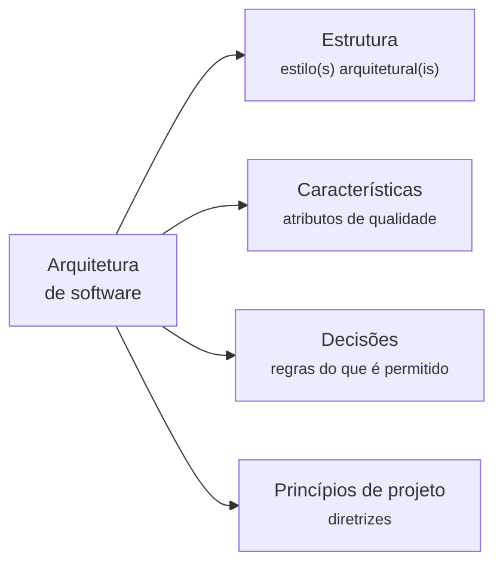
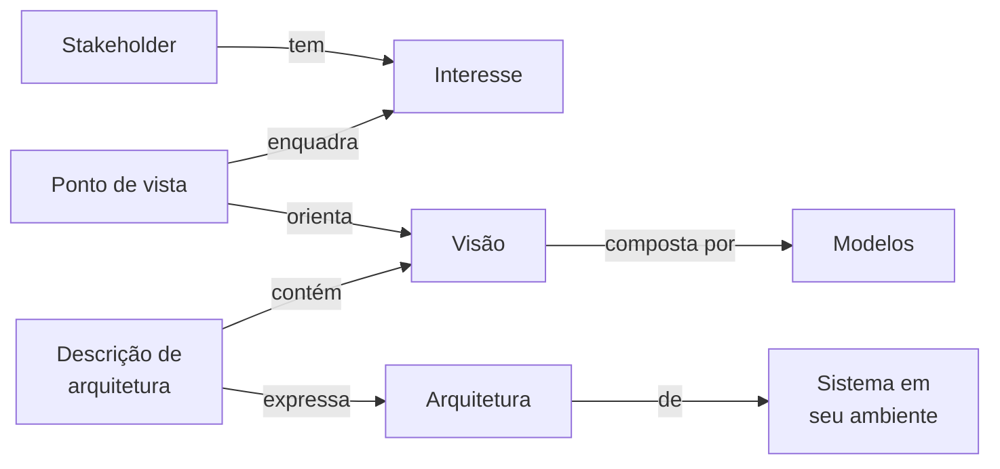
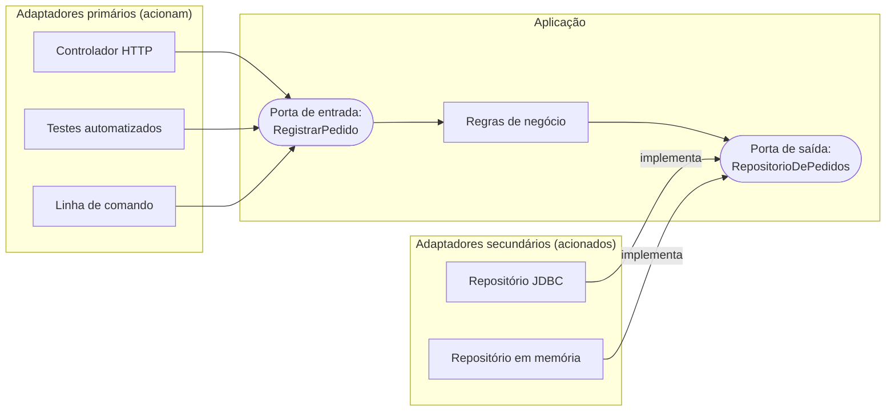
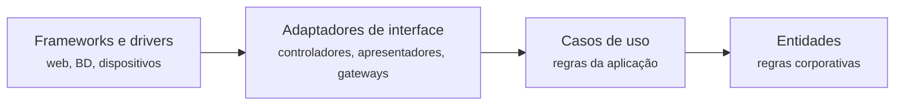

# Capítulo 1 - Fundamentos da arquitetura de software

!!! todo "Para desenvolver"
    Podcast do capítulo (NotebookLM → SoundCloud), embutido aqui com o bloco
    `<figure class="podcast-capitulo">` (ver `docente/podcasts/README.md`).

## Objetivos

Ao final deste capítulo, o leitor deverá ser capaz de:

- Discutir as principais definições de arquitetura de software propostas na literatura e
  identificar o que elas têm em comum e em que divergem.
- Distinguir arquitetura de software, arquitetura de sistemas e arquitetura corporativa, e
  situar o software no interior de sistemas mais amplos.
- Empregar o vocabulário normativo da descrição de arquiteturas: *stakeholder*, interesse,
  visão, ponto de vista e modelo.
- Explicar os princípios clássicos de projeto (abstração, separação de interesses, ocultação de
  informação, coesão e acoplamento) e os princípios SOLID, relacionando-os às suas origens.
- Caracterizar padrões de projeto e padrões arquiteturais, distinguindo-os de estilos
  arquiteturais e de antipadrões.
- Comparar a arquitetura em camadas, a arquitetura hexagonal, a arquitetura em cebola e a
  arquitetura limpa, reconhecendo o princípio comum que as une.
- Descrever os conceitos estratégicos e táticos do *Domain-Driven Design*.
- Justificar o registro de decisões arquiteturais e relacioná-lo à noção de dívida técnica.
- Compreender o método adotado neste livro: a análise de sistemas reais em quatro altitudes.

## Introdução

Todo sistema de software possui uma arquitetura, ainda que ninguém a tenha concebido
deliberadamente. A questão relevante não é, portanto, se um sistema tem arquitetura, mas se
ela resultou de decisões conscientes, fundamentadas e comunicadas, ou se emergiu por acúmulo
de escolhas locais tomadas sem uma visão de conjunto. Foote e Yoder (1997) deram a esse
segundo caso um nome que se tornou célebre: a *big ball of mud* (grande bola de lama), uma
estrutura sem forma reconhecível, mantida por remendos sucessivos. A disciplina de arquitetura
de software existe para que essa não seja a trajetória inevitável dos sistemas.

A preocupação com a estrutura global dos programas é quase tão antiga quanto a própria
engenharia de software. Dijkstra (1968) já organizava o sistema operacional THE em camadas
hierárquicas, e Parnas (1972) formulou o critério de decomposição em módulos que até hoje
orienta o projeto de sistemas. A arquitetura de software, entretanto, só se constituiu como
campo de estudo próprio no início dos anos 1990, com os trabalhos de Perry e Wolf (1992) e de
Garlan e Shaw (1993), que propuseram tratar a organização de alto nível dos sistemas como objeto
de pesquisa e de ensino. Desde então o campo amadureceu, produziu normas internacionais (ISO/IEC/IEEE
42010), catálogos de estilos e padrões, métodos de avaliação e, mais recentemente, práticas de
governança contínua integradas ao ciclo de entrega de software.

Este capítulo apresenta os conceitos fundamentais sobre os quais o restante do livro se apoia.
A Seção 1.1 examina as definições de arquitetura de software e a relação entre arquitetura e
projeto detalhado. A Seção 1.2 situa o software no contexto mais amplo da arquitetura de
sistemas. A Seção 1.3 introduz o vocabulário da descrição de arquiteturas e a Seção 1.4, os
atributos de qualidade. As Seções 1.5 e 1.6 tratam dos princípios e dos padrões de projeto. A
Seção 1.7 oferece um primeiro panorama dos estilos arquiteturais, e a Seção 1.8 aprofunda uma
família de arquiteturas centradas no domínio: camadas, hexagonal, cebola e limpa. A Seção 1.9
apresenta o *Domain-Driven Design*, e a Seção 1.10 discute o registro de decisões. Por fim, a
Seção 1.11 descreve o método de análise adotado ao longo do livro.

## 1.1 O que é arquitetura de software

### 1.1.1 Definições clássicas

Não existe uma definição única e universalmente aceita de arquitetura de software. O
*Software Engineering Institute* (SEI) da Universidade Carnegie Mellon chegou a manter uma
coletânea extensa de definições propostas por pesquisadores e profissionais. Essa
diversidade, contudo, não indica confusão conceitual. Ela reflete o fato de que o termo é
usado para designar coisas relacionadas, mas distintas. O SWEBOK v4 registra explicitamente
essa polissemia ao observar que "arquitetura" pode denotar uma **disciplina**, um **processo** e
o **resultado** desse processo (WASHIZAKI, 2024, cap. 2, seção 1.1). O exame de algumas
definições influentes permite identificar o núcleo comum.

Perry e Wolf (1992) propuseram um modelo que se tornou referência. Para eles, uma arquitetura
de software é composta por três conjuntos: **elementos**, **forma** e **justificativa**
(*rationale*). Os elementos podem ser de processamento, de dados ou de conexão. A forma
compreende as propriedades e os relacionamentos ponderados entre os elementos, isto é, as
restrições sobre como eles podem ser combinados. A justificativa registra as motivações para a
escolha de estilo, de elementos e de forma. A inclusão da justificativa como parte constitutiva
da arquitetura, e não como documentação acessória, é a contribuição mais duradoura desse
trabalho e antecipa em mais de uma década o movimento de registro de decisões discutido na
Seção 1.10.

Garlan e Shaw (1993), por sua vez, caracterizaram a arquitetura como a descrição dos elementos
a partir dos quais os sistemas são construídos, das interações entre esses elementos, dos
padrões que orientam sua composição e das restrições sobre esses padrões. Dessa formulação
deriva o vocabulário de **componentes** e **conectores** que ainda organiza boa parte da
literatura: componentes são os locais de computação e de estado; conectores são os mecanismos
de interação entre eles, como chamadas de procedimento, eventos, *pipes* ou protocolos de
banco de dados. Shaw e Garlan (1996) desenvolveram essa visão em livro e catalogaram os
primeiros **estilos arquiteturais**, retomados na Seção 1.7.

Bass, Clements e Kazman (2021, cap. 1) adotam uma definição estrutural: a arquitetura de um
sistema é o conjunto de **estruturas** necessárias para raciocinar sobre ele, compreendendo
elementos de software, as relações entre eles e as propriedades de ambos. Dois aspectos dessa
definição merecem destaque. Primeiro, o plural "estruturas": um sistema não tem uma única
estrutura, mas várias (de módulos, de componentes em execução, de alocação em *hardware*), e
nenhuma delas, isoladamente, é "a" arquitetura. Segundo, o critério de relevância: nem toda
estrutura é arquitetural, apenas aquelas que sustentam o raciocínio sobre as propriedades do
sistema, sobretudo os atributos de qualidade.

A norma ISO/IEC/IEEE 42010, cuja edição de 2011 consolidou a terminologia da área, define
arquitetura como os conceitos ou propriedades fundamentais de um sistema em seu ambiente,
incorporados em seus elementos, relacionamentos e nos princípios de seu projeto e evolução
(ISO/IEC/IEEE, 2011). A revisão de 2022 generalizou o objeto da definição de "sistema" para
"entidade", de modo a abranger também empresas, famílias de produtos e sistemas de sistemas
(ISO/IEC/IEEE, 2022). O SWEBOK v4 adota essa definição normativa e chama a atenção para a
expressão "em seu ambiente": a arquitetura não é uma propriedade intrínseca do código, mas da
relação entre o sistema e o contexto que o cerca, incluindo usuários, outros sistemas,
organizações e restrições (WASHIZAKI, 2024, cap. 2).

Uma linha distinta de definições desloca o foco das estruturas para as **decisões**. Fowler
(2003), relatando uma discussão com Ralph Johnson, propõe que a arquitetura corresponde às
"coisas importantes", seja lá o que forem, e, em particular, às decisões que os desenvolvedores
consideram difíceis de mudar. Taylor, Medvidovic e Dashofy (2009) tornam essa ideia explícita
ao definir arquitetura como o conjunto das principais decisões de projeto tomadas sobre um
sistema. Jansen e Bosch (2005) argumentam no mesmo sentido: tratar a arquitetura como um
conjunto de decisões permite preservar o conhecimento que, de outro modo, se evapora quando
apenas os diagramas resultantes são documentados.

Por fim, Richards e Ford (2020, p. 3-8), referência principal deste livro, propõem uma
definição operacional em quatro dimensões, ilustrada na Figura 1.1:

1. **Estrutura**: o estilo ou os estilos arquiteturais em que o sistema é implementado, como
   camadas, microsserviços ou microkernel.
2. **Características arquiteturais**: os critérios de sucesso que não dizem respeito à
   funcionalidade em si, como disponibilidade, escalabilidade, desempenho e segurança, as
   chamadas "-ilidades".
3. **Decisões arquiteturais**: as regras sobre como o sistema deve ser construído, que
   definem o que é permitido e o que é proibido, por exemplo "apenas as camadas de negócio e de
   serviço podem acessar o banco de dados".
4. **Princípios de projeto**: diretrizes que orientam escolhas sem constituir regras rígidas,
   por exemplo "preferir mensagens assíncronas entre serviços para favorecer o desempenho".

**Figura 1.1** – As quatro dimensões da arquitetura de software segundo Richards e Ford.



Fonte: adaptado de Richards e Ford (2020, p. 4-6).

Os autores ressaltam que descrever um sistema apenas pela estrutura é insuficiente. Quem
afirma que um sistema "usa microsserviços" informa o estilo, mas silencia sobre as
características que justificaram a escolha, as decisões que a concretizam e os princípios que
orientam sua evolução (RICHARDS; FORD, 2020, p. 5). Essa observação é central para o método
deste livro, que exige, em cada sistema estudado, a reconstrução das quatro dimensões.

!!! note "Definição 1.1 – Arquitetura de software"
    Neste livro, entende-se por **arquitetura de software** o conjunto de estruturas
    fundamentais de um sistema em seu ambiente, as características de qualidade que essas
    estruturas devem assegurar, as decisões significativas que as originaram, com sua
    justificativa, e os princípios que orientam sua evolução. A definição combina a perspectiva
    estrutural (BASS; CLEMENTS; KAZMAN, 2021), a normativa (ISO/IEC/IEEE, 2022), a centrada em
    decisões (JANSEN; BOSCH, 2005) e a operacional (RICHARDS; FORD, 2020).

O que essas definições têm em comum é mais importante do que aquilo que as distingue. Todas
reconhecem que a arquitetura trata do que é **fundamental** e **difícil de mudar**, que ela se
manifesta em **elementos e relações**, que ela é condicionada pelo **ambiente** e que sua
compreensão exige conhecer as **razões** das escolhas, e não apenas seus resultados.

### 1.1.2 As leis da arquitetura de software

Richards e Ford (2020, p. 19) sintetizam a natureza da disciplina em duas leis, que funcionam
ao longo deste livro como critérios de avaliação de qualquer argumento arquitetural.

!!! quote "Primeira lei da arquitetura de software"
    "Everything in software architecture is a trade-off." (RICHARDS; FORD, 2020, p. 19)

    Tudo em arquitetura de software é uma relação de compromisso (*trade-off*). Como corolário,
    os autores observam que, se um arquiteto julga ter encontrado algo que não envolve
    compromisso, o mais provável é que ainda não tenha identificado qual é.

!!! quote "Segunda lei da arquitetura de software"
    "Why is more important than how." (RICHARDS; FORD, 2020, p. 19)

    O porquê é mais importante que o como.

A primeira lei tem uma consequência epistemológica importante: não existe "a melhor
arquitetura" em termos absolutos, apenas arquiteturas mais ou menos adequadas a um contexto.
Os mesmos autores falam em buscar a arquitetura "menos pior" (*least worst architecture*),
reconhecendo que toda escolha sacrifica alguma propriedade em favor de outra (RICHARDS; FORD,
2020, cap. 4). A segunda lei justifica a ênfase deste livro na reconstrução da justificativa
das decisões. Um diagrama mostra **como** um sistema está organizado, mas é a compreensão do
**porquê** que permite avaliar se a organização ainda é adequada quando o contexto muda.

### 1.1.3 Arquitetura e projeto detalhado

A fronteira entre arquitetura e projeto detalhado (*design*) é notoriamente imprecisa.
O SWEBOK v4 distingue três estágios de projeto: o arquitetural, o de alto nível, voltado para
as interfaces do sistema com o exterior, e o detalhado, voltado para a organização interna dos
componentes (WASHIZAKI, 2024, cap. 3). Essa divisão, porém, descreve estágios de um processo e
não oferece um critério para classificar uma decisão específica.

Eden e Kazman (2003) propuseram um critério formal baseado em duas propriedades das
especificações. Uma especificação é **intensional** quando pode ser satisfeita por um número
ilimitado de implementações, e **não local** quando sua violação pode ocorrer em qualquer parte
do sistema, e não apenas em um trecho delimitado. Decisões arquiteturais são, ao mesmo tempo,
intensionais e não locais. Por exemplo, "nenhum componente da camada de apresentação acessa o
banco de dados diretamente" é uma restrição que qualquer arquivo do sistema pode violar.
Decisões de projeto detalhado são intensionais, mas locais: a escolha de um padrão para
organizar uma família de algoritmos afeta apenas as classes envolvidas. A implementação, por
fim, é extensional e local.

Richards e Ford (2020, cap. 2) propõem um critério mais pragmático, baseado em um espectro
entre decisões **estratégicas** e **táticas**. Quanto mais pessoas uma decisão envolve, quanto
mais longo é seu horizonte e quanto mais custosa é sua reversão, mais ela se aproxima do polo
arquitetural. A Tabela 1.1 ilustra o espectro.

**Tabela 1.1** – Critérios para situar uma decisão entre arquitetura e projeto detalhado.

| Critério | Mais arquitetural | Mais próximo do projeto detalhado |
|---|---|---|
| Abrangência (EDEN; KAZMAN, 2003) | Não local: pode ser violada em qualquer parte | Local: afeta um trecho delimitado |
| Envolvimento | Várias equipes e *stakeholders* | Uma pessoa ou uma equipe |
| Custo de reversão | Alto: semanas ou meses | Baixo: horas ou dias |
| Exemplo | Particionar o sistema em serviços implantados separadamente | Empregar o padrão *Strategy* no cálculo de frete |

Fonte: elaborado pelo autor (2026), com base em Eden e Kazman (2003) e Richards e Ford (2020).

Mais importante do que traçar a fronteira com precisão é reconhecer que arquitetura e projeto
detalhado são **interdependentes**. Uma decisão arquitetural só produz efeito quando se
materializa no código, por meio de pacotes, interfaces, regras de dependência e padrões.
Inversamente, decisões locais acumuladas podem corroer uma decisão arquitetural, fenômeno
descrito na literatura como **erosão** ou **deriva** arquitetural (PERRY; WOLF, 1992). Por
essa razão, o método deste livro não se detém nos diagramas de alto nível e desce,
sistematicamente, até o código.

### 1.1.4 O papel do arquiteto

A arquitetura pode ser exercida por uma pessoa com o cargo de arquiteto, por um grupo de
desenvolvedores experientes ou de forma distribuída na equipe. Em qualquer caso, há um conjunto
de responsabilidades que precisa ser assumido. Richards e Ford (2020, p. 9-12) enumeram oito
expectativas em relação a quem exerce o papel:

1. tomar decisões arquiteturais;
2. analisar continuamente a arquitetura;
3. manter-se atualizado em relação às tendências;
4. assegurar a conformidade com as decisões;
5. ter exposição e experiência diversificadas;
6. conhecer o domínio de negócio;
7. possuir habilidades interpessoais;
8. compreender e lidar com a dinâmica política da organização.

A lista evidencia que a arquitetura não é uma atividade exclusivamente técnica. Metade das
expectativas diz respeito a conhecimento de negócio, comunicação e negociação. Isso é coerente
com a observação de Conway (1968) de que a estrutura dos sistemas tende a reproduzir a
estrutura de comunicação das organizações que os produzem, tema retomado na Seção 5.1.2.
Brooks (1975), por sua vez, argumentou que a **integridade conceitual** é a consideração mais
importante no projeto de sistemas e que ela depende de que o projeto provenha de uma única
mente ou de um grupo pequeno e coeso. Ao arquiteto cabe, portanto, preservar a coerência do
conjunto diante das pressões locais.

## 1.2 Arquitetura de sistemas e arquitetura de software

O software raramente existe isolado. Ele executa sobre *hardware*, comunica-se por redes, é
operado por pessoas e integra processos organizacionais. A distinção entre **arquitetura de
sistemas** e **arquitetura de software** é, por isso, necessária para delimitar o objeto deste
livro e para compreender dois dos sistemas estudados, o ThingsBoard e o PX4 (Seções 2.7 e 2.8), nos quais o software é
apenas uma parte de sistemas ciberfísicos.

### 1.2.1 Sistemas e engenharia de sistemas

A norma ISO/IEC/IEEE 15288, que trata dos processos do ciclo de vida de sistemas, define
**sistema** como uma combinação de elementos que interagem e estão organizados para atingir um
ou mais propósitos declarados (ISO/IEC/IEEE, 2023). Os elementos podem incluir *hardware*,
software, dados, pessoas, processos, procedimentos e instalações. A **engenharia de sistemas** é
a abordagem interdisciplinar que conduz o desenvolvimento de tais sistemas, do levantamento de
necessidades à desativação, e a **arquitetura de sistemas** é a atividade que define a
estrutura de alto nível desses elementos e de suas interfaces (INCOSE, 2023).

Maier e Rechtin (2009) caracterizam a arquitetura de sistemas (*systems architecting*) como
uma atividade que combina ciência e arte. Ela opera com problemas mal estruturados, nos quais
os objetivos ainda estão em negociação, e recorre a heurísticas acumuladas pela experiência,
como "simplifique, simplifique, simplifique" ou "não suponha que a declaração original do
problema seja necessariamente a melhor". Os autores distinguem o arquiteto, que atua em favor
do cliente na definição do que deve ser construído, do engenheiro, que otimiza a solução dentro
de um conjunto de requisitos já estabelecido.

### 1.2.2 Sistemas intensivos em software

A antiga norma IEEE 1471-2000, predecessora da ISO/IEC/IEEE 42010, introduziu a noção de
**sistema intensivo em software**: qualquer sistema em que o software exerce influência
essencial sobre o projeto, a construção, a implantação e a evolução do sistema como um todo
(IEEE, 2000). A noção é útil porque, na maior parte dos sistemas contemporâneos, de automóveis a
plataformas bancárias, o software deixou de ser um componente entre outros para tornar-se o
principal portador da funcionalidade e da capacidade de evolução.

A arquitetura de software ocupa-se das estruturas do software em um sistema desse tipo. Ela
recebe da arquitetura de sistemas um conjunto de restrições: plataformas de execução,
capacidade de processamento e memória, protocolos de comunicação, requisitos de segurança
física (*safety*) e de proteção (*security*), interfaces com equipamentos e com pessoas. Em
contrapartida, informa à arquitetura de sistemas o que é viável e a que custo. Em sistemas
embarcados de tempo real, como o piloto automático PX4 (Seções 2.8 e 4.8), essa interação é
especialmente estreita: a escolha de um sistema operacional de tempo real, a frequência dos
laços de controle e a redundância de sensores são decisões simultaneamente de sistema e de
software.

### 1.2.3 Arquitetura corporativa e arquitetura de soluções

Acima do nível de sistemas individuais situa-se a **arquitetura corporativa** (*enterprise
architecture*), que trata da organização como um todo: seus processos de negócio, suas
informações, o portfólio de aplicações e a infraestrutura tecnológica. O *framework* de Zachman
(1987), um dos marcos fundadores dessa área, propôs classificar as representações de uma
empresa segundo perspectivas (do planejador ao executor) e segundo dimensões interrogativas (o
quê, como, onde, quem, quando e por quê). O TOGAF, mantido pelo consórcio The Open Group, é o
*framework* de arquitetura corporativa mais difundido na indústria.

Entre a arquitetura corporativa e a arquitetura de software, as organizações costumam
reconhecer ainda a **arquitetura de soluções**, que trata da combinação de sistemas, serviços
e produtos para atender a uma necessidade de negócio específica. A Tabela 1.2 sintetiza esses
níveis.

**Tabela 1.2** – Níveis de arquitetura e seus objetos.

| Nível | Objeto | Horizonte | Exemplo de questão |
|---|---|---|---|
| Arquitetura corporativa | A organização e seu portfólio | Anos | Que capacidades de negócio são atendidas por quais sistemas? |
| Arquitetura de soluções | Um conjunto de sistemas para uma necessidade | Meses a anos | Como integrar o novo sistema de pagamentos ao ERP e ao *e-commerce*? |
| Arquitetura de sistemas | *Hardware*, software, pessoas e processos de um sistema | Ciclo de vida do sistema | Que parte da função é realizada em *hardware* e que parte em software? |
| Arquitetura de software | As estruturas do software | Ciclo de vida do software | Como o software é decomposto, comunicado, implantado e evoluído? |

Fonte: elaborado pelo autor (2026).

Este livro concentra-se na arquitetura de software, mas os sistemas estudados obrigam a
transitar entre os níveis. A análise de cada sistema começa pelo contexto organizacional e de
negócio, que é matéria da arquitetura corporativa e de soluções, e, nos casos de IoT e de
sistemas embarcados, inclui decisões que pertencem à arquitetura de sistemas.

## 1.3 A descrição de arquiteturas

Uma arquitetura que existe apenas na mente de seus criadores não pode ser analisada,
comunicada nem preservada. O SWEBOK v4 observa que, embora um modelo mental possa bastar a
indivíduos trabalhando em sistemas pequenos, sistemas grandes, desenvolvidos e operados por
equipes, exigem representações tangíveis da arquitetura (WASHIZAKI, 2024, cap. 2, seção 2).
A área desenvolveu um vocabulário preciso para essas representações.

### 1.3.1 O modelo conceitual da ISO/IEC/IEEE 42010

A norma ISO/IEC/IEEE 42010 estabelece os conceitos a seguir, adotados neste livro
(ISO/IEC/IEEE, 2022; WASHIZAKI, 2024, cap. 2):

- **Stakeholder** (parte interessada): indivíduo, grupo ou organização que tem interesse no
  sistema, como usuários, clientes, desenvolvedores, operadores, órgãos reguladores e
  investidores.
- **Interesse** (*concern*): questão relevante para um ou mais *stakeholders*, por exemplo
  custo, prazo, desempenho, privacidade ou facilidade de implantação.
- **Descrição de arquitetura**: artefato que expressa a arquitetura de um sistema. Distingue-se
  da arquitetura propriamente dita, que existe independentemente de ser descrita.
- **Visão** (*view*): parte da descrição de arquitetura que trata de um conjunto de interesses
  de *stakeholders*.
- **Ponto de vista** (*viewpoint*): convenções para construir, interpretar e analisar um tipo
  de visão, isto é, quais interesses ela atende, que notações e modelos usa e que técnicas de
  análise se aplicam.
- **Modelo**: representação que compõe uma visão, como um diagrama, uma tabela ou uma
  especificação formal.

A distinção entre visão e ponto de vista corresponde à distinção entre um mapa específico e a
convenção cartográfica que o orienta. Um ponto de vista de implantação, por exemplo, estabelece
que se devem representar nós computacionais, ambientes de execução e canais de comunicação, e
que a análise de interesse é a de disponibilidade e capacidade. A visão de implantação de um
sistema particular é o produto da aplicação desse ponto de vista.

**Figura 1.2** – Conceitos centrais da descrição de arquiteturas.



Fonte: adaptado de ISO/IEC/IEEE (2022) e Washizaki (2024).

### 1.3.2 Conjuntos de visões

Como nenhuma visão isolada descreve uma arquitetura, a literatura propôs conjuntos
coordenados de visões. O mais conhecido é o **modelo 4+1** de Kruchten (1995), que organiza a
descrição em quatro visões e um conjunto de cenários:

- a **visão lógica**, que representa a decomposição funcional, em geral em termos de classes,
  objetos ou serviços;
- a **visão de processo**, que trata da concorrência, da distribuição e da sincronização;
- a **visão de desenvolvimento**, que representa a organização do software em módulos,
  pacotes e camadas no ambiente de desenvolvimento;
- a **visão física**, que mapeia o software para os nós computacionais;
- os **cenários** (o "+1"), casos de uso que atravessam as quatro visões, ilustram como elas
  colaboram e servem para validar a arquitetura.

Clements *et al.* (2010), na abordagem conhecida como *Views and Beyond*, agrupam as visões em
três **tipos de visão** (*viewtypes*). O tipo **módulo** descreve as unidades de implementação e
suas relações de dependência, uso e generalização. O tipo **componente e conector** descreve as
entidades presentes em tempo de execução e suas interações. O tipo **alocação** descreve o
mapeamento do software para ambientes externos, como *hardware*, sistemas de arquivos ou
equipes. Rozanski e Woods (2011) complementam a noção de visão com a de **perspectiva**, um
conjunto de atividades e táticas para garantir um atributo de qualidade, como segurança ou
desempenho, que atravessa todas as visões.

### 1.3.3 O modelo C4

No âmbito profissional, o **modelo C4**, proposto por Brown (2018), difundiu-se por sua
simplicidade. Ele organiza os diagramas de arquitetura em quatro níveis hierárquicos de
abstração, análogos aos níveis de *zoom* de um mapa digital:

1. **Contexto**: o sistema representado como uma única caixa, cercado por seus usuários e
   pelos sistemas externos com que se comunica.
2. **Containers**: as unidades que executam ou armazenam dados separadamente, como aplicações
   web, aplicativos móveis, bancos de dados e filas de mensagens. O termo não se refere a
   contêineres Docker.
3. **Componentes**: os agrupamentos de funcionalidade dentro de um *container*, com suas
   responsabilidades e interfaces.
4. **Código**: as classes, interfaces e funções que implementam um componente.

O C4 não é um ponto de vista no sentido estrito da norma 42010, pois não define técnicas de
análise, mas oferece uma hierarquia de abstração que facilita a comunicação entre públicos
distintos. Este livro adota essa hierarquia como espinha dorsal do seu método de análise,
conforme a Seção 1.11. O Apêndice A apresenta as convenções de notação utilizadas.

## 1.4 Atributos de qualidade

Os sistemas são construídos para cumprir funções, mas raramente são substituídos por deixarem
de cumpri-las. Com muito mais frequência, são reescritos porque se tornaram lentos, instáveis,
inseguros, caros de operar ou difíceis de modificar. Essas propriedades, que não correspondem a
funcionalidades específicas, são chamadas de **atributos de qualidade**, **requisitos não
funcionais** ou, na terminologia de Richards e Ford (2020, cap. 4), **características
arquiteturais**. Bass, Clements e Kazman (2021, cap. 3) argumentam que são precisamente os
atributos de qualidade, e não a funcionalidade, que determinam a forma da arquitetura: a mesma
funcionalidade pode ser realizada por estruturas muito diferentes, mas cada estrutura favorece
certos atributos e prejudica outros.

### 1.4.1 Modelos de qualidade

A norma ISO/IEC 25010 define um modelo de qualidade de produto amplamente usado como
referência. A edição de 2011 organizava a qualidade do produto em oito características:
adequação funcional, eficiência de desempenho, compatibilidade, usabilidade, confiabilidade,
segurança, manutenibilidade e portabilidade. A revisão de 2023 renomeou usabilidade para
capacidade de interação e portabilidade para flexibilidade, e acrescentou uma nona
característica, a segurança física (*safety*) (ISO/IEC, 2023). Cada característica se desdobra
em subcaracterísticas. A manutenibilidade, por exemplo, inclui modularidade, reusabilidade,
analisabilidade, modificabilidade e testabilidade. O SWEBOK v4 adota esse modelo na área de
conhecimento de qualidade de software (WASHIZAKI, 2024, cap. 12).

Richards e Ford (2020, cap. 4) preferem uma classificação mais próxima da prática arquitetural:
características **operacionais** (disponibilidade, continuidade, desempenho, recuperabilidade,
confiabilidade, robustez, escalabilidade), **estruturais** (configurabilidade, extensibilidade,
instalabilidade, reúso, localização, manutenibilidade, portabilidade) e **transversais**
(acessibilidade, arquivamento, autenticação, autorização, conformidade legal, privacidade,
segurança, suportabilidade, usabilidade). Os autores advertem que a lista nunca é completa e que
cada organização tende a criar seus próprios termos.

### 1.4.2 Cenários de qualidade

Um atributo de qualidade enunciado genericamente, como "o sistema deve ser escalável", não pode
ser verificado nem usado para comparar alternativas. Bass, Clements e Kazman (2021, cap. 3)
propõem especificar cada atributo por meio de **cenários de qualidade** com seis partes:

1. **fonte do estímulo**: quem ou o que gera o estímulo (um usuário, um sistema, um atacante);
2. **estímulo**: o evento que chega ao sistema (uma requisição, uma falha, uma alteração);
3. **ambiente**: as condições em que o estímulo ocorre (operação normal, sobrecarga, falha);
4. **artefato**: a parte do sistema afetada;
5. **resposta**: a atividade que o sistema deve realizar;
6. **medida da resposta**: o critério mensurável de sucesso.

Por exemplo: "Durante a abertura do período de matrícula (ambiente), 20.000 estudantes
(fonte) solicitam simultaneamente a página de oferta de disciplinas (estímulo) ao sistema
acadêmico (artefato), que deve atender às requisições (resposta) com tempo de resposta inferior
a 2 segundos em 95% dos casos (medida)". A medida torna o requisito verificável e permite
comparar alternativas arquiteturais de maneira objetiva.

### 1.4.3 Conflitos entre atributos

Atributos de qualidade frequentemente conflitam entre si, o que é a manifestação mais concreta
da primeira lei apresentada na Seção 1.1.2. A segurança costuma reduzir o desempenho e a
usabilidade. A disponibilidade obtida por replicação aumenta o custo e complica a consistência.
A flexibilidade obtida por camadas de indireção prejudica o desempenho e a simplicidade.
Richards e Ford (2020, cap. 5) recomendam, por isso, que os *stakeholders* escolham as **três
características mais importantes** de cada parte do sistema, em vez de tentar maximizar todas.
O Apêndice D aprofunda a identificação, a priorização e a medição das características
arquiteturais.

## 1.5 Princípios de projeto

Princípios de projeto são proposições gerais que orientam a decomposição de um sistema e a
distribuição de responsabilidades entre suas partes. Diferentemente de padrões, que oferecem
soluções para problemas recorrentes, os princípios oferecem **critérios** para avaliar soluções.
O SWEBOK v4 enumera como princípios fundamentais a abstração, a separação de interesses, a
modularização, o encapsulamento, a separação entre interface e implementação, o baixo
acoplamento, a alta coesão, a uniformidade, a completude e a verificabilidade (WASHIZAKI, 2024,
cap. 3, seção 1.4). Esta seção examina os mais influentes, com atenção às suas origens, porque
conhecer o problema que motivou cada princípio é a melhor proteção contra sua aplicação
mecânica.

### 1.5.1 Abstração e separação de interesses

A **abstração** consiste em representar um objeto ou fenômeno por suas propriedades relevantes
para um propósito, omitindo as demais. É o instrumento mais elementar para lidar com a
complexidade e está presente em todos os níveis de um sistema: uma função abstrai um algoritmo,
uma interface abstrai uma família de implementações, um serviço abstrai um subsistema inteiro.

A **separação de interesses** (*separation of concerns*) foi formulada por Dijkstra (1974) como
uma atitude intelectual: concentrar a atenção em um aspecto do problema de cada vez, sabendo que
os demais existem, mas deliberadamente ignorando-os naquele momento. Dijkstra apresentou a ideia
como condição do pensamento científico em geral, e não apenas da programação. Na arquitetura de
software, o princípio se manifesta na atribuição de interesses distintos, como apresentação,
regras de negócio e persistência, a partes distintas do sistema, de modo que cada uma possa ser
compreendida, modificada e testada com o mínimo de referência às outras. As arquiteturas
discutidas na Seção 1.8 são, em grande medida, elaborações desse princípio.

### 1.5.2 Ocultação de informação

O artigo de Parnas (1972) sobre os critérios de decomposição de sistemas em módulos é
provavelmente o texto mais influente da história do projeto de software. Parnas comparou duas
decomposições de um mesmo programa, um sistema de índice KWIC (*key word in context*). A
primeira seguia as etapas do processamento: entrada, deslocamento circular, ordenação e saída.
A segunda organizava os módulos em torno das **decisões de projeto difíceis ou sujeitas a
mudança**, como o formato de armazenamento das linhas, e escondia cada decisão dentro de um
módulo. Parnas mostrou que, diante de mudanças plausíveis, como alterar o formato de
armazenamento, a primeira decomposição exigia modificar vários módulos, ao passo que a segunda
confinava a mudança a um único módulo.

O critério resultante, conhecido como **ocultação de informação** (*information hiding*), pode
ser enunciado assim: cada módulo deve esconder uma decisão de projeto do restante do sistema, e
sua interface deve revelar o mínimo necessário sobre seu funcionamento interno. O princípio
desloca a pergunta "que etapas o programa executa?" para "que decisões provavelmente vão mudar?".
Essa mudança de perspectiva é a origem conceitual do encapsulamento na orientação a objetos, das
interfaces estáveis entre serviços e do próprio conceito de arquitetura como gestão do que é
difícil de mudar.

### 1.5.3 Coesão e acoplamento

Stevens, Myers e Constantine (1974), no artigo que fundou o projeto estruturado, introduziram
dois conceitos complementares para avaliar decomposições. O **acoplamento** mede o grau de
interdependência entre módulos: quanto mais um módulo precisa conhecer sobre outro para
funcionar, mais acoplados eles estão. A **coesão** mede o grau em que os elementos internos de
um módulo estão relacionados entre si e contribuem para um propósito único. Os autores
propuseram escalas ordinais para ambos. A coesão vai da coincidental, em que os elementos estão
juntos por acaso, à funcional, em que todos contribuem para uma única função. O acoplamento vai
do acoplamento por dados simples ao acoplamento por conteúdo, em que um módulo acessa
diretamente o interior de outro.

A diretriz que deriva desses conceitos, **alta coesão e baixo acoplamento**, permanece como o
critério mais geral de qualidade de uma decomposição. Ela vale em todas as escalas: entre
classes, entre pacotes, entre serviços e entre sistemas. Richards e Ford (2020, cap. 3)
retomam esses conceitos com métricas quantitativas, como a falta de coesão em métodos (LCOM) e
os acoplamentos aferente e eferente, e com a noção mais refinada de *connascence*. Esses
instrumentos são tratados no Apêndice E.

### 1.5.4 Os princípios SOLID

Na década de 1990, a comunidade de orientação a objetos consolidou um conjunto de princípios
para organizar classes e suas dependências. Martin (2000) reuniu quatro deles (OCP, LSP, ISP e
DIP) em um artigo, ao lado de princípios de coesão e acoplamento de pacotes; o princípio da
responsabilidade única juntou-se a eles em obras posteriores do autor, e o acrônimo **SOLID**
foi proposto por Michael Feathers. Embora divulgados em conjunto, os princípios têm origens
distintas, apresentadas a seguir.

**Princípio da responsabilidade única** (*Single Responsibility Principle*, SRP). Uma classe
deve ter um único motivo para mudar. Martin (2017) reformulou o princípio em termos de
*stakeholders*: um módulo deve ser responsável perante um, e apenas um, ator. A formulação
esclarece que "responsabilidade" não se refere a "fazer uma única coisa", mas a atender a uma
única fonte de demandas de mudança. É uma aplicação direta da coesão de Stevens, Myers e
Constantine (1974).

**Princípio aberto-fechado** (*Open-Closed Principle*, OCP). Formulado por Meyer (1988),
estabelece que entidades de software devem estar abertas para extensão e fechadas para
modificação. Na formulação original, o mecanismo era a herança. Na leitura contemporânea, o
mecanismo preferencial é o polimorfismo por meio de interfaces: novos comportamentos são
introduzidos por novas implementações, sem alterar o código existente que depende da abstração.

**Princípio da substituição de Liskov** (*Liskov Substitution Principle*, LSP). Derivado do
trabalho de Liskov (1987) e formalizado por Liskov e Wing (1994), estabelece que objetos de um
subtipo devem poder substituir objetos do supertipo sem alterar as propriedades desejáveis do
programa. O princípio impede hierarquias que respeitam a sintaxe mas violam o comportamento
esperado, como o exemplo clássico de um quadrado que herda de retângulo e não preserva a
independência entre largura e altura.

**Princípio da segregação de interfaces** (*Interface Segregation Principle*, ISP). Clientes não
devem ser forçados a depender de métodos que não utilizam. Interfaces extensas devem ser
divididas em interfaces menores, específicas para cada tipo de cliente, reduzindo o acoplamento
e o impacto de mudanças (MARTIN, 2000).

**Princípio da inversão de dependência** (*Dependency Inversion Principle*, DIP). Módulos de alto
nível não devem depender de módulos de baixo nível; ambos devem depender de abstrações. As
abstrações, por sua vez, não devem depender de detalhes; os detalhes é que devem depender das
abstrações (MARTIN, 2000). Do ponto de vista arquitetural, este é o mais importante dos cinco,
pois é o mecanismo que permite inverter o sentido das dependências entre camadas. Ele constitui
o fundamento técnico das arquiteturas hexagonal e limpa, discutidas na Seção 1.8.

A Listagem 1.1 ilustra o DIP. O serviço de notificação, que expressa uma política de alto
nível, depende de uma abstração (`CanalDeMensagem`). Os detalhes de envio por e-mail ou por
SMS implementam essa abstração e podem ser substituídos sem modificar o serviço, o que também
satisfaz o OCP.

**Listagem 1.1** – Inversão de dependência: a política depende de uma abstração.

```java
// Abstração definida no nível da política (alto nível).
public interface CanalDeMensagem {
    void enviar(String destinatario, String texto);
}

// Política de alto nível: não conhece nenhum detalhe de envio.
public class ServicoDeNotificacao {
    private final CanalDeMensagem canal;

    public ServicoDeNotificacao(CanalDeMensagem canal) {   // dependência injetada
        this.canal = canal;
    }

    public void avisarMatriculaConfirmada(String estudante) {
        canal.enviar(estudante, "Sua matrícula foi confirmada.");
    }
}

// Detalhes de baixo nível: dependem da abstração, e não o contrário.
public class CanalEmail implements CanalDeMensagem {
    @Override public void enviar(String destinatario, String texto) { /* SMTP */ }
}

public class CanalSms implements CanalDeMensagem {
    @Override public void enviar(String destinatario, String texto) { /* API de SMS */ }
}
```

Fonte: elaborado pelo autor (2026).

### 1.5.5 Outros princípios recorrentes

Diversos outros princípios circulam na literatura e na prática profissional. Os mais citados
são os seguintes:

- **Programe para uma interface, não para uma implementação**, e **prefira a composição de
  objetos à herança de classes**: os dois princípios centrais enunciados por Gamma *et al.*
  (1994, cap. 1). O segundo se apoia na observação de que a herança expõe a subclasse aos
  detalhes da superclasse, o que os autores chamam de reúso de "caixa branca", enquanto a
  composição produz reúso de "caixa preta", em que os objetos interagem apenas por suas
  interfaces.
- **Lei de Demeter**, ou princípio do menor conhecimento: um método deve enviar mensagens apenas
  ao próprio objeto, a seus parâmetros, aos objetos que cria e a seus componentes diretos,
  evitando cadeias de navegação como `a.getB().getC().fazer()` (LIEBERHERR; HOLLAND, 1989).
- **DRY** (*Don't Repeat Yourself*): cada porção de conhecimento deve ter uma representação
  única e autoritativa no sistema (HUNT; THOMAS, 1999). O princípio trata da duplicação de
  conhecimento, e não meramente de trechos de código parecidos.
- **YAGNI** (*You Aren't Gonna Need It*) e **KISS** (*Keep It Simple*): advertências, oriundas da
  comunidade de métodos ágeis, contra a introdução de generalidade especulativa. Elas equilibram
  os princípios anteriores, pois toda abstração tem custo de compreensão e de manutenção.

A tensão entre os princípios que recomendam flexibilidade (OCP, DIP) e os que recomendam
simplicidade (YAGNI, KISS) é ela própria uma instância da primeira lei. Gamma *et al.* (1994,
cap. 1) já advertiam que padrões de projeto não devem ser aplicados indiscriminadamente, pois a
flexibilidade que oferecem tem o custo de tornar o projeto mais complexo e, por vezes, menos
eficiente. A decisão de introduzir uma abstração deve, portanto, ser justificada por uma
variação **provável**, no sentido de Parnas (1972), e não apenas possível.

## 1.6 Padrões

### 1.6.1 Origem e definição

O conceito de padrão foi introduzido na arquitetura de edificações por Christopher Alexander e
seus colaboradores. Em *A Pattern Language*, Alexander *et al.* (1977) apresentaram 253 padrões
para o projeto de cidades, bairros e edifícios, cada um descrevendo um problema recorrente e o
núcleo de sua solução. Gamma *et al.* (1994, cap. 1) citam a formulação de Alexander segundo a
qual cada padrão descreve um problema que ocorre repetidamente em nosso ambiente e o núcleo da
solução para esse problema, de tal forma que a solução pode ser usada "um milhão de vezes" sem
nunca ser aplicada exatamente da mesma maneira.

A transposição para o software começou com Beck e Cunningham (1987), que experimentaram
linguagens de padrões para o projeto de interfaces em Smalltalk, e consolidou-se com o livro
de Gamma, Helm, Johnson e Vlissides (1994), conhecido como o livro da "Gangue dos Quatro" (GoF).
Os autores estabelecem que um padrão tem quatro elementos essenciais (GAMMA *et al.*, 1994,
cap. 1):

1. o **nome**, que amplia o vocabulário de projeto e permite discutir soluções em um nível mais
   alto de abstração;
2. o **problema**, que descreve quando aplicar o padrão, incluindo seu contexto;
3. a **solução**, que descreve os elementos do projeto, suas relações, responsabilidades e
   colaborações, sem prescrever uma implementação concreta;
4. as **consequências**, isto é, os resultados e os compromissos da aplicação do padrão.

O quarto elemento é o que liga os padrões à arquitetura. Um padrão não é uma receita a ser
aplicada sempre que possível, mas uma solução com custos e benefícios conhecidos, a ser escolhida
quando seus benefícios superam seus custos no contexto em questão.

!!! note "Definição 1.2 – Padrão"
    Um **padrão** é a descrição nomeada de uma solução comprovada para um problema recorrente em
    um contexto, acompanhada das forças em jogo e das consequências de sua aplicação (GAMMA *et
    al.*, 1994; BUSCHMANN *et al.*, 1996).

### 1.6.2 Níveis de padrões

Buschmann *et al.* (1996) propuseram distinguir três níveis de padrões segundo sua escala:

- **padrões arquiteturais**, que expressam esquemas fundamentais de organização estrutural de
  sistemas inteiros, como *Layers*, *Pipes and Filters*, *Broker*, *Model-View-Controller* e
  *Microkernel*;
- **padrões de projeto**, que refinam subsistemas ou componentes e descrevem estruturas
  recorrentes de componentes que se comunicam, como os 23 padrões do catálogo GoF;
- **idiomas**, padrões de baixo nível específicos de uma linguagem de programação, como o
  gerenciamento de recursos com `try-with-resources` em Java.

A essa classificação somam-se catálogos especializados. Fowler (2002) catalogou padrões de
aplicações corporativas, como *Domain Model*, *Repository*, *Data Mapper* e *Unit of Work*,
estudados no Apêndice E e no Capítulo 6. Hohpe e Woolf (2003) catalogaram padrões de integração por mensagens.
Evans (2003) apresentou os blocos de construção do *Domain-Driven Design* também na forma de
padrões, como se verá na Seção 1.9.

### 1.6.3 O catálogo GoF

O catálogo de Gamma *et al.* (1994) organiza 23 padrões segundo dois critérios. O **propósito**
indica o que o padrão faz: padrões criacionais tratam do processo de criação de objetos;
padrões estruturais, da composição de classes e objetos; padrões comportamentais, da
distribuição de responsabilidades e da interação entre objetos. O **escopo** indica se o padrão
se aplica primariamente a classes, com relações estabelecidas em tempo de compilação por
herança, ou a objetos, com relações estabelecidas em tempo de execução. A Tabela 1.3 apresenta
o catálogo.

**Tabela 1.3** – Os 23 padrões do catálogo GoF, por propósito.

| Criacionais (5) | Estruturais (7) | Comportamentais (11) |
|---|---|---|
| *Abstract Factory*, *Builder*, *Factory Method*, *Prototype*, *Singleton* | *Adapter*, *Bridge*, *Composite*, *Decorator*, *Facade*, *Flyweight*, *Proxy* | *Chain of Responsibility*, *Command*, *Interpreter*, *Iterator*, *Mediator*, *Memento*, *Observer*, *State*, *Strategy*, *Template Method*, *Visitor* |

Fonte: Gamma *et al.* (1994).

Um aspecto pedagógico do livro merece atenção. Seu segundo capítulo apresenta um estudo de caso,
o projeto de um editor de documentos chamado Lexi, no qual sete problemas de projeto são
examinados sucessivamente, e de cada um emerge um padrão: *Composite* para a estrutura do
documento, *Strategy* para os algoritmos de formatação, *Decorator* para os adornos da interface,
*Abstract Factory* para múltiplos padrões de aparência, *Bridge* para múltiplos sistemas de
janelas, *Command* para as operações do usuário com desfazer e *Iterator* com *Visitor* para a
verificação ortográfica (GAMMA *et al.*, 1994, cap. 2). O estudo de caso mostra que os padrões
não são aplicados a esmo, mas emergem como respostas a forças concretas de um sistema. Os
capítulos de voo deste livro adotam a mesma lógica: em cada sistema real, os padrões são
apresentados como respostas a problemas identificados nas altitudes superiores.

Para estudantes de língua portuguesa, a obra de Shvets (2022) apresenta 22 dos 23 padrões
(exclui o *Interpreter*) em formato didático. Cada padrão percorre problema, solução, analogia,
estrutura, pseudocódigo, aplicabilidade, passos de implementação, prós e contras, e relações
com outros padrões. A obra também explicita a relação entre cada padrão e os princípios SOLID.

A Listagem 1.2 apresenta o padrão *Strategy* em uma situação típica: o cálculo de frete de um
comércio eletrônico, em que diferentes modalidades obedecem a regras distintas e novas
modalidades surgem com frequência.

**Listagem 1.2** – O padrão *Strategy* aplicado ao cálculo de frete.

```java
public interface PoliticaDeFrete {                    // a estratégia
    Dinheiro calcular(Pedido pedido);
}

public class FreteExpresso implements PoliticaDeFrete {
    @Override public Dinheiro calcular(Pedido p) {
        return Dinheiro.reais(20).mais(p.pesoKg().vezes(Dinheiro.reais(3)));
    }
}

public class FreteGratisAcimaDe implements PoliticaDeFrete {
    private final Dinheiro limite;
    private final PoliticaDeFrete senaoUse;
    public FreteGratisAcimaDe(Dinheiro limite, PoliticaDeFrete senaoUse) {
        this.limite = limite; this.senaoUse = senaoUse;
    }
    @Override public Dinheiro calcular(Pedido p) {
        return p.total().maiorOuIgualA(limite) ? Dinheiro.ZERO : senaoUse.calcular(p);
    }
}

public class Checkout {                               // o contexto
    private final PoliticaDeFrete frete;
    public Checkout(PoliticaDeFrete frete) { this.frete = frete; }
    public Dinheiro totalComFrete(Pedido p) { return p.total().mais(frete.calcular(p)); }
}
```

Fonte: elaborado pelo autor (2026).

A listagem evidencia a relação entre padrões e princípios. O `Checkout` está fechado para
modificação e aberto para extensão (OCP). Ele depende da abstração `PoliticaDeFrete` e não de
implementações concretas (DIP). As políticas são compostas em vez de herdadas, como em
`FreteGratisAcimaDe`, que delega a outra política, seguindo a preferência pela composição de
Gamma *et al.* (1994). O custo também é visível: há mais tipos a compreender do que em um único
método com uma estrutura condicional. Esse custo se justifica apenas se as modalidades de frete
de fato variarem com frequência.

### 1.6.4 Estilos, padrões arquiteturais e táticas

Os termos "estilo arquitetural" e "padrão arquitetural" são frequentemente usados como
sinônimos, e a literatura não é unânime quanto à distinção. Seguindo Shaw e Garlan (1996), um
**estilo** define uma família de sistemas em termos de um vocabulário de tipos de componentes e
conectores e de um conjunto de restrições sobre como podem ser combinados. Um estilo descreve,
portanto, uma forma geral, como "camadas" ou "orientado a eventos". Seguindo Buschmann *et al.*
(1996), um **padrão arquitetural** é a descrição de uma solução para um problema de organização
em um contexto, com forças e consequências explícitas. Na prática, muitos estilos foram
documentados como padrões, e muitos padrões definem estilos. Bass, Clements e Kazman (2021)
acrescentam a noção de **tática**: uma decisão de projeto elementar que influencia um único
atributo de qualidade, como introduzir redundância para aumentar a disponibilidade ou um cache
para melhorar o desempenho. Padrões e estilos podem ser compreendidos como combinações de
táticas.

### 1.6.5 Antipadrões

Assim como existem soluções recorrentes que funcionam, existem soluções recorrentes que falham.
O termo **antipadrão** (*antipattern*) foi cunhado por Koenig (1995) e popularizado por Brown
*et al.* (1998) para designar soluções comumente adotadas que produzem consequências
negativas, acompanhadas de uma solução refatorada. A *big ball of mud* de Foote e Yoder (1997),
mencionada na introdução, é o antipadrão arquitetural por excelência. Richards e Ford (2020)
descrevem diversos antipadrões ao longo do livro: o *architecture sinkhole*, em que as
requisições atravessam camadas que nada acrescentam; a *entity trap*, em que componentes
são derivados mecanicamente das entidades do banco de dados; e antipadrões de decisão como o
*Groundhog Day*, em que a mesma decisão é rediscutida indefinidamente por falta de registro.
Reconhecer antipadrões é tão importante quanto conhecer padrões, porque os sistemas reais
estudados neste livro exibem ambos.

## 1.7 Estilos arquiteturais: um panorama

Shaw e Garlan (1996) organizaram o primeiro catálogo sistemático de estilos arquiteturais,
incluindo *pipes and filters*, abstração de dados e organização orientada a objetos, invocação
implícita baseada em eventos, sistemas em camadas, repositórios (como os sistemas de *blackboard*)
e interpretadores. O catálogo se expandiu desde então, acompanhando a evolução das plataformas de
computação. Richards e Ford (2020, cap. 9) propõem uma divisão fundamental entre estilos
**monolíticos**, implantados como uma única unidade, e estilos **distribuídos**, compostos por
várias unidades que se comunicam por rede. A divisão não é apenas técnica: estilos distribuídos
oferecem escalabilidade, elasticidade e implantação independente, mas expõem o sistema às
falácias da computação distribuída, como supor que a rede é confiável ou que a latência é nula.

A Tabela 1.4 apresenta os estilos tratados neste livro e indica o capítulo de voo em que cada
um é estudado em um sistema real.

**Tabela 1.4** – Estilos arquiteturais e sua ocorrência nos sistemas estudados.

| Estilo | Tipo | Ideia central | Estudado em |
|---|---|---|---|
| Camadas | Monolítico | Organização por responsabilidade técnica, com dependências em um só sentido | Mastodon (Seções 4.2 e 5.2) |
| *Pipeline* (*pipes and filters*) | Monolítico ou distribuído | Dados fluem por uma sequência de filtros independentes | PeerTube (Seções 4.4 e 5.4) |
| Microkernel | Monolítico | Núcleo mínimo estendido por *plug-ins* que obedecem a um contrato | Nextcloud (Seções 4.5 e 5.5) |
| Baseado em serviços | Distribuído | Poucos serviços de domínio de granularidade grossa, com banco compartilhado | Aproximação no Saleor, com *apps* externas (Seções 4.6 e 5.6) |
| Orientado a eventos | Distribuído | Componentes reagem a eventos assíncronos por meio de *brokers* ou mediadores | ThingsBoard (Seção 4.7); difusão de eventos no Mattermost (Seção 4.3) |
| Microsserviços | Distribuído | Serviços pequenos, implantáveis de forma independente, cada um com seus dados | ThingsBoard (Seção 4.7) |
| *Publish/subscribe* embarcado | Monolítico | Módulos comunicam-se exclusivamente por tópicos tipados | PX4 (Seções 4.8 e 5.8) |

Fonte: elaborado pelo autor (2026), com base em Shaw e Garlan (1996) e Richards e Ford (2020).

Os estilos raramente aparecem em estado puro nos sistemas reais. Um mesmo sistema pode ser
organizado em camadas internamente, comunicar-se por eventos com outros sistemas e oferecer
extensibilidade por *plug-ins*. O Apêndice D compara os estilos segundo as características
arquiteturais que favorecem e discute critérios para escolher entre eles.

## 1.8 Arquiteturas centradas no domínio

Uma parte considerável dos sistemas de informação tem como núcleo um conjunto de regras de
negócio, como cálculo de preços, elegibilidade para matrícula, concessão de crédito ou
reconciliação financeira. Ao redor desse núcleo gravita uma série de mecanismos técnicos:
interfaces com usuários, bancos de dados, filas de mensagens, serviços externos e
*frameworks*. As arquiteturas apresentadas nesta seção respondem a uma mesma pergunta: como
organizar o sistema de modo que as regras de negócio, que são a parte mais valiosa e mais
duradoura, não fiquem reféns dos mecanismos técnicos, que mudam com mais frequência?

### 1.8.1 Arquitetura em camadas

A organização em **camadas** é a mais antiga e a mais difundida. Seu princípio é que cada camada
oferece serviços à camada imediatamente superior e utiliza serviços da camada imediatamente
inferior. Buschmann *et al.* (1996) documentaram o padrão *Layers*, e Fowler (2002, cap. 1)
descreveu a forma predominante em aplicações corporativas, com três camadas principais:
**apresentação**, **domínio** e **fonte de dados**. Evans (2003, cap. 4) propôs uma variante com
quatro camadas conceituais: **interface com o usuário**, **aplicação**, **domínio** e
**infraestrutura**. Na formulação de Evans, a camada de aplicação é deliberadamente "fina": ela
coordena tarefas e delega o trabalho aos objetos de domínio, mas não contém regras de negócio.
Para o autor, é a separação nítida da camada de domínio que permite que o modelo do negócio seja
expresso diretamente no código.

Fowler (2002, cap. 1) distingue **camada** (*layer*), uma separação lógica, de **nível**
(*tier*), uma separação física em processos ou máquinas distintos. Um sistema pode ter três
camadas lógicas e ser implantado em um único processo. A confusão entre os dois conceitos é
fonte frequente de decisões equivocadas, como distribuir camadas em máquinas diferentes sem
necessidade, contrariando o que Fowler (2002, cap. 7) chama de primeira lei do projeto de
objetos distribuídos: não distribua seus objetos.

As camadas oferecem benefícios conhecidos: cada camada pode ser compreendida isoladamente,
substituída por implementação equivalente e, em princípio, reutilizada. Elas também têm custos.
Mudanças em um conceito de negócio frequentemente atravessam todas as camadas, da tela ao banco.
Quando a maior parte das requisições apenas atravessa as camadas sem processamento, surge o
antipadrão *architecture sinkhole* (RICHARDS; FORD, 2020, cap. 10). O problema mais sério,
contudo, diz respeito ao **sentido das dependências**. Na forma tradicional, a camada de domínio
depende da camada de fonte de dados, o que faz com que as regras de negócio importem tipos,
anotações e exceções do mecanismo de persistência. O núcleo do sistema passa a depender do seu
detalhe mais volátil. As três arquiteturas seguintes nasceram para corrigir esse problema.

### 1.8.2 Arquitetura hexagonal (portas e adaptadores)

Cockburn (2005) propôs a **arquitetura hexagonal**, também chamada de **portas e adaptadores**
(*ports and adapters*), com o objetivo declarado de permitir que uma aplicação seja acionada
igualmente por usuários, programas, testes automatizados ou *scripts*, e que seja desenvolvida e
testada isoladamente dos dispositivos e bancos de dados com que operará em produção. A motivação
do autor era prática: a lógica de negócio infiltrava-se no código de interface com o usuário e
no código de acesso a dados, o que impedia testá-la automaticamente e trocá-la de canal.

A proposta substitui a assimetria "acima/abaixo" das camadas por uma distinção entre **dentro** e
**fora**. Dentro está a aplicação, com suas regras. Fora estão todos os atores e tecnologias com
que ela interage. A comunicação entre dentro e fora ocorre exclusivamente por **portas**,
interfaces definidas pela aplicação em seus próprios termos, que correspondem a "conversas com
propósito", como "registrar pedido" ou "obter cotação de frete". Para cada tecnologia concreta há
um **adaptador**, que traduz entre o protocolo externo e a porta: um controlador HTTP, uma
interface de linha de comando, um conjunto de testes, um repositório JDBC, um cliente de API de
transportadora.

Cockburn distingue dois tipos de interação. Os **atores primários** (*driving*) acionam a
aplicação, como usuários, outros sistemas ou testes. Para eles, a porta é uma interface que a
aplicação **implementa**. Os **atores secundários** (*driven*) são acionados pela aplicação, como
bancos de dados, serviços de mensagem e APIs de terceiros. Para eles, a porta é uma interface
que a aplicação **define e utiliza** e que o adaptador implementa. Neste segundo caso, a
dependência no código-fonte aponta de fora para dentro, embora o fluxo de controle vá de dentro
para fora. Trata-se de uma aplicação direta do princípio da inversão de dependência (Seção 1.5.4).
A forma hexagonal do desenho não tem significado próprio: Cockburn a escolheu apenas para deixar
espaço visual para várias portas, rompendo com o hábito de desenhar camadas empilhadas. Fowler
(2002, cap. 1) já registrava a proposta de Cockburn ao discutir camadas e observava que, nela,
tudo o que é externo é tratado como interface.

**Figura 1.3** – Arquitetura hexagonal: portas definidas pela aplicação e adaptadores externos.



Fonte: adaptado de Cockburn (2005).

A Listagem 1.3 mostra a estrutura em código. A porta de saída `RepositorioDePedidos` é definida
no pacote da aplicação e expressa uma necessidade do negócio. O adaptador JDBC, no pacote de
infraestrutura, implementa essa porta. Os testes usam um adaptador em memória, sem banco de
dados.

**Listagem 1.3** – Portas e adaptadores em Java.

```java
// ---- dentro: pacote br.edu.ifal.loja.aplicacao ----
public interface RegistrarPedido {                       // porta de entrada
    IdPedido registrar(IdCliente cliente, List<ItemSolicitado> itens);
}

public interface RepositorioDePedidos {                  // porta de saída
    void salvar(Pedido pedido);
    Optional<Pedido> buscar(IdPedido id);
}

public class ServicoDeRegistroDePedido implements RegistrarPedido {
    private final RepositorioDePedidos pedidos;
    public ServicoDeRegistroDePedido(RepositorioDePedidos pedidos) { this.pedidos = pedidos; }

    @Override
    public IdPedido registrar(IdCliente cliente, List<ItemSolicitado> itens) {
        Pedido pedido = Pedido.novo(cliente, itens);     // regras ficam no domínio
        pedidos.salvar(pedido);
        return pedido.id();
    }
}

// ---- fora: pacote br.edu.ifal.loja.infra ----
public class RepositorioDePedidosJdbc implements RepositorioDePedidos {
    private final DataSource dataSource;
    public RepositorioDePedidosJdbc(DataSource ds) { this.dataSource = ds; }
    @Override public void salvar(Pedido pedido) { /* INSERT/UPDATE via JDBC */ }
    @Override public Optional<Pedido> buscar(IdPedido id) { /* SELECT via JDBC */ return Optional.empty(); }
}
```

Fonte: elaborado pelo autor (2026).

### 1.8.3 Arquitetura em cebola

Palermo (2008) propôs a **arquitetura em cebola** (*onion architecture*) a partir de
preocupações semelhantes, mas com uma representação em anéis concêntricos. No centro está o
**modelo de domínio**. Ao seu redor ficam os **serviços de domínio** e, em seguida, os
**serviços de aplicação**. No anel mais externo ficam a interface com o usuário, a
infraestrutura e os testes. A regra fundamental é que todo acoplamento aponta para o centro: um
anel pode depender dos anéis internos, nunca dos externos. As interfaces de que o núcleo precisa,
como as de repositórios, são declaradas nos anéis internos e implementadas no anel externo.
Palermo enfatiza que, nessa organização, o banco de dados deixa de ser o centro da aplicação e
passa a ser um detalhe de infraestrutura, invertendo a visão predominante em sistemas
corporativos da época, nos quais o projeto partia do esquema de dados.

### 1.8.4 Arquitetura limpa

Martin (2012) propôs a **arquitetura limpa** (*clean architecture*) como uma síntese explícita
das propostas anteriores. Ele cita como antecedentes a arquitetura hexagonal de Cockburn, a
arquitetura em cebola de Palermo, a abordagem DCI de Coplien e Reenskaug e a abordagem BCE de
Jacobson (1992). O autor desenvolveu a proposta em livro (MARTIN, 2017). A arquitetura é
representada por círculos concêntricos com quatro níveis típicos:

1. **Entidades**: regras de negócio corporativas, válidas independentemente de qualquer
   aplicação específica.
2. **Casos de uso**: regras de negócio específicas da aplicação, que orquestram o fluxo de dados
   para e a partir das entidades.
3. **Adaptadores de interface**: controladores, apresentadores e *gateways*, que convertem dados
   entre o formato conveniente para os casos de uso e o formato conveniente para os agentes
   externos.
4. ***Frameworks* e *drivers***: banco de dados, *framework* web, dispositivos e demais
   detalhes técnicos.

O elemento organizador é a **regra da dependência**: as dependências de código-fonte só podem
apontar para dentro. Nada em um círculo interno pode mencionar o nome de algo declarado em um
círculo externo, seja uma função, uma classe ou uma variável (MARTIN, 2012). Quando o fluxo de
controle precisa ir de dentro para fora, como no caso de um caso de uso que precisa gravar dados
ou apresentar resultados, a regra é preservada pelo princípio da inversão de dependência: o
círculo interno declara uma interface, e o círculo externo a implementa.

**Figura 1.4** – A regra da dependência na arquitetura limpa.



Fonte: adaptado de Martin (2012). As setas indicam dependências de código-fonte, sempre de fora
para dentro.

Martin (2017) extrai dessa estrutura algumas teses de projeto. O banco de dados, o *framework*
web e a interface com o usuário são tratados como **detalhes**, decisões que devem ser
adiadas e isoladas. A arquitetura deve "gritar" o domínio do sistema e não o *framework*
utilizado: a estrutura de pacotes de um sistema de matrículas deve evidenciar matrículas, turmas
e disciplinas, e não controladores, serviços e repositórios. Essa tese foi apresentada
originalmente como *screaming architecture*.

### 1.8.5 O princípio comum e seus limites

As arquiteturas hexagonal, em cebola e limpa diferem na terminologia e na representação gráfica,
mas compartilham o mesmo princípio: **o domínio ocupa o centro, não depende de nada externo, e
todas as dependências de código-fonte apontam para ele**. O mecanismo que torna isso possível é
a inversão de dependência. A Tabela 1.5 compara as quatro organizações.

**Tabela 1.5** – Comparação entre arquiteturas centradas no domínio.

| Aspecto | Camadas (tradicional) | Hexagonal | Cebola | Limpa |
|---|---|---|---|---|
| Autor de referência | Buschmann *et al.* (1996); Fowler (2002) | Cockburn (2005) | Palermo (2008) | Martin (2012, 2017) |
| Metáfora | Pilha (acima/abaixo) | Dentro/fora, portas | Anéis concêntricos | Círculos concêntricos |
| Sentido das dependências | De cima para baixo; o domínio depende dos dados | De fora para dentro | Para o centro | Para dentro (regra da dependência) |
| Lugar do banco de dados | Base da pilha | Adaptador secundário | Anel externo (infraestrutura) | Círculo externo (detalhe) |
| Ênfase | Separação técnica | Testabilidade e múltiplos canais | Domínio no centro | Independência de *frameworks* e casos de uso explícitos |

Fonte: elaborado pelo autor (2026).

Essas arquiteturas não são isentas de custos, e a primeira lei se aplica a elas como a qualquer
decisão. A introdução de portas, adaptadores e objetos de conversão entre camadas aumenta o
número de tipos e de indireções. Em aplicações cuja lógica de negócio é pouco mais que a
gravação e a leitura de registros, esse investimento pode não se pagar. Fowler (2002, cap. 2)
argumenta, nesse sentido, que padrões mais simples, como o *Transaction Script*, são preferíveis
quando a lógica é simples, e que o *Domain Model* só compensa seu custo inicial à medida que a
complexidade do domínio cresce. A escolha entre uma arquitetura em camadas tradicional e uma
arquitetura centrada no domínio é, portanto, uma decisão a ser justificada pela complexidade e
pela expectativa de vida do domínio, e não uma questão de estilo pessoal. O exercício-modelo
deste livro (`atividades/modelo-exercicio`) materializa essa discussão: um código em que o
domínio depende da infraestrutura deve ser refatorado até que regras automatizadas confirmem
que as dependências apontam para o domínio.

## 1.9 *Domain-Driven Design*

### 1.9.1 Motivação

Evans (2003) parte da constatação de que, em muitos sistemas, a complexidade mais difícil de
dominar não é a tecnológica, mas a do próprio domínio de negócio. O *Domain-Driven Design* (DDD),
ou projeto orientado pelo domínio, propõe que o desenvolvimento de software complexo seja
centrado em um **modelo de domínio** construído em colaboração entre desenvolvedores e
especialistas do negócio, e que esse modelo seja expresso diretamente no código. O livro de
Evans organiza-se em duas grandes partes. Os **blocos de construção** do projeto tático tratam de
como expressar o modelo em objetos. O **projeto estratégico** trata de como organizar modelos
em sistemas grandes, desenvolvidos por várias equipes.

O conceito fundador é a **linguagem ubíqua** (*ubiquitous language*): uma linguagem comum,
construída a partir do modelo de domínio, usada por todos os membros da equipe em conversas,
documentos e no próprio código (EVANS, 2003, cap. 2). Quando um especialista diz que um pedido
foi "faturado" e o código registra que o status do registro mudou para `3`, há uma tradução
implícita que é fonte permanente de erros. A linguagem ubíqua elimina essa tradução ao fazer com
que classes, métodos e eventos tenham os nomes que os especialistas usam.

### 1.9.2 Projeto estratégico

O conceito central do projeto estratégico é o **contexto delimitado** (*bounded context*): uma
fronteira explícita dentro da qual um modelo é definido e aplicado de maneira consistente
(EVANS, 2003, cap. 14). A noção parte do reconhecimento de que, em sistemas grandes, um modelo
único e unificado para toda a organização é inviável e indesejável. O termo "produto", por
exemplo, significa coisas diferentes no catálogo (descrição, fotos e preço), no estoque
(quantidade e localização), na logística (peso e dimensões) e no faturamento (classificação
fiscal). Evans compara a tentativa de unificar esses modelos à parábola dos cegos que descrevem
um elefante: cada um apalpa uma parte diferente e chega a uma conclusão diferente, e as
descrições, embora todas parcialmente corretas, não se reduzem a um modelo único.

A relação entre contextos é representada em um **mapa de contextos** (*context map*). Evans (2003,
cap. 14) cataloga padrões de relacionamento entre contextos, entre eles:

- **Núcleo compartilhado** (*shared kernel*): duas equipes compartilham explicitamente um
  subconjunto do modelo e coordenam suas mudanças.
- **Cliente-fornecedor** (*customer/supplier*): o contexto a jusante depende do contexto a
  montante, que leva em conta suas necessidades no planejamento.
- **Conformista** (*conformist*): o contexto a jusante adota o modelo do contexto a montante sem
  tradução, em geral por falta de poder de negociação.
- **Camada anticorrupção** (*anticorruption layer*): o contexto a jusante isola seu modelo por
  meio de uma camada de tradução, protegendo-o dos conceitos do outro sistema.
- **Serviço de hospedagem aberta** (*open host service*) e **linguagem publicada** (*published
  language*): um contexto oferece um protocolo bem documentado, com uma linguagem de troca
  comum, para uso por vários consumidores.
- **Caminhos separados** (*separate ways*): os contextos não se integram, porque o custo da
  integração supera o benefício.

Evans (2003, cap. 15) propõe ainda a **destilação** do domínio, que distingue o **domínio
principal** (*core domain*), onde está a vantagem competitiva e para onde devem ir os melhores
esforços, dos **subdomínios genéricos**, que podem ser atendidos por soluções de mercado, e dos
subdomínios de suporte. A recomendação tem consequências diretas para a arquitetura e para a
alocação de equipes. É desaconselhável investir as melhores competências em construir um
*gateway* de pagamento próprio quando o diferencial da empresa está na recomendação de produtos.

O projeto estratégico tornou-se especialmente influente com a difusão dos microsserviços. Newman
(2021) recomenda que as fronteiras de serviços sejam traçadas ao longo de contextos
delimitados, e Richards e Ford (2020, cap. 17) identificam o contexto delimitado como o conceito
que orienta a granularidade desse estilo.

### 1.9.3 Projeto tático

Os blocos de construção do projeto tático são apresentados por Evans (2003, caps. 5 e 6) como
padrões:

- **Entidade** (*entity*): objeto definido por uma identidade que persiste ao longo do tempo e
  através de mudanças de estado, como um cliente ou um pedido.
- **Objeto de valor** (*value object*): objeto definido apenas por seus atributos, sem
  identidade própria, e preferencialmente imutável, como um valor monetário, um endereço ou um
  intervalo de datas.
- **Serviço de domínio** (*domain service*): operação do domínio que não pertence naturalmente a
  nenhuma entidade ou objeto de valor, como uma transferência entre contas.
- **Agregado** (*aggregate*): grupo de entidades e objetos de valor tratado como uma unidade
  para fins de alteração de dados, com uma entidade designada como **raiz**. Objetos externos só
  podem manter referências à raiz, e é a raiz que garante as **invariantes** do grupo.
- **Fábrica** (*factory*): encapsula a criação de objetos e agregados complexos.
- **Repositório** (*repository*): oferece a ilusão de uma coleção em memória de todos os objetos
  de um tipo, ocultando o mecanismo de persistência. Evans recomenda repositórios apenas para
  raízes de agregado.
- **Módulo** (*module*): agrupamento de conceitos do modelo segundo a linguagem ubíqua.

Uma extensão posterior ganhou importância central: o **evento de domínio** (*domain event*), um
registro de algo significativo que aconteceu no domínio, como "pedido confirmado" ou "pagamento
recusado". O padrão não consta da obra de 2003 e foi incorporado à literatura do DDD
posteriormente (VERNON, 2013; EVANS, 2015). Os eventos de domínio são o elo entre o DDD e as
arquiteturas orientadas a eventos estudadas no Mattermost, no Saleor e no ThingsBoard (Seções 5.3, 5.6 e 5.7).

A Listagem 1.4 ilustra um agregado. `Pedido` é a raiz. `ItemPedido` e `Dinheiro` são objetos de
valor. As invariantes, como "um pedido fechado não aceita itens", são garantidas pela própria
raiz, e não por um serviço externo.

**Listagem 1.4** – Agregado com raiz, objetos de valor e invariantes.

```java
public record Dinheiro(BigDecimal valor) {               // objeto de valor imutável
    public static final Dinheiro ZERO = new Dinheiro(BigDecimal.ZERO);
    public Dinheiro { if (valor.signum() < 0) throw new IllegalArgumentException("negativo"); }
    public Dinheiro mais(Dinheiro outro) { return new Dinheiro(valor.add(outro.valor)); }
    public Dinheiro vezes(int n) { return new Dinheiro(valor.multiply(BigDecimal.valueOf(n))); }
}

public record ItemPedido(Sku produto, int quantidade, Dinheiro precoUnitario) {
    public ItemPedido { if (quantidade <= 0) throw new IllegalArgumentException("quantidade"); }
    public Dinheiro subtotal() { return precoUnitario.vezes(quantidade); }
}

public class Pedido {                                    // entidade e raiz do agregado
    private final IdPedido id;
    private final List<ItemPedido> itens = new ArrayList<>();
    private boolean fechado;

    public void adicionar(ItemPedido item) {
        if (fechado) throw new IllegalStateException("pedido fechado não aceita itens");
        itens.add(item);
    }

    public PedidoFechado fechar() {                      // devolve um evento de domínio
        if (itens.isEmpty()) throw new IllegalStateException("pedido vazio");
        fechado = true;
        return new PedidoFechado(id, total());
    }

    public Dinheiro total() {
        return itens.stream().map(ItemPedido::subtotal).reduce(Dinheiro.ZERO, Dinheiro::mais);
    }
    // construtor, fábrica e demais métodos omitidos
}
```

Fonte: elaborado pelo autor (2026).

### 1.9.4 DDD e as arquiteturas centradas no domínio

O DDD e as arquiteturas da Seção 1.8 são complementares. As arquiteturas hexagonal, em cebola
e limpa estabelecem **onde** o modelo de domínio fica e **como** ele se protege dos detalhes
técnicos. O DDD estabelece **como** construir esse modelo e **como** dividi-lo quando o sistema
cresce. Evans (2003, cap. 4) já exigia o isolamento do domínio em uma camada própria como
condição para o projeto orientado por modelo. As arquiteturas centradas no domínio radicalizam
essa exigência ao inverter as dependências. Na escala estratégica, cada contexto delimitado pode
ter sua própria arquitetura interna, e os padrões do mapa de contextos, especialmente a camada
anticorrupção, funcionam como adaptadores entre modelos, no mesmo espírito das portas e
adaptadores de Cockburn.

## 1.10 Decisões arquiteturais e seu registro

Se a arquitetura é, em grande medida, um conjunto de decisões (Seção 1.1.1), preservar essas
decisões e suas justificativas é parte do trabalho arquitetural. Jansen e Bosch (2005) observam
que o conhecimento sobre as decisões tende a se "vaporizar": os diagramas permanecem, mas as
razões, as alternativas descartadas e as premissas que motivaram as escolhas perdem-se à medida
que as pessoas deixam o projeto. Quando o contexto muda, a equipe não sabe se uma decisão ainda
é válida, e o resultado é a rediscussão indefinida ou a mudança imprudente.

Nygard (2011) propôs uma prática leve para enfrentar o problema: o **registro de decisão
arquitetural** (*Architecture Decision Record*, ADR). Um ADR é um documento curto, mantido junto
ao código-fonte, que registra uma única decisão com seu título, seu *status*, o contexto que a
motivou, a decisão tomada e suas consequências. Os ADRs não são apagados quando uma decisão é
revista. São marcados como substituídos, preservando a história do raciocínio. Richards e Ford
(2020, cap. 19) acrescentam ao modelo uma seção de **conformidade**, que descreve como a decisão
será verificada, e uma seção de **notas**. O Apêndice B apresenta o modelo adotado neste livro.

A noção de **dívida técnica**, introduzida por Cunningham (1992) em um relato de experiência,
complementa a discussão. Cunningham comparou a entrega de código imaturo à contração de uma
dívida: pode acelerar o desenvolvimento no curto prazo, desde que seja paga prontamente por meio
de reescrita. O perigo está em não pagá-la, pois cada minuto gasto com código inadequado
equivale aos juros da dívida. Kruchten, Nord e Ozkaya (2019) mostram que as formas mais custosas
de dívida técnica são frequentemente **arquiteturais**: decisões estruturais que se tornaram
inadequadas e cuja correção exige mudanças amplas. O SWEBOK v4 incorpora a dívida técnica
arquitetural à área de conhecimento de arquitetura (WASHIZAKI, 2024, cap. 2, seção 2.4).

Por fim, decisões registradas precisam ser verificadas, sob pena de serem gradualmente violadas.
Ford, Parsons e Kua (2017) propuseram o conceito de **função de aptidão** (*fitness function*):
qualquer mecanismo que forneça uma avaliação objetiva de uma característica arquitetural, como
um teste automatizado que verifica as dependências entre pacotes. Richards e Ford (2020, cap. 6)
comparam essas funções às listas de verificação usadas por pilotos de avião. Elas não substituem
o julgamento, mas impedem que erros conhecidos se repitam por descuido. As atividades práticas
deste livro utilizam funções de aptidão escritas com a biblioteca ArchUnit, tema do Apêndice E e do Capítulo 6.

## 1.11 O método deste livro: um voo em quatro altitudes

Os conceitos apresentados neste capítulo podem ser estudados em abstrato, mas sua compreensão
plena exige observá-los em sistemas reais, com sua história, suas restrições e suas
imperfeições. Este livro adota, por isso, uma abordagem baseada em casos: sete sistemas de
grande porte, apresentados no Capítulo 2, são analisados ao longo de todo o livro. Como os
sistemas mais conhecidos têm código fechado, cada um é pareado com um sistema de código aberto de
arquitetura comparável, o que permite estender a análise até o código.

A análise de cada sistema segue uma descida em quatro níveis de abstração, que o livro
denomina **altitudes**, em analogia com a perspectiva de um piloto que inicia a aproximação a
grande altitude e só observa a pista no final do voo. As altitudes correspondem aos quatro
níveis do modelo C4 (Seção 1.3.3), conforme a Tabela 1.6.

**Tabela 1.6** – As quatro altitudes de análise e sua correspondência com o modelo C4.

| Altitude | Nível C4 | Objeto de análise | Questões típicas | Conceitos deste capítulo |
|---|---|---|---|---|
| <span class="altitude a100">100.000 pés</span> | Contexto | Negócio, usuários, ecossistema, restrições | Que problema o sistema resolve, para quem, e que propriedades não podem falhar? | *Stakeholders*, interesses, atributos de qualidade (1.3, 1.4) |
| <span class="altitude a50">50.000 pés</span> | *Containers* | Unidades de execução e de dados, comunicação, implantação | Monolítico ou distribuído? Síncrono ou assíncrono? Onde residem os dados? | Estilos (1.7), arquitetura de sistemas (1.2), decisões (1.10) |
| <span class="altitude a10">10.000 pés</span> | Componentes | Organização interna dos *containers* | Que componentes, contextos e camadas existem, e por quê? | Arquiteturas centradas no domínio (1.8), DDD (1.9) |
| <span class="altitude solo">Solo</span> | Código | Classes, interfaces, funções | Onde cada decisão se materializa? Que padrões a realizam? | Princípios (1.5), padrões (1.6) |

Fonte: elaborado pelo autor (2026).

A analogia não é meramente ilustrativa. Os próprios Richards e Ford (2020, cap. 4) recorrem à
imagem de um piloto de helicóptero, que precisa coordenar vários controles simultaneamente,
para caracterizar o equilíbrio entre características arquiteturais. A analogia também ajuda a
identificar um erro frequente em discussões arquiteturais, que é **discutir na altitude
errada**: debater a escolha de um *framework* (solo) antes de saber se o sistema precisa
suportar picos de carga cem vezes superiores à média (100.000 pés), ou desenhar diagramas de
contexto quando o problema real é um ciclo de dependências entre pacotes.

A descida termina com uma **subida de verificação**. Partindo de um trecho de código real, o
analista sobe as altitudes perguntando que componente esse código realiza, que decisão esse
componente concretiza e que característica arquitetural essa decisão protege. Quando a cadeia se
completa, a arquitetura está compreendida. Quando ela se interrompe, há duas hipóteses: o código
é acidental, e talvez supérfluo, ou a decisão que o justifica não está documentada. O
interativo a seguir ilustra a descida e a subida sobre o sistema Mastodon, um dos sete sistemas
estudados.

<iframe src="../interativos/altimetro.html" title="Altímetro: do contexto ao código"
  style="width:100%; height:660px; border:1px solid #2A4468; border-radius:10px;"
  loading="lazy"></iframe>

A organização do livro segue a própria descida, e não os sistemas. Em vez de dedicar um capítulo
a cada sistema, cada capítulo corresponde a uma altitude e percorre os sete sistemas nessa
altitude, à maneira de Xu (2020), que apresenta o projeto de cada sistema como uma sequência de
passos: compreender o problema, propor um desenho de alto nível e aprofundá-lo. O Capítulo 2
apresenta os sete sistemas. O Capítulo 3 os examina a 100.000 pés, simulando uma conversa de
requisitos com o cliente em que o diagrama de contexto evolui a cada nova informação. O Capítulo 4
desce a 50.000 pés e trata dos *containers* e da implantação. O Capítulo 5 desce a 10.000 pés e
trata dos componentes e de sua comunicação. O Capítulo 6 chega ao solo, ao código, ao modelo de
domínio e aos padrões. O Capítulo 7 compara os sistemas e discute a escolha de estilos, a avaliação
de arquiteturas e a arquitetura evolutiva. Os conceitos que exigem aprofundamento estão nos
apêndices: o modelo C4 (Apêndice A), o registro de decisões (Apêndice B), a exploração de código
legado (Apêndice C), as características, os estilos e as decisões (Apêndice D), a modularidade e os
padrões de aplicação (Apêndice E) e os blocos de construção de sistemas em escala (Apêndice F).

## Síntese do capítulo

Este capítulo examinou os conceitos sobre os quais o restante do livro se apoia. Mostrou-se que
as definições de arquitetura de software, embora diversas, convergem em torno de quatro ideias:
a arquitetura trata do que é fundamental e difícil de mudar, manifesta-se em elementos e
relações, é condicionada pelo ambiente e só é compreendida quando se conhecem as razões das
escolhas. As duas leis de Richards e Ford sintetizam essa visão: tudo é compromisso, e o porquê
importa mais que o como.

A arquitetura de software foi situada em relação à arquitetura de sistemas e à arquitetura
corporativa, e foram apresentados o vocabulário normativo da descrição de arquiteturas e o
papel dos atributos de qualidade como determinantes da forma dos sistemas. Os princípios de
projeto foram examinados a partir de suas origens históricas, de Dijkstra e Parnas aos
princípios SOLID, e os padrões foram caracterizados como soluções com consequências, em vários
níveis de escala. As arquiteturas em camadas, hexagonal, em cebola e limpa foram apresentadas
como respostas sucessivas a um mesmo problema, a proteção do domínio contra os detalhes técnicos,
resolvido pela inversão de dependência. O *Domain-Driven Design* foi apresentado como a disciplina
que orienta a construção e a divisão do modelo de domínio.

Por fim, argumentou-se que decisões precisam ser registradas e verificadas, e apresentou-se o
método do livro: a análise de sete sistemas reais em quatro altitudes, do contexto de negócio ao
código, encerrada por uma subida de verificação que liga cada trecho de código à característica
que ele protege.

## Diagramas e animações

### Interativo: o altímetro

Já incorporado na [Seção 1.11](#111-o-metodo-deste-livro-um-voo-em-quatro-altitudes).

### Interativo: das camadas à arquitetura limpa

A animação a seguir parte da arquitetura em camadas tradicional (Seção 1.8.1) e inverte, passo a
passo, as setas de dependência de código-fonte por meio de interfaces, passando pela arquitetura
hexagonal (Seção 1.8.2) até a regra da dependência da arquitetura limpa (Seção 1.8.4). O último
passo mostra o mesmo movimento no exercício-modelo do livro, medido no Apêndice E.

<iframe src="../interativos/dependencias-camadas-vs-limpa.html" title="Das camadas à arquitetura limpa"
  style="width:100%; height:660px; border:1px solid #2A4468; border-radius:10px;"
  loading="lazy"></iframe>

## Vídeos

!!! todo "Para desenvolver"
    Vídeo (10–15 min) sobre a evolução das camadas à arquitetura limpa, com o exemplo da
    Listagem 1.3.

<!-- Modelo de incorporacao (substituir VIDEO_ID):
<div class="video-wrapper"><iframe width="100%" height="400" src="https://www.youtube.com/embed/VIDEO_ID" title="..." frameborder="0" allowfullscreen></iframe></div> -->

## Exercícios

1. Compare as definições de arquitetura de Perry e Wolf (1992), Bass, Clements e Kazman (2021) e
   ISO/IEC/IEEE 42010. Que aspecto cada uma privilegia? Que aspecto cada uma deixa em segundo
   plano?
2. Descreva um aplicativo de uso cotidiano (banco digital, *delivery* ou rede social) nas quatro
   dimensões de Richards e Ford. Indique quais informações foram inferidas e quais seriam
   necessárias para confirmá-las.
3. Selecione uma afirmação do tipo "a tecnologia X é sempre melhor que a tecnologia Y" em um
   texto técnico publicado. Aplique a primeira lei e identifique o compromisso omitido.
4. Usando o critério de Eden e Kazman (2003), classifique como arquitetural, de projeto detalhado
   ou de implementação: (a) "nenhuma classe do pacote `dominio` importa classes do pacote
   `infra`"; (b) "o cálculo de juros usa o padrão *Strategy*"; (c) "a variável `taxa` é do tipo
   `BigDecimal`". Justifique.
5. Para o sistema acadêmico de uma instituição de ensino, identifique cinco *stakeholders*, um
   interesse de cada um e ao menos um conflito entre interesses.
6. Escreva dois cenários de qualidade completos, com as seis partes, para um sistema de
   matrícula: um de desempenho e um de disponibilidade.
7. Releia a comparação de Parnas (1972) entre as duas decomposições do sistema KWIC. Proponha uma
   mudança de requisito que favoreça a primeira decomposição. O que isso revela sobre o critério
   de ocultação de informação?
8. Identifique, em um projeto próprio, uma violação do princípio da inversão de dependência.
   Refatore-a e explique que mudanças futuras ficaram mais baratas e quais ficaram mais caras.
9. Explique por que o padrão *Strategy* da Listagem 1.2 satisfaz o OCP e o DIP. Em que situação
   uma estrutura condicional simples seria preferível?
10. Desenhe a arquitetura hexagonal de um sistema de biblioteca, identificando duas portas de
    entrada, duas portas de saída e um adaptador para cada porta.
11. Compare as arquiteturas hexagonal, em cebola e limpa. Argumente se elas constituem estilos
    distintos ou variações de um mesmo princípio.
12. Para uma loja virtual, identifique quatro contextos delimitados e desenhe um mapa de
    contextos, nomeando o padrão de relacionamento entre cada par e justificando a escolha.
13. Defina um agregado `Carrinho`. Qual é sua raiz? Que invariantes ele protege? Que objetos de
    valor ele contém?
14. Escreva um ADR, segundo o modelo do Apêndice B, para a decisão de adotar a arquitetura
    hexagonal em um sistema novo de agendamento de consultas.
15. Explique o que significa "discutir na altitude errada" e dê um exemplo observado em um
    projeto do qual tenha participado.

## Glossário do capítulo

`Arquitetura de software`
:   Conjunto de estruturas fundamentais de um sistema em seu ambiente, das características de
    qualidade que elas asseguram, das decisões que as originaram e dos princípios que orientam
    sua evolução.

`Arquitetura de sistemas`
:   Definição da estrutura de alto nível de um sistema composto por *hardware*, software, dados,
    pessoas e processos, e das interfaces entre esses elementos.

`Stakeholder`
:   Indivíduo, grupo ou organização com interesse em um sistema.

`Visão (view)`
:   Parte de uma descrição de arquitetura que trata de um conjunto de interesses de
    *stakeholders*.

`Ponto de vista (viewpoint)`
:   Convenções para construir, interpretar e analisar um tipo de visão.

`Atributo de qualidade`
:   Propriedade mensurável de um sistema que indica o grau em que ele atende a necessidades de
    seus *stakeholders* além da funcionalidade. Também chamado de característica arquitetural.

`Cenário de qualidade`
:   Especificação mensurável de um atributo de qualidade em seis partes: fonte, estímulo,
    ambiente, artefato, resposta e medida da resposta.

`Ocultação de informação`
:   Princípio segundo o qual cada módulo deve esconder uma decisão de projeto sujeita a mudança,
    revelando em sua interface apenas o necessário.

`Inversão de dependência`
:   Princípio segundo o qual módulos de alto nível e de baixo nível devem depender de
    abstrações, e as abstrações não devem depender de detalhes.

`Padrão`
:   Descrição nomeada de uma solução comprovada para um problema recorrente em um contexto, com
    suas forças e consequências.

`Estilo arquitetural`
:   Família de sistemas definida por um vocabulário de tipos de componentes e conectores e por
    restrições sobre sua combinação.

`Antipadrão`
:   Solução comumente adotada que produz consequências negativas.

`Arquitetura hexagonal`
:   Arquitetura em que a aplicação se comunica com o exterior exclusivamente por portas que ela
    define, implementadas ou acionadas por adaptadores específicos de cada tecnologia.

`Arquitetura limpa`
:   Arquitetura em círculos concêntricos regida pela regra de que as dependências de código-fonte
    apontam sempre para dentro, em direção às regras de negócio.

`Contexto delimitado`
:   Fronteira explícita dentro da qual um modelo de domínio e sua linguagem são definidos e
    aplicados de maneira consistente.

`Linguagem ubíqua`
:   Linguagem comum, derivada do modelo de domínio, usada por desenvolvedores e especialistas do
    negócio e refletida no código.

`Agregado`
:   Grupo de entidades e objetos de valor tratado como unidade de consistência, acessado
    exclusivamente por sua raiz.

`ADR`
:   Registro de decisão arquitetural: documento curto que registra uma decisão, seu contexto e
    suas consequências.

`Dívida técnica`
:   Custo futuro de retrabalho decorrente de escolhas que aceleraram o desenvolvimento no
    presente.

`Função de aptidão`
:   Mecanismo que fornece uma avaliação objetiva de uma característica arquitetural, tipicamente
    um teste automatizado.

## Referências

ALEXANDER, C.; ISHIKAWA, S.; SILVERSTEIN, M. **A pattern language**: towns, buildings,
construction. New York: Oxford University Press, 1977.

BASS, L.; CLEMENTS, P.; KAZMAN, R. **Software architecture in practice**. 4. ed. Boston:
Addison-Wesley, 2021.

BECK, K.; CUNNINGHAM, W. **Using pattern languages for object-oriented programs**. [S. l.]:
Tektronix, 17 set. 1987. (Technical Report CR-87-43). Trabalho submetido ao OOPSLA-87 Workshop
on the Specification and Design for Object-Oriented Programming. Disponível em:
<http://c2.com/doc/oopsla87.html>. Acesso em: 18 out. 2026.

BROOKS, F. P. **The mythical man-month**: essays on software engineering. Reading:
Addison-Wesley, 1975.

BROWN, S. **The C4 model for visualising software architecture**. 2018. Disponível em:
<https://c4model.com>. Acesso em: 18 out. 2026.

BROWN, W. J. *et al.* **AntiPatterns**: refactoring software, architectures, and projects in
crisis. New York: Wiley, 1998.

BUSCHMANN, F. *et al.* **Pattern-oriented software architecture**: a system of patterns.
Chichester: Wiley, 1996. v. 1.

CLEMENTS, P. *et al.* **Documenting software architectures**: views and beyond. 2. ed. Boston:
Addison-Wesley, 2010.

COCKBURN, A. **Hexagonal architecture**. 2005. Disponível em:
<https://alistair.cockburn.us/hexagonal-architecture/>. Acesso em: 18 out. 2026.

CONWAY, M. E. How do committees invent? **Datamation**, v. 14, n. 4, p. 28-31, 1968.

CUNNINGHAM, W. The WyCash portfolio management system. *In*: OBJECT-ORIENTED PROGRAMMING
SYSTEMS, LANGUAGES, AND APPLICATIONS (OOPSLA), 1992, Vancouver. **Addendum to the
proceedings**. New York: ACM, 1992. p. 29-30.

DIJKSTRA, E. W. The structure of the "THE"-multiprogramming system. **Communications of the
ACM**, v. 11, n. 5, p. 341-346, 1968.

DIJKSTRA, E. W. **On the role of scientific thought**. 1974. Manuscrito EWD447. Publicado em:
DIJKSTRA, E. W. Selected writings on computing: a personal perspective. New York: Springer,
1982. p. 60-66.

EDEN, A. H.; KAZMAN, R. Architecture, design, implementation. *In*: INTERNATIONAL CONFERENCE ON
SOFTWARE ENGINEERING (ICSE), 25., 2003, Portland. **Proceedings** [...]. Los Alamitos: IEEE,
2003. p. 149-159.

EVANS, E. **Domain-driven design**: tackling complexity in the heart of software. Boston:
Addison-Wesley, 2003.

EVANS, E. **Domain-driven design reference**: definitions and pattern summaries. Domain
Language, 2015.

FOOTE, B.; YODER, J. Big ball of mud. *In*: CONFERENCE ON PATTERN LANGUAGES OF PROGRAMS (PLoP),
4., 1997, Monticello. **Proceedings** [...]. 1997.

FORD, N.; PARSONS, R.; KUA, P. **Building evolutionary architectures**: support constant
change. Sebastopol: O'Reilly, 2017.

FOWLER, M. **Patterns of enterprise application architecture**. Boston: Addison-Wesley, 2002.

FOWLER, M. Who needs an architect? **IEEE Software**, v. 20, n. 5, p. 11-13, 2003.

GAMMA, E. *et al.* **Design patterns**: elements of reusable object-oriented software. Reading:
Addison-Wesley, 1994.

GARLAN, D.; SHAW, M. An introduction to software architecture. *In*: AMBRIOLA, V.; TORTORA, G.
(ed.). **Advances in software engineering and knowledge engineering**. Singapore: World
Scientific, 1993. v. 1, p. 1-39.

HOHPE, G.; WOOLF, B. **Enterprise integration patterns**: designing, building, and deploying
messaging solutions. Boston: Addison-Wesley, 2003.

HUNT, A.; THOMAS, D. **The pragmatic programmer**: from journeyman to master. Reading:
Addison-Wesley, 1999.

IEEE. **IEEE Std 1471-2000**: IEEE recommended practice for architectural description of
software-intensive systems. New York: IEEE, 2000.

INCOSE. **INCOSE systems engineering handbook**. 5. ed. Hoboken: Wiley, 2023.

ISO/IEC. **ISO/IEC 25010:2023**: systems and software engineering: systems and software
Quality Requirements and Evaluation (SQuaRE): product quality model. Geneva: ISO, 2023.

ISO/IEC/IEEE. **ISO/IEC/IEEE 42010:2011**: systems and software engineering: architecture
description. Geneva: ISO, 2011.

ISO/IEC/IEEE. **ISO/IEC/IEEE 42010:2022**: software, systems and enterprise: architecture
description. Geneva: ISO, 2022.

ISO/IEC/IEEE. **ISO/IEC/IEEE 15288:2023**: systems and software engineering: system life cycle
processes. Geneva: ISO, 2023.

JACOBSON, I. *et al.* **Object-oriented software engineering**: a use case driven approach.
Wokingham: Addison-Wesley, 1992.

JANSEN, A.; BOSCH, J. Software architecture as a set of architectural design decisions. *In*:
WORKING IEEE/IFIP CONFERENCE ON SOFTWARE ARCHITECTURE (WICSA), 5., 2005, Pittsburgh.
**Proceedings** [...]. Los Alamitos: IEEE, 2005. p. 109-120.

KOENIG, A. Patterns and antipatterns. **Journal of Object-Oriented Programming**, v. 8, n. 1,
p. 46-48, 1995.

KRUCHTEN, P. The 4+1 view model of architecture. **IEEE Software**, v. 12, n. 6, p. 42-50,
1995.

KRUCHTEN, P.; NORD, R.; OZKAYA, I. **Managing technical debt**: reducing friction in software
development. Boston: Addison-Wesley, 2019.

LIEBERHERR, K. J.; HOLLAND, I. M. Assuring good style for object-oriented programs. **IEEE
Software**, v. 6, n. 5, p. 38-48, 1989.

LISKOV, B. Data abstraction and hierarchy. *In*: OBJECT-ORIENTED PROGRAMMING SYSTEMS,
LANGUAGES, AND APPLICATIONS (OOPSLA), 1987, Orlando. **Addendum to the proceedings**. New York:
ACM, 1987. p. 17-34.

LISKOV, B.; WING, J. M. A behavioral notion of subtyping. **ACM Transactions on Programming
Languages and Systems**, v. 16, n. 6, p. 1811-1841, 1994.

MAIER, M. W.; RECHTIN, E. **The art of systems architecting**. 3. ed. Boca Raton: CRC Press,
2009.

MARTIN, R. C. **Design principles and design patterns**. [S. l.]: Object Mentor, 2000.
Disponível em: <https://staff.cs.utu.fi/~jounsmed/doos_06/material/DesignPrinciplesAndPatterns.pdf>.
Acesso em: 18 out. 2026.

MARTIN, R. C. **The clean architecture**. 2012. Disponível em:
<https://blog.cleancoder.com/uncle-bob/2012/08/13/the-clean-architecture.html>. Acesso em:
18 out. 2026.

MARTIN, R. C. **Clean architecture**: a craftsman's guide to software structure and design.
Boston: Prentice Hall, 2017.

MEYER, B. **Object-oriented software construction**. Englewood Cliffs: Prentice Hall, 1988.

NEWMAN, S. **Building microservices**: designing fine-grained systems. 2. ed. Sebastopol:
O'Reilly, 2021.

NYGARD, M. **Documenting architecture decisions**. 2011. Disponível em:
<https://cognitect.com/blog/2011/11/15/documenting-architecture-decisions>. Acesso em:
18 out. 2026.

PALERMO, J. **The onion architecture**: part 1. 2008. Disponível em:
<https://jeffreypalermo.com/2008/07/the-onion-architecture-part-1/>. Acesso em: 18 out. 2026.

PARNAS, D. L. On the criteria to be used in decomposing systems into modules.
**Communications of the ACM**, v. 15, n. 12, p. 1053-1058, 1972.

PERRY, D. E.; WOLF, A. L. Foundations for the study of software architecture. **ACM SIGSOFT
Software Engineering Notes**, v. 17, n. 4, p. 40-52, 1992.

RICHARDS, M.; FORD, N. **Fundamentals of software architecture**: an engineering approach.
Sebastopol: O'Reilly, 2020.

ROZANSKI, N.; WOODS, E. **Software systems architecture**: working with stakeholders using
viewpoints and perspectives. 2. ed. Upper Saddle River: Addison-Wesley, 2011.

SHAW, M.; GARLAN, D. **Software architecture**: perspectives on an emerging discipline. Upper
Saddle River: Prentice Hall, 1996.

SHVETS, A. **Mergulho nos padrões de projeto**. [S. l.]: Refactoring.Guru, 2022. Disponível
em: <https://refactoring.guru/pt-br/design-patterns>. Acesso em: 18 out. 2026.

STEVENS, W. P.; MYERS, G. J.; CONSTANTINE, L. L. Structured design. **IBM Systems Journal**,
v. 13, n. 2, p. 115-139, 1974.

TAYLOR, R. N.; MEDVIDOVIC, N.; DASHOFY, E. M. **Software architecture**: foundations, theory,
and practice. Hoboken: Wiley, 2009.

VERNON, V. **Implementing domain-driven design**. Upper Saddle River: Addison-Wesley, 2013.

WASHIZAKI, H. (ed.). **Guide to the software engineering body of knowledge (SWEBOK Guide)**:
version 4.0. Los Alamitos: IEEE Computer Society, 2024.

XU, A. **System design interview**: an insider's guide. 2. ed. [S. l.]: Byte Code LLC, 2020.

ZACHMAN, J. A. A framework for information systems architecture. **IBM Systems Journal**,
v. 26, n. 3, p. 276-292, 1987.

## Material complementar

!!! todo "Para desenvolver"
    Seleção de palestras e textos de acesso aberto, com duração e um comentário: por exemplo, a
    apresentação de Simon Brown sobre o modelo C4, o texto original de Cockburn sobre a
    arquitetura hexagonal e o artigo de Martin sobre a arquitetura limpa.
