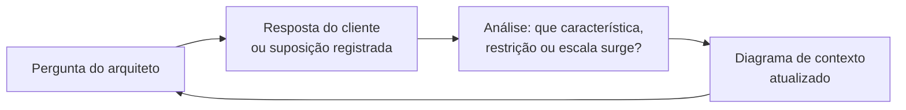

# Capítulo 3 - 100.000 pés: requisitos e contexto

!!! todo "Para desenvolver"
    Podcast do capítulo.

## Objetivos

Ao final deste capítulo, o leitor deverá ser capaz de:

- Conduzir uma conversa de levantamento de requisitos arquiteturais segundo o método de Xu
  (2020), formulando perguntas que delimitem escopo, escala e restrições.
- Distinguir requisitos funcionais de características arquiteturais e derivar estas a partir do
  contexto de negócio.
- Realizar estimativas de ordem de grandeza (vazão, armazenamento e banda) a partir de dados
  de negócio.
- Especificar características arquiteturais por meio de cenários de qualidade mensuráveis.
- Construir e fazer evoluir um diagrama de contexto (C4, nível 1) à medida que novas
  informações são obtidas.
- Aplicar esse procedimento aos sete sistemas estudados no livro.

## 3.1 Introdução: a altitude do contexto

### 3.1.1 O que se observa a 100.000 pés

A 100.000 pés, o sistema é uma única caixa. Não se distinguem servidores, bancos de dados ou
classes; distinguem-se as **pessoas** que usam o sistema, os **sistemas externos** com que ele se
comunica e as **forças** que o condicionam: o volume de usuários, a taxa de crescimento esperada,
as exigências legais, o orçamento, o prazo e as competências da equipe. É o nível do diagrama de
contexto do modelo C4 (BROWN, 2018) e o ponto de partida obrigatório de qualquer análise, pois,
como argumentam Bass, Clements e Kazman (2021, cap. 3), são os atributos de qualidade exigidos
pelo contexto, e não a funcionalidade, que determinam a forma da arquitetura.

O erro mais comum nesta altitude é abandoná-la cedo demais. Xu (2020, cap. 3) dedica uma seção
inteira do seu método a advertir contra a tentação de propor soluções antes de compreender o
problema. Responder rapidamente, sem entender os requisitos, é apresentado pelo autor como um
sinal de alerta, e não de competência: a pressa em chegar ao desenho final tende a produzir o
sistema errado. Richards e Ford (2020, cap. 5) chegam a conclusão semelhante por outro caminho
ao relatar o caso do navio Vasa, cuja sobrecarga de requisitos levou ao naufrágio na viagem
inaugural. Nos dois casos, a lição é que a qualidade das perguntas iniciais condiciona a qualidade
de tudo o que vem depois.

### 3.1.2 O método: uma conversa que faz o desenho evoluir

Este capítulo adota o procedimento proposto por Xu (2020, cap. 3) para entrevistas de projeto de
sistemas e o adapta ao estudo de sistemas reais. O método de Xu tem quatro passos: (1) entender o
problema e estabelecer o escopo; (2) propor um projeto de alto nível e obter concordância;
(3) aprofundar o projeto; (4) concluir. O primeiro passo corresponde à altitude de 100.000 pés e é
o objeto deste capítulo. Os demais correspondem às altitudes tratadas nos Capítulos 4 a 6.

Xu (2020, cap. 3) propõe que o primeiro passo seja conduzido como uma **conversa** em que o
projetista faz perguntas e o interlocutor responde ou pede que suposições sejam feitas e
registradas. As perguntas iniciais sugeridas pelo autor tratam de quatro temas:

1. **funcionalidades**: que funcionalidades específicas serão construídas;
2. **usuários**: quantos usuários o produto tem;
3. **crescimento**: com que rapidez a empresa espera crescer, e que escala se prevê em três
   meses, seis meses e um ano;
4. **tecnologia existente**: qual é a pilha tecnológica da empresa e que serviços existentes podem
   ser aproveitados para simplificar o projeto.

O exemplo apresentado por Xu para um sistema de *feed* de notícias mostra o efeito dessas
perguntas. Cada resposta (aplicativo móvel e web; ordenação cronológica reversa; até 5.000
amigos por usuário; 10 milhões de usuários ativos por dia; publicações com imagens e vídeos)
elimina alternativas e introduz restrições. O desenho que emerge ao final da conversa não poderia
ter sido proposto no início, porque as informações que o justificam ainda não existiam.

Nos estudos de caso deste capítulo, essa conversa é **simulada** entre o arquiteto e um
representante do cliente, como um *product owner*, um gestor ou um especialista do domínio. As
falas do cliente são construídas a partir de fontes públicas sobre cada sistema, como documentação
oficial, artigos de engenharia, relatos de incidentes e o próprio código, e, quando hipotéticas,
são assinaladas como tais. Após cada rodada da conversa, o texto analisa a nova informação em
linguagem técnica e atualiza o diagrama de contexto, que **evolui** ao longo da seção. O leitor
acompanha, assim, não apenas o resultado da análise, mas o raciocínio que a produziu, o que atende
à segunda lei de Richards e Ford (2020, p. 19): o porquê é mais importante que o como.

**Figura 3.1** – Ciclo de uma rodada da conversa de requisitos.

Fonte: elaborado pelo autor (2026), com base em Xu (2020, cap. 3).

Convém registrar uma diferença entre a entrevista de Xu e a prática profissional. Na entrevista,
o interlocutor conhece as respostas e o objetivo é avaliar a capacidade do candidato de formular
perguntas. Na prática, o cliente frequentemente não sabe responder, ou responde de forma
imprecisa, e parte do trabalho consiste em transformar respostas vagas ("o sistema precisa ser
rápido") em requisitos verificáveis. O SWEBOK v4 trata dessa atividade na área de conhecimento de
requisitos, que inclui a elicitação, a análise e a especificação de requisitos não funcionais e de
restrições (WASHIZAKI, 2024, cap. 1). As conversas simuladas deste capítulo procuram reproduzir
essa dificuldade: o cliente nem sempre conhece os números e, por vezes, o arquiteto precisa propor
suposições e pedir confirmação.

### 3.1.3 Os produtos da análise a 100.000 pés

Cada seção de aplicação (3.2 a 3.8) produz os mesmos cinco artefatos:

1. **Diagrama de contexto** (C4, nível 1), em versões sucessivas, com usuários, o sistema e os
   sistemas externos (Apêndice A).
2. **Estimativas de ordem de grandeza** de vazão (requisições por segundo, médias e de pico),
   armazenamento e banda, calculadas com o procedimento de Xu (2020, cap. 2) e explicitadas passo
   a passo, de modo que o leitor possa refazê-las com outras premissas. O Apêndice F apresenta as
   técnicas e as tabelas de referência.
3. **Características arquiteturais priorizadas**, com as três mais importantes de cada sistema,
   segundo a recomendação de Richards e Ford (2020, cap. 5), e a justificativa de cada escolha. O
   Apêndice D aprofunda a identificação e a classificação das características.
4. **Cenários de qualidade** com as seis partes propostas por Bass, Clements e Kazman (2021,
   cap. 3): fonte, estímulo, ambiente, artefato, resposta e medida da resposta (Seção 1.4.2).
5. **Restrições** que não decorrem de escolhas da equipe, mas do ambiente: legislação, como a Lei
   Geral de Proteção de Dados Pessoais (BRASIL, 2018) e as normas de aviação civil;
   compatibilidade com protocolos existentes; orçamento; competências da equipe.

A Tabela 3.1 resume o ponto de partida das sete conversas.

**Tabela 3.1** – Ponto de partida das conversas de requisitos.

| Seção | Sistema | Primeira frase do cliente (resumo) | Dimensão que domina a conversa |
|---|---|---|---|
| [3.2](mastodon.md) | Mastodon | "Queremos uma rede social de mensagens curtas, sem um dono único." | Leituras em escala e federação |
| [3.3](mattermost.md) | Mattermost | "O jurídico não aceita mais que as conversas fiquem em servidores de terceiros." | Latência e soberania de dados |
| [3.4](peertube.md) | PeerTube | "Queremos um YouTube nosso, para as aulas do instituto." | Custo de armazenamento e de banda |
| [3.5](nextcloud.md) | Nextcloud | "Queremos uma pasta sincronizada para cada pessoa da universidade." | Durabilidade e extensibilidade |
| [3.6](saleor.md) | Saleor | "Tudo o que fazemos de diferente na loja alugada exige gambiarras." | Elasticidade e consistência financeira |
| [3.7](thingsboard.md) | ThingsBoard | "Nossos clientes querem ver os sensores num painel e receber alarmes." | Vazão de telemetria e segurança de dispositivos |
| [3.8](px4.md) | PX4 | "Precisamos de um único software de voo para toda a linha de veículos." | Determinismo e segurança física |

Fonte: elaborado pelo autor (2026).

### 3.1.4 Armadilhas desta altitude

Três armadilhas recorrentes merecem atenção.

A primeira é **tratar todas as características como prioritárias**. Richards e Ford (2020, cap. 5)
observam que cada característica suportada pela arquitetura acrescenta complexidade, e que a
tentativa de suportar todas produz arquiteturas genéricas que não atendem bem a nenhum objetivo.
A recomendação de escolher as três mais importantes não é arbitrária: ela força a conversa sobre
compromissos a acontecer cedo, quando ainda é barata.

A segunda é **confundir requisitos implícitos com ausência de requisitos**. Características como
segurança, disponibilidade e conformidade legal raramente aparecem nas primeiras falas do cliente,
mas sua ausência no projeto é inaceitável. Richards e Ford (2020, cap. 5) distinguem, por isso,
características explícitas, declaradas nos requisitos, de características implícitas, que o
arquiteto deve inferir do domínio. Nas conversas deste capítulo, várias delas surgem por iniciativa
do arquiteto, e não do cliente.

A terceira é o **excesso de engenharia** (*over-engineering*), que Xu (2020, cap. 3) caracteriza
como uma "doença real" de muitos engenheiros, atraídos pela pureza do projeto e desatentos aos
compromissos e aos custos acumulados que ela impõe. Projetar para um bilhão de usuários quando o
cliente espera dez mil é um erro tão grave quanto o oposto. As estimativas de ordem de grandeza
servem justamente para ancorar o projeto em números plausíveis.

## Diagramas e animações

O interativo do altímetro, apresentado na Seção 1.11, mostra a posição desta altitude na descida
completa.

<iframe src="../interativos/altimetro.html" title="Altímetro: do contexto ao código"
  style="width:100%; height:660px; border:1px solid #2A4468; border-radius:10px;"
  loading="lazy"></iframe>

A simulação seguinte aplica o primeiro passo do método de Xu (2020, cap. 3) a um sistema simples,
o encurtador de URL estudado no Apêndice F (Seção F.4). O leitor escolhe as perguntas do
arquiteto, organizadas pelos quatro temas da Seção 3.1.2, e, a cada resposta, observa o diagrama
de contexto e as estimativas de ordem de grandeza se atualizarem, como no ciclo da Figura 3.1.
Duas perguntas são deliberadamente prematuras, pois tratam de tecnologia e de estilo antes que as
características tenham sido estabelecidas, e ilustram a advertência de Xu contra propor soluções
antes de compreender o problema (Seção 3.1.1).

<iframe src="../interativos/conversa-requisitos.html" title="Conversa de requisitos: um encurtador de URL"
  style="width:100%; height:660px; border:1px solid #2A4468; border-radius:10px;"
  loading="lazy"></iframe>

## Vídeos

!!! todo "Para desenvolver"
    Vídeo (10–15 min) com uma conversa de requisitos encenada para um dos sete sistemas.

## Exercícios

1. Explique por que Xu (2020) considera a resposta rápida um sinal de alerta numa entrevista de
   projeto de sistemas. Relacione o argumento à segunda lei de Richards e Ford.
2. Escolha um dos sete sistemas e reescreva a conversa da seção correspondente supondo um cliente
   com cem vezes menos usuários. Que características deixam de estar entre as três prioritárias?
3. Para o sistema de matrícula de uma instituição de ensino, simule uma conversa de requisitos com
   ao menos seis rodadas e produza as versões sucessivas do diagrama de contexto.
4. Compare as estimativas de armazenamento das Seções 3.4 (PeerTube) e 3.7 (ThingsBoard). Que
   grandeza domina cada uma e que consequência isso tem a 50.000 pés?
5. Identifique, em duas das sete seções, uma característica implícita que surgiu por iniciativa do
   arquiteto. Por que o cliente não a mencionou?
6. Escreva dois cenários de qualidade para um mesmo sistema que conflitem entre si. Como a
   conversa com o cliente poderia resolver o conflito?
7. Em que sistemas deste capítulo a legislação aparece como restrição? Que leis ou normas estão
   envolvidas e que decisões elas impõem?
8. Construa uma tabela com o Top-3 dos sete sistemas. Que características aparecem com mais
   frequência? Que hipótese isso sugere sobre os sistemas escolhidos?

## Glossário do capítulo

`Diagrama de contexto`
:   Diagrama do nível 1 do modelo C4, que representa o sistema como uma única caixa, cercado por
    seus usuários e pelos sistemas externos com que se comunica.

`Estimativa de ordem de grandeza`
:   Cálculo aproximado, feito com premissas explícitas e números arredondados, para verificar se
    uma proposta de projeto é compatível com a escala esperada. Também chamada de estimativa de
    guardanapo.

`Característica explícita`
:   Característica arquitetural declarada nos requisitos ou pelo cliente.

`Característica implícita`
:   Característica arquitetural não declarada, mas exigida pelo domínio, como segurança em um
    sistema financeiro.

`Restrição`
:   Condição imposta pelo ambiente, e não escolhida pela equipe, que limita as soluções possíveis,
    como uma lei, um protocolo obrigatório ou um orçamento.

`Excesso de engenharia`
:   Introdução de complexidade não justificada pelos requisitos e pela escala esperada.

## Referências

BASS, L.; CLEMENTS, P.; KAZMAN, R. **Software architecture in practice**. 4. ed. Boston:
Addison-Wesley, 2021.

BRASIL. **Lei nº 13.709, de 14 de agosto de 2018**. Lei Geral de Proteção de Dados Pessoais
(LGPD). Brasília, DF: Presidência da República, 2018.

BROWN, S. **The C4 model for visualising software architecture**. 2018. Disponível em:
<https://c4model.com>. Acesso em: 18 out. 2026.

RICHARDS, M.; FORD, N. **Fundamentals of software architecture**: an engineering approach.
Sebastopol: O'Reilly, 2020.

WASHIZAKI, H. (ed.). **Guide to the software engineering body of knowledge (SWEBOK Guide)**:
version 4.0. Los Alamitos: IEEE Computer Society, 2024.

XU, A. **System design interview**: an insider's guide. 2. ed. [*S. l.*]: Byte Code LLC, 2020.

## Material complementar

!!! todo "Para desenvolver"
    Seleção de palestras e textos de acesso aberto sobre levantamento de requisitos arquiteturais.
