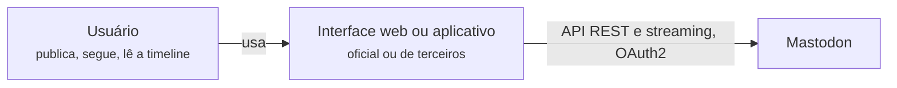
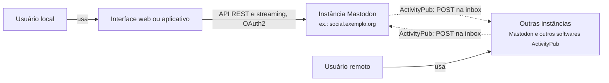
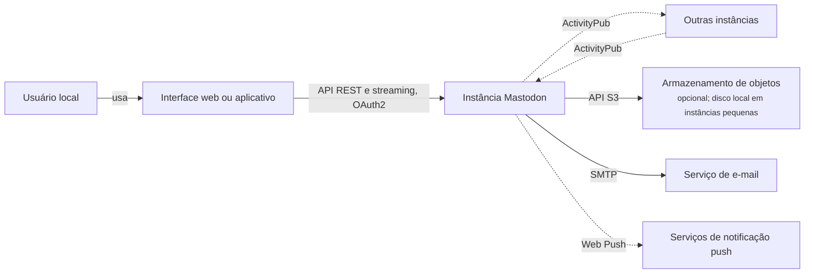
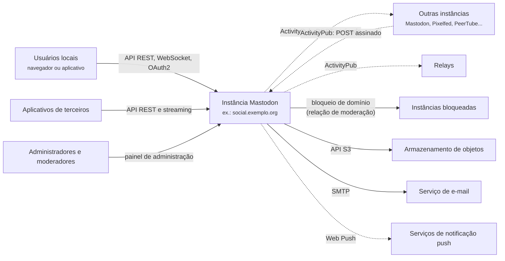

# 3.2 Mastodon: requisitos e contexto

100.000 pés

Esta seção aplica ao Mastodon o procedimento descrito na Seção 3.1: uma conversa simulada entre o
arquiteto e o cliente, em rodadas, ao fim das quais o diagrama de contexto é atualizado. O sistema
e seu par fechado, o Twitter/X, foram apresentados na
[Seção 2.2](../capitulo-2-aplicacoes/mastodon.md).

!!! note "Sobre as falas do cliente"
    O "cliente" desta conversa é um *product owner* fictício do projeto Mastodon. Suas falas
    reproduzem decisões e números documentados publicamente pelo projeto (documentação oficial,
    código da *tag* v4.7.3, blog do projeto), com a fonte indicada na análise que segue cada
    rodada. Quando a fala contém um número ou uma exigência hipotética, criada para fins
    didáticos, isso é dito explicitamente na análise.

## 3.2.1 Rodada 1: o que é o produto

!!! question "Arquiteto"
    O que exatamente vamos construir? Quem usa e o que essas pessoas fazem?

!!! quote "Cliente"
    Queremos uma rede social de mensagens curtas, sem um dono único. As pessoas publicam textos
    curtos, com imagens, vídeos ou enquetes, seguem outras pessoas e leem uma *timeline* com o
    que as contas seguidas publicaram, em ordem cronológica. Nada de algoritmo decidindo o que
    aparece. Também querem ser notificadas quando alguém as menciona ou interage com elas, e ver
    as novidades aparecerem sem recarregar a página.

!!! question "Arquiteto"
    Ordem cronológica reversa, sem ranqueamento? Interface web e aplicativos?

!!! quote "Cliente"
    Isso. A interface web é nossa; para celular, há aplicativos oficiais e muitos de terceiros.
    Queremos que qualquer pessoa possa escrever um cliente usando a nossa API.

A primeira rodada fixa o escopo funcional e já antecipa três características. A ordenação
cronológica, sem ranqueamento, simplifica o problema da *timeline* em relação a um *feed*
algorítmico: a lista de cada usuário é apenas a fusão, ordenada por tempo, das publicações das
contas seguidas. É a mesma simplificação que Xu (2020, cap. 11) adota no projeto de um *feed* de
notícias, e é coerente com o que o Mastodon de fato faz. A exigência de "ver as novidades sem
recarregar" introduz um requisito de **tempo quase real**, que implica conexões persistentes entre
cliente e servidor. A abertura para clientes de terceiros introduz **interoperabilidade na borda
do cliente**: o `README.md` do projeto descreve o Mastodon como provedor OAuth2 com API REST e de
*streaming* públicas, o que resultou num ecossistema amplo de aplicativos (MASTODON, 2026a).

Nesta altura, o diagrama de contexto tem apenas o usuário, o sistema e os aplicativos clientes
(Figura 3.2.1).

**Figura 3.2.1** – Diagrama de contexto, versão 1.

Fonte: elaborado pelo autor (2026).

## 3.2.2 Rodada 2: "sem um dono único"

!!! question "Arquiteto"
    O que significa, na prática, "sem um dono único"? Haverá uma empresa operando o serviço?

!!! quote "Cliente"
    Não. Nós escrevemos o software; quem opera são pessoas e organizações independentes:
    universidades, coletivos, jornalistas, empresas, indivíduos. Cada uma instala o seu servidor,
    a sua instância, com as suas regras. Uma pessoa numa instância precisa poder seguir e
    responder a alguém de outra instância como se estivessem no mesmo lugar. E isso não pode
    ficar restrito ao Mastodon: outros softwares que falem o mesmo protocolo também participam.

!!! question "Arquiteto"
    Então o protocolo entre servidores é parte do produto. Ele já existe ou vamos inventá-lo?

!!! quote "Cliente"
    Já existe: é o ActivityPub, um padrão do W3C. Queremos segui-lo.

Esta é a informação que mais transforma o problema. A documentação do projeto define a federação
como uma forma de descentralização em que servidores operados independentemente se comunicam por
um protocolo aberto, e chama de *fediverso* o conjunto de sites que conversam por ActivityPub,
como Pixelfed, Misskey e PeerTube (MASTODON, 2026b). A especificação ActivityPub, recomendação do
W3C de 23 de janeiro de 2018, define um protocolo servidor-servidor em que um servidor entrega
atividades fazendo `POST` na caixa de entrada (*inbox*) de atores hospedados em outros servidores
(LEMMER-WEBBER *et al.*, 2018, seções 1 e 7).

Três consequências arquiteturais decorrem daí. Primeiro, o sistema **não é o único dono dos dados
que seus usuários leem**: parte relevante de cada *timeline* é produzida em servidores que ele não
controla, com versões de software, políticas e disponibilidade próprias. Segundo, a **sexta
falácia da computação distribuída**, a de que há um único administrador (RICHARDS; FORD, 2020,
p. 129), deixa de ser um erro a evitar e passa a ser premissa explícita: haverá milhares de
administradores. Terceiro, a **interoperabilidade** torna-se característica de primeira ordem,
verificável contra uma especificação externa. O diagrama de contexto ganha um novo vizinho, com
setas nos dois sentidos (Figura 3.2.2).

**Figura 3.2.2** – Diagrama de contexto, versão 2: a federação.

Fonte: elaborado pelo autor (2026), com base em Lemmer-Webber *et al.* (2018). Linhas contínuas:
comunicação síncrona; linhas tracejadas: comunicação assíncrona.

## 3.2.3 Rodada 3: escala

!!! question "Arquiteto"
    Qual é o tamanho de uma instância típica? Quantas contas, quantas ativas, quantas pessoas
    conectadas ao mesmo tempo?

!!! quote "Cliente"
    Varia muito, de uma pessoa a centenas de milhares. Para dimensionar, pense numa comunidade de
    uns 50 mil cadastros, com 10 a 20 mil contas ativas por mês. Uma instância assim costuma ter
    de 800 a 1.200 conexões de *streaming* abertas ao mesmo tempo.

!!! question "Arquiteto"
    E quanto essas pessoas publicam e leem? Quantos seguidores têm?

!!! quote "Cliente"
    Isso nós não medimos de forma centralizada; cada instância tem os seus números. Faça
    suposições razoáveis e registre-as.

Os números da primeira resposta vêm da documentação oficial de escala, que usa exatamente esse
exemplo de comunidade (MASTODON, 2026c). A segunda resposta é a situação descrita na Seção 3.1.2: o
cliente não sabe, e o arquiteto precisa propor suposições explícitas. A Tabela 3.2.1 registra as
suposições, todas hipotéticas, e a Tabela 3.2.2 calcula as estimativas de guardanapo pelo
procedimento de Xu (2020, cap. 2).

**Tabela 3.2.1** – Suposições para a estimativa (hipotéticas, exceto onde indicado).

| Suposição | Valor | Origem |
|---|---|---|
| Contas cadastradas | 50.000 | documentação (MASTODON, 2026c) |
| Contas ativas por mês (MAU) | 15.000 | ponto médio do intervalo documentado |
| Ativas por dia (DAU) | 40% do MAU = 6.000 | hipótese |
| Publicações por usuário ativo por dia | 2 | hipótese, igual à de Xu (2020, cap. 2) |
| Aberturas da *timeline* por usuário ativo por dia | 20 | hipótese |
| Seguidores **locais** médios por conta que publica | 30 | hipótese |
| Contas **remotas** distintas seguidas por usuários da instância | 60.000 | hipótese |
| Publicações por conta remota seguida por dia | 3 | hipótese |
| Seguidores locais médios de cada conta remota seguida | 5 | hipótese |
| Instâncias remotas distintas que recebem cada publicação local | 200 | hipótese |
| Publicações com mídia; tamanho médio da mídia | 20%; 2 MB | hipótese |
| Fator de pico sobre a média | 10 | hipótese (evento ao vivo) |

Fonte: elaborado pelo autor (2026).

**Tabela 3.2.2** – Estimativas de guardanapo para uma instância Mastodon.

| Grandeza | Cálculo | Resultado |
|---|---|---|
| Publicações locais por dia | 6.000 × 2 | 12.000/dia |
| Publicações locais por segundo (média; pico) | 12.000 / 86.400; × 10 | ≈ 0,14/s; ≈ 1,4/s |
| Leituras de *timeline* por segundo (média; pico) | 6.000 × 20 / 86.400; × 10 | ≈ 1,4/s; ≈ 14/s |
| Inserções em *timelines* por publicações locais | 12.000 × 30 / 86.400 | ≈ 4/s |
| Publicações remotas recebidas | 60.000 × 3 / 86.400 | ≈ 2/s |
| Inserções em *timelines* por publicações remotas | 2/s × 5 | ≈ 10/s |
| Entregas federadas enviadas | 12.000 × 200 / 86.400 | ≈ 28/s |
| Mídia local nova por dia; por ano | 12.000 × 20% × 2 MB; × 365 | ≈ 4,8 GB; ≈ 1,75 TB |
| *Timelines* em memória (até 800 IDs de 8 bytes; 8.000 contas ativas na semana) | 8.000 × 800 × 8 B | ≈ 51 MB só de IDs |

Fonte: elaborado pelo autor (2026), com as suposições da Tabela 3.2.1.

Três observações resultam da tabela. A primeira é que, em vazão, uma instância típica é
**minúscula** quando comparada ao exemplo hipotético do Twitter de Xu (2020, cap. 2), com cerca de
3.500 publicações por segundo em média: a instância está quatro ordens de grandeza abaixo. Não há,
portanto, justificativa de volume para uma arquitetura distribuída dentro de cada servidor. A
segunda é que o tráfego é **dominado pela federação**: as entregas enviadas (≈ 28/s) superam em
duas ordens de grandeza as publicações locais, e as inserções causadas por publicações remotas
superam as causadas por publicações locais. O gargalo provável não é o banco nem a leitura, mas a
fila de trabalho assíncrono e a rede de saída. A terceira é que o **armazenamento de mídia** é o
item que cresce sem limite natural; a documentação recomenda, por isso, revisar as configurações de
retenção de conteúdo, incluindo o tempo durante o qual a mídia de usuários remotos fica em cache no
servidor (MASTODON, 2026c). O sobrecusto real das *timelines* em memória é maior que os 51 MB da
tabela, pois o Redis guarda também a pontuação e estruturas internas, mas a ordem de grandeza mostra
que manter as *timelines* pré-computadas cabe com folga em um servidor modesto.

A rodada também acrescenta ao contexto o armazenamento de mídia e, por consequência do volume de
mídia, a opção por um serviço externo de objetos. A documentação informa que o sistema de arquivos
local é perfeitamente adequado para servidores pequenos, mas que o armazenamento externo de objetos
compatível com S3 é mais escalável (MASTODON, 2026d).

**Figura 3.2.3** – Diagrama de contexto, versão 3: mídia e notificações.

Fonte: elaborado pelo autor (2026), com base em Mastodon (2026c; 2026d). Linhas contínuas:
comunicação síncrona; linhas tracejadas: comunicação assíncrona.

## 3.2.4 Rodada 4: picos e contas muito seguidas

!!! question "Arquiteto"
    Há picos? E há contas com muito mais seguidores que as outras?

!!! quote "Cliente"
    As duas coisas. Os picos não são só de publicações: no fim de 2022, quando o Twitter foi
    vendido, a rede inteira passou de uns 300 mil para 2,5 milhões de usuários ativos por mês em
    dois meses. Servidores pequenos receberam milhares de cadastros em poucos dias. E sim: há
    jornalistas, artistas e instituições com centenas de milhares de seguidores, espalhados por
    milhares de servidores.

!!! question "Arquiteto"
    Quando uma instância está sobrecarregada, o que deve sofrer primeiro?

!!! quote "Cliente"
    Os usuários locais precisam continuar vendo as próprias publicações e as de quem seguem na
    mesma instância. Se a entrega para outros servidores atrasar algumas horas, é aceitável.

A cifra de crescimento é do próprio projeto (ROCHKO, 2022). Ela revela que a característica em jogo
não é apenas a escalabilidade, capacidade de atender a um número crescente de usuários, mas a
**elasticidade**, capacidade de absorver rajadas (RICHARDS; FORD, 2020, p. 70). A segunda resposta
estabelece uma **prioridade explícita** entre a experiência local e a federação, e é coerente com
a documentação de escala, que ordena as filas de trabalho por importância e coloca as tarefas que
afetam usuários locais acima da entrega e da recepção federadas, justamente para que os usuários
locais continuem vendo suas publicações quando o servidor está sob carga (MASTODON, 2026c).

O problema das contas muito seguidas, o **problema da celebridade**, merece uma estimativa à parte.
Uma conta com 300 mil seguidores, sendo 50 mil na própria instância e os demais em 3.000 instâncias
remotas (números hipotéticos), gera a cada publicação 50 mil inserções em *timelines* locais e
3.000 entregas federadas, uma por servidor de destino quando ele oferece uma caixa de entrada
compartilhada (LEMMER-WEBBER *et al.*, 2018, seção 7.1.3). Se os processos de trabalho da instância
inserem, por hipótese, 2.000 itens por segundo, a última *timeline* local é atualizada cerca de 25
segundos após a primeira, e as tarefas que chegaram depois esperam junto. Para efeito de
comparação, o resumo de Hoff (2013) da palestra de Krikorian (2012) registra que, no Twitter, a
entrega de uma publicação de uma conta com 31 milhões de seguidores podia levar até cinco minutos.
Argumenta-se aqui que a federação atenua o problema ao **repartir o trabalho**: o *fanout* para os
250 mil seguidores remotos do exemplo é feito pelas 3.000 instâncias desses seguidores, cada uma
com os seus recursos.

## 3.2.5 Rodada 5: moderação, dados pessoais e restrições

!!! question "Arquiteto"
    Quem decide o que é aceitável? E o que acontece se outro servidor for usado para abuso?

!!! quote "Cliente"
    Cada instância tem as suas regras e a sua equipe de moderação. Os moderadores podem limitar
    ou suspender contas, inclusive de outros servidores, e também bloquear um servidor inteiro.
    Há administradores que preferem só federar com servidores aprovados manualmente.

!!! question "Arquiteto"
    E os dados pessoais? O usuário pode levar sua conta embora?

!!! quote "Cliente"
    Pode exportar a lista de quem segue, bloqueios e listas, pedir um arquivo com suas
    publicações e mídia e migrar para outra instância levando os seguidores. Suponha ainda que
    a primeira instância que vamos apoiar seja de uma universidade brasileira: ela precisa
    cumprir a LGPD.

As respostas sobre moderação correspondem a funções documentadas: ações sobre contas (limitar,
suspender) e bloqueios de domínio com níveis de severidade, em que suspender um servidor remove
todas as relações de seguimento entre contas locais e contas daquele servidor (MASTODON, 2026e). O
modo de federação limitada, que restringe a federação a servidores aprovados manualmente, também é
uma opção documentada (MASTODON, 2026f). A portabilidade descrita pelo cliente está na documentação
para usuários: exportação em CSV de contas seguidas, listas e bloqueios, arquivo das publicações e
mídia no formato Activity Streams 2.0, que pode ser solicitado uma vez a cada 7 dias, e migração de
conta com redirecionamento de seguidores (MASTODON, 2026g). A exigência da LGPD é **hipotética**,
introduzida para fins didáticos; ela acrescenta uma restrição de ambiente, no sentido da Seção
3.1.3, e reforça a importância da exportação e da exclusão de dados.

Do ponto de vista arquitetural, a moderação federada introduz dois *stakeholders* sem equivalente
direto no Twitter (o administrador e o moderador de **cada** instância) e uma relação nova entre
sistemas: uma instância pode **recusar** outra. A Tabela 3.2.3 consolida os *stakeholders*.

**Tabela 3.2.3** – *Stakeholders* e interesses: Twitter/X e Mastodon.

| *Stakeholder* | Twitter/X | Mastodon |
|---|---|---|
| Usuários que publicam | alcance, rapidez de entrega | alcance dentro e fora da instância, controle de visibilidade |
| Usuários que leem | *timeline* rápida e relevante | *timeline* cronológica, sem recomendação obrigatória |
| Anunciantes | exposição, segmentação | não se aplicam ao software em si |
| Empresa operadora | custo por usuário, receita | não existe um operador central |
| Administradores de instância | — | custo de *hardware*, facilidade de operação, atualização simples |
| Moderadores | políticas globais | políticas locais, bloqueio de servidores inteiros |
| Outras instâncias federadas | — | interoperabilidade, entregas confiáveis |
| Desenvolvedores de aplicativos | API controlada pela empresa | API pública e estável |
| Reguladores | proteção de dados, conteúdo ilegal | idem, aplicado a cada administrador |

Fonte: elaborado pelo autor (2026).

!!! caixa-preta "Julho de 2023: limites de leitura no Twitter/X"
    Em 1.º de julho de 2023, Elon Musk anunciou limites temporários ao número de publicações que
    cada conta podia ler por dia, inicialmente 6.000 para contas verificadas, 600 para não
    verificadas e 300 para novas contas não verificadas, justificados como resposta a níveis
    "extremos" de coleta automatizada de dados (*scraping*) e manipulação do sistema. A medida veio
    logo após a plataforma passar a exigir conta para visualizar publicações, e usuários relataram
    não conseguir ver nenhuma publicação após atingir o limite (GODOY, 2023).

    **Lição para esta altitude.** Um limite aplicado à **leitura** de um sistema cuja arquitetura
    foi otimizada para tornar a leitura barata indica que a capacidade, e não apenas o algoritmo,
    tornou-se a restrição. A medida protegeu a disponibilidade à custa dos leitores e da confiança
    dos anunciantes, um conflito entre *stakeholders* e entre atributos (Seção 1.4.3) que só fica
    visível a 100.000 pés. As causas internas não foram documentadas publicamente pela empresa; o
    caso ilustra o compromisso, e não serve de diagnóstico técnico. No Mastodon, a mesma tensão
    entre abertura e proteção aparece como configuração de cada administrador: o "modo seguro"
    (`AUTHORIZED_FETCH`) e o modo de federação limitada restringem quem pode ler o quê
    (MASTODON, 2026f).

## 3.2.6 Características prioritárias

Com as cinco rodadas, é possível escolher as características prioritárias, seguindo a
recomendação de Richards e Ford (2020, cap. 5) de manter a lista curta. A Tabela 3.2.4 compara o
Top-3 do Mastodon com o do Twitter.

**Tabela 3.2.4** – Top-3 de características arquiteturais.

| Posição | Twitter/X | Mastodon (instância) | Rodada que a justifica |
|---|---|---|---|
| 1 | Desempenho de leitura da *timeline* | Simplicidade operacional (custo, facilidade de implantação e atualização) | 2 e 3 |
| 2 | Disponibilidade | Interoperabilidade (ActivityPub, API de clientes) | 1 e 2 |
| 3 | Elasticidade diante de picos | Desempenho de leitura da *timeline* | 1, 3 e 4 |

Fonte: elaborado pelo autor (2026), com base em Krikorian (2013) para a coluna do Twitter.

O Top-3 do Twitter é sustentado pelo próprio relato da empresa sobre sua reengenharia: reduzir a
latência mediana e as extremas, isolar falhas para evitar grandes interrupções e suportar picos
como o de 3 de agosto de 2013, quando uma transmissão de TV no Japão produziu 143.199 publicações
em um segundo, cerca de 25 vezes a média (KRIKORIAN, 2013). O do Mastodon decorre da Rodada 2: se
qualquer organização, inclusive voluntários, deve poder operar uma instância, a **simplicidade
operacional** passa à frente, e a Rodada 3 mostra que o volume de uma instância não exige
sofisticação. A disponibilidade continua importante, mas o raio de impacto de uma falha é menor: se
uma instância cai, as demais seguem funcionando. A elasticidade é desejável (Rodada 4), mas
argumenta-se aqui que ela é obtida mais pela rede, com a criação de novas instâncias, do que por
cada servidor. Essa diferença de prioridades antecipa a principal diferença de estilo entre os dois
sistemas, examinada na [Seção 4.2](../capitulo-4-50-mil-pes/mastodon.md): o Mastodon permaneceu um
monólito, enquanto o Twitter abandonou o seu.

## 3.2.7 Cenários de qualidade

As características do Top-3, mais a disponibilidade sob falhas da federação, são especificadas a
seguir como cenários com as seis partes descritas na Seção 1.4.2 (BASS; CLEMENTS; KAZMAN, 2021,
cap. 3). As medidas são **metas hipotéticas** propostas pelo arquiteto, pois o projeto não publica
objetivos de nível de serviço; os mecanismos que permitem atingi-las são examinados nas Seções 4.2
e 5.2.

**Tabela 3.2.5** – Cenários de qualidade para uma instância Mastodon.

| Parte | C1 – Desempenho de leitura | C2 – Falha parcial na federação | C3 – Elasticidade | C4 – Simplicidade operacional |
|---|---|---|---|---|
| **Fonte** | usuário local ativo | instância remota | onda de novos usuários | administrador voluntário |
| **Estímulo** | abre a *timeline* inicial | fica fora do ar por 2 dias | cadastros 10 vezes acima do normal durante uma semana | instala e atualiza a instância |
| **Ambiente** | operação normal, inclusive em pico | operação normal | servidor único de pequeno porte | servidor Linux comum, sem equipe dedicada |
| **Artefato** | API da *timeline* inicial | entrega federada | filas de trabalho e servidor | instalação e procedimento de atualização |
| **Resposta** | devolve as publicações mais recentes das contas seguidas | continua entregando às demais instâncias; reenvia à instância caída com espera crescente | preserva a experiência local; atrasa a federação | conclui com a documentação oficial, sem componentes além dos documentados |
| **Medida** | p95 < 300 ms | entregas às demais instâncias sem atraso adicional; entrega à instância caída concluída após o retorno, dentro de cerca de 2 dias | publicações locais nas *timelines* locais em < 10 s; atraso de federação de até algumas horas | instalação em um dia; atualização de versão menor em < 1 h |

Fonte: elaborado pelo autor (2026).

O cenário C2 merece um comentário. A especificação ActivityPub determina que a entrega a servidores
de terceiros deve ser assíncrona e deve ser repetida em caso de falha de rede (LEMMER-WEBBER
*et al.*, 2018, seção 7.1), mas não diz por quanto tempo. A medida "cerca de 2 dias" foi escolhida
porque corresponde, como mostra a Seção 6.2, à soma das esperas entre as retentativas configuradas
no código da versão estudada. O cenário, portanto, é verificável contra a implementação.

## 3.2.8 Diagrama de contexto final

A Figura 3.2.4 consolida a análise. Em relação à versão 3, ela acrescenta os moderadores e
administradores, os retransmissores (*relays*), que o código usa para ampliar a distribuição de
publicações públicas (Seção 5.2), e a possibilidade de uma instância remota estar bloqueada.

**Figura 3.2.4** – Diagrama de contexto final de uma instância Mastodon.

Fonte: elaborado pelo autor (2026), com base em Mastodon (2026a; 2026c; 2026d; 2026e). Linhas
contínuas: comunicação síncrona; linhas tracejadas: comunicação assíncrona.

O diagrama deixa explícita a diferença em relação a um diagrama de contexto convencional: a seta
bidirecional com outras instâncias significa que o sistema troca dados com **pares**, e não com
fornecedores ou clientes. Tudo o que a Figura 3.2.4 mostra como uma caixa, a Seção 4.2 abre em
*containers*.

## Referências

BASS, L.; CLEMENTS, P.; KAZMAN, R. **Software architecture in practice**. 4. ed. Boston:
Addison-Wesley, 2021.

GODOY, J. Musk's Twitter rate limits could undermine new CEO, ad experts say. **Reuters**,
3 jul. 2023. Disponível em:
<https://www.reuters.com/business/media-telecom/musks-twitter-rate-limits-could-undermine-new-ceo-ad-experts-say-2023-07-03/>.
Acesso em: 18 out. 2026.

HOFF, T. **The architecture Twitter uses to deal with 150M active users, 300K QPS, a 22 MB/s
firehose, and send tweets in under 5 seconds**. High Scalability, 8 jul. 2013. Disponível em:
<http://highscalability.com/blog/2013/7/8/the-architecture-twitter-uses-to-deal-with-150m-active-users.html>.
Acesso em: 18 out. 2026.

KRIKORIAN, R. **Timelines at scale**. Palestra apresentada na QCon San Francisco 2012. InfoQ,
2012. Disponível em: <https://www.infoq.com/presentations/Twitter-Timeline-Scalability/>. Acesso
em: 18 out. 2026.

KRIKORIAN, R. **New Tweets per second record, and how!** Twitter Engineering Blog, 16 ago. 2013.
Disponível em:
<https://blog.x.com/engineering/en_us/a/2013/new-tweets-per-second-record-and-how>. Acesso em:
18 out. 2026.

LEMMER-WEBBER, C. *et al.* **ActivityPub**. W3C Recommendation, 23 jan. 2018. Disponível em:
<https://www.w3.org/TR/activitypub/>. Acesso em: 18 out. 2026.

MASTODON. **mastodon/mastodon**: repositório de código-fonte, versão v4.7.3. GitHub, 2026a.
Disponível em: <https://github.com/mastodon/mastodon/tree/v4.7.3>. Acesso em: 18 out. 2026.

MASTODON. **What is Mastodon?** Mastodon documentation, 2026b. Disponível em:
<https://docs.joinmastodon.org/>. Acesso em: 18 out. 2026.

MASTODON. **Scaling up your server**. Mastodon documentation, 2026c. Disponível em:
<https://docs.joinmastodon.org/admin/scaling/>. Acesso em: 18 out. 2026.

MASTODON. **Object storage**. Mastodon documentation, 2026d. Disponível em:
<https://docs.joinmastodon.org/admin/optional/object-storage/>. Acesso em: 18 out. 2026.

MASTODON. **Moderation actions**. Mastodon documentation, 2026e. Disponível em:
<https://docs.joinmastodon.org/admin/moderation/>. Acesso em: 18 out. 2026.

MASTODON. **Configuring your environment**. Mastodon documentation, 2026f. Disponível em:
<https://docs.joinmastodon.org/admin/config/>. Acesso em: 18 out. 2026.

MASTODON. **Moving or leaving accounts**. Mastodon documentation, 2026g. Disponível em:
<https://docs.joinmastodon.org/user/moving/>. Acesso em: 18 out. 2026.

RICHARDS, M.; FORD, N. **Fundamentals of software architecture**: an engineering approach.
Sebastopol: O'Reilly, 2020.

ROCHKO, E. **Twitter suspends Mastodon account, prevents sharing links**. Mastodon Blog, 20 dez.
2022. Disponível em:
<https://blog.joinmastodon.org/2022/12/twitter-suspends-mastodon-account-prevents-sharing-links/>.
Acesso em: 18 out. 2026.

XU, A. **System design interview**: an insider's guide. 2. ed. [*S. l.*]: Byte Code LLC, 2020.
