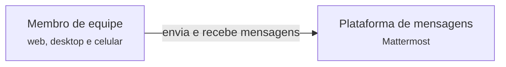
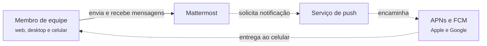
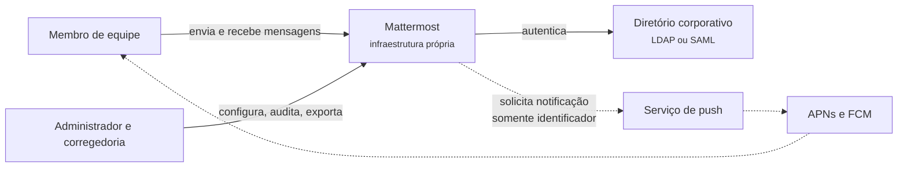
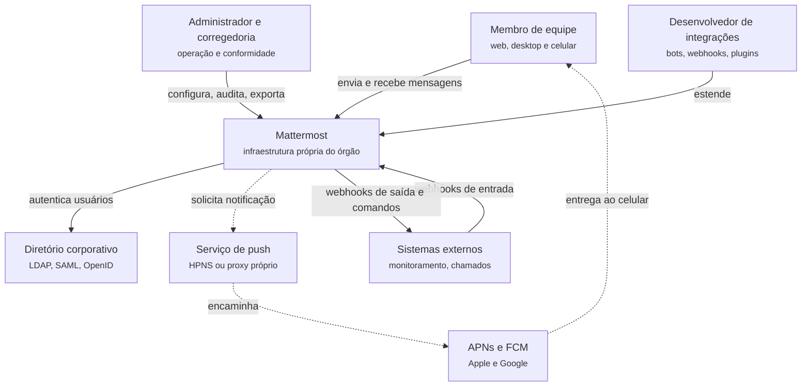

# 3.3 Mattermost: requisitos e contexto

100.000 pés

Esta seção reconstrói os requisitos e o contexto do Mattermost à maneira de Xu (2020): os
requisitos não são apresentados prontos, mas revelados em uma conversa entre o arquiteto e um
cliente, e o desenho do sistema evolui a cada nova informação. O cliente imaginado é o
responsável por tecnologia de um órgão público que precisa substituir uma ferramenta de mensagens
em nuvem. As falas do cliente foram construídas a partir da documentação oficial do Mattermost e
das fontes citadas; quando uma informação é hipotética, isso é indicado em nota.

!!! note "Sobre a conversa"
    O órgão, os números de usuários e os prazos desta conversa são **hipotéticos**, escolhidos
    para tornar as estimativas concretas. As capacidades e restrições atribuídas ao Mattermost,
    ao Slack e ao WhatsApp provêm das fontes citadas no texto.

## 3.3.1 Rodada 1: o problema

!!! question "Arquiteto"
    Que problema vocês querem resolver? O que a ferramenta atual não faz?

!!! quote "Cliente"
    Nossas equipes conversam hoje por uma ferramenta de mensagens em nuvem, parecida com o Slack.
    Ela funciona bem, mas o jurídico e a segurança da informação não aceitam mais que as
    conversas fiquem em servidores de terceiros, fora do país. Precisamos de algo equivalente:
    canais por equipe, mensagens diretas, *threads*, anexos, busca e aplicativo no celular. E as
    mensagens têm de chegar na hora, como hoje.

A primeira rodada fixa o domínio e revela, já de início, a restrição que vai distinguir este
sistema do Slack. Funcionalmente, o pedido é o de uma ferramenta de mensagens para equipes, com os
requisitos que Xu (2020, cap. 12) enumera para um sistema de *chat*: conversas individuais e em
grupo, baixa latência de entrega, suporte a múltiplos dispositivos, indicador de presença e
notificações *push*. Não funcionalmente, aparece uma exigência que não é de desempenho nem de
escala, mas de **localização e controle dos dados**. Essa é precisamente a motivação que a
documentação do Mattermost chama de colaboração soberana (MATTERMOST, 2026d). O primeiro diagrama
de contexto contém apenas o sistema e seus usuários (Figura 3.3.1).

**Figura 3.3.1** – Contexto, versão 1: o sistema e seus usuários.

Fonte: elaborado pelo autor (2026).

## 3.3.2 Rodada 2: escala e padrão de uso

!!! question "Arquiteto"
    Quantas pessoas vão usar? Quantas ao mesmo tempo? Há horários de pico?

!!! quote "Cliente"
    São cerca de 20 mil servidores públicos. Num dia normal, uns 15 mil entram em algum momento, e
    no meio da manhã chegamos a 10 mil conectados ao mesmo tempo, muitos com o computador e o
    celular abertos. Mandamos, sei lá, umas 30 mensagens por pessoa por dia. Os canais são
    pequenos, de 10 a 50 pessoas, mas há alguns canais institucionais com todo mundo.

Os números permitem as primeiras estimativas de guardanapo, no espírito de Xu (2020, cap. 2). Os cálculos a seguir explicitam as hipóteses.

- **Conexões simultâneas.** Com 10.000 usuários no pico e uma média hipotética de 1,5 dispositivo
  conectado por usuário, o servidor mantém cerca de **15.000 conexões WebSocket**. Usando a ordem
  de grandeza de Xu (2020, cap. 12), de cerca de 10 KB de memória por conexão, as conexões
  ocupariam aproximadamente 150 MB. A memória das conexões, nesta escala, não é o gargalo.
- **Mensagens escritas.** 15.000 usuários ativos × 30 mensagens = 450.000 mensagens por dia. Se 80%
  delas se concentrarem em 8 horas de expediente, a taxa média é 360.000 / 28.800 s ≈ **12,5
  mensagens por segundo**; admitindo um pico de três vezes a média, cerca de 40 por segundo.
- **Entregas.** Cada mensagem precisa ser entregue a todas as conexões dos membros conectados do
  canal. Em um canal de 30 membros, com metade conectada e 1,5 dispositivo cada, são cerca de 22
  escritas em *socket* por mensagem; no pico, 40 × 22 ≈ **900 quadros WebSocket por segundo**. Uma
  única mensagem num canal institucional com os 10.000 conectados exigiria, sozinha, cerca de
  15.000 escritas.
- **Armazenamento.** Supondo 1 KB por mensagem com metadados, 450.000 mensagens por dia somam
  cerca de 450 MB por dia, ou aproximadamente 110 GB por ano em 250 dias úteis, sem contar anexos.

O quadro que emerge é o oposto do encontrado no encurtador de URL de Xu (2020, cap. 8):
o volume de dados é modesto, mas a relação entre escrita e entrega é desequilibrada, porque uma
escrita no banco desencadeia dezenas a milhares de escritas em conexões abertas. Xu (2020, cap. 12)
observa que a difusão a todos os membros funciona bem em grupos pequenos, e cita o WeChat, que
limita os grupos a 500 membros, mas se torna cara em grupos grandes. Os canais institucionais do
cliente são, portanto, um ponto de atenção desde já.

A conversa também revela que **cada usuário tem vários dispositivos**. A consequência
arquitetural é que "o usuário está *online*" deixa de ser equivalente a "o usuário tem uma conexão
aberta", e que a mesma mensagem precisa chegar a várias conexões do mesmo usuário, sincronizadas.

## 3.3.3 Rodada 3: tempo real e redes instáveis

!!! question "Arquiteto"
    O que significa "chegar na hora"? E onde as pessoas estão quando usam o celular?

!!! quote "Cliente"
    Quero ver a mensagem aparecer na tela do colega enquanto eu ainda estou olhando, como no
    Slack. Muita gente trabalha em campo, com 4G ruim, entrando e saindo de área de cobertura.
    Ninguém pode perder mensagem, e não pode aparecer mensagem repetida nem fora de ordem.

A fala traz três requisitos que precisam ser separados. O primeiro é de **latência**: o Slack
declara entregar mensagens ao redor do mundo em 500 ms (THANGUDU, 2023), e esse é o padrão de
comparação do usuário. Para atingi-lo, o servidor precisa tomar a iniciativa de avisar o cliente,
o que, sobre HTTP, exige *polling*, *long polling* ou WebSocket (XU, 2020, cap. 12); a escolha é
discutida na [Seção 4.3.1](../capitulo-4-50-mil-pes/mattermost.md). O segundo é de **entrega**: nenhuma mensagem perdida. O terceiro é de
**ordem e unicidade**: nem repetida, nem fora de ordem.

A rede instável torna o segundo e o terceiro requisitos difíceis. Xu (2020, cap. 10) lembra que,
em sistemas distribuídos, a entrega exatamente uma vez não pode ser garantida, e que a alternativa
é aceitar repetições e eliminá-las por deduplicação. Lembra também, a respeito da presença, que
conexões móveis caem e voltam com frequência, por exemplo ao passar por um túnel, e que marcar o
usuário como *offline* a cada queda produz uma experiência ruim (XU, 2020, cap. 12). Quanto à
ordem, o autor observa que basta garantir a sequência **dentro** de cada canal, e não entre
canais (XU, 2020, cap. 12). A conversa, portanto, já permite registrar uma decisão de escopo: a
ordem exigida é por canal.

Quando o destinatário não está conectado, a mensagem precisa alcançá-lo de outra forma. Para o
celular, isso significa **notificações *push***, que passam necessariamente pelos serviços da
Apple (APNs) e do Google (FCM) (XU, 2020, cap. 10). O diagrama de contexto ganha esses atores
(Figura 3.3.2).

**Figura 3.3.2** – Contexto, versão 2: notificações aos dispositivos móveis.

Fonte: elaborado pelo autor (2026), com base em Xu (2020, cap. 10). Linhas contínuas: comunicação
síncrona; linhas tracejadas: comunicação assíncrona.

## 3.3.4 Rodada 4: soberania, identidade e conformidade

!!! question "Arquiteto"
    Vocês disseram que os dados não podem sair do país. Isso vale também para as notificações no
    celular? Como os usuários fazem *login* hoje? Há exigências de auditoria?

!!! quote "Cliente"
    O ideal é que nada saia da nossa infraestrutura. Vamos instalar em nossos servidores. O
    *login* tem de ser pelo nosso diretório, com a mesma senha da rede. E a corregedoria exige
    poder exportar conversas e ter registro de quem fez o quê.

Esta rodada transforma a soberania de desejo em restrição de projeto. A documentação do
Mattermost oferece, como meios de soberania, a implantação própria (*self-hosted*), inclusive em
ambientes isolados e desconectados, o controle das chaves de cifração e dos registros de auditoria
pela própria organização, a integração com SSO e com diretórios LDAP/*Active Directory* e o
controle de acesso por papéis (MATTERMOST, 2026d). Do ponto de vista arquitetural, *self-hosting*
não é uma funcionalidade, mas uma **restrição de implantação**: o sistema precisa ser instalável e
operável por equipes de TI heterogêneas, o que favorece a entrega como binário único com
dependências comuns, e a escala horizontal precisa ser opcional, porque muitas organizações operam
um único servidor.

A pergunta sobre o celular expõe o limite da soberania. Por padrão, o texto da mensagem viaja,
dentro da notificação, até a Apple ou o Google. O Mattermost oferece, para esse caso, as
notificações **somente com identificador** (*ID-only push notifications*): a notificação
transporta apenas o identificador da mensagem, e o aplicativo busca o conteúdo diretamente no
servidor da organização por um canal cifrado; a documentação reconhece que o usuário pode perceber
um pequeno atraso na exibição (MATTERMOST, 2026f). Trata-se de uma troca explícita de latência por
privacidade, que só se justifica porque o cliente colocou a soberania acima da latência. O
WhatsApp, como contraponto, resolve o problema do conteúdo de outra forma, com criptografia de
ponta a ponta nos dispositivos (WHATSAPP, 2016), o que impediria, porém, a exportação de conversas
exigida pela corregedoria.

A soberania tem também um custo operacional. No Slack, um serviço gerenciado, a operação é do
fornecedor; no Mattermost implantado pelo órgão, banco de dados, armazenamento de arquivos,
*proxy*, cópias de segurança e atualizações passam a ser responsabilidade da equipe de TI do
cliente. O contexto ganha o provedor de identidade e os administradores (Figura 3.3.3).

**Figura 3.3.3** – Contexto, versão 3: identidade, administração e conformidade.

Fonte: elaborado pelo autor (2026), com base em Mattermost (2026d, 2026f). Linhas contínuas:
comunicação síncrona; linhas tracejadas: comunicação assíncrona.

## 3.3.5 Rodada 5: integrações e disponibilidade

!!! question "Arquiteto"
    A ferramenta precisa conversar com outros sistemas? E o que acontece se ela ficar fora do ar
    por uma hora?

!!! quote "Cliente"
    Queremos receber alertas do monitoramento e do sistema de chamados nos canais, e ter comandos
    como `/chamado 1234`. Já temos fornecedores querendo fazer extensões. Fora do ar por uma hora
    em horário de expediente é inaceitável: há equipes de plantão que dependem disso. Mas não
    temos uma equipe enorme de operação.

A rodada acrescenta dois requisitos com tensão entre si. As integrações pedem **extensibilidade**:
*webhooks* de entrada e de saída, comandos de barra e extensões de terceiros. Código de terceiros,
porém, ameaça a **disponibilidade** e a **segurança**: uma extensão defeituosa não pode derrubar o
servidor que mantém as conexões de todos os usuários, nem ler dados que não lhe dizem respeito. A
resposta do Mattermost, *plugins* em processos separados, é reconstruída como ADR na [Seção 4.3.8](../capitulo-4-50-mil-pes/mattermost.md).

A exigência de disponibilidade em horário de expediente, combinada com uma equipe pequena de
operação, aponta para redundância de servidores de aplicação, de banco de dados e de
balanceadores, que é o que a documentação de alta disponibilidade do Mattermost descreve, com a
ressalva de que o *cluster* exige licença comercial (MATTERMOST, 2026b). O incidente do Slack em
4 de janeiro de 2021, quando a volta das férias levou a carga do dia mais tranquilo do ano para um
dos mais movimentados "literalmente da noite para o dia" (NOLAN, 2021), alerta para um padrão de
pico que o cliente também terá: segunda-feira de manhã, depois de feriados, com *caches* frios nos
clientes.

## 3.3.6 Rodada 6: crescimento

!!! question "Arquiteto"
    E daqui a dois anos? A ferramenta será usada só por este órgão?

!!! quote "Cliente"
    A ideia é oferecer a mesma instalação a outros órgãos do estado. Poderíamos chegar a 100 mil
    usuários, uns 50 mil conectados no pico. E queremos manter os canais com todo mundo, para
    comunicados oficiais.

O crescimento muda a ordem de grandeza das estimativas da Rodada 2, mantidas as mesmas hipóteses.
Com 50.000 usuários conectados e 1,5 dispositivo por usuário, seriam cerca de **75.000 conexões**
simultâneas, ou aproximadamente 750 MB apenas para as conexões, na ordem de grandeza de Xu (2020,
cap. 12). Supondo, a título de ilustração, um *ping* de verificação por conexão a cada 60
segundos, o servidor emitiria cerca de 75.000 / 60 ≈ **1.250 quadros de controle por segundo**
apenas para saber quem continua conectado, mesmo que ninguém escreva nada. Um único comunicado em
um canal com todos os conectados exigiria cerca de 75.000 escritas em *socket*.

Dois problemas emergem. O primeiro é de **disponibilidade**: concentrar 75.000 conexões em um
único servidor faria dele um ponto único de falha, algo que Xu (2020, cap. 12) considera
inaceitável mesmo quando a capacidade de um servidor seria suficiente; e, quando esse servidor
reiniciasse, todos os clientes tentariam reconectar-se ao mesmo tempo. O segundo é de **difusão**:
canais muito grandes tornam caro não apenas entregar mensagens, mas também atualizar a presença de
seus membros, e Xu (2020, cap. 12) sugere, para grupos grandes, buscar o status apenas quando o
usuário abre o grupo, em vez de difundir cada mudança. A conversa conduz, portanto, a duas
perguntas para a [Seção 4.3](../capitulo-4-50-mil-pes/mattermost.md): como distribuir as conexões entre vários servidores e como fazer um
evento produzido em um servidor chegar às conexões mantidas nos outros.

## 3.3.7 Características prioritárias e cenários de qualidade

Seguindo a recomendação de Richards e Ford (2020, cap. 5) de eleger as três características mais
importantes, a conversa conduz ao seguinte conjunto para o Mattermost no contexto do cliente:

1. **Segurança e privacidade**, incluindo a soberania sobre os dados;
2. **Latência de entrega** (responsividade percebida);
3. **Disponibilidade**.

Para o Slack, argumenta-se aqui que a ordem seria outra: latência e disponibilidade no topo e,
em terceiro lugar, a **escalabilidade**, dado que um único serviço atende a muitas organizações,
ao passo que, no Mattermost, cada implantação atende, em regra, a uma organização. A diferença de
ordem explica muitas das decisões contrastadas nas [Seções 4.3](../capitulo-4-50-mil-pes/mattermost.md) e [5.3](../capitulo-5-10-mil-pes/mattermost.md). A Tabela 3.3.1 expressa as
três características como cenários de qualidade com as seis partes (ver [Seção 1.4.2](../capitulo-1-fundamentos/index.md)).

**Tabela 3.3.1** – Cenários de qualidade do Mattermost no contexto do cliente.

| Parte | Segurança e privacidade | Latência de entrega | Disponibilidade |
|---|---|---|---|
| Fonte | Serviço de notificações de terceiros (Apple ou Google) | Membro de um canal de 30 pessoas | Falha de *hardware* |
| Estímulo | Recebe notificação de nova mensagem para um usuário | Publica uma mensagem | Um nó de aplicação para abruptamente |
| Ambiente | Operação normal, notificações somente com identificador ativadas | Pico da manhã, 15.000 conexões abertas | *Cluster* com dois ou mais nós em operação normal |
| Artefato | Conteúdo das mensagens | Serviço de mensagens em tempo real | Conexões WebSocket mantidas pelo nó |
| Resposta | A notificação não transporta o texto; o aplicativo busca o conteúdo no servidor do órgão | A mensagem é exibida a todos os membros conectados | Os clientes se reconectam a outro nó e recuperam os eventos perdidos |
| Medida | Nenhum conteúdo de mensagem trafega por serviços de terceiros | Em menos de 1 s em 99% dos casos | Em menos de 30 s, sem intervenção do usuário e sem perda de mensagens |

Fonte: elaborado pelo autor (2026). As medidas são hipotéticas.

## 3.3.8 Diagrama de contexto final

A Figura 3.3.4 consolida o contexto após as seis rodadas, segundo as convenções do [Apêndice A](../apendice-a-c4/index.md).

**Figura 3.3.4** – Contexto, versão final (C4, nível 1) do Mattermost.

Fonte: elaborado pelo autor (2026), com base em Mattermost (2026b, 2026d, 2026f). Linhas contínuas:
comunicação síncrona; linhas tracejadas: comunicação assíncrona.

As seis rodadas produziram, além do diagrama, quatro conclusões que orientam as altitudes seguintes. A
entrega em tempo real exige que o servidor mantenha conexões abertas e, portanto, estado. A
relação entre escrita e entrega é desequilibrada, e os canais grandes são o caso crítico. A ordem
e a unicidade das mensagens podem ser garantidas por canal, com deduplicação de repetições. E a
soberania de dados, que coloca a segurança no topo das prioridades, impõe uma restrição de
implantação que favorece a simplicidade operacional sobre a especialização de serviços.

## Referências

MATTERMOST. **High availability cluster-based deployment**. Mattermost Documentation, 2026b.
Disponível em:
<https://docs.mattermost.com/administration-guide/scale/high-availability-cluster-based-deployment.html>.
Acesso em: 18 out. 2026.

MATTERMOST. **Self-sovereign collaboration**. Mattermost Documentation, 2026d. Disponível em:
<https://docs.mattermost.com/use-case-guide/self-sovereign-collaboration.html>. Acesso em:
18 out. 2026.

MATTERMOST. **Push notification server configuration settings**. Mattermost Documentation,
2026f. Disponível em:
<https://docs.mattermost.com/administration-guide/configure/push-notification-server-configuration-settings.html>.
Acesso em: 18 out. 2026.

NOLAN, L. **Slack's outage on January 4th 2021**. Slack Engineering, 1 fev. 2021. Disponível em:
<https://slack.engineering/slacks-outage-on-january-4th-2021/>. Acesso em: 18 out. 2026.

RICHARDS, M.; FORD, N. **Fundamentals of software architecture**: an engineering approach.
Sebastopol: O'Reilly, 2020.

THANGUDU, S. **Real-time messaging**. Slack Engineering, 11 abr. 2023. Disponível em:
<https://slack.engineering/real-time-messaging/>. Acesso em: 18 out. 2026.

WHATSAPP. **WhatsApp encryption overview**: technical white paper. [*S. l.*]: WhatsApp, 2016.
Disponível em: <https://www.whatsapp.com/security/WhatsApp-Security-Whitepaper.pdf>. Acesso em:
18 out. 2026.

XU, A. **System design interview**: an insider's guide. 2. ed. [*S. l.*]: Byte Code LLC, 2020.
