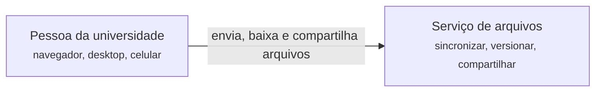
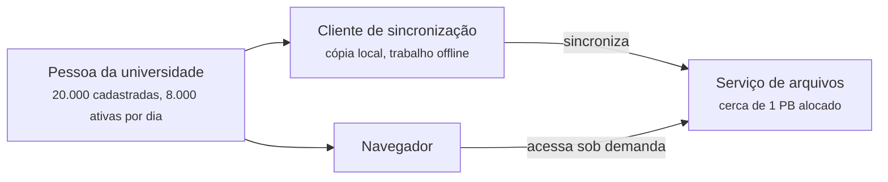
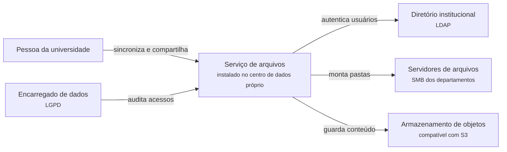
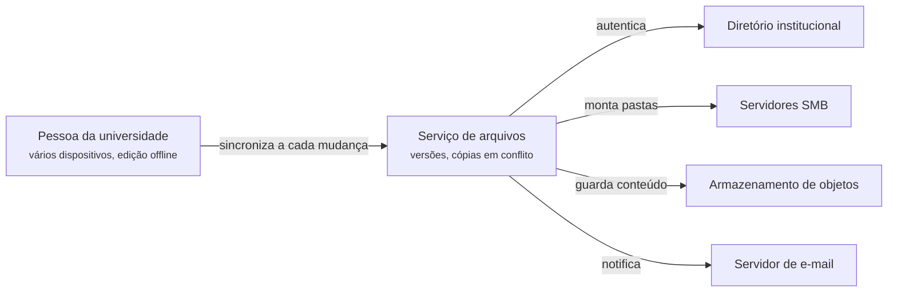

# 3.5 Nextcloud: requisitos e contexto

100.000 pés

Esta seção aplica ao Nextcloud o método de levantamento de requisitos de Xu (2020, cap. 3): em vez
de partir de uma especificação pronta, o arquiteto conduz uma conversa com o cliente, faz
perguntas que delimitam o escopo e redesenha o sistema a cada nova informação. O ponto de chegada
é o mesmo de qualquer análise a 100.000 pés: o diagrama de contexto, as estimativas de capacidade,
as três características arquiteturais prioritárias e os cenários de qualidade que as tornam
verificáveis. A apresentação do sistema e a ficha *kata* estão na
[Seção 2.5](../capitulo-2-aplicacoes/nextcloud.md).

!!! note "Sobre a conversa"
    A instituição e seu representante são **hipotéticos**. As necessidades expressas por ele,
    porém, correspondem a funcionalidades reais do Nextcloud, documentadas no repositório e nos
    manuais oficiais: autenticação por LDAP (*app* `user_ldap`), montagem de armazenamentos
    externos (*app* `files_external`), armazenamento primário em objetos, versões, lixeira,
    compartilhamento federado e *apps* de colaboração. Os números (usuários, cotas, taxas de
    uso) são premissas didáticas, indicadas como tais.

## 3.5.1 Primeira rodada: o problema

!!! question "Arquiteto"
    Qual problema a instituição quer resolver?

!!! quote "Cliente"
    Somos uma universidade pública. Hoje, professores e técnicos guardam documentos em
    *pen drives*, em servidores de arquivos de cada departamento e em contas pessoais de serviços
    comerciais de nuvem. Queremos um serviço único em que cada pessoa tenha uma pasta sincronizada
    entre o computador do trabalho, o *notebook* e o celular, possa recuperar versões antigas e
    compartilhar arquivos com colegas.

!!! question "Arquiteto"
    O acesso será pelo navegador, por um aplicativo instalado ou pelos dois?

!!! quote "Cliente"
    Pelos dois. A maioria vai usar o cliente de sincronização no computador, mas todos precisam
    poder abrir um arquivo pelo navegador em qualquer lugar.

A primeira rodada fixa o núcleo funcional, que coincide com o escopo que Xu (2020, cap. 15) adota
para o projeto de um serviço do tipo Google Drive: enviar e baixar arquivos, sincronizá-los entre
dispositivos, consultar versões, compartilhar e notificar alterações. Fixa também uma decisão de
contexto relevante: haverá **clientes ricos**, capazes de manter uma cópia local e de trabalhar
*offline*, e não apenas uma interface web. Como se verá, essa decisão é a origem de quase toda a
complexidade do domínio, porque cópias locais significam réplicas, e réplicas significam
consistência a administrar. A Figura 3.5.1 registra a primeira versão do contexto.

**Figura 3.5.1** – Diagrama de contexto, versão 1.

Fonte: elaborado pelo autor (2026).

## 3.5.2 Segunda rodada: escala

!!! question "Arquiteto"
    Quantas pessoas vão usar o serviço, e com que cota?

!!! quote "Cliente"
    Cerca de 20.000 pessoas entre estudantes, docentes e técnicos. Pensamos em 50 GB para cada
    uma. Esperamos que perto de 40% usem o serviço em um dia típico de aula.

!!! question "Arquiteto"
    Há períodos de pico?

!!! quote "Cliente"
    O início do semestre e as semanas de fechamento de notas. Nesses dias, o uso pode ser várias
    vezes maior que o normal.

Com essas informações é possível fazer as primeiras estimativas de guardanapo. O espaço alocado é
de 20.000 × 50 GB = 1.000 TB, isto é, 1 PB. O espaço alocado, porém, não é o ocupado. Supondo, como
premissa didática, que a ocupação média seja de 30% da cota, os arquivos correntes ocupariam
300 TB. Versões anteriores e lixeira acrescentam volume; com um acréscimo suposto de 20%, chega-se a
360 TB. Com crescimento de 20% ao ano, o volume após três anos seria 360 × 1,2³ ≈ 622 TB.

Para as escritas, supõe-se que cada um dos 8.000 usuários ativos diários (40% de 20.000) salve em
média 20 arquivos de 1 MB por dia, o que resulta em 160.000 *uploads* e 160 GB por dia.
Concentrados em um expediente de dez horas (36.000 s), são em média 4,4 *uploads* por segundo e
4,4 MB/s, ou cerca de 36 Mbit/s. Com fator de pico de 5, chega-se a 22 *uploads* por segundo e
cerca de 180 Mbit/s. A Tabela 3.5.1 reúne os números e os compara com as premissas de Xu
(2020, cap. 15) para um serviço comercial.

**Tabela 3.5.1** – Estimativas de guardanapo: universidade hipotética e serviço comercial.

| Grandeza | Universidade (premissas desta seção) | Serviço comercial (XU, 2020, cap. 15) |
|---|---|---|
| Usuários cadastrados | 20.000 | 50 milhões |
| Usuários ativos por dia | 8.000 | 10 milhões |
| Cota por usuário | 50 GB | 10 GB |
| Espaço alocado | 1 PB | 500 PB |
| *Uploads* por dia | 160.000 | 20 milhões |
| *Uploads* por segundo (média) | ≈ 4,4 (em 10 h) | ≈ 240 (em 24 h) |
| *Uploads* por segundo (pico) | ≈ 22 (fator 5) | ≈ 480 (fator 2) |

Fonte: elaborado pelo autor (2026); coluna da direita adaptada de Xu (2020, cap. 15).

A premissa de 20 *uploads* diários por pessoa, dez vezes maior que a de Xu, reflete o fato de que
um cliente de sincronização envia o arquivo a cada gravação, e não apenas quando o usuário decide
publicá-lo. Mesmo assim, o serviço comercial supera a universidade por um fator de 125 em
*uploads* diários e de 500 no espaço alocado. Conclui-se que, para a universidade, o desafio dominante é o **volume armazenado** e sua
**durabilidade**, e não a vazão de requisições: 22 *uploads* por segundo cabem com folga em um
único servidor de aplicação bem dimensionado. A Figura 3.5.2 acrescenta ao contexto a distinção
entre os tipos de cliente, que terá consequências na rodada seguinte.

**Figura 3.5.2** – Diagrama de contexto, versão 2.

Fonte: elaborado pelo autor (2026).

## 3.5.3 Terceira rodada: onde ficam os dados

!!! question "Arquiteto"
    O serviço pode ser contratado de um provedor comercial de nuvem?

!!! quote "Cliente"
    Preferimos que não. Muitos documentos contêm dados pessoais de estudantes e servidores, e o
    nosso encarregado de dados quer saber exatamente onde eles estão e quem tem acesso. Temos um
    centro de dados próprio e um armazenamento de objetos compatível com S3 que já usamos para
    *backup*.

!!! question "Arquiteto"
    Como as pessoas se autenticam hoje nos sistemas da universidade?

!!! quote "Cliente"
    Pelo diretório institucional, em LDAP. E não queremos abandonar de imediato os servidores de
    arquivos SMB dos departamentos: as pessoas deveriam ver essas pastas dentro do novo serviço.

A terceira rodada introduz três restrições que mudam a natureza do problema. A primeira é
**legal e organizacional**: a Lei Geral de Proteção de Dados Pessoais institui a figura do
encarregado pelo tratamento de dados pessoais e impõe obrigações de segurança e de prestação de
contas (BRASIL, 2018). Manter os dados em infraestrutura própria simplifica a demonstração de
conformidade, e é essa a razão pela qual um produto auto-hospedado, como o Nextcloud, entra na
discussão em lugar de um serviço comercial como o Dropbox. A decisão tem custo: a instituição
passa a ser responsável pela durabilidade, pelas atualizações de segurança e pela operação, que
num serviço comercial seriam do provedor.

A segunda restrição é a **integração com a identidade existente**. O serviço não terá cadastro
próprio de senhas; delegará a autenticação ao diretório LDAP. A terceira é a **integração com
armazenamentos existentes**: servidores SMB legados devem aparecer como pastas, e o armazenamento
de objetos S3 do centro de dados é candidato a armazenamento primário. No Nextcloud, as duas
integrações correspondem a *apps* distribuídos com o servidor, `user_ldap` e `files_external`, e
à opção de configurar um armazenamento de objetos como armazenamento primário, caso em que os
metadados ficam apenas no banco de dados e o armazenamento de objetos guarda somente o conteúdo,
endereçado por um identificador único (NEXTCLOUD, 2026a).

Argumenta-se aqui que esta é a rodada em que o estilo do sistema começa a se definir, ainda que a
conversa não tenha mencionado tecnologia alguma. Cada universidade terá um diretório e um conjunto
de armazenamentos diferentes; um produto que atenda a muitas delas precisa tratar esses sistemas
externos como **pontos de variação** atrás de contratos estáveis. A Figura 3.5.3 mostra o contexto
atualizado.

**Figura 3.5.3** – Diagrama de contexto, versão 3.

Fonte: elaborado pelo autor (2026).

## 3.5.4 Quarta rodada: *offline*, conflitos e versões

!!! question "Arquiteto"
    As pessoas vão editar arquivos sem conexão?

!!! quote "Cliente"
    Sim. Docentes trabalham em viagens e em casa, às vezes por dias sem sincronizar. E é comum a
    mesma pessoa abrir o mesmo arquivo no computador do laboratório e no *notebook*.

!!! question "Arquiteto"
    Se o mesmo arquivo for alterado em dois lugares antes de sincronizar, o que deve acontecer?

!!! quote "Cliente"
    Ninguém pode perder trabalho. Se o sistema não souber qual versão é a certa, que guarde as
    duas e avise. E queremos poder voltar a uma versão de ontem se alguém estragar um arquivo.

!!! question "Arquiteto"
    Em quanto tempo uma alteração feita em um computador deve aparecer nos demais?

!!! quote "Cliente"
    Em menos de um minuto já está ótimo.

Esta rodada expõe o requisito central do domínio, que Xu (2020, cap. 15) enuncia sem rodeios: a
perda de dados é inaceitável. Ela também revela que o sistema, visto em conjunto com os
dispositivos dos usuários, aceita escritas durante desconexões. Em termos do teorema CAP
(BREWER, 2000; GILBERT; LYNCH, 2002), o conjunto formado pelo servidor e pelos clientes privilegia
a disponibilidade durante a partição e converge depois, isto é, é eventualmente consistente. Os
conflitos são, portanto, inevitáveis, e a única questão é como resolvê-los. A resposta do cliente
descarta a política de "o último a gravar vence" e aponta para a estratégia proposta por Xu
(2020, cap. 15): preservar as duas versões e deixar ao usuário a decisão. O mecanismo é estudado
na [Seção 5.5](../capitulo-5-10-mil-pes/nextcloud.md), e a discussão de consistência, na
[Seção 4.5](../capitulo-4-50-mil-pes/nextcloud.md).

O requisito de propagação em menos de um minuto permite uma nova estimativa, que se mostra
reveladora. Um cliente de sincronização precisa descobrir quando algo mudou no servidor. Na
versão estudada, o cliente *desktop* do Nextcloud consulta o servidor, por padrão, a cada
30 segundos (NEXTCLOUD, 2026b, `src/libsync/configfile.cpp`, linha 44). Se 8.000 clientes
estiverem conectados simultaneamente, o servidor receberá 8.000 / 30 ≈ 267 consultas por segundo
apenas para responder "nada mudou", cerca de sessenta vezes a taxa média de *uploads* estimada na
segunda rodada. A conclusão é contraintuitiva: em um serviço de sincronização de porte médio, a
carga dominante pode não vir das transferências de arquivos, mas da **detecção de mudanças**. É
por isso que Xu (2020, cap. 15) dedica um componente inteiro, o serviço de notificação, a esse
problema, e que o Nextcloud oferece, como opção, um serviço de notificação por WebSocket
(Seção 4.5). A consulta precisa ainda ser barata: o Nextcloud responde a ela comparando um único
identificador de versão da pasta raiz, como se verá na
[Seção 6.5](../capitulo-6-solo/nextcloud.md).

A Figura 3.5.4 acrescenta ao contexto o servidor de e-mail, necessário para avisar as pessoas de
conflitos, compartilhamentos e outras ocorrências.

**Figura 3.5.4** – Diagrama de contexto, versão 4.

Fonte: elaborado pelo autor (2026).

## 3.5.5 Quinta rodada: o que mais o serviço deve fazer

!!! question "Arquiteto"
    Além dos arquivos, há outras funcionalidades previstas?

!!! quote "Cliente"
    Os departamentos pedem coisas diferentes. Alguns querem editar documentos no navegador,
    outros querem calendário compartilhado, e a reitoria quer trocar arquivos com outras
    universidades que também usam o mesmo tipo de serviço. Não sabemos o que vão pedir no ano que
    vem.

!!! question "Arquiteto"
    A equipe de TI pretende desenvolver extensões próprias?

!!! quote "Cliente"
    Talvez pequenas integrações com o sistema acadêmico. Mas não queremos ter de manter uma
    versão modificada do produto: as atualizações de segurança precisam ser simples.

A última rodada transforma uma característica até então implícita em requisito explícito: a
**extensibilidade**. Funcionalidades heterogêneas, demandas futuras desconhecidas e extensões
locais que não podem exigir modificações no produto descrevem, quase palavra por palavra, o
problema que o estilo microkernel resolve: um núcleo estável, que recebe atualizações do
fabricante, e *plug-ins* que acrescentam comportamento por meio de contratos (RICHARDS; FORD,
2020, cap. 12). A exigência de atualizações simples impõe uma condição adicional: o contrato entre
núcleo e extensões precisa ser **estável ao longo de versões**, sob pena de cada atualização
quebrar as integrações locais. O Nextcloud responde com uma API pública cujas partes depreciadas
são mantidas por pelo menos três anos antes da remoção (NEXTCLOUD, 2026c), tema da
[Seção 5.5](../capitulo-5-10-mil-pes/nextcloud.md).

A troca de arquivos com outras universidades introduz mais um sistema externo: outras instalações
do mesmo produto, com as quais o serviço se comunica por compartilhamento federado. A edição de
documentos no navegador costuma depender de um servidor de documentos separado. A Figura 3.5.5
apresenta o diagrama de contexto final.

**Figura 3.5.5** – Diagrama de contexto final (C4, nível 1).

Fonte: elaborado pelo autor (2026), com base na documentação do Nextcloud. Código-fonte da figura:
`diagramas/d2/nextcloud-100k.d2`.

O diagrama final revela o caráter integrador do produto. Dos sete sistemas externos, seis são
pontos de variação entre organizações: diretórios, armazenamentos, servidores de e-mail e de
documentos e outras instalações mudam de uma universidade para outra. Cada um será atendido, nas
altitudes seguintes, por um *app* ou por um *plug-in* que implementa um contrato do núcleo.

## 3.5.6 *Stakeholders* e interesses

A conversa revelou *stakeholders* além do cliente que a conduziu. A Tabela 3.5.2 os organiza com o
vocabulário da Seção 1.3.

**Tabela 3.5.2** – *Stakeholders* e interesses.

| *Stakeholder* | Interesses principais |
|---|---|
| Pessoa usuária | não perder arquivos; sincronização rápida; acesso *offline*; compartilhamento simples |
| Equipe de TI | instalação e atualização simples; integração com LDAP, SMB e S3; cotas; *backup* |
| Desenvolvedor de extensões | API estável e documentada; compatibilidade entre versões |
| Encarregado de dados | localização dos dados; criptografia; registro de acessos; exclusão |
| Reitoria | custo; colaboração com outras instituições |
| Fabricante do produto | ecossistema de *apps*; base instalada; evolução do núcleo |

Fonte: elaborado pelo autor (2026).

O desenvolvedor de extensões é um *stakeholder* raro em sistemas fechados e central neste. Seu
interesse, uma API estável, entra em tensão com o interesse do fabricante em evoluir o núcleo; a
forma como o Nextcloud administra essa tensão é examinada nas Seções 5.5 e 6.5.

## 3.5.7 Características prioritárias e cenários de qualidade

Seguindo a recomendação de Richards e Ford (2020, cap. 5) de eleger as três características mais
importantes, a conversa conduz ao seguinte Top-3:

1. **Durabilidade e confiabilidade.** Nenhuma edição pode ser perdida, nem por falha de
   *hardware*, nem por conflito de sincronização (quarta rodada).
2. **Extensibilidade.** Funcionalidades e integrações heterogêneas e futuras, sem modificação do
   produto (terceira e quinta rodadas).
3. **Segurança e privacidade.** Dados pessoais sob controle da instituição, autenticação
   delegada, auditoria (terceira rodada).

O Top-3 de um serviço comercial como o Dropbox seria diferente. Xu (2020, cap. 15) lista, entre os
requisitos não funcionais de seu projeto, a confiabilidade, a velocidade de sincronização, o uso
econômico de banda, a escalabilidade e a alta disponibilidade; e o Dropbox formulou metas
explícitas de durabilidade anual superior a 99,9999999999% e de disponibilidade superior a 99,99%
para seu armazenamento próprio (GUPTA, 2016). A durabilidade é comum aos dois contextos; a
extensibilidade é própria do produto auto-hospedado; a eficiência de sincronização e a
escalabilidade ganham peso no serviço de escala massiva. A comparação ilustra a primeira lei
(Seção 1.1.2): o mesmo domínio produz prioridades distintas quando o contexto muda.

Para tornar as características verificáveis, a Tabela 3.5.3 as especifica como cenários de
qualidade nas seis partes de Bass, Clements e Kazman (2021, cap. 3), apresentadas na Seção 1.4.2.

**Tabela 3.5.3** – Cenários de qualidade para a instalação da universidade.

| Parte | Durabilidade | Extensibilidade | Segurança | Desempenho |
|---|---|---|---|---|
| Fonte | dois dispositivos da mesma pessoa | equipe de TI da universidade | atacante externo | 8.000 clientes de sincronização |
| Estímulo | edições concorrentes do mesmo arquivo | necessidade de integrar um novo armazenamento | tentativa de acesso com senha incorreta | consulta periódica de mudanças |
| Ambiente | um dispositivo ficou dois dias *offline* | produção, versão principal corrente | logo após a implantação de nova versão | dia de pico no início do semestre |
| Artefato | sincronização do arquivo | servidor de arquivos | mecanismo de autenticação | servidor de aplicação |
| Resposta | preservar as duas versões e sinalizar o conflito | integração implementada como *app* | recusar o acesso e registrá-lo | informar se houve mudança |
| Medida | zero edições perdidas; conflito visível na primeira sincronização após a reconexão | nenhuma linha alterada no núcleo; atualização do núcleo sem retrabalho na extensão | 100% das tentativas recusadas, verificado por teste automatizado a cada implantação | 95% das consultas respondidas em menos de 500 ms |

Fonte: elaborado pelo autor (2026), com base em Bass, Clements e Kazman (2021) e nas rodadas desta seção.

O cenário de segurança não é arbitrário. Em junho de 2011, uma atualização de código no Dropbox
desligou, por algumas horas, a verificação de senhas para parte dos acessos (FERDOWSI, 2011). O
caso é examinado na caixa-preta da [Seção 4.5](../capitulo-4-50-mil-pes/nextcloud.md), porque sua
lição principal diz respeito à forma de implantar mudanças. O cenário de desempenho decorre
diretamente da estimativa da quarta rodada: com 267 consultas por segundo, a resposta a "algo
mudou?" precisa ser uma operação de custo constante, independente do tamanho da árvore de arquivos
de cada pessoa.

## Referências

BASS, L.; CLEMENTS, P.; KAZMAN, R. **Software architecture in practice**. 4. ed. Boston:
Addison-Wesley, 2021.

BRASIL. **Lei nº 13.709, de 14 de agosto de 2018**. Lei Geral de Proteção de Dados Pessoais
(LGPD). Brasília: Presidência da República, 2018. Disponível em:
<https://www.planalto.gov.br/ccivil_03/_ato2015-2018/2018/lei/l13709.htm>. Acesso em: 18 out. 2026.

BREWER, E. A. Towards robust distributed systems. *In*: ACM SYMPOSIUM ON PRINCIPLES OF
DISTRIBUTED COMPUTING (PODC), 19., 2000, Portland. **Keynote**. New York: ACM, 2000.

FERDOWSI, A. **Yesterday's authentication bug**. The Dropbox Blog, 20 jun. 2011. Disponível em:
<https://blog.dropbox.com/topics/company/yesterdays-authentication-bug>. Acesso em: 18 out. 2026.

GILBERT, S.; LYNCH, N. Brewer's conjecture and the feasibility of consistent, available,
partition-tolerant web services. **ACM SIGACT News**, v. 33, n. 2, p. 51-59, 2002.

GUPTA, A. **Scaling to exabytes and beyond**. Dropbox Tech Blog, 14 mar. 2016. Disponível em:
<https://dropbox.tech/infrastructure/magic-pocket-infrastructure>. Acesso em: 18 out. 2026.

NEXTCLOUD. **Configuring object storage as primary storage**. Nextcloud Administration Manual,
2026a. Disponível em:
<https://docs.nextcloud.com/server/latest/admin_manual/configuration_files/primary_storage.html>.
Acesso em: 18 out. 2026.

NEXTCLOUD. **nextcloud/desktop**: repositório de código-fonte, versão v35.0.0. GitHub, 2026b.
Disponível em: <https://github.com/nextcloud/desktop/tree/v35.0.0>. Acesso em: 18 out. 2026.

NEXTCLOUD. **Deprecations**. Nextcloud Developer Manual, 2026c. Disponível em:
<https://docs.nextcloud.com/server/stable/developer_manual/release_notes/deprecations.html>.
Acesso em: 18 out. 2026.

RICHARDS, M.; FORD, N. **Fundamentals of software architecture**: an engineering approach.
Sebastopol: O'Reilly, 2020.

XU, A. **System design interview**: an insider's guide. 2. ed. [*S. l.*]: Byte Code LLC, 2020.
