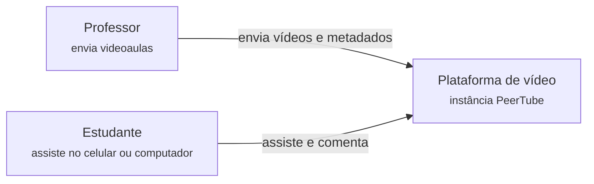
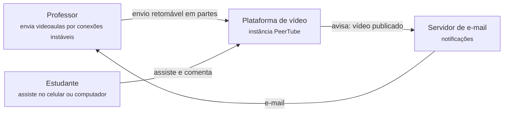
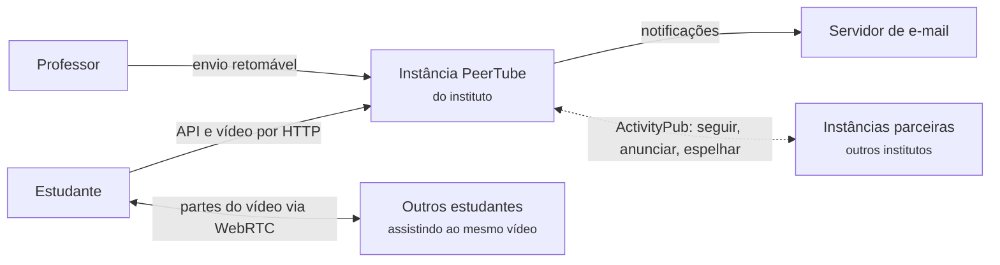
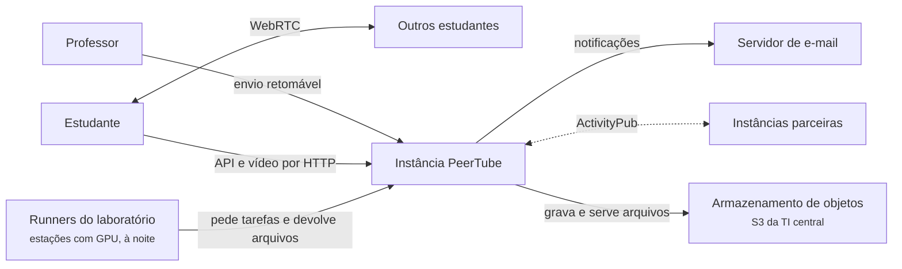

# 3.4 PeerTube: requisitos e contexto

100.000 pés

Esta seção aplica ao PeerTube o método de levantamento de requisitos descrito na Seção 3.1. Xu
(2020, cap. 3) recomenda que o projeto de um sistema comece por perguntas, e não por soluções: o
arquiteto deve entender o problema e delimitar o escopo antes de desenhar qualquer componente, e
o próprio capítulo do autor sobre o YouTube começa com uma sequência de perguntas sobre
funcionalidades, clientes, escala, tamanho dos arquivos e infraestrutura disponível (XU, 2020,
cap. 14). O texto a seguir simula essa conversa entre um arquiteto e o cliente de uma
instância PeerTube, em rodadas. Depois de cada rodada, a informação nova é analisada e o
diagrama de contexto (nível 1 do modelo C4; ver Apêndice A) evolui.

!!! note "Sobre o cenário"
    O cliente desta conversa é **hipotético**: a coordenação de educação a distância de um
    instituto federal que deseja hospedar as videoaulas da instituição. Os números informados
    pelo cliente são hipóteses didáticas, e não dados de uma instituição real. Já as
    capacidades atribuídas ao PeerTube, os valores de configuração e as comparações com o
    YouTube vêm de fontes verificáveis, citadas no texto.

## 3.4.1 Rodada 1: o que o sistema deve fazer

!!! question "Arquiteto"
    O que vocês esperam da plataforma? Que funcionalidades são indispensáveis no primeiro
    semestre de uso?

!!! quote "Cliente"
    Queremos um "YouTube nosso". Os professores gravam as aulas e enviam; os estudantes assistem
    no celular ou no computador, de casa ou do *campus*. Cada curso teria o seu canal. Comentários
    seriam bons, mas não são essenciais. Não queremos depender de uma plataforma comercial que
    mostre anúncios aos estudantes ou que possa mudar as regras a qualquer momento.

A primeira rodada fixa o escopo funcional no mesmo ponto em que Xu (2020, cap. 14) fixa o do
YouTube: **enviar** e **assistir** vídeos, em clientes variados. A organização em canais
corresponde a um conceito nativo do PeerTube, em que vídeos pertencem a canais e canais
pertencem a contas. A última frase do cliente é um requisito não funcional disfarçado de
preferência: a independência em relação a um fornecedor comercial. Ela não define nenhuma
funcionalidade, mas restringe as soluções aceitáveis e justifica, desde já, a escolha de um
software livre auto-hospedado. Na terminologia de Richards e Ford (2020, cap. 4), trata-se de
uma restrição de negócio que influencia a estrutura do sistema.

A Figura 3.4.1 registra o primeiro esboço do contexto, com apenas dois atores e o sistema.

**Figura 3.4.1** – Diagrama de contexto, versão 1.

Fonte: elaborado pelo autor (2026).

## 3.4.2 Rodada 2: escala

!!! question "Arquiteto"
    Quantas pessoas vão usar a plataforma? Quantos vídeos serão enviados, de que tamanho, e com
    que frequência serão assistidos? Há períodos de pico?

!!! quote "Cliente"
    Temos cerca de 20 mil estudantes, mas uns 2 mil assistem a alguma coisa em um dia típico,
    em média duas aulas cada. Os professores enviam umas 20 aulas por dia letivo, com 500 MB em
    média, quase sempre gravadas no celular, em 1080p. O pico é na véspera das provas: nessas
    noites, o número de visualizações dobra, e a maior parte se concentra entre 19h e 23h.

A partir dessas informações é possível fazer as estimativas de guardanapo que Xu (2020, cap. 2)
recomenda. A Tabela 3.4.1 apresenta o cálculo, explicitando as premissas adicionais adotadas
pelo arquiteto. A taxa média de 2,5 Mbit/s para a variante assistida com mais frequência e o
fator de 1,5 entre o conjunto de versões transcodificadas e o original são hipóteses deste
livro. A coluna da direita reproduz, para comparação, a estimativa de Xu para um serviço do
porte de um YouTube regional.

**Tabela 3.4.1** – Estimativas de guardanapo para a instância e para o serviço hipotético de Xu.

| Grandeza | Instância do instituto | Serviço hipotético de Xu (2020, cap. 14) |
|---|---|---|
| Usuários ativos por dia | 2.000 | 5 milhões |
| Visualizações por dia | 4.000 (2.000 × 2) | 25 milhões (5 milhões × 5) |
| Envios por dia | 20 | 500 mil (10% × 1) |
| Tamanho médio do original | 500 MB | 300 MB |
| Armazenamento novo por dia | 15 GB (20 × 0,5 GB × 1,5, sem o original) | 150 TB (só originais) |
| Armazenamento novo por ano letivo (200 dias) | cerca de 3 TB | não estimado |
| Volume médio por visualização | 300 MB (cerca de 16 min a 2,5 Mbit/s) | 300 MB |
| Volume entregue por dia | 1,2 TB | 7,5 PB |
| Custo de entrega | banda do *link* institucional | 150 mil dólares por dia (CDN a 0,02 dólar/GB) |

Fonte: elaborado pelo autor (2026), com base em Xu (2020, cap. 14) para a última coluna.

O pico merece um cálculo próprio, porque é ele que dimensiona a rede. Na véspera de prova, as
visualizações dobram para 8.000. Supondo que 40% delas ocorram na hora de maior movimento, são
3.200 sessões nessa hora; com duração média de 16 minutos, a concorrência média nessa hora é de
3.200 × 16 / 60 ≈ 853 sessões simultâneas. A 2,5 Mbit/s por sessão, a saída necessária é de
cerca de 2,1 Gbit/s. A conclusão é que **um único servidor com um *link* de 1 Gbit/s não
atende ao pico**, mesmo que tenha CPU e disco de sobra. O gargalo do sistema não é o
processamento das requisições, mas a banda de saída.

Dois outros resultados da tabela merecem destaque. O primeiro é a assimetria entre escrita e
leitura: o volume entregue por dia é cerca de oitenta vezes maior que o volume armazenado por
dia. O segundo é que, mesmo três ordens de grandeza abaixo do serviço de Xu, a instância já
enfrenta o mesmo problema qualitativo: a entrega domina o custo. O diagrama de contexto não
muda nesta rodada, mas a análise de escala já antecipa que será preciso descarregar a entrega
para fora do servidor.

## 3.4.3 Rodada 3: envio e tempo de publicação

!!! question "Arquiteto"
    Como os professores enviam os vídeos hoje? Já houve problemas? Quanto tempo pode passar
    entre o envio e a disponibilidade do vídeo para os estudantes?

!!! quote "Cliente"
    Muitos professores gravam em casa e a internet deles é ruim. No sistema atual, quando a
    conexão cai no meio do envio, eles têm de começar de novo, e alguns desistem. Sobre o tempo:
    se a aula aparecer em meia hora, está ótimo. O que não pode é o professor ficar com a página
    travada esperando.

A primeira parte da resposta revela uma característica de **confiabilidade** do envio que
enfrenta diretamente duas falácias da computação distribuída: "a rede é confiável" e "a largura
de banda é infinita" (RICHARDS; FORD, 2020, p. 124-127). Um arquivo de 500 MB enviado por uma
conexão doméstica instável tem probabilidade alta de sofrer ao menos uma interrupção, e o custo
de recomeçar cresce com o tamanho do arquivo. O requisito que daí decorre é o **envio
retomável**: dividir o arquivo em partes e permitir que o cliente pergunte ao servidor o que já
foi recebido. Xu (2020, cap. 14) propõe a mesma solução para o YouTube, com partes alinhadas a
grupos de quadros, e o PeerTube a oferece desde a versão 3.2.0, de 2021 (PEERTUBE, 2026,
`CHANGELOG.md`).

A segunda parte é ainda mais importante para a arquitetura, porque mostra que o processamento
**tolera atraso**, mas a resposta ao professor não. Transcodificar uma aula de uma hora em várias
resoluções consome muitos minutos de CPU, e esse trabalho não pode ocorrer enquanto a requisição
de envio aguarda. O requisito é, portanto, separar a confirmação do envio, que deve ser
imediata, do processamento, que pode levar até meia hora. Essa separação é a semente do estilo
*pipes and filters* com fila de *jobs* analisado na Seção 4.4.

A Figura 3.4.2 acrescenta ao contexto o serviço de e-mail, pelo qual a plataforma avisa o
professor de que o vídeo foi publicado. A instalação oficial do PeerTube com Docker inclui um
contêiner de *relay* de e-mail, o que indica que o envio de notificações é tratado como parte
do contexto padrão de uma instância (PEERTUBE, 2026, `support/docker/production/docker-compose.yml`).

**Figura 3.4.2** – Diagrama de contexto, versão 2.

Fonte: elaborado pelo autor (2026).

## 3.4.4 Rodada 4: orçamento

!!! question "Arquiteto"
    Qual é o orçamento? Há verba para contratar uma CDN comercial ou um serviço de vídeo em
    nuvem?

!!! quote "Cliente"
    Não há verba recorrente para isso. Temos um servidor no *datacenter* do *campus*, com *link*
    de 1 Gbit/s. Outros institutos da rede também estão montando instâncias, e poderíamos nos
    ajudar. E muitos estudantes assistem às mesmas aulas ao mesmo tempo, no laboratório ou na
    biblioteca.

Esta é a rodada que define o caráter do sistema. O SWEBOK v4 afirma que a engenharia consiste
em encontrar o equilíbrio entre o que é tecnicamente viável e o que é economicamente aceitável,
e lembra que, em organizações sem fins lucrativos, o critério de decisão é obter o máximo
benefício pelo menor custo, por técnicas como a análise de custo-efetividade (WASHIZAKI, 2024,
cap. 15). Richards e Ford (2020, p. 130) chegam ao mesmo ponto pela sétima falácia da computação
distribuída, "o custo de transporte é zero", que se refere ao custo monetário de mover dados e
manter a infraestrutura de rede. Em um serviço de vídeo, essa falácia é literal.

Argumenta-se aqui que o **custo** se torna, neste ponto, uma característica arquitetural, e não
apenas gerencial, porque satisfaz os três critérios de Richards e Ford (2020, cap. 4): é uma
consideração de projeto fora do domínio funcional, influencia a estrutura do sistema e é crítica
para o seu sucesso. Sem CDN, a Rodada 2 mostrou que o *link* não suporta o pico. As alternativas
precisam vir de outro lugar, e o cliente, sem saber, mencionou duas.

A primeira é a **cauda longa**. Anderson (2006) popularizou a expressão para mercados em que
poucos itens muito populares convivem com muitos itens pouco procurados. Cha *et al.* (2007)
mostraram que a popularidade dos vídeos do YouTube segue esse tipo de distribuição e discutiram
suas implicações para *cache* e P2P, e Xu (2020, cap. 14) apoia nessa observação as suas
otimizações de custo, como servir pela CDN apenas os vídeos mais populares. Na instância do
instituto, a cabeça da distribuição é previsível: na véspera de prova, os estudantes de uma
mesma turma assistem às mesmas poucas aulas. É precisamente o caso em que a entrega **P2P**
funciona melhor. O PeerTube permite que os navegadores dos espectadores troquem entre si partes
do vídeo por WebRTC, de modo que estudantes no mesmo laboratório obtenham boa parte dos dados
uns dos outros, e não do servidor (PEERTUBE, 2026).

A segunda é a **federação**. Instâncias PeerTube seguem-se pelo protocolo ActivityPub
(LEMMER-WEBBER *et al.*, 2018) e podem **espelhar** vídeos umas das outras segundo estratégias
configuráveis, como "mais vistos", "em alta" ou "adicionados recentemente", com limite de espaço
e tempo mínimo de permanência (PEERTUBE, 2026, `config/default.yaml`). Institutos parceiros
podem, assim, repartir a banda dos vídeos mais procurados, e a cauda longa de cada instância
continua a ser servida pela sua origem.

A Figura 3.4.3 incorpora as duas novidades: os espectadores passam a trocar dados entre si, e
outras instâncias entram no contexto como consumidoras e fornecedoras de conteúdo.

**Figura 3.4.3** – Diagrama de contexto, versão 3.

Fonte: elaborado pelo autor (2026). Linhas contínuas: comunicação síncrona; linhas tracejadas:
comunicação assíncrona.

## 3.4.5 Rodada 5: processamento

!!! question "Arquiteto"
    O servidor do *campus* é dedicado à plataforma? Que configuração ele tem? Existe alguma
    outra máquina que possa ajudar?

!!! quote "Cliente"
    É uma máquina virtual modesta, com poucos núcleos. Mas o laboratório de computação tem
    estações com placa de vídeo que ficam ociosas à noite. E a TI central acabou de contratar um
    armazenamento de objetos compatível com S3 para todos os sistemas.

A Rodada 3 estabeleceu que o processamento pode levar até meia hora. A Rodada 5 revela que ele
pode não caber no servidor. Uma estimativa simples mostra o risco. A configuração padrão do
PeerTube executa **um** *job* de transcodificação local por vez, com uma *thread* do ffmpeg
(`transcoding.concurrency: 1` e `transcoding.threads: 1`; PEERTUBE, 2026, `config/default.yaml`).
Supondo, como hipótese, que transcodificar uma hora de vídeo em todas as resoluções consuma 1,5
hora de processamento nessa máquina, os 20 envios diários de cerca de 45 minutos exigiriam
20 × 0,75 × 1,5 = 22,5 horas de processamento por dia. A fila nunca se esvaziaria em dias de
envio intenso, e o requisito de publicação em meia hora seria violado.

As estações ociosas do laboratório sugerem a solução que o PeerTube oferece desde a versão
5.2.0: os ***runners* remotos**, programas instalados em outras máquinas que pedem tarefas de
transcodificação à instância, executam-nas localmente e devolvem o resultado (PEERTUBE, 2026). A
documentação de administração adverte, contudo, que *runners* registrados podem alterar o
conteúdo dos vídeos e que o administrador precisa confiar em quem os opera. Para o instituto,
isso não é um obstáculo, porque as estações pertencem à própria instituição, mas a advertência
mostra que a decisão de delegar processamento é também uma decisão sobre a **fronteira de
confiança** do sistema.

O armazenamento de objetos é a outra novidade. O PeerTube pode gravar os arquivos de vídeo em
um serviço compatível com S3 em vez do disco local (PEERTUBE, 2026, `config/default.yaml`), o que
retira do servidor da instância a responsabilidade de crescer em disco a cada semestre. A Figura
3.4.4 acrescenta ambos ao contexto.

**Figura 3.4.4** – Diagrama de contexto, versão 4.

Fonte: elaborado pelo autor (2026). Linhas contínuas: comunicação síncrona; linhas tracejadas:
comunicação assíncrona.

## 3.4.6 Rodada 6: acesso, privacidade e moderação

!!! question "Arquiteto"
    Todos os vídeos são públicos? Há exigências de privacidade ou de identificação dos
    usuários?

!!! quote "Cliente"
    Algumas aulas podem ser abertas ao público, mas a maioria deve ser vista só pela comunidade
    do instituto. O acesso tem de ser pelo login institucional. E precisamos cumprir a LGPD:
    não queremos expor dados dos estudantes.

A resposta introduz três requisitos. O primeiro é o **controle de acesso por vídeo**. O
PeerTube define cinco níveis de privacidade: público, não listado, privado, interno (restrito
à instância) e protegido por senha (PEERTUBE, 2026,
`packages/models/src/videos/video-privacy.enum.ts`). Por padrão, o acesso aos arquivos de vídeos
privados e internos exige autenticação (`static_files.private_files_require_auth: true`), o que
impede que um arquivo seja baixado apenas por quem conhece a sua URL (PEERTUBE, 2026,
`config/default.yaml`).

O segundo é a **integração com a identidade institucional**. A API de *plugins* do PeerTube
oferece pontos de extensão para registrar autenticação externa e autenticação por usuário e
senha delegada (`registerExternalAuth` e `registerIdAndPassAuth`), de modo que o login
institucional pode ser acoplado sem modificar o núcleo (PEERTUBE, 2026,
`server/core/lib/plugins/register-helpers.ts`). O provedor de identidade passa a ser um sistema
externo no diagrama de contexto.

O terceiro é a **privacidade** no sentido da Lei Geral de Proteção de Dados Pessoais (BRASIL,
2018). Aqui a entrega P2P, celebrada na Rodada 4, apresenta um custo: para trocar dados por
WebRTC, os navegadores dos espectadores precisam conhecer o endereço IP uns dos outros. O
PeerTube trata o P2P como opção que o administrador habilita por padrão ou não e que cada
espectador, anônimo ou autenticado, pode desativar (PEERTUBE, 2026, `config/default.yaml`, chave
`p2p.webapp.enabled`). O conflito entre **custo** e **privacidade** é real e não tem solução
técnica que satisfaça ambos plenamente; ele precisa ser decidido pela instituição e registrado.
Argumenta-se aqui que uma solução razoável para o instituto é manter o P2P habilitado para os
vídeos públicos e informar a sua existência na política de privacidade, mas essa é uma decisão de
negócio, e não do arquiteto.

## 3.4.7 Características prioritárias

Richards e Ford (2020, cap. 4-5) recomendam que o arquiteto selecione poucas características
prioritárias, em vez de tentar maximizar todas. As seis rodadas sustentam o Top-3 da Tabela 3.4.2.

**Tabela 3.4.2** – Top-3 de características arquiteturais da instância.

| Posição | Característica | Origem na conversa | Justificativa |
|---|---|---|---|
| 1 | **Custo** (banda, armazenamento, CPU) | Rodadas 2, 4 e 5 | Sem verba recorrente; o *link* não suporta o pico sem descarregar a entrega |
| 2 | **Desempenho de entrega** (tempo até o primeiro quadro, ausência de travamentos) | Rodadas 1 e 2 | É a experiência central do estudante, sobretudo no pico de véspera de prova |
| 3 | **Elasticidade do processamento** | Rodadas 3 e 5 | A transcodificação chega em rajadas e pode exceder a capacidade do servidor |

Fonte: elaborado pelo autor (2026).

Logo abaixo do Top-3 ficam a **confiabilidade do envio** (Rodada 3), a **privacidade** e a
**segurança** (Rodada 6) e a **interoperabilidade** com outras instâncias (Rodada 4). Uma
característica notável é a **disponibilidade assimétrica**: a reprodução precisa estar sempre
disponível, mas o processamento de um vídeo novo pode atrasar sem prejuízo sério. É essa
assimetria que permite tirar o processamento do caminho da requisição.

## 3.4.8 Cenários de qualidade

Bass, Clements e Kazman (2021) propõem expressar cada atributo de qualidade como um cenário com
seis partes: **fonte do estímulo**, **estímulo**, **artefato**, **ambiente**, **resposta** e
**medida da resposta**. A Tabela 3.4.3 apresenta quatro cenários para a instância, cobrindo o
Top-3 e a confiabilidade do envio. As medidas de resposta são metas propostas pelo arquiteto
com base na conversa, e não valores medidos.

**Tabela 3.4.3** – Cenários de qualidade da instância PeerTube do instituto.

| Parte | Cenário 1: custo de pico | Cenário 2: entrega | Cenário 3: processamento | Cenário 4: envio |
|---|---|---|---|---|
| **Fonte** | Estudantes de várias turmas | Estudante em rede doméstica | Professores | Professor em conexão instável |
| **Estímulo** | 850 sessões simultâneas, a maioria em 20 aulas | Pressiona "reproduzir" | 20 envios de 45 min em um dia | Conexão cai aos 70% do envio |
| **Artefato** | Entrega de vídeo (HLS e P2P) | Reprodutor e entrega HLS | Fila de *jobs* e transcodificação | Protocolo de envio retomável |
| **Ambiente** | Véspera de prova, *link* de 1 Gbit/s | Operação normal | Operação normal, servidor modesto | Operação normal |
| **Resposta** | Parte dos segmentos é obtida por P2P ou de instâncias espelho | Reprodução começa na resolução adequada à banda | Tarefas distribuídas a *runners*; API não degrada | O envio é retomado do último byte confirmado |
| **Medida** | Saída do servidor abaixo de 1 Gbit/s | Primeiro quadro em menos de 3 s | 95% dos vídeos publicados em até 30 min | Nenhum byte já confirmado é reenviado |

Fonte: elaborado pelo autor (2026), no formato de Bass, Clements e Kazman (2021).

O Cenário 1 é o mais exigente e o mais revelador. Ele só é satisfeito se uma fração
significativa da entrega sair do servidor. Com 850 sessões e 2,1 Gbit/s de demanda, mais da
metade dos dados precisaria vir de pares ou de espelhos. Se a fração obtida por P2P for menor,
restam duas alternativas, ambas registráveis como decisões: aceitar a degradação para
resoluções menores no pico, que o *streaming* adaptativo produz automaticamente, ou contratar
mais banda. Os cenários tornam explícito o que a conversa apenas sugeria e servem de critério
de verificação para as decisões das Seções 4.4 e 5.4.

## 3.4.9 Diagrama de contexto final

A Figura 3.4.5 consolida o contexto da instância, com todos os sistemas externos revelados na
conversa.

**Figura 3.4.5** – Diagrama de contexto final da instância PeerTube do instituto.

Fonte: elaborado pelo autor (2026), com base em PeerTube (2026). Linhas contínuas: comunicação
síncrona; linhas tracejadas: comunicação assíncrona. Código-fonte da figura:
`diagramas/d2/peertube-100k.d2`.

O diagrama final evidencia três características pouco comuns em sistemas de informação
institucionais. Os espectadores trocam dados entre si, o que significa que parte da
infraestrutura de entrega roda nos computadores dos usuários. Os *runners* são sistemas externos
que **iniciam** a comunicação com a instância, e não o contrário. E outras instâncias são
simultaneamente consumidoras e fornecedoras de conteúdo. A Seção 4.4 desce ao nível dos
*containers* para mostrar como a instância está organizada por dentro e onde cada elemento é
implantado.

## Referências

ANDERSON, C. **The long tail**: why the future of business is selling less of more. New York:
Hyperion, 2006.

BASS, L.; CLEMENTS, P.; KAZMAN, R. **Software architecture in practice**. 4. ed. Boston:
Addison-Wesley, 2021.

BRASIL. Lei nº 13.709, de 14 de agosto de 2018. Lei Geral de Proteção de Dados Pessoais (LGPD).
**Diário Oficial da União**, Brasília, DF, 15 ago. 2018.

CHA, M. *et al.* I tube, you tube, everybody tubes: analyzing the world's largest user generated
content video system. *In*: ACM SIGCOMM CONFERENCE ON INTERNET MEASUREMENT, 7., 2007, San Diego.
**Proceedings** [...]. New York: ACM, 2007. p. 1-14.

LEMMER-WEBBER, C. *et al.* **ActivityPub**. W3C Recommendation. [S. l.]: World Wide Web
Consortium, 23 jan. 2018. Disponível em: <https://www.w3.org/TR/activitypub/>. Acesso em: 18
out. 2026.

PEERTUBE. **Chocobozzz/PeerTube**: repositório de código-fonte, versão v8.3.1. GitHub, 2026.
Disponível em: <https://github.com/Chocobozzz/PeerTube/tree/v8.3.1>. Acesso em: 18 out. 2026.
Documentação disponível em: <https://docs.joinpeertube.org>.

RICHARDS, M.; FORD, N. **Fundamentals of software architecture**: an engineering approach.
Sebastopol: O'Reilly, 2020.

WASHIZAKI, H. (ed.). **Guide to the software engineering body of knowledge (SWEBOK Guide)**:
version 4.0. Los Alamitos: IEEE Computer Society, 2024.

XU, A. **System design interview**: an insider's guide. 2. ed. [*S. l.*]: Byte Code LLC, 2020.
