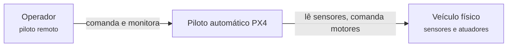
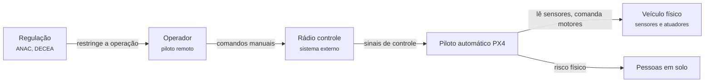
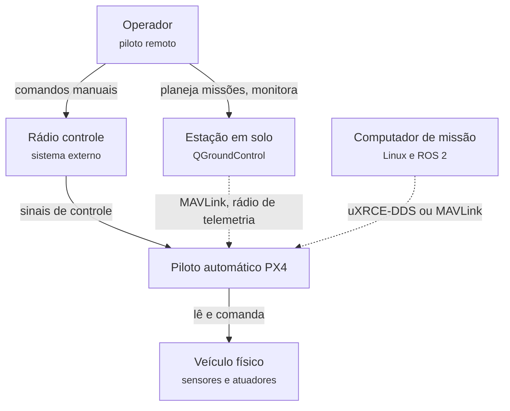
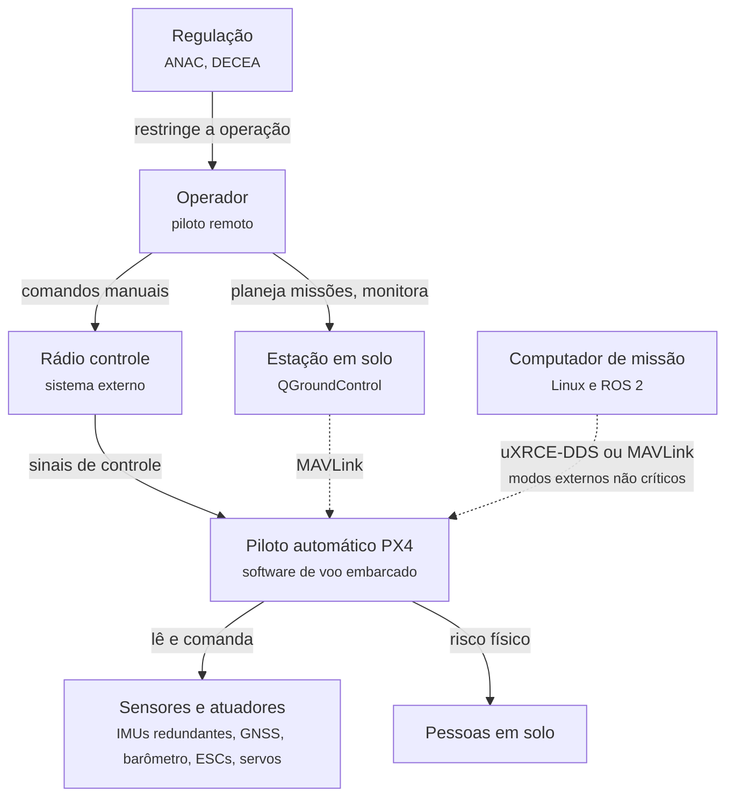

# 3.8 PX4: requisitos e contexto

100.000 pés

Esta seção reconstrói os requisitos do PX4 Autopilot no estilo de Xu (2020): em vez de
apresentar uma especificação pronta, simula uma conversa em rodadas entre o arquiteto e o cliente,
na qual cada nova informação obriga a revisar o desenho. A diferença em relação às aplicações
anteriores aparece já nas primeiras perguntas. Em vez de usuários ativos por dia e requisições por
segundo, as grandezas decisivas são **prazos em milissegundos** e **consequências físicas de
falhas**. Ao final, chega-se a um diagrama de contexto, a uma lista priorizada de características
arquiteturais e a cenários de qualidade verificáveis.

!!! note "Sobre o cliente simulado"
    O "cliente" é uma personagem hipotética: um fabricante de drones que deseja adotar um piloto
    automático aberto. As informações técnicas que ele fornece, como taxas de amostragem,
    configurações de *hardware* e comportamentos de *failsafe*, foram extraídas da documentação
    oficial do PX4 na *tag* `v1.17.0` e estão referenciadas na análise que segue cada rodada. As
    motivações de negócio da personagem são ilustrativas.

## 3.8.1 Rodada 1: o que se pretende construir

!!! question "Arquiteto"
    Que problema o sistema resolve, e para que tipo de veículo?

!!! quote "Cliente"
    Fabricamos multirrotores para inspeção, mas a linha vai crescer: queremos um avião de asa
    fixa para mapeamento e, talvez, um VTOL. Precisamos de um único software de voo que estabilize
    o veículo, execute missões por pontos de passagem e se comunique com a estação em solo. Não
    queremos manter três pilotos automáticos diferentes.

O pedido define o núcleo funcional: estimar o estado do veículo a partir de sensores, controlar os
atuadores e executar missões. Também revela um requisito de variabilidade que terá peso
arquitetural: uma base de código para vários tipos de veículo. O PX4 assume esse requisito
explicitamente, pois todos os tipos de veículo compartilham uma única base de código, incluindo
barcos, veículos terrestres e submarinos (PX4, 2026a). Do ponto de vista de Parnas (Seção 1.5.2),
o que varia entre veículos, como a geometria dos motores e superfícies, precisa ficar escondido
atrás de interfaces estáveis, para que estimadores e controladores não dependam do tipo de
veículo.

A Figura 3.8.1 mostra a primeira versão do contexto: o sistema, o operador e o veículo físico.

**Figura 3.8.1** – Diagrama de contexto, versão 1.

Fonte: elaborado pelo autor (2026).

## 3.8.2 Rodada 2: o tempo como requisito

!!! question "Arquiteto"
    Com que frequência o software precisa reagir? O que acontece se ele atrasar?

!!! quote "Cliente"
    Os sensores inerciais das nossas placas amostram a 1 kHz. O laço de estabilização precisa
    rodar algumas centenas de vezes por segundo; o padrão que usamos hoje é 400 Hz. Se o laço
    atrasar, o multirrotor oscila e pode cair, porque ele é instável sem correção contínua. Já a
    telemetria para a estação em solo pode ir bem mais devagar.

A resposta transforma o tempo em requisito de **correção**, e não de desempenho. Kopetz (2011,
cap. 1) define um sistema de tempo real como aquele cuja correção depende não apenas dos
resultados lógicos da computação, mas também do instante físico em que são produzidos. O autor
classifica os prazos segundo as consequências de sua perda: um prazo é **não crítico** (*soft*)
quando o resultado ainda tem utilidade depois de vencido; **firme** (*firm*) quando perde toda a
utilidade, sem causar dano; e **crítico** (*hard*) quando a perda pode ter consequências graves.

!!! note "Definição 3.8.1 – Tempo real crítico e não crítico"
    Uma função tem requisito de **tempo real crítico** quando perder seu prazo pode causar dano
    grave, independentemente de o valor calculado estar correto. Tem requisito de **tempo real
    não crítico** quando um resultado atrasado ainda é útil, com qualidade degradada (KOPETZ,
    2011).

Os números do cliente coincidem com a documentação do PX4, segundo a qual a maior parte dos
*drivers* de unidades inerciais amostra os dados a 1 kHz, integra-os e os publica a 250 Hz
(PX4, 2026a). O parâmetro `IMU_GYRO_RATEMAX`, que define a taxa máxima de publicação da velocidade
angular filtrada e, portanto, a frequência do laço do controlador de taxa e das saídas, tem padrão
de 400 Hz e pode ser configurado entre 100 Hz e 2 kHz
([`imu_gyro_parameters.c`, linhas
130-150](https://github.com/PX4/PX4-Autopilot/blob/v1.17.0/src/modules/sensors/vehicle_angular_velocity/imu_gyro_parameters.c#L130-L150)).

### 3.8.2.1 Estimativas de guardanapo

Nesta aplicação, a grandeza a estimar é o **orçamento de tempo** de cada ciclo.

- **Período do laço interno.** A 400 Hz, o período é 1/400 s = 2,5 ms. Nesse intervalo o
  processador precisa receber a amostra filtrada do giroscópio, executar o controlador de taxa,
  alocar o comando aos motores e escrever as saídas, além de atender às demais tarefas que
  compartilham a CPU. À taxa máxima configurável, 2 kHz, o período cai para 0,5 ms.
- **Execuções por voo.** Em um voo de 20 minutos a 400 Hz, o laço interno executa
  400 × 1.200 = 480.000 vezes.
- **Risco acumulado.** Se cada execução tivesse probabilidade de 10⁻⁶ de perder o prazo, a
  probabilidade de ao menos uma perda em um voo seria 1 − (1 − 10⁻⁶)^480.000 ≈ 1 − e^(−0,48) ≈ 0,38,
  isto é, cerca de 38%.
- **Supervisão.** O módulo que supervisiona modos de voo e *failsafes* trabalha com intervalo de
  monitoramento de 10 ms
  ([`Commander.hpp`, linha 217](https://github.com/PX4/PX4-Autopilot/blob/v1.17.0/src/modules/commander/Commander.hpp#L217)),
  ou seja, 100 Hz: quatro vezes mais lento que o laço interno, mas ainda muito mais rápido que a
  reação humana.

A terceira estimativa é a mais importante para a arquitetura. Uma probabilidade de falha
individual que pareceria desprezível em um sistema web torna-se inaceitável quando multiplicada
pelo número de execuções. Em tempo real crítico, não basta que o caso médio seja rápido: é
preciso **garantir** um limite para o pior caso.

### 3.8.2.2 Classificação temporal das funções

A classificação de Kopetz não se aplica ao sistema como bloco, mas a cada função. A Tabela 3.8.1
aplica-a às funções mencionadas até aqui.

**Tabela 3.8.1** – Classificação temporal de funções de um piloto automático.

| Função | Classe | Consequência de perder o prazo |
|---|---|---|
| Controle de taxa angular e escrita nos motores | Crítico | Oscilação ou perda de estabilidade |
| Estimação de atitude | Crítico | Controladores operam sobre estado desatualizado |
| Supervisão de modos e *failsafes* | Crítico, com prazo mais folgado | Reação tardia a perda de enlace ou bateria crítica |
| Telemetria para a estação em solo | Firme | Uma amostra atrasada é descartada; a próxima a substitui |
| Registro de voo em cartão SD | Não crítico | Dados gravados mais tarde, sem efeito no voo |

Fonte: elaborado pelo autor (2026), com base em Kopetz (2011) e PX4 (2026a).

A tabela antecipa uma consequência que só será resolvida a 50.000 e a 10.000 pés: se funções de
classes distintas compartilham o mesmo processador, é preciso isolá-las temporalmente, de modo que
uma tarefa não crítica nunca atrase uma crítica (Seções 4.8 e 5.8). O diagrama de contexto ainda
não muda, mas o sistema deixou de ser uma caixa qualquer: é um **sistema embarcado de tempo real
crítico**.

## 3.8.3 Rodada 3: falhas, pessoas em solo e regulação

!!! question "Arquiteto"
    O que deve acontecer quando algo dá errado? Quem, além do operador, é afetado?

!!! quote "Cliente"
    Os drones voam sobre áreas com gente. Se o rádio controle perder sinal, se a bateria ficar
    crítica ou se o GPS falhar, o drone tem de manter posição, voltar para casa ou pousar sozinho,
    mas o piloto precisa ter alguns segundos para perceber e assumir o controle. Também
    precisamos respeitar áreas restritas e as regras da ANAC e do DECEA. E o rádio controle é um
    sistema à parte, que não fabricamos.

A rodada introduz três *stakeholders* novos: as **pessoas em solo**, que não interagem com o
sistema mas sofrem as consequências de suas falhas; os **reguladores**; e o **rádio controle**,
sistema externo. Introduz também o conceito de *safety*. O SWEBOK v4 define sistemas críticos de
segurança como aqueles em que uma falha pode causar dano à vida, a outros seres vivos, a estruturas
físicas ou ao ambiente, e observa que seu desenvolvimento exige métodos sistemáticos e normas
setoriais, como a DO-178C para sistemas aeronáuticos (WASHIZAKI, 2024, cap. 12, seção 1.4). No
projeto, o guia distingue *security*, proteção contra ataques, de *safety*, que diz respeito ao
comportamento do software em circunstâncias que podem levar a danos (WASHIZAKI, 2024, cap. 3,
seção 3.7). Nesta seção, "segurança" designa *safety*.

Leveson (2011) insiste que *safety* e **confiabilidade** são propriedades distintas: um componente
pode funcionar exatamente como especificado e ainda assim contribuir para um acidente, porque a
especificação era inadequada ao contexto ou porque a interação entre componentes corretos produziu
um comportamento perigoso. Por isso, o requisito do cliente não é "o software não pode falhar",
mas "o sistema deve levar o veículo a um estado seguro quando detectar condições perigosas".

O pedido do cliente corresponde ao que o PX4 chama de *failsafes*. A documentação lista as ações
possíveis em ordem crescente de severidade: nenhuma ação, aviso, espera (*hold*), retorno, pouso,
desarme e terminação de voo. Na maioria dos casos, o comportamento padrão é entrar em espera por
alguns segundos, configuráveis pelo parâmetro `COM_FAIL_ACT_T`, antes de executar a ação
associada, justamente para que o operador perceba o problema e possa assumir o controle
(PX4, 2026b). Os gatilhos incluem bateria baixa, perda do rádio controle, perda do enlace com a
estação em solo, violação de cerca geográfica e perda de posição (PX4, 2026b). As normas de
certificação, como a DO-178C na aviação (RTCA, 2011) e a ISO 26262 em veículos rodoviários (ISO,
2018), entram aqui apenas como contexto: a certificação é propriedade do **produto** do cliente em
seu contexto operacional, e não de uma base de código aberta distribuída sem garantias.

**Figura 3.8.2** – Diagrama de contexto, versão 2: rádio controle, pessoas em solo e regulação.

Fonte: elaborado pelo autor (2026).

## 3.8.4 Rodada 4: estação em solo e computador de missão

!!! question "Arquiteto"
    Como o operador planeja missões e acompanha o voo? Há outros computadores a bordo?

!!! quote "Cliente"
    Nossos operadores usam o QGroundControl num *notebook*, ligado ao drone por um rádio de
    telemetria de baixa velocidade. E o próximo produto terá um computador de bordo com Linux e
    ROS 2, para visão computacional; nossa equipe de pesquisa quer escrever modos de voo novos
    nesse computador, sem mexer no *firmware*.

A estação em solo e o computador de missão são duas fronteiras com propriedades opostas. O enlace
com a estação em solo é lento e não confiável; o PX4 usa nele o **MAVLink**, protocolo descrito pela
documentação como muito leve, projetado para enlaces de rádio de baixa largura de banda e não
confiáveis (PX4, 2026c; KOUBÂA *et al.*, 2019). O enlace com o computador de missão é rápido, serial
ou IP, e a documentação descreve configurações em que esse computador executa Linux, pela
abundância de desenvolvedores e de bibliotecas para visão computacional e integração com a nuvem
(PX4, 2026d). Para o ROS 2, o PX4 oferece uma ponte baseada em uXRCE-DDS (PX4, 2026e).

O desejo da equipe de pesquisa cria uma tensão que precisa ser registrada já nesta altitude. A
documentação do PX4 admite **modos externos**, escritos em ROS 2 no computador de missão, mas
estabelece que eles não podem ser usados para modos que exigem temporização estrita ou alta
frequência, nem para modos críticos de segurança, como o retorno; se o processo ROS 2 terminar, o
sistema volta a um modo interno (PX4, 2026f). Em termos de contexto, a extensibilidade é concedida
à custa de uma fronteira: o que pode falhar sem derrubar a aeronave pode ficar fora do controlador
de voo; o que garante a segurança fica dentro.

**Figura 3.8.3** – Diagrama de contexto, versão 3: estação em solo e computador de missão.

Fonte: elaborado pelo autor (2026), com base em PX4 (2026d). Linhas contínuas: comunicação
síncrona; linhas tracejadas: comunicação assíncrona.

## 3.8.5 Rodada 5: redundância e o fantasma dos acidentes

!!! question "Arquiteto"
    As placas têm sensores redundantes? O que se espera quando um sensor começa a mentir, em vez
    de simplesmente parar?

!!! quote "Cliente"
    Algumas placas têm duas ou três unidades inerciais e dois magnetômetros. Depois do que
    aconteceu com o 737 MAX, nosso diretor de engenharia não aceita que uma função crítica dependa
    de um único sensor.

A preocupação do cliente é fundada. A Seção 5.8 examina o caso do 737 MAX, em que uma função
crítica de software podia ser acionada a partir dos dados de um único sensor de ângulo de ataque
(HOUSE COMMITTEE ON TRANSPORTATION AND INFRASTRUCTURE, 2020). Do ponto de vista do contexto, a
resposta implica um requisito de **tolerância a falhas de sensores**, inclusive falhas não óbvias,
como saltos de viés ou dados congelados. A documentação do estimador do PX4 descreve exatamente
essa capacidade: com sensores redundantes, várias instâncias do estimador podem ser executadas, cada
uma com uma combinação diferente de unidade inercial e magnetômetro, e um seletor escolhe a
combinação mais consistente, o que permite detectar e isolar falhas como mudanças bruscas de viés,
saturação ou dados congelados (PX4, 2026g). O mecanismo é examinado na Seção 5.8.

## 3.8.6 *Stakeholders*, características e cenários

### 3.8.6.1 *Stakeholders*

**Tabela 3.8.2** – *Stakeholders* de um piloto automático e seus interesses.

| *Stakeholder* | Interesse principal |
|---|---|
| Operador (piloto remoto) | Controle previsível, alertas claros, retorno seguro em caso de falha |
| Pessoas e propriedades em solo | Que a aeronave não caia sobre elas; que respeite áreas restritas |
| Fabricante ou integrador | Suporte a seu *hardware*, customização, custo, certificação do produto |
| Órgãos reguladores (ANAC, DECEA) | Cumprimento de regras de operação e de uso do espaço aéreo |
| Desenvolvedores do PX4 | Manutenibilidade de uma base única para muitos veículos, testabilidade |
| Pesquisadores | Facilidade para substituir estimadores e controladores, simulação |

Fonte: elaborado pelo autor (2026).

A tabela evidencia um conflito estrutural. Pesquisadores e integradores desejam
**flexibilidade**; pessoas em solo e reguladores desejam **segurança** e **previsibilidade**. Esse
conflito é o dilema arquitetural desta aplicação (Seção 2.8.3).

### 3.8.6.2 Top-3 de características

Seguindo a recomendação de Richards e Ford (2020, cap. 5) de eleger as três características mais
importantes, propõem-se para o núcleo de voo:

1. **Segurança (*safety*)**: detectar condições perigosas e levar o veículo a um estado seguro.
2. **Determinismo temporal**: cumprir os prazos dos laços críticos em todos os cenários
   especificados.
3. **Tolerância a falhas**: a perda de um sensor, de um enlace ou de um estimador não deve levar à
   perda do veículo.

O **determinismo temporal** merece definição própria, pois não figura nas listas usuais de
características. Richards e Ford (2020, cap. 4) classificam o desempenho entre as características
operacionais, mas, em tempo real, essa categoria se desdobra. O desempenho usual mede médias e
percentis; o determinismo mede a existência de um limite superior conhecido para o tempo de
resposta e a pequena variação (*jitter*) em torno do valor esperado. Os dois podem conflitar: um
*cache* melhora a média e piora a previsibilidade; uma coleta de lixo automática simplifica o
código e introduz pausas imprevisíveis.

!!! note "Definição 3.8.2 – Determinismo temporal"
    **Determinismo temporal** é a propriedade de um sistema que, para um mesmo conjunto de
    entradas e um mesmo estado, responde dentro de limites de tempo conhecidos e verificáveis. É
    uma característica arquitetural porque depende de decisões globais, como o sistema operacional,
    a política de escalonamento, o modelo de comunicação entre componentes e a alocação de memória.

Extensibilidade, portabilidade (o mesmo código em várias placas) e testabilidade (simulação do
*firmware* em computadores comuns) são importantes, mas subordinam-se às três primeiras.

### 3.8.6.3 Cenários de qualidade

Os cenários a seguir seguem o formato de seis partes da Seção 1.4.2.

**Tabela 3.8.3** – Cenários de qualidade para as características prioritárias.

| Parte | Determinismo | Segurança | Tolerância a falhas |
|---|---|---|---|
| Fonte | Unidade inercial | Receptor de rádio controle | Uma das unidades inerciais |
| Estímulo | Nova amostra de velocidade angular | Perda do sinal de controle | Salto súbito de viés do giroscópio |
| Ambiente | Voo estabilizado, carga normal de CPU | Missão automática sobre área povoada | Voo em modo de posição, com estimadores redundantes ativos |
| Artefato | Controlador de taxa e alocação de controle | Supervisão de modos e *failsafes* | Estimador de estado |
| Resposta | Calcular e publicar o comando aos motores | Entrar em espera e, sem intervenção do operador, executar a ação configurada (por exemplo, retorno) | Detectar a inconsistência e passar a usar a instância do estimador sem o sensor defeituoso |
| Medida | Antes da amostra seguinte: menos de 2,5 ms a 400 Hz, em 100% dos ciclos | Espera pelo tempo `COM_FAIL_ACT_T` e ação sem perda de controle | Sem perda de controle; veículo mantém o modo ou recorre a modo degradado |

Fonte: elaborado pelo autor (2026), com base em PX4 (2026b, 2026g) e no parâmetro
`IMU_GYRO_RATEMAX`.

A medida do primeiro cenário é deliberadamente "100% dos ciclos", e não um percentil, como seria
usual em sistemas web. A diferença resume a mudança de perspectiva desta aplicação.

## 3.8.7 Diagrama de contexto final

**Figura 3.8.4** – Diagrama de contexto (C4, nível 1) final de um sistema baseado no PX4.

Fonte: elaborado pelo autor (2026), com base em PX4 (2026d). Linhas contínuas: comunicação
síncrona; linhas tracejadas: comunicação assíncrona.

Ao fim da conversa, o sistema está delimitado: um software embarcado de tempo real crítico, com
duas fronteiras de comunicação de naturezas opostas, sensores redundantes e um compromisso
explícito entre extensibilidade e segurança. A Seção 4.8 desce a 50.000 pés para examinar onde e
como esse sistema é implantado ([Seção 4.8](../capitulo-4-50-mil-pes/px4.md)).

## Referências

HOUSE COMMITTEE ON TRANSPORTATION AND INFRASTRUCTURE. **Final committee report**: the design,
development & certification of the Boeing 737 MAX. Washington: U.S. House of Representatives,
2020. Disponível em:
<https://democrats-transportation.house.gov/imo/media/doc/final_boeing_737_max_report.pdf>.
Acesso em: 18 out. 2026.

ISO. **ISO 26262:2018**: road vehicles: functional safety. 2. ed. Geneva: ISO, 2018.

KOPETZ, H. **Real-time systems**: design principles for distributed embedded applications. 2. ed.
New York: Springer, 2011.

KOUBÂA, A. *et al.* Micro Air Vehicle Link (MAVLink) in a nutshell: a survey. **IEEE Access**,
v. 7, p. 85023-85037, 2019.

LEVESON, N. G. **Engineering a safer world**: systems thinking applied to safety. Cambridge: MIT
Press, 2011.

PX4. **PX4 architectural overview**. Versão v1.17.0. 2026a. Disponível em:
<https://github.com/PX4/PX4-Autopilot/blob/v1.17.0/docs/en/concept/architecture.md>. Acesso em:
18 out. 2026.

PX4. **Safety (failsafe) configuration**. Versão v1.17.0. 2026b. Disponível em:
<https://github.com/PX4/PX4-Autopilot/blob/v1.17.0/docs/en/config/safety.md>. Acesso em: 18 out.
2026.

PX4. **MAVLink messaging**. Versão v1.17.0. 2026c. Disponível em:
<https://github.com/PX4/PX4-Autopilot/blob/v1.17.0/docs/en/mavlink/index.md>. Acesso em: 18 out.
2026.

PX4. **PX4 system architecture**. Versão v1.17.0. 2026d. Disponível em:
<https://github.com/PX4/PX4-Autopilot/blob/v1.17.0/docs/en/concept/px4_systems_architecture.md>.
Acesso em: 18 out. 2026.

PX4. **uXRCE-DDS (PX4-ROS 2/DDS bridge)**. Versão v1.17.0. 2026e. Disponível em:
<https://github.com/PX4/PX4-Autopilot/blob/v1.17.0/docs/en/middleware/uxrce_dds.md>. Acesso em:
18 out. 2026.

PX4. **Flight modes (developers)**. Versão v1.17.0. 2026f. Disponível em:
<https://github.com/PX4/PX4-Autopilot/blob/v1.17.0/docs/en/concept/flight_modes.md>. Acesso em:
18 out. 2026.

PX4. **Using PX4's navigation filter (EKF2)**. Versão v1.17.0. 2026g. Disponível em:
<https://github.com/PX4/PX4-Autopilot/blob/v1.17.0/docs/en/advanced_config/tuning_the_ecl_ekf.md>.
Acesso em: 18 out. 2026.

RICHARDS, M.; FORD, N. **Fundamentals of software architecture**: an engineering approach.
Sebastopol: O'Reilly, 2020.

RTCA. **DO-178C**: software considerations in airborne systems and equipment certification.
Washington: RTCA, 2011.

WASHIZAKI, H. (ed.). **Guide to the software engineering body of knowledge (SWEBOK Guide)**:
version 4.0. Los Alamitos: IEEE Computer Society, 2024.

XU, A. **System design interview**: an insider's guide. 2. ed. [S. l.]: Byte Code, 2020.
