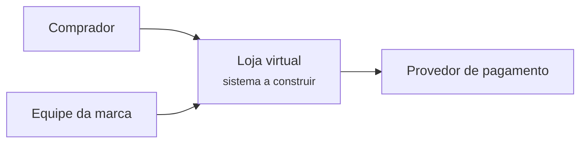
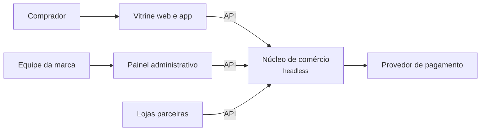
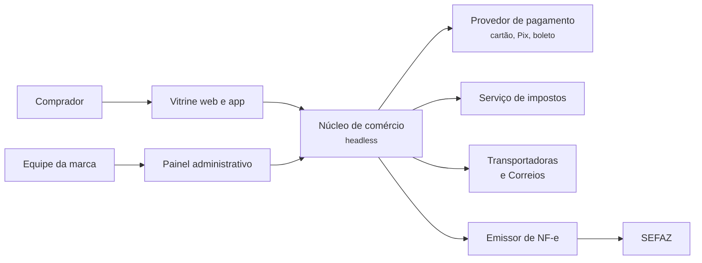
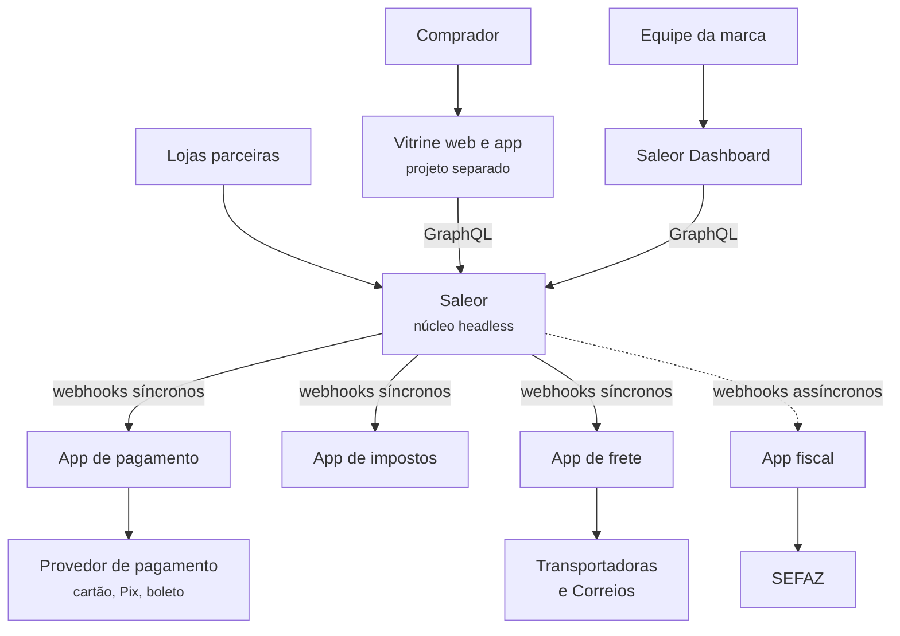

# 3.6 Saleor: requisitos e contexto

100.000 pés

Esta seção reconstrói, a 100.000 pés, os requisitos e o contexto de uma loja construída sobre
o Saleor, apresentado na [Seção 2.6](../capitulo-2-aplicacoes/saleor.md). Seguindo o método de
Xu (2020, cap. 3), os requisitos não são dados de antemão: eles emergem de uma conversa entre o
arquiteto e o cliente, e o desenho do sistema evolui a cada informação nova. A conversa é
seguida, a cada rodada, de análise em texto e de uma nova versão do diagrama de contexto (nível
1 do modelo C4, Seção 1.3.3).

!!! note "Sobre a conversa"
    A empresa e as falas do cliente são **hipotéticas**, construídas para que as necessidades
    expressas correspondam aos recursos documentados do Saleor (SALEOR, 2026a) e às
    integrações típicas do comércio eletrônico brasileiro. Os números de tráfego são
    hipóteses de trabalho e são tratados como tais nas estimativas.

## 3.6.1 Primeira rodada: o que está sendo construído

!!! question "Arquiteto"
    Antes de qualquer tecnologia: o que a empresa vende, para quem, e por que precisa de um
    sistema novo?

!!! quote "Cliente"
    Somos uma marca de artigos esportivos. Vendemos hoje por uma plataforma de loja pronta,
    alugada. Funciona, mas tudo o que fazemos de diferente, como montar kits, personalizar
    camisas, fazer lançamentos com hora marcada, exige gambiarras ou não é possível. Queremos
    uma loja própria, em que a experiência de compra seja nossa.

A primeira informação já orienta a destilação do domínio. Evans (2003, cap. 15) chama de
**domínio principal** (*core domain*) a parte do modelo em que está o valor diferenciador do
negócio, para a qual devem ir os melhores esforços de modelagem, e de **subdomínios
genéricos** as partes coesas, necessárias ao funcionamento, mas comuns a muitos negócios, para
as quais recomenda considerar soluções prontas ou modelos publicados. Vernon (2013, cap. 2)
acrescentou a categoria intermediária dos **subdomínios de suporte**: específicos do negócio,
mas não diferenciadores. O que o cliente descreve como diferencial é a apresentação do
catálogo, a composição de produtos e a dinâmica de promoções; o restante do comércio
eletrônico, a princípio, deve funcionar como em qualquer loja. A Figura 3.6.1 é o ponto de
partida.

**Figura 3.6.1** – Diagrama de contexto, versão 1.

Fonte: elaborado pelo autor (2026).

## 3.6.2 Segunda rodada: canais e interfaces

!!! question "Arquiteto"
    Por onde o comprador compra? Só pelo *site*, ou há outros canais?

!!! quote "Cliente"
    Pelo *site* e por um aplicativo que queremos lançar no ano que vem. Também vendemos para
    lojas parceiras na Argentina e no Chile, com preços em outra moeda. E a equipe de
    *marketing* quer trocar o visual do *site* a cada campanha, sem esperar o time de
    *backend*.

Três requisitos aparecem nessa fala. O primeiro é a **pluralidade de interfaces**: *site*,
aplicativo e, possivelmente, integrações com parceiros. O segundo é a operação **multicanal**,
com preço, moeda e estoque próprios por canal, recurso declarado no README do Saleor (SALEOR,
2026a). O terceiro é a **independência entre a evolução da vitrine e a do núcleo**, uma
exigência de modificabilidade. Os três apontam para a mesma decisão de alto nível: o núcleo
de comércio não deve ter interface própria, mas oferecer uma API, consumida por vitrines e
aplicativos independentes. É a arquitetura *headless*, que o Saleor adota como premissa ao se
declarar "API-only" (SALEOR, 2026a, `README.md`). A Figura 3.6.2 incorpora as novas
informações.

**Figura 3.6.2** – Diagrama de contexto, versão 2.

Fonte: elaborado pelo autor (2026).

## 3.6.3 Terceira rodada: escala e picos

!!! question "Arquiteto"
    Quantas pessoas visitam a loja e quantas compram? Há datas em que o movimento muda muito?

!!! quote "Cliente"
    Em dias normais, uns cinco milhões de visitas por dia somando *site* e aplicativo, e a
    conversão fica perto de 2%. Mas na Black Friday e nos lançamentos de camisa de time a
    coisa explode: no ano passado a loja alugada ficou fora do ar nos primeiros minutos de um
    lançamento.

### Estimativas de guardanapo

Seguindo Xu (2020, cap. 2), as estimativas são feitas com números redondos e hipóteses
explícitas.

- **Pedidos por dia:** 5.000.000 visitas × 2% = **100.000 pedidos/dia**.
- **Pedidos por segundo (média):** 100.000 / 86.400 s ≈ **1,2 pedido/s**. Como o tráfego se
  concentra em cerca de 10 horas do dia, a média nesse período é 100.000 / 36.000 s ≈ **2,8
  pedidos/s**.
- **Pico de lançamento:** admitindo-se um fator de 20 sobre a média das horas de movimento,
  2,8 × 20 ≈ **56 pedidos/s** no *checkout* durante os primeiros minutos.
- **Leituras de catálogo:** admitindo-se 10 consultas à API por visita, 5.000.000 × 10 =
  50 milhões de consultas/dia, ou 50.000.000 / 36.000 ≈ **1.400 consultas/s** nas horas de
  movimento e cerca de **28.000 consultas/s** no pico (fator 20).
- **Armazenamento de pedidos:** admitindo-se 10 KB por pedido com linhas, eventos e
  transações, 100.000 × 10 KB = 1 GB/dia, ou cerca de **365 GB/ano**, volume trivial para um
  PostgreSQL bem administrado.

**Tabela 3.6.1** – Resumo das estimativas.

| Grandeza | Média | Pico (fator 20) | Observação |
|---|---|---|---|
| Escritas de pedido | 2,8/s | ≈ 56/s | exigem consistência forte |
| Leituras de catálogo | ≈ 1.400/s | ≈ 28.000/s | toleram dados levemente desatualizados |
| Dados de pedidos | 1 GB/dia | – | ≈ 365 GB/ano |

Fonte: elaborado pelo autor (2026). Todos os valores derivam das hipóteses da conversa.

Duas conclusões decorrem da tabela. A primeira é a **assimetria entre leitura e escrita**: o
catálogo é lido cerca de 500 vezes mais do que o pedido é escrito, o que favorece *cache*,
réplicas de leitura e redes de distribuição de conteúdo para a vitrine. A segunda é que a
escrita crítica é pequena em volume, mas exige consistência: um pedido duplicado ou um item
vendido sem estoque custa mais do que uma página de produto alguns segundos desatualizada. A
queda relatada pelo cliente, nos primeiros minutos de um lançamento, é um problema de
**elasticidade**, que Richards e Ford (2020, cap. 5) distinguem da escalabilidade: esta trata
do crescimento sustentado da carga, aquela das rajadas.

## 3.6.4 Quarta rodada: pagamentos

!!! question "Arquiteto"
    Que meios de pagamento são necessários? A empresa pretende processar cartões diretamente?

!!! quote "Cliente"
    Cartão, Pix e boleto. Não queremos ser instituição de pagamento; usamos um provedor e
    queremos poder trocar de provedor se as taxas subirem. Ah, e tivemos um problema sério na
    loja antiga: em dia de pico, alguns clientes foram cobrados duas vezes pelo mesmo pedido.

A fala contém uma decisão de destilação e um requisito de qualidade. A decisão é que
**pagamento é subdomínio genérico** para esta empresa, ao contrário do que ocorre com o
Mercado Livre, que mantém uma operação financeira própria, o Mercado Pago (MERCADOLIBRE, 2026).
Evans (2003, cap. 15) adverte, justamente, que o domínio principal de uma aplicação é o
componente genérico de outra. A exigência de trocar de provedor é um requisito de
**modificabilidade** que, na altitude de componentes, se traduzirá numa camada de tradução
entre o modelo da loja e o de cada provedor (Seção 5.6).

O requisito de qualidade é que **nenhuma intenção de pagamento resulte em duas cobranças**. O
problema descrito é típico de novas tentativas sem idempotência: uma resposta se perde por
tempo limite, a chamada é repetida e o provedor, sem saber que se trata da mesma intenção, cobra
de novo. O tema é tratado em detalhe, com o código do Saleor, na Seção 6.6.

## 3.6.5 Quinta rodada: obrigações legais e logística

!!! question "Arquiteto"
    Como funcionam hoje a nota fiscal, o cálculo de impostos e a entrega?

!!! quote "Cliente"
    A nota fiscal eletrônica é emitida por um emissor terceirizado; o pedido só pode sair do
    depósito com a nota autorizada. Trabalhamos com três transportadoras e com os Correios, e
    queremos mostrar ao cliente o frete de todas no *checkout*. Os impostos variam por estado
    de destino.

A Nota Fiscal Eletrônica (NF-e) foi instituída pelo Ajuste SINIEF 07/05 (CONFAZ, 2005). O
documento é um arquivo XML cujo leiaute é definido pelo Manual de Orientação do Contribuinte e
pelos esquemas publicados no Portal Nacional da NF-e; deve ser assinado eletronicamente e só
tem validade jurídica depois que a administração tributária concede a autorização de uso,
antes da saída da mercadoria. Trata-se de um modelo imposto por norma e alterado
periodicamente por notas técnicas, que a loja não pode negociar. Cotação de frete e cálculo
de impostos acrescentam outros sistemas externos, cada um com seu próprio modelo. A Figura
3.6.3 mostra o contexto com todas essas integrações.

**Figura 3.6.3** – Diagrama de contexto, versão 3.

Fonte: elaborado pelo autor (2026).

## 3.6.6 Sexta rodada: equipe e orçamento

!!! question "Arquiteto"
    Quantas pessoas vão desenvolver e operar o sistema? Há equipe de infraestrutura?

!!! quote "Cliente"
    Teremos oito desenvolvedores, divididos em duas equipes, e nenhum especialista em
    infraestrutura. Vimos palestras sobre os milhares de microsserviços do Mercado Livre e
    ficamos em dúvida se devemos seguir o mesmo caminho.

A pergunta do cliente é a mais importante da conversa, porque desloca a discussão para a
altitude certa. O Mercado Livre relata ter migrado de um monólito para microsserviços e ter
precisado construir uma plataforma interna, a Fury, para sustentar mais de 26 mil
microsserviços e mais de 12 mil desenvolvedores (AWS, 2026; MARTINS, 2023). O problema que
os microsserviços resolvem ali é, em boa parte, organizacional: milhares de desenvolvedores não
compartilham um único ciclo de implantação. Oito desenvolvedores sem equipe de infraestrutura
não têm esse problema, e importar a solução sem o problema é a forma mais cara de errar a
altitude (Seção 1.11). A discussão de estilos pertence à altitude de *containers* e é
desenvolvida na [Seção 4.6](../capitulo-4-50-mil-pes/saleor.md); aqui basta registrar a
restrição: **equipe pequena, sem operação dedicada**.

## 3.6.7 *Stakeholders*, subdomínios e conflitos

A conversa permite consolidar os *stakeholders* (Seção 1.3.1) e seus interesses.

**Tabela 3.6.2** – *Stakeholders* e interesses.

| *Stakeholder* | Interesse principal | Conflito típico |
|---|---|---|
| Comprador | encontrar, pagar e receber com rapidez e segurança | quer frete grátis e rápido; a logística quer consolidar envios |
| Equipe da marca e *marketing* | experiência própria, campanhas frequentes | quer mudar a vitrine sempre; o núcleo precisa de contratos estáveis |
| Financeiro | conciliação exata entre pedidos, cobranças e estornos | quer consistência forte; o *marketing* quer *checkout* sem fricção |
| Logística | despacho correto, rastreamento, custo de frete | depende de transportadoras com APIs heterogêneas |
| Fisco (SEFAZ) | emissão correta e tempestiva da NF-e | regras mudam por norma; a autorização condiciona o despacho |
| Desenvolvedores | evoluir cada parte sem coordenar todas | equipe pequena, sem especialista em operação |

Fonte: elaborado pelo autor (2026).

A destilação pode, agora, ser comparada entre os sistemas deste par (Tabela 3.6.3). A
classificação depende do ponto de vista, e a diferença ajuda a explicar as escolhas
arquiteturais de cada caso.

**Tabela 3.6.3** – Destilação de subdomínios segundo o ponto de vista.

| Subdomínio | Loja sobre o Saleor | *Marketplace* (Mercado Livre) | Varejista integrado (Amazon) |
|---|---|---|---|
| Catálogo e conteúdo de produto | principal | suporte (o conteúdo vem dos vendedores) | suporte |
| Busca e recomendação | genérico ou suporte | principal | principal |
| Carrinho e *checkout* | suporte | suporte | suporte |
| Precificação e promoções | principal | suporte | principal |
| Pagamento | genérico | principal (Mercado Pago) | suporte |
| Estoque e logística | suporte | principal (Mercado Envios) | principal |
| Faturamento e NF-e | genérico | genérico | genérico |
| Reputação de vendedores | não se aplica | principal | suporte |

Fonte: elaborado pelo autor (2026), com base em Evans (2003, cap. 15), Vernon (2013, cap. 2)
e Mercadolibre (2026). As colunas Mercado Livre e Amazon são interpretação do autor.

Argumenta-se aqui que a tabela explica a forma do Saleor. O núcleo não sabe cobrar um cartão
nem calcular um imposto ou um frete: ele dispara um evento e espera que uma *app* externa
responda (SALEOR, 2026b). Isso é coerente com a recomendação de Evans de não gastar o esforço
central nos subdomínios genéricos. A NF-e é genérica para todos: nenhuma empresa compete por
emitir notas fiscais melhor, mas todas precisam emiti-las corretamente.

## 3.6.8 Características prioritárias e cenários de qualidade

Seguindo Richards e Ford (2020, cap. 5), escolhem-se três características para o *checkout* e
o pós-venda, a parte crítica do sistema:

1. **Elasticidade**, para absorver os picos de lançamento (terceira rodada).
2. **Consistência dos dados financeiros e de estoque**, desdobrada em integridade e
   recuperabilidade: nenhum pedido pago duas vezes, nenhum item vendido sem estoque, nenhum
   estorno esquecido (quarta rodada).
3. **Modificabilidade e capacidade de integração**, para trocar de provedor de pagamento,
   acrescentar transportadoras e acompanhar mudanças fiscais sem reescrever o núcleo (segunda,
   quarta e quinta rodadas).

Para a vitrine e o catálogo, o conjunto é outro: desempenho de leitura, disponibilidade e
escalabilidade, com tolerância a consistência eventual. A diferença entre os dois conjuntos
será o primeiro argumento, na Seção 4.6, para separar fisicamente partes do sistema. A Tabela
3.6.4 especifica as três características por cenários de qualidade com as seis partes de
Bass, Clements e Kazman (2021, cap. 3), apresentadas na Seção 1.4.2.

**Tabela 3.6.4** – Cenários de qualidade.

| Parte | Elasticidade | Consistência | Modificabilidade |
|---|---|---|---|
| Fonte | compradores | rede entre a loja e o provedor | equipe de produto |
| Estímulo | tráfego de *checkout* sobe 20 vezes em 5 minutos | a resposta de uma cobrança se perde por tempo limite e a chamada é repetida | contratar um segundo provedor de pagamento |
| Ambiente | abertura de lançamento | operação de pico | operação normal |
| Artefato | API de *checkout* | serviço de pagamento | integração de pagamentos |
| Resposta | aceitar e processar os pedidos | reconhecer a repetição e devolver o resultado da primeira cobrança | integrar o provedor sem alterar pedido, estoque e *checkout* |
| Medida | latência p99 < 2 s, nenhum pedido perdido | zero cobranças duplicadas por intenção de pagamento | até 10 dias de trabalho, nenhuma mudança fora do módulo de integração |

Fonte: elaborado pelo autor (2026), no formato de Bass, Clements e Kazman (2021).

## 3.6.9 Diagrama de contexto final

A Figura 3.6.4 consolida a conversa no vocabulário do Saleor. O sistema é o núcleo *headless*;
painel e vitrine são clientes da API; pagamento, impostos e frete são prestados por *apps* que
o núcleo aciona por *webhooks* síncronos; a emissão da NF-e reage a *webhooks* assíncronos.

**Figura 3.6.4** – Diagrama de contexto final (C4, nível 1) de uma loja construída sobre o
Saleor.

Fonte: elaborado pelo autor (2026), com base em Saleor (2026a; 2026b). As *apps* fiscal, de
impostos e de frete são hipotéticas no contexto brasileiro; o mecanismo de *webhooks* é o
documentado. Linhas contínuas: comunicação síncrona; linhas tracejadas: comunicação assíncrona.

O diagrama evidencia um fato que orientará as próximas altitudes: todos os sistemas externos
estão em posição de **montante** em relação à loja, isto é, a loja nunca dita o modelo do outro
lado. Pagamento, entrega e faturamento são os pontos em que modelos alheios tentam entrar no
sistema. A forma de impedir essa "corrupção", nos termos de Evans (2003, cap. 14), é o tema da
[Seção 5.6](../capitulo-5-10-mil-pes/saleor.md).

## Referências

AWS. **AWS Innovator**: Mercado Libre. [*S. l.*]: Amazon Web Services, 2026. Disponível em:
<https://aws.amazon.com/solutions/case-studies/innovators/mercado-libre/>. Acesso em: 18 out.
2026.

BASS, L.; CLEMENTS, P.; KAZMAN, R. **Software architecture in practice**. 4. ed. Boston:
Addison-Wesley, 2021.

CONFAZ. **Ajuste SINIEF 07/05, de 30 de setembro de 2005**. Institui a Nota Fiscal Eletrônica
e o Documento Auxiliar da Nota Fiscal Eletrônica. Diário Oficial da União, Brasília, DF, 5 out.
2005. Disponível em: <https://www.confaz.fazenda.gov.br/legislacao/ajustes/2005/AJ007_05>. Acesso em: 18
out. 2026.

EVANS, E. **Domain-driven design**: tackling complexity in the heart of software. Boston:
Addison-Wesley, 2003.

MARTINS, J. M. **Efficiency and platform engineering**. Palestra apresentada na PlatformCon
2023. Disponível em: <https://2023.platformcon.com/talks/efficiency-and-platform-engineering>.
Acesso em: 18 out. 2026.

MERCADOLIBRE, INC. **Form 10-K**: annual report for the fiscal year ended December 31, 2025.
Washington, DC: U.S. Securities and Exchange Commission, 2026. Disponível em:
<https://www.sec.gov/Archives/edgar/data/1099590/000109959026000006/meli-20251231.htm>. Acesso
em: 18 out. 2026.

RICHARDS, M.; FORD, N. **Fundamentals of software architecture**: an engineering approach.
Sebastopol: O'Reilly, 2020.

SALEOR. **saleor/saleor**: repositório de código-fonte, versão 3.23.42. GitHub, 2026a.
Disponível em: <https://github.com/saleor/saleor/tree/3.23.42>. Acesso em: 18 out. 2026.

SALEOR. **Webhooks overview**. Documentação do Saleor, 2026b. Disponível em:
<https://docs.saleor.io/developer/extending/webhooks/overview>. Acesso em: 18 out. 2026.

VERNON, V. **Implementing domain-driven design**. Upper Saddle River: Addison-Wesley, 2013.

XU, A. **System design interview**: an insider's guide. 2. ed. [*S. l.*]: Independently
published, 2020.
