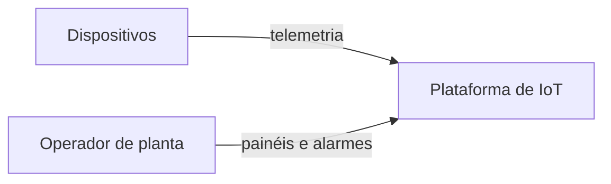
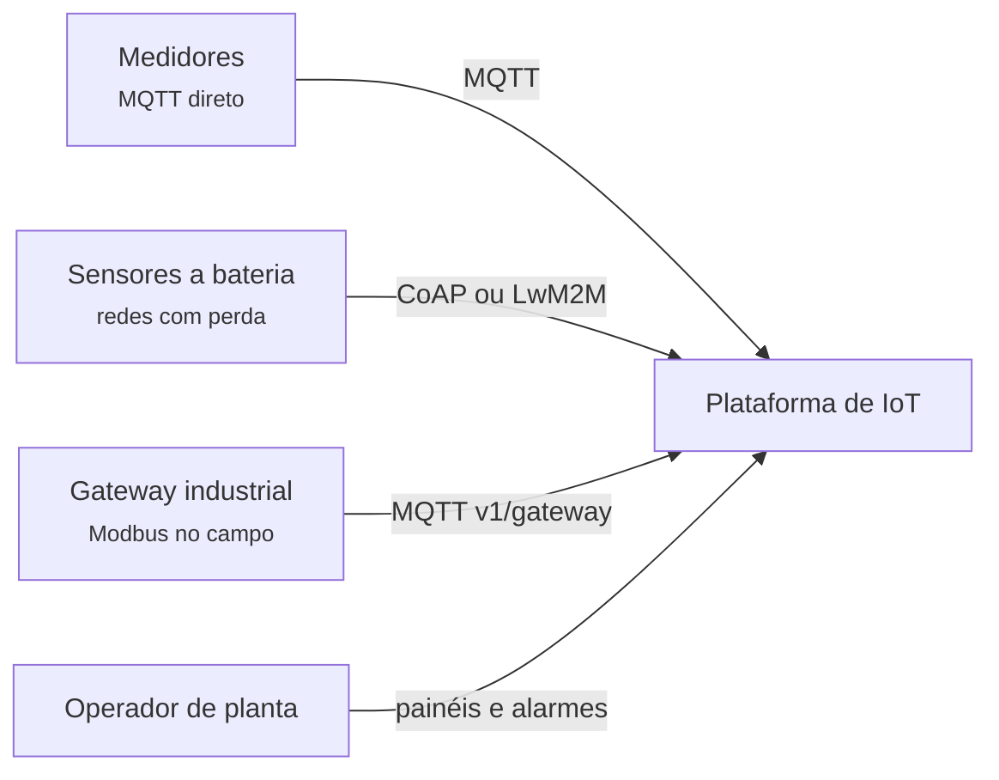
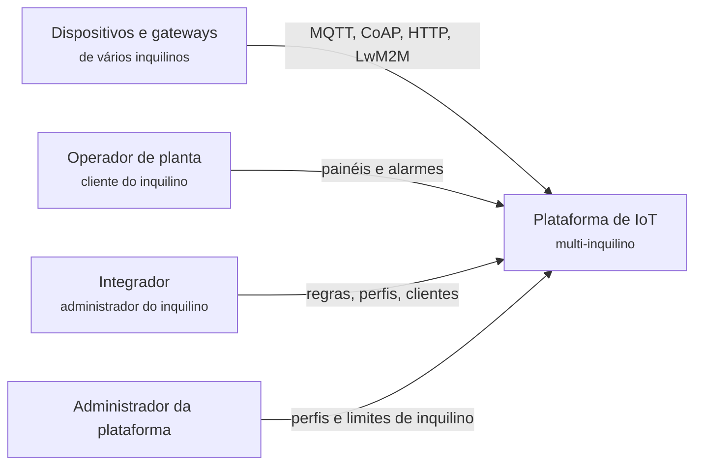
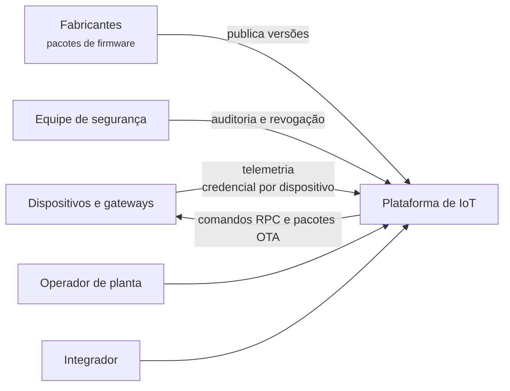
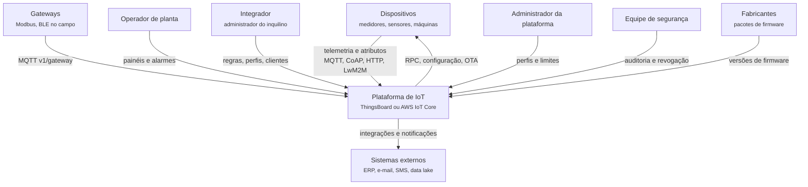

# 3.7 ThingsBoard: requisitos e contexto

100.000 pés

## 3.7.1 O método: uma conversa que redesenha o contexto

Xu (2020, cap. 3) recomenda que uma entrevista de projeto de sistemas comece pela compreensão do
problema e pela delimitação do escopo, com perguntas ao interlocutor, antes de qualquer desenho;
as respostas estreitam o espaço de soluções e devem ser registradas como hipóteses explícitas.
Esta seção aplica o método à plataforma de IoT apresentada na [Seção 2.7](../capitulo-2-aplicacoes/thingsboard.md).
O arquiteto conversa com a diretora de produto de uma empresa fictícia que pretende oferecer uma
plataforma de IoT a clientes industriais. A cada rodada surge uma informação nova, seguida de
análise e de uma versão revista do diagrama de contexto (nível 1 do modelo C4, ver Apêndice A).

!!! note "Sobre as falas do cliente"
    A empresa e a interlocutora são fictícias. Os números de escala (1 milhão de dispositivos, uma
    mensagem a cada 10 segundos) são **hipotéticos** e foram escolhidos para tornar as estimativas
    instrutivas. As demais falas foram construídas para serem coerentes com a documentação do
    ThingsBoard e do AWS IoT Core e com a literatura citada; sempre que uma fala depende de um fato
    externo, a análise que a segue indica a fonte.

## 3.7.2 Rodada 1: o que se quer construir

!!! question "Arquiteto"
    Que problema a plataforma resolve, e para quem?

!!! quote "Cliente"
    Nossos clientes são indústrias, distribuidoras de energia e empresas do agronegócio. Eles têm
    sensores e máquinas espalhados e querem ver tudo num painel: temperatura, consumo, pressão. Se
    algo sair do normal, querem um alarme. E queremos que eles mesmos configurem as regras, sem
    depender de programadores.

A primeira rodada fixa o núcleo funcional: **receber telemetria** (medições periódicas),
**exibi-la em painéis**, **avaliar regras** e **gerar alarmes**. A última frase traz uma
característica arquitetural que costuma ficar implícita: a **configurabilidade** por usuários não
programadores. No ThingsBoard, ela se materializa em cadeias de regras montadas graficamente
(THINGSBOARD, 2026a); no AWS IoT Core, em regras escritas em uma linguagem semelhante a SQL
(AMAZON WEB SERVICES, 2026a). As duas escolhas já indicam públicos diferentes: a primeira favorece
integradores e operadores, a segunda, desenvolvedores. A Figura 3.7.1 apresenta a primeira versão
do contexto.

**Figura 3.7.1** – Contexto, versão 1.

Fonte: elaborado pelo autor (2026).

## 3.7.3 Rodada 2: escala

!!! question "Arquiteto"
    Quantos dispositivos, com que frequência de envio, e por quanto tempo os dados precisam ser
    guardados?

!!! quote "Cliente"
    Queremos chegar a um milhão de dispositivos em três anos. A maioria manda uma leitura a cada
    10 segundos, com umas cinco grandezas. Os clientes querem consultar o histórico, alguns por
    anos, por exigência de auditoria.

Seguindo o roteiro de estimativas de ordem de grandeza de Xu (2020, cap. 2), a Tabela 3.7.1
explicita cada hipótese.

**Tabela 3.7.1** – Estimativa de guardanapo para o cenário da Rodada 2.

| Grandeza | Cálculo | Resultado |
|---|---|---|
| Mensagens por segundo (média) | 1.000.000 ÷ 10 s | 100.000 msg/s |
| Mensagens por dia | 100.000 × 86.400 | 8,64 × 10⁹ |
| Mensagens por ano | 8,64 × 10⁹ × 365 | ≈ 3,15 × 10¹² |
| Pontos de dados por segundo (5 grandezas por mensagem) | 100.000 × 5 | 500.000 pontos/s |
| Bytes brutos por segundo (hipótese: 16 bytes por ponto, carimbo de tempo e valor) | 500.000 × 16 | 8 MB/s |
| Armazenamento bruto por dia | 8 MB/s × 86.400 | ≈ 691 GB |
| Armazenamento bruto por ano | 691 GB × 365 | ≈ 252 TB |
| Com fator de replicação 3 (hipótese) | 252 TB × 3 | ≈ 757 TB |

Fonte: elaborado pelo autor (2026). Os 16 bytes por ponto e a replicação tripla são ilustrativos;
índices, chaves, metadados e compressão alteram o resultado.

Três conclusões decorrem da tabela. A primeira é que **a escrita de séries temporais domina o
custo**. A documentação do ThingsBoard indica que o armazenamento de séries temporais em
PostgreSQL atende até algo entre 5 mil e 10 mil pontos de dados por segundo e recomenda o modo
híbrido, com Cassandra, quando a vazão de escrita ultrapassa esse patamar; o mesmo texto adverte
que o número de dispositivos, isoladamente, não decide a escolha, pois 300 mil dispositivos que
reportam uma vez por minuto produzem cerca de 5 mil pontos por segundo (THINGSBOARD, 2026b;
THINGSBOARD, 2026c). O cenário da Rodada 2 está duas ordens de grandeza acima do limite do modo
SQL. A segunda é que **a média esconde os picos**, tema da Rodada 6. A terceira é que um volume
que "só cresce" exige uma **política de retenção**: tempo de vida dos dados, agregação de dados
antigos ou arquivamento em armazenamento mais barato. A exigência de auditoria mencionada pela
cliente torna essa política uma decisão de negócio com consequência arquitetural, e não um
detalhe de configuração. A decisão de separar entidades e séries temporais em bancos distintos é
discutida, com ADR, na [Seção 4.7](../capitulo-4-50-mil-pes/thingsboard.md).

## 3.7.4 Rodada 3: os dispositivos

!!! question "Arquiteto"
    Que dispositivos são esses? Como se conectam? Quem os fabrica?

!!! quote "Cliente"
    De tudo um pouco. Medidores modernos falam MQTT direto. Sensores de campo são a bateria,
    mandam pouco e ficam em redes ruins. Nas fábricas, os equipamentos antigos falam Modbus e
    precisam de um gateway. E os fabricantes são vários; queremos ao menos ler bateria e atualizar
    firmware de todos do mesmo jeito.

A rodada revela **heterogeneidade de protocolos** e a necessidade de **gateways**. A escolha do
protocolo é uma decisão difícil de mudar no sentido de Fowler (2003), discutido na Seção 1.1.1:
uma vez que a frota está em campo, trocá-lo exige atualizar *firmware* remotamente ou substituir
equipamentos. A plataforma precisa, portanto, aceitar vários protocolos e convertê-los em uma
representação interna comum.

O **MQTT** foi criado em 1999 por Andy Stanford-Clark, da IBM, e Arlen Nipper, da Arcom
(MQTT.ORG, 2026). É um protocolo de *publish/subscribe* sobre TCP, padronizado pela OASIS nas
versões 3.1.1, de 2014, e 5.0, de 7 de março de 2019 (OASIS, 2019). A conexão é persistente,
mantida por pacotes de *keep alive*, o que permite à plataforma enviar comandos a qualquer momento.
O **CoAP**, especificado na RFC 7252, é um protocolo de transferência *web* para nós e redes
restritos, como microcontroladores de 8 bits e redes 6LoWPAN com altas taxas de perda; usa o
modelo de requisição e resposta do HTTP, mas sobre UDP, com cabeçalho fixo de 4 bytes e
confiabilidade opcional por mensagens *Confirmable* (SHELBY; HARTKE; BORMANN, 2014). O **HTTP** é
útil para dispositivos com recursos abundantes e envios esporádicos, mas não oferece um canal
natural para a plataforma iniciar a comunicação. O **LwM2M**, mantido pela OMA SpecWorks, é um
protocolo de **gerenciamento de dispositivos**, voltado a monitoramento, configuração e controle
remotos (OMA SPECWORKS, 2026), e responde diretamente ao desejo de "ler bateria e atualizar
*firmware* de todos do mesmo jeito". A Tabela 3.7.2 compara os quatro.

**Tabela 3.7.2** – Protocolos de dispositivo e o que favorecem.

| Critério | MQTT | CoAP | HTTP | LwM2M |
|---|---|---|---|---|
| Transporte | TCP (ou WebSocket) | UDP | TCP | CoAP sobre UDP na concepção original |
| Interação | *Publish/subscribe* via *broker* | Requisição e resposta | Requisição e resposta | Gerenciamento de objetos e recursos |
| Conexão | Persistente | Sem conexão | Por requisição | Registro periódico |
| Plataforma inicia contato? | Sim | Sim, se alcançável | Não, sem *polling* | Sim |
| Favorece | Comandos em tempo real | Bateria e redes com perda | Simplicidade e integração | Gestão uniforme de frotas heterogêneas |

Fonte: elaborado pelo autor (2026), com base em OASIS (2019), Shelby, Hartke e Bormann (2014) e
OMA SpecWorks (2026).

O **gateway** agrega dispositivos que não falam com a nuvem diretamente. No ThingsBoard, a API de
*gateway* permite que um único dispositivo mantenha uma conexão MQTT com a plataforma enquanto
encaminha dados de vários dispositivos físicos ligados a ele, com tópicos de prefixo
`v1/gateway/` (THINGSBOARD, 2026d). No AWS, o processamento local é oferecido pelo AWS IoT
Greengrass, descrito como extensão do AWS IoT para dispositivos de borda capazes de agir
localmente, filtrar e agregar dados (AMAZON WEB SERVICES, 2026a). A Figura 3.7.2 incorpora essas
informações.

**Figura 3.7.2** – Contexto, versão 2: protocolos e *gateways*.

Fonte: elaborado pelo autor (2026).

## 3.7.5 Rodada 4: garantias de entrega

!!! question "Arquiteto"
    Toda leitura precisa chegar? Uma leitura duplicada seria um problema?

!!! quote "Cliente"
    Leituras de temperatura de rotina, se uma se perder, a próxima chega em 10 segundos. Mas
    eventos de alarme e comandos para as máquinas não podem se perder. Duplicado, tudo bem, desde
    que o gráfico não mostre o mesmo ponto duas vezes.

O MQTT define três níveis de qualidade de serviço (QoS). No **QoS 0**, a mensagem chega uma vez
ou nenhuma, sem confirmação nem reenvio. No **QoS 1**, a publicação é confirmada por um `PUBACK`
e o emissor a trata como pendente até recebê-lo, de modo que pode haver duplicidade. No **QoS
2**, um protocolo de quatro passos garante entrega exatamente uma vez (OASIS, 2019, seções 4.3.1
a 4.3.3). A resposta da cliente distingue tráfego que tolera perda de tráfego que não tolera, mas
aceita duplicidade em ambos, desde que a apresentação seja correta.

Essa resposta coincide com a escolha das duas plataformas estudadas. O AWS IoT Core suporta os
níveis 0 e 1 e não suporta o nível 2 (AMAZON WEB SERVICES, 2026b), e o ThingsBoard limita o QoS
máximo do transporte MQTT a "pelo menos uma vez", como se verá no código na [Seção
6.7](../capitulo-6-solo/thingsboard.md). Garantir "exatamente uma vez" em escala exigiria manter
estado por mensagem em trânsito para milhões de sessões. É mais barato aceitar "pelo menos uma
vez" e tornar o armazenamento **idempotente**: gravar uma leitura com a chave (dispositivo,
grandeza, carimbo de tempo) duas vezes produz o mesmo resultado que gravá-la uma vez. Argumenta-se
aqui que essa é uma aplicação direta da primeira lei da arquitetura (Seção 1.1.2): a garantia mais
forte foi trocada por escalabilidade, e a responsabilidade pela correção foi deslocada do
protocolo para o modelo de dados.

## 3.7.6 Rodada 5: vários clientes na mesma plataforma

!!! question "Arquiteto"
    Cada cliente terá sua própria instalação?

!!! quote "Cliente"
    Não, seria caro demais. Uma plataforma só, com muitos clientes. Alguns são integradores que
    revendem para clientes deles. Cada um só pode ver o que é seu. E já aconteceu, num piloto, de
    um cliente mandar dados sem parar por um erro de firmware e deixar todo mundo lento. Isso não
    pode acontecer.

A rodada introduz a **multi-inquilinidade** (*multi-tenancy*) com dois níveis de hierarquia
(inquilino e cliente do inquilino) e as duas dimensões de isolamento. O **isolamento lógico**
impede que um inquilino veja ou altere dados de outro; no ThingsBoard, ele começa no próprio
transporte, que identifica o inquilino a partir das credenciais do dispositivo (THINGSBOARD,
2026b). O **isolamento de desempenho** impede que um inquilino "barulhento" degrade o serviço dos
demais. O ThingsBoard trata essa dimensão por **perfis de inquilino**, que definem limites de taxa
no transporte por inquilino, dispositivo e *gateway* e podem ativar filas isoladas do motor de
regras para inquilinos específicos (THINGSBOARD, 2026e). Esses mecanismos são examinados nas
Seções [4.7](../capitulo-4-50-mil-pes/thingsboard.md) e [6.7](../capitulo-6-solo/thingsboard.md).

A rodada também acrescenta *stakeholders*. Os **integradores** querem modelar regras sem programar
e administrar seus próprios clientes. Os **responsáveis financeiros** querem custo previsível por
dispositivo. A **equipe de operação** da plataforma quer escalar componentes de forma
independente e conter falhas de um cliente sem afetar os demais. A Figura 3.7.3 mostra a terceira
versão do contexto.

**Figura 3.7.3** – Contexto, versão 3: inquilinos e integradores.

Fonte: elaborado pelo autor (2026).

## 3.7.7 Rodada 6: segurança e atualização remota

!!! question "Arquiteto"
    Como os dispositivos se autenticam? Quem atualiza o firmware?

!!! quote "Cliente"
    Os fabricantes gravam alguma credencial de fábrica. Nosso pessoal de segurança ficou
    preocupado depois de ler sobre aquelas câmeras que viraram uma botnet. E queremos mandar
    atualização de firmware pela própria plataforma, para não mandar técnico a campo.

A preocupação da equipe de segurança tem fundamento empírico. Antonakakis *et al.* (2017)
mostraram que a botnet Mirai alcançou um pico de cerca de 600 mil infecções em 2016 com um
mecanismo trivial: varrer endereços nas portas Telnet 23 e 2323 e tentar 10 pares de usuário e
senha sorteados de uma lista de 62 credenciais de fábrica. Os ataques de negação de serviço
resultantes atingiram, entre outros, o Krebs on Security, a OVH e o provedor de DNS Dyn. Os
autores recomendam portas fechadas por padrão, menor privilégio e atualização automática, e
observam que esta última exige uma arquitetura de *software* modular e infraestrutura de chaves
públicas para atualizações confiáveis (ANTONAKAKIS *et al.*, 2017). O SWEBOK v4 registra a mesma
preocupação: um número massivo de pontos de extremidade cria terreno fértil para a exploração de
elos fracos (WASHIZAKI, 2024, cap. 13, seção 6.2).

Duas consequências para os requisitos são imediatas. A primeira é que a credencial precisa ser
**por dispositivo**, emitida no provisionamento e revogável individualmente; uma credencial
compartilhada pela frota impediria isolar um dispositivo comprometido. O AWS IoT Core usa
certificados X.509 e políticas por dispositivo e oferece auditoria que alerta, por exemplo, quando
um certificado é compartilhado por vários dispositivos (AMAZON WEB SERVICES, 2026a). A segunda é
que a **atualização remota** (*over-the-air*, OTA) passa a ser um requisito funcional, com um novo
sistema externo: o repositório de pacotes de *firmware* dos fabricantes. A Figura 3.7.4 incorpora
esses elementos.

**Figura 3.7.4** – Contexto, versão 4: segurança e atualização remota.

Fonte: elaborado pelo autor (2026).

## 3.7.8 Rodada 7: quedas, reconexões e o que não pode falhar

!!! question "Arquiteto"
    O que acontece hoje quando a rede de um cliente cai?

!!! quote "Cliente"
    No piloto, a operadora de celular teve uma falha de meia hora. Quando voltou, todos os
    dispositivos reconectaram ao mesmo tempo e o servidor caiu de novo. Ficamos fora do ar mais
    tempo depois da falha do que durante. E, nessa confusão, perdemos alarmes, o que não pode
    acontecer.

A rodada descreve uma **tempestade de reconexões**: quando uma frota perde a conexão ao mesmo
tempo, a reconexão sincronizada transforma a recuperação em um novo pico, e o tráfego de
recuperação passa a ser a nova causa de indisponibilidade. Brooker (2015) mostrou, por simulação,
que o *backoff* exponencial sozinho não resolve o problema, porque clientes que falham juntos
continuam tentando juntos, e que a solução é acrescentar aleatoriedade (*jitter*) ao intervalo. O
*AWS Well-Architected IoT Lens* prescreve exatamente essa combinação para a reconexão de
dispositivos remotos (AMAZON WEB SERVICES, 2026c). A discussão completa, com código, está na
caixa-preta da [Seção 4.7](../capitulo-4-50-mil-pes/thingsboard.md).

A segunda parte da fala estabelece um requisito de disponibilidade mais preciso do que "o sistema
não pode cair": **nenhum alarme confirmado ao dispositivo pode ser perdido**, mesmo que o
processamento atrase. Isso conduz a uma decisão estrutural que a Seção 4.7 desenvolve: separar a
**aceitação** de uma mensagem do seu **processamento**, por meio de uma fila durável entre os
transportes e o motor de regras. A plataforma passa a ter duas noções de disponibilidade: a de
aceitar dados, que precisa ser altíssima, e a de processá-los, que pode atrasar por alguns
minutos sem perda.

## 3.7.9 Características arquiteturais e cenários de qualidade

Seguindo Richards e Ford (2020, cap. 5), que recomendam escolher as três características mais
importantes em vez de tentar maximizar todas, as rodadas conduzem ao *top-3* da Tabela 3.7.3.

**Tabela 3.7.3** – Características arquiteturais prioritárias.

| Posição | Característica | Origem na conversa | Medida |
|---|---|---|---|
| 1 | **Escalabilidade** | Rodada 2: 100 mil mensagens e 500 mil pontos por segundo | Mensagens por segundo, conexões simultâneas |
| 2 | **Disponibilidade** (de aceitação) | Rodada 7: nenhum alarme confirmado pode ser perdido | Fração de mensagens confirmadas e persistidas |
| 3 | **Segurança** | Rodada 6: cada dispositivo é uma porta de entrada | Credenciais por dispositivo, revogação, limites por endereço |
| Logo abaixo | Elasticidade, isolamento entre inquilinos, configurabilidade | Rodadas 1, 5 e 7 | — |

Fonte: elaborado pelo autor (2026).

A Seção 1.4.2 recomendou especificar cada característica por cenários de qualidade com seis
partes. Três cenários derivam diretamente da conversa.

**Cenário 1 – Escalabilidade.** *Fonte*: a frota de 1 milhão de dispositivos. *Estímulo*: envio
de telemetria a cada 10 segundos. *Ambiente*: operação normal. *Artefato*: transportes MQTT.
*Resposta*: aceitar e enfileirar as mensagens. *Medida*: atraso entre recepção e confirmação ao
dispositivo abaixo de um limite acordado em 99% dos casos, sem rejeições por capacidade.

**Cenário 2 – Disponibilidade.** *Fonte*: falha de infraestrutura. *Estímulo*: queda de um nó de
processamento de regras por 15 minutos. *Ambiente*: carga normal. *Artefato*: fila entre
transportes e motor de regras. *Resposta*: manter as mensagens na fila e processá-las após a
recuperação. *Medida*: nenhuma mensagem confirmada ao dispositivo é perdida; o atraso acumulado é
zerado em tempo determinado após a recuperação.

**Cenário 3 – Isolamento entre inquilinos.** *Fonte*: dispositivos de um inquilino com defeito de
*firmware*. *Estímulo*: envio contínuo dez vezes acima do contratado. *Ambiente*: operação normal
dos demais inquilinos. *Artefato*: transportes e motor de regras. *Resposta*: rejeitar o excesso
do inquilino defeituoso. *Medida*: o atraso de processamento dos demais inquilinos não se altera
além de uma margem acordada.

## 3.7.10 Diagrama de contexto final

A Figura 3.7.5 consolida as rodadas no diagrama de contexto final, ponto de partida da descida à
[Seção 4.7](../capitulo-4-50-mil-pes/thingsboard.md).

**Figura 3.7.5** – Contexto final da plataforma de IoT (C4, nível 1).

Fonte: elaborado pelo autor (2026).

A comparação com o sistema real fecha a análise a esta altitude. O AWS IoT Core responde às
mesmas rodadas com um contrato diferente: o cliente não planeja capacidade, mas aceita cotas e
cobrança por mensagem, e a própria documentação apresenta o *Basic Ingest*, que publica
diretamente no motor de regras sem passar pelo *broker*, como forma de reduzir custos de
mensageria (AMAZON WEB SERVICES, 2026d). A cobrança por mensagem transforma a escolha de tópico
em decisão econômica, um exemplo de como o modelo de negócio do provedor entra no contexto do
sistema. A Rodada 2 teria, com o serviço gerenciado, uma pergunta adicional: quanto custa, por
mês, enviar 100 mil mensagens por segundo?

## Referências

AMAZON WEB SERVICES. **How AWS IoT works**. AWS IoT Core Developer Guide. 2026a. Disponível em:
<https://docs.aws.amazon.com/iot/latest/developerguide/aws-iot-how-it-works.html>. Acesso em:
18 out. 2026.

AMAZON WEB SERVICES. **MQTT**. AWS IoT Core Developer Guide. 2026b. Disponível em:
<https://docs.aws.amazon.com/iot/latest/developerguide/mqtt.html>. Acesso em: 18 out. 2026.

AMAZON WEB SERVICES. **Failure management**. AWS Well-Architected Framework: IoT Lens. 2026c.
Disponível em: <https://docs.aws.amazon.com/wellarchitected/latest/iot-lens/failure-management.html>.
Acesso em: 18 out. 2026.

AMAZON WEB SERVICES. **Reducing messaging costs with Basic Ingest**. AWS IoT Core Developer
Guide. 2026d. Disponível em:
<https://docs.aws.amazon.com/iot/latest/developerguide/iot-basic-ingest.html>. Acesso em:
18 out. 2026.

ANTONAKAKIS, M. *et al.* Understanding the Mirai botnet. *In*: USENIX SECURITY SYMPOSIUM, 26.,
2017, Vancouver. **Proceedings** [...]. Berkeley: USENIX Association, 2017. p. 1093-1110.

BROOKER, M. **Exponential backoff and jitter**. AWS Architecture Blog, 4 mar. 2015. Disponível
em: <https://aws.amazon.com/blogs/architecture/exponential-backoff-and-jitter/>. Acesso em:
18 out. 2026.

FOWLER, M. Who needs an architect? **IEEE Software**, v. 20, n. 5, p. 11-13, 2003.

MQTT.ORG. **Frequently asked questions**. 2026. Disponível em: <https://mqtt.org/faq/>. Acesso
em: 18 out. 2026.

OASIS. **MQTT version 5.0**. Edited by Andrew Banks, Ed Briggs, Ken Borgendale and Rahul Gupta.
OASIS Standard, 7 mar. 2019. Disponível em:
<https://docs.oasis-open.org/mqtt/mqtt/v5.0/os/mqtt-v5.0-os.html>. Acesso em: 18 out. 2026.

OMA SPECWORKS. **Lightweight M2M (LwM2M)**. 2026. Disponível em:
<https://www.openmobilealliance.org/lwm2m>. Acesso em: 18 out. 2026.

RICHARDS, M.; FORD, N. **Fundamentals of software architecture**: an engineering approach.
Sebastopol: O'Reilly, 2020.

SHELBY, Z.; HARTKE, K.; BORMANN, C. **RFC 7252**: the Constrained Application Protocol (CoAP).
Fremont: Internet Engineering Task Force, jun. 2014. Disponível em:
<https://www.rfc-editor.org/rfc/rfc7252>. Acesso em: 18 out. 2026.

THINGSBOARD. **Rule engine**. ThingsBoard documentation. 2026a. Disponível em:
<https://thingsboard.io/docs/user-guide/rule-engine/>. Acesso em: 18 out. 2026.

THINGSBOARD. **Architecture overview**. ThingsBoard documentation. 2026b. Disponível em:
<https://thingsboard.io/docs/reference/architecture/>. Acesso em: 18 out. 2026.

THINGSBOARD. **Database layer**. ThingsBoard documentation. 2026c. Disponível em:
<https://thingsboard.io/docs/reference/architecture/database/>. Acesso em: 18 out. 2026.

THINGSBOARD. **Gateway API overview**. ThingsBoard documentation. 2026d. Disponível em:
<https://thingsboard.io/docs/reference/gateway-api/overview/>. Acesso em: 18 out. 2026.

THINGSBOARD. **Tenant profiles**. ThingsBoard documentation. 2026e. Disponível em:
<https://thingsboard.io/docs/user-guide/tenant-profiles/>. Acesso em: 18 out. 2026.

WASHIZAKI, H. (ed.). **Guide to the software engineering body of knowledge (SWEBOK Guide)**:
version 4.0. Los Alamitos: IEEE Computer Society, 2024.

XU, A. **System design interview**: an insider's guide. 2. ed. [*S. l.*]: Byte Code LLC, 2020.
