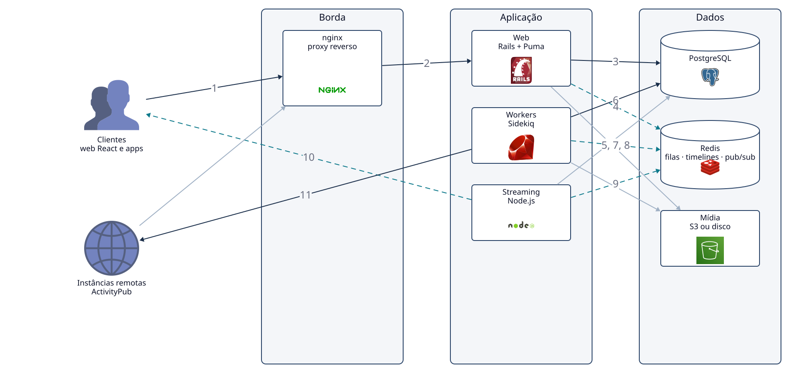

# 4.2 Mastodon: containers e implantação

50.000 pés

A [Seção 3.2](../capitulo-3-100-mil-pes/mastodon.md) terminou com uma instância Mastodon
representada como uma única caixa, cercada por usuários, aplicativos, moderadores, outras
instâncias e serviços externos. Esta seção abre a caixa: identifica os *containers*, no sentido
do modelo C4 (Seção 1.3.3 e Apêndice A), mostra como eles são implantados segundo a documentação
oficial, discute o estilo arquitetural e os quanta, e reconstrói as decisões que explicam essa
forma. A análise usa a *tag* `v4.7.3` do repositório.

## 4.2.1 Os *containers* de uma instância

A documentação técnica descreve o Mastodon como uma aplicação Ruby on Rails com interface em
React, que segue as práticas convencionais desses *frameworks* e depende de Ruby, Node.js,
PostgreSQL e Redis (MASTODON, 2026a). A documentação de escala detalha os três tipos de processo:
o processo web (Puma), que atende requisições HTTP curtas; a API de *streaming*, que mantém
conexões HTTP e WebSocket de longa duração pelas quais os clientes recebem atualizações em tempo
real; e o processamento em segundo plano (Sidekiq) (MASTODON, 2026b). O arquivo
[`docker-compose.yml`](https://github.com/mastodon/mastodon/blob/v4.7.3/docker-compose.yml) da
*tag* estudada confirma a divisão, com os serviços `db` (PostgreSQL 14), `redis` (Redis 7), `web`
(`bundle exec puma -C config/puma.rb`), `streaming` (`node ./streaming/index.js`) e `sidekiq`
(`bundle exec sidekiq`) (MASTODON, 2026f). A Figura 4.2.1 mostra os *containers* e suas comunicações, e a Tabela
4.2.1 resume a responsabilidade de cada um.

**Figura 4.2.1** – *Containers* de uma instância Mastodon e o caminho de uma publicação.

Passos numerados (publicação de uma mensagem e entrega aos seguidores):

1. O cliente envia a publicação, `POST /api/v1/statuses`, ao proxy reverso.
2. O nginx repassa a requisição HTTPS ao processo Web (Rails + Puma).
3. O `PostStatusService` grava a publicação no PostgreSQL, em transação, e o cliente recebe a resposta.
4. O processo Web enfileira o `DistributionWorker` no Redis.
5. Um *worker* Sidekiq retira o *job* da fila.
6. O *worker* consulta no PostgreSQL os seguidores locais ativos.
7. Para cada seguidor, o *worker* insere o identificador da publicação na *timeline* em memória (`ZADD feed:home:<id>`). O comando é síncrono, mas executa dentro de um *job* assíncrono.
8. Para os seguidores conectados, o *worker* publica o evento no canal do usuário (`PUBLISH timeline:<id>`).
9. O servidor de *streaming*, que assina esses canais, recebe o evento.
10. O evento `update` chega ao cliente do seguidor por WebSocket, passando pelo nginx.
11. Em paralelo, a entrega federada envia `POST /inbox` às instâncias remotas (ActivityPub).

As setas finas sem número representam relações que não pertencem a esse fluxo: o *streaming*
valida *tokens* de acesso no PostgreSQL, Web e *workers* gravam mídia no armazenamento de objetos
e as instâncias remotas entregam atividades no `/inbox` local.

Fonte: elaborado pelo autor (2026), com base em Mastodon (2026a; 2026b), no arquivo
`docker-compose.yml` da *tag* `v4.7.3` e no estilo de diagrama de Xu (2020). Linhas contínuas:
comunicação síncrona; linhas tracejadas: comunicação assíncrona. Código-fonte da figura:
`diagramas/d2/mastodon-50k.d2`.

**Tabela 4.2.1** – *Containers* de uma instância Mastodon.

| *Container* | Tecnologia | Responsabilidade | Estado |
|---|---|---|---|
| Web | Rails + Puma | API REST, páginas, *inbox* ActivityPub, autenticação OAuth2 | sem estado (escala horizontalmente) |
| *Workers* | Sidekiq | *fanout*, entrega e recepção federadas, notificações, processamento de mídia, tarefas agendadas | sem estado; o trabalho está nas filas |
| *Streaming* | Node.js (`ws`, `ioredis`, `pg`) | conexões longas com os clientes; repassa eventos | conexões abertas |
| Banco relacional | PostgreSQL | fonte da verdade: contas, publicações, relações, configurações | persistente |
| Memória | Redis | *timelines* pré-computadas, filas do Sidekiq, *pub/sub*, cache, travas | volátil, reconstruível |
| Mídia | S3 compatível ou disco local | imagens, vídeos, áudios, miniaturas e cache de mídia remota | persistente |

Fonte: elaborado pelo autor (2026), com base em Mastodon (2026a; 2026b) e no código da *tag*
v4.7.3.

O servidor de *streaming* consulta o PostgreSQL diretamente para validar o token de acesso do
cliente, numa consulta à tabela `oauth_access_tokens` que se lê em
[`streaming/index.js`](https://github.com/mastodon/mastodon/blob/v4.7.3/streaming/index.js#L383).
É um detalhe revelador: os três processos de aplicação compartilham o mesmo banco, inclusive o
que está escrito em outra linguagem.

## 4.2.2 Implantação

### Servidor único

O roteiro oficial de instalação a partir do código pressupõe uma máquina com Ubuntu 24.04 ou
Debian 13, um domínio, nginx como proxy reverso, certificado TLS obtido com o Let's Encrypt e três
serviços systemd, `mastodon-web`, `mastodon-sidekiq` e `mastodon-streaming`, criados a partir de
modelos que acompanham o repositório (MASTODON, 2026c). PostgreSQL e Redis são instalados na mesma
máquina como pacotes do sistema. A Figura 4.2.2 representa essa implantação, que é a de referência
para instâncias pequenas e médias.

**Figura 4.2.2** – Diagrama de implantação em servidor único, segundo o roteiro oficial.

Fonte: elaborado pelo autor (2026), com base em Mastodon (2026c). Linhas contínuas: comunicação
síncrona; linhas tracejadas: comunicação assíncrona. Código-fonte da figura:
`diagramas/d2/mastodon-impl-unico.d2`.

A implantação por contêineres segue a mesma topologia. No `docker-compose.yml`, banco e Redis
ficam numa rede marcada como `internal: true`, sem acesso à internet, enquanto `web`, `streaming`
e `sidekiq` participam também de uma rede externa; as portas 3000 e 4000 são publicadas apenas em
`127.0.0.1`, de modo que o nginx do hospedeiro continua sendo o único ponto de entrada. O serviço de
*streaming* usa uma imagem própria (`ghcr.io/mastodon/mastodon-streaming:v4.7.3`), enquanto `web` e
`sidekiq` usam a **mesma** imagem (`ghcr.io/mastodon/mastodon:v4.7.3`) com comandos diferentes.

### Escalando a instância

A documentação de escala descreve como a mesma topologia cresce sem mudar de estilo (MASTODON,
2026b; 2026d). O processo web escala por número de processos e de *threads* (variáveis
`WEB_CONCURRENCY` e `MAX_THREADS`). O *streaming* escala executando vários processos em portas
diferentes, balanceados pelo nginx; versões antigas usavam o módulo de *cluster* do Node.js, abandonado
em favor de processos independentes. O Sidekiq escala por número de processos e permite dedicar
processos a filas específicas (`bundle exec sidekiq -q default`). O PostgreSQL ganha o PgBouncer
quando as conexões se esgotam e pode ter uma réplica somente leitura (variáveis `REPLICA_DB_*`). O
Redis pode ser dividido: a documentação recomenda um servidor separado para o cache volátil
(`CACHE_REDIS_*`) e permite outro para as filas (`SIDEKIQ_REDIS_*`). A mídia vai para um
armazenamento de objetos compatível com S3, eventualmente atrás de uma CDN. A Figura 4.2.3 mostra
essa configuração.

**Figura 4.2.3** – Diagrama de implantação de uma instância maior.

![Implantação de uma instância maior do Mastodon: o balanceador ou nginx distribui as requisições entre os processos Puma 1 a Puma N e os processos de streaming nas portas 4000 e 4001; os Puma e as três filas do Sidekiq (default, push e ingress, pull e scheduler) acessam o PostgreSQL primário pelo PgBouncer, e o primário replica de forma assíncrona para uma réplica somente leitura; Puma e Sidekiq usam o Redis de timelines, filas e pub/sub, que o streaming assina com SUBSCRIBE; o Puma usa ainda um Redis de cache, e Puma e Sidekiq gravam no armazenamento S3 com CDN](../assets/diagramas/mastodon-impl-escala.svg)

Fonte: elaborado pelo autor (2026), com base em Mastodon (2026b; 2026d). Linhas contínuas:
comunicação síncrona; linhas tracejadas: comunicação assíncrona. Código-fonte da figura:
`diagramas/d2/mastodon-impl-escala.d2`.

A figura é instrutiva pelo que **não** contém: nenhum novo serviço de aplicação, nenhum
*broker* de mensagens dedicado, nenhum banco adicional. Uma instância grande é uma instância
pequena com mais processos dos mesmos tipos e com os dados separados por papel. Essa é a
materialização da simplicidade operacional que encabeça o Top-3 da Seção 3.2.6.

## 4.2.3 Estilo e quanta

O estilo dominante do Mastodon é o **monólito em camadas** (RICHARDS; FORD, 2020, cap. 10),
complementado por processamento assíncrono em filas de *jobs*. O código Rails do processo web e o
dos *workers* é **o mesmo**: além da imagem de contêiner compartilhada, o `Procfile` da *tag*
estudada declara `web: bin/heroku-web` e `worker: bundle exec sidekiq` sobre a mesma base de
código. São dois processos implantados separadamente, mas um único artefato, com um único esquema
de banco.

Quantos **quanta arquiteturais** existem? Richards e Ford (2020, p. 92) definem o quantum como um
artefato implantável de forma independente, com alta coesão funcional e conascência síncrona, e
observam que o banco de dados faz parte do quantum, pois o sistema não funciona sem ele; sistemas
com um único banco formam, por definição, um quantum único. Uma instância Mastodon é, portanto,
**um quantum**: web, *workers* e *streaming* compartilham o mesmo PostgreSQL e o mesmo Redis, e
nenhum deles cumpre sua função sozinho. A comunicação entre a requisição web e o *fanout* é
assíncrona, mediada pela fila, o que permite escalar *workers* e processos web em números
diferentes, mas não os torna quanta separados.

A rede federada, por outro lado, é composta por **milhares de quanta**, um por instância. As
instâncias são implantadas, versionadas e operadas de forma independente e se comunicam de modo
assíncrono por HTTP. Argumenta-se aqui que essa é a observação arquitetural mais interessante do
par: o Mastodon obtém, no nível da rede, propriedades típicas de arquiteturas distribuídas
(isolamento de falhas, autonomia de evolução, escala por adição de nós), sem pagar o custo de uma
arquitetura distribuída **dentro** de cada instância. A Tabela 4.2.2 confronta essa escolha com as
avaliações de Richards e Ford para o estilo em camadas.

**Tabela 4.2.2** – O estilo em camadas segundo Richards e Ford e a compensação adotada pelo Mastodon.

| Característica | Avaliação do estilo em camadas | Compensação no Mastodon |
|---|---|---|
| Custo e simplicidade | ponto forte | mantidos: um repositório, uma linguagem principal, um banco |
| Implantabilidade | fraca: qualquer mudança reimplanta tudo | aceita: atualizações são raras e feitas por cada administrador |
| Elasticidade e escalabilidade | fracas: um único quantum | processos web e *workers* escalam por número; a rede escala por número de instâncias |
| Desempenho | fraco por natureza; exige cache | *timelines* pré-computadas no Redis |
| Tolerância a falhas | fraca: uma falha derruba a unidade | falhas de uma instância não derrubam a rede |

Fonte: elaborado pelo autor (2026), com base em Richards e Ford (2020, p. 139-141).

## 4.2.4 Comunicação síncrona e assíncrona

A Tabela 4.2.3 classifica as comunicações da Figura 4.2.1. A regra que emerge é simples: tudo o que
o usuário espera é síncrono e curto; tudo o que pode demorar, depende de terceiros ou multiplica o
trabalho vai para uma fila.

**Tabela 4.2.3** – Comunicações entre *containers*.

| De → para | Modo | Mecanismo | Exemplo |
|---|---|---|---|
| Cliente → Web | síncrono | HTTPS/REST | publicar, ler a *timeline* |
| Cliente ↔ *Streaming* | assíncrono, persistente | WebSocket ou *Server-Sent Events* | nova publicação aparece sem recarregar |
| Web → *Workers* | assíncrono | fila Sidekiq no Redis | distribuir publicação, buscar prévia de *link* |
| *Workers* → *Streaming* | assíncrono | *pub/sub* do Redis | evento de atualização da *timeline* |
| *Workers* → instâncias remotas | assíncrono para o usuário; síncrono por requisição | HTTPS `POST` assinado | entrega ActivityPub |
| Instâncias remotas → Web | síncrono na borda; assíncrono no processamento | `POST /inbox`, resposta `202` e fila `ingress` | recepção ActivityPub |

Fonte: elaborado pelo autor (2026), com base no código da *tag* v4.7.3.

As filas do Sidekiq são priorizadas de forma explícita. A documentação lista, em ordem decrescente
de importância e entre outras, `default` (todas as tarefas que afetam usuários locais), `push`
(entrega de cargas a outros servidores), `ingress` (atividades remotas recebidas, com prioridade
menor que `default` para que os usuários locais continuem vendo suas publicações quando o servidor
está sob carga) e `pull` (tarefas de menor prioridade, como importações, cópias de segurança e
resolução de conversas) (MASTODON, 2026b). O arquivo
[`config/sidekiq.yml`](https://github.com/mastodon/mastodon/blob/v4.7.3/config/sidekiq.yml#L3-L10)
da *tag* estudada atribui pesos 8, 6, 4 e 2 às filas `default`, `push`, `ingress` e `mailers`, e
deixa `pull`, `scheduler` e `fasp` sem peso explícito. Argumenta-se aqui que a priorização de filas é
uma decisão arquitetural disfarçada de configuração: diante de sobrecarga, a instância escolhe
degradar a federação antes de degradar a experiência local, exatamente como o cliente pediu na
Rodada 4 da Seção 3.2.

## 4.2.5 Dados

Os dados de uma instância têm três destinos com propriedades distintas.

O **PostgreSQL** é a fonte da verdade. Contas, publicações, relações de seguimento, mídias
(metadados), bloqueios, denúncias e configurações estão nele, acessados pelo Rails por meio de
modelos *Active Record*, examinados na Seção 6.2. O código usa explicitamente a réplica de leitura,
quando configurada, em operações como a leitura da *timeline* e a filtragem do *fanout*
(Seção 5.2).

O **Redis** tem quatro papéis: guarda as *timelines* pré-computadas, serve de *broker* das filas do
Sidekiq, faz o *pub/sub* que alimenta o *streaming* e funciona como cache do Rails (MASTODON,
2026d). Concentrar papéis tão diferentes em um componente é uma decisão de simplicidade operacional,
coerente com o Top-3, mas cria um ponto de acoplamento: uma instância com o Redis saturado sofre ao
mesmo tempo nas *timelines*, nos *jobs* e no tempo real. Por isso a documentação recomenda separar o
cache volátil num servidor próprio (MASTODON, 2026d). Mais importante, as *timelines* são **dados
derivados**: tudo o que está nelas pode ser reconstruído a partir do PostgreSQL, como mostra a
Seção 5.2. Isso permite tratar o Redis como memória volátil, algo inaceitável para a fonte da
verdade.

A **mídia** fica no disco local ou num armazenamento de objetos. A documentação informa que o
sistema de arquivos local do servidor é perfeitamente adequado para instâncias pequenas, mas que o
armazenamento externo de objetos é mais escalável, e que o Mastodon usa a API S3 para escrita,
exclusão e permissões (MASTODON, 2026e). Como as leituras de mídia são anônimas e usam `GET`
simples, podem passar por proxies reversos e CDNs (MASTODON, 2026e), o que Xu (2020, cap. 11)
recomenda para sistemas de *feed*: conteúdo de mídia servido por CDN, separado do caminho dos dados
estruturados. A mídia de usuários **remotos** também é copiada para a instância e mantida em cache
por um período configurável (MASTODON, 2026b), o que explica por que o armazenamento é o item que
mais cresce na estimativa da Seção 3.2.3.

## 4.2.6 Decisões reconstruídas

O Mastodon não publica registros de decisões arquiteturais. As decisões a seguir foram
reconstruídas a partir do código e da documentação, no formato da Seção 1.10 e do Apêndice B. A
decisão sobre o *fanout*, que pertence à altitude de componentes, é registrada na Seção 5.2.

!!! note "ADR-M1 (reconstruído): monólito Rails com processamento assíncrono em Sidekiq"
    **Status:** aceito (reconstrução retrospectiva, 2026).

    **Contexto.** Qualquer organização, inclusive voluntários, deve poder instalar e atualizar uma
    instância. O volume de uma instância típica é baixo (Seção 3.2.3), mas o trabalho por
    publicação é multiplicado pelo número de seguidores e de servidores remotos, e depende de
    terceiros que podem falhar.

    **Decisão.** Uma única base de código Rails, executada como processo web (Puma) e como
    processos de *workers* (Sidekiq), com um único PostgreSQL e um Redis. Todo trabalho que
    multiplica, demora ou depende de rede externa é enfileirado.

    **Consequências.** Instalação e atualização simples, um único esquema de banco, uma única
    linguagem para a lógica de negócio. A requisição do usuário não espera o *fanout* nem a
    federação. Em contrapartida, um único quantum: não é possível implantar ou escalar
    separadamente partes da lógica, e uma migração de banco afeta todos os processos.

!!! note "ADR-M2 (reconstruído): servidor de *streaming* em processo Node.js separado"
    **Status:** aceito (reconstrução retrospectiva, 2026).

    **Contexto.** Os clientes precisam receber atualizações sem recarregar a página. Uma instância
    média mantém cerca de mil conexões longas e ociosas (MASTODON, 2026b). O processo Puma é
    dimensionado para requisições curtas.

    **Decisão.** Um processo dedicado em Node.js mantém as conexões WebSocket e SSE, autentica o
    cliente no PostgreSQL e assina canais do Redis; os *workers* publicam eventos nesses canais.

    **Consequências.** O modelo de concorrência orientado a eventos do Node.js é adequado a muitas
    conexões ociosas, e o *streaming* escala independentemente do processo web. Em contrapartida,
    uma segunda linguagem e uma segunda imagem de contêiner; o acoplamento com o Rails passa a
    ser feito por nomes de canais e formato de mensagens, sem verificação de tipos entre os lados.

!!! note "ADR-M3 (reconstruído): Redis como armazenamento derivado e multifuncional"
    **Status:** aceito (reconstrução retrospectiva, 2026).

    **Contexto.** A leitura da *timeline* é a operação mais frequente e deve ser rápida. Filas,
    *pub/sub* e cache também são necessários. A instância deve depender do menor número possível
    de componentes.

    **Decisão.** Usar o Redis para *timelines* pré-computadas (limitadas), filas, *pub/sub* e cache;
    manter no PostgreSQL toda informação necessária para reconstruir as *timelines*.

    **Consequências.** Um único componente adicional ao banco. Perder o Redis degrada o desempenho
    e exige reconstrução das *timelines*, mas não perde publicações. Em contrapartida, saturação do
    Redis afeta quatro funções; a separação do cache é a mitigação documentada.

## 4.2.7 Comparação com o Twitter

O Twitter percorreu o caminho oposto. Krikorian (2013) relata que, após a Copa do Mundo de 2010, a
equipe concluiu que operava uma das maiores instalações Ruby on Rails do mundo, com cerca de 200
engenheiros contribuindo para uma base de código monolítica. O relato aponta três problemas:
desempenho (os servidores Rails, efetivamente monotarefa, atendiam apenas 200 a 300 requisições por
segundo por máquina), organização (era cada vez mais difícil ter especialistas no todo e coordenar
equipes em paralelo) e armazenamento (as publicações ficavam num único banco MySQL mestre,
particionado por tempo, o que concentrava a carga nas máquinas mais recentes). Fox e Patterson
(2021, cap. 3) registram que, por volta de 2013, o monólito, apelidado internamente de *MonoRail*,
foi dividido em muitos microsserviços, a maioria escrita em Java, Scala ou Clojure.

A reengenharia teve quatro eixos, segundo Krikorian (2013): a troca da máquina virtual Ruby pela
JVM, com ganho estimado superior a dez vezes no mesmo *hardware*; a decomposição em serviços em torno
dos "substantivos centrais" (publicação, *timeline*, usuário); um novo particionamento do
armazenamento, com identificadores Snowflake e distribuição por *hash*, o mesmo esquema que Xu
(2020, cap. 7) apresenta como referência; e uma biblioteca comum de comunicação (Finagle), adotada
depois que serviços com semânticas de falha divergentes produziram "manadas" de clientes repetindo
requisições contra serviços lentos. O resultado relatado inclui redução de 5 a 12 vezes no número de
máquinas e disponibilidade próxima de quatro noves no semestre anterior à publicação.

As *timelines* do Twitter ficavam num *cluster* Redis, cada uma com no máximo 800 entradas e cada
entrada replicada em três máquinas, e o *cluster* tinha alguns terabytes de RAM, segundo o resumo
de Hoff (2013) da palestra de Krikorian (2012). Em 2023, a empresa informou que a *timeline* "Para
você" passara a ser montada por um serviço chamado Home Mixer, construído sobre um *framework* Scala
próprio, e que deixara de usar o serviço de *fanout* de 12 anos (TWITTER, 2023). A Tabela 4.2.4
resume a comparação.

**Tabela 4.2.4** – Twitter e Mastodon a 50.000 pés.

| Aspecto | Twitter (a partir de 2013) | Mastodon (instância) |
|---|---|---|
| Estilo | serviços na JVM, comunicação por RPC (Finagle) | monólito Rails em camadas + filas |
| Quanta | muitos, por serviço | um por instância; milhares na rede |
| Fonte da verdade | armazenamento particionado por *hash* (IDs Snowflake) | um PostgreSQL (com réplica opcional) |
| *Timelines* | *cluster* Redis replicado, 800 entradas | Redis único ou dedicado, 800 entradas |
| Tempo real | serviços dedicados | processo Node.js + *pub/sub* do Redis |
| Escala | por serviço e por *data center* | por processo dentro da instância; por instância na rede |
| Operação | uma empresa, muitas equipes | milhares de administradores independentes |

Fonte: elaborado pelo autor (2026), com base em Krikorian (2013), Hoff (2013) e Mastodon (2026b).

A comparação mostra que a semelhança na estrutura de dados (as mesmas 800 entradas no Redis)
convive com uma diferença radical de estilo. O que separa os dois sistemas não é a técnica de cache,
mas o contexto organizacional: uma empresa com centenas de engenheiros precisava que equipes
evoluíssem e implantassem partes do sistema de forma independente; um projeto cujo software é
operado por milhares de voluntários precisa que cada cópia seja simples de instalar.

## 4.2.8 Caixa-preta

!!! caixa-preta "A Copa do Mundo de 2010 e o fim do monólito do Twitter"
    Durante a Copa do Mundo de 2010, cada chute a gol, pênalti ou cartão gerava uma enxurrada de
    publicações que, repetidas vezes, deixou o Twitter indisponível por curtos períodos. A equipe
    trabalhou noites seguidas em busca de ganhos de eficiência de ordens de grandeza, mas esses
    ganhos eram rapidamente engolidos pelo crescimento, e as soluções fáceis se esgotaram
    (KRIKORIAN, 2013). O mesmo texto menciona "expedições de caça à baleia" (*whale hunting
    expeditions*) organizadas para entender grandes falhas, alusão, segundo a interpretação do
    autor deste livro, à imagem de erro exibida pelo site nesses períodos, que ficou popularmente
    conhecida como *Fail Whale*.

    **Lição para esta altitude.** O problema não era apenas de desempenho: um monólito com cerca de
    200 engenheiros tornara-se difícil de entender, de dividir entre equipes e de escalar de forma
    seletiva. A resposta foi uma mudança de estilo, de plataforma e de armazenamento. Três anos
    depois, um pico 25 vezes maior que a média passou sem interrupção (KRIKORIAN, 2013). O caso
    ilustra a avaliação de Richards e Ford (2020, cap. 10) de que as notas de escalabilidade e
    elasticidade do estilo em camadas diminuem rapidamente à medida que o monólito cresce.

!!! caixa-preta "Novembro de 2022: a migração em massa para o Mastodon"
    Após a aquisição do Twitter, no fim de outubro de 2022, o Mastodon passou de aproximadamente
    300 mil para 2,5 milhões de usuários ativos mensais entre outubro e novembro, segundo o próprio
    projeto (ROCHKO, 2022). Instâncias que haviam sido dimensionadas para comunidades pequenas,
    muitas operadas por voluntários, receberam em poucos dias milhares de novos usuários e, com
    eles, novos seguidores para as contas existentes.

    **Lição para esta altitude.** O evento é um teste de **elasticidade** (RICHARDS; FORD, 2020,
    p. 70), não de escalabilidade. Cada novo seguidor ativo aumenta o *fanout* local de cada
    publicação, e cada nova instância remota aumenta as entregas federadas; as filas crescem e a
    latência de entrega aumenta, ainda que a leitura da *timeline* continue rápida. A priorização
    das filas (Seção 4.2.4) é a válvula de segurança projetada para esse cenário, e a Figura 4.2.3
    mostra o caminho de crescimento disponível a cada administrador. A federação, por sua vez,
    distribuiu a carga: a chegada de usuários não recaiu sobre um único operador, e novas instâncias
    puderam ser criadas para absorvê-la.

O próximo passo da descida, na [Seção 5.2](../capitulo-5-10-mil-pes/mastodon.md), abre os
*containers* web e Sidekiq e segue, componente por componente, o caminho de uma publicação.

## Referências

FOX, A.; PATTERSON, D. **Engineering software as a service**: an agile approach using cloud
computing. 2. ed., versão 2.0b7. [*S. l.*]: Strawberry Canyon, 2021.

HOFF, T. **The architecture Twitter uses to deal with 150M active users, 300K QPS, a 22 MB/s
firehose, and send tweets in under 5 seconds**. High Scalability, 8 jul. 2013. Disponível em:
<http://highscalability.com/blog/2013/7/8/the-architecture-twitter-uses-to-deal-with-150m-active-users.html>.
Acesso em: 18 out. 2026.

KRIKORIAN, R. **Timelines at scale**. Palestra apresentada na QCon San Francisco 2012. InfoQ,
2012. Disponível em: <https://www.infoq.com/presentations/Twitter-Timeline-Scalability/>. Acesso
em: 18 out. 2026.

KRIKORIAN, R. **New Tweets per second record, and how!** Twitter Engineering Blog, 16 ago. 2013.
Disponível em:
<https://blog.x.com/engineering/en_us/a/2013/new-tweets-per-second-record-and-how>. Acesso em:
18 out. 2026.

MASTODON. **Technical overview**. Mastodon documentation, 2026a. Disponível em:
<https://docs.joinmastodon.org/dev/overview/>. Acesso em: 18 out. 2026.

MASTODON. **Scaling up your server**. Mastodon documentation, 2026b. Disponível em:
<https://docs.joinmastodon.org/admin/scaling/>. Acesso em: 18 out. 2026.

MASTODON. **Installing from source**. Mastodon documentation, 2026c. Disponível em:
<https://docs.joinmastodon.org/admin/install/>. Acesso em: 18 out. 2026.

MASTODON. **Configuring your environment**. Mastodon documentation, 2026d. Disponível em:
<https://docs.joinmastodon.org/admin/config/>. Acesso em: 18 out. 2026.

MASTODON. **Object storage**. Mastodon documentation, 2026e. Disponível em:
<https://docs.joinmastodon.org/admin/optional/object-storage/>. Acesso em: 18 out. 2026.

MASTODON. **mastodon/mastodon**: repositório de código-fonte, versão v4.7.3. GitHub, 2026f.
Disponível em: <https://github.com/mastodon/mastodon/tree/v4.7.3>. Acesso em: 18 out. 2026.

RICHARDS, M.; FORD, N. **Fundamentals of software architecture**: an engineering approach.
Sebastopol: O'Reilly, 2020.

ROCHKO, E. **Twitter suspends Mastodon account, prevents sharing links**. Mastodon Blog, 20 dez.
2022. Disponível em:
<https://blog.joinmastodon.org/2022/12/twitter-suspends-mastodon-account-prevents-sharing-links/>.
Acesso em: 18 out. 2026.

TWITTER. **Twitter's recommendation algorithm**. Twitter Engineering Blog, 31 mar. 2023.
Disponível em:
<https://blog.x.com/engineering/en_us/topics/open-source/2023/twitter-recommendation-algorithm>.
Acesso em: 18 out. 2026.

XU, A. **System design interview**: an insider's guide. 2. ed. [*S. l.*]: Byte Code LLC, 2020.
