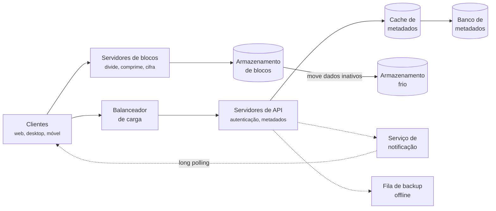
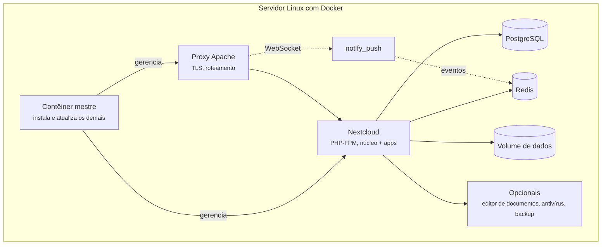
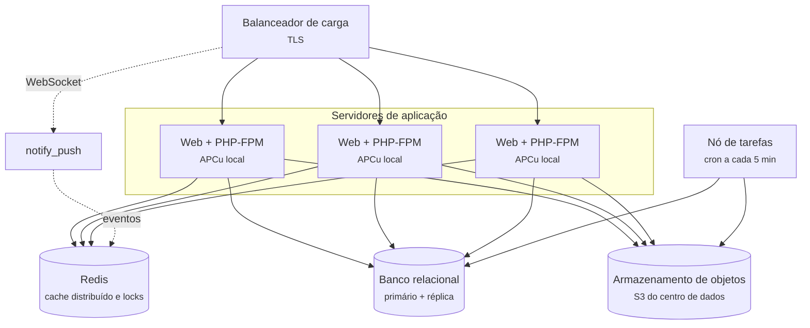

# 4.5 Nextcloud: containers e implantação

<span class="altitude a50">50.000 pés</span>

A [Seção 3.5](../capitulo-3-100-mil-pes/nextcloud.md) terminou com um diagrama de contexto em que
quase todos os sistemas externos são pontos de variação entre organizações, e com um Top-3 formado
por durabilidade, extensibilidade e segurança. Esta seção desce a 50.000 pés para examinar em que
unidades de execução e de dados o Nextcloud se divide, como elas são implantadas, que estilo
organiza o conjunto e, sobretudo, por que cada decisão foi tomada. O código citado refere-se à *tag*
`v35.0.2` do repositório `nextcloud/server`.

## 4.5.1 O projeto de referência: *containers* de um serviço de sincronização

Antes de examinar o Nextcloud, convém fixar o projeto de referência. Xu (2020, cap. 15) constrói a
arquitetura de um serviço do tipo Google Drive de forma incremental, partindo de um único servidor
com um servidor web, um banco MySQL e um diretório local. O crescimento força, sucessivamente, o
particionamento do armazenamento, a adoção do Amazon S3 com replicação entre regiões, um
balanceador de carga e a retirada do banco de metadados do servidor principal. O desenho final,
reproduzido de forma simplificada na Figura 4.5.1, contém servidores de API, servidores de blocos,
armazenamento em nuvem e armazenamento frio, banco de metadados com *cache*, um serviço de
notificação e uma fila para clientes desconectados.

**Figura 4.5.1** – *Containers* do projeto de referência.



Fonte: adaptado de Xu (2020, cap. 15). Linhas contínuas: comunicação síncrona; linhas tracejadas:
comunicação assíncrona.

A decisão estrutural mais importante desse desenho é a separação entre o **caminho do conteúdo**
(clientes, servidores de blocos e armazenamento de blocos) e o **caminho dos metadados**
(servidores de API, *cache* e banco de metadados). Os dois caminhos têm perfis opostos. O conteúdo
é volumoso, imutável depois de gravado e tolerante a latência; os metadados são pequenos, mudam
com frequência e exigem consistência forte. Por isso Xu escolhe um banco relacional para os
metadados, justamente porque ele oferece as propriedades ACID de forma nativa, e um armazenamento
de objetos para o conteúdo, otimizado para durabilidade e custo por *byte*.

## 4.5.2 Os *containers* do Nextcloud

A Figura 4.5.2 apresenta os *containers* de uma instalação do Nextcloud no nível 2 do modelo C4 e
o caminho de um arquivo enviado pelo cliente *desktop*, do envio por WebDAV à notificação dos
demais clientes. A sequência dos passos no servidor acompanha a Figura 5.5.3.

**Figura 4.5.2** – *Containers* do Nextcloud e o caminho de um arquivo sincronizado.


Passos numerados (envio e sincronização de um arquivo):

1. Ao detectar uma alteração local, o cliente *desktop* envia o arquivo à aplicação PHP por WebDAV,
   `PUT /remote.php/dav/files/<usuário>/<caminho>`. O servidor sabre/dav autentica a requisição, e
   o `QuotaPlugin` verifica a cota antes que qualquer *byte* seja gravado.
2. O provedor de *locks*, no Redis, converte o *lock* compartilhado do arquivo em exclusivo.
3. O conteúdo é gravado em um arquivo parcial no armazenamento primário e depois movido para o
   destino, o que impede que outro cliente baixe um arquivo truncado.
4. O `Updater` atualiza a tabela `filecache` no banco relacional e propaga uma nova *ETag* ao
   arquivo e às pastas ancestrais, até a raiz. O *lock* volta a ser compartilhado, e o cliente
   recebe `201` ou `204` com a nova *ETag*.
5. Quando presente, o `notify_push` obtém do Redis o evento da alteração.
6. O `notify_push` avisa os demais clientes pela conexão WebSocket que eles mantêm abertas. O aviso
   é de melhor esforço.
7. Avisados, ou na consulta periódica, a cada 30 segundos por padrão, os outros clientes comparam a
   *ETag* da raiz com a última que conhecem, descem apenas pelas pastas cujas *ETags* mudaram e
   baixam o arquivo novo.

As setas finas sem número representam relações que não pertencem a esse fluxo: o navegador e os
*apps* móveis também acessam a aplicação PHP, por HTTPS, OCS e WebDAV, e as tarefas em segundo
plano (`cron.php`) usam o banco relacional e o armazenamento primário. A seta 2 representa também
o uso do Redis como *cache* distribuído. A seta 6 é desenhada no sentido do aviso, embora a conexão
WebSocket seja aberta pelo cliente. A figura não tem a faixa "Borda", porque a versão anterior,
à qual ela é fiel, não representa um proxy reverso.

Fonte: elaborado pelo autor (2026), com base na documentação de administração do Nextcloud, no
repositório `nextcloud/notify_push` e no estilo de diagrama de Xu (2020). Linhas contínuas:
comunicação síncrona; linhas tracejadas: comunicação assíncrona. Código-fonte da figura:
`diagramas/d2/nextcloud-50k.d2`.

Comparado à Figura 4.5.1, o desenho do Nextcloud é muito mais compacto. Não há servidores de
blocos separados, e o serviço de notificação é opcional: o mesmo processo PHP atende às
requisições de metadados e de conteúdo. A separação entre metadados e conteúdo, entretanto,
permanece, agora no nível dos dados. O banco relacional guarda a tabela `filecache`, com nomes,
caminhos, tamanhos, *ETags* e permissões, enquanto o armazenamento primário guarda os *bytes*.
Quando o armazenamento primário é um serviço de objetos, a documentação é explícita: os metadados
ficam apenas no banco de dados, o armazenamento de objetos guarda somente o conteúdo, endereçado
por um identificador único, e os arquivos deixam de ser acessíveis diretamente no *bucket*
(NEXTCLOUD, 2026a). No código, esse identificador é o prefixo `urn:oid:` seguido do identificador
numérico do arquivo, como se vê no método
[`getURN`](https://github.com/nextcloud/server/blob/v35.0.2/lib/private/Files/ObjectStore/ObjectStoreStorage.php#L267-L269)
de `ObjectStoreStorage`.

Os demais *containers* têm papéis bem delimitados:

- **Aplicação PHP.** Executa o núcleo e todos os *apps* habilitados, servidos por Apache 2.4 ou
  nginx com PHP-FPM; a versão 35 suporta PHP 8.3 a 8.5 e recomenda pelo menos 512 MB de memória
  por processo (NEXTCLOUD, 2026b).
- **Banco relacional.** MariaDB, MySQL ou PostgreSQL; o SQLite é recomendado apenas para testes e
  instâncias mínimas, e o Oracle está disponível apenas em assinatura empresarial (NEXTCLOUD,
  2026b).
- **Redis.** Cumpre dois papéis: *cache* distribuído e provedor de *locks* transacionais. A
  documentação recomenda o Redis para *locking* porque ele garante que os objetos permaneçam
  disponíveis enquanto forem necessários, e desaconselha o Memcached para essa função, porque os
  dados podem desaparecer do *cache* a qualquer momento (NEXTCLOUD, 2026c).
- **Tarefas em segundo plano.** Limpeza de versões e lixeira, varreduras, envio de notificações e
  outras tarefas periódicas são executadas pelo script `cron.php`. Dos três modos previstos
  (AJAX, Webcron e Cron), a documentação recomenda o agendador do sistema operacional, a cada
  cinco minutos (NEXTCLOUD, 2026d).
- **`notify_push`.** Servidor separado, escrito em Rust, que mantém conexões WebSocket com os
  clientes e os avisa de mudanças. Seu propósito, segundo o próprio repositório, é reduzir a
  carga das verificações periódicas que os clientes fazem para saber se algo mudou, que, com
  muitos clientes, pode representar grande parte da carga do servidor; as notificações são de
  "melhor esforço", e os clientes continuam fazendo verificações, em frequência menor
  (NEXTCLOUD, 2026e). Ele exige o Redis.

A descrição do `notify_push` confirma a estimativa da Seção 3.5.4: com milhares de clientes
consultando o servidor a cada 30 segundos, a detecção de mudanças pode dominar a carga.

## 4.5.3 Implantação

O Nextcloud admite topologias muito diferentes, da instalação doméstica em um único computador a
*clusters* com vários servidores de aplicação. Duas delas interessam aqui. A primeira é a do
**Nextcloud All-in-One** (AIO), que o projeto apresenta como o método oficial de instalação: um
contêiner mestre cria e atualiza contêineres para o servidor web, a aplicação, o PostgreSQL, o
Redis e componentes opcionais, como o *backend* de alto desempenho para arquivos (o
`notify_push`), o editor de documentos e o antivírus (NEXTCLOUD, 2026f). A Figura 4.5.3 resume
essa topologia.

**Figura 4.5.3** – Implantação em um único servidor com o Nextcloud All-in-One.



Fonte: elaborado pelo autor (2026), com base em Nextcloud (2026f). Linhas contínuas: comunicação
síncrona; linhas tracejadas: comunicação assíncrona.

A segunda é uma topologia de **vários servidores de aplicação**, adequada à universidade da
Seção 3.5. Os processos PHP são, em princípio, sem estado entre requisições: o estado fica no
banco, no Redis e no armazenamento primário. Por isso, é possível colocar vários servidores de
aplicação atrás de um balanceador de carga, desde que todos compartilhem esses três serviços. A
documentação de *cache* registra a condição essencial: em configurações com vários servidores,
todos devem apontar para o mesmo servidor ou *cluster* de *cache*, e não para uma instância local;
o APCu permanece como *cache* local de cada servidor (NEXTCLOUD, 2026c). A Figura 4.5.4 apresenta a
topologia.

**Figura 4.5.4** – Implantação com vários servidores de aplicação.



Fonte: elaborado pelo autor (2026), com base em Nextcloud (2026a; 2026c; 2026d). Linhas contínuas:
comunicação síncrona; linhas tracejadas: comunicação assíncrona.

Para a carga estimada na Seção 3.5.2, de cerca de 22 *uploads* por segundo no pico, um único
servidor de aplicação seria suficiente; a multiplicação de servidores atende sobretudo à
disponibilidade e às consultas de mudança. Os pontos críticos dessa topologia são os serviços
compartilhados. O banco de dados concentra os metadados e é o único componente que precisa de
consistência forte; o Redis concentra os *locks*, de modo que sua falha impede gravações seguras; e
o armazenamento de objetos concentra a durabilidade do conteúdo.

## 4.5.4 Estilo e quanta

Richards e Ford (2020, cap. 12) definem o estilo **microkernel**, também chamado de arquitetura de
*plug-ins*, como uma arquitetura monolítica relativamente simples, com dois tipos de componente: um
**sistema núcleo** e **componentes *plug-in***. O núcleo é a funcionalidade mínima necessária para
o sistema operar ou, em uma segunda definição, mais útil para aplicações de negócio, o "caminho
feliz" do processamento, com pouca ou nenhuma customização (RICHARDS; FORD, 2020, p. 150). Os
*plug-ins* são componentes independentes que contêm processamento especializado e, idealmente,
não dependem uns dos outros (RICHARDS; FORD, 2020, p. 154). O núcleo os conhece por meio de um
**registro** e se comunica com eles por meio de **contratos** (RICHARDS; FORD, 2020, p. 157-158).
Os autores observam que o estilo é um ajuste natural para aplicações baseadas em produto,
instaladas no ambiente do cliente (RICHARDS; FORD, 2020, p. 149).

!!! note "Definição 4.5.1 – Estilo microkernel"
    O **estilo microkernel** organiza um sistema em um **núcleo**, que contém a funcionalidade
    mínima necessária para o sistema operar ou o fluxo geral de processamento, e em
    ***plug-ins*** independentes que estendem esse núcleo, obedecendo a **contratos** definidos
    por ele e localizados por meio de um **registro** (RICHARDS; FORD, 2020, cap. 12).

Lido à luz dessa definição, o Nextcloud é um microkernel. O núcleo, no diretório `lib/`, provê
os serviços transversais: usuários e grupos, autenticação, abstração de sistema de arquivos,
*cache* de metadados, compartilhamento, eventos, injeção de dependências, banco de dados e
*locking*. Os *apps*, no diretório `apps/` e nas instalações feitas a partir da loja, acrescentam
funcionalidades. Na *tag* `v35.0.2`, o diretório `apps/` contém mais de trinta *apps* distribuídos
com o servidor, entre eles `files` (a interface de arquivos), `dav` (o servidor WebDAV, CalDAV e
CardDAV), `files_sharing`, `files_versions`, `files_trashbin`, `files_external`, `encryption` e
`user_ldap`. Até funcionalidades que um usuário consideraria essenciais, como a interface de
arquivos e o protocolo de sincronização, são *apps*. O núcleo aproxima-se, portanto, da segunda
definição de Richards e Ford: ele não é mínimo no sentido de um editor de texto sem *plug-ins*, mas
concentra o fluxo comum e os serviços compartilhados.

Os *apps* comunicam-se com o núcleo por chamadas de método no mesmo processo PHP, isto é, são
*plug-ins* ponto a ponto, e podem ser habilitados e desabilitados em tempo de execução pelo
administrador, sem reinstalar o núcleo. Disso decorre o número de quanta arquiteturais. Para
Richards e Ford (2020, p. 160), um microkernel monolítico tem sempre um único quantum, porque toda
requisição passa pelo núcleo. No Nextcloud, todos os *apps* compartilham o mesmo processo, o mesmo
banco e a mesma implantação: há **um quantum**. O `notify_push` roda em processo separado, mas lê a
configuração do Nextcloud, depende do mesmo Redis e não tem utilidade sem a aplicação principal;
argumenta-se aqui que ele não constitui um quantum independente, e sim um componente auxiliar do
mesmo quantum.

Os autores apontam a simplicidade e o custo como pontos fortes do estilo e a escalabilidade e a
tolerância a falhas como pontos fracos, consequências da implantação monolítica (RICHARDS; FORD,
2020, p. 160). No Nextcloud, a fraqueza de escalabilidade é atenuada pela ausência de estado nos
processos PHP, que permite replicar o monólito inteiro (Figura 4.5.4). A fraqueza de tolerância a
falhas permanece: um *app* defeituoso afeta o processo que atende à requisição.

## 4.5.5 Comunicação síncrona e assíncrona

A comunicação entre clientes e servidor é **síncrona**, sobre HTTP: WebDAV para arquivos, a API
OCS para funcionalidades como compartilhamento e chamadas da interface web. A comunicação entre
núcleo e *apps* também é síncrona, por chamadas de método, inclusive na entrega de eventos: o
despachante de eventos do núcleo invoca os ouvintes registrados pelos *apps* no próprio processo
da requisição.

A assincronia aparece em três pontos. As **tarefas em segundo plano**, executadas pelo `cron.php`,
processam trabalhos agendados e enfileirados no banco de dados, retirando da requisição do usuário
operações demoradas. O **`notify_push`** inverte o sentido da comunicação, permitindo que o
servidor avise os clientes, que de outro modo precisariam perguntar. E o próprio **cliente de
sincronização** é, do ponto de vista do usuário, assíncrono: a gravação no disco local termina
imediatamente, e a propagação ao servidor acontece depois. É essa última assincronia que torna o
sistema eventualmente consistente, como se discute a seguir.

## 4.5.6 Dados e consistência

Toda discussão sobre sincronização desemboca na questão da consistência. Brewer (2000) conjecturou
que um sistema distribuído não pode oferecer simultaneamente **consistência**, **disponibilidade**
e **tolerância a partições** de rede. Gilbert e Lynch (2002) formalizaram e demonstraram a
conjectura para um modelo de sistema assíncrono, com consistência entendida como
linearizabilidade.

!!! note "Definição 4.5.2 – Teorema CAP"
    Em um sistema distribuído sujeito a partições de rede, não é possível garantir
    simultaneamente consistência (todo cliente vê o mesmo dado ao mesmo tempo, qualquer que seja
    o nó consultado) e disponibilidade (todo cliente que faz uma requisição recebe uma resposta,
    mesmo com nós fora do ar). Durante uma partição, o sistema precisa escolher entre as duas
    (BREWER, 2000; GILBERT; LYNCH, 2002; XU, 2020, cap. 6).

Xu (2020, cap. 6) ilustra o teorema com três réplicas: se uma fica isolada, um sistema CP bloqueia
escritas até que a partição se resolva, e um sistema AP continua aceitando leituras e escritas,
sincronizando as réplicas depois. Brewer (2012) advertiu contra a leitura simplista de "escolher
dois de três": partições são raras, a escolha só se impõe durante elas e pode ser feita de modo
diferente para operações diferentes do mesmo sistema. Um serviço de arquivos combina pelo menos
três regimes:

- os **metadados no servidor**, para os quais Xu (2020, cap. 15) exige consistência forte, por ser
  inaceitável que clientes diferentes vejam o mesmo arquivo de formas distintas ao mesmo tempo;
- o **conteúdo**, que, quando armazenado em blocos imutáveis endereçados por *hash*, como no
  Dropbox, tem consistência quase trivial, porque um bloco nunca muda depois de gravado;
- os **dispositivos dos usuários**, que aceitam escritas *offline* por horas ou dias. Em relação
  ao conjunto formado pelo servidor e pelos clientes, o serviço é inevitavelmente AP e
  **eventualmente consistente**: cessadas as atualizações, as réplicas convergem (VOGELS, 2009).

O serviço é, assim, fortemente consistente no centro e eventualmente consistente na borda. O
Dropbox explicitou essa preocupação ao reescrever seu motor de sincronização: o novo protocolo
garante que cliente e servidor compartilhem a mesma visão do sistema de arquivos remoto antes que
qualquer mutação seja considerada (JAYAKAR, 2020).

Quando os metadados são replicados, Xu (2020, cap. 6) descreve a técnica de **quórum**: com *N*
réplicas, uma escrita é confirmada por *W* réplicas e uma leitura aguarda *R* respostas; se
*W* + *R* > *N*, todo conjunto de leitura intersecta todo conjunto de escrita, e a consistência
forte é garantida. A Tabela 4.5.1 resume as combinações para *N* = 3.

**Tabela 4.5.1** – Configurações de quórum e seus efeitos (N = 3).

| W | R | W + R > N? | Efeito |
|---|---|---|---|
| 3 | 1 | sim | leitura rápida; escrita indisponível se uma réplica falhar |
| 1 | 3 | sim | escrita rápida; leitura indisponível se uma réplica falhar |
| 2 | 2 | sim | equilíbrio usual; tolera a falha de uma réplica |
| 1 | 1 | não | latência mínima; leituras podem devolver dados antigos |

Fonte: adaptado de Xu (2020, cap. 6).

O Nextcloud, implantado com um único banco relacional primário, não precisa de quórum: a
consistência forte dos metadados vem do próprio banco. Quando o administrador acrescenta réplicas
de leitura, as garantias passam a depender da configuração escolhida. Esse é um traço recorrente
dos produtos auto-hospedados: parte das decisões arquiteturais é transferida para quem os instala.

## 4.5.7 Decisões e ADRs reconstruídos

As decisões a seguir não foram documentadas como ADRs pelos mantenedores; foram reconstruídas a
partir do código e da documentação, segundo o modelo do Apêndice B.

**Quadro 4.5.1** – ADR reconstruído: toda funcionalidade além do núcleo é um *app*.

```text
ADR-001: Entregar toda funcionalidade além do núcleo como app

Status: Aceito (reconstruído pelo autor; não é um documento oficial do projeto)

Contexto
  O produto é instalado por organizações com necessidades muito diferentes.
  Terceiros querem estender o produto sem alterar o código do servidor.
  O núcleo precisa evoluir com frequência, inclusive internamente.

Decisão
  Funcionalidades (arquivos, compartilhamento, versões, calendário etc.) são apps.
  Apps dependem apenas da API pública (namespace OCP). O núcleo (namespace OC)
  é privado. Cada app declara em appinfo/info.xml as versões do servidor que suporta
  e registra seus serviços por IBootstrap::register().

Alternativas consideradas
  (a) Monólito único com flags de configuração: menor custo inicial, mas acoplamento
      e complexidade ciclomática crescentes no núcleo.
  (b) Microsserviços: escalabilidade independente, mas instalação e operação
      inviáveis para a maioria das organizações que auto-hospedam o produto.

Consequências
  + Instalações enxutas: o administrador habilita apenas o que precisa.
  + Ecossistema de terceiros e ciclo de vida independente para apps da loja.
  - A API pública vira um compromisso de longo prazo (política de depreciação).
  - Apps rodam no mesmo processo: um app defeituoso pode afetar todo o servidor.
  - Um único quantum arquitetural: não há escalabilidade independente por app.

Conformidade
  Revisão de código e análise estática sobre o uso de classes OC\ por apps.
```

Fonte: elaborado pelo autor (2026), com base em Nextcloud (2026g) e no repositório `nextcloud/server`.

**Quadro 4.5.2** – ADR reconstruído: *locking* transacional com Redis.

```text
ADR-002: Usar Redis como provedor de locks transacionais em produção

Status: Aceito (reconstruído; reflete a recomendação da documentação)

Contexto
  Requisições concorrentes podem gravar o mesmo arquivo; vários armazenamentos
  (S3, SMB, FTP) não oferecem bloqueio próprio. O banco relacional já suporta
  locks, mas com carga significativa.

Decisão
  O locking é feito acima do armazenamento, por um ILockingProvider configurável.
  Em produção, usar Redis (memcache.locking); banco relacional como padrão.

Alternativas consideradas
  (a) Locks no banco: sem componente novo, mas carga elevada no banco.
  (b) Memcached: rápido, mas pode descartar entradas a qualquer momento.

Consequências
  + Locks rápidos e compartilhados entre todos os servidores de aplicação.
  - Redis passa a ser dependência crítica: sem ele, não há gravação segura.
```

Fonte: elaborado pelo autor (2026), com base em Nextcloud (2026c; 2026h).

**Quadro 4.5.3** – ADR reconstruído: WebDAV como protocolo de sincronização.

```text
ADR-003: Usar WebDAV (RFC 4918) como protocolo entre clientes e servidor

Status: Aceito (reconstruído)

Contexto
  Clientes variados (desktop, móvel, gerenciadores de arquivos dos sistemas
  operacionais) precisam listar, ler, gravar, mover e bloquear arquivos.

Decisão
  Expor os arquivos por WebDAV, com a biblioteca sabre/dav; definir extensões
  próprias quando o padrão não bastar (ex.: envio em partes de arquivos grandes).

Alternativas consideradas
  (a) API REST proprietária: liberdade de projeto, mas sem clientes prontos.
  (b) Protocolo binário próprio: eficiente, mas opaco e caro de manter.

Consequências
  + Interoperabilidade: qualquer cliente WebDAV acessa o servidor.
  - O padrão não foi concebido para sincronização em escala; extensões
    proprietárias (chunked upload, propriedades oc:) acabam necessárias.
```

Fonte: elaborado pelo autor (2026), com base em Dusseault (2007) e Nextcloud (2026i).

O ADR-003 merece um comentário. O WebDAV acrescenta ao HTTP métodos para manipular coleções e
propriedades: PROPFIND, PROPPATCH, MKCOL, COPY, MOVE, LOCK e UNLOCK (DUSSEAULT, 2007). Ele não
tem, porém, uma noção nativa de envio em partes de arquivos grandes, razão pela qual o Nextcloud
define um protocolo próprio sobre WebDAV: o cliente cria uma pasta temporária com MKCOL, envia
partes numeradas com PUT e solicita com MOVE a montagem do arquivo no destino (NEXTCLOUD, 2026i).

## 4.5.8 Comparação com o sistema real: o Dropbox sai do S3

O caso do Dropbox mostra que a escolha do armazenamento de conteúdo é uma decisão de alto custo e
longo horizonte. Gupta (2016) relata que, durante anos, o conteúdo dos arquivos foi armazenado no
Amazon S3, enquanto metadados e servidores web rodavam em centros de dados próprios. Em 2013, a
empresa iniciou o *Magic Pocket*, sistema de armazenamento de blocos construído internamente. O
relato registra marcos precisos: lançamento "no escuro" (*dark launch*), com dados espelhados entre
duas localizações, em agosto de 2014; primeiro dia em que arquivos de usuários foram armazenados e
servidos exclusivamente pela infraestrutura própria, em 27 de fevereiro de 2015; e mais de 90% dos
dados servidos a partir dela em 7 de outubro de 2015. As razões apresentadas são o desempenho,
pelo controle de toda a pilha, e a economia unitária, pois o padrão de acesso bem conhecido
permitia projetar *hardware* e software sob medida (GUPTA, 2016).

Cowling (2016) descreve a arquitetura resultante: blocos **imutáveis** de até 4 MB, comprimidos e
cifrados, identificados na maioria dos casos pelo *hash* SHA-256 do conteúdo, agrupados em
contêineres lógicos de 1 GB e replicados entre zonas geográficas; um serviço de índice,
implementado como *cluster* MySQL particionado, mapeia cada *hash* para sua localização; blocos
recentes são replicados integralmente e, mais tarde, codificados com códigos de apagamento
(*erasure coding*), que reduzem o espaço mantendo a durabilidade.

**Tabela 4.5.2** – Decisões a 50.000 pés: Dropbox e Nextcloud.

| Decisão | Dropbox | Nextcloud |
|---|---|---|
| Armazenamento de conteúdo | construído internamente (*Magic Pocket*) | abstraído: disco local, objetos ou armazenamentos externos |
| Unidade de conteúdo | blocos imutáveis de até 4 MB, endereçados por *hash* | arquivo inteiro, endereçado pelo identificador do arquivo |
| Metadados | serviço próprio, separado do conteúdo | tabela `filecache` no banco relacional |
| Notificação | *long polling* (XU, 2020, cap. 15) | consulta periódica e WebSocket opcional |
| Estilo | serviço operado por uma empresa | microkernel monolítico, um quantum |

Fonte: elaborado pelo autor (2026), com base em Gupta (2016), Cowling (2016), Xu (2020) e no repositório `nextcloud/server`.

A decisão do Dropbox é um exemplo didático de *trade-off* entre **custo** e **controle**: a escala
dilui o custo fixo de uma equipe dedicada, mas o risco de perda de dados e a necessidade de
competências raras de *hardware* permanecem. Argumenta-se aqui que a decisão só é racional acima de
um limiar de escala. A universidade da Seção 3.5, com algumas centenas de *terabytes*, não tem
escala para justificar um sistema de armazenamento próprio. Por isso, o Nextcloud segue o caminho
inverso: em vez de construir um armazenamento, **abstrai** os existentes por meio de um contrato
comum, estudado na [Seção 6.5](../capitulo-6-solo/nextcloud.md).

## 4.5.9 Caixa-preta

!!! caixa-preta "Dropbox, junho de 2011: autenticação desligada por uma atualização"
    Em 19 de junho de 2011, uma atualização de código no Dropbox introduziu um defeito no
    mecanismo de autenticação. Segundo o comunicado da empresa, assinado pelo cofundador Arash
    Ferdowsi, a atualização foi feita às 13h54 (horário do Pacífico), o problema foi descoberto
    às 17h41 e a correção entrou em produção às 17h46. Durante esse intervalo, de quase quatro
    horas, uma parcela de usuários estimada pela empresa em muito menos de 1% acessou o serviço,
    e algumas contas puderam ser acessadas sem a senha correta. Como precaução, todas as sessões
    ativas foram encerradas (FERDOWSI, 2011).

    **Lição arquitetural.** A segurança é uma característica **transversal** (Seção 1.4.1): uma
    única alteração no caminho de autenticação anulou as demais proteções, porque o acesso
    ocorreu pela porta da frente. O incidente pertence a esta altitude porque sua lição principal
    é de **implantação**. Duas táticas teriam reduzido o impacto: funções de aptidão que verificam,
    antes e depois de cada implantação, propriedades como "uma senha incorreta é sempre recusada"
    (cenário de segurança da Seção 3.5.7); e implantação gradual, que expõe a mudança a uma
    fração pequena dos usuários antes de liberá-la a todos. Em uma instalação do Nextcloud, a
    autenticação das requisições WebDAV é feita por um *plug-in* adicionado ao servidor sabre/dav
    antes de todos os demais; como há um único quantum, um defeito ali afeta todos os *apps* de
    uma só vez, e uma topologia com vários servidores de aplicação (Figura 4.5.4) permite atualizar
    um servidor por vez e observar o efeito antes de prosseguir.

## Referências

BREWER, E. A. Towards robust distributed systems. *In*: ACM SYMPOSIUM ON PRINCIPLES OF
DISTRIBUTED COMPUTING (PODC), 19., 2000, Portland. **Keynote**. New York: ACM, 2000.

BREWER, E. A. CAP twelve years later: how the "rules" have changed. **Computer**, v. 45, n. 2,
p. 23-29, 2012.

COWLING, J. **Inside the Magic Pocket**. Dropbox Tech Blog, 6 maio 2016. Disponível em:
<https://dropbox.tech/infrastructure/inside-the-magic-pocket>. Acesso em: 18 out. 2026.

DUSSEAULT, L. (ed.). **RFC 4918**: HTTP extensions for Web Distributed Authoring and Versioning
(WebDAV). [S. l.]: Internet Engineering Task Force, 2007. Disponível em:
<https://www.rfc-editor.org/rfc/rfc4918>. Acesso em: 18 out. 2026.

FERDOWSI, A. **Yesterday's authentication bug**. The Dropbox Blog, 20 jun. 2011. Disponível em:
<https://blog.dropbox.com/topics/company/yesterdays-authentication-bug>. Acesso em: 18 out. 2026.

GILBERT, S.; LYNCH, N. Brewer's conjecture and the feasibility of consistent, available,
partition-tolerant web services. **ACM SIGACT News**, v. 33, n. 2, p. 51-59, 2002.

GUPTA, A. **Scaling to exabytes and beyond**. Dropbox Tech Blog, 14 mar. 2016. Disponível em:
<https://dropbox.tech/infrastructure/magic-pocket-infrastructure>. Acesso em: 18 out. 2026.

JAYAKAR, S. **Rewriting the heart of our sync engine**. Dropbox Tech Blog, 9 mar. 2020.
Disponível em: <https://dropbox.tech/infrastructure/rewriting-the-heart-of-our-sync-engine>.
Acesso em: 18 out. 2026.

NEXTCLOUD. **Configuring object storage as primary storage**. Nextcloud Administration Manual,
2026a. Disponível em:
<https://docs.nextcloud.com/server/latest/admin_manual/configuration_files/primary_storage.html>.
Acesso em: 18 out. 2026.

NEXTCLOUD. **System requirements**. Nextcloud 35 Administration Manual, 2026b. Disponível em:
<https://docs.nextcloud.com/server/35/admin_manual/installation/system_requirements.html>.
Acesso em: 18 out. 2026.

NEXTCLOUD. **Memory caching**. Nextcloud 35 Administration Manual, 2026c. Disponível em:
<https://docs.nextcloud.com/server/35/admin_manual/configuration_server/caching_configuration.html>.
Acesso em: 18 out. 2026.

NEXTCLOUD. **Background jobs**. Nextcloud 35 Administration Manual, 2026d. Disponível em:
<https://docs.nextcloud.com/server/35/admin_manual/configuration_server/background_jobs_configuration.html>.
Acesso em: 18 out. 2026.

NEXTCLOUD. **nextcloud/notify_push**: Client Push. GitHub, 2026e. Disponível em:
<https://github.com/nextcloud/notify_push>. Acesso em: 18 out. 2026.

NEXTCLOUD. **nextcloud/all-in-one**: Nextcloud All-in-One. GitHub, 2026f. Disponível em:
<https://github.com/nextcloud/all-in-one>. Acesso em: 18 out. 2026.

NEXTCLOUD. **API reference**. Nextcloud Developer Manual, 2026g. Disponível em:
<https://docs.nextcloud.com/server/stable/developer_manual/digging_deeper/api.html>. Acesso em:
18 out. 2026.

NEXTCLOUD. **Transactional file locking**. Nextcloud Administration Manual, 2026h. Disponível em:
<https://docs.nextcloud.com/server/latest/admin_manual/configuration_files/files_locking_transactional.html>.
Acesso em: 18 out. 2026.

NEXTCLOUD. **Chunked file upload**. Nextcloud Developer Manual, 2026i. Disponível em:
<https://docs.nextcloud.com/server/latest/developer_manual/client_apis/WebDAV/chunking.html>.
Acesso em: 18 out. 2026.

RICHARDS, M.; FORD, N. **Fundamentals of software architecture**: an engineering approach.
Sebastopol: O'Reilly, 2020.

VOGELS, W. Eventually consistent. **Communications of the ACM**, v. 52, n. 1, p. 40-44, 2009.

XU, A. **System design interview**: an insider's guide. 2. ed. [*S. l.*]: Byte Code LLC, 2020.
