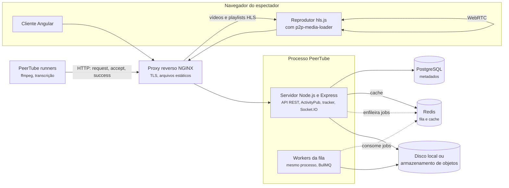
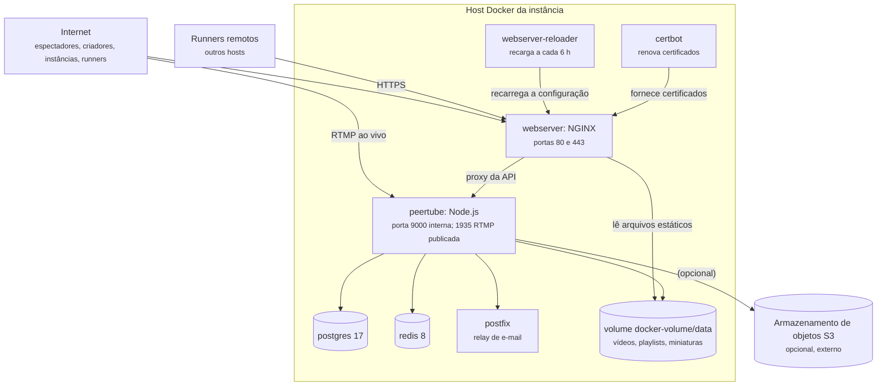

# 4.4 PeerTube: containers e implantação

50.000 pés

A Seção 3.4 terminou com um diagrama de contexto em que a instância PeerTube aparece como uma
caixa única, cercada por professores, estudantes, *runners*, instâncias parceiras e serviços de
infraestrutura. Esta seção abre a caixa. A pergunta, a 50.000 pés, é quais unidades de execução
e de dados compõem o sistema, onde elas são implantadas, como se comunicam e por que foram
organizadas assim (ver Seção 1.11). A análise usa como fontes a documentação de arquitetura do
projeto, o arquivo oficial de composição Docker e a configuração de referência do NGINX, todos
na *tag* `v8.3.1`.

## 4.4.1 Os *containers*

A documentação de arquitetura do PeerTube descreve o servidor como uma aplicação TypeScript
baseada em Express, responsável pela API REST, pelo ActivityPub, por um rastreador (*tracker*)
P2P, pelas notificações via Socket.IO e pelas tarefas agendadas, entre elas a transcodificação
com ffmpeg (PEERTUBE, 2026). O cliente é uma aplicação Angular de página única que consome a API
REST. O PostgreSQL guarda os metadados de longo prazo (contas, vídeos, comentários, canais), e o
Redis serve como *cache* e como suporte à fila de mensagens, implementada com a biblioteca
BullMQ. Um proxy reverso, normalmente o NGINX, termina as conexões TLS e serve arquivos
estáticos; a própria documentação recomenda que o servidor da API nunca seja exposto
diretamente à internet.

A Figura 4.4.1 mostra esses *containers* (nível 2 do modelo C4), acrescidos dos *runners*
remotos e do armazenamento de objetos opcional.

**Figura 4.4.1** – *Containers* de uma instância PeerTube.

Fonte: elaborado pelo autor (2026), com base na documentação de arquitetura do PeerTube
(PEERTUBE, 2026) e no código da *tag* `v8.3.1`. Linhas contínuas: comunicação síncrona; linhas
tracejadas: comunicação assíncrona.

Um detalhe da figura deve ser destacado: os *workers* da fila executam, por padrão, **no mesmo
processo** Node.js do servidor da API. A classe `JobQueue` cria um `Worker` do BullMQ para cada
tipo de *job* durante a inicialização do servidor (PEERTUBE, 2026,
[`server/core/lib/job-queue/job-queue.ts#L224-L252`](https://github.com/Chocobozzz/PeerTube/blob/v8.3.1/server/core/lib/job-queue/job-queue.ts#L224-L252)).
Em termos de Richards e Ford (2020, cap. 7), a instância é, portanto, um único **quantum
arquitetural**, que contém a API e o processamento e é implantado como uma unidade. Os *runners*
remotos, discutidos na Seção 4.4.6, são o mecanismo pelo qual o projeto separa o processamento
pesado em um quantum distinto, com escalabilidade e ciclo de implantação próprios.

## 4.4.2 A implantação de referência

O arquivo `support/docker/production/docker-compose.yml` é, na prática, o diagrama de
implantação oficial do PeerTube. Ele define sete serviços em um único *host* (PEERTUBE, 2026):

- `webserver`, a imagem `chocobozzz/peertube-webserver`, um NGINX que publica as portas 80 e 443
  e monta, em modo somente leitura, os arquivos compilados do cliente e, também, o diretório
  de dados da instância;
- `certbot`, que renova periodicamente os certificados TLS;
- `webserver-reloader`, que envia a cada seis horas um sinal de recarga ao NGINX para que ele
  adote os certificados renovados;
- `peertube`, a imagem `chocobozzz/peertube:production`, com endereço IP fixo na rede interna
  (porque, segundo o comentário do arquivo, o NGINX não lida com a troca de endereço do *upstream*
  sem recarga) e a porta 1935 publicada para a recepção de transmissões ao vivo por RTMP;
- `postgres`, com a imagem `postgres:17-alpine`;
- `redis`, com a imagem `redis:8-alpine`;
- `postfix`, um *relay* de e-mail com assinatura DKIM.

A Figura 4.4.2 representa essa implantação.

**Figura 4.4.2** – Diagrama de implantação de referência (Docker Compose, um único *host*).

Fonte: elaborado pelo autor (2026), com base em `support/docker/production/docker-compose.yml`
(PEERTUBE, 2026, *tag* `v8.3.1`).

O ponto mais importante do diagrama é a seta do NGINX para o volume de dados. A configuração de
referência do NGINX define a raiz de arquivos como o diretório de armazenamento da instância e
serve **diretamente**, sem passar pelo Node.js, as rotas de arquivos públicos de vídeo
(`/static/web-videos/`, `/static/streaming-playlists/` e `/static/redundancy/`), com
`sendfile` e E/S assíncrona; apenas os arquivos de vídeos privados são encaminhados ao processo
PeerTube, que verifica a autorização (PEERTUBE, 2026, `support/nginx/peertube`). A mesma
configuração limita a taxa de cada conexão de vídeo a 5 MB/s após os primeiros 5 MB, aceita
corpos de tamanho ilimitado na rota de *upload* retomável e nas rotas pelas quais os *runners*
devolvem arquivos, e mantém abertas por até 15 minutos as conexões WebSocket do rastreador P2P,
porque os pares se anunciam a cada 15 minutos.

Argumenta-se aqui que essas poucas linhas de configuração implementam, em escala de um único
servidor, a mesma separação entre **plano de controle** e **plano de dados** que a Netflix
implementa em escala global (Seção 4.4.7): o Node.js decide (autentica, valida, registra,
orquestra), e o NGINX transfere bytes. A separação é o que permite que um único processo Node.js
atenda a uma instância com muitos espectadores simultâneos.

## 4.4.3 Estilos e quanta

### 4.4.3.1 O processamento: *pipes and filters*

O estilo *pipes and filters* é um dos estilos arquiteturais mais antigos e mais estudados. Shaw
e Garlan (1996) o incluíram em seu catálogo pioneiro de estilos, e Richards e Ford (2020, p.
143-145) lembram que ele é o princípio subjacente às linguagens de *shell* do Unix, recontando a
anedota em que Doug McIlroy resolveu com seis comandos encadeados um problema de contagem de
palavras para o qual Donald Knuth escrevera um programa de mais de dez páginas.

!!! note "Definição 4.4.1 – *Pipes and filters*"
    Estilo arquitetural em que o processamento é decomposto em **filtros** independentes,
    autocontidos e geralmente sem estado, cada um realizando uma única tarefa, conectados por
    **canos** (*pipes*) unidirecionais que transportam dados de um filtro ao seguinte. Tarefas
    compostas são realizadas por sequências de filtros, e não por um filtro único
    (RICHARDS; FORD, 2020, p. 143-144; SHAW; GARLAN, 1996).

Richards e Ford (2020, p. 144) classificam os filtros em quatro tipos: **produtor** (ponto de
partida, só com saída), **transformador** (recebe, transforma e encaminha), **testador** (avalia
um critério e, conforme o resultado, produz ou não uma saída) e **consumidor** (ponto final). No
*pipeline* de vídeo do PeerTube, o *upload* é o produtor; a análise do arquivo com `ffprobe`,
que verifica se o vídeo é legível, é um testador; cada transcodificação é um transformador; e a
gravação no armazenamento, seguida da publicação e da federação do vídeo, é o consumidor. Os
autores recomendam que os canos transportem pouca carga, e a recomendação é seguida: o que
trafega na fila não é o vídeo, mas uma **referência** a ele (o UUID e os parâmetros da tarefa),
enquanto o conteúdo fica no disco ou no armazenamento de objetos.

Richards e Ford (2020, p. 146-148) avaliam o estilo como geralmente monolítico, com quantum
igual a um, notas altas para custo, simplicidade e modularidade e notas muito baixas para
elasticidade, escalabilidade e tolerância a falhas. Essa avaliação descreve bem um *pipeline*
dentro de um único processo, mas não o *pipeline* de vídeo de um serviço de porte, por causa de
duas transformações. A primeira é que os canos deixam de ser chamadas em memória e passam a ser
**filas persistentes**: Xu (2020, cap. 14) mostra que, sem filas, o módulo de codificação precisa
esperar a saída do módulo anterior, e que, com filas, cada módulo consome eventos quando eles
existem, o que torna o sistema fracamente acoplado. A segunda é que a sequência linear se torna
um **grafo acíclico dirigido** (DAG), como no sistema de processamento de vídeo do Facebook
descrito por Huang *et al.* (2017), em que as tarefas são definidas em estágios executados em
sequência ou em paralelo. A Tabela 4.4.1 sintetiza a comparação.

**Tabela 4.4.1** – *Pipeline* monolítico e *pipeline* de vídeo distribuído por filas.

| Característica | *Pipeline* monolítico (Richards; Ford, 2020) | *Pipeline* de vídeo com filas e *workers* |
|---|---|---|
| Quantum arquitetural | sempre 1 | 1 com *workers* locais; 2 ou mais com *runners* remotos |
| Elasticidade e escalabilidade | muito baixas | altas para os filtros caros, que escalam pelo número de *workers* |
| Tolerância a falhas | não suportada | a falha de um *job* não derruba a API; o *job* pode ser repetido |
| Custo e simplicidade | muito altos | menores: exigem fila, estados intermediários e monitoramento |
| Modularidade | alta | alta, desde que os filtros só se conheçam pelo formato da mensagem |

Fonte: elaborado pelo autor (2026), com base em Richards e Ford (2020, p. 146-148) e Xu (2020,
cap. 14). A terceira coluna é interpretação do autor.

O preço da distribuição aparece na última linha: uma vez que os canos são filas e os filtros
podem falhar e ser reexecutados, cada filtro precisa ser **idempotente**. A Seção 5.4 mostra como
o PeerTube trata essa exigência.

O SWEBOK v4 usa justamente o estilo *pipes and filters* para ilustrar o conceito de **requisito
derivado**: a decisão de adotar o estilo é uma decisão de projeto do ponto de vista dos
*stakeholders* externos, mas torna-se um requisito para as equipes que constroem cada filtro, que
passam a respeitar o formato dos dados nos canos (WASHIZAKI, 2024, cap. 1, seção 1.10). No
PeerTube, esse requisito derivado é o conjunto de tipos de *payload* de *job* definidos no pacote
`packages/models` (`@peertube/peertube-models`), importado tanto pelo servidor quanto pelo
*runner*, que também compartilham o pacote de comandos do ffmpeg (`@peertube/peertube-ffmpeg`)
(PEERTUBE, 2026, `apps/peertube-runner/src/server/process/shared/process-vod.ts`).

### 4.4.3.2 A entrega: cliente-servidor, CDN e P2P

Xu (2020, cap. 14) descreve a forma padrão da entrega de vídeo: os vídeos são armazenados na CDN
e transmitidos do servidor de borda mais próximo, enquanto todo o resto (recomendações,
metadados, cadastro, geração de URLs de envio) passa pelos servidores da API. O PeerTube
reproduz essa separação com o NGINX no lugar da CDN e acrescenta uma terceira camada: o
reprodutor usa a biblioteca hls.js com um carregador do projeto `p2p-media-loader`, que baixa
segmentos por HTTP do servidor e também, via WebRTC, de outros espectadores do mesmo vídeo
(PEERTUBE, 2026). A instância de origem e eventuais instâncias espelho atuam como fontes HTTP
sempre disponíveis; os espectadores, como fontes oportunistas. A entrega combina, portanto, três
estilos: cliente-servidor, distribuição de conteúdo e P2P.

### 4.4.3.3 A rede: federação

O PeerTube é federado por meio do protocolo ActivityPub (LEMMER-WEBBER *et al.*, 2018), o mesmo
estudado no Mastodon (Seção 4.2). Instâncias trocam mensagens servidor a servidor, assinadas com
*HTTP Signatures* usando a chave privada da conta que as enviou (PEERTUBE, 2026). Por padrão,
apenas **metadados** circulam: quando uma instância segue outra, passa a conhecer e exibir os
vídeos remotos, mas os arquivos continuam sendo servidos pela origem. A redundância é opcional e
explícita, e uma instância que espelha um vídeo notifica a origem com uma atividade `CacheFile`.
Do ponto de vista do custo, a federação é uma forma de partição: cada instância paga pelos
próprios vídeos, e a rede se comporta como um catálogo distribuído em que a cauda longa é
repartida entre centenas de administradores.

## 4.4.4 Comunicação síncrona e assíncrona

A Tabela 4.4.2 classifica os canais de comunicação entre *containers* e sistemas externos. A
análise revela um padrão: tudo o que envolve um usuário esperando é síncrono e curto; tudo o que
é caro ou envolve terceiros é assíncrono.

**Tabela 4.4.2** – Canais de comunicação da instância PeerTube.

| Canal | Participantes | Modo | Observação |
|---|---|---|---|
| API REST | cliente Angular → servidor | síncrono, HTTP | respostas curtas; o *upload* é dividido em partes |
| Arquivos HLS | reprodutor → NGINX | síncrono, HTTP | servidos sem passar pelo Node.js |
| Segmentos P2P | reprodutor ↔ reprodutor | síncrono, WebRTC | descoberta pelo rastreador, via WebSocket |
| Fila de *jobs* | servidor → *workers* | assíncrono, Redis/BullMQ | transcodificação, e-mail, federação, estatísticas |
| ActivityPub | instância ↔ instâncias | assíncrono na saída, por *jobs* | envio em *jobs* `activitypub-http-broadcast` e `activitypub-http-unicast` |
| *Runners* | *runner* → servidor | assíncrono, iniciado pelo *runner* (HTTP) | servidor só avisa por Socket.IO que há trabalho |
| Notificações | servidor → navegador | assíncrono, Socket.IO | avisos ao usuário conectado |

Fonte: elaborado pelo autor (2026), com base no código da *tag* `v8.3.1`.

O envio de atividades ActivityPub merece um comentário. Ele não ocorre na requisição que as
origina, mas em *jobs* de difusão com até 30 requisições paralelas por *job* (constante
`BROADCAST_CONCURRENCY`), de modo que a lentidão de uma instância remota não atrasa a resposta
ao usuário local (PEERTUBE, 2026, `server/core/initializers/constants.ts`). É a mesma decisão
tomada pelo Mastodon (Seção 4.2), e pela mesma razão.

## 4.4.5 Dados

O PeerTube distribui seus dados por quatro mecanismos, cada um escolhido pelo padrão de acesso.
O **PostgreSQL** guarda os metadados de longo prazo e é a fonte da verdade sobre vídeos, contas,
canais, estados e *jobs* de *runner*. O **Redis** guarda dados efêmeros: filas de *jobs*,
sessões de *upload* e *caches*. Os **arquivos de vídeo**, as *playlists* HLS, as miniaturas e os
*storyboards* ficam no **disco local** ou, desde a versão 3.4.0, em um **armazenamento de objetos**
compatível com S3 (PEERTUBE, 2026, `CHANGELOG.md`). Por fim, os **navegadores** dos espectadores
guardam temporariamente segmentos que repassam a outros pares.

Duas decisões de dados têm impacto direto no custo. A primeira é o descarte do original: a
configuração padrão define `transcoding.original_file.keep: false`, isto é, o arquivo enviado é
apagado depois de transcodificado, a menos que o administrador decida guardá-lo (PEERTUBE, 2026,
`config/default.yaml`). O *trade-off* é explícito: sem o original, uma futura retranscodificação
com um codec melhor partirá de uma cópia já comprimida. A segunda é o formato do HLS: o PeerTube
grava **um único arquivo por resolução**, endereçado por intervalos de bytes, em vez de um arquivo
por segmento (ver Seção 6.4), o que reduz o número de objetos no armazenamento, um fator relevante
quando o serviço de objetos cobra por operação.

O armazenamento de objetos, por sua vez, tem uma configuração que revela uma preocupação com
privacidade: arquivos de vídeos públicos recebem uma ACL pública e podem ser servidos
diretamente pelo serviço de objetos, enquanto arquivos de vídeos privados e internos recebem uma
ACL privada e são entregues por meio de um *proxy* do próprio PeerTube, que verifica a
autorização (PEERTUBE, 2026, `config/default.yaml`, chave `object_storage`).

## 4.4.6 Decisões arquiteturais

As decisões a seguir não estão registradas no repositório na forma de ADR, mas podem ser
reconstruídas a partir do código, da documentação e do *changelog*, como propõe o Apêndice C. Os
registros seguem o modelo do Apêndice B.

!!! example "ADR-PT-01: separar a publicação do processamento por uma fila de *jobs*"
    **Status:** Aceito (presente desde as primeiras versões; reconstruído).

    **Contexto.** Transcodificar um vídeo leva de minutos a horas. A resposta ao criador precisa
    ser imediata, mas a publicação tolera atraso (Seção 3.4.3).

    **Decisão.** O *upload* termina com a criação do vídeo no estado `TO_TRANSCODE` e com o
    enfileiramento de *jobs*. Todo processamento pesado ocorre em *workers* que consomem a fila.

    **Consequências.** A API não bloqueia; o processamento pode ser priorizado, repetido e
    limitado em tempo por tipo de tarefa. Em troca, surgem estados intermediários visíveis ao
    usuário e a exigência de idempotência dos *handlers*.

!!! example "ADR-PT-02: permitir *runners* remotos de transcodificação"
    **Status:** Aceito (versão 5.2.0, junho de 2023; reconstruído).

    **Contexto.** A transcodificação é a etapa mais cara do *pipeline* e chega em rajadas.
    Executada no mesmo processo da API, compete por recursos com as requisições e a federação.
    Muitas instâncias rodam em servidores modestos, cujo dimensionamento para o pico seria caro e
    ocioso na maior parte do tempo. O Top-3 inclui custo e elasticidade do processamento.

    **Decisão.** Separar a transcodificação, e depois outras tarefas pesadas, em um processo
    externo, o *runner*, que se registra com um *token*, **pede** tarefas por HTTP, processa-as
    com ffmpeg e devolve os arquivos. A instância continua responsável por construir o DAG de
    tarefas e por manter o estado de cada *job*.

    **Alternativas.** (a) Mais *workers* locais: não resolve a competição por recursos no mesmo
    servidor. (b) Serviço de transcodificação de nuvem comercial: criaria dependência de
    fornecedor e custo recorrente. (c) *Workers* remotos alimentados pela instância (modelo
    *push*): exigiria que a instância alcançasse cada *worker*, inclusive atrás de NAT.

    **Consequências.** O processamento torna-se um quantum separado, que escala acrescentando
    *runners*, inclusive em máquinas com GPU ou cedidas por terceiros. Em troca, surge um
    protocolo novo (pedir, aceitar, atualizar, concluir, falhar, abortar) com estados e tempos
    limite; arquivos grandes atravessam a rede duas vezes; e o administrador precisa confiar em
    quem opera o *runner*.

    **Conformidade.** Monitorar *jobs* parados (a configuração padrão considera parado um *job*
    de vídeo sob demanda sem atualização por dois minutos), falhas por *job* e o tempo entre envio
    e publicação.

A documentação de administração confirma o essencial do ADR-PT-02: a instância pode delegar a
*runners* remotos trabalhos de alto consumo de CPU e longa duração, e, quando a opção está ativa
para um tipo de tarefa, deixa de processá-lo localmente; além da transcodificação sob demanda,
ao vivo e de estúdio, podem ser delegadas a transcrição automática e a geração de *storyboards*
(PEERTUBE, 2026). A alternativa (c) e sua rejeição são inferências do autor deste livro a partir
do desenho do protocolo, inteiramente iniciado pelo *runner*.

!!! example "ADR-PT-03: entregar P2P apenas sobre HLS"
    **Status:** Aceito (versão 6.0; reconstruído).

    **Contexto.** Até a versão 5, o PeerTube oferecia dois modos de reprodução com P2P: arquivos
    MP4 inteiros distribuídos por WebTorrent e HLS com `p2p-media-loader`. Manter os dois duplicava
    o esforço no reprodutor.

    **Decisão.** Remover o WebTorrent do reprodutor. Os arquivos MP4 passam a se chamar *Web
    Video* e são servidos sem P2P e sem troca automática de qualidade; o P2P continua para o HLS,
    formato recomendado (PEERTUBE, 2026, `CHANGELOG.md`).

    **Consequências.** Um único caminho de P2P, baseado em segmentos e compatível com o
    *streaming* adaptativo. Instâncias que só geravam Web Video perdem o P2P e passam a depender de
    habilitar o HLS.

## 4.4.7 Comparação com o sistema real

Xu (2020, cap. 14) propõe para o YouTube uma arquitetura com balanceador de carga, servidores de
API sem estado, banco de metadados particionado e replicado, *cache* de metadados, armazenamento
de originais em *blob storage*, servidores de transcodificação, armazenamento de versões
transcodificadas, CDN, uma fila de eventos de conclusão e *workers* que atualizam os metadados
quando a transcodificação termina. A Tabela 4.4.3 relaciona esses elementos aos do PeerTube.

**Tabela 4.4.3** – Containers do YouTube segundo Xu (2020) e seus equivalentes no PeerTube.

| Elemento em Xu (2020, cap. 14) | Equivalente no PeerTube | Diferença principal |
|---|---|---|
| Balanceador e servidores de API sem estado | NGINX e um processo Node.js | um único processo, sem escala horizontal na instalação de referência |
| Banco de metadados particionado e replicado | PostgreSQL único | sem particionamento; escala da instância é modesta |
| *Cache* de metadados | Redis | também usado como fila |
| Armazenamento de originais | diretório temporário; original descartado por padrão | economia de armazenamento |
| Servidores de transcodificação | *workers* locais ou *runners* remotos | *runners* são opcionais e iniciam a comunicação |
| Fila de conclusão e *workers* de conclusão | *jobs* encadeados e contador de transcodificações pendentes | junção feita por contador, não por fila dedicada |
| CDN | NGINX, instâncias espelho e P2P | custo repartido entre instâncias e espectadores |

Fonte: elaborado pelo autor (2026), com base em Xu (2020, cap. 14) e no código do PeerTube.

A Netflix leva a separação entre controle e dados ao extremo. Segundo o documento de visão geral
do *Open Connect*, os servidores *Open Connect Appliances* (OCAs) apenas armazenam arquivos de
vídeo e os servem por HTTP ou HTTPS; não guardam histórico, licenças nem dados de assinantes.
Eles relatam saúde, rotas e conteúdo a serviços de controle na AWS. Quando o assinante pede uma
reprodução, os serviços na AWS verificam autorização e licenciamento, determinam os arquivos
necessários, escolhem os OCAs adequados e devolvem ao cliente as URLs correspondentes. Os OCAs
são instalados em pontos de troca de tráfego e, gratuitamente, dentro das redes de provedores
qualificados, que fornecem energia, espaço e conectividade (NETFLIX, 2026). O documento
acrescenta que, como a empresa consegue prever com alta precisão o que será assistido e quando,
a maior parte do conteúdo é copiada para os OCAs em janelas de baixa demanda, e os OCAs podem
buscar atualizações uns dos outros. É o oposto de uma CDN tradicional, que busca o conteúdo na
origem no primeiro pedido.

A comparação é instrutiva em dois sentidos. Primeiro, a estrutura lógica é a mesma nos três
casos (um plano de controle que decide e um plano de dados que transfere), e o que muda é a
escala e a localização física do plano de dados: um NGINX no mesmo *host*, uma CDN comercial ou
milhares de servidores dentro dos provedores. Segundo, a mesma decisão (*cache* proativo) é
ótima para um catálogo curado e previsível, como o da Netflix, e inviável para um catálogo
imenso e dominado pela cauda longa, como o do YouTube, o que confirma a advertência de Xu (2020,
cap. 14) de que otimizações de entrega devem partir da análise dos padrões de visualização.

O YouTube oferece ainda um exemplo de custo como força arquitetural no nível do *hardware*.
Ranganathan *et al.* (2021) descrevem o projeto e a implantação, nos centros de dados do Google,
de um acelerador dedicado à transcodificação, a *video coding unit* (VCU), e relatam ganhos de
eficiência de 20 a 33 vezes em relação à linha de base anterior, já otimizada e sem aceleração.
Uma instância PeerTube resolve o mesmo problema de outra forma: os perfis de codificação
extensíveis por *plugins* (Seção 6.4) permitem usar um codificador por *hardware*, e os *runners*
permitem levar a transcodificação até a máquina que tenha esse *hardware*.

## 4.4.8 Caixa-preta

!!! caixa-preta "Netflix, 2008: três dias sem enviar DVDs"
    Em agosto de 2008, a Netflix sofreu uma corrupção grave de banco de dados e, durante três
    dias, não conseguiu enviar DVDs aos assinantes. Segundo o relato da própria empresa, a
    conclusão foi que era preciso abandonar pontos únicos de falha escalados verticalmente, como
    os bancos de dados relacionais do seu centro de dados, em favor de sistemas distribuídos,
    altamente confiáveis e escaláveis horizontalmente na nuvem (IZRAILEVSKY; VLAOVIC;
    MESHENBERG, 2016).

O mesmo relato registra três aspectos que interessam a esta altitude. A migração durou sete anos
e só terminou no início de janeiro de 2016, quando os últimos componentes de *streaming*
deixaram o centro de dados próprio. A empresa recusou a estratégia de simplesmente transferir os
sistemas existentes para a nuvem e optou por reconstruí-los de forma nativa: de um aplicativo
monolítico para centenas de microsserviços, de dados normalizados em bancos relacionais para
dados desnormalizados em bancos NoSQL, e de lançamentos coordenados para entrega contínua. E
redução de custo **não** foi a motivação principal, embora o custo da nuvem por início de
reprodução tenha terminado como uma pequena fração do custo do centro de dados (IZRAILEVSKY;
VLAOVIC; MESHENBERG, 2016). A motivação foi a confiabilidade.

Richards e Ford (2020, p. 88) contam a sequência: ao mover a operação para a nuvem da Amazon, os
arquitetos da Netflix preocuparam-se com a perda de controle sobre a operação e, para enfrentar o
problema, criaram a engenharia do caos, começando pelo *Chaos Monkey* e chegando ao *Simian
Army*. O *Chaos Monkey* desliga instâncias aleatoriamente em produção, durante o horário
comercial, para que os engenheiros observem a reação do sistema e construam mecanismos
automáticos de recuperação (IZRAILEVSKY; TSEITLIN, 2011). Ferramentas posteriores simularam
latência (*Latency Monkey*) e até a falha de uma região inteira da AWS (*Chaos Kong*). Richards e
Ford (2020, p. 88) tratam os macacos de conformidade, de segurança e de limpeza como funções de
aptidão executadas em produção; o *Janitor Monkey* procura serviços órfãos e os remove,
precisamente porque serviços na nuvem custam dinheiro. Basiri *et al.* (2016) sistematizaram a
prática como experimentação sobre um sistema distribuído para construir confiança em sua
capacidade de suportar condições turbulentas em produção.

Para o PeerTube, a lição é de escala diferente, mas de mesma natureza. A implantação de
referência da Seção 4.4.2 tem vários pontos únicos de falha (um PostgreSQL, um Redis, um processo
Node.js), e isso é uma escolha consciente de simplicidade e custo para instâncias pequenas. A
disponibilidade assimétrica identificada na Seção 3.4.7 atenua o risco: se o processo cair, os
arquivos públicos já publicados continuam servidos pelo NGINX, e os *jobs* pendentes, persistidos
no Redis, são retomados quando o processo volta. O que a Netflix ensina é que essa escolha deve
ser explícita e revista quando o contexto mudar.

!!! caixa-preta "PeerTube: a fronteira de confiança dos *runners*"
    A documentação de administração adverte que *runners* registrados podem alterar o conteúdo
    dos vídeos e que, por isso, o administrador precisa confiar em quem os opera (PEERTUBE,
    2026). No P2P, o risco equivalente, de um par entregar segmentos adulterados, é mitigado por
    resumos SHA-256 publicados pela instância (Seção 6.4), mas não há mecanismo equivalente para
    o resultado de um *runner*: o arquivo devolvido é, por construção, um arquivo novo, cujo
    resumo a instância não pode conhecer de antemão.

A assimetria é instrutiva. No P2P, o conteúdo correto é conhecido antes da transferência, e a
verificação é barata. Na transcodificação delegada, o conteúdo correto só existe depois do
processamento, e verificá-lo exigiria refazer o trabalho, o que anularia o benefício. A decisão
do ADR-PT-02 é, portanto, também uma decisão sobre a fronteira de confiança do sistema.

## Referências

BASIRI, A. *et al.* Chaos engineering. **IEEE Software**, v. 33, n. 3, p. 35-41, 2016.

HUANG, Q. *et al.* SVE: distributed video processing at Facebook scale. *In*: SYMPOSIUM ON
OPERATING SYSTEMS PRINCIPLES, 26., 2017, Shanghai. **Proceedings** [...]. New York: ACM, 2017.
p. 87-103.

IZRAILEVSKY, Y.; TSEITLIN, A. **The Netflix Simian Army**. Netflix Technology Blog, 19 jul.
2011. Disponível em: <https://netflixtechblog.com/the-netflix-simian-army-16e57fbab116>. Acesso
em: 18 out. 2026.

IZRAILEVSKY, Y.; VLAOVIC, S.; MESHENBERG, R. **Completing the Netflix cloud migration**. Netflix,
12 fev. 2016. Disponível em:
<https://about.netflix.com/en/news/completing-the-netflix-cloud-migration>. Acesso em: 18 out.
2026.

LEMMER-WEBBER, C. *et al.* **ActivityPub**. W3C Recommendation. [S. l.]: World Wide Web
Consortium, 23 jan. 2018. Disponível em: <https://www.w3.org/TR/activitypub/>. Acesso em: 18
out. 2026.

NETFLIX. **Open Connect overview**. Los Gatos: Netflix, 2026. Disponível em:
<https://openconnect.netflix.com/Open-Connect-Overview.pdf>. Acesso em: 18 out. 2026.

PEERTUBE. **Chocobozzz/PeerTube**: repositório de código-fonte, versão v8.3.1. GitHub, 2026.
Disponível em: <https://github.com/Chocobozzz/PeerTube/tree/v8.3.1>. Acesso em: 18 out. 2026.
Documentação disponível em: <https://docs.joinpeertube.org>.

RANGANATHAN, P. *et al.* Warehouse-scale video acceleration: co-design and deployment in the
wild. *In*: INTERNATIONAL CONFERENCE ON ARCHITECTURAL SUPPORT FOR PROGRAMMING LANGUAGES AND
OPERATING SYSTEMS, 26., 2021, [*s. l.*]. **Proceedings** [...]. New York: ACM, 2021. p. 600-615.

RICHARDS, M.; FORD, N. **Fundamentals of software architecture**: an engineering approach.
Sebastopol: O'Reilly, 2020.

SHAW, M.; GARLAN, D. **Software architecture**: perspectives on an emerging discipline. Upper
Saddle River: Prentice Hall, 1996.

WASHIZAKI, H. (ed.). **Guide to the software engineering body of knowledge (SWEBOK Guide)**:
version 4.0. Los Alamitos: IEEE Computer Society, 2024.

XU, A. **System design interview**: an insider's guide. 2. ed. [S. l.]: Byte Code LLC, 2020.
