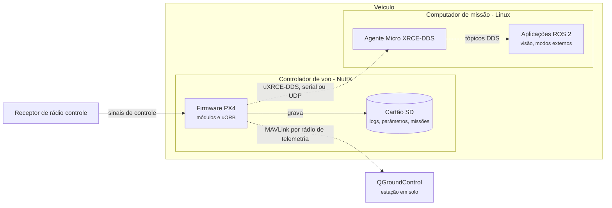
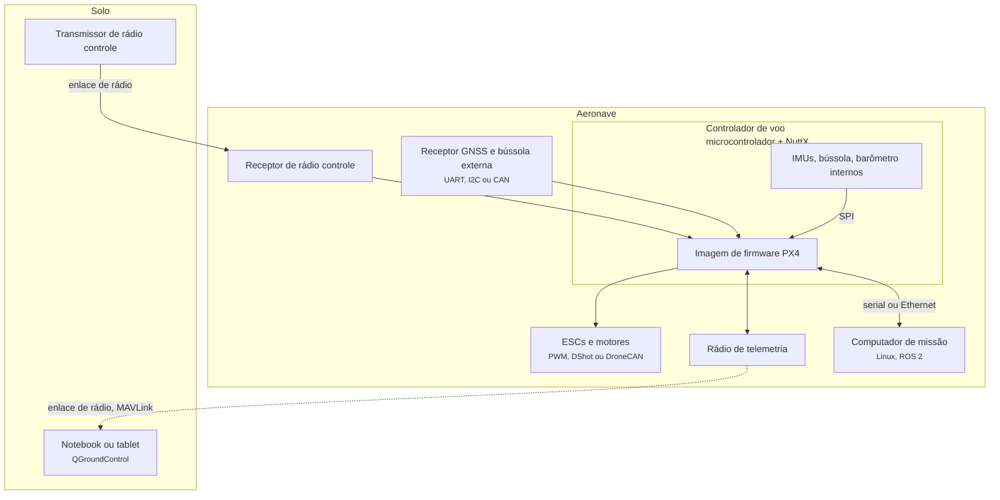

# 4.8 PX4: containers e implantação

<span class="altitude a50">50.000 pés</span>

A Seção 3.8 delimitou o PX4 como um software embarcado de tempo real crítico, com duas fronteiras
de comunicação de naturezas opostas: um enlace lento e não confiável com a estação em solo e um
enlace rápido com o computador de missão. Esta seção desce a 50.000 pés para examinar em que
unidades de execução o sistema se divide, onde cada uma é implantada e por quê. A pergunta "onde o
sistema é implantado?", que nas aplicações web levava a servidores, bancos de dados e filas, aqui
leva a placas eletrônicas, sistemas operacionais de tempo real e enlaces de rádio.

## 4.8.1 O que são *containers* neste sistema

No modelo C4, um *container* é uma unidade que executa ou armazena dados separadamente (Seção
1.3.3). A documentação do PX4 descreve duas configurações típicas (PX4, 2026a). Na mais simples, há
apenas o **controlador de voo**, uma placa com microcontrolador, sensores internos (unidades
inerciais, bússola e barômetro, em muitos casos) e saídas para os controladores eletrônicos de
velocidade (ESCs) dos motores, que executa a pilha de voo. Na mais completa, há também um
**computador de missão** (*companion computer*), em geral com Linux, que executa funções de alto
nível, como visão computacional, e se comunica com o controlador de voo por enlace serial ou IP.
Fora do veículo, a **estação em solo** executa o QGroundControl, e o **rádio controle** transmite os
comandos do piloto (PX4, 2026a).

**Figura 4.8.1** – *Containers* (C4, nível 2) de um sistema PX4 com computador de missão.



Fonte: elaborado pelo autor (2026), com base em PX4 (2026a, 2026b). Linhas contínuas: comunicação
síncrona; linhas tracejadas: comunicação assíncrona.

O armazenamento local merece uma nota. O *firmware* grava registros de voo e mantém parâmetros e
dados de missão; o repositório contém módulos específicos para isso, como `logger` e `dataman`
([`src/modules/logger/`](https://github.com/PX4/PX4-Autopilot/tree/v1.17.0/src/modules/logger),
[`src/modules/dataman/`](https://github.com/PX4/PX4-Autopilot/tree/v1.17.0/src/modules/dataman)).
Não há banco de dados no sentido das aplicações anteriores: os dados de longo prazo, como logs de
voo, são analisados fora do veículo, depois do pouso.

## 4.8.2 Implantação física

A Figura 4.8.2 mostra a visão de implantação: os nós físicos, os sistemas de execução e os canais
de comunicação.

**Figura 4.8.2** – Diagrama de implantação de um sistema PX4 típico.



Fonte: elaborado pelo autor (2026), com base em PX4 (2026a). Os barramentos indicados são
exemplos; a documentação cita I2C, SPI, CAN e UART para sensores e PWM ou DroneCAN para ESCs.
Linhas contínuas: comunicação síncrona; linhas tracejadas: comunicação assíncrona.

A unidade de implantação do PX4 é uma **imagem de *firmware***, compilada para uma placa
específica e gravada em sua memória, em geral pelo próprio QGroundControl (PX4, 2026c). Não há
implantação contínua no sentido das aplicações web: uma nova versão do software exige regravar a
placa, e a validação antes do voo é feita em simulação e em bancada. A simulação SITL, descrita na
Seção 2.8.2.2, executa a mesma pilha de voo em um computador comum e é o principal instrumento de
teste antes da implantação.

## 4.8.3 Por que dois computadores: a partição por criticidade

A divisão entre controlador de voo e computador de missão é uma decisão de **arquitetura de
sistemas** (Seção 1.2) motivada pela classificação temporal da Tabela 3.8.1. A documentação
justifica o uso de Linux no computador de missão pela abundância de desenvolvedores e de software
pronto para visão computacional, comunicação, integração com a nuvem e *drivers* de *hardware*
(PX4, 2026a). O controlador de voo, por sua vez, executa um sistema operacional de tempo real. O
resultado é uma **partição por criticidade**: o que é crítico e precisa de determinismo permanece
no controlador de voo; o que é complexo, volumoso e tolerante a atrasos vai para o computador de
missão.

A partição tem também uma justificativa de certificação. As normas de segurança atribuem níveis
de criticidade às funções e exigem rigor de verificação proporcional a eles; a DO-178C, por
exemplo, classifica o software em níveis de A a E segundo a gravidade do efeito de sua falha
(RTCA, 2011). Separar fisicamente as funções críticas das demais reduz o volume de software que
precisa do rigor máximo. O PX4 não é distribuído como software certificado, mas a partição
preserva essa possibilidade para quem o integra em um produto.

!!! note "ADR-PX4-002 – Modos críticos executam apenas no controlador de voo (reconstruído)"
    **Status:** aceito (reconstrução a partir da documentação da `v1.17.0`).

    **Contexto:** integradores querem escrever modos de voo em ROS 2, no computador de missão,
    onde há bibliotecas e poder de processamento. O computador de missão executa Linux, sem
    garantias de tempo real, e pode reiniciar ou travar durante o voo.

    **Decisão:** modos de voo podem ser implementados como **modos externos**, em ROS 2, exceto
    quando exigem acesso de baixo nível, temporização estrita ou alta frequência, e exceto os modos
    críticos de segurança, como o retorno, que permanecem internos. Se um modo externo terminar, o
    sistema recorre a um modo interno.

    **Consequências positivas:** extensibilidade com interface pequena e estável; falhas do
    computador de missão não derrubam a aeronave.

    **Consequências negativas:** duas formas de implementar modos; a interface de controle por ROS
    2, introduzida na `v1.15`, ainda é considerada experimental pela documentação.

    **Fonte:** PX4 (2026d).

## 4.8.4 O ambiente de execução: NuttX, tarefas e filas de trabalho

O PX4 executa sobre sistemas operacionais que oferecem uma interface POSIX e alguma forma de
escalonamento de tempo real, como FIFO; Linux, macOS, NuttX e QuRT são citados pela documentação
(PX4, 2026e). Nos controladores de voo, o sistema principal é o **NuttX**, sistema operacional de
tempo real de código aberto sob licença BSD, descrito pela documentação como leve, eficiente e
muito estável. No NuttX, os módulos executam como tarefas com listas próprias de descritores de
arquivo, mas compartilham um único espaço de endereçamento; cada tarefa tem pilha de tamanho fixo,
e uma tarefa periódica verifica se ainda há espaço livre nas pilhas. Em Linux e macOS, o PX4
executa em um único processo, com os módulos em *threads* (PX4, 2026e).

A compatibilidade com POSIX é uma decisão de **portabilidade** com consequências diretas para a
testabilidade: o mesmo código que voa no microcontrolador executa em um computador de mesa, ligado
a um simulador. O compromisso, coerente com a primeira lei (Seção 1.1.2), é que o comportamento
temporal em um sistema operacional de propósito geral não reproduz fielmente o do sistema de tempo
real; a simulação valida a lógica, mas não substitui a verificação temporal no *hardware* alvo.

Dentro do controlador de voo, a documentação descreve duas maneiras de executar um módulo
(PX4, 2026e). Como **tarefa**, o módulo tem pilha e prioridade próprias. Como **tarefa de fila de
trabalho** (*work queue*), executa em uma fila compartilhada, com a mesma pilha e a mesma
prioridade das demais tarefas da fila; a vantagem é o menor consumo de memória e de trocas de
contexto. A organização das filas e a atribuição de prioridades são examinadas a 10.000 pés, na
Seção 5.8.

## 4.8.5 Estilo e quanta: uma arquitetura unitária com *publish/subscribe* interno

Richards e Ford (2020, p. 121) observam que poucas arquiteturas **unitárias**, executadas como um
único sistema em uma única máquina, existem fora dos sistemas embarcados e de outros ambientes
altamente restritos. O PX4 é um desses casos: todo o *middleware* executa em um único espaço de
endereçamento, e a comunicação entre módulos baseia-se em memória compartilhada (PX4, 2026e). A
documentação acrescenta que o sistema foi projetado para que, com pouco esforço, cada módulo
pudesse executar em espaço de endereçamento separado, listando as partes que precisariam mudar:
uORB, interface de parâmetros, `dataman` e `perf` (PX4, 2026e).

Pelo critério do **quantum arquitetural** (Apêndice D), há um único quantum no controlador de voo:
todos os módulos são implantados juntos, na mesma imagem de *firmware*, e compartilham o mesmo
destino em caso de falha do processador. O computador de missão é um segundo quantum, implantado e
reiniciado de forma independente, e a estação em solo, um terceiro. O sistema como um todo é,
portanto, distribuído **entre** quanta e unitário **dentro** do quantum crítico.

Internamente, porém, a organização não é a de um monólito acoplado. A documentação descreve o
sistema como **reativo**: as funções são divididas em componentes intercambiáveis e reutilizáveis,
a comunicação é feita por troca assíncrona de mensagens, e o sistema lida com carga variável. Os
módulos comunicam-se por um barramento *publish/subscribe* chamado **uORB**, o que, segundo a
documentação, torna o sistema reativo à chegada de novos dados, paraleliza operações e comunicação
e permite a um componente consumir dados de qualquer origem de forma segura entre *threads*
(PX4, 2026e). Meier, Honegger e Pollefeys (2015) apresentaram essa organização em analogia com os
nós e tópicos do ROS.

O estilo se aproxima da topologia de *broker* da arquitetura orientada a eventos, na qual
processadores desacoplados publicam e assinam canais, sem mediador central (RICHARDS; FORD, 2020,
cap. 14), e guarda parentesco com o microkernel, pois um núcleo pequeno sustenta módulos
substituíveis. As diferenças, contudo, são decisivas (Tabela 4.8.1).

**Tabela 4.8.1** – O *publish/subscribe* do PX4 comparado à topologia de *broker* distribuída.

| Aspecto | *Broker* distribuído (Seções 4.3 e 4.7) | uORB no PX4 |
|---|---|---|
| Transporte | Rede, *broker* externo (RabbitMQ, Kafka) | Memória compartilhada no mesmo processo |
| Latência | Variável, dependente da rede | Pequena e previsível |
| Semântica de entrega | Filas, persistência, reentrega | Por padrão, só a última amostra; filas curtas opcionais |
| Tipagem | Em geral, esquema por convenção | Tipos C++ gerados de arquivos `.msg` em tempo de compilação |
| Falha de um consumidor | Isolada em outro processo | Compartilha processador e memória; exige disciplina temporal |
| Escalabilidade | Horizontal, por réplicas | Não se aplica; limitada a um processador |
| Objetivo principal | Escalabilidade e desacoplamento entre equipes | Desacoplamento, substituibilidade e reatividade em tempo real |

Fonte: elaborado pelo autor (2026), com base em Richards e Ford (2020, cap. 14) e PX4 (2026e,
2026f).

Richards e Ford (2020, cap. 14) apontam como desvantagens da topologia de *broker* a falta de
controle sobre o fluxo de trabalho, a dificuldade no tratamento de erros e a impossibilidade de
saber quando um processo terminou; observam também que fluxos de eventos não determinísticos tornam
os sistemas difíceis de testar e de governar (RICHARDS; FORD, 2020, p. 209). No PX4, essas
desvantagens são mitigadas por duas decisões. O "fluxo de trabalho" é um laço de controle contínuo,
sem transações a concluir: cada nova amostra substitui a anterior. E existe um supervisor
explícito, o módulo *commander*, que observa a saúde de todo o sistema e decide os modos de voo; o
tratamento de erros não fica a cargo da coreografia entre módulos (Seção 5.8).

!!! note "ADR-PX4-001 – Módulos comunicam-se apenas por tópicos uORB (reconstruído)"
    **Status:** aceito (reconstrução a partir da documentação e do código da `v1.17.0`).

    **Contexto:** o mesmo *firmware* precisa servir a muitos tipos de veículo. Pesquisadores e
    integradores precisam substituir estimadores e controladores. Os laços críticos têm prazos de
    poucos milissegundos. Os módulos executam em *threads* e filas de trabalho distintas.

    **Decisão:** módulos de voo não chamam funções uns dos outros. Toda troca de dados ocorre por
    tópicos uORB tipados, definidos em arquivos `.msg` dos quais o código é gerado.

    **Consequências positivas:** substituibilidade de módulos, até em tempo de execução;
    ausência de *locks* compartilhados entre módulos; possibilidade de registrar em log e
    reproduzir qualquer tópico; exposição dos mesmos tipos ao ROS 2.

    **Consequências negativas:** o fluxo de dados torna-se implícito e precisa ser documentado; a
    semântica de "última amostra" pode perder mensagens se o consumidor for lento; mudanças em uma
    mensagem afetam todos os assinantes e ferramentas externas, o que exige versionamento.

    **Conformidade:** revisão de código; no exercício da Seção 6.8, uma *fitness function* em
    ArchUnit.

## 4.8.6 Comunicação com o exterior: síncrona, assíncrona e com perdas

Toda a comunicação do PX4 é **assíncrona**: internamente, por tópicos; externamente, por
mensagens. A natureza dos dois enlaces externos, porém, é diferente.

O **MAVLink** é usado com estações em solo, SDKs e componentes externos. A documentação o descreve
como protocolo muito leve, projetado para enlaces de rádio de baixa largura de banda e não
confiáveis; as mensagens são deliberadamente pequenas, sem semântica de reenvio ou de confirmação,
e servem a telemetria e a comandos de alta frequência; protocolos mais elaborados, chamados
microsserviços, são construídos sobre elas para tarefas como transferir uma missão ou um parâmetro
(PX4, 2026g; KOUBÂA *et al.*, 2019). A ausência de reenvio nas mensagens básicas é coerente com a
classificação de "tempo real firme" da telemetria (Tabela 3.8.1): uma amostra perdida é substituída
pela seguinte, e reenviar uma amostra velha só congestionaria o enlace.

A ponte **uXRCE-DDS**, introduzida na `v1.14`, permite que tópicos uORB sejam publicados e
assinados no computador de missão como se fossem tópicos do ROS 2 (PX4, 2026b). Há duas partes: um
**cliente**, executado no PX4, e um **agente**, executado no computador de missão, que atua como
*proxy* do cliente no espaço de dados DDS. O cliente é gerado em tempo de compilação a partir das
definições de mensagens e de um arquivo que lista os tópicos expostos (Listagem 4.8.1).

**Listagem 4.8.1** – Código real (YAML, PX4 v1.17.0): tópicos expostos ao ROS 2: a atitude sai do PX4; o *setpoint* de trajetória entra.

```yaml
publications:
  # (...)
  - topic: /fmu/out/vehicle_attitude
    type: px4_msgs::msg::VehicleAttitude
  # (...)
subscriptions:
  # (...)
  - topic: /fmu/in/trajectory_setpoint
    type: px4_msgs::msg::TrajectorySetpoint
```

Fonte: PX4-Autopilot, *tag* `v1.17.0`,
[`src/modules/uxrce_dds_client/dds_topics.yaml`, linhas 6, 63-64, 112 e
158-159](https://github.com/PX4/PX4-Autopilot/blob/v1.17.0/src/modules/uxrce_dds_client/dds_topics.yaml#L63-L64).
Linhas não contíguas; `(...)` indica omissões.

A lista explícita é uma decisão de **ocultação de informação** (Seção 1.5.2): apenas um subconjunto
dos tópicos internos constitui a interface pública do piloto automático para o mundo ROS 2. O
versionamento de mensagens introduzido na `v1.16` responde ao custo dessa exposição, pois mensagens
publicadas para o exterior precisam permanecer compatíveis entre versões do PX4 e do ROS 2
(PX4, 2026f).

## 4.8.7 Comparação com o sistema real

A Tabela 4.8.2 compara as decisões de implantação do PX4 com o que é publicamente observável nos
produtos da DJI (Seção 2.8.1). Como o *firmware* da DJI é fechado, a comparação limita-se à
fronteira do sistema.

**Tabela 4.8.2** – Decisões de implantação: PX4 e DJI.

| Decisão | PX4 | DJI (publicamente observável) |
|---|---|---|
| Núcleo de voo | Aberto, BSD, compartilhado por muitos fabricantes | Fechado, integrado verticalmente |
| Extensão por terceiros | Módulos internos, modos externos em ROS 2, MAVLink | SDKs publicados (*Mobile SDK*, *Payload SDK*) |
| Dados de restrição de voo | Cercas geográficas configuradas pelo operador | Sistema GEO mantido pelo fabricante |
| Protocolo com o solo | MAVLink, aberto | Não documentado nas fontes públicas consultadas |

Fonte: elaborado pelo autor (2026), com base em PX4 (2026a, 2026h) e DJI (2026a, 2026b).

A diferença central não está na tecnologia, mas em **quem controla a fronteira**. Na DJI, a
fronteira é o SDK, e o fabricante decide o que é extensível. No PX4, a fronteira é um conjunto de
mensagens e protocolos abertos, e cada integrador pode movê-la, o que aumenta a flexibilidade e
transfere a ele a responsabilidade pela segurança do produto final.

## 4.8.8 Caixa-preta: Ariane 5, voo 501

!!! caixa-preta "Ariane 5, voo 501 (1996): reúso e redundância idêntica"
    Em 4 de junho de 1996, cerca de 40 segundos após o início da sequência de voo e a cerca de
    3.700 m de altitude, o primeiro Ariane 5 desviou-se da trajetória, partiu-se e explodiu. A
    comissão de inquérito presidida por Jacques-Louis Lions concluiu que os dois sistemas de
    referência inercial (SRI), o ativo e o de reserva, haviam falhado pelo mesmo motivo: uma exceção
    de software na conversão de um número de ponto flutuante de 64 bits para um inteiro com sinal de
    16 bits, causada por um valor inesperadamente alto de uma variável de alinhamento chamada BH
    (*horizontal bias*). O SRI de reserva deixara de funcionar um ciclo de dados antes, 72 ms, e o
    computador de bordo interpretou como dados de voo o padrão de diagnóstico emitido pelo SRI
    ativo após a falha (LIONS *et al.*, 1996).

O caso pertence a esta altitude porque suas causas são decisões de implantação e de redundância. A
função de alinhamento que falhou só tinha utilidade antes da decolagem, mas continuava executando
durante cerca de 40 segundos de voo por um requisito do Ariane 4, desnecessário no Ariane 5. A
proteção contra estouro havia sido omitida em algumas variáveis, em parte por causa de uma meta de
carga máxima de 80% para o computador do SRI. Os dados de trajetória do Ariane 5 não foram
incluídos nos requisitos do SRI. E o tratamento de exceções seguia a filosofia de que falhas
decorrem de defeitos aleatórios de *hardware*, de modo que desligar o processador e passar ao
reserva seria a resposta adequada; diante de uma falha sistemática de software, a redundância
**idêntica** falhou do mesmo modo (LIONS *et al.*, 1996).

Entre as recomendações, a comissão pediu que nenhuma função executasse em voo sem necessidade, que
sensores continuassem enviando a melhor estimativa possível em vez de parar, e que todo o software
de voo fosse revisto para confrontar suas premissas implícitas com os limites dos equipamentos
(LIONS *et al.*, 1996). As lições conectam-se ao PX4 em três pontos: redundância idêntica protege
contra falhas aleatórias, não contra falhas de projeto, e a redundância do estimador do PX4 usa
combinações **diferentes** de sensores (Seção 5.8); o reúso de um componente exige reabrir suas
premissas, o que vale para qualquer módulo levado de um tipo de veículo a outro; e não executar em
voo o que não é necessário é uma regra de determinismo, pois cada função a mais é carga a mais no
pior caso.

A Seção 5.8 desce a 10.000 pés para examinar os componentes do controlador de voo e o fluxo de
comunicação entre eles ([Seção 5.8](../capitulo-5-10-mil-pes/px4.md)).

## Referências

DJI. **DJI developer**: Mobile SDK e Payload SDK. 2026a. Disponível em:
<https://developer.dji.com>. Acesso em: 18 out. 2026.

DJI. **DJI FlySafe**: GEO zones. 2026b. Disponível em: <https://www.dji.com/flysafe>. Acesso em:
18 out. 2026.

KOUBÂA, A. *et al.* Micro Air Vehicle Link (MAVLink) in a nutshell: a survey. **IEEE Access**,
v. 7, p. 85023-85037, 2019.

LIONS, J. L. *et al.* **Ariane 5 flight 501 failure**: report by the Inquiry Board. Paris:
ESA/CNES, 19 jul. 1996. Disponível em: <https://esamultimedia.esa.int/docs/esa-x-1819eng.pdf>.
Acesso em: 18 out. 2026.

MEIER, L.; HONEGGER, D.; POLLEFEYS, M. PX4: a node-based multithreaded open source robotics
framework for deeply embedded platforms. *In*: IEEE INTERNATIONAL CONFERENCE ON ROBOTICS AND
AUTOMATION (ICRA), 2015, Seattle. **Proceedings** [...]. Piscataway: IEEE, 2015. p. 6235-6240.

PX4. **PX4 system architecture**. Versão v1.17.0. 2026a. Disponível em:
<https://github.com/PX4/PX4-Autopilot/blob/v1.17.0/docs/en/concept/px4_systems_architecture.md>.
Acesso em: 18 out. 2026.

PX4. **uXRCE-DDS (PX4-ROS 2/DDS bridge)**. Versão v1.17.0. 2026b. Disponível em:
<https://github.com/PX4/PX4-Autopilot/blob/v1.17.0/docs/en/middleware/uxrce_dds.md>. Acesso em:
18 out. 2026.

PX4. **Basic concepts**. Versão v1.17.0. 2026c. Disponível em:
<https://github.com/PX4/PX4-Autopilot/blob/v1.17.0/docs/en/getting_started/px4_basic_concepts.md>.
Acesso em: 18 out. 2026.

PX4. **Flight modes (developers)**. Versão v1.17.0. 2026d. Disponível em:
<https://github.com/PX4/PX4-Autopilot/blob/v1.17.0/docs/en/concept/flight_modes.md>. Acesso em:
18 out. 2026.

PX4. **PX4 architectural overview**. Versão v1.17.0. 2026e. Disponível em:
<https://github.com/PX4/PX4-Autopilot/blob/v1.17.0/docs/en/concept/architecture.md>. Acesso em:
18 out. 2026.

PX4. **uORB messaging**. Versão v1.17.0. 2026f. Disponível em:
<https://github.com/PX4/PX4-Autopilot/blob/v1.17.0/docs/en/middleware/uorb.md>. Acesso em: 18
out. 2026.

PX4. **MAVLink messaging**. Versão v1.17.0. 2026g. Disponível em:
<https://github.com/PX4/PX4-Autopilot/blob/v1.17.0/docs/en/mavlink/index.md>. Acesso em: 18 out.
2026.

PX4. **Safety (failsafe) configuration**. Versão v1.17.0. 2026h. Disponível em:
<https://github.com/PX4/PX4-Autopilot/blob/v1.17.0/docs/en/config/safety.md>. Acesso em: 18 out.
2026.

RICHARDS, M.; FORD, N. **Fundamentals of software architecture**: an engineering approach.
Sebastopol: O'Reilly, 2020.

RTCA. **DO-178C**: software considerations in airborne systems and equipment certification.
Washington: RTCA, 2011.
