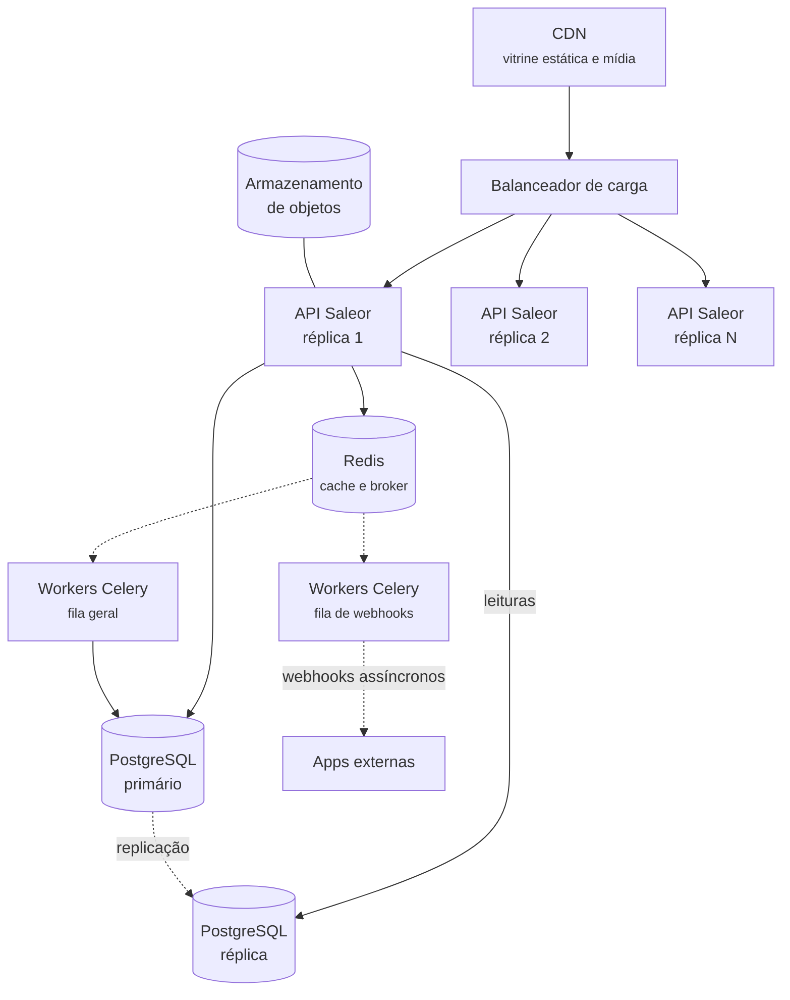

# 4.6 Saleor: containers e implantação

50.000 pés

A [Seção 3.6](../capitulo-3-100-mil-pes/saleor.md) terminou com um diagrama de contexto e três
características prioritárias para o *checkout*: elasticidade, consistência financeira e de
estoque, e modificabilidade. Também registrou uma restrição: uma equipe de oito
desenvolvedores, sem especialista em infraestrutura. Esta seção desce a 50.000 pés e examina
quais unidades de execução e de dados compõem o Saleor, como são implantadas, como se
comunicam e por que foram organizadas assim. Ao final, compara a solução com as trajetórias
da Amazon e do Mercado Livre e abre a caixa-preta do Prime Day de 2018.

## 4.6.1 Os *containers*

O diagrama de *containers* foi construído a partir de três fontes confirmadas: o arquivo
`pyproject.toml` da *tag* 3.23.42, que declara Django, Graphene, `psycopg` e Celery com suporte
a Redis e SQS e define tarefas para executar o *worker* e o agendador do Celery; o `Dockerfile`
oficial, que executa a aplicação ASGI com o Uvicorn na porta 8000; e o `docker-compose.yml` do
repositório `saleor-platform`, recomendado pela documentação para execução local (SALEOR,
2026a; 2026c).

**Figura 4.6.1** – *Containers* (C4, nível 2) do Saleor e o caminho de um *checkout*.

Passos numerados (conclusão de um *checkout* no fluxo de transações, detalhado na Figura 5.6.2):

1. A vitrine envia à API, por GraphQL sobre HTTPS, as mutações que montam o *checkout*.
2. Durante a requisição, a API dispara o evento síncrono que pede às *apps* a lista de métodos de
   entrega.
3. Pelo mesmo mecanismo, a API pede o cálculo de impostos do *checkout*; nos dois casos, a resposta
   da *app* é usada para continuar o processamento.
4. A vitrine chama `transactionInitialize`.
5. A API dispara o *webhook* síncrono `TRANSACTION_INITIALIZE_SESSION` para a *app* de pagamento,
   que chama o provedor, repassando a chave de idempotência, e responde.
6. A API registra `TransactionItem` e `TransactionEvent` no PostgreSQL.
7. A vitrine chama `checkoutComplete`.
8. Numa transação local, a API verifica se o valor autorizado cobre o total, bloqueia o *checkout*,
   cria o pedido, aloca o estoque e apaga o *checkout*.
9. A API enfileira no intermediário os *webhooks* assíncronos, como `ORDER_CREATED`.
10. Um *worker* Celery retira a tarefa da fila.
11. O *worker* entrega o evento à *app* fiscal, por HTTP, SQS ou Pub/Sub, com repetição automática.

As setas finas sem número representam relações que não pertencem a esse fluxo: o Dashboard também
é cliente da API GraphQL; as *apps* agem sobre o núcleo pela mesma API, autenticadas por *token*
próprio (a seta parte da *app* fiscal, mas vale para todas); os *workers* leem e gravam no
PostgreSQL; e o Celery beat enfileira as tarefas agendadas.

Fonte: elaborado pelo autor (2026), com base em Saleor (2026a; 2026c) e no estilo de diagrama de
Xu (2020). Linhas contínuas: comunicação síncrona; linhas tracejadas: comunicação assíncrona.
Código-fonte da figura: `diagramas/d2/saleor-50k.d2`.

Quatro observações decorrem da figura. Primeira: API, *workers* e agendador são **o mesmo
código e a mesma imagem**, executados com comandos diferentes. No `docker-compose.yml` do
`saleor-platform`, o serviço `worker` usa a imagem `ghcr.io/saleor/saleor:3.23`, a mesma da API,
com o comando `celery -A saleor --app=saleor.celeryconf:app worker --loglevel=info -B`, em que a
opção `-B` embute o agendador no próprio *worker* (SALEOR, 2026c). Segunda: há **um único banco
de dados lógico**, compartilhado por todos os módulos de domínio. Terceira: o intermediário de
mensagens é configurável; o arquivo `settings.py` lê `CELERY_BROKER_URL` do ambiente e ativa um
transporte específico quando o endereço começa com `sqs://`, e, se nenhum intermediário for
configurado, as tarefas passam a executar de forma síncrona, no próprio processo
(`CELERY_TASK_ALWAYS_EAGER = not CELERY_BROKER_URL`) (SALEOR, 2026a, `saleor/settings.py`,
linhas 632-643). Quarta: as *apps* são **containers de terceiros**, implantados separadamente,
que recebem eventos do Saleor e agem sobre ele pela mesma API GraphQL que a vitrine usa,
autenticadas por um *token* próprio.

## 4.6.2 Implantação

O `saleor-platform` descreve a implantação mínima, adequada ao desenvolvimento: sete serviços
numa única máquina, com PostgreSQL 15, Valkey 8.1 (um derivado de código aberto do Redis) como
*cache* e intermediário, Jaeger para rastreamento distribuído e Mailpit como servidor de
e-mail de teste (SALEOR, 2026c). Uma implantação de produção para os números da Tabela 3.6.1
mantém os mesmos *containers*, mas multiplica e separa as instâncias. A Figura 4.6.2 apresenta
uma topologia de produção coerente com os pontos de configuração existentes no código, isto é,
uma topologia que o Saleor suporta sem alterações.

**Figura 4.6.2** – Diagrama de implantação de produção (ilustrativo).

Fonte: elaborado pelo autor (2026), com base nos parâmetros de configuração de Saleor
(2026a). A topologia é ilustrativa; o número de réplicas depende da medição. Linhas contínuas:
comunicação síncrona; linhas tracejadas: comunicação assíncrona.

Três pontos de configuração sustentam a figura. O primeiro é a **réplica de leitura**:
`settings.py` define uma segunda conexão de banco chamada `replica`, lida da variável
`DATABASE_URL_REPLICA` quando ela existe, e que, na ausência dela, aponta para o próprio
primário (SALEOR, 2026a, `saleor/settings.py`, linhas 127-146). O gerenciador de *plug-ins*,
por exemplo, escolhe entre a conexão de réplica e a principal conforme o parâmetro
`allow_replica`. O segundo são as **filas separadas**: variáveis como
`WEBHOOK_CELERY_QUEUE_NAME`, `CHECKOUT_WEBHOOK_EVENTS_CELERY_QUEUE_NAME` e
`ORDER_WEBHOOK_EVENTS_CELERY_QUEUE_NAME` permitem dedicar *workers* à entrega de *webhooks*, de
modo que uma *app* lenta não atrase as demais tarefas (linhas 1089-1106). O terceiro é a
**API sem estado**: como a sessão do comprador está no *checkout* persistido e a autenticação
é feita por *tokens*, qualquer réplica da API atende qualquer requisição, e o balanceador não
precisa de afinidade.

Com esses três pontos, a elasticidade pedida na Seção 3.6.8 é obtida de forma convencional:
a vitrine e a mídia saem da API por meio de uma CDN; as leituras do catálogo vão para réplicas
de banco e para o *cache*; as réplicas da API escalam horizontalmente; e o banco primário só
recebe as escritas, cerca de 56 por segundo no pico estimado. Um único primário PostgreSQL
atende essa carga com folga. O limite estrutural da topologia é outro: todas as réplicas da
API dependem do mesmo primário e das mesmas *apps* síncronas, de modo que a falha de qualquer
um deles atinge todo o *checkout*.

## 4.6.3 Estilo e *quanta*

Richards e Ford (2020, cap. 18) formulam a primeira pergunta de estilo em termos de
***quantum* arquitetural**, definido como um artefato implantável de forma independente, com
alta coesão funcional e conascência síncrona (RICHARDS; FORD, 2020, p. 92): se um único
conjunto de características basta para todo o sistema, um monólito é adequado; se partes
diferentes exigem características diferentes, uma arquitetura distribuída se justifica. A
Seção 3.6.8 mostrou que vitrine e *checkout* têm perfis diferentes, mas isso não diz quantas
partes devem existir. Três estilos competem.

O **monólito modular** organiza o código em componentes por domínio, com um único banco,
implantado como um único *quantum*; Richards e Ford (2020, cap. 18) recomendam, quando possível,
separar também as tabelas por componente, para facilitar uma eventual migração. Newman (2021,
cap. 1) trata o monólito modular como opção legítima, e não como etapa a ser superada, e Fowler
(2015) defende começar por um monólito e extrair serviços apenas quando as fronteiras estiverem
compreendidas.

A **arquitetura baseada em serviços** é descrita por Richards e Ford (2020, cap. 13) como um
híbrido pragmático: interface implantada separadamente, poucos serviços de domínio de
granularidade grossa, tipicamente entre 4 e 12, e, em geral, um banco monolítico compartilhado
(RICHARDS; FORD, 2020, p. 163). Os autores usam precisamente um *checkout* para mostrar sua
vantagem: como o serviço de pedidos contém a colocação do pedido, o pagamento e a atualização
do estoque, uma falha por cartão expirado é desfeita por *rollback* ACID local; nos
microsserviços, a mesma falha deixa um pedido inserido e não aprovado e abre perguntas sobre o
estoque reservado (RICHARDS; FORD, 2020, p. 168-169).

Os **microsserviços** levam o particionamento por domínio ao extremo. Para Richards e Ford
(2020, p. 247-249), cada serviço modela um domínio ou fluxo e inclui seu próprio esquema de
dados, prefere-se a duplicação ao acoplamento, e o isolamento de dados é requisito. A
consequência é que transações entre serviços deixam de ser triviais; o conselho dos autores é
não fazê-las, mas corrigir a granularidade, e usar sagas com parcimônia (RICHARDS; FORD, 2020,
p. 260-263).

**Tabela 4.6.1** – Três estilos para o mesmo comércio eletrônico.

| Critério | Monólito modular | Baseada em serviços | Microsserviços |
|---|---|---|---|
| *Quanta* | um | em geral um, pelo banco compartilhado | muitos |
| Transação do *checkout* | ACID local | ACID dentro do serviço de pedidos | saga entre serviços |
| Vitrine escala separada do *checkout* | só com réplicas inteiras | parcialmente | sim |
| Autonomia de equipes | baixa a média | média | alta, se as fronteiras forem boas |
| Custo operacional | baixo | médio | alto: plataforma, observabilidade, rede |
| Risco principal | erosão das fronteiras internas | banco compartilhado como acoplamento | granularidade errada e sagas por toda parte |
| Exemplo | Saleor (núcleo) | evolução plausível de uma loja média | Amazon e Mercado Livre |

Fonte: elaborado pelo autor (2026), com base em Richards e Ford (2020, caps. 13, 17 e 18) e
Newman (2021).

O Saleor ocupa uma posição particular na tabela. Seu núcleo é um **monólito modular**: um
projeto Django com módulos por domínio (`checkout`, `order`, `payment`, `warehouse`,
`product` e outros), um banco e *workers* que compartilham o mesmo código. As integrações com
subdomínios genéricos, porém, foram empurradas para fora, como *apps* implantadas
separadamente. O resultado são **vários *quanta*, mas acoplados**: o núcleo é um *quantum*; cada
*app* é outro; e, como os eventos de pagamento, impostos e frete são síncronos, a definição de
Richards e Ford implica que, durante o *checkout*, a disponibilidade e a latência do núcleo
dependem das *apps*. Argumenta-se aqui que essa é uma decisão consciente, justificada pela
destilação da Seção 3.6.7: o núcleo fica monolítico porque pedido, pagamento e estoque
compartilham transações; o genérico fica fora porque muda por razões alheias à loja.

## 4.6.4 Comunicação síncrona e assíncrona

Richards e Ford (2020, cap. 18) recomendam a comunicação síncrona por padrão e a assíncrona
quando necessária. O Saleor aplica a regra com nitidez. Entre clientes e núcleo, a comunicação
é síncrona: requisições GraphQL. Entre o núcleo e as *apps*, a documentação distingue dois
tipos de evento (SALEOR, 2026b). Os **eventos síncronos** são enviados durante a requisição
GraphQL, e a resposta da *app* é usada para continuar o processamento, como o cálculo de
impostos do *checkout*, a lista de métodos de entrega e a cobrança de uma transação. Os
**eventos assíncronos** são enviados depois que o processamento da requisição termina, como a
criação de um pedido, e servem para notificar.

Os eventos síncronos estão no caminho crítico do *checkout* e, por isso, são protegidos de três
modos na versão estudada. Há um **tempo limite**: o `settings.py` fixa 2 segundos para
estabelecer a conexão e 18 para aguardar a resposta (linhas 1155-1163). Há um **disjuntor**
(*circuit breaker*) opcional, ativado pela variável `BREAKER_BOARD_ENABLED`, que usa o Redis para
registrar falhas e permite indicar, em `BREAKER_BOARD_SYNC_EVENTS`, quais eventos síncronos
devem ser monitorados, com exemplos como o cálculo de impostos e a lista de métodos de entrega
(linhas 1197-1208). E a documentação recomenda que as *apps* respondam rapidamente e que usem
filas, em vez de *endpoints* HTTP, para os eventos assíncronos (SALEOR, 2026b). Os eventos
assíncronos, por sua vez, são entregues por tarefas Celery com repetição automática, o que
garante entrega "pelo menos uma vez" e exige idempotência das *apps*, como se verá na Seção 6.6.
O destino pode ser um *endpoint* HTTP ou uma fila: o modelo de *webhook* aceita os esquemas
`http`, `https`, `awssqs` e `gcpubsub` (`saleor/webhook/models.py`).

## 4.6.5 Dados

O Saleor tem um único banco relacional, e essa é a decisão de dados mais consequente do
sistema. Ela permite que a conversão do *checkout* em pedido seja feita com transações ACID e
bloqueio de linhas (`SELECT ... FOR UPDATE`), sem coordenação distribuída, e que a API
componha numa única consulta dados de catálogo, estoque e preço. O custo é que os módulos de
domínio compartilham esquema e se referenciam por chaves estrangeiras, o que torna difícil,
no futuro, extrair um deles como serviço (Seção 5.6). O *cache* Redis guarda dados derivados e
serve de intermediário do Celery; o armazenamento de mídia é externo ao banco (um volume
compartilhado entre API e *worker* no `saleor-platform`, ou armazenamento de objetos em
produção). Não há, no núcleo, bancos especializados de busca ou de séries temporais; a busca
textual usa os recursos do próprio PostgreSQL.

## 4.6.6 Decisões reconstruídas

As decisões mais visíveis podem ser reconstruídas no formato de ADR do Apêndice B. As
reconstruções são do autor; os fatos citados estão no repositório e na documentação.

!!! note "ADR-001 (reconstruído) – A loja é um cliente da API GraphQL"
    **Status:** aceito (inferido do estado do repositório na versão 3.23.42).

    **Contexto:** lojas diferentes exigem vitrines diferentes (web, aplicativo, parceiros),
    feitas com tecnologias diferentes. A equipe de *marketing* quer mudar a vitrine sem
    depender do *backend* (Seção 3.6.2).

    **Decisão:** o *backend* não terá interface própria para o comprador. Toda interação,
    configuração e extensão ocorrerá por uma API GraphQL única. Painel e vitrine serão projetos
    separados.

    **Consequências:** (+) vitrines em qualquer tecnologia; (+) uma única fachada remota para
    todos os clientes; (−) mais peças para operar, mesmo em lojas pequenas; (−) a API pública
    vira contrato e precisa de política de versionamento e depreciação.

    **Conformidade:** nenhuma funcionalidade nova fora do *schema* GraphQL; o arquivo
    `saleor/graphql/schema.graphql`, versionado no repositório, é a referência do contrato.

!!! note "ADR-002 (reconstruído) – Extensões como apps externas, e não como plug-ins no processo"
    **Status:** em implantação; o mecanismo anterior está marcado como obsoleto.

    **Contexto:** os *plug-ins* Python executavam dentro do processo do núcleo, compartilhavam
    sua versão de linguagem e seu ciclo de implantação, e acoplavam a disponibilidade da loja
    ao código de terceiros.

    **Decisão:** novas integrações serão *apps* externas, que recebem *webhooks* síncronos e
    assíncronos e agem pela API. O README justifica a escolha por menor indisponibilidade,
    atualizações mais simples, independência de tecnologia e escala independente das extensões
    (SALEOR, 2026a, `README.md`). Métodos do gerenciador de *plug-ins* trazem o comentário de que
    serão removidos e de que a funcionalidade relacionada a *webhooks* passará ao núcleo
    (`saleor/plugins/manager.py`, linhas 914-915).

    **Consequências:** (+) isolamento de falhas de código e de dependências; (+) *apps* em
    qualquer linguagem; (−) latência de rede e risco de indisponibilidade nos eventos
    síncronos, mitigados por tempo limite e disjuntor; (−) as *apps* precisam ser idempotentes,
    porque recebem repetições.

!!! note "ADR-003 (reconstruído) – Um único banco relacional para o núcleo"
    **Status:** aceito.

    **Contexto:** pedido, pagamento e estoque precisam ser atualizados de forma consistente na
    conversão do *checkout*; o volume de escrita estimado é baixo (Tabela 3.6.1).

    **Decisão:** todos os módulos de domínio compartilham um PostgreSQL, com réplica opcional
    para leituras.

    **Consequências:** (+) transações ACID locais e consultas que atravessam módulos; (−) um
    *quantum* único para o núcleo; (−) fronteiras entre módulos mantidas apenas por disciplina,
    sem isolamento físico.

## 4.6.7 Comparação com os sistemas reais

Fox e Patterson (2021, seção 3.4) usam a Amazon para mostrar a passagem do monólito para
serviços. Segundo o relato de Yegge (2011), que ele mesmo situa "por volta de 2002, mais ou
menos um ano", Jeff Bezos determinou que todas as equipes expusessem dados e funcionalidades
apenas por interfaces de serviço; que nenhuma outra forma de comunicação entre processos fosse
permitida, inclusive a leitura do banco de outra equipe; que a tecnologia fosse escolha de
cada equipe; e que toda interface fosse projetada para poder ser exposta a desenvolvedores
externos. Fox e Patterson (2021, seção 3.4) observam que o decreto capta a distinção crítica da
arquitetura orientada a serviços: um serviço só acessa os dados de outro solicitando operações
específicas por uma interface externa.

O memorando original não foi publicado, e o relato de Yegge foi escrito como crítica interna à
Google, publicada por engano. Seu valor está nas lições que ele diz ter observado: cada equipe
par torna-se um potencial atacante de negação de serviço, o que exige cotas e limitação de
requisições; o monitoramento precisa de verificações semânticas, porque um serviço pode se
declarar saudável enquanto falha; centenas de serviços exigem um mecanismo de descoberta; e a
depuração de chamadas entre serviços de outras equipes torna-se muito mais difícil (YEGGE, 2011).
Em termos deste livro, o mandato **proibiu o banco compartilhado**, exatamente a decisão que o
ADR-003 do Saleor adota. A diferença não é de competência, mas de contexto: a Amazon tinha
muitas equipes e precisava de autonomia entre elas; a loja da Seção 3.6 tem duas.

O Mercado Livre percorreu caminho semelhante e documentou o custo. A migração para
microsserviços (AWS, 2026) só se tornou sustentável com a Fury, plataforma que padroniza
repositórios, *pipelines* de entrega, observabilidade e gestão de custos e procura instaurar
uma cultura *NoOps*, em que as equipes de produto não operam infraestrutura (MARTINS, 2023).
Richards e Ford (2020, p. 263) observam que os microsserviços não poderiam existir sem a
revolução DevOps e a automação incessante das preocupações operacionais; o caso mostra que, em
escala, essa automação se torna um produto interno, com equipe própria. Curiosamente, o Saleor
aproxima-se do mandato da Amazon nas bordas: as *apps* só falam com o núcleo pela API pública,
a mesma oferecida a qualquer terceiro, e nunca pelo banco.

## 4.6.8 Caixa-preta

!!! caixa-preta "Prime Day de 2018: o pico como teste de elasticidade"
    Em 16 de julho de 2018, a abertura do Prime Day da Amazon nos Estados Unidos foi marcada
    por falhas generalizadas e por uma página inicial simplificada de contingência. Segundo
    reportagem da CNBC baseada em documentos internos da empresa, a Amazon não conseguiu
    provisionar servidores suficientes para o aumento de tráfego e teve de adicionar
    capacidade manualmente, o que levou especialistas ouvidos pela reportagem a supor uma
    falha da escalabilidade automática; a empresa também cortou temporariamente o tráfego
    internacional para o *site* americano, a fim de reduzir a pressão sobre um sistema interno
    chamado Sable, que fornece serviços de computação e armazenamento aos negócios de varejo e
    digitais, e cuja degradação se propagou a outros serviços dependentes (KIM, 2018).

    **Leitura arquitetural.** Primeiro, a elasticidade só se verifica sob o pico real ou sob
    testes que o reproduzam; a escalabilidade automática é um mecanismo, não uma garantia.
    Segundo, um serviço compartilhado de infraestrutura é um ponto de acoplamento que
    transforma a falha de um *quantum* na de muitos, a mesma lição que Yegge (2011) relatava
    sobre equipes pares como fontes de sobrecarga. Terceiro, a resposta da empresa, que reduziu
    a carga para preservar a função principal, é uma tática de **degradação controlada**. Na
    topologia da Figura 4.6.2, as táticas equivalentes seriam servir a vitrine da CDN mesmo
    com a API degradada, desativar temporariamente eventos síncronos não essenciais e limitar a
    taxa de novas sessões de *checkout*. Um projeto que separa vitrine e *checkout* torna essas
    táticas possíveis; um sistema sem essa separação só pode cair inteiro.

## Referências

AWS. **AWS Innovator**: Mercado Libre. [*S. l.*]: Amazon Web Services, 2026. Disponível em:
<https://aws.amazon.com/solutions/case-studies/innovators/mercado-libre/>. Acesso em: 18 out.
2026.

FOWLER, M. **MonolithFirst**. 2015. Disponível em:
<https://martinfowler.com/bliki/MonolithFirst.html>. Acesso em: 18 out. 2026.

FOX, A.; PATTERSON, D. **Engineering software as a service**: an agile approach using cloud
computing. 2. ed. beta. San Francisco: Strawberry Canyon, 2021.

KIM, E. Amazon's internal documents show what caused the Prime Day crash and the company's
scramble to fix it. **CNBC**, 19 jul. 2018. Disponível em:
<https://www.cnbc.com/2018/07/19/amazon-internal-documents-what-caused-prime-day-crash-company-scramble.html>.
Acesso em: 18 out. 2026.

MARTINS, J. M. **Efficiency and platform engineering**. Palestra apresentada na PlatformCon
2023. Disponível em: <https://2023.platformcon.com/talks/efficiency-and-platform-engineering>.
Acesso em: 18 out. 2026.

NEWMAN, S. **Building microservices**: designing fine-grained systems. 2. ed. Sebastopol:
O'Reilly, 2021.

RICHARDS, M.; FORD, N. **Fundamentals of software architecture**: an engineering approach.
Sebastopol: O'Reilly, 2020.

SALEOR. **saleor/saleor**: repositório de código-fonte, versão 3.23.42. GitHub, 2026a.
Disponível em: <https://github.com/saleor/saleor/tree/3.23.42>. Acesso em: 18 out. 2026.

SALEOR. **Webhooks overview**. Documentação do Saleor, 2026b. Disponível em:
<https://docs.saleor.io/developer/extending/webhooks/overview>. Acesso em: 18 out. 2026.

SALEOR. **saleor/saleor-platform**: docker-compose.yml, *commit* ab6315bd. GitHub, 2026c.
Disponível em:
<https://github.com/saleor/saleor-platform/blob/ab6315bd59c58b4815175df4c679107ff9695be4/docker-compose.yml>.
Acesso em: 18 out. 2026.

XU, A. **System design interview**: an insider's guide. 2. ed. [*S. l.*]: Byte Code LLC, 2020.

YEGGE, S. **Stevey's Google platforms rant**. 12 out. 2011. Publicado originalmente no
Google+. Cópia disponível em: <https://gist.github.com/chitchcock/1281611>. Acesso em: 18
out. 2026.
