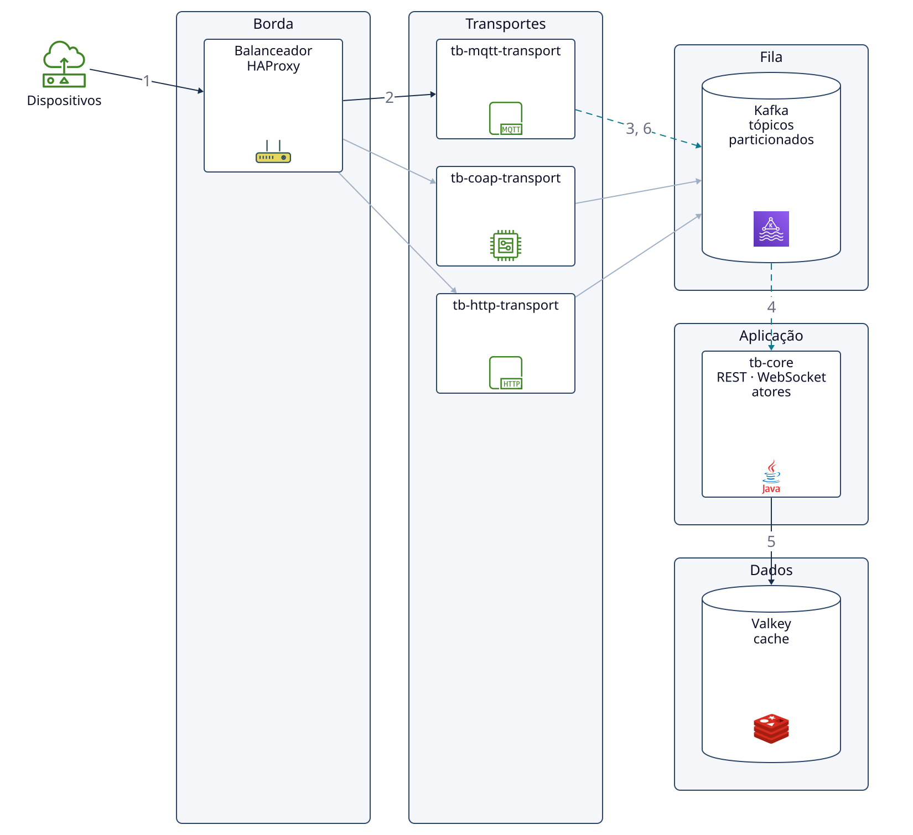
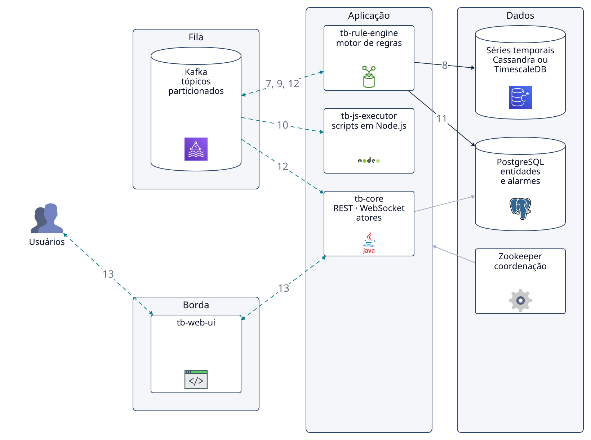
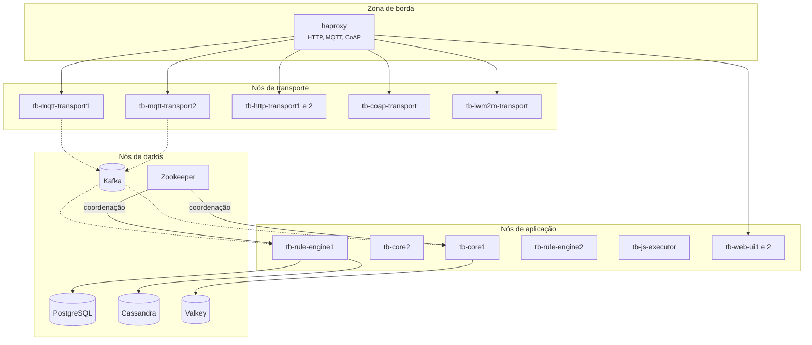

# 4.7 ThingsBoard: containers e implantação

<span class="altitude a50">50.000 pés</span>

## 4.7.1 Do contexto aos *containers*

A [Seção 3.7](../capitulo-3-100-mil-pes/thingsboard.md) terminou com três características
prioritárias (escalabilidade, disponibilidade de aceitação e segurança) e com uma decisão
estrutural antecipada: separar a **aceitação** de uma mensagem do seu **processamento**. Esta
seção desce a 50.000 pés para examinar como o ThingsBoard materializa essa separação em
*containers*, onde cada um é implantado e por quê. Os trechos de configuração citados referem-se à
*tag* `v4.3.1.6` do repositório, adotada no livro pelos motivos expostos na [Seção
2.7](../capitulo-2-aplicacoes/thingsboard.md).

A documentação de arquitetura descreve o caminho de uma mensagem em sete passos: o dispositivo se
conecta a um transporte; o transporte identifica o inquilino a partir das credenciais; as
credenciais são validadas junto ao núcleo (*core*) e mantidas em *cache*; o transporte converte a
carga útil em uma mensagem unificada e a envia ao motor de regras pela fila; o motor executa as
cadeias de regras do inquilino; nós de ação persistem telemetria, atributos ou alarmes; e o
núcleo envia atualizações em tempo real aos painéis por WebSocket (THINGSBOARD, 2026a). Cada passo
corresponde a um *container* ou a uma fronteira entre *containers*.

## 4.7.2 Os *containers*

A documentação de microsserviços enumera os seguintes *containers* de aplicação: um **transporte
por protocolo** (MQTT, HTTP, CoAP, LwM2M e SNMP), cada um escalável por réplicas; o **nó
ThingsBoard** (`tb-node`), que executa a API REST, o servidor WebSocket, o motor de regras e o
sistema de atores; o **executor de JavaScript** (`tb-js-executor`), que roda *scripts* de usuários
em *sandboxes* Node.js isoladas; e a **interface web** (`tb-web-ui`), que repassa chamadas REST e
WebSocket ao nó (THINGSBOARD, 2026b). Os *containers* de infraestrutura são o PostgreSQL, sempre
necessário, para entidades; o Kafka, como barramento entre serviços em produção; o Valkey ou Redis,
como *cache* compartilhado de credenciais, sessões e perfis; o Cassandra, opcional, para séries
temporais; o Zookeeper, para descoberta de serviços e atribuição de partições; e um balanceador
de carga para HTTP, MQTT e CoAP (THINGSBOARD, 2026a). A Figura 4.7.1 apresenta o diagrama de
*containers* na topologia de microsserviços.

**Figura 4.7.1** – *Containers* do ThingsBoard na topologia de microsserviços (C4, nível 2) e o caminho de uma telemetria: (a) ingestão; (b) processamento e visualização.

(a) Ingestão



(b) Processamento e visualização



Passos numerados (telemetria de um dispositivo por MQTT, detalhada na Figura 5.7.3). Os passos 1 a 6
estão na parte (a), e os passos 7 a 13, na parte (b). O Kafka aparece nas duas partes: a parte (a)
termina com a publicação da telemetria na fila, e a parte (b) começa com o seu consumo.

1. O dispositivo conecta-se por MQTT e publica telemetria com QoS 1; o balanceador recebe a conexão.
2. O HAProxy encaminha a conexão a uma réplica do `tb-mqtt-transport`.
3. Na conexão, o transporte publica o pedido de validação das credenciais no tópico
   `tb_transport.api.requests`.
4. O `tb-core` consome o pedido e valida as credenciais.
5. As credenciais ficam em *cache* no Valkey, e a resposta volta ao transporte pelo tópico
   `tb_transport.api.responses`.
6. Para cada mensagem, o transporte verifica os limites de taxa, converte a carga útil numa mensagem
   unificada e a publica no tópico `tb_rule_engine`; o `PUBACK` só é enviado ao dispositivo depois
   que a fila confirma o recebimento.
7. O consumidor do `tb-rule-engine` lê um lote da partição do dispositivo e o submete à cadeia de
   regras do inquilino.
8. O nó *Save time series* grava a telemetria no banco de séries temporais.
9. Um nó de filtro por *script* publica o pedido de avaliação no tópico `js.eval.requests`.
10. O `tb-js-executor` avalia o *script* numa *sandbox* Node.js; o resultado volta por
    `js.eval.responses`.
11. Se a condição for verdadeira, o nó *Create alarm* grava o alarme no PostgreSQL.
12. A atualização da telemetria e do alarme chega ao `tb-core` pela fila.
13. O `tb-core` envia a atualização em tempo real ao painel, por WebSocket, passando pelo
    `tb-web-ui`.

A seta dupla do passo 7 reúne a leitura dos lotes e as publicações do motor de regras na fila
(passos 9 e 12). As setas duplas do passo 13 representam a conexão WebSocket, que o painel abre
pelo `tb-web-ui` (a relação Usuários → `tb-web-ui` → `tb-core` da arquitetura) e pela qual a
atualização desce. As setas finas sem número representam relações que não pertencem a esse fluxo.
Na parte (a), os transportes CoAP e HTTP também recebem conexões do balanceador e publicam na fila.
Na parte (b), o `tb-core` lê e grava entidades no PostgreSQL, e o Zookeeper coordena os serviços da
faixa de aplicação, `tb-rule-engine` e `tb-core`, atribuindo-lhes partições, o que se representa
por uma única seta para a faixa.

Fonte: elaborado pelo autor (2026), com base em ThingsBoard (2026a; 2026b), no arquivo
`docker/docker-compose.yml` da *tag* v4.3.1.6 e no estilo de diagrama de Xu (2020). Linhas
contínuas: comunicação síncrona; linhas tracejadas: comunicação assíncrona. Código-fonte da figura:
`diagramas/d2/thingsboard-50k-a.d2` e `diagramas/d2/thingsboard-50k-b.d2`.

A documentação afirma que todos esses serviços são sem estado, com o estado persistente no banco e
no *cache* (THINGSBOARD, 2026b). A afirmação merece leitura cuidadosa: os atores mantêm estado em
memória, mas esse estado é reconstruído a partir do banco quando um nó reinicia ou quando partições
são reatribuídas (THINGSBOARD, 2026c). O estado em memória é, portanto, um *cache* derivável, e não
a fonte da verdade, o que permite substituir qualquer réplica sem perda.

## 4.7.3 Implantação

A documentação descreve duas topologias e, dentro da monolítica, duas configurações
(THINGSBOARD, 2026d). No **monólito em nó único**, transportes, motor de regras, núcleo e interface
web executam em um único processo Java, com fila em memória e sem dependências além do banco. É a
configuração do arquivo `docker-compose.yml` da página de instalação com Docker, com dois serviços:
`postgres` e `thingsboard-ce`, este baseado na imagem `thingsboard/tb-node:4.3.1.6` e publicando
as portas 8080 (web e REST), 1883 e 8883 (MQTT) e 5683 a 5688 em UDP (CoAP e LwM2M)
(THINGSBOARD, 2026e). No **monólito em *cluster***, várias instâncias idênticas rodam atrás de um
balanceador e passam a exigir Zookeeper e Kafka. Na topologia de **microsserviços**, disponível
desde a versão 2.2, cada serviço roda em seu próprio *container* (THINGSBOARD, 2026b).

O arquivo
[`docker/docker-compose.yml`](https://github.com/thingsboard/thingsboard/blob/v4.3.1.6/docker/docker-compose.yml)
da versão estudada é a referência executável da topologia de microsserviços. Ele declara, entre
outros, os serviços `zookeeper`, `tb-js-executor`, `tb-core1`, `tb-core2`, `tb-rule-engine1`,
`tb-rule-engine2`, `tb-mqtt-transport1`, `tb-mqtt-transport2`, `tb-http-transport1`,
`tb-http-transport2`, `tb-coap-transport`, `tb-lwm2m-transport`, `tb-snmp-transport`,
`tb-web-ui1`, `tb-web-ui2`, `tb-vc-executor1`, `tb-vc-executor2` e `haproxy`; Kafka, PostgreSQL,
Cassandra e Valkey são acrescentados por arquivos complementares, como
`docker-compose.kafka.yml`, `docker-compose.postgres.yml`, `docker-compose.hybrid.yml` e
`docker-compose.valkey.yml`, no mesmo diretório. A duplicação dos nomes (`tb-core1`, `tb-core2`)
mostra que o núcleo e o motor de regras são executados como serviços distintos e replicados. A
Figura 4.7.2 apresenta o diagrama de implantação correspondente.

**Figura 4.7.2** – Implantação de referência em microsserviços.



Fonte: elaborado pelo autor (2026), com base no diretório `docker/` da *tag* v4.3.1.6 e em
ThingsBoard (2026b). Linhas contínuas: comunicação síncrona; linhas tracejadas: comunicação
assíncrona.

## 4.7.4 A fila como espinha dorsal

O estilo dominante é o **orientado a eventos na topologia de *broker***, em que não há mediador
central e cada processador recebe uma mensagem, faz sua parte e a repassa (RICHARDS; FORD, 2020,
cap. 14). Os tópicos destacados pela documentação são `tb_transport.api.requests` e
`tb_transport.api.responses`, para validação de credenciais; `tb_rule_engine`, para telemetria,
atributos, RPC e eventos de ciclo de vida; `tb_core`, para atualizações de entidades e de
conectividade; e `js.eval.requests` e `js.eval.responses`, para a avaliação de *scripts*
(THINGSBOARD, 2026b).

A implementação da fila é selecionável pela propriedade `queue.type`, na linha 1721 de
[`thingsboard.yml`](https://github.com/thingsboard/thingsboard/blob/v4.3.1.6/application/src/main/resources/thingsboard.yml#L1721),
com valor padrão `in-memory` e alternativa `kafka`. A documentação é explícita quanto ao
compromisso: a fila em memória perde mensagens ao reiniciar e serve a desenvolvimento e a
demonstrações em um único nó, enquanto o Kafka armazena mensagens em disco, sobrevive a reinícios e
deve ser usado em produção (THINGSBOARD, 2026f). O Kafka foi concebido no LinkedIn como sistema de
mensagens distribuído para processamento de *logs*, organizado em tópicos particionados que os
consumidores leem no próprio ritmo (KREPS; NARKHEDE; RAO, 2011). Essa propriedade é decisiva: o
consumidor **puxa** mensagens quando tem capacidade, e uma sobrecarga do motor de regras se
converte em **atraso** observável, e não em perda. Richards e Ford (2020, p. 184) observam que, na
topologia de *broker*, os tópicos são o ponto de contrapressão (*back pressure*) quando um
processador cai ou fica lento. A documentação do ThingsBoard trata o atraso do consumidor como
indicador de que o serviço não acompanha o volume e recomenda, como remédio, mais réplicas ou mais
partições (THINGSBOARD, 2026f).

A **partição** concilia paralelismo e ordenação. Toda mensagem é particionada pelo identificador
da entidade, de modo que as mensagens de um dispositivo caem sempre na mesma partição; o número de
partições controla o paralelismo; e aumentá-lo depois da implantação redistribui o mapeamento
entre entidades e partições, o que é arriscado (THINGSBOARD, 2026f). A ordem garantida é **por
dispositivo**, a que importa para séries temporais e alarmes, sem impor uma ordem global que
impediria o paralelismo. Na topologia de microsserviços, o Zookeeper atribui as partições aos nós;
quando um nó falha, as partições são reatribuídas, os atores são reconstruídos a partir do banco e
o processamento é retomado (THINGSBOARD, 2026b).

!!! note "ADR reconstruído 4.7-A – Fila durável entre transportes e motor de regras"
    **Status:** aceito (reconstruído; não é um documento do projeto).

    **Contexto:** a Seção 3.7 exige aceitar dados mesmo com o processamento atrasado e não perder
    mensagens confirmadas. Transportes e motor de regras têm capacidades e padrões de carga
    distintos.

    **Decisão:** toda mensagem de dispositivo é publicada em uma fila particionada por entidade
    antes de ser processada; em produção, a fila é o Apache Kafka.

    **Alternativas:** (a) chamada síncrona do transporte ao motor de regras, mais simples, mas que
    acopla a disponibilidade de aceitação à de processamento; (b) fila em memória, sem dependência
    externa, mas com perda em caso de reinício.

    **Consequências:** positivas: absorção de picos, ordem por dispositivo, escala independente de
    produtores e consumidores, reprocessamento após falhas. Negativas: operação de um *cluster*
    Kafka e Zookeeper; latência adicional; entrega "pelo menos uma vez", que exige processamento
    idempotente.

    **Conformidade:** monitoramento do atraso de consumidores por tópico; teste de caos que derruba
    um nó do motor de regras e verifica a ausência de perda.

### Interativo

O interativo a seguir permite observar a contrapressão descrita nesta seção. Na primeira parte,
ajustam-se a taxa de produção dos dispositivos, a taxa de consumo do motor de regras e o limite de
taxa do inquilino: quando o consumo fica abaixo da produção, a sobrecarga aparece como atraso
crescente na fila `tb_rule_engine`, e não como perda, desde que a fila seja durável; com
`queue.type = in-memory`, o reinício do nó descarta as mensagens enfileiradas, como registra o
ADR 4.7-A. Na segunda parte, uma frota hipotética de mil dispositivos reconecta-se após uma queda
de 30 segundos do balanceador, com intervalo fixo, *backoff* exponencial ou *backoff* exponencial
com *Full Jitter* (BROOKER, 2015), antecipando a discussão da Seção 4.7.9.

<iframe src="../../interativos/telemetria-backpressure.html" title="Ingestão de telemetria, backpressure e reconexão no ThingsBoard" style="width:100%; height:660px; border:1px solid #2A4468; border-radius:10px;" loading="lazy"></iframe>

## 4.7.5 Duas topologias do mesmo código e seus quanta

O que permite à mesma base de código assumir as duas formas é a combinação de três decisões. A
primeira é a abstração de fila: produtor e consumidor dependem das interfaces `TbQueueProducer` e
`TbQueueConsumer`, com implementações em memória e para Kafka, como se verá na [Seção
6.7](../capitulo-6-solo/thingsboard.md). A segunda é a identificação do papel de cada processo em
tempo de execução: o ator de inquilino consulta se o serviço corrente é do tipo `TB_CORE` ou
`TB_RULE_ENGINE` e ignora mensagens que não lhe cabem
([`TenantActor.java`, linhas 80-81](https://github.com/thingsboard/thingsboard/blob/v4.3.1.6/application/src/main/java/org/thingsboard/server/actors/tenant/TenantActor.java#L80-L81)).
A terceira é o empacotamento: os diretórios `transport/` e `msa/` constroem, a partir dos mesmos
módulos de `common/transport`, aplicações e imagens separadas por protocolo.

A documentação aponta a limitação do monólito: todo nó executa todos os serviços, de modo que não
se pode escalar os transportes independentemente do motor de regras. Ela recomenda migrar para
microsserviços quando é preciso escalar o transporte MQTT separadamente (por exemplo, muitas
conexões e pouca carga de regras), quando a equipe precisa de atualizações sem interrupção ou
quando se quer que a queda de um transporte não afete a API REST (THINGSBOARD, 2026d).

A noção de **quantum arquitetural** permite comparar as topologias com precisão. Richards e Ford
(2020, p. 92) definem o quantum como um artefato implantável de forma independente, com alta
coesão funcional e conascência síncrona; um sistema implantado como unidade única com um único
banco forma um quantum só. Em arquiteturas orientadas a eventos, processadores que compartilham
uma instância de banco pertencem ao mesmo quantum, e o mesmo vale para processadores ligados por
requisição e resposta, ainda que por mensagens assíncronas (RICHARDS; FORD, 2020, p. 208). A Tabela
4.7.1 aplica o critério.

**Tabela 4.7.1** – Quanta arquiteturais nas topologias do ThingsBoard.

| Topologia | Unidades implantáveis | Conascência | Quanta | Observação |
|---|---|---|---|---|
| Monólito, nó único | 1 processo + PostgreSQL | Chamadas em processo | 1 | Escala vertical; a falha do processo interrompe tudo |
| Monólito em *cluster* | N processos idênticos + Kafka + Zookeeper + banco | Assíncrona via Kafka; banco compartilhado | 1 | Tolerância a falhas, mas características operacionais idênticas em todas as instâncias |
| Microsserviços | Transportes, *core*, motor de regras, JS executor, web UI | Assíncrona via Kafka; autenticação por requisição e resposta | Argumenta-se: 2 ou mais | *Core* e motor de regras compartilham o PostgreSQL e, portanto, o quantum |

Fonte: elaborado pelo autor (2026), aplicando Richards e Ford (2020, caps. 7 e 14) a ThingsBoard
(2026b; 2026d).

A contagem para microsserviços é menos evidente do que parece. Os transportes não acessam o banco,
mas dependem de uma resposta do núcleo para autenticar um dispositivo, uma interação de requisição
e resposta que vincula os participantes. Por outro lado, uma vez autenticada a sessão e com as
credenciais em *cache*, o transporte continua aceitando e enfileirando telemetria mesmo que o motor
de regras esteja indisponível. Argumenta-se aqui que os transportes formam um quantum distinto
**para o fluxo de telemetria**, com características operacionais próprias (elasticidade, número
de conexões), e que essa distinção é o que justifica a topologia de microsserviços. O exemplo de
Richards e Ford (2020, p. 94), em que uma fila assíncrona absorve a diferença de capacidade entre
um serviço de leilões e um de pagamentos, tem a mesma estrutura.

!!! note "ADR reconstruído 4.7-B – Uma base de código, duas topologias"
    **Status:** aceito (reconstruído).

    **Contexto:** o projeto atende de demonstrações em um único servidor a implantações com centenas
    de milhares de conexões; manter dois produtos seria caro.

    **Decisão:** manter uma única base de código em que cada módulo depende de abstrações de fila e
    descobre seu papel em tempo de execução; empacotá-la como monólito ou como serviços separados.

    **Consequências:** positivas: caminho de crescimento sem reescrita; mesmo código testado nas
    duas formas. Negativas: o monólito carrega abstrações de distribuição que não usa; a
    configuração cresce (o `thingsboard.yml` da versão estudada tem mais de 2 mil linhas); erros que só ocorrem na
    topologia distribuída podem escapar dos testes no monólito.

## 4.7.6 Dados: entidades e séries temporais

O ThingsBoard sempre armazena entidades (dispositivos, ativos, usuários, painéis, relações,
alarmes) e atributos no PostgreSQL. Para as séries temporais, a propriedade `database.ts.type`
aceita `sql`, `cassandra` ou `timescale`, e uma propriedade separada, `database.ts_latest.type`,
define onde fica o último valor de cada série
([`thingsboard.yml`, linhas 294 e 296](https://github.com/thingsboard/thingsboard/blob/v4.3.1.6/application/src/main/resources/thingsboard.yml#L294-L296)).
A documentação ressalta que o Cassandra substitui apenas a camada de séries temporais e recomenda
começar com PostgreSQL e migrar para o modo híbrido quando a escrita ultrapassar algo entre 5 mil e
10 mil pontos por segundo (THINGSBOARD, 2026g).

Os dois tipos de dado têm perfis opostos. A telemetria é gravada em ritmo constante, quase nunca
atualizada, lida por intervalos de tempo e agregada por janelas, e perde valor com o tempo. As
entidades são poucas, relacionadas e transacionais. Bancos de colunas largas, como o Cassandra, e
extensões como o TimescaleDB organizam os dados por série e por janela de tempo, favorecendo a
escrita sequencial e a leitura por intervalo.

!!! note "ADR reconstruído 4.7-C – Telemetria em banco de séries temporais separado"
    **Status:** aceito (reconstruído).

    **Contexto:** a estimativa da Seção 3.7 indica cerca de 500 mil pontos por segundo, duas ordens
    de grandeza acima do patamar documentado para PostgreSQL puro.

    **Decisão:** manter entidades e atributos em PostgreSQL e gravar séries temporais e últimos
    valores em armazenamento selecionável (`sql`, `cassandra` ou `timescale`).

    **Alternativas:** (a) tudo em PostgreSQL, simples mas limitado em escrita; (b) tudo em NoSQL,
    dificultando consultas relacionais e transações sobre entidades; (c) telemetria apenas em um
    *data lake* externo, perdendo consultas de baixa latência para painéis.

    **Consequências:** positivas: escrita escalável; retenção própria para telemetria;
    implantações pequenas continuam simples. Negativas: dois sistemas de armazenamento; ausência de
    transações entre entidades e telemetria; possível divergência temporária entre último valor e
    histórico.

## 4.7.7 Isolamento entre inquilinos na implantação

O isolamento de desempenho, exigido pelo Cenário 3 da Seção 3.7, tem tradução direta na
implantação. Os **perfis de inquilino** configuram limites de taxa no transporte, por inquilino,
dispositivo e *gateway*, para mensagens e pontos de telemetria; se não configurados, os limites não
são aplicados (THINGSBOARD, 2026h). O mesmo perfil pode ativar **filas isoladas do motor de
regras**: cada inquilino passa a usar filas dedicadas, o que isola o processamento de suas
mensagens e pode ser combinado com instâncias dedicadas do motor (THINGSBOARD, 2026h). Por fim, os
*scripts* de usuários executam em processos Node.js separados (`tb-js-executor`), de modo que um
*script* custoso não compete pela mesma JVM que processa as mensagens dos demais. Os três
mecanismos formam uma escada de custo crescente: uma verificação em memória, tópicos e consumidores
adicionais e um salto de rede por avaliação.

## 4.7.8 Comparação com o AWS IoT Core

O AWS IoT Core resolve os mesmos problemas com um contrato diferente. O cliente não implanta
*containers*: consome um *device gateway*, um *message broker*, um *rules engine* e um serviço de
*Device Shadow* (AMAZON WEB SERVICES, 2026a). Filas, partições e bancos ficam invisíveis, e o que
se oferece ao arquiteto são funções, cotas e preços. A Tabela 4.7.2 compara os dois sistemas.

**Tabela 4.7.2** – Decisões a 50.000 pés nos dois sistemas.

| Decisão | AWS IoT Core | ThingsBoard |
|---|---|---|
| Quem opera filas e bancos | O provedor | A equipe do cliente |
| Ingestão direta para regras | *Basic Ingest* (`$aws/rules/...`), sem passar pelo *broker* | Todo transporte publica no tópico do motor de regras |
| Estado do dispositivo | *Device Shadow* (JSON) | Atributos e ator de dispositivo |
| Borda | AWS IoT Greengrass | ThingsBoard Edge e IoT Gateway |
| QoS MQTT máximo | 1 | 1 |
| Escala | Elástica, sujeita a cotas | Planejada: réplicas e partições |
| Custo | Por mensagem e conexão | Infraestrutura e equipe |

Fonte: elaborado pelo autor (2026), com base em Amazon Web Services (2026a; 2026b; 2026c) e
ThingsBoard (2026a; 2026b).

O *Basic Ingest* é apresentado pela AWS como meio de reduzir custos de mensageria, ao retirar o
*broker* de *publish/subscribe* do caminho de ingestão (AMAZON WEB SERVICES, 2026c). Argumenta-se
aqui que ele é o equivalente gerenciado do caminho transporte-fila-motor de regras do ThingsBoard:
a telemetria que só precisa ser processada não precisa ser distribuída a assinantes.

## 4.7.9 Caixa-preta

!!! caixa-preta "O que deu errado em sistemas reais"
    - **Tempestades de reconexão:** quando uma frota perde a conexão ao mesmo tempo, a reconexão
      sincronizada transforma a recuperação em um novo pico de carga. A resposta consolidada é o
      *backoff* exponencial com *jitter* (BROOKER, 2015).
    - **Mirai (2016):** dispositivos com credenciais de fábrica formaram uma botnet com pico de
      cerca de 600 mil infecções, que atacou o Krebs on Security, a OVH e a Dyn (ANTONAKAKIS *et
      al.*, 2017).

### Tempestades de reconexão

Considere-se a frota da Seção 3.7 conectada por MQTT aos transportes. Uma atualização malsucedida
derruba o balanceador por alguns minutos. Quando ele volta, todos os dispositivos tentam
reconectar; a maior parte falha por sobrecarga; e, se todos esperarem o mesmo intervalo, a
próxima onda chega igualmente sincronizada. Cada reconexão bem-sucedida dispara validação de
credenciais no tópico `tb_transport.api.requests`, criação de sessão e ativação do ator de
dispositivo, de modo que a onda atravessa todos os *containers* da Figura 4.7.1.

Brooker (2015) mostrou por simulação que o *backoff* exponencial sozinho não basta, porque clientes
que falham juntos continuam tentando juntos, e que a correção é acrescentar *jitter*; na variante
*Full Jitter*, o intervalo é sorteado uniformemente entre zero e o valor exponencial. A conclusão
do texto é que o *backoff* com *jitter* deveria ser a abordagem padrão para clientes remotos. A AWS
incorporou a recomendação ao *Well-Architected IoT Lens* (AMAZON WEB SERVICES, 2026d) e aos testes
do AWS IoT Core Device Advisor, que derrubam a conexão de um dispositivo repetidas vezes e
verificam se ele usa *backoff* com *jitter*; um dispositivo com intervalos estritamente
exponenciais passa com advertência (AMAZON WEB SERVICES, 2026e). O CoAP já embute a ideia no
protocolo: o intervalo inicial de retransmissão é sorteado entre `ACK_TIMEOUT` e
`ACK_TIMEOUT × ACK_RANDOM_FACTOR` e dobra a cada tentativa (SHELBY; HARTKE; BORMANN, 2014, seção
4.2). A Listagem 4.7.1 implementa o *Full Jitter* em Java 17.

**Listagem 4.7.1** – Modelo didático em Java: atraso de reconexão com *backoff* exponencial e *Full Jitter*.

```java
import java.util.random.RandomGenerator;

public final class PoliticaDeReconexao {
    private final long baseMs;      // ex.: 1.000 ms
    private final long tetoMs;      // ex.: 300.000 ms
    private final RandomGenerator aleatorio;

    public PoliticaDeReconexao(long baseMs, long tetoMs, RandomGenerator aleatorio) {
        this.baseMs = baseMs;
        this.tetoMs = tetoMs;
        this.aleatorio = aleatorio;
    }

    /** Atraso antes da tentativa n (n = 0, 1, 2...). */
    public long atrasoMs(int tentativa) {
        int expoente = Math.min(tentativa, 30);                  // evita estouro no deslocamento
        long exponencial = Math.min(tetoMs, baseMs << expoente); // base * 2^n, limitado ao teto
        return aleatorio.nextLong(exponencial + 1);              // Full Jitter: uniforme em [0, exponencial]
    }
}
```

Fonte: elaborado pelo autor (2026), com base em Brooker (2015).

A responsabilidade é compartilhada. O *jitter* precisa estar no dispositivo, mas a plataforma deve
proteger-se mesmo de dispositivos que não o implementam, com limites de taxa por endereço e por
inquilino e com rejeição barata de conexões no balanceador e nos transportes. A escala horizontal
dos transportes, possível apenas na topologia de microsserviços, é também uma defesa: a onda de
reconexões pode ser absorvida por réplicas adicionais sem tocar o motor de regras.

### Mirai e a responsabilidade da plataforma

Antonakakis *et al.* (2017) descrevem um mecanismo de propagação trivial: varredura das portas
Telnet 23 e 2323 e tentativa de 10 pares de usuário e senha sorteados de uma lista de 62
credenciais de fábrica. Não houve exploração sofisticada; bastaram portas abertas por padrão e
senhas de fábrica. Embora a vulnerabilidade estivesse nos dispositivos, a lição alcança a
implantação da plataforma: os transportes são a superfície exposta à internet e precisam aceitar
somente dispositivos com credenciais individuais, limitar tentativas por endereço após falhas de
autenticação e permitir revogação imediata. O AWS IoT Core exige certificados X.509 e oferece o
Device Defender, que alerta, por exemplo, quando um certificado é compartilhado por vários
dispositivos (AMAZON WEB SERVICES, 2026a). No ThingsBoard, a validação de credenciais é um passo
explícito do fluxo, executado pelo núcleo e mantido em *cache* (THINGSBOARD, 2026a), e os limites
por endereço são examinados no código na [Seção 6.7](../capitulo-6-solo/thingsboard.md).

## Referências

AMAZON WEB SERVICES. **How AWS IoT works**. AWS IoT Core Developer Guide. 2026a. Disponível em:
<https://docs.aws.amazon.com/iot/latest/developerguide/aws-iot-how-it-works.html>. Acesso em:
18 out. 2026.

AMAZON WEB SERVICES. **MQTT**. AWS IoT Core Developer Guide. 2026b. Disponível em:
<https://docs.aws.amazon.com/iot/latest/developerguide/mqtt.html>. Acesso em: 18 out. 2026.

AMAZON WEB SERVICES. **Reducing messaging costs with Basic Ingest**. AWS IoT Core Developer
Guide. 2026c. Disponível em:
<https://docs.aws.amazon.com/iot/latest/developerguide/iot-basic-ingest.html>. Acesso em:
18 out. 2026.

AMAZON WEB SERVICES. **Failure management**. AWS Well-Architected Framework: IoT Lens. 2026d.
Disponível em: <https://docs.aws.amazon.com/wellarchitected/latest/iot-lens/failure-management.html>.
Acesso em: 18 out. 2026.

AMAZON WEB SERVICES. **MQTT**: Device Advisor test cases. AWS IoT Core Developer Guide. 2026e.
Disponível em: <https://docs.aws.amazon.com/iot/latest/developerguide/device-advisor-tests-mqtt.html>.
Acesso em: 18 out. 2026.

ANTONAKAKIS, M. *et al.* Understanding the Mirai botnet. *In*: USENIX SECURITY SYMPOSIUM, 26.,
2017, Vancouver. **Proceedings** [...]. Berkeley: USENIX Association, 2017. p. 1093-1110.

BROOKER, M. **Exponential backoff and jitter**. AWS Architecture Blog, 4 mar. 2015. Disponível
em: <https://aws.amazon.com/blogs/architecture/exponential-backoff-and-jitter/>. Acesso em:
18 out. 2026.

KREPS, J.; NARKHEDE, N.; RAO, J. Kafka: a distributed messaging system for log processing. *In*:
INTERNATIONAL WORKSHOP ON NETWORKING MEETS DATABASES (NetDB), 6., 2011, Athens.
**Proceedings** [...]. New York: ACM, 2011.

RICHARDS, M.; FORD, N. **Fundamentals of software architecture**: an engineering approach.
Sebastopol: O'Reilly, 2020.

SHELBY, Z.; HARTKE, K.; BORMANN, C. **RFC 7252**: the Constrained Application Protocol (CoAP).
Fremont: Internet Engineering Task Force, jun. 2014. Disponível em:
<https://www.rfc-editor.org/rfc/rfc7252>. Acesso em: 18 out. 2026.

THINGSBOARD. **Architecture overview**. ThingsBoard documentation. 2026a. Disponível em:
<https://thingsboard.io/docs/reference/architecture/>. Acesso em: 18 out. 2026.

THINGSBOARD. **Microservices architecture**. ThingsBoard documentation. 2026b. Disponível em:
<https://thingsboard.io/docs/reference/architecture/microservices/>. Acesso em: 18 out. 2026.

THINGSBOARD. **Actor system**. ThingsBoard documentation. 2026c. Disponível em:
<https://thingsboard.io/docs/reference/architecture/actor-system/>. Acesso em: 18 out. 2026.

THINGSBOARD. **Monolithic architecture**. ThingsBoard documentation. 2026d. Disponível em:
<https://thingsboard.io/docs/reference/architecture/monolithic/>. Acesso em: 18 out. 2026.

THINGSBOARD. **Installing ThingsBoard CE using Docker (Linux, macOS)**. ThingsBoard
documentation. 2026e. Disponível em: <https://thingsboard.io/docs/installation/docker/>. Acesso
em: 18 out. 2026.

THINGSBOARD. **Message queue**. ThingsBoard documentation. 2026f. Disponível em:
<https://thingsboard.io/docs/reference/architecture/queue/>. Acesso em: 18 out. 2026.

THINGSBOARD. **Database layer**. ThingsBoard documentation. 2026g. Disponível em:
<https://thingsboard.io/docs/reference/architecture/database/>. Acesso em: 18 out. 2026.

THINGSBOARD. **Tenant profiles**. ThingsBoard documentation. 2026h. Disponível em:
<https://thingsboard.io/docs/user-guide/tenant-profiles/>. Acesso em: 18 out. 2026.

XU, A. **System design interview**: an insider's guide. 2. ed. [*S. l.*]: Byte Code LLC, 2020.
