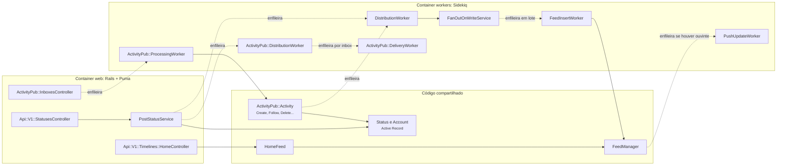
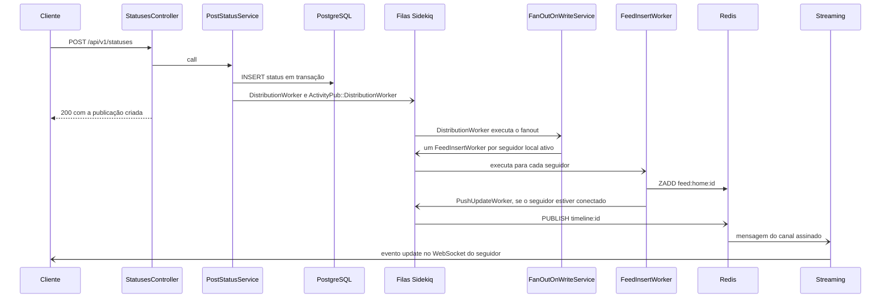
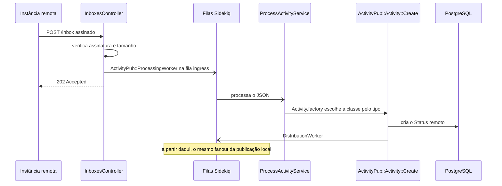
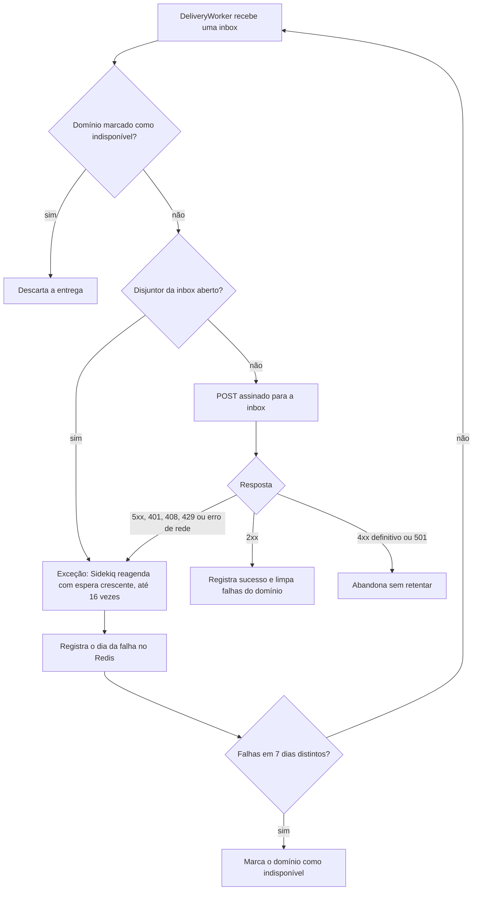

# 5.2 Mastodon: componentes e comunicação

10.000 pés

A [Seção 4.2](../capitulo-4-50-mil-pes/mastodon.md) mostrou que uma instância Mastodon é um único
quantum, formado por um processo web Rails, *workers* Sidekiq, um servidor de *streaming*, um
PostgreSQL e um Redis. Esta seção abre os dois *containers* que concentram a lógica, o web e o de
*workers*, que compartilham o mesmo código, e segue o caminho da operação mais importante do
sistema: a publicação de uma mensagem e sua chegada às *timelines* de seguidores locais e
remotos. Em seguida, examina a organização interna pelas lentes das camadas, da arquitetura
hexagonal e limpa, dos padrões de Fowler e do DDD estratégico. A análise usa a *tag* `v4.7.3` (MASTODON, 2026); os
trechos de código correspondentes são lidos na [Seção 6.2](../capitulo-6-solo/mastodon.md).

## 5.2.1 Componentes dos *containers* web e *workers*

A aplicação Rails do Mastodon segue a estrutura de diretórios convencional do *framework*,
enriquecida por pastas que o Rails não prescreve. O diretório `app/` da *tag* estudada contém, entre
outros, `controllers`, `models`, `services`, `workers`, `lib`, `serializers`, `policies`,
`presenters`, `validators` e `javascript` (a interface React). A Figura 5.2.1 agrupa os componentes
que participam do caminho de uma publicação.

**Figura 5.2.1** – Diagrama de componentes dos *containers* web e *workers* no caminho de uma publicação.

Fonte: elaborado pelo autor (2026), com base no código da *tag* v4.7.3. Linhas contínuas:
comunicação síncrona; linhas tracejadas: comunicação assíncrona.

A figura evidencia quatro grupos de componentes:

- **Apresentação:** *controllers* (`app/controllers`) e serializadores (`app/serializers`). O
  *controller* valida parâmetros, verifica autorização e delega; não contém regra de negócio.
- **Serviços:** *service objects* (`app/services`), que orquestram operações que envolvem vários
  modelos, como publicar, seguir, bloquear ou processar uma atividade remota. Todos herdam de
  `BaseService`, cujo único método público é `call`.
- **Domínio e persistência:** modelos *Active Record* (`app/models`), que combinam dados,
  validações, associações e *callbacks*, e classes de apoio como `Feed` e `HomeFeed`.
- **Infraestrutura e protocolo:** `app/lib`, onde residem o `FeedManager`, a classe `Request`
  (requisições HTTP assinadas), o `DeliveryFailureTracker` e as classes do protocolo ActivityPub.
- **Processamento assíncrono:** *workers* Sidekiq (`app/workers`), que executam *services* fora do
  ciclo da requisição.

## 5.2.2 Operação-chave: publicar

A Figura 5.2.2 mostra a sequência de uma publicação feita por um usuário local, desde a requisição
HTTP até a atualização em tempo real na tela de um seguidor conectado.

**Figura 5.2.2** – Sequência de uma publicação local.

Fonte: elaborado pelo autor (2026), com base no código da *tag* v4.7.3. Setas de ponta aberta:
mensagens assíncronas.

O ponto decisivo está na quinta mensagem: a resposta ao cliente sai **antes** de qualquer
*fanout*. A requisição termina assim que a publicação está gravada e os *jobs* estão enfileirados.
O tempo de resposta da publicação, portanto, não depende do número de seguidores do autor nem da
saúde das instâncias remotas. Note-se também que a distribuição local (`DistributionWorker`) e a
federada (`ActivityPub::DistributionWorker`) são **dois *jobs* independentes**: a falha de uma não
impede a outra.

O *fanout* é um *fanout* **de *jobs***: o `FanOutOnWriteService` não insere nas *timelines*; ele
enfileira, em lotes, um `FeedInsertWorker` por seguidor. Isso distribui o trabalho por todos os
processos Sidekiq disponíveis e torna cada inserção independente, como no serviço de *fanout* de Xu
(2020, cap. 11), em que a lista de amigos e o ID da publicação vão para uma fila e *workers* de
*fanout* os gravam no cache. Cada `FeedInsertWorker` aplica os filtros do destinatário (bloqueios,
silenciamentos, filtros de palavras) antes de inserir, o que corresponde ao passo de Xu em que o
serviço de *fanout* descarta destinatários conforme as configurações de cada usuário.

## 5.2.3 *Fanout on write*, *on read* e híbrido

*Fanout* é o processo de entregar uma publicação a todos os seguidores do autor (XU, 2020,
cap. 11). No ***fanout on write***, ou modelo *push*, a *timeline* é pré-computada no momento da
escrita: a leitura fica rápida, mas autores com muitos seguidores tornam a escrita lenta, e o
trabalho é desperdiçado com usuários inativos. No ***fanout on read***, ou modelo *pull*, a
*timeline* é montada sob demanda: não há desperdício nem problema com celebridades, mas a leitura é
lenta. Xu conclui por um modelo **híbrido**: *push* para a maioria dos usuários e *pull* para
celebridades, cujas publicações os seguidores buscam sob demanda (XU, 2020, cap. 11). A Tabela
5.2.1 sintetiza a comparação.

**Tabela 5.2.1** – Comparação dos modelos de *fanout*.

| Critério | *Fanout on write* (*push*) | *Fanout on read* (*pull*) | Híbrido |
|---|---|---|---|
| Custo da escrita | proporcional ao nº de seguidores | constante | proporcional, exceto celebridades |
| Custo da leitura | uma consulta ao cache | consulta a todos os seguidos e mescla | cache + mescla de poucas celebridades |
| Latência de leitura | baixa e previsível | alta e variável | baixa |
| Desperdício com inativos | alto | nenhum | controlável |
| Problema da celebridade | grave na escrita | inexistente | mitigado |
| Memória | alta (uma lista por usuário) | baixa | alta, mas limitada |
| Exemplo | Mastodon (seguidores locais ativos) | Mastodon (usuário que volta após inatividade) | Twitter (HOFF, 2013) |

Fonte: elaborado pelo autor (2026), com base em Xu (2020, cap. 11) e Hoff (2013).

O Mastodon adota *fanout on write*, mas com uma restrição que o transforma num híbrido de outra
natureza. O *fanout* alcança apenas seguidores **locais** que entraram na conta nos últimos 7 dias
(valor configurável por `USER_ACTIVE_DAYS`). Quando um usuário inativo volta, sua *timeline* é
reconstruída a partir do PostgreSQL por um *job* de regeneração, e, enquanto isso, a API responde
com o código `206 Partial Content`. Argumenta-se aqui que se trata de um **híbrido por leitor**,
diferente do **híbrido por autor** de Xu: leitores ativos recebem *push*; leitores inativos não
recebem nada e, ao voltar, fazem um *pull* completo, uma única vez, que os devolve ao regime de
*push*. O critério ataca a segunda desvantagem do *fanout on write* listada por Xu, o desperdício com
usuários que raramente entram, e não a primeira, o problema da celebridade. O Twitter adotava as
duas divisões: segundo Hoff (2013), mantinha em memória apenas as *timelines* de usuários ativos nos
últimos 30 dias e fazia *pull* para algumas contas muito seguidas.

O problema da celebridade aparece duas vezes em Xu: como **chave quente** no particionamento de
bancos (XU, 2020, cap. 1) e como custo do *fanout* (XU, 2020, cap. 11). As duas manifestações têm a
mesma raiz, a distribuição de cauda longa do grafo social. No Mastodon, o *fanout* local alcança só
os seguidores da **mesma instância**; os seguidores remotos recebem a publicação por entrega
federada, uma por servidor, e cada servidor de destino faz o seu próprio *fanout*. A federação
funciona, assim, como um particionamento natural do *fanout*, ainda que não haja, no código
estudado, nenhum limiar de celebridade para o *fanout* local.

### Interativo

O interativo a seguir permite comparar quantitativamente os quatro arranjos discutidos nesta
seção. Para uma conta com muitos seguidores locais, ele calcula o número de *jobs*
`FeedInsertWorker` gerados por publicação, o atraso até a última *timeline* local, o número de
consultas por leitura e o trabalho desperdiçado com usuários inativos. Os valores iniciais, 50 mil
seguidores locais e 2.000 inserções por segundo, são os da estimativa hipotética da Seção 3.2.4, e
o controle de `USER_ACTIVE_DAYS` mostra como o limiar de atividade altera o custo da escrita sem
alterar o problema da celebridade. Observa-se ainda o caminho do leitor inativo que retorna:
resposta `206 Partial Content`, regeneração pelo `RegenerationWorker` e volta ao regime de *push*.

<iframe src="../../interativos/fanout.html" title="Fanout on write, on read e híbrido no Mastodon" style="width:100%; height:660px; border:1px solid #2A4468; border-radius:10px;" loading="lazy"></iframe>

## 5.2.4 A *timeline* como estrutura em memória

O Mastodon guarda cada *timeline* num **conjunto ordenado** (*sorted set*) do Redis, com chave
`feed:home:<id da conta>`, em que o membro e a pontuação são o próprio ID da publicação. Como os IDs
são gerados de forma ordenável no tempo, à maneira do Snowflake do Twitter, ordenar por ID equivale
a ordenar cronologicamente, e a paginação por `max_id` e `min_id` vira uma consulta por faixa de
pontuação. Cada *timeline* é limitada a 800 itens, o mesmo valor que o Twitter usava, segundo Hoff
(2013); o histórico mais antigo vem do PostgreSQL.

A organização corresponde à arquitetura de cache proposta por Xu (2020, cap. 11), em que o cache de
*feed* guarda apenas IDs e a resposta completa é montada depois, a partir de outros caches ou do
banco, processo chamado de **hidratação**. No Mastodon, a leitura da *timeline* faz uma consulta por
faixa no Redis e uma busca por chave primária no PostgreSQL; não há junção com a tabela de seguidores
nem varredura de publicações de centenas de contas. A separação entre a lista de IDs e o conteúdo
tem uma consequência importante: editar uma publicação não exige reescrever milhares de *timelines*,
pois elas guardam apenas o ID.

## 5.2.5 Recepção federada: os dois caminhos convergem

Uma publicação de outra instância chega por outro caminho, mostrado na Figura 5.2.3. O
`ActivityPub::InboxesController` verifica a assinatura HTTP, rejeita cargas grandes demais,
enfileira o processamento num *job* da fila `ingress` e responde imediatamente `202 Accepted`. O
servidor de origem não espera o processamento, o que desacopla a disponibilidade das duas
instâncias.

**Figura 5.2.3** – Sequência de recepção de uma publicação remota.

Fonte: elaborado pelo autor (2026), com base no código da *tag* v4.7.3. Setas de ponta aberta:
mensagens assíncronas.

A última mensagem é a mais importante do ponto de vista de componentes: depois de criar a publicação
remota no banco, a classe `ActivityPub::Activity::Create` enfileira o **mesmo** `DistributionWorker`
usado para publicações locais. Os dois caminhos convergem num único mecanismo de *fanout*, e o
`FanOutOnWriteService` não precisa saber se a publicação nasceu na instância ou fora dela. A
fronteira com o mundo federado fica concentrada nas classes do protocolo; o restante do sistema
trabalha com o modelo local.

## 5.2.6 Entrega federada: retentativas e falhas parciais

A especificação ActivityPub determina que a entrega a servidores de terceiros deve ser assíncrona e
repetida em caso de falha de rede, e permite entregar uma única vez à caixa de entrada compartilhada
(*sharedInbox*) de um servidor que hospede vários destinatários (LEMMER-WEBBER *et al.*, 2018,
seções 7.1 e 7.1.3). O `ActivityPub::DistributionWorker` calcula as caixas de entrada de destino,
usando a compartilhada quando existe, e enfileira um `ActivityPub::DeliveryWorker` por caixa.

A entrega federada é o ponto em que as falácias da computação distribuída deixam de ser teoria. A
primeira delas, a de que a rede é confiável, é o motivo pelo qual existem *timeouts* e disjuntores
(*circuit breakers*) entre serviços (RICHARDS; FORD, 2020, p. 124). Uma instância remota pode estar
fora do ar, lenta, bloqueando o remetente ou ter deixado de existir. A entrega precisa tolerar
**falhas parciais**: a mesma publicação chega a 4.990 instâncias e falha em 10, e essas 10 não podem
atrasar as demais nem consumir recursos indefinidamente. A Figura 5.2.4 mostra o fluxo
implementado, cujo código é lido na Seção 6.2.

**Figura 5.2.4** – Entrega federada com retentativas, disjuntor e marcação de domínios indisponíveis.

Fonte: elaborado pelo autor (2026), com base nos arquivos `app/workers/activitypub/delivery_worker.rb`,
`app/lib/delivery_failure_tracker.rb` e `app/helpers/json_ld_helper.rb` da *tag* v4.7.3.

Três táticas se combinam. A **retentativa com espera crescente** absorve falhas transitórias, como
Xu (2020, cap. 10) recomenda para sistemas de notificação. O **disjuntor** evita insistir numa caixa
de entrada que vem falhando. A **marcação de domínios indisponíveis** encerra as tentativas quando a
falha deixa de ser transitória. O resultado é uma garantia de entrega **pelo menos uma vez** dentro
de uma janela de cerca de dois dias, e não de exatamente uma vez. Xu (2020, cap. 10) observa que a
entrega exatamente uma vez não é alcançável em sistemas distribuídos e recomenda deduplicar no
destino pelo identificador do evento; no ActivityPub, esse papel cabe ao identificador global (URI)
de cada objeto, que o modelo `Status` exige ser único para publicações remotas.

## 5.2.7 As lentes de análise

### Camadas

Na terminologia de Richards e Ford (2020, cap. 10), as camadas do Mastodon não são estritamente
fechadas. Um *worker* chama tanto *services* quanto modelos; um *controller* pode consultar modelos
diretamente para leituras simples; o `FeedManager`, em `app/lib`, consulta modelos e Redis. A regra
predominante é de convenção, não de imposição. Essa flexibilidade evita o antipadrão do **sumidouro
arquitetural** (*architecture sinkhole*), em que requisições atravessam camadas que nada fazem além
de repassá-las (RICHARDS; FORD, 2020, p. 138), mas cobra seu preço em isolamento: com camadas
abertas, uma mudança na persistência pode afetar *controllers*, *services* e *workers* ao mesmo
tempo. Richards e Ford observam ainda que o estilo em camadas é particionado tecnicamente, e não por
domínio, de modo que um conceito fica espalhado por todas as camadas (RICHARDS; FORD, 2020, p. 135).
No Mastodon, o conceito de publicação aparece em `StatusesController`, `PostStatusService`, `Status`,
`DistributionWorker`, `FanOutOnWriteService`, `FeedManager` e nos serializadores, como se pode
verificar seguindo a Figura 5.2.1.

### Hexagonal e limpa

Pela lente da arquitetura hexagonal e da arquitetura limpa (Seções 1.8.2 a 1.8.4), o Mastodon **não**
inverte dependências. Os *services* dependem diretamente dos modelos *Active Record*, que dependem do
banco, e o `FeedManager` fala diretamente com o Redis; não há portas definidas pela aplicação nem
adaptadores substituíveis. A regra da dependência, segundo a qual o código de política não deve
conhecer detalhes de infraestrutura, é deliberadamente ignorada em favor das convenções do Rails.
Há, contudo, uma exceção parcial: a **fronteira do protocolo**. As classes de `app/lib/activitypub`
e os serializadores ActivityPub funcionam como um adaptador de entrada e de saída entre o formato
externo (JSON-LD do Activity Streams) e o modelo interno, de modo que a mudança de uma versão do
protocolo tende a ficar contida nelas. Argumenta-se aqui que o Mastodon aplica a ideia hexagonal
onde o custo de não aplicá-la seria maior, isto é, na fronteira com milhares de sistemas que ele não
controla, e não no interior, onde a substituição de PostgreSQL ou Redis não é um cenário relevante.

### Padrões de Fowler

Pela lente dos padrões de aplicação corporativa de Fowler (2002), o Mastodon combina três padrões. Os
modelos seguem o ***Active Record*** (FOWLER, 2002, cap. 10), em que o objeto envolve uma linha de uma
tabela, encapsula o acesso a ela e acrescenta lógica de domínio. Os *service objects* aproximam-se de
uma ***Service Layer*** (FOWLER, 2002, cap. 9), uma camada que define as operações disponíveis e
coordena a resposta da aplicação a cada uma, e, internamente, cada serviço tem a forma de um
***Transaction Script*** (FOWLER, 2002, cap. 9), um procedimento que organiza a lógica de uma
operação do início ao fim. Fox e Patterson (2021, cap. 5) descrevem esses objetos no contexto do
Rails como classes, em geral sem estado próprio no banco, que realizam operações complexas envolvendo
vários modelos e que são especialmente úteis quando combinadas com uma transação de banco. A Seção
6.2 identifica cada padrão no código, no formato de ficha *Known Uses*.

### DDD estratégico

Embora o Mastodon não use o vocabulário do DDD, é possível identificar contextos delimitados
implícitos (Seção 1.9.2), resumidos na Tabela 5.2.2.

**Tabela 5.2.2** – Contextos delimitados implícitos no Mastodon.

| Contexto | Conceitos centrais | Onde vive no código |
|---|---|---|
| Identidade e contas | conta, usuário, sessão, aplicação OAuth | `Account`, `User`, *controllers* de autenticação |
| Publicação | publicação, menção, mídia, enquete, citação | `Status`, `PostStatusService`, `MediaAttachment` |
| *Timelines* | *timeline* inicial, lista, regeneração | `FeedManager`, `Feed`, `HomeFeed`, `FanOutOnWriteService` |
| Federação | ator, atividade, *inbox*, entrega | `app/lib/activitypub`, `app/services/activitypub`, *workers* ActivityPub |
| Moderação | denúncia, bloqueio de domínio, suspensão | `app/controllers/admin`, `app/policies`, `DomainBlock` |
| Notificações | notificação, *push* web | `LocalNotificationWorker`, `app/workers/web` |

Fonte: elaborado pelo autor (2026), com base no código da *tag* v4.7.3.

Os contextos compartilham o mesmo banco e as mesmas classes de modelo, de modo que, no interior da
instância, a relação entre eles é, na prática, um núcleo compartilhado amplo, não uma fronteira
explícita. Na fronteira externa, o quadro é diferente e corresponde bem aos padrões de Evans (2003,
cap. 14). O ActivityPub e o vocabulário Activity Streams são uma **linguagem publicada**
(*Published Language*), um modelo de intercâmbio documentado e compartilhado (EVANS, 2003, p. 264).
A *inbox* e a API REST oferecem um **serviço de *host* aberto** (*Open Host Service*), um protocolo
público pelo qual qualquer sistema pode se integrar (EVANS, 2003, p. 263). E as classes que
traduzem atividades recebidas em modelos locais desempenham o papel de uma **camada anticorrupção**
(*Anticorruption Layer*), que protege o modelo interno do modelo de outros sistemas (EVANS, 2003,
p. 257): uma atividade `Create` de um software qualquer do fediverso torna-se um `Status` local, com
as validações e os filtros locais.

## 5.2.8 Decisões e compromissos

A decisão central desta altitude pode ser registrada como ADR reconstruído, no formato do Apêndice B.
Os nomes entre parênteses foram conferidos na *tag* estudada.

!!! note "ADR-M4 (reconstruído): distribuir publicações às *timelines* no momento da escrita, de forma assíncrona"
    **Status:** aceito (reconstrução retrospectiva, 2026).

    **Contexto.** A leitura da *timeline* inicial é a operação mais frequente da instância e precisa
    ser rápida. As publicações de quem o usuário segue podem ser locais ou chegar de outras
    instâncias a qualquer momento. A instância deve funcionar num único servidor modesto. Muitos
    usuários cadastrados não acessam a conta com frequência.

    **Decisão.** Ao criar ou receber uma publicação, gravá-la no PostgreSQL e enfileirar um *job*
    (`DistributionWorker`) que insere o ID na *timeline* de cada seguidor **local e ativo**, mantida
    no Redis como conjunto ordenado limitado a 800 itens (`FeedManager::MAX_ITEMS`). Usuários
    inativos há mais de 7 dias (`USER_ACTIVE_DAYS`) não recebem *fanout*; sua *timeline* é
    reconstruída quando voltam (`RegenerationWorker`). Seguidores de outras instâncias recebem a
    publicação por entrega ActivityPub, em outro *job*, uma vez por caixa de entrada compartilhada.

    **Consequências.** Leitura da *timeline* em tempo praticamente constante. Escrita com custo
    proporcional ao número de seguidores locais ativos, absorvido pelas filas e não pela requisição.
    Consistência eventual: um seguidor pode ver a publicação alguns segundos depois de outro.
    Dependência do Redis para o desempenho de leitura, mas não para a durabilidade. Contas com muitos
    seguidores locais produzem rajadas de *jobs*; não há exceção para celebridades no *fanout* local.

A Tabela 5.2.3 resume os compromissos assumidos nesta altitude.

**Tabela 5.2.3** – Decisões de componentes e seus compromissos.

| Decisão | Ganha | Paga |
|---|---|---|
| *Fanout on write* assíncrono | leitura rápida; publicação rápida | consistência eventual; rajadas de *jobs* |
| *Fanout* só para ativos | memória e processamento | reconstrução na volta; resposta `206` |
| *Timeline* limitada a 800 IDs | memória previsível | histórico antigo vem do banco |
| Mesmo *fanout* para locais e remotas | um único mecanismo, menos código | publicação remota tardia entra como recente se não for filtrada |
| Camadas abertas, sem portas | simplicidade, convenções do Rails | isolamento fraco; testes dependem do banco |
| Tradução na fronteira ActivityPub | modelo interno protegido | duas representações a manter em sincronia |

Fonte: elaborado pelo autor (2026).

Sobre a quarta linha, o código da classe `Create` só enfileira a distribuição para publicações
remotas recentes, dentro de uma "janela de tempo real", ou quando o processamento foi disparado por
uma entrega direta, o que mitiga o risco indicado (Seção 6.2).

!!! caixa-preta "Quando a resposta chega antes da pergunta"
    O resumo de Hoff (2013) da palestra de Krikorian (2012) registra dois sintomas do *fanout on
    write* no Twitter: a entrega da publicação de uma conta com 31 milhões de seguidores podia levar
    até cinco minutos, e respostas a publicações de celebridades eram vistas antes das publicações
    originais. O segundo sintoma é um efeito clássico de consistência eventual com filas de
    tamanhos diferentes: a resposta de um usuário comum percorre um *fanout* pequeno e chega logo; a
    publicação original da celebridade espera atrás de dezenas de milhões de inserções.

    **Lição para esta altitude.** O problema não está em nenhum componente isolado, mas na
    **comunicação** entre eles: duas mensagens causalmente ordenadas seguem caminhos de custos muito
    diferentes. A resposta do Twitter foi o modelo híbrido, mesclando na leitura as publicações das
    contas muito seguidas (HOFF, 2013). O Mastodon convive com uma versão atenuada do mesmo efeito:
    a ordem de chegada às *timelines* é dada pela fila, e a ordem de exibição, pelos IDs; o código
    da *timeline* precisa tolerar que um compartilhamento chegue antes do original, caso tratado
    explicitamente no `FeedManager` (Seção 6.2).

## Referências

EVANS, E. **Domain-driven design**: tackling complexity in the heart of software. Boston:
Addison-Wesley, 2003.

FOWLER, M. **Patterns of enterprise application architecture**. Boston: Addison-Wesley, 2002.

FOX, A.; PATTERSON, D. **Engineering software as a service**: an agile approach using cloud
computing. 2. ed., versão 2.0b7. [*S. l.*]: Strawberry Canyon, 2021.

HOFF, T. **The architecture Twitter uses to deal with 150M active users, 300K QPS, a 22 MB/s
firehose, and send tweets in under 5 seconds**. High Scalability, 8 jul. 2013. Disponível em:
<http://highscalability.com/blog/2013/7/8/the-architecture-twitter-uses-to-deal-with-150m-active-users.html>.
Acesso em: 18 out. 2026.

KRIKORIAN, R. **Timelines at scale**. Palestra apresentada na QCon San Francisco 2012. InfoQ,
2012. Disponível em: <https://www.infoq.com/presentations/Twitter-Timeline-Scalability/>. Acesso
em: 18 out. 2026.

LEMMER-WEBBER, C. *et al.* **ActivityPub**. W3C Recommendation, 23 jan. 2018. Disponível em:
<https://www.w3.org/TR/activitypub/>. Acesso em: 18 out. 2026.

MASTODON. **mastodon/mastodon**: repositório de código-fonte, versão v4.7.3. GitHub, 2026.
Disponível em: <https://github.com/mastodon/mastodon/tree/v4.7.3>. Acesso em: 18 out. 2026.

RICHARDS, M.; FORD, N. **Fundamentals of software architecture**: an engineering approach.
Sebastopol: O'Reilly, 2020.

XU, A. **System design interview**: an insider's guide. 2. ed. [*S. l.*]: Independently
published, 2020.
