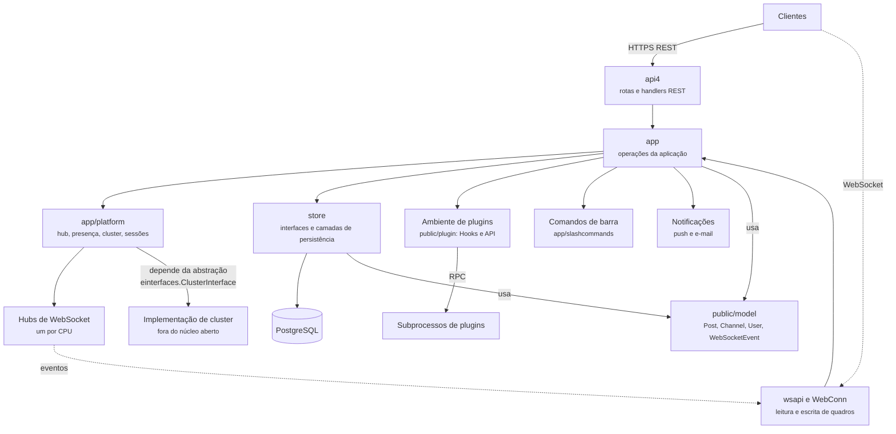
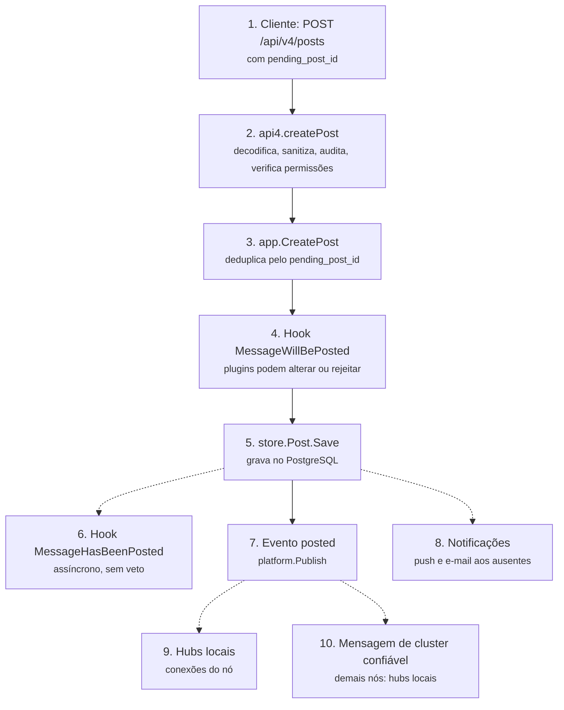
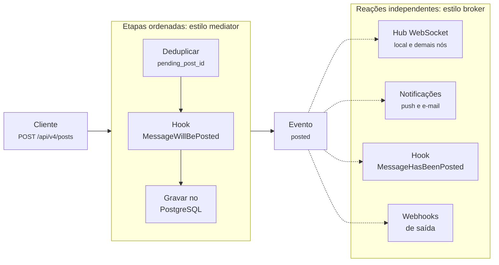
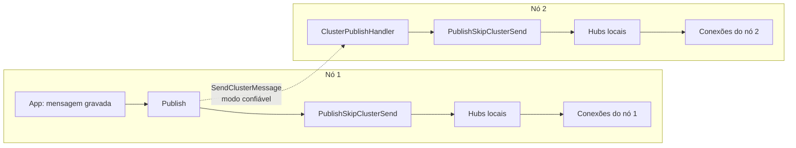
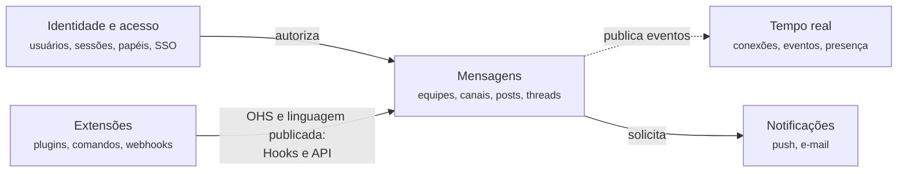

# 5.3 Mattermost: componentes e comunicação

10.000 pés

A [Seção 4.3](../capitulo-4-50-mil-pes/mattermost.md) mostrou que o servidor Mattermost é um binário único que acumula a API REST, as
conexões WebSocket e o gerenciamento de *plugins*, e que, em *cluster*, os nós trocam eventos por
difusão. Esta seção abre esse *container* para examinar seus componentes, o fluxo de comunicação
entre eles em uma operação-chave, a publicação de uma mensagem, e os mecanismos de ordenação,
entrega, idempotência e presença. Ao final, a organização interna é lida pelas lentes das
arquiteturas em camadas, hexagonal e limpa, dos padrões de Fowler (2002) e do *Domain-Driven
Design* estratégico. Todos os caminhos citados referem-se à *tag* v11.11.1 do repositório
(MATTERMOST, 2026a).

## 5.3.1 Componentes do servidor

A estrutura de diretórios do servidor já revela a decomposição principal. Em `server/channels/`
estão o pacote `api4`, que registra as rotas da API REST e traduz requisições HTTP em chamadas à
aplicação; o pacote `wsapi`, que trata as mensagens enviadas pelos clientes através do WebSocket; o
pacote `app`, que concentra as operações da aplicação, como criar uma mensagem ou executar um
comando; o subpacote `app/platform`, que reúne os serviços de infraestrutura em tempo real, como o
*hub* de WebSocket, a presença e a comunicação com o *cluster*; o pacote `store`, que define as
interfaces de persistência e suas implementações; e o pacote `jobs`, de tarefas em segundo plano.
Fora de `channels`, o diretório `server/public/` contém o modelo de dados compartilhado
(`public/model`) e a API de *plugins* (`public/plugin`), e `server/einterfaces/` contém as
interfaces que funcionalidades comerciais implementam (MATTERMOST, 2026a). A Figura 5.3.1 organiza
esses elementos como um diagrama C4 de componentes.

**Figura 5.3.1** – Componentes (C4, nível 3) do servidor Mattermost.

Fonte: elaborado pelo autor (2026), com base em Mattermost (2026a). Linhas contínuas: comunicação
síncrona; linhas tracejadas: comunicação assíncrona.

Duas observações orientam a leitura. Primeiro, o pacote `app` funciona como fachada única da
lógica de aplicação: os *handlers* REST, os tratadores de WebSocket, os comandos de barra e a API
oferecida aos *plugins* convergem para ele. Segundo, a seta rotulada com
`einterfaces.ClusterInterface` indica uma dependência de **abstração**: o núcleo aberto declara a
interface do *cluster*, e a implementação concreta é injetada quando existe licença; sem ela, o
servidor opera como nó único (MATTERMOST, 2026a, `server/einterfaces/cluster.go` e
`server/channels/app/platform/cluster.go`).

## 5.3.2 Uma operação-chave: publicar uma mensagem

A Figura 5.3.2 acompanha a publicação de uma mensagem desde a requisição até a entrega aos
clientes de outro nó. Os passos foram reconstruídos a partir do código: o *handler* `createPost`
em `api4/post.go`, a função `CreatePost` em `app/post.go` e as funções `Publish` e
`PublishSkipClusterSend` em `app/platform/cluster.go` (MATTERMOST, 2026a).

**Figura 5.3.2** – Comunicação entre componentes na publicação de uma mensagem.

Fonte: elaborado pelo autor (2026), com base em Mattermost (2026a). Linhas contínuas: comunicação
síncrona; linhas tracejadas: comunicação assíncrona.

Três aspectos do fluxo merecem destaque. O *handler* REST descarta o instante de criação enviado
pelo cliente, salvo para administradores do sistema, de modo que, em regra, o servidor define o
instante que ordenará a mensagem (MATTERMOST, 2026a, `api4/post.go`, linhas 130 a 132). A
gravação no banco precede todas as reações; nenhum cliente é avisado de uma mensagem que não foi
persistida. E os passos 6 a 10 não dependem uns dos outros: correspondem a interessados distintos
no mesmo fato, o que leva à discussão de topologias a seguir.

## 5.3.3 *Broker* e *mediator*

Richards e Ford (2020, cap. 14) distinguem duas topologias na arquitetura orientada a eventos. Na
topologia ***broker*** não há coordenador central: um evento inicial é publicado em um canal do
*broker* de mensagens, um processador o consome, executa sua tarefa e anuncia o que fez por meio
de um novo evento de processamento, ao qual outros processadores reagem, e assim por diante. Os
autores comparam a topologia a uma corrida de revezamento, em que cada corredor, depois de passar
o bastão, deixa de se ocupar dele. Recomendam ainda que cada processador anuncie o que fez mesmo
que ninguém esteja interessado, porque esse anúncio funciona como um ponto de extensão para
funcionalidades futuras (RICHARDS; FORD, 2020, cap. 14).

Na topologia ***mediator***, um **mediador de eventos** recebe o evento inicial, conhece as etapas
do fluxo e envia eventos de processamento a canais dedicados, em geral filas ponto a ponto; os
processadores executam suas etapas e respondem ao mediador, sem anunciar ao resto do sistema o
que fizeram (RICHARDS; FORD, 2020, cap. 14). A Tabela 5.3.1 resume as vantagens e desvantagens que
os autores atribuem a cada topologia.

**Tabela 5.3.1** – Compromissos das topologias *broker* e *mediator*.

| | Topologia *broker* | Topologia *mediator* |
|---|---|---|
| **Vantagens** | Processadores muito desacoplados; alta escalabilidade, responsividade, desempenho e tolerância a falhas | Controle do fluxo; tratamento de erros; recuperabilidade; capacidade de reinício; melhor consistência dos dados |
| **Desvantagens** | Falta de controle do fluxo; tratamento de erros difícil; sem recuperabilidade nem reinício; inconsistência de dados | Maior acoplamento entre processadores; menor escalabilidade, desempenho e tolerância a falhas; dificuldade de modelar fluxos complexos |

Fonte: adaptado de Richards e Ford (2020, p. 185, 195).

Os autores resumem a escolha como um compromisso entre controle do fluxo e capacidade de tratar
erros, de um lado, e desempenho e escalabilidade, de outro (RICHARDS; FORD, 2020, p. 195). Em um
sistema de mensagens, as duas topologias convivem, aplicadas a fluxos diferentes. A **difusão** de
uma mensagem publicada segue a lógica do *broker*: o evento "mensagem publicada" é anunciado, e
vários interessados reagem de forma independente e em paralelo, como o *hub* de WebSocket, que a
entrega aos clientes conectados; o serviço de notificações, que decide quem deve receber *push*
ou *e-mail*; os *plugins*, pelo *hook* `MessageHasBeenPosted`; e os *webhooks* de saída. Nenhum
desses interessados precisa conhecer os demais, e a falha de um não impede os outros.

Já a **criação** da mensagem segue a lógica do *mediator*. Antes de a mensagem ser gravada, o
servidor executa uma sequência ordenada e controlada de etapas: deduplicação, consulta aos
*plugins* pelo *hook* `MessageWillBePosted`, que podem alterar ou
rejeitar a mensagem, gravação no banco e só então a publicação do evento (MATTERMOST, 2026a,
`post.go`). Aqui, a ordem importa e um erro precisa interromper o fluxo e ser devolvido ao
usuário. Argumenta-se, portanto, que o Mattermost usa uma orquestração síncrona, de estilo
*mediator*, para tudo o que ocorre **antes** da confirmação, e uma difusão assíncrona, de estilo
*broker*, para tudo o que ocorre **depois**. A Figura 5.3.3 representa esse arranjo.

**Figura 5.3.3** – Orquestração antes da gravação e difusão depois dela, na publicação de uma mensagem.

Fonte: elaborado pelo autor (2026), com base em Richards e Ford (2020, cap. 14) e Mattermost
(2026a). Linhas contínuas: comunicação síncrona; linhas tracejadas: comunicação assíncrona.

## 5.3.4 *Publish/subscribe* e o *hub* de WebSocket

O modelo *publish/subscribe* é a forma de mensageria que sustenta a topologia *broker*. Os
produtores publicam eventos em tópicos sem conhecer os consumidores, que assinam os tópicos de seu
interesse. O SWEBOK v4 contrasta esse modelo com a mensageria **ponto a ponto**, em que remetentes
e destinatários precisam conhecer-se para trocar mensagens (WASHIZAKI, 2024, cap. 3, seção 5.7).
Richards e Ford (2020, cap. 14) destacam a **capacidade de difusão** como uma característica
singular do estilo: o produtor de uma mensagem difundida em geral não sabe quem a receberá nem o
que será feito com ela, o que constitui talvez o mais alto grau de desacoplamento entre
processadores de eventos.

O componente central do Mattermost a esta altitude é o ***hub*** de WebSocket, implementado no
pacote `platform` do servidor (MATTERMOST, 2026a, `server/channels/app/platform/web_hub.go`). Suas
responsabilidades são registrar e remover conexões, manter índices que permitem encontrar as
conexões de um usuário ou de um canal, e entregar a cada conexão os eventos que lhe dizem respeito.
Cada conexão é representada por um objeto `WebConn` (arquivo `web_conn.go`), que tem duas rotinas
concorrentes (*goroutines*): uma que lê os quadros enviados pelo cliente e outra que escreve no
*socket* os eventos colocados em sua fila de envio.

Três decisões de projeto merecem atenção. A primeira é que não há um *hub*, mas **vários**: o
servidor cria um *hub* por núcleo de processador, e cada usuário é atribuído a um *hub* por meio de
uma função de *hash* sobre seu identificador ([Listagem 6.3.3](../capitulo-6-solo/mattermost.md)). Todas as conexões de um mesmo usuário,
em todos os seus dispositivos, ficam no mesmo *hub*, o que simplifica a lógica de presença. A
segunda é que cada *hub* processa seus pedidos em um único laço, que recebe mensagens por canais
(*channels*) da linguagem Go: registrar, remover, difundir, invalidar *cache*. Como só esse laço
altera os índices de conexões, eles dispensam bloqueios (*locks*). Trata-se de uma aplicação do
princípio de comunicar por mensagens em vez de compartilhar memória, e lembra o modelo de atores do
Erlang usado pelo WhatsApp (WHATSAPP, 2012). A terceira é o tratamento do **consumidor lento**: se a
fila de envio de uma conexão está cheia quando o *hub* tenta entregar um evento, o *hub* não espera;
ele fecha e remove a conexão ([Listagem 6.3.4](../capitulo-6-solo/mattermost.md)). A decisão protege a responsividade de todos os demais
usuários do *hub* à custa do cliente lento, que terá de reconectar-se e recuperar os eventos pelo
mecanismo descrito na Seção 5.3.6.

## 5.3.5 Difusão de eventos entre os nós do *cluster*

Quando há vários nós, um evento produzido em um deles pode interessar a conexões mantidas em
outro. O Mattermost resolve o problema por difusão: ao publicar um evento, o nó o entrega aos seus
próprios *hubs* e, em seguida, o serializa e o envia a todos os outros nós do *cluster*, que, ao
recebê-lo, o entregam aos seus *hubs* locais, sem reenviá-lo ([Listagem 6.3.5](../capitulo-6-solo/mattermost.md)). A não retransmissão é
essencial: se cada nó reenviasse o que recebe, um único evento circularia indefinidamente.

O detalhe mais instrutivo está no **tipo de envio**. Cada mensagem de *cluster* pode ser enviada em
modo de **melhor esforço** (*best effort*) ou em modo **confiável** (*reliable*), e o modo confiável
é reservado a um conjunto restrito de eventos: mensagem publicada, mensagem editada, conversa direta
ou em grupo criada e usuário adicionado a uma equipe, além dos eventos marcados explicitamente
(MATTERMOST, 2026a, `cluster.go`). A estrutura que descreve o alcance de um evento documenta que o
envio confiável usa um canal apoiado em TCP (MATTERMOST, 2026a, `websocket_message.go`). A lógica
é a de uma classificação de eventos por custo da perda. Perder um aviso de "fulano está digitando"
é irrelevante, porque ele perde o sentido em poucos segundos; perder a notícia de que uma mensagem
foi publicada deixa um usuário sem ver a mensagem até recarregar a página. Garantias mais fortes
custam mais, e por isso são aplicadas apenas onde a perda é cara. O Slack faz distinção análoga:
eventos transitórios, como os indicadores de digitação, seguem caminho semelhante ao das mensagens,
mas não são persistidos (THANGUDU, 2023).

A Figura 5.3.4 mostra o percurso de um evento de mensagem publicada em um *cluster* de dois nós.

**Figura 5.3.4** – Difusão de um evento entre os nós do *cluster* do Mattermost.

Fonte: elaborado pelo autor (2026), com base em Mattermost (2026a, `cluster.go` e
`cluster_handlers.go`). Linhas contínuas: comunicação síncrona; linhas tracejadas: comunicação
assíncrona.

Há um aspecto de modularidade que só se percebe ao procurar a implementação do *cluster*. O código
público do servidor declara a interface `ClusterInterface`, no pacote `einterfaces`, com operações
como enviar mensagem ao *cluster*, registrar tratadores de eventos e consultar se o nó é líder; o
serviço de plataforma depende apenas dessa interface, recebida por injeção (MATTERMOST, 2026a,
`server/einterfaces/cluster.go` e `cluster.go`). A implementação concreta, que realiza o protocolo
de fofoca, não está entre os diretórios públicos da versão estudada. O princípio da inversão de
dependência (ver [Seção 1.5.4](../capitulo-1-fundamentos/index.md)) é aqui o mecanismo que torna possível o modelo *open core*: o núcleo
aberto define a abstração, e a implementação comercial a satisfaz, sem que o núcleo dependa dela.
Quando nenhuma implementação é injetada, o servidor simplesmente opera como nó único.

### Interativo

O interativo a seguir reúne, em uma sequência de passos, as três ideias das Seções 5.3.3 a 5.3.5.
Inicia-se pelas topologias abstratas de Richards e Ford (2020, cap. 14); em seguida, acompanha-se
a publicação de uma mensagem, com as etapas ordenadas de estilo *mediator* até a gravação,
incluindo a rejeição por um *plugin*, e as reações independentes de estilo *broker* depois dela.
Os passos finais mostram a escolha do *hub* por *hash*, o descarte do consumidor lento e a
difusão entre nós nos modos confiável e de melhor esforço, com a assimetria entre `Publish` e
`PublishSkipClusterSend` que impede a recirculação de eventos.

<iframe src="../../interativos/broker-mediator.html" title="Broker, mediator e difusão de eventos no Mattermost" style="width:100%; height:660px; border:1px solid #2A4468; border-radius:10px;" loading="lazy"></iframe>

## 5.3.6 Ordenação, entrega e idempotência

Três propriedades frequentemente confundidas precisam ser separadas. A **ordenação** diz respeito à
sequência em que as mensagens aparecem; a **garantia de entrega** diz respeito a quantas vezes uma
mensagem chega ao destino (no máximo uma, ao menos uma ou exatamente uma); a **idempotência** é a
propriedade de uma operação que produz o mesmo efeito se executada uma ou várias vezes, e é a
técnica usual para tornar inofensivas as repetições inevitáveis da entrega "ao menos uma vez".

**Ordenação.** Em um sistema distribuído não existe relógio global confiável, e por isso a ordem
dos eventos precisa ser construída. Lamport (1978) mostrou que se pode definir uma ordem parcial
baseada na relação "aconteceu antes" e estendê-la a uma ordem total por meio de relógios lógicos.
Na prática dos sistemas de mensagens, a solução é atribuir a cada mensagem um identificador
ordenável. Xu (2020, cap. 12) observa que não se pode confiar no instante de criação para ordenar,
porque duas mensagens podem ser criadas no mesmo instante, e exige que o identificador seja único e
crescente no tempo. O autor nota ainda que basta garantir a ordem **dentro** de cada canal, e não
entre canais, o que permite usar geradores de sequência locais a cada canal em vez de um gerador
global. Essa observação responde a uma pergunta frequente: a ordem global entre canais é,
em geral, desnecessária e cara, ao passo que a ordem dentro do canal é indispensável.

No Mattermost, cada mensagem recebe um instante de criação em milissegundos (`CreateAt`),
preenchido pelo servidor quando o cliente não o informa, e as listas de mensagens são ordenadas por
esse campo (MATTERMOST, 2026a, `post.go` e `server/public/model/post_list.go`). Como o instante
vem do relógio do nó que gravou a mensagem, a ordem é tão boa quanto a sincronização de relógios
entre os nós, uma limitação que a observação de Xu sobre instantes coincidentes ajuda a avaliar. Há, porém, um
segundo nível de ordenação, menos visível: a **ordem de entrega pela conexão**. Cada `WebConn`
numera sequencialmente os eventos que escreve no *socket* ([Listagem 6.3.6](../capitulo-6-solo/mattermost.md)). O cliente conhece o
número do último evento recebido e, ao reconectar-se, informa-o ao servidor. O servidor guarda os
últimos 128 eventos enviados a cada conexão em um *buffer* circular chamado de **fila morta**
(*dead queue*), descrito no código como um *buffer* de *socket* em espaço de usuário, usado para
"ressuscitar" mensagens perdidas quando a conexão cai (MATTERMOST, 2026a, `web_conn.go`). Na
reconexão, se o número informado ainda está na fila morta, o servidor reenvia os eventos
subsequentes e a retomada é sem perdas; se não está e houve perda, o servidor gera uma nova
identidade de conexão, zera a sequência e envia uma mensagem de saudação (*hello*), sinalizando ao
cliente que ele deve ressincronizar seu estado pela API. Em *cluster*, o nó que recebe a reconexão
pode pedir aos demais nós a fila da conexão anterior (MATTERMOST, 2026a, `web_hub.go`,
`einterfaces/cluster.go`). O mecanismo combina uma técnica de garantia de entrega com uma
alternativa explícita para quando a garantia não pode ser cumprida.

**Entrega.** Richards e Ford (2020, cap. 14) identificam três pontos de perda em um fluxo
assíncrono: a mensagem não chega à fila, o consumidor a retira e falha antes de processá-la, ou o
consumidor não consegue persisti-la. As técnicas correspondentes são filas persistentes com envio
síncrono, confirmação pelo cliente (*client acknowledge*) e transações no banco de dados. No
Mattermost, a persistência da mensagem ocorre de forma síncrona na requisição REST, **antes** de
qualquer difusão; o que é assíncrono é apenas a notificação aos interessados. Se a difusão falhar,
a mensagem não está perdida, apenas atrasada até que o cliente se ressincronize. Essa ordem,
"gravar e depois anunciar", é a decisão que transforma a perda de eventos em um problema de
latência, e não de integridade. Xu (2020, cap. 10) chega a conclusão análoga para notificações:
elas podem atrasar ou chegar fora de ordem, mas não devem ser perdidas, e a entrega exatamente
uma vez não pode ser garantida em um sistema distribuído.

**Idempotência.** Se a entrega exatamente uma vez é impossível, a alternativa é aceitar repetições
e torná-las inofensivas, o que Hohpe e Woolf (2003) catalogam como o padrão *Idempotent Receiver*.
Xu (2020, cap. 10) propõe a deduplicação por identificador de evento: ao receber um evento, verifica-
se se seu identificador já foi visto e, em caso positivo, ele é descartado. O Mattermost aplica a
mesma técnica no ponto mais sensível, a criação de mensagens. O cliente gera um identificador
provisório, o `pending_post_id`, e o reenvia em todas as tentativas da mesma mensagem; o servidor
guarda em *cache*, por 30 segundos, a associação entre esse identificador e a mensagem criada, e, se
receber uma repetição, devolve a mensagem já existente em vez de criar outra ([Listagem 6.3.7](../capitulo-6-solo/mattermost.md)). Sem
esse mecanismo, um usuário em uma rede móvel instável que reenviasse a mensagem após um tempo
limite poderia publicá-la duas vezes.

## 5.3.7 Presença por *heartbeat*

O indicador de presença parece trivial, mas é um problema distribuído. Xu (2020, cap. 12) mostra
que a abordagem ingênua, marcar o usuário como *offline* quando a conexão cai e como *online* quando
ela volta, produz uma experiência ruim, porque conexões móveis caem e voltam com frequência, por
exemplo ao passar por um túnel. A solução proposta é o ***heartbeat***: o cliente envia
periodicamente um sinal ao servidor de presença, e o usuário só é considerado *offline* se nenhum
sinal chegar dentro de um intervalo. Para difundir as mudanças de status, o autor sugere um modelo
*publish/subscribe* com um canal por par de amigos, adequado a grupos pequenos, e adverte que, em
grupos de dezenas de milhares de membros, cada mudança de status geraria um evento por membro;
nesses casos, é preferível buscar o status apenas quando o usuário abre o grupo (XU, 2020, cap. 12).
O Slack adota uma variante dessa recomendação: os clientes recebem atualizações de presença apenas
dos usuários visíveis na tela (THANGUDU, 2023).

O Mattermost implementa o *heartbeat* com os quadros de controle do próprio WebSocket, em vez de
mensagens da aplicação. O servidor envia um *ping* a cada 60 segundos e espera o *pong* correspondente em até 100
segundos; se o prazo de leitura expira, a leitura falha e a conexão é encerrada
([Listagem 6.3.6](../capitulo-6-solo/mattermost.md)). Cada *pong* recebido renova o prazo e dispara uma verificação de ausência: se a
última atividade real do usuário, como digitar ou trocar de canal, é mais antiga que o tempo de
ausência configurado, o status passa a "ausente" (MATTERMOST, 2026a, `web_conn.go` e `status.go`).
O *heartbeat* serve, portanto, a dois propósitos distintos: detectar conexões mortas e acionar a
reavaliação periódica do status.

O tratamento de múltiplos dispositivos e de múltiplos nós revela a sutileza do problema. Quando uma
conexão é removida, o *hub* verifica se restam outras conexões ativas do mesmo usuário; se não
restam, pergunta aos demais nós do *cluster* quantas conexões o usuário tem neles e só o marca como
*offline* se a contagem for zero. Se a consulta ao *cluster* falha, o código adota uma postura
conservadora e não altera o status ([Listagem 6.3.8](../capitulo-6-solo/mattermost.md)). A escolha é, mais uma vez, explícita: entre
exibir erroneamente um usuário como *offline* e exibi-lo erroneamente como *online* por mais
tempo, o sistema prefere o segundo erro.

## 5.3.8 Lentes de leitura: camadas, hexagonal, limpa, PoEAA e DDD

**Camadas.** A cadeia `api4` → `app` → `store` é uma arquitetura em camadas no sentido clássico
(ver [Seção 1.8.1](../capitulo-1-fundamentos/index.md)): apresentação (*handlers* HTTP e WebSocket), aplicação e persistência, com
dependências no sentido descendente. A camada de aplicação, porém, não é pura. O tipo `App` dá
acesso, por meio do servidor, à plataforma, ao *store* e aos *plugins*, e os *handlers* de `api4`
chamam livremente dezenas de métodos de `App`; é uma camada **aberta e larga**, que favorece a
produtividade e dificulta o isolamento.

**Hexagonal e limpa.** Pela lente de Cockburn (2005) e de Martin (2017), há portas e adaptadores
bem definidos em alguns pontos e ausentes em outros. O `store.Store` é uma porta de saída: a
aplicação depende de interfaces como `PostStore`, e a implementação SQL é um adaptador, que pode ser
envolvido por outras camadas ([Seção 6.3.7](../capitulo-6-solo/mattermost.md)). A `ClusterInterface` é outra porta de saída, com
adaptador fornecido fora do núcleo aberto. A API de *plugins* é uma porta **de entrada e de
saída** ao mesmo tempo: os *hooks* são chamados pela aplicação, e a `API` é chamada pelos
*plugins*. Em contrapartida, o modelo (`public/model`) não está no centro de um círculo protegido:
as estruturas como `Post` carregam anotações de serialização JSON e de banco de dados e são usadas
indistintamente pela API, pela aplicação e pela persistência. Argumenta-se aqui que o Mattermost
aplica a inversão de dependência **onde há variação provável**, isto é, no armazenamento, no
*cluster* e nas extensões, e não a aplica ao modelo, o que é coerente com o critério de Parnas
discutido na [Seção 1.5.5](../capitulo-1-fundamentos/index.md).

**PoEAA.** Na terminologia de Fowler (2002), o pacote `app` desempenha o papel de uma **Service
Layer**, que define as operações disponíveis e coordena as respostas da aplicação a cada uma. A
lógica de domínio está distribuída entre métodos de `App`, que lembram **Transaction Scripts**
organizados por caso de uso, e pequenos métodos de validação e preparação nas próprias estruturas
do modelo, como `IsValid` e `PreSave`. O pacote `store` aproxima-se do **Repository**, ao oferecer
interfaces por tipo de objeto com operações de coleção, e a implementação SQL faz o mapeamento
entre estruturas e tabelas. O resultado, examinado no código na [Seção 6.3.2](../capitulo-6-solo/mattermost.md), é um modelo
predominantemente **anêmico**, opção frequente em sistemas cujo valor está mais na entrega e na
integração do que em regras de negócio complexas.

**DDD estratégico.** Embora o código não use a terminologia de Evans (2003), é possível reconhecer
contextos delimitados com linguagens próprias. O contexto de **mensagens** (equipes, canais,
mensagens, *threads*, reações) é o núcleo do produto. O contexto de **tempo real** (conexões,
eventos, sequência, presença) tem vocabulário próprio e reside em `app/platform`. Os contextos de
**identidade e acesso** (usuários, sessões, papéis, integrações com LDAP e SAML), de
**notificações** e de **extensões** (*plugins*, comandos, *webhooks*) completam o mapa. A
fronteira mais nítida é a das extensões: a API de *plugins* funciona como uma **linguagem
publicada** (*published language*) com um **serviço de *host* aberto** (*open host service*),
versionada e distribuída sob licença própria, que protege o núcleo de mudanças nos *plugins* e
vice-versa (EVANS, 2003, cap. 14). A Figura 5.3.5 resume o mapa.

**Figura 5.3.5** – Mapa de contextos reconhecíveis no servidor Mattermost.

Fonte: elaborado pelo autor (2026), com base em Evans (2003) e Mattermost (2026a). Linhas
contínuas: comunicação síncrona; linhas tracejadas: comunicação assíncrona.

## 5.3.9 Decisões e *trade-offs*

A Tabela 5.3.2 consolida as decisões examinadas nesta altitude e os compromissos que cada uma
aceita.

**Tabela 5.3.2** – Decisões de componentes do Mattermost e seus compromissos.

| Decisão | Ganha | Perde |
|---|---|---|
| Vários *hubs*, um por CPU, com usuário atribuído por *hash* | Paralelismo sem bloqueios; todas as conexões de um usuário no mesmo *hub* | Eventos de canal precisam visitar todos os *hubs* |
| Fechar a conexão do consumidor lento | Responsividade dos demais usuários | O cliente lento precisa reconectar-se e ressincronizar |
| Gravar antes de anunciar | Nenhum evento sobre dado não persistido; perda de evento vira atraso | Latência da gravação síncrona no caminho da requisição |
| Difusão a todos os nós, com modo confiável para eventos caros | Simplicidade; nenhum registro de localização de usuários | Tráfego entre nós cresce com o número de nós |
| Numeração por conexão e fila morta de 128 eventos | Retomada sem perdas em quedas curtas | Quedas longas exigem ressincronização completa |
| Deduplicação por `pending_post_id` com janela de 30 s | Idempotência na criação sob reenvios | Requisições concorrentes com a mesma chave recebem erro |
| Inversão de dependência no *store*, no *cluster* e nos *plugins*, mas não no modelo | Variação onde ela é provável; *open core* | Modelo acoplado a formatos de serialização e persistência |

Fonte: elaborado pelo autor (2026), com base em Mattermost (2026a).

A tabela confirma, a 10.000 pés, a ordem de características definida na [Seção 3.3.7](../capitulo-3-100-mil-pes/mattermost.md). As decisões
favorecem a latência percebida pela maioria dos usuários e a simplicidade operacional exigida pela
implantação própria, e aceitam, em troca, custos localizados: o cliente lento, a reconexão longa,
o tráfego entre nós de *clusters* grandes. O código que materializa cada uma dessas decisões é
examinado na [Seção 6.3](../capitulo-6-solo/mattermost.md).

## Referências

COCKBURN, A. **Hexagonal architecture**. 2005. Disponível em:
<https://alistair.cockburn.us/hexagonal-architecture/>. Acesso em: 18 out. 2026.

EVANS, E. **Domain-driven design**: tackling complexity in the heart of software. Boston:
Addison-Wesley, 2003.

FOWLER, M. **Patterns of enterprise application architecture**. Boston: Addison-Wesley, 2002.

HOHPE, G.; WOOLF, B. **Enterprise integration patterns**: designing, building, and deploying
messaging solutions. Boston: Addison-Wesley, 2003.

LAMPORT, L. Time, clocks, and the ordering of events in a distributed system. **Communications
of the ACM**, v. 21, n. 7, p. 558-565, 1978.

MARTIN, R. C. **Clean architecture**: a craftsman's guide to software structure and design.
Boston: Prentice Hall, 2017.

MATTERMOST. **mattermost/mattermost**: repositório de código-fonte, versão v11.11.1. GitHub,
2026a. Disponível em: <https://github.com/mattermost/mattermost/tree/v11.11.1>. Acesso em:
18 out. 2026.

RICHARDS, M.; FORD, N. **Fundamentals of software architecture**: an engineering approach.
Sebastopol: O'Reilly, 2020.

THANGUDU, S. **Real-time messaging**. Slack Engineering, 11 abr. 2023. Disponível em:
<https://slack.engineering/real-time-messaging/>. Acesso em: 18 out. 2026.

WASHIZAKI, H. (ed.). **Guide to the software engineering body of knowledge (SWEBOK Guide)**:
version 4.0. Los Alamitos: IEEE Computer Society, 2024.

WHATSAPP. **1 million is so 2011**. WhatsApp Blog, 6 jan. 2012. Disponível em:
<https://blog.whatsapp.com/1-million-is-so-2011>. Acesso em: 18 out. 2026.

XU, A. **System design interview**: an insider's guide. 2. ed. [*S. l.*]: Byte Code LLC, 2020.
