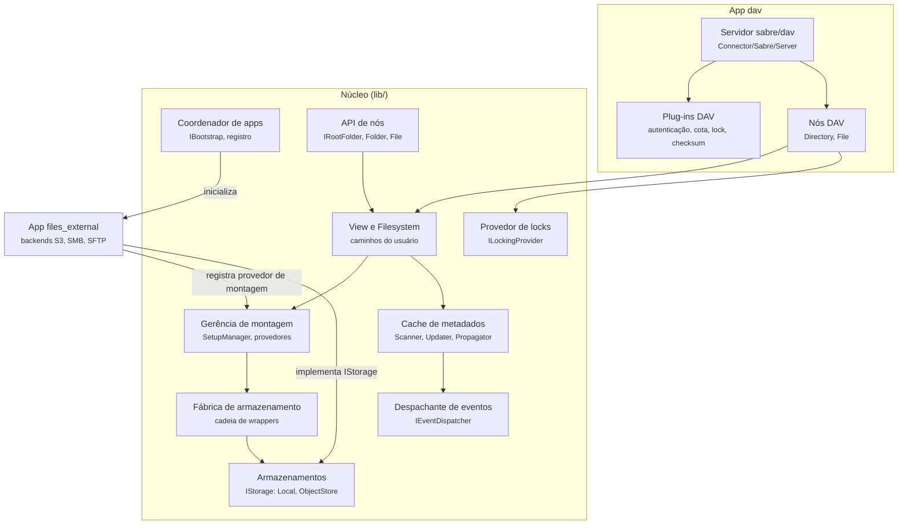
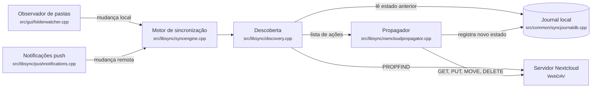
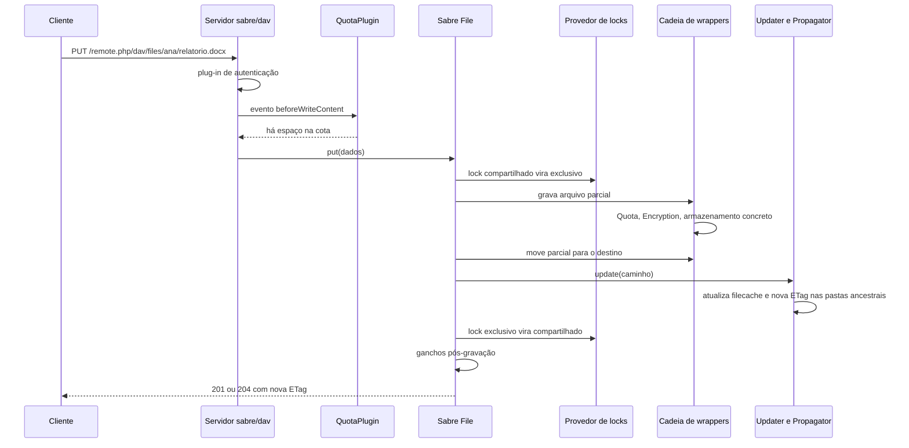
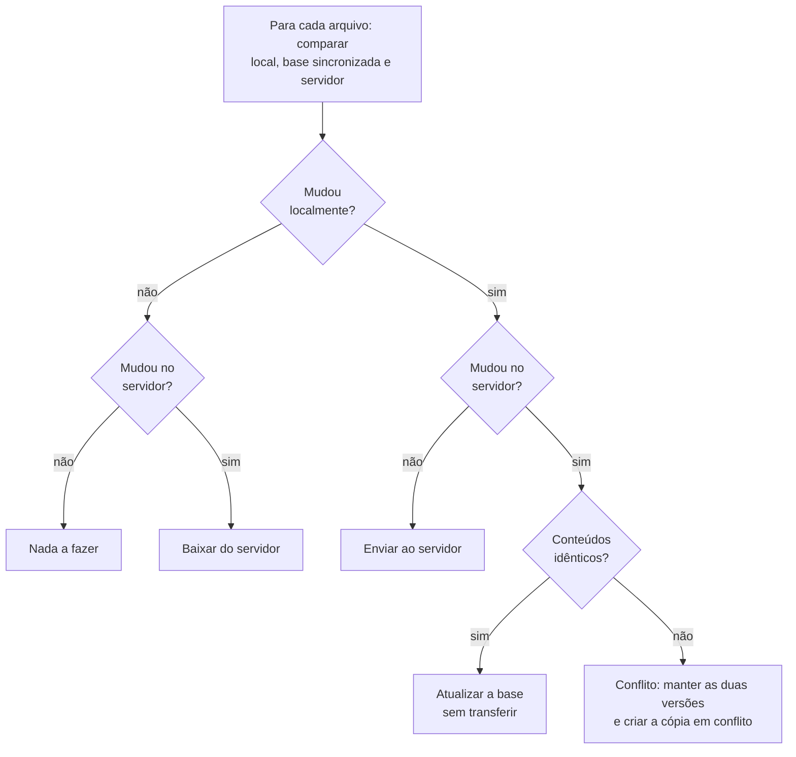
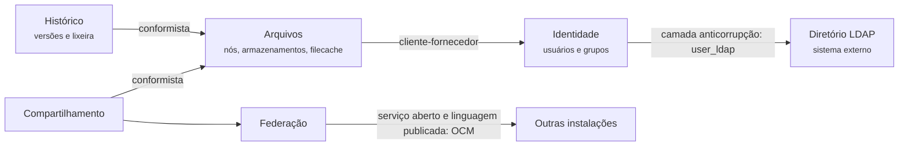

# 5.5 Nextcloud: componentes e comunicação

<span class="altitude a10">10.000 pés</span>

A [Seção 4.5](../capitulo-4-50-mil-pes/nextcloud.md) mostrou que o Nextcloud é um microkernel
monolítico, com um único quantum, cujos *containers* principais são a aplicação PHP e o cliente de
sincronização. Esta seção abre esses dois *containers*, descreve seus componentes e a comunicação
entre eles em uma operação-chave, o envio de um arquivo, e examina os mecanismos que tornam a
sincronização possível: blocos e *hashes*, detecção de mudanças e resolução de conflitos. Ao
final, o conjunto é lido pelas lentes das arquiteturas em camadas, hexagonal e limpa, dos padrões
de Fowler (2002) e do DDD estratégico. O código citado refere-se às *tags* `v35.0.2`
(`nextcloud/server`) e `v35.0.0` (`nextcloud/desktop`).

## 5.5.1 Componentes da aplicação PHP

A Figura 5.5.1 apresenta os principais componentes envolvidos no tratamento de arquivos.

**Figura 5.5.1** – Componentes da aplicação PHP envolvidos com arquivos (C4, nível 3).



Fonte: elaborado pelo autor (2026), com base no repositório `nextcloud/server` (*tag* `v35.0.2`).

Os componentes organizam-se em torno de uma cadeia de indireções, cada uma escondendo uma decisão
de projeto, no sentido de Parnas (Seção 1.5.2):

- O **servidor sabre/dav** traduz requisições WebDAV em operações sobre nós. A classe
  [`OCA\DAV\Connector\Sabre\Server`](https://github.com/nextcloud/server/blob/v35.0.2/apps/dav/lib/Connector/Sabre/Server.php#L26)
  estende `\Sabre\DAV\Server`, e a
  [`ServerFactory`](https://github.com/nextcloud/server/blob/v35.0.2/apps/dav/lib/Connector/Sabre/ServerFactory.php#L86-L230)
  monta o servidor pela adição sucessiva de *plug-ins*: autenticação, *locking*, cotas,
  *checksums*, etiquetas, compartilhamentos e comentários. A mesma fábrica despacha um evento para
  que outros *apps* acrescentem seus próprios *plug-ins* DAV.
- A **API de nós** (`IRootFolder`, `Folder`, `File`, no espaço público `OCP\Files`) é a forma
  pela qual os *apps* manipulam arquivos sem conhecer armazenamentos.
- A **View** traduz caminhos do usuário, como `/ana/files/relatorio.docx`, em um par formado pelo
  armazenamento responsável e pelo caminho interno a ele.
- A **gerência de montagem** decide quais armazenamentos estão montados para cada usuário: a pasta
  pessoal, compartilhamentos recebidos e pastas externas. Provedores de montagem, como o do *app*
  `files_external`, registram-se no núcleo.
- A **fábrica de armazenamento** envolve cada armazenamento em uma cadeia de *wrappers* (cota,
  criptografia, permissões), estudada na [Seção 6.5](../capitulo-6-solo/nextcloud.md).
- Os **armazenamentos** implementam o contrato `IStorage`, seja sobre disco local, seja sobre um
  armazenamento de objetos ou um serviço externo.
- O **cache de metadados** mantém a tabela `filecache` coerente com os armazenamentos: o
  `Scanner` lê o estado real, o `Updater` aplica alterações e o `Propagator` atualiza as pastas
  ancestrais.
- O **provedor de *locks*** e o **despachante de eventos** são serviços transversais oferecidos
  a todos os *apps*.

Observa-se aqui um traço notável: o microkernel do Nextcloud é **recursivo**. O *app* `dav` é um
*plug-in* do núcleo e contém um microkernel, o servidor sabre/dav com seus *plug-ins*. O *app*
`files_external` é um *plug-in* do núcleo e contém outro, com seu próprio contrato e registro de
*backends*. Argumenta-se aqui que essa composição é uma forma eficaz de manter cada contrato
pequeno: o núcleo não precisa conhecer o protocolo SMB, e o *app* `files_external` não precisa
conhecer os detalhes de autenticação do núcleo.

## 5.5.2 Componentes do cliente de sincronização

O cliente *desktop* tem uma organização distinta, centrada em um ciclo de sincronização. A
Figura 5.5.2 apresenta seus componentes.

**Figura 5.5.2** – Componentes do cliente *desktop* (C4, nível 3).



Fonte: elaborado pelo autor (2026), com base no repositório `nextcloud/desktop` (*tag* `v35.0.0`).

O ciclo tem duas fases. Na **descoberta**, o cliente compara três fontes de informação: o sistema
de arquivos local, o servidor e o *journal*, um banco local que registra o estado da última
sincronização bem-sucedida, incluindo a última *ETag* conhecida de cada arquivo. Da comparação
resulta uma lista de ações. Na **propagação**, as ações são executadas: baixar, enviar, mover,
apagar ou criar uma cópia em conflito; ao final, o *journal* é atualizado. Arquivos grandes são
enviados pelo protocolo de *chunked upload* sobre o caminho `remote.php/dav/uploads/`, como mostra
[`src/libsync/propagateuploadng.cpp`](https://github.com/nextcloud/desktop/blob/v35.0.0/src/libsync/propagateuploadng.cpp#L32-L38).
O ciclo é disparado por mudanças locais, detectadas pelo observador de pastas, e por mudanças
remotas, detectadas por consulta periódica ou por notificação *push* (Seção 5.5.5).

## 5.5.3 Comunicação: o envio de um arquivo

A Figura 5.5.3 mostra a sequência de interações no servidor quando um cliente envia um arquivo
com um PUT simples, sem divisão em partes.

**Figura 5.5.3** – Sequência do envio de um arquivo por WebDAV.



Fonte: elaborado pelo autor (2026), com base em `apps/dav/lib/Connector/Sabre/File.php`, `QuotaPlugin.php` e `lib/private/Files/Cache/Updater.php` (*tag* `v35.0.2`).

A sequência foi reconstruída a partir do código. O
[`QuotaPlugin`](https://github.com/nextcloud/server/blob/v35.0.2/apps/dav/lib/Connector/Sabre/QuotaPlugin.php#L62-L66)
registra-se para os eventos `beforeWriteContent`, `beforeCreateFile`, `beforeMove` e
`beforeCopy`, e pode recusar a requisição antes que qualquer *byte* seja gravado. O método `put`
de `OCA\DAV\Connector\Sabre\File` converte o *lock* compartilhado em exclusivo
([linhas 163-174](https://github.com/nextcloud/server/blob/v35.0.2/apps/dav/lib/Connector/Sabre/File.php#L163-L174)),
grava o conteúdo, quando necessário, em um arquivo parcial, e o move para o destino. O método
`finalizeUpload`
([linhas 360-410](https://github.com/nextcloud/server/blob/v35.0.2/apps/dav/lib/Connector/Sabre/File.php#L360-L410))
chama o `Updater` do armazenamento, registra a data de modificação enviada pelo cliente no
cabeçalho `X-OC-MTime` e o *checksum* enviado em `OC-Checksum`, rebaixa o *lock* para
compartilhado e emite os ganchos pós-gravação. O `Updater`, por sua vez, examina o arquivo com o
`Scanner` e chama `propagateChange` no `Propagator`
([`Updater.php`, linhas 69-94](https://github.com/nextcloud/server/blob/v35.0.2/lib/private/Files/Cache/Updater.php#L69-L94)).

Toda a comunicação dentro do servidor é síncrona e ocorre no processo PHP que atende à requisição.
A única saída assíncrona é a notificação aos demais clientes, quando o `notify_push` está
presente. Observa-se também o papel do arquivo parcial: o conteúdo só passa a ser visível com o
nome final depois de completamente gravado, o que impede que outro cliente baixe um arquivo
truncado.

## 5.5.4 Metadados, conteúdo e blocos

A decisão de componentes mais importante do domínio é a separação entre metadados e conteúdo,
introduzida na Seção 4.5.1. No esquema de Xu (2020, cap. 15), o banco de metadados contém tabelas
de usuários, dispositivos, espaços de nomes, arquivos, versões de arquivos e blocos. Duas regras
do esquema são decisivas: a tabela de versões é somente de inserção, o que preserva a integridade
do histórico; e qualquer versão pode ser reconstruída juntando, na ordem correta, os blocos
listados para ela. Essas regras transformam o armazenamento de conteúdo em um repositório de
**blocos imutáveis** e concentram a consistência difícil nos metadados, muito menores. O mesmo
princípio aparece no *Magic Pocket* (COWLING, 2016).

A divisão em blocos tem três benefícios: permite **retomar** transferências interrompidas, realizar
a **sincronização diferencial** (*delta sync*), transferindo apenas os blocos alterados, e fazer
**deduplicação**, armazenando uma única vez blocos com o mesmo *hash* (XU, 2020, cap. 15). Xu usa o
Dropbox como referência para o tamanho máximo de bloco, 4 MB, valor confirmado por Cowling (2016).
A Listagem 5.5.1 mostra a versão mais simples da ideia.

**Listagem 5.5.1** – Modelo didático em Java: sincronização diferencial com blocos de tamanho fixo.

```java
import java.security.MessageDigest;
import java.util.*;

public final class Blocos {
    public static final int TAMANHO = 4 * 1024 * 1024;  // 4 MB, como no Dropbox

    /** Divide o conteúdo em blocos e devolve o hash SHA-256 de cada um. */
    public static List<String> hashes(byte[] conteudo) throws Exception {
        List<String> resultado = new ArrayList<>();
        for (int ini = 0; ini < conteudo.length; ini += TAMANHO) {
            int fim = Math.min(ini + TAMANHO, conteudo.length);
            MessageDigest sha = MessageDigest.getInstance("SHA-256");
            sha.update(conteudo, ini, fim - ini);
            resultado.add(HexFormat.of().formatHex(sha.digest()));
        }
        return resultado;
    }

    /** Índices dos blocos que o servidor ainda não tem: só eles serão enviados. */
    public static List<Integer> blocosAEnviar(List<String> local, Set<String> noServidor) {
        List<Integer> enviar = new ArrayList<>();
        for (int i = 0; i < local.size(); i++) {
            if (!noServidor.contains(local.get(i))) {   // deduplicação por hash
                enviar.add(i);
            }
        }
        return enviar;
    }
}
```

Fonte: elaborado pelo autor (2026), com base em Xu (2020, cap. 15).

A listagem evidencia uma limitação: com blocos alinhados, a inserção de um único *byte* no início
do arquivo altera todos os blocos seguintes. O algoritmo rsync, de Tridgell e Mackerras (1996),
citado por Xu como referência, resolve o problema combinando um *checksum* rolante, barato de
calcular em todas as posições, com um *hash* forte para confirmar coincidências. Há ainda
limitações de outra natureza: formatos comprimidos ou cifrados mudam quase inteiramente a cada
edição, anulando o ganho; e a deduplicação entre usuários diferentes pode vazar informação, pois
um envio instantâneo revela que o bloco já existia. Por isso Xu propõe a deduplicação no nível da
conta.

O Nextcloud adota uma separação mais simples. A tabela `filecache` guarda os metadados, e o
conteúdo vai para o armazenamento como um objeto inteiro. Não há, no servidor, um repositório de
blocos endereçados por conteúdo. O *chunked upload* divide o envio em partes de 5 MB a 5 GB, mas
as partes servem para retomar envios interrompidos, não para deduplicar ou transferir apenas o que
mudou; ao final, o servidor as junta e as apaga (NEXTCLOUD, 2026a). O *trade-off* é claro:
perde-se a economia de banda da sincronização diferencial, mas mantém-se a independência em
relação ao armazenamento, já que um servidor SMB ou um *bucket* S3 de terceiros recebem arquivos
comuns, legíveis por outros sistemas.

## 5.5.5 Detecção e notificação de mudanças

Xu (2020, cap. 15) discute duas opções para o serviço de notificação: *long polling*, em que o
cliente mantém uma requisição aberta que o servidor só responde quando há novidade, e WebSocket,
com conexão bidirecional persistente. O autor escolhe o *long polling*, usado pelo Dropbox, porque
a comunicação é essencialmente unidirecional e pouco frequente. Ao ser notificado, o cliente não
recebe os dados pelo mesmo canal: consulta os servidores de API para obter os metadados e depois
baixa apenas os blocos novos. Xu registra, a partir de uma palestra do Dropbox de 2012, que mais de
um milhão de conexões ficavam abertas por máquina, e destaca o problema que isso cria: quando um
servidor de notificação cai, a reconexão em massa dos clientes é lenta.

O Nextcloud resolve a detecção de mudanças com a **propagação de *ETags***. Uma *ETag* é um
identificador opaco da versão de um recurso HTTP (FIELDING; NOTTINGHAM; RESCHKE, 2022). No
Nextcloud, toda alteração em um arquivo atribui nova *ETag* ao arquivo e a todas as pastas
ancestrais, até a raiz. Para saber se algo mudou em toda a árvore de um usuário, basta ao cliente
comparar a *ETag* da raiz com a última que conhece; se diferirem, desce apenas pelas pastas cujas
*ETags* mudaram. Essa é a operação de custo constante exigida pelo cenário de desempenho da
Seção 3.5.7. O cliente faz essa consulta, por padrão, a cada 30 segundos, e, quando o servidor tem o
`notify_push`, recebe avisos por WebSocket e passa a consultar com menos frequência (Seção 4.5.2).
O desenho combina uma estratégia de *pull* barata com uma estratégia de *push* opcional. O código
da propagação é examinado na [Seção 6.5](../capitulo-6-solo/nextcloud.md).

## 5.5.6 Conflitos

Um conflito ocorre quando duas cópias de um arquivo são modificadas de forma concorrente, isto é,
sem que uma das modificações tenha conhecido a outra. A política mais simples, **o último a gravar
vence** (*last writer wins*), tem dois defeitos graves: descarta silenciosamente o trabalho de um
dos usuários e depende de relógios de máquinas diferentes, que nunca estão perfeitamente
sincronizados. Para um serviço em que a perda de dados é inaceitável, ela é inadequada.

Xu (2020, cap. 15) propõe outra estratégia: a primeira versão processada pelo servidor vence, e a
que chega depois recebe um conflito; o sistema apresenta ao segundo usuário as duas cópias e deixa
a ele a escolha entre mesclá-las ou sobrescrever uma pela outra. Detectar o conflito exige saber de
que versão cada modificação partiu. Xu (2020, cap. 6) apresenta os **relógios vetoriais**, que
permitem decidir se uma versão descende de outra ou se ambas são concorrentes. Em sincronização de
arquivos, a solução usual equivale a uma **comparação em três vias**, como nos sistemas de controle
de versão. O motor Nucleus do Dropbox modela o estado da conta com três árvores: a remota, a local e
a sincronizada, que registra o último estado em que ambas concordavam e funciona como base comum,
permitindo saber se uma mudança foi feita localmente ou remotamente (GOLDBERG, 2020). O cliente do
Nextcloud adota a mesma lógica com o *journal*. A Figura 5.5.4 resume a decisão.

**Figura 5.5.4** – Decisão de sincronização por comparação em três vias.



Fonte: elaborado pelo autor (2026), com base em Xu (2020, cap. 15), Goldberg (2020) e no código do cliente Nextcloud.

**Listagem 5.5.2** – Modelo didático em Java: detecção de conflito por comparação em três vias.

```java
public enum Acao { NADA, ENVIAR, BAIXAR, ATUALIZAR_BASE, CONFLITO }

public record Versao(String etag, String hashConteudo) {}

public final class Reconciliador {
    /** base: estado da última sincronização bem-sucedida (o "journal"). */
    public Acao decidir(Versao base, Versao local, Versao servidor) {
        boolean mudouLocal = !local.hashConteudo().equals(base.hashConteudo());
        boolean mudouServidor = !servidor.etag().equals(base.etag());
        if (!mudouLocal && !mudouServidor) return Acao.NADA;
        if (mudouLocal && !mudouServidor) return Acao.ENVIAR;
        if (!mudouLocal) return Acao.BAIXAR;
        // Mudou dos dois lados: só não há conflito se os conteúdos coincidirem.
        return local.hashConteudo().equals(servidor.hashConteudo())
                ? Acao.ATUALIZAR_BASE
                : Acao.CONFLITO;   // nunca descartar: manter as duas versões
    }
}
```

Fonte: elaborado pelo autor (2026).

No cliente do Nextcloud, a comparação entre a *ETag* registrada no *journal* e a do servidor
aparece no componente de descoberta
([`src/libsync/discovery.cpp`, linhas 860-878](https://github.com/nextcloud/desktop/blob/v35.0.0/src/libsync/discovery.cpp#L860-L878)).
Quando o arquivo mudou dos dois lados, o conflito é resolvido preservando as duas versões: o
arquivo do servidor fica com o nome original, e a versão local é renomeada com a marca
`(conflicted copy ...)`, acrescida do nome do usuário e de data e hora (Seção 6.5).

Os conflitos entre edições *offline* não devem ser confundidos com a concorrência dentro do
servidor. Para esta, o Nextcloud oferece o **locking transacional de arquivos**, com *locks*
compartilhados para leitura e exclusivos para escrita, que opera acima do sistema de arquivos e
protege também as pastas ancestrais contra renomeação. A documentação é precisa quanto ao que ele
não faz: não impede que vários usuários editem o mesmo documento nem os avisa disso; apenas impede
gravações simultâneas que corromperiam o arquivo (NEXTCLOUD, 2026b). São problemas de naturezas
diferentes, resolvidos em componentes diferentes: o *lock* no servidor, a reconciliação no cliente.

### Interativo

O interativo a seguir trata, em duas abas, dos mecanismos das Seções 5.5.4 e 5.5.6. Na primeira,
um arquivo de 32 MB é dividido em oito blocos de 4 MB endereçados por *hash*; a edição de um bloco
mostra a economia da sincronização diferencial, e a inserção de um *byte* no início mostra a
limitação dos blocos alinhados, em contraste com o *chunked upload* do Nextcloud, que transfere o
arquivo inteiro. Na segunda, dois dispositivos editam o mesmo arquivo, e cada sincronização aplica
a comparação em três vias da Figura 5.5.4, até a criação da cópia em conflito com o nome gerado
pelo cliente.

<iframe src="../../interativos/sync-conflitos.html" title="Sincronização por blocos e conflitos em três vias no Nextcloud" style="width:100%; height:660px; border:1px solid #2A4468; border-radius:10px;" loading="lazy"></iframe>

## 5.5.7 Contratos entre núcleo e *apps*

O contrato de um microkernel só cumpre seu papel se for estável. Richards e Ford (2020, p. 158)
observam que os contratos entre *plug-ins* e núcleo incluem comportamento, dados de entrada e dados
de saída, e que, quando o *plug-in* é de terceiros, é comum criar um adaptador entre o contrato do
*plug-in* e o contrato padrão. O Nextcloud separa o código em dois espaços de nomes. O espaço
`OCP\`, em `lib/public/`, contém as interfaces e classes que os *apps* podem usar; o espaço `OC\`,
em `lib/private/`, contém a implementação interna. A intenção está registrada no topo dos próprios
arquivos públicos, em um comentário segundo o qual o espaço `OCP` deve ser usado para todas as
classes consideradas públicas, que os *apps* devem usar no lugar das classes internas. Na *tag*
`v35.0.2`, `lib/public/` contém mais de mil arquivos PHP.

A documentação para desenvolvedores acrescenta duas regras. A primeira distingue interfaces
**consumíveis**, que os *apps* só podem usar, de interfaces **implementáveis**, que os *apps* podem
implementar e às quais o servidor não pode acrescentar métodos (NEXTCLOUD, 2026c). Acrescentar um
método a uma interface consumível não quebra nenhum *app*; acrescentá-lo a uma implementável quebra
todos os que a implementam. A segunda é a política de depreciação: APIs depreciadas são mantidas
por pelo menos três anos antes da remoção, salvo quando a quebra for inevitável (NEXTCLOUD, 2026d).
Do outro lado, cada *app* declara em `appinfo/info.xml` as versões do servidor que suporta; no
`files_external`, a declaração `<nextcloud min-version="35" max-version="35"/>`
([linhas 35-37](https://github.com/nextcloud/server/blob/v35.0.2/apps/files_external/appinfo/info.xml#L35-L37))
fixa uma única versão, porque *apps* distribuídos com o servidor evoluem com ele. *Apps* de
terceiros declaram faixas mais largas, e é para eles que a estabilidade do espaço `OCP` importa.

## 5.5.8 Lentes de análise

**Camadas.** A cadeia da Figura 5.5.1 forma camadas nítidas: protocolo (sabre/dav), API de nós,
visão de caminhos, montagem, *wrappers* e armazenamento. Cada camada usa apenas a seguinte. É uma
arquitetura em camadas fechadas no caminho de arquivos, e o *architecture sinkhole* descrito por
Richards e Ford (2020, cap. 10) é evitado porque cada camada acrescenta uma tradução real.

**Hexagonal e limpa.** Na leitura de Cockburn (2005), o núcleo do Nextcloud define **portas** e é
cercado por **adaptadores**. São portas de entrada o servidor WebDAV, a API OCS e a interface web,
que acionam o núcleo; são portas de saída `IStorage`, `ILockingProvider` e as interfaces de *cache*,
que o núcleo define e outros implementam. Os armazenamentos S3 e SMB são adaptadores de saída no
sentido exato de Cockburn, e o diretório LDAP é integrado por um *app* que implementa o contrato de
*backend* de usuários. A regra de dependência da arquitetura limpa (MARTIN, 2017), segundo a qual o
código-fonte depende sempre para dentro, é respeitada pelos *apps*, que dependem de `OCP`, mas não
integralmente pelo núcleo: `lib/private` conhece, por exemplo, detalhes de banco de dados e de
protocolo HTTP. O Nextcloud é hexagonal na fronteira com armazenamentos e *apps*, e pragmático por
dentro.

**PoEAA.** Vários padrões de Fowler (2002) aparecem nesta altitude. O par `OCP`/`OC` é uma
aplicação de *Separated Interface* (FOWLER, 2002, cap. 18): a interface fica em um pacote, e a
implementação, em outro, de modo que o cliente dependa apenas da primeira. Os armazenamentos são
*Gateways* (FOWLER, 2002, cap. 18), objetos que encapsulam o acesso a um sistema ou recurso
externo. O registro de *apps* e de *backends* corresponde ao padrão *Plugin* (FOWLER, 2002,
cap. 18), em que a ligação entre interface e implementação ocorre na configuração, e não na
compilação. E o acesso à tabela `filecache` por meio de uma classe que concentra as consultas
aproxima-se de um *Table Data Gateway* (FOWLER, 2002, cap. 10). A [Seção 6.5](../capitulo-6-solo/nextcloud.md)
detalha os padrões no código.

**DDD estratégico.** Os *apps* distribuídos com o servidor desenham, com boa aproximação, os
contextos delimitados do domínio (EVANS, 2003, cap. 14): **Arquivos** (`files`, `dav`),
**Compartilhamento** (`files_sharing`, `sharebymail`, `federatedfilesharing`), **Histórico**
(`files_versions`, `files_trashbin`), **Identidade** (núcleo e `user_ldap`) e **Federação**
(`cloud_federation_api`). A Figura 5.5.5 propõe um mapa de contextos.

**Figura 5.5.5** – Mapa de contextos proposto para o Nextcloud.



Fonte: elaborado pelo autor (2026), com base em Evans (2003) e no repositório `nextcloud/server`.

As relações são interpretação do autor. Compartilhamento e Histórico adotam o modelo de Arquivos
tal como ele é, o que caracteriza a relação **conformista**. O *app* `user_ldap` traduz o modelo de
um diretório externo para o modelo de usuários do núcleo, papel de **camada anticorrupção**. A
Federação comunica-se com outras instalações por um protocolo publicado: a interface
[`IOCMProvider`](https://github.com/nextcloud/server/blob/v35.0.2/lib/public/OCM/IOCMProvider.php#L18-L23)
declara ser um modelo baseado na API de descoberta do *Open Cloud Mesh*, uma especificação aberta,
o que corresponde aos padrões **serviço aberto** e **linguagem publicada** de Evans (2003, cap. 14).

## 5.5.9 Decisões e *trade-offs*

**Tabela 5.5.1** – Decisões a 10.000 pés e seus *trade-offs*.

| Decisão | Ganho | Custo |
|---|---|---|
| Arquivo inteiro, sem blocos endereçados por conteúdo | armazenamentos de terceiros recebem arquivos comuns | sem *delta sync* nem deduplicação |
| Propagação de *ETags* às pastas ancestrais | detecção de mudança em custo constante | uma escrita por pasta ancestral a cada alteração |
| Cópia em conflito no cliente | nenhuma edição é perdida | o usuário resolve o conflito manualmente |
| *Locking* acima do armazenamento | funciona sobre S3, SMB, FTP | dependência de Redis ou carga no banco |
| Microkernel recursivo (`dav`, `files_external`) | contratos pequenos, extensões locais | mais indireções para depurar |
| Espaços `OCP` e `OC` | evolução interna livre | API pública congelada por anos |

Fonte: elaborado pelo autor (2026).

## 5.5.10 Caixa-preta

!!! caixa-preta "Conflitos mal resolvidos: o perigo do \"último a gravar vence\""
    Dois dispositivos, A e B, sincronizam um mesmo arquivo. Ambos ficam *offline*, e cada um o
    edita. A reconecta primeiro e envia sua versão. B reconecta depois e, com uma política de
    "último a gravar vence", envia a sua, que substitui a de A no servidor e, em seguida, em A. O
    trabalho de A desaparece sem aviso. Se o relógio de B estiver atrasado, o resultado pode ser o
    inverso: a versão de B é descartada, embora tenha sido gravada depois.

    **Lição arquitetural.** O defeito não está em um componente, mas na **política**. Um serviço
    de arquivos não pode decidir sozinho entre duas edições concorrentes de um arquivo binário,
    porque não conhece a semântica do conteúdo. As políticas defensáveis preservam ambas as
    versões, e a detecção da concorrência deve comparar com a base comum, e não com relógios.

!!! caixa-preta "Dropbox, 2016-2020: reescrever o coração do sistema"
    Jayakar (2020) relata que o motor de sincronização antigo do Dropbox, o *Sync Engine
    Classic*, chegou a um ponto em que correções incrementais não bastavam. A causa raiz apontada
    foi o **modelo de dados**: não havia identificadores de arquivo estáveis através de
    movimentações, e as garantias de consistência eram poucas. A arquitetura também era difícil de
    testar, porque o modelo de *threads* tornava os testes de integração não reprodutíveis. O novo
    motor, *Nucleus*, escrito em Rust e desenvolvido ao longo de cerca de quatro anos, executa a
    maior parte do código em uma única *thread* de controle determinística, o que permite testes
    por simulação com sementes pseudoaleatórias em milhões de cenários por dia (JAYAKAR, 2020).
    Goldberg (2020) descreve os *frameworks* CanopyCheck, que gera árvores aleatórias e verifica
    invariantes do planejador, e Trinity, que simula sistema de arquivos, rede e temporizadores
    para expor condições de corrida.

    **Lição arquitetural.** O problema estava na organização dos componentes e de seus dados, e
    não em linhas isoladas de código. A testabilidade foi determinante na decisão de reescrever, e
    um modelo de dados inadequado é uma dívida técnica arquitetural (Seção 1.10) que correções
    locais não pagam.

## Referências

COCKBURN, A. **Hexagonal architecture**. 2005. Disponível em:
<https://alistair.cockburn.us/hexagonal-architecture/>. Acesso em: 18 out. 2026.

COWLING, J. **Inside the Magic Pocket**. Dropbox Tech Blog, 6 maio 2016. Disponível em:
<https://dropbox.tech/infrastructure/inside-the-magic-pocket>. Acesso em: 18 out. 2026.

EVANS, E. **Domain-driven design**: tackling complexity in the heart of software. Boston:
Addison-Wesley, 2003.

FIELDING, R.; NOTTINGHAM, M.; RESCHKE, J. (ed.). **RFC 9110**: HTTP semantics. [S. l.]: Internet
Engineering Task Force, 2022. Disponível em: <https://www.rfc-editor.org/rfc/rfc9110>. Acesso
em: 18 out. 2026.

FOWLER, M. **Patterns of enterprise application architecture**. Boston: Addison-Wesley, 2002.

GOLDBERG, I. **Testing sync at Dropbox**. Dropbox Tech Blog, 20 abr. 2020. Disponível em:
<https://dropbox.tech/infrastructure/-testing-our-new-sync-engine>. Acesso em: 18 out. 2026.

JAYAKAR, S. **Rewriting the heart of our sync engine**. Dropbox Tech Blog, 9 mar. 2020.
Disponível em: <https://dropbox.tech/infrastructure/rewriting-the-heart-of-our-sync-engine>.
Acesso em: 18 out. 2026.

MARTIN, R. C. **Clean architecture**: a craftsman's guide to software structure and design.
Boston: Prentice Hall, 2017.

NEXTCLOUD. **Chunked file upload**. Nextcloud Developer Manual, 2026a. Disponível em:
<https://docs.nextcloud.com/server/latest/developer_manual/client_apis/WebDAV/chunking.html>.
Acesso em: 18 out. 2026.

NEXTCLOUD. **Transactional file locking**. Nextcloud Administration Manual, 2026b. Disponível em:
<https://docs.nextcloud.com/server/latest/admin_manual/configuration_files/files_locking_transactional.html>.
Acesso em: 18 out. 2026.

NEXTCLOUD. **API reference**. Nextcloud Developer Manual, 2026c. Disponível em:
<https://docs.nextcloud.com/server/stable/developer_manual/digging_deeper/api.html>. Acesso em:
18 out. 2026.

NEXTCLOUD. **Deprecations**. Nextcloud Developer Manual, 2026d. Disponível em:
<https://docs.nextcloud.com/server/stable/developer_manual/release_notes/deprecations.html>.
Acesso em: 18 out. 2026.

RICHARDS, M.; FORD, N. **Fundamentals of software architecture**: an engineering approach.
Sebastopol: O'Reilly, 2020.

TRIDGELL, A.; MACKERRAS, P. **The rsync algorithm**. Canberra: Australian National University,
1996. Technical Report TR-CS-96-05.

XU, A. **System design interview**: an insider's guide. 2. ed. [*S. l.*]: Byte Code LLC, 2020.
