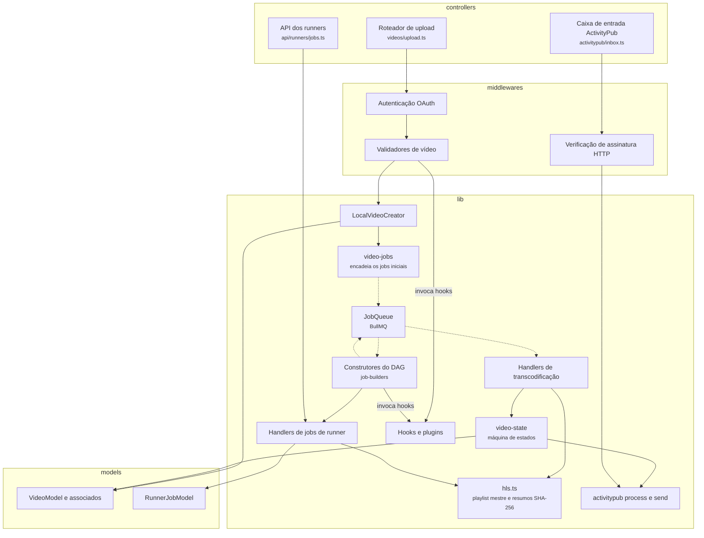
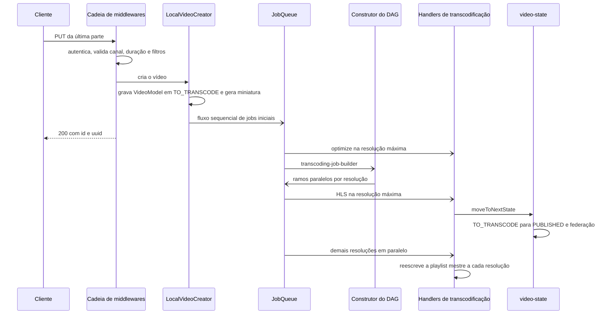
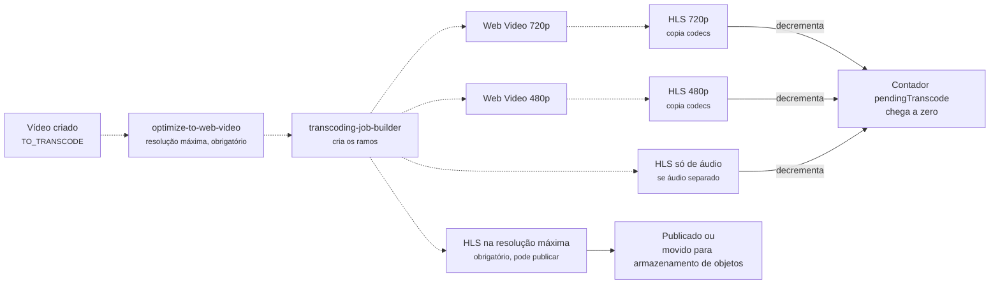
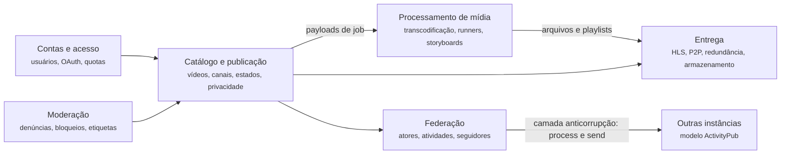

# 5.4 PeerTube: componentes e comunicação

10.000 pés

A Seção 4.4 mostrou que o núcleo de uma instância PeerTube é um único processo Node.js, que
atende à API, à federação e, por padrão, à fila de *jobs*. Esta seção desce para dentro desse
*container*. Primeiro, identifica os componentes do servidor e acompanha a operação-chave do
sistema, a publicação de um vídeo, do *upload* retomável até a disponibilidade em HLS. Em seguida,
examina os componentes de entrega no reprodutor. Por fim, analisa a organização encontrada pelas
lentes das camadas, da arquitetura hexagonal e da arquitetura limpa (ver Seção 1.8), dos padrões
de Fowler (2002) e do DDD estratégico (EVANS, 2003; ver Seção 1.9).

## 5.4.1 Os componentes do servidor

O código do servidor, em `server/core/`, está dividido em pastas que correspondem a papéis
técnicos (PEERTUBE, 2026): `controllers/` contém os roteadores Express da API REST
(`controllers/api/`), da federação (`controllers/activitypub/`), dos arquivos estáticos e do
rastreador P2P (`controllers/tracker.ts`); `middlewares/` contém autenticação, limitação de taxa,
validadores e adaptadores; `lib/` contém a lógica da aplicação, organizada por assunto
(`job-queue/`, `transcoding/`, `runners/`, `activitypub/`, `plugins/`, `live/`, `object-storage/`,
além de arquivos como `video-state.ts`, `video-jobs.ts`, `hls.ts` e `local-video-creator.ts`);
`models/` contém as classes Sequelize que mapeiam as tabelas do PostgreSQL; `helpers/` e
`initializers/` contêm utilitários, constantes e configuração. A Figura 5.4.1 apresenta os
componentes mais relevantes para a publicação e a entrega de vídeos (nível 3 do modelo C4).

**Figura 5.4.1** – Componentes do *container* servidor PeerTube envolvidos na publicação de vídeos.

Fonte: elaborado pelo autor (2026), com base no código da *tag* `v8.3.1` (PEERTUBE, 2026). Linhas
contínuas: comunicação síncrona; linhas tracejadas: comunicação assíncrona.

A figura mostra três entradas no componente (o *upload* do criador, a caixa de entrada da
federação e a API dos *runners*), todas organizadas como cadeias de *middlewares* seguidas de um
controlador, e um núcleo em `lib/` que concentra o fluxo de publicação. A seta dupla entre a fila
e os construtores do DAG indica uma característica pouco usual: um *job* da fila (o construtor)
cria outros *jobs* na mesma fila.

## 5.4.2 A operação-chave: do *upload* à publicação

### 5.4.2.1 O *upload* retomável

O primeiro filtro do *pipeline* enfrenta diretamente as falácias "a rede é confiável" e "a
largura de banda é infinita" (RICHARDS; FORD, 2020, p. 124-127). Xu (2020, cap. 14) discute três
otimizações para o envio: dividir o vídeo em partes, o que permite envios retomáveis e paralelos;
usar centros de *upload* próximos dos usuários; e usar **URLs pré-assinadas**, que permitem ao
cliente enviar o arquivo diretamente ao armazenamento de objetos, sem passar pelos servidores da
API. O PeerTube adota a primeira; as outras duas não fazem parte da instalação de referência, em
que o arquivo atravessa o NGINX e chega ao processo Node.js.

A especificação OpenAPI do PeerTube descreve o protocolo, herdado da biblioteca `node-uploadx`:
um `POST` em `/api/v1/videos/upload-resumable` inicializa o envio e devolve um identificador
(`upload_id`); requisições `PUT` sucessivas enviam partes do arquivo com o cabeçalho
`Content-Range`; enquanto o arquivo não está completo, o servidor responde com o código 308
(*resume incomplete*) e um cabeçalho `Range` que informa os bytes já recebidos; a última parte
recebe a resposta 200 com os dados do vídeo criado; e um `DELETE` cancela o envio (PEERTUBE, 2026,
`support/doc/api/openapi.yaml`). A especificação prevê ainda a resposta 503, "*upload* já em
processamento", com um cabeçalho `Retry-After`, para o caso em que a resposta à última parte se
perde e o cliente repete a requisição. Sem essa resposta, a repetição poderia criar o mesmo vídeo
duas vezes; a Seção 6.4 mostra o código que a produz.

### 5.4.2.2 A sequência completa

A Figura 5.4.2 mostra a sequência da publicação, do último `PUT` do *upload* até a mudança do
vídeo para o estado publicado.

**Figura 5.4.2** – Sequência da publicação de um vídeo com transcodificação local.

Fonte: elaborado pelo autor (2026), com base no código da *tag* `v8.3.1` (PEERTUBE, 2026). Setas de
ponta aberta: mensagens assíncronas.

Quando o vídeo é criado, a função `addVideoJobsAfterCreation` encadeia uma sequência de *jobs*:
criação do *torrent* de metadados, geração de *storyboard* quando necessária, etiquetagem
automática para moderação, notificação, federação e, por fim, um *job* do tipo
`transcoding-job-builder` (PEERTUBE, 2026,
[`video-jobs.ts#L89-L153`](https://github.com/Chocobozzz/PeerTube/blob/v8.3.1/server/core/lib/video-jobs.ts#L89-L153)).
Esse último é um filtro especial: não transcodifica nada, apenas **constrói o DAG** de
transcodificação, cuja forma aparece na Figura 5.4.3.

**Figura 5.4.3** – DAG de transcodificação de um vídeo sob demanda (HLS e Web Video habilitados).

Fonte: elaborado pelo autor (2026), com base em
`server/core/lib/transcoding/shared/job-builders/abstract-job-builder.ts` (*tag* `v8.3.1`). Linhas
contínuas: comunicação síncrona; linhas tracejadas: comunicação assíncrona (*jobs* enfileirados).

Xu (2020, cap. 14) propõe para o YouTube uma arquitetura de transcodificação com pré-processador,
escalonador do DAG, gerenciador de recursos com filas de tarefas e de *workers*, *workers* e
armazenamento temporário, inspirada no sistema SVE do Facebook, cujo objetivo declarado era
reduzir a latência entre envio e disponibilidade processando partes do vídeo em paralelo (HUANG
*et al.*, 2017). O PeerTube implementa uma versão mais simples do mesmo modelo, com três decisões
de projeto que se destacam.

A primeira é a distinção entre tarefas **obrigatórias** e **opcionais**. A transcodificação na
resolução máxima recebe prioridade de *job* obrigatório e pode mover o vídeo para o estado
publicado; as resoluções inferiores recebem prioridade opcional e são acrescentadas depois. O
vídeo fica visível tão logo exista uma versão reproduzível, o que atende ao cenário de tempo de
publicação da Seção 3.4.8. A segunda é o mecanismo de **junção**: em vez de um escalonador
central, o PeerTube mantém, por vídeo, um contador de transcodificações pendentes
(`pendingTranscode`), incrementado na criação de cada ramo e decrementado ao fim de cada tarefa
(PEERTUBE, 2026,
[`ended-transcoding.ts#L11-L27`](https://github.com/Chocobozzz/PeerTube/blob/v8.3.1/server/core/lib/transcoding/ended-transcoding.ts#L11-L27)).
A terceira é que o mesmo DAG pode ser materializado de duas maneiras, como *jobs* na fila local
ou como *jobs* de *runners* remotos, sem que o algoritmo de construção mude. A Seção 6.4 mostra
que isso é obtido com o padrão *Template Method*.

Para cada resolução inferior à do original, o construtor cria um ramo com uma tarefa de Web Video
(arquivo MP4 único) seguida de uma tarefa de HLS, que pode simplesmente copiar os codecs já
produzidos; os ramos de resoluções diferentes executam em paralelo. O comentário do construtor
abstrato documenta essa estrutura como uma lista de listas, em que as listas externas executam
em paralelo e cada lista interna é uma sequência (PEERTUBE, 2026,
[`abstract-job-builder.ts#L303-L314`](https://github.com/Chocobozzz/PeerTube/blob/v8.3.1/server/core/lib/transcoding/shared/job-builders/abstract-job-builder.ts#L303-L314)).

Xu (2020, cap. 14) menciona ainda miniaturas e marcas d'água. No PeerTube, a miniatura é produzida
ainda na criação do vídeo, de forma síncrona: a partir da imagem enviada pelo criador ou, na falta
dela, de um quadro do próprio vídeo (PEERTUBE, 2026,
[`local-video-creator.ts#L293-L311`](https://github.com/Chocobozzz/PeerTube/blob/v8.3.1/server/core/lib/local-video-creator.ts#L293-L311)).
É uma operação barata, que pode permanecer no caminho da requisição. Já os *storyboards*, que
exigem extrair muitos quadros, têm um tipo de *job* próprio.

### 5.4.2.3 Interativo

O interativo a seguir executa o DAG da Figura 5.4.3 com um número configurável de executores.
Cada tarefa entra na fila com a prioridade definida pelo código, 100 para as obrigatórias e
10.000 para as opcionais, o que permite observar que o vídeo passa a `PUBLISHED` assim que a HLS
na resolução máxima termina, enquanto as resoluções inferiores prosseguem em paralelo. O contador
`pendingTranscode` evidencia a junção sem escalonador central. No modo de *runners* remotos, o
mesmo DAG é materializado como *jobs* de *runner*, e a injeção de uma falha contrasta a tentativa
única da transcodificação local com as até cinco tentativas concedidas a um *runner*. As durações
das tarefas são ilustrativas.

<iframe src="../../interativos/pipeline-video.html" title="Pipeline de transcodificação do PeerTube como DAG" style="width:100%; height:660px; border:1px solid #2A4468; border-radius:10px;" loading="lazy"></iframe>

## 5.4.3 A fila de *jobs*: prioridades, tentativas e idempotência

A fila de *jobs* é o conector que transforma o *pipeline* em um sistema assíncrono. O PeerTube
registra cerca de trinta tipos de *job* na versão estudada, de `email` e `notify` a
`video-transcoding`, `video-transcription` e `activitypub-http-broadcast` (PEERTUBE, 2026,
[`job-queue.ts#L130-L161`](https://github.com/Chocobozzz/PeerTube/blob/v8.3.1/server/core/lib/job-queue/job-queue.ts#L130-L161)).
Para cada tipo existem uma fila do BullMQ, um *worker* e parâmetros próprios de tentativas,
concorrência e tempo máximo. Três aspectos determinam o comportamento do componente.

**Prioridade.** No BullMQ, um número menor indica prioridade maior (BULLMQ, 2026). O PeerTube
atribui 100 às transcodificações obrigatórias e 10.000 às opcionais, e soma a essa base o número
de vídeos que o usuário enviou na última semana (PEERTUBE, 2026,
[`transcoding-priority.ts#L5-L27`](https://github.com/Chocobozzz/PeerTube/blob/v8.3.1/server/core/lib/transcoding/transcoding-priority.ts#L5-L27)).
O efeito é uma política simples de **equidade**: um professor que envia cinquenta aulas de uma vez
não impede que a aula única de outro professor seja processada.

**Novas tentativas.** Toda opção de *job* inclui um recuo exponencial com atraso inicial de um
minuto, mas o número de tentativas varia por tipo: cinco para o envio de e-mails e para pedidos de
seguimento entre instâncias, três para a movimentação de arquivos ao armazenamento de objetos e
apenas uma para a transcodificação local (PEERTUBE, 2026, `server/core/initializers/constants.ts`).
A diferença corresponde à distinção de Xu (2020, cap. 14) entre erros **recuperáveis**, que devem
ser repetidos algumas vezes, e **não recuperáveis**, como um vídeo malformado, que devem
interromper as tarefas e devolver um código de erro. Uma falha de rede ao enviar um e-mail é
tipicamente transitória; uma falha do ffmpeg ao decodificar um arquivo tende a se repetir, e cada
tentativa custa minutos de CPU. Quando a transcodificação local falha, o vídeo vai para o estado
`TRANSCODING_FAILED`. Com *runners* remotos, a política muda: um *job* que falha volta ao estado
pendente até cinco vezes, porque a causa provável passa a ser o *runner*, e não o vídeo.

**Idempotência.** Em qualquer sistema com novas tentativas, uma mesma mensagem pode ser processada
mais de uma vez. Kleppmann (2017, cap. 11) mostra que garantir processamento "exatamente uma vez"
em sistemas distribuídos equivale, na prática, a garantir que o **efeito** seja o de uma única
execução, e que a forma mais comum de fazê-lo é tornar as operações idempotentes. Hohpe e Woolf
(2003) catalogam o padrão correspondente como *Idempotent Receiver*. O PeerTube usa as duas
técnicas clássicas: **detecção de duplicatas**, no *upload* e nas opções de deduplicação da fila
(PEERTUBE, 2026,
[`job-queue.ts#L118-L128`](https://github.com/Chocobozzz/PeerTube/blob/v8.3.1/server/core/lib/job-queue/job-queue.ts#L118-L128)),
e **idempotência por natureza**, na máquina de estados: a função `moveToNextState` recarrega o
vídeo dentro de uma transação e, se ele já estiver publicado, não faz nada (PEERTUBE, 2026,
[`video-state.ts#L42-L62`](https://github.com/Chocobozzz/PeerTube/blob/v8.3.1/server/core/lib/video-state.ts#L42-L62)).
O *handler* de transcodificação também encerra sem erro quando o vídeo foi apagado enquanto o
*job* aguardava na fila. Argumenta-se aqui que essas verificações são o custo inevitável de trocar
canos em memória por filas: cada filtro precisa perguntar "este trabalho ainda faz sentido?" antes
de começar.

## 5.4.4 Os componentes de entrega

### 5.4.4.1 *Streaming* adaptativo

Xu (2020, cap. 14) diferencia **baixar** um vídeo, em que o arquivo inteiro é copiado antes da
reprodução, de **transmitir** (*streaming*), em que o dispositivo recebe o vídeo em pequenas
partes e começa a reproduzir logo. Os dois protocolos mais difundidos funcionam sobre HTTP comum:
o *HTTP Live Streaming* (HLS), publicado como RFC 8216 (PANTOS; MAY, 2017), e o MPEG-DASH,
padronizado pela ISO/IEC como norma 23009-1 (SODAGAR, 2011). Ambos codificam o vídeo em várias
variantes, dividem cada variante em **segmentos** de poucos segundos e descrevem tudo em um
**manifesto**: no HLS, uma *playlist* mestre M3U8 que lista as variantes com os atributos
`BANDWIDTH`, `RESOLUTION` e `CODECS` na *tag* `EXT-X-STREAM-INF`, e uma *playlist* por variante
(PANTOS; MAY, 2017, seção 4); no DASH, um documento XML chamado *Media Presentation Description*
(SODAGAR, 2011). A escolha da variante a cada momento é feita **pelo cliente**, que mede a banda
e o estado do seu *buffer*; o servidor não guarda estado de sessão de reprodução.

Esse último ponto é decisivo em termos arquiteturais. Toda a inteligência de adaptação foi
deslocada para a borda, e o servidor se reduziu a um servidor de arquivos estáticos, cuja
escalabilidade é a de uma CDN ou, no PeerTube, a de um NGINX com `sendfile` (Seção 4.4.2). No
PeerTube, o componente que produz os manifestos é o módulo `hls.ts`, que reescreve a *playlist*
mestre sempre que uma nova resolução fica pronta e grava, ao lado dela, um arquivo JSON com o
resumo SHA-256 de cada segmento (PEERTUBE, 2026,
[`hls.ts#L84-L230`](https://github.com/Chocobozzz/PeerTube/blob/v8.3.1/server/core/lib/hls.ts#L84-L230)).

### 5.4.4.2 P2P e integridade

No reprodutor, três componentes cooperam: o hls.js, que interpreta os manifestos e escolhe as
variantes; o `p2p-media-loader`, que substitui o carregador de segmentos do hls.js e busca cada
segmento por HTTP ou, via WebRTC, de outros espectadores descobertos pelo rastreador da instância
(ALVESTRAND, 2021; PEERTUBE, 2026); e o validador de segmentos do PeerTube, que verifica cada
segmento recebido de um par contra os resumos publicados pela instância
(`client/src/standalone/player/src/shared/p2p-media-loader/segment-validator.ts`).

A entrega P2P tem três propriedades notáveis. A capacidade **cresce com a demanda**: quanto mais
espectadores simultâneos, mais fontes, o inverso de um servidor central. O benefício **depende da
cauda longa**: vídeos pouco assistidos raramente têm pares simultâneos (Seção 3.4.4). E o P2P
**quebra a cadeia de confiança**: quando parte dos bytes vem de um desconhecido, o cliente
precisa de outra forma de verificar o que recebeu. O PeerTube ancora essa verificação em um único
ponto, o arquivo de resumos baixado da instância por HTTPS, aplicando o princípio de que a
confiança deve depender de poucos pontos verificáveis, e não de todos os participantes. O custo
para o espectador é a exposição do seu endereço IP aos pares com quem troca dados, discutida na
Seção 3.4.6.

## 5.4.5 As cadeias de *middlewares*

O servidor organiza o tratamento de cada requisição como uma sequência de funções *middleware*
do Express. Segundo a documentação do *framework*, um *middleware* é uma função que recebe a
requisição, a resposta e a próxima função do ciclo, `next`, e que pode executar código,
modificar a requisição e a resposta, encerrar o ciclo ou passar o controle adiante (EXPRESS,
2026). A estrutura realiza o padrão *Chain of Responsibility* (GAMMA *et al.*, 1994, cap. 5): cada
elo decide entre tratar a requisição e encerrá-la, por exemplo com erro 401, ou chamar `next()`.
Há uma diferença em relação à formulação original: no GoF, a cadeia típica termina no primeiro
elo que trata a requisição, enquanto no Express quase todos os elos fazem algum trabalho
(autenticar, validar, carregar entidades) e passam adiante. A cadeia de *middlewares* é, nesse
sentido, um *pipes and filters* em escala de requisição.

O PeerTube usa essa estrutura de forma uniforme nas três entradas da Figura 5.4.1: o *upload*
encadeia autenticação, *parsing* de arquivos com o Multer, validadores e controlador; a caixa de
entrada ActivityPub encadeia limitação de taxa, verificação da assinatura HTTP, validação da
atividade e controlador; a API dos *runners* encadeia limitação de taxa, validação e
identificação do *runner* pelo *token*. A uniformidade facilita a revisão de segurança: para
saber se uma rota exige autenticação, basta ler a sua declaração. Os trechos literais estão na
Seção 6.4.

## 5.4.6 Lentes arquiteturais

### 5.4.6.1 Camadas

A organização em `controllers/`, `middlewares/`, `lib/` e `models/` corresponde, à primeira
vista, a uma arquitetura em camadas clássica: apresentação, aplicação e dados (ver Seção 1.8).
O exame do código mostra que as camadas são **abertas**. Os controladores chamam diretamente
métodos estáticos dos modelos (por exemplo, `VideoModel.loadFull`), os *middlewares* de validação
consultam o banco e o Redis, e os módulos de `lib/` usam os modelos sem intermediários. Richards
e Ford (2020, p. 135) discutem esse caso: camadas abertas reduzem a cerimônia, ao custo de
acoplar as camadas superiores à estrutura de persistência. No PeerTube, o custo é visível nos
tipos auxiliares de `server/core/types/models/`, como `MVideoFull` e `MVideoAP`, que descrevem
quais associações de um modelo foram carregadas em cada consulta. Eles existem porque a
estrutura do banco atravessa todas as camadas.

### 5.4.6.2 Hexagonal e limpa

Pela lente da arquitetura hexagonal (COCKBURN, 2005), o PeerTube tem **adaptadores** nítidos,
mas não **portas** definidas pelo núcleo. São adaptadores o pacote `@peertube/peertube-ffmpeg`,
que encapsula o ffmpeg e é compartilhado com o *runner*; o módulo de armazenamento de objetos e o
`VideoPathManager`, que oferece o mesmo acesso a arquivos estejam eles no disco ou no S3; e os
roteadores ActivityPub, que traduzem o protocolo externo. Contudo, a lógica de aplicação depende
diretamente desses adaptadores e dos modelos Sequelize, e não de interfaces declaradas por ela.

O ponto mais próximo de uma porta hexagonal é o sistema de **hooks** de *plugins*. Funções como
`Hooks.wrapObject` e `Hooks.runAction` expõem pontos nomeados, como
`filter:api.video.upload.accept.result` ou `filter:transcoding.auto.resolutions-to-transcode.result`,
nos quais código externo pode inspecionar ou alterar o fluxo (PEERTUBE, 2026). São portas
voltadas à extensão, e não à substituição da infraestrutura.

Pela lente da arquitetura limpa (MARTIN, 2017), a regra de dependência, segundo a qual o código de
política não deve depender de detalhes, não é respeitada: as entidades são classes Sequelize,
dependentes do *framework* de persistência. Argumenta-se aqui que isso não é um defeito em
abstrato, mas uma escolha coerente com o contexto. O PeerTube não tem a intenção de trocar de
banco de dados nem de *framework* web, e o benefício da inversão de dependência seria pequeno
diante do custo de manter duas representações de cada entidade. Onde a troca é de fato
necessária (disco ou S3, transcodificação local ou remota), o projeto introduziu abstrações
específicas.

### 5.4.6.3 Padrões de Fowler

A Tabela 5.4.1 relaciona os padrões de aplicação corporativa de Fowler (2002) identificáveis no
servidor.

**Tabela 5.4.1** – Padrões de Fowler (2002) identificados no servidor do PeerTube.

| Padrão | Onde | Observação |
|---|---|---|
| *Active Record* | `server/core/models/` (por exemplo, `VideoModel`) | objetos com dados persistentes, acesso ao banco e regras de domínio |
| *Transaction Script* | funções de `lib/`, como `addVideoJobsAfterCreation` e `moveToNextState` | procedimentos que orquestram uma operação de ponta a ponta |
| *Query Object* | `VideoModelGetQueryBuilder` e construtores de consultas em `models/video/sql/` | consultas complexas montadas fora do modelo |
| *Data Transfer Object* | métodos `toFormattedJSON` e `toActivityPubObject` dos modelos; tipos de `packages/models` | representações para a API REST, a federação e os *runners* |
| *Front Controller* | roteador Express | um ponto de entrada que despacha para controladores |

Fonte: elaborado pelo autor (2026), com base em Fowler (2002) e no código da *tag* `v8.3.1`.

Fowler (2002) descreve o *Active Record* como um objeto que carrega dados e comportamento, em que
a lógica de acesso ao banco é colocada no próprio objeto de domínio, e observa que parte da lógica
pode ficar em *Transaction Scripts*. É exatamente a divisão encontrada: regras locais, como a
definição da data de publicação ao mudar de estado, ficam no modelo; fluxos que envolvem vários
modelos, a fila e a federação ficam em funções de `lib/`. A Seção 6.4 mostra os dois lados em
código.

## 5.4.7 Contextos delimitados

Evans (2003) define o contexto delimitado como o limite dentro do qual um modelo tem significado
consistente, e o mapa de contextos como o registro das relações entre eles. Embora o PeerTube não
seja organizado explicitamente segundo o DDD, a sua estrutura de `lib/` e o vocabulário do código
permitem reconhecer seis contextos, apresentados na Figura 5.4.4.

**Figura 5.4.4** – Mapa de contextos reconstruído do PeerTube.

Fonte: elaborado pelo autor (2026), com base na estrutura de `server/core/lib/` (*tag* `v8.3.1`).

Duas relações merecem nome. A primeira é a fronteira entre **catálogo** e **processamento**,
mediada pelos tipos de *payload* de *job*. Ela é estreita o bastante para que o processamento
tenha sido levado para outro processo, o *runner*, sem alterar o catálogo, o que é a evidência
mais forte de que se trata de um contexto distinto. A segunda é a fronteira com **outras
instâncias**. O modelo ActivityPub (atores, objetos, atividades como `Create`, `Update`,
`Announce` e `Undo`) é estrangeiro ao modelo interno, e os módulos `lib/activitypub/process/` e
`lib/activitypub/send/` traduzem nos dois sentidos. O primeiro despacha cada tipo de atividade
recebida para uma função própria, por meio de uma tabela de despacho (PEERTUBE, 2026,
[`process.ts#L27-L43`](https://github.com/Chocobozzz/PeerTube/blob/v8.3.1/server/core/lib/activitypub/process/process.ts#L27-L43)).
Na terminologia de Evans (2003), esses módulos formam uma **camada anticorrupção**, que impede
que o modelo do protocolo contamine o modelo do domínio.

## 5.4.8 Decisões e *trade-offs*

A análise desta altitude permite enunciar as principais decisões de componentes e seus custos:

- **Construir o DAG por um *job*, e não na requisição.** O *upload* termina rápido e o DAG pode
  considerar o estado do vídeo no momento da execução; em troca, a lógica de orquestração fica
  distribuída entre a fila, o construtor e um contador no banco.
- **Publicar após a primeira versão reproduzível.** Atende ao tempo de publicação; em troca, o
  vídeo fica algum tempo publicado sem todas as resoluções.
- **Uma tentativa para transcodificação local, cinco para *runners*.** Evita desperdiçar CPU com
  erros determinísticos; em troca, uma falha transitória local exige reenvio manual.
- **Camadas abertas e *Active Record*.** Menos cerimônia e um único modelo por entidade; em troca,
  acoplamento ao Sequelize em todas as camadas.
- **Camada anticorrupção para a federação.** Protege o modelo interno; em troca, cada nova
  atividade do protocolo exige código de tradução nos dois sentidos.

## Referências

ALVESTRAND, H. **Overview**: real-time protocols for browser-based applications. RFC 8825.
[S. l.]: Internet Engineering Task Force, jan. 2021. Disponível em:
<https://www.rfc-editor.org/rfc/rfc8825>. Acesso em: 18 out. 2026.

BULLMQ. **BullMQ documentation**: prioritized jobs; flows. 2026. Disponível em:
<https://docs.bullmq.io>. Acesso em: 18 out. 2026.

COCKBURN, A. **Hexagonal architecture**. 2005. Disponível em:
<https://alistair.cockburn.us/hexagonal-architecture/>. Acesso em: 18 out. 2026.

EVANS, E. **Domain-driven design**: tackling complexity in the heart of software. Boston:
Addison-Wesley, 2003.

EXPRESS. **Using middleware**. 2026. Disponível em:
<https://expressjs.com/en/guide/using-middleware.html>. Acesso em: 18 out. 2026.

FOWLER, M. **Patterns of enterprise application architecture**. Boston: Addison-Wesley, 2002.

GAMMA, E. *et al.* **Design patterns**: elements of reusable object-oriented software. Reading:
Addison-Wesley, 1994.

HOHPE, G.; WOOLF, B. **Enterprise integration patterns**: designing, building, and deploying
messaging solutions. Boston: Addison-Wesley, 2003.

HUANG, Q. *et al.* SVE: distributed video processing at Facebook scale. *In*: SYMPOSIUM ON
OPERATING SYSTEMS PRINCIPLES, 26., 2017, Shanghai. **Proceedings** [...]. New York: ACM, 2017.
p. 87-103.

KLEPPMANN, M. **Designing data-intensive applications**: the big ideas behind reliable,
scalable, and maintainable systems. Sebastopol: O'Reilly, 2017.

MARTIN, R. C. **Clean architecture**: a craftsman's guide to software structure and design.
Boston: Prentice Hall, 2017.

PANTOS, R. (ed.); MAY, W. **HTTP Live Streaming**. RFC 8216. [S. l.]: Internet Engineering Task
Force, ago. 2017. Disponível em: <https://www.rfc-editor.org/rfc/rfc8216>. Acesso em: 18 out.
2026.

PEERTUBE. **Chocobozzz/PeerTube**: repositório de código-fonte, versão v8.3.1. GitHub, 2026.
Disponível em: <https://github.com/Chocobozzz/PeerTube/tree/v8.3.1>. Acesso em: 18 out. 2026.
Documentação disponível em: <https://docs.joinpeertube.org>.

RICHARDS, M.; FORD, N. **Fundamentals of software architecture**: an engineering approach.
Sebastopol: O'Reilly, 2020.

SODAGAR, I. The MPEG-DASH standard for multimedia streaming over the internet. **IEEE
MultiMedia**, v. 18, n. 4, p. 62-67, 2011.

XU, A. **System design interview**: an insider's guide. 2. ed. [S. l.]: Byte Code LLC, 2020.
