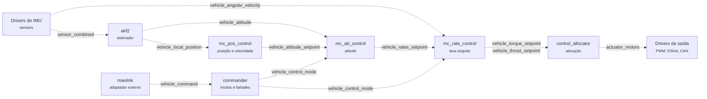
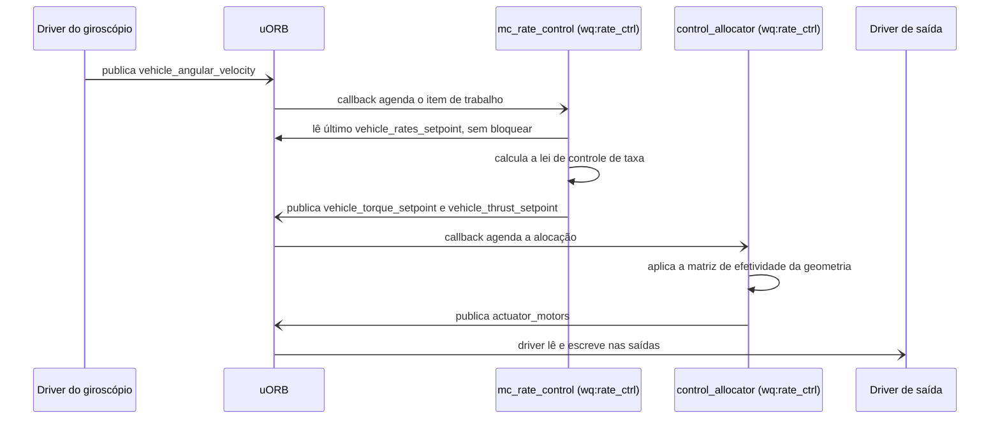
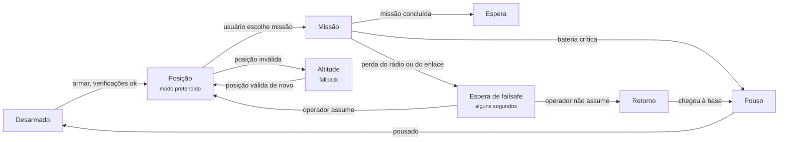
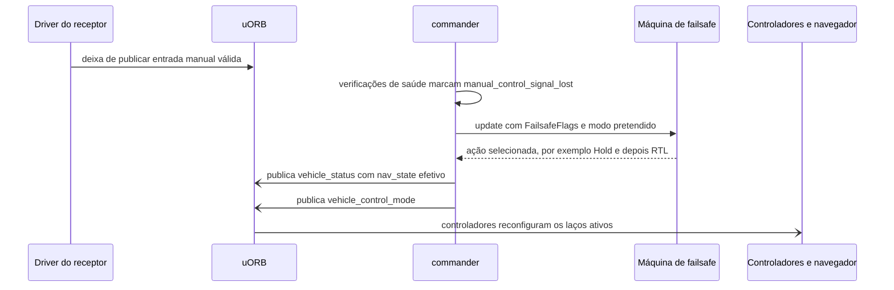

# 5.8 PX4: componentes e comunicação

10.000 pés

A Seção 4.8 mostrou que o controlador de voo é um único quantum, uma arquitetura unitária na qual
módulos substituíveis se comunicam exclusivamente por tópicos uORB. Esta seção desce a 10.000 pés
para abrir esse *container*: que componentes existem, como os dados fluem entre eles, como sua
execução é agendada para cumprir prazos e como o sistema decide o que fazer quando algo falha. Ao
final, o desenho é examinado pelas lentes das arquiteturas em camadas, hexagonal e limpa, dos
padrões de Fowler e do DDD estratégico.

## 5.8.1 Os componentes da pilha de voo

A documentação divide o PX4 em duas camadas: a **pilha de voo**, que reúne estimação e controle, e
o ***middleware***, que inclui *drivers*, comunicação externa e o barramento uORB (PX4, 2026a). Na
pilha de voo, três papéis se repetem. Um **estimador** recebe uma ou mais entradas de sensores,
combina-as e calcula um estado do veículo. Um **controlador** recebe um valor desejado (*setpoint*)
e uma medida ou estimativa, e produz uma correção para aproximar um do outro. Um **misturador**,
hoje chamado de alocação de controle, traduz comandos de força e torque em comandos individuais
para motores e servos, respeitando limites (PX4, 2026a). A Figura 5.8.1 mostra os componentes de um
multirrotor e os tópicos que os conectam, conforme conferido no código da *tag* `v1.17.0`.

**Figura 5.8.1** – Componentes (C4, nível 3) do controlador de voo de um multirrotor e tópicos uORB.

Fonte: elaborado pelo autor (2026), com base em PX4 (2026a, 2026b) e nos arquivos
`mc_att_control.hpp`, `MulticopterRateControl.hpp`, `ControlAllocator.hpp`,
`MulticopterPositionControl.hpp` e `EKF2.hpp` da *tag* `v1.17.0`. Linhas contínuas: comunicação
síncrona; linhas tracejadas: comunicação assíncrona (tópicos uORB).

A arquitetura de controle é **em cascata**, padrão clássico da engenharia de controle: um laço
externo de posição produz *setpoints* para um laço de velocidade, que produz *setpoints* de atitude
e empuxo, que alimentam o laço de atitude, que produz *setpoints* de taxa angular para o laço mais
interno (PX4, 2026c). Segundo a documentação, os controladores combinam leis P e PID; o controlador
de atitude usa quatérnios e implementa a abordagem de Brescianini, Hehn e D'Andrea (2013); e,
conforme o modo de voo, o laço externo de posição é contornado (PX4, 2026c).

A cascata tem justificativa arquitetural, além da de controle. Cada laço tem uma constante de tempo
diferente: a taxa angular muda muito mais depressa que a posição. Por isso, os laços podem executar
em **frequências diferentes**, os internos mais rápidos que os externos, o que economiza
processamento e permite que cada componente seja projetado, testado e ajustado separadamente. O
encadeamento por tópicos expressa exatamente essa decomposição: cada nível da cascata assina o
*setpoint* do nível de cima e a estimativa do estado, e publica o *setpoint* do nível de baixo.

A alocação de controle completa a separação. A tradução de torque em comandos depende da geometria
do veículo: para virar à direita, um avião move ailerons em sentidos opostos, enquanto um
multirrotor altera a velocidade de todos os motores. A documentação justifica a separação: os
controladores não precisam de tratamento especial para cada geometria, o que aumenta muito a
reusabilidade (PX4, 2026b). É a aplicação, a 10.000 pés, do critério de Parnas que a Seção 3.8.1
antecipou: o que varia entre veículos fica escondido em um único componente.

## 5.8.2 O estimador EKF2 e a redundância analítica

O componente `ekf2` implementa um **filtro de Kalman estendido** que estima, entre outros estados,
o quatérnio de atitude, a velocidade e a posição, os vieses do giroscópio e do acelerômetro, o
campo magnético, o vento e a altitude do terreno. A unidade inercial é usada apenas na predição; os
demais sensores entram como observações. Como cada sensor tem um atraso próprio, o filtro opera em
um "horizonte de fusão" atrasado, com os dados de cada sensor em *buffers* FIFO, e um filtro
complementar propaga o estado desse horizonte até o tempo presente (PX4, 2026d).

Para a arquitetura, interessa a forma como o estimador lida com falhas. Por padrão, executa-se uma
única instância, e a seleção de sensores ocorre antes da estimação. Quando o processador permite,
porém, podem-se executar **várias instâncias**, cada uma com uma combinação diferente de unidade
inercial e magnetômetro; um **seletor** compara a consistência interna das instâncias e escolhe a
melhor, o que permite detectar e isolar falhas como mudanças bruscas de viés, saturação ou dados
congelados (PX4, 2026d). O número de instâncias é o produto do número de unidades inerciais pelo
de magnetômetros selecionados; com duas de cada, há quatro instâncias (PX4, 2026d).

A decisão se reflete no tópico de saída. No modo de múltiplas instâncias, cada EKF publica em
`estimator_attitude`, e só o seletor publica a atitude oficial, `vehicle_attitude`
([`EKF2.cpp`, linhas
52-60](https://github.com/PX4/PX4-Autopilot/blob/v1.17.0/src/modules/ekf2/EKF2.cpp#L52-L60);
o trecho é transcrito na Seção 6.8). Os controladores assinam `vehicle_attitude` e ignoram quantas
instâncias existem ou qual delas está ativa: a redundância é ativada por configuração, sem alteração
nos consumidores. É a mesma substituibilidade que as aplicações anteriores obtinham com interfaces e
injeção de dependência, aqui obtida com tópicos.

## 5.8.3 Agendamento: como os componentes cumprem prazos

### 5.8.3.1 O resultado de Liu e Layland

Decidir qual tarefa ocupa o processador a cada instante é o problema do **escalonamento**, que o
SWEBOK v4 inclui entre os interesses do projeto para concorrência, ao lado da eficiência, da
atomicidade e da sincronização (WASHIZAKI, 2024, cap. 3, seção 3.1). Liu e Layland (1973) deram a
esse problema uma das respostas mais influentes da computação. O modelo considera tarefas
periódicas, independentes, preemptíveis, com tempo de execução constante no pior caso e prazo igual
ao período. No **escalonamento por taxa monotônica** (*rate monotonic*, RM), cada tarefa recebe
prioridade fixa, tanto maior quanto menor o período; os autores provaram que essa atribuição é
ótima entre as de prioridade fixa e que *n* tarefas são escalonáveis se a utilização total
Σ*Cᵢ*/*Tᵢ* não exceder *n*(2^(1/*n*) − 1). O limite vale 0,828 para duas tarefas, 0,780 para três,
0,757 para quatro e tende a ln 2 ≈ 0,693. No **escalonamento por prazo mais próximo** (*earliest
deadline first*, EDF), com prioridades dinâmicas, o conjunto é escalonável se, e somente se, a
utilização não exceder 1.

O teste de RM é **suficiente, mas não necessário**. A decisão exata exige a **análise de tempo de
resposta** (JOSEPH; PANDYA, 1986), que calcula iterativamente o pior tempo de resposta de cada
tarefa somando as interferências das de maior prioridade. A Tabela 5.8.1 aplica os dois testes a um
conjunto **hipotético**.

**Tabela 5.8.1** – Teste de escalonabilidade de um conjunto hipotético de tarefas sob RM.

| Tarefa (hipotética) | Período *T* (ms) | Execução *C* (ms) | Utilização | Pior resposta *R* (ms) | Cumpre o prazo? |
|---|---|---|---|---|---|
| τ1 Controle de taxa | 2,5 | 0,5 | 0,20 | 0,5 | Sim |
| τ2 Estimador | 4 | 1,2 | 0,30 | 1,7 | Sim |
| τ3 Controle de atitude | 10 | 1,0 | 0,10 | 3,2 | Sim |
| τ4 Controle de posição | 20 | 4,0 | 0,20 | 13,8 | Sim |
| **Total** | | | **0,80** | | |

Fonte: elaborado pelo autor (2026). Valores hipotéticos; limite de Liu e Layland (1973) para
*n* = 4: 0,757.

A utilização (0,80) excede o limite, e o teste suficiente nada garante; a análise de tempo de
resposta, porém, mostra que a tarefa de menor prioridade termina, no pior caso, em 13,8 ms, dentro
do período de 20 ms. Os testes simples são conservadores, e as garantias exatas exigem conhecer o
**tempo de execução no pior caso** (WCET) de cada tarefa, grandeza difícil de medir em processadores
com *cache*.

As premissas raramente se cumprem por completo. Tarefas reais compartilham recursos protegidos por
exclusão mútua, o que cria a **inversão de prioridade**: uma tarefa de alta prioridade espera por
um recurso retido por uma de baixa prioridade, que é preemptada por tarefas intermediárias. Sha,
Rajkumar e Lehoczky (1990) propuseram os protocolos de **herança** e de **teto de prioridade**
para limitar esse bloqueio. O PX4 reduz o problema por uma decisão arquitetural: os componentes não
compartilham objetos protegidos por *locks*; trocam cópias de mensagens por meio do uORB.

### 5.8.3.2 Filas de trabalho e prioridades no PX4

Como se viu na Seção 4.8.4, um módulo do PX4 pode executar como tarefa própria ou em uma **fila de
trabalho** compartilhada. Dentro de uma fila, as tarefas devem cooperar, pois não podem interromper
umas às outras, e são agendadas para um instante futuro ou por uma *callback* de atualização de
tópico. A restrição explicitada pela documentação é que tarefas de fila **não podem dormir,
aguardar mensagens nem fazer E/S bloqueante**; computações longas devem ir para tarefa ou fila
separada (PX4, 2026a).

As regras compõem um modelo híbrido. **Entre** filas, que são *threads* com prioridades distintas,
vale a preempção por prioridade fixa do sistema operacional, como no modelo de Liu e Layland.
**Dentro** de uma fila, a execução é não preemptiva, o que elimina *locks* entre tarefas da mesma
fila, mas introduz um bloqueio curto, mantido previsível pela proibição de operações bloqueantes.
Trata-se de uma regra arquitetural no sentido estrito: não local, pois sua violação em qualquer
módulo afeta o tempo de resposta de outros (Seção 1.1.3).

**Tabela 5.8.2** – Filas de trabalho, prioridades padrão e componentes que as usam (`v1.17.0`).

| Fila | Prioridade relativa padrão | Componentes (exemplos conferidos) |
|---|---|---|
| `wq:rate_ctrl` | 0 (a mais alta) | `mc_rate_control`, `control_allocator` |
| `wq:nav_and_controllers` | −13 | `mc_att_control`, `mc_pos_control` |
| `wq:INS0` | −14 | `ekf2` (instância única) |
| `wq:hp_default` | −18 | uso geral de alta prioridade |
| `wq:lp_default` | −50 | uso geral de baixa prioridade |

Fonte: PX4-Autopilot, *tag* `v1.17.0`:
[`WorkQueueManager.hpp`, linhas
54-95](https://github.com/PX4/PX4-Autopilot/blob/v1.17.0/platforms/common/include/px4_platform_common/px4_work_queue/WorkQueueManager.hpp#L54-L95);
[`px4_work_queue/Kconfig`](https://github.com/PX4/PX4-Autopilot/blob/v1.17.0/platforms/common/px4_work_queue/Kconfig#L14-L17);
[`MulticopterRateControl.cpp`, linha
48](https://github.com/PX4/PX4-Autopilot/blob/v1.17.0/src/modules/mc_rate_control/MulticopterRateControl.cpp#L48);
[`ControlAllocator.cpp`, linha
54](https://github.com/PX4/PX4-Autopilot/blob/v1.17.0/src/modules/control_allocator/ControlAllocator.cpp#L54);
[`mc_att_control_main.cpp`, linha
58](https://github.com/PX4/PX4-Autopilot/blob/v1.17.0/src/modules/mc_att_control/mc_att_control_main.cpp#L58);
[`MulticopterPositionControl.cpp`, linha
46](https://github.com/PX4/PX4-Autopilot/blob/v1.17.0/src/modules/mc_pos_control/MulticopterPositionControl.cpp#L46);
[`EKF2.cpp`, linha
2931](https://github.com/PX4/PX4-Autopilot/blob/v1.17.0/src/modules/ekf2/EKF2.cpp#L2931).

A tabela materializa a classificação temporal da Tabela 3.8.1. O laço mais interno e a alocação aos
motores ficam na fila de maior prioridade, de modo que nenhum controlador externo, estimador ou
tarefa de manutenção consiga atrasá-los: é a intuição do escalonamento por taxa monotônica. A
documentação observa ainda que, como os módulos aguardam atualizações de mensagens, são
tipicamente os *drivers* que definem a frequência de execução, e partes como o navegador executam
bem mais devagar (PX4, 2026a). O agendamento, portanto, não é configurado módulo a módulo, mas
**propagado pelo fluxo de dados**.

### 5.8.3.3 Interativo

O interativo a seguir escalona, ao longo de 40 ms, as quatro tarefas hipotéticas da Tabela 5.8.1,
que correspondem aos níveis da cascata de controle e ao estimador. Três políticas podem ser
comparadas: a taxa monotônica de Liu e Layland (1973), a atribuição das filas de trabalho da
Tabela 5.8.2, com preempção entre filas e cooperação dentro de `wq:nav_and_controllers`, e uma
fila única não preemptiva. Um atraso extra, como o de uma operação bloqueante proibida, pode ser
acrescentado a qualquer tarefa; o diagrama de Gantt marca os prazos perdidos, e a tabela apresenta
o pior tempo de resposta calculado pela análise de Joseph e Pandya (1986), que reproduz os valores
da Tabela 5.8.1.

<iframe src="../../interativos/laco-controle.html" title="Laços de controle em cascata, prioridades e prazos no PX4" style="width:100%; height:660px; border:1px solid #2A4468; border-radius:10px;" loading="lazy"></iframe>

## 5.8.4 Fluxo de comunicação de uma operação-chave

A operação mais crítica do sistema é o ciclo do laço interno: da chegada de uma amostra do
giroscópio ao comando dos motores. A Figura 5.8.2 mostra a sequência.

**Figura 5.8.2** – Sequência de um ciclo do laço interno de controle.

Fonte: elaborado pelo autor (2026), com base em PX4 (2026b) e nos arquivos
`MulticopterRateControl.hpp` (linhas 100-111) e `ControlAllocator.hpp` (linhas 178 e 187) da
*tag* `v1.17.0`. Setas de ponta aberta: mensagens assíncronas.

Três propriedades da sequência merecem destaque. Nenhum componente chama outro: todas as setas
passam pelo uORB. As leituras de dados auxiliares, como o *setpoint* vindo do controlador de
atitude, são não bloqueantes e retornam o último valor disponível; o laço interno não espera o
externo. E os dois componentes do laço interno estão na mesma fila de maior prioridade, de modo que,
uma vez disparado pelo giroscópio, o ciclo completo não é interrompido por componentes menos
críticos.

## 5.8.5 Supervisão: *commander*, modos de voo e *failsafes*

Os **modos de voo** são estados operacionais que determinam como o piloto automático responde às
entradas do usuário e controla o veículo. A documentação os agrupa em modos manuais, assistidos e
automáticos, e o piloto alterna entre eles por chaves do rádio controle ou pela estação em solo
(PX4, 2026e). O componente **commander** supervisiona essas transições, as verificações de saúde que
antecedem a armação dos motores e a reação a falhas.

Uma decisão central do *commander* é distinguir o **modo pretendido pelo usuário** do **modo
efetivo**. O usuário pode pedir o modo de posição; se a estimativa de posição for inválida, o modo
efetivo será outro, enquanto a intenção permanece registrada. Para isso, cada modo declara
**requisitos**, como atitude ou posição válidas, e o *commander* só permite a mudança, com os motores
armados, se os requisitos forem atendidos. Sobre esse mecanismo opera a **máquina de estados de
*failsafe***, que recebe sinalizadores de falha reunidos em uma mensagem, `FailsafeFlags`, e
decide uma ação. A Figura 5.8.3 simplifica o comportamento.

**Figura 5.8.3** – Máquina de estados simplificada de modos de voo com dois *failsafes*.

Fonte: elaborado pelo autor (2026), com base em PX4 (2026e, 2026f). Simplificação didática.

As ações de *failsafe*, em ordem crescente de severidade, são: nenhuma, aviso, espera, retorno,
pouso, desarme e terminação de voo; esta última desliga todos os controladores e leva as saídas a
valores de segurança, que podem acionar um paraquedas (PX4, 2026f). Há ainda um **detector de
falhas** que, por exemplo, desarma o veículo se ele virar além de ângulos configurados durante a
decolagem; durante o voo, agir sobre falhas detectadas vem desativado por padrão (PX4, 2026f).

A lógica de decisão do *failsafe* é um componente isolado, no diretório
`src/modules/commander/failsafe/`, que pode ser compilado para WebAssembly; a documentação oferece
uma simulação no navegador que, segundo ela, executa o mesmo código que roda no veículo (PX4,
2026g). Isolar a política de segurança em um componente puro, alimentado por dados e testável fora
do veículo, é uma tática de **testabilidade** aplicada ao componente mais crítico. A sequência de
reação a uma perda de rádio é a da Figura 5.8.4.

**Figura 5.8.4** – Sequência simplificada de reação à perda do rádio controle.

Fonte: elaborado pelo autor (2026), com base em `Commander.cpp` (linhas 2356-2372) e
`failsafe.cpp` (linhas 493-496) da *tag* `v1.17.0` e em PX4 (2026f). Setas de ponta aberta:
mensagens assíncronas.

## 5.8.6 O desenho visto por outras lentes

### 5.8.6.1 Camadas

A divisão da documentação entre *middleware* e pilha de voo sugere duas camadas, e os *drivers*
constituem uma terceira, mais baixa. A organização, porém, não é a de camadas estritas no sentido da
Seção 1.8.1: os componentes da pilha de voo não chamam os *drivers*; ambos dependem do uORB, que
funciona como meio comum. Mais do que camadas, o que se observa é um **barramento** ao qual se
acoplam *drivers*, estimadores, controladores e adaptadores, com dependências de código apontando
todas para as definições de mensagens.

### 5.8.6.2 Hexagonal e limpa

A lente hexagonal (Seção 1.8.2) é mais reveladora. O módulo `mavlink` traduz mensagens externas em
tópicos uORB e vice-versa; o cliente uXRCE-DDS faz o mesmo para o ROS 2; os *drivers* traduzem
registradores de sensores em tópicos. Todos são **adaptadores**, e o núcleo de voo não conhece
nenhum protocolo externo: conhece apenas tópicos como `vehicle_command`. Um mesmo comando pode
chegar por MAVLink, pelo ROS 2 ou pelo rádio controle, sem que os controladores distingam a origem.
Na lente da arquitetura limpa (MARTIN, 2017), a regra de dependência é respeitada de modo peculiar:
o "centro" não é uma camada de entidades, mas o conjunto de **contratos de mensagens**, do qual
todos os componentes dependem e que não depende de nenhum deles.

### 5.8.6.3 Padrões de Fowler

O catálogo de Fowler (2002) foi escrito para aplicações corporativas, e a maior parte de seus
padrões, como os de mapeamento objeto-relacional, não tem correspondente aqui. Uma analogia útil é a
do ***Data Transfer Object***, objeto que transporta dados entre processos para reduzir o número de
chamadas: as estruturas geradas a partir dos arquivos `.msg` são objetos de dados sem
comportamento, copiados entre componentes. A diferença é que, no PX4, a cópia ocorre dentro do mesmo
espaço de endereçamento, e o motivo não é reduzir chamadas remotas, mas eliminar o compartilhamento
de estado mutável entre *threads*.

### 5.8.6.4 DDD estratégico

Pela lente do DDD estratégico, é possível identificar contextos com linguagens próprias:
**estimação** (estados, covariâncias, inovações), **controle** (*setpoints*, ganhos, saturação),
**navegação e missão** (pontos de passagem, cercas), **supervisão** (modos, requisitos,
*failsafes*) e **comunicação externa**. As definições de mensagens no diretório `msg/` funcionam
como um **núcleo compartilhado** (*shared kernel*) entre esses contextos, mantido por toda a
comunidade. Já as mensagens versionadas expostas ao ROS 2 e o MAVLink aproximam-se do que Evans
(2003, parte IV) chama de **linguagem publicada** (*published language*): um modelo de intercâmbio
documentado e estável, disponível a uma comunidade, para que interpretações independentes sejam
compatíveis. Evans observa que um modelo usado como linguagem de intercâmbio tende a congelar e não
pode mudar livremente; é exatamente a razão do versionamento de mensagens introduzido na `v1.16`
(PX4, 2026h).

## 5.8.7 Decisões e compromissos

**Tabela 5.8.3** – Decisões a 10.000 pés e seus compromissos.

| Decisão | Característica favorecida | Custo |
|---|---|---|
| Controle em cascata, um componente por laço | Manutenibilidade, ajuste independente, frequências distintas | Mais latência total entre posição e motores |
| Alocação de controle separada | Reúso dos controladores em várias geometrias | Mais um salto no laço interno |
| Estimadores redundantes com seletor | Tolerância a falhas de sensores | Consumo de CPU proporcional ao número de instâncias |
| Filas de trabalho com prioridades | Determinismo dos laços críticos | Regras rígidas: nada de bloqueio nem de E/S nas filas |
| Supervisão centralizada no *commander* | Segurança, previsibilidade dos *failsafes* | Ponto central de complexidade |
| Política de *failsafe* isolada | Testabilidade do componente mais crítico | Duplicidade de representação entre código e simulação |

Fonte: elaborado pelo autor (2026).

## 5.8.8 Caixa-preta: Boeing 737 MAX e o MCAS

!!! caixa-preta "Boeing 737 MAX (2018-2019): um sensor único em uma função de controle"
    Os acidentes do voo 610 da Lion Air, em outubro de 2018, e do voo 302 da Ethiopian Airlines,
    em março de 2019, mataram 346 pessoas. A investigação da Comissão de Transporte e
    Infraestrutura da Câmara dos Representantes dos Estados Unidos concluiu que o MCAS
    (*Maneuvering Characteristics Augmentation System*), função de software que comandava o
    estabilizador horizontal para contrapor a tendência do avião de levantar o nariz, podia ser
    acionado a partir dos dados de **um único** sensor de ângulo de ataque (HOUSE COMMITTEE ON
    TRANSPORTATION AND INFRASTRUCTURE, 2020).

O relatório aponta também que o alerta de discordância entre os sensores de ângulo de ataque não
funcionava na maior parte da frota, que a existência do MCAS não constava dos manuais das
tripulações e que os acidentes não resultaram de uma falha singular, mas de uma série de premissas
equivocadas e de falhas de supervisão (HOUSE COMMITTEE ON TRANSPORTATION AND INFRASTRUCTURE,
2020). No retorno do avião ao serviço, a autoridade aeronáutica norte-americana registrou, entre as
mudanças exigidas, que o software passasse a usar as entradas dos dois sensores para decidir sobre
o acionamento do MCAS (FAA, 2020).

O caso pertence a esta altitude porque é um problema de **componentes e de comunicação entre
eles**. O avião tinha dois sensores, mas o componente crítico consumia um só: a redundância física
não se convertia em tolerância a falhas. A função comandava repetidamente uma superfície de
controle, o que exigia classificá-la com o rigor máximo. E um comportamento automático desconhecido
da tripulação transferiu a ela uma carga impossível de cumprir. Leveson (2011) argumenta que
acidentes em sistemas complexos emergem de interações inseguras entre componentes, inclusive
humanos, e não apenas de falhas de componentes isolados; o MCAS ilustra essa tese.

No PX4, os mecanismos correspondentes estão explícitos: estimadores redundantes com seleção por
consistência (Seção 5.8.2); requisitos por modo, que impedem entrar em um modo sem os dados de que
ele depende; *failsafes* com espera inicial para que o operador perceba e assuma o controle; e uma
máquina de estados isolada e simulável. Nada disso torna o PX4 imune a falhas, e sua configuração
pode inclusive desativar proteções. O ponto é que essas decisões estão registradas em mensagens,
parâmetros e código, onde podem ser discutidas e verificadas, como mostra a Seção 6.8
([Seção 6.8](../capitulo-6-solo/px4.md)).

## Referências

BRESCIANINI, D.; HEHN, M.; D'ANDREA, R. **Nonlinear quadrocopter attitude control**: technical
report. Zurich: ETH Zurich, 2013. Disponível em:
<https://www.research-collection.ethz.ch/bitstream/handle/20.500.11850/154099/eth-7387-01.pdf>.
Acesso em: 18 out. 2026.

EVANS, E. **Domain-driven design**: tackling complexity in the heart of software. Boston:
Addison-Wesley, 2003.

FAA. **Summary of the FAA's review of the Boeing 737 MAX**: return to service of the Boeing 737
MAX aircraft. Washington: Federal Aviation Administration, 2020. Disponível em:
<https://www.faa.gov/sites/faa.gov/files/2022-08/737_RTS_Summary.pdf>. Acesso em: 18 out. 2026.

FOWLER, M. **Patterns of enterprise application architecture**. Boston: Addison-Wesley, 2002.

HOUSE COMMITTEE ON TRANSPORTATION AND INFRASTRUCTURE. **Final committee report**: the design,
development & certification of the Boeing 737 MAX. Washington: U.S. House of Representatives,
2020. Disponível em:
<https://democrats-transportation.house.gov/imo/media/doc/final_boeing_737_max_report.pdf>.
Acesso em: 18 out. 2026.

JOSEPH, M.; PANDYA, P. Finding response times in a real-time system. **The Computer Journal**,
v. 29, n. 5, p. 390-395, 1986.

LEVESON, N. G. **Engineering a safer world**: systems thinking applied to safety. Cambridge: MIT
Press, 2011.

LIU, C. L.; LAYLAND, J. W. Scheduling algorithms for multiprogramming in a hard-real-time
environment. **Journal of the ACM**, v. 20, n. 1, p. 46-61, 1973.

MARTIN, R. C. **Clean architecture**: a craftsman's guide to software structure and design.
Boston: Prentice Hall, 2017.

PX4. **PX4 architectural overview**. Versão v1.17.0. 2026a. Disponível em:
<https://github.com/PX4/PX4-Autopilot/blob/v1.17.0/docs/en/concept/architecture.md>. Acesso em:
18 out. 2026.

PX4. **Control allocation (mixing)**. Versão v1.17.0. 2026b. Disponível em:
<https://github.com/PX4/PX4-Autopilot/blob/v1.17.0/docs/en/concept/control_allocation.md>.
Acesso em: 18 out. 2026.

PX4. **Controller diagrams**. Versão v1.17.0. 2026c. Disponível em:
<https://github.com/PX4/PX4-Autopilot/blob/v1.17.0/docs/en/flight_stack/controller_diagrams.md>.
Acesso em: 18 out. 2026.

PX4. **Using PX4's navigation filter (EKF2)**. Versão v1.17.0. 2026d. Disponível em:
<https://github.com/PX4/PX4-Autopilot/blob/v1.17.0/docs/en/advanced_config/tuning_the_ecl_ekf.md>.
Acesso em: 18 out. 2026.

PX4. **Flight modes (developers)**. Versão v1.17.0. 2026e. Disponível em:
<https://github.com/PX4/PX4-Autopilot/blob/v1.17.0/docs/en/concept/flight_modes.md>. Acesso em:
18 out. 2026.

PX4. **Safety (failsafe) configuration**. Versão v1.17.0. 2026f. Disponível em:
<https://github.com/PX4/PX4-Autopilot/blob/v1.17.0/docs/en/config/safety.md>. Acesso em: 18 out.
2026.

PX4. **Failsafe state machine simulation**. Versão v1.17.0. 2026g. Disponível em:
<https://github.com/PX4/PX4-Autopilot/blob/v1.17.0/docs/en/config/safety_simulation.md>.
Acesso em: 18 out. 2026.

PX4. **uORB messaging**. Versão v1.17.0. 2026h. Disponível em:
<https://github.com/PX4/PX4-Autopilot/blob/v1.17.0/docs/en/middleware/uorb.md>. Acesso em: 18
out. 2026.

SHA, L.; RAJKUMAR, R.; LEHOCZKY, J. P. Priority inheritance protocols: an approach to real-time
synchronization. **IEEE Transactions on Computers**, v. 39, n. 9, p. 1175-1185, 1990.

WASHIZAKI, H. (ed.). **Guide to the software engineering body of knowledge (SWEBOK Guide)**:
version 4.0. Los Alamitos: IEEE Computer Society, 2024.
