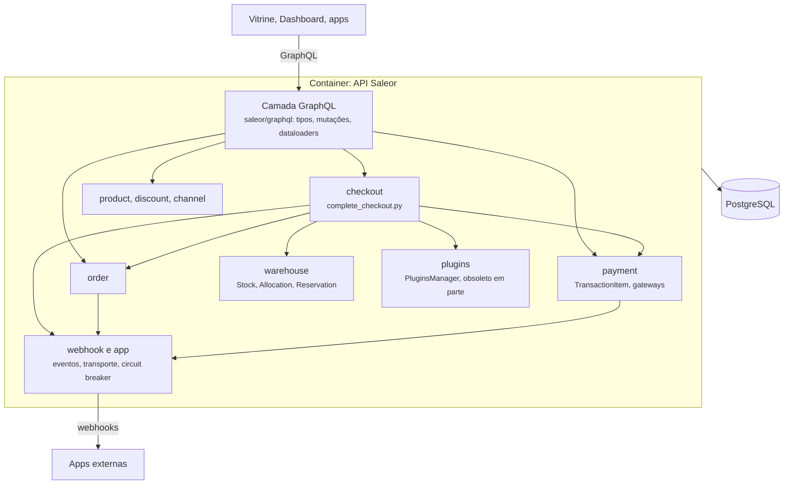
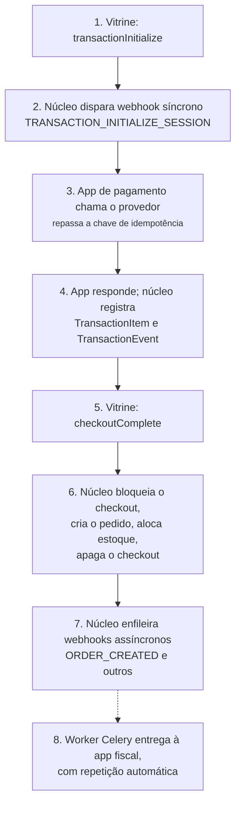
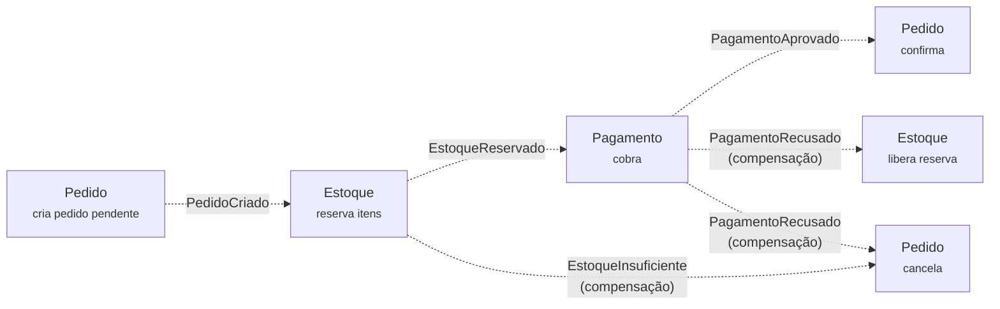
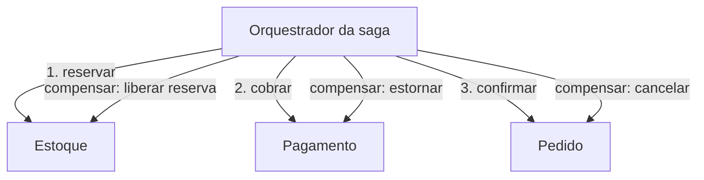
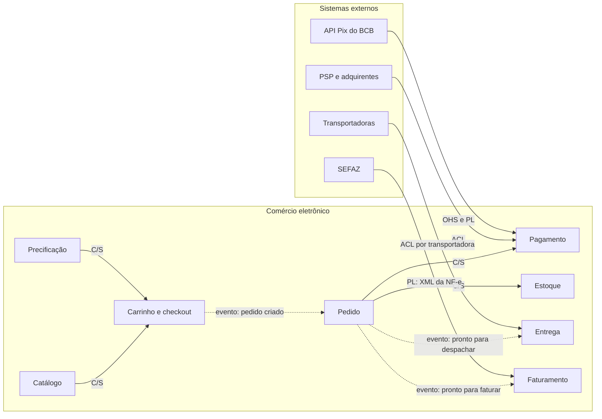

# 5.6 Saleor: componentes e comunicação

<span class="altitude a10">10.000 pés</span>

A [Seção 4.6](../capitulo-4-50-mil-pes/saleor.md) mostrou que o núcleo do Saleor é um monólito
modular *headless*, com um único banco, e que as integrações com subdomínios genéricos foram
deslocadas para *apps* externas. Esta seção abre o *container* da API e examina seus
componentes, o fluxo da operação mais crítica (a conclusão do *checkout*) e a organização
estratégica dos modelos. É aqui que o livro desenvolve o **projeto estratégico** do
*Domain-Driven Design*, apresentado em linhas gerais na Seção 1.9.2: contextos delimitados,
mapa de contextos, camada anticorrupção e linguagem publicada.

## 5.6.1 Componentes do *container* da API

O pacote `saleor/` da *tag* 3.23.42 é organizado por domínio. Há um subpacote para cada área
de negócio, com modelos, ações e tarefas, e um pacote paralelo, `saleor/graphql/`, que repete a
mesma divisão para a API. É o que Richards e Ford (2020, cap. 8) chamam de **particionamento
por domínio**, em contraste com o particionamento técnico. A Figura 5.6.1 apresenta os
componentes principais.

**Figura 5.6.1** – Componentes (C4, nível 3) do *container* da API do Saleor.



Fonte: elaborado pelo autor (2026), com base em Saleor (2026a).

A Tabela 5.6.1 relaciona os módulos aos contextos de negócio que serão definidos na Seção 5.6.4.

**Tabela 5.6.1** – Módulos do Saleor e contextos correspondentes.

| Contexto | Módulo do domínio | Módulo da API | Observação |
|---|---|---|---|
| Catálogo | `saleor/product`, `saleor/attribute` | `saleor/graphql/product` | produtos, variantes e atributos |
| Precificação e promoções | `saleor/discount`, `saleor/channel` | `saleor/graphql/discount` | preço por canal, promoções, cupons |
| Carrinho e *checkout* | `saleor/checkout` | `saleor/graphql/checkout` | inclui `complete_checkout.py` |
| Pedido | `saleor/order` | `saleor/graphql/order` | situação, linhas, atendimento, devolução |
| Pagamento | `saleor/payment` | `saleor/graphql/payment` | transações e *gateways* legados |
| Estoque | `saleor/warehouse` | `saleor/graphql/warehouse` | saldo, alocação e reserva |
| Entrega | `saleor/shipping` | `saleor/graphql/shipping` | métodos e zonas; cotação delegada a *apps* |
| Faturamento | `saleor/invoice`, `saleor/tax` | `saleor/graphql/invoice` | emissão delegada a *apps* |
| Integração | `saleor/webhook`, `saleor/app`, `saleor/plugins` | `saleor/graphql/webhook`, `saleor/graphql/app` | eventos, *apps*, *plug-ins* |

Fonte: elaborado pelo autor (2026), com base em Saleor (2026a).

## 5.6.2 Fluxo da operação-chave: concluir o *checkout*

A mutação GraphQL `checkoutComplete` é tratada pela classe `CheckoutComplete`, em
`saleor/graphql/checkout/mutations/checkout_complete.py`, que delega à função
`complete_checkout`, em `saleor/checkout/complete_checkout.py`. Essa função escolhe entre dois
fluxos, conforme o comentário do próprio código: se o *checkout* já está totalmente autorizado
por transações de pagamento, ou se o canal permite pedidos não pagos, usa-se o **fluxo de
transações** (`complete_checkout_with_transaction`); se o *checkout* tem um pagamento ativo do
mecanismo antigo, usa-se o **fluxo de pagamento** (`complete_checkout_with_payment`)
(SALEOR, 2026a, linhas 1753-1790). A diferença entre eles é arquitetural, e não apenas de API.

No **fluxo de transações**, que é o atual, o pagamento acontece **antes** da conclusão. A
vitrine chama `transactionInitialize`, que dispara o *webhook* síncrono
`TRANSACTION_INITIALIZE_SESSION` para a *app* de pagamento; a *app* conversa com o provedor e
reporta o resultado. Em seguida, a vitrine chama `checkoutComplete`, e o núcleo verifica a
cobertura: se o valor autorizado não cobre o total e o canal não admite pedidos não pagos, a
conclusão é recusada com o erro `CHECKOUT_NOT_FULLY_PAID` (função
`_prepare_checkout_with_transactions`, linhas 961-971); caso contrário, o pedido é criado
numa transação local. No **fluxo de pagamento**,
legado, a cobrança acontece **durante** a conclusão, por meio de *plug-ins* de *gateway*
executados no processo, e o núcleo divide o trabalho em três transações de banco sucessivas
(Seção 6.6). A Figura 5.6.2 mostra o fluxo atual.

**Figura 5.6.2** – Sequência da compra no fluxo de transações.



Fonte: elaborado pelo autor (2026), com base em Saleor (2026a; 2026b). Linhas contínuas:
comunicação síncrona; linhas tracejadas: comunicação assíncrona.

A sequência revela uma decisão importante. No fluxo atual, a etapa de pagamento ocorre fora da
transação de criação do pedido e é registrada como um conjunto de eventos imutáveis; a criação
do pedido verifica apenas se o valor está coberto. A consistência entre dinheiro e pedido é,
portanto, **eventual e reconciliável**, e não atômica, o que se discute a seguir.

## 5.6.3 Sagas: coreografia, orquestração e o que o Saleor faz

O conceito de saga foi proposto por Garcia-Molina e Salem (1987) para **transações de longa
duração** em bancos de dados, que, executadas como uma única transação, manteriam bloqueios por
tempo excessivo. Os autores propuseram escrevê-las como uma sequência de transações T1, ...,
Tn, intercaláveis com outras, cada uma associada a uma **transação de compensação** Ci que
desfaz semanticamente seu efeito; o sistema garante a execução de T1, ..., Tn ou, em caso de
falha na etapa j, de T1, ..., Tj seguida de Cj, ..., C1. A compensação não é um *rollback*: o
efeito de Ti foi efetivado e pode ter sido observado; Ci produz um novo efeito que o anula do
ponto de vista do negócio, como um estorno anula uma cobrança sem apagá-la do extrato.

Richardson (2018, cap. 4) retomou o conceito para os microsserviços e distinguiu duas formas
de coordenação. Na **coreografia**, cada participante executa sua transação local e publica um
evento, ao qual o próximo reage. Na **orquestração**, um orquestrador envia comandos aos
participantes e decide, conforme as respostas, o próximo passo ou as compensações. Richards e
Ford (2020, p. 256-259) observam que a coreografia preserva o desacoplamento, mas torna mais
complexos o tratamento de erros e a coordenação, enquanto a orquestração concentra a
complexidade num mediador, ao custo de acoplar os participantes a ele. As Figuras 5.6.3 e 5.6.4
mostram a saga do *checkout* nas duas formas, para um sistema hipotético em microsserviços.

**Figura 5.6.3** – Saga do *checkout* coreografada.



Fonte: elaborado pelo autor (2026), com base em Richardson (2018, cap. 4). Todas as setas são
eventos publicados; os rótulos marcados com "(compensação)" indicam compensações. Linhas
contínuas: comunicação síncrona; linhas tracejadas: comunicação assíncrona.

**Figura 5.6.4** – Saga do *checkout* orquestrada.



Fonte: elaborado pelo autor (2026), com base em Richardson (2018, cap. 4).

Richardson (2018, cap. 4) classifica as etapas em **compensáveis** (podem ser desfeitas, como a
reserva de estoque), a **pivô** (o ponto de não retorno; no *checkout*, a captura do pagamento)
e **retentáveis** (vêm depois do pivô e têm sucesso garantido se repetidas, como confirmar o
pedido, solicitar a NF-e e notificar o comprador). A regra de projeto é pôr antes do pivô tudo
o que pode falhar por motivo de negócio e tornar idempotente tudo o que vem depois. O autor
também adverte que sagas não têm **isolamento**: estados intermediários ficam visíveis, e uma
das contramedidas é o **bloqueio semântico**, um estado do próprio objeto que sinaliza que ele
está em uso por uma saga.

O Saleor não usa coreografia entre módulos internos: não há barramento de eventos entre
`checkout`, `order`, `payment` e `warehouse`, que se chamam diretamente. O que existe é uma
**saga orquestrada dentro de um processo**: a função de conclusão do *checkout* executa
transações locais sucessivas, marca o *checkout* com um bloqueio semântico
(`completing_started_at`) e concentra as compensações numa única função. No fluxo de
transações, a parte da saga que envolve dinheiro é deslocada para fora, para a *app* de
pagamento, e o núcleo apenas registra eventos e verifica cobertura. Os eventos assíncronos para
*apps* (pedido criado, pedido pago) é que dão à borda do sistema um caráter coreografado: a
*app* fiscal reage a eles sem que o núcleo saiba de sua existência. O código dessa saga é
examinado na Seção 6.6.

### Interativo

O interativo a seguir percorre a saga do *checkout* em três formas de coordenação: a coreografada
da Figura 5.6.3, a orquestrada da Figura 5.6.4 e a saga orquestrada em processo do Saleor, com
suas três transações sucessivas. Para cada forma, o leitor escolhe entre a conclusão sem falha, a
recusa do pagamento e a falta de estoque, e observa quais participantes executam compensações e
quem decide executá-las. Cada passo é classificado como compensável, pivô ou retentável, segundo
Richardson (2018, cap. 4), o que torna visível por que a falta de estoque **depois** do pagamento
exige uma compensação financeira mesmo dentro de um monólito.

<iframe src="../../interativos/saga.html" title="Saga do checkout: coreografia, orquestração e compensações" style="width:100%; height:660px; border:1px solid #2A4468; border-radius:10px;" loading="lazy"></iframe>

## 5.6.4 Contextos delimitados e o elefante

Um **contexto delimitado** é a fronteira explícita dentro da qual um modelo vale de forma
consistente. Evans (2003, cap. 14) parte de uma constatação: em projetos grandes coexistem
vários modelos, e quando código baseado em modelos distintos é combinado, o software torna-se
defeituoso, instável e difícil de entender. A recomendação é definir explicitamente o contexto
de cada modelo e delimitá-lo em termos de organização das equipes, de partes da aplicação e de
manifestações físicas, como bases de código e esquemas de banco de dados.

**Tabela 5.6.2** – Contextos delimitados de um comércio eletrônico.

| Contexto | Pergunta central | Conceitos próprios | Consistência exigida |
|---|---|---|---|
| Catálogo | O que é vendido e como é apresentado? | produto, variante, atributo, categoria | eventual |
| Precificação | Quanto custa, para quem e quando? | preço por canal, promoção, cupom | forte no momento do pedido |
| Carrinho e *checkout* | O que se pretende comprar e em que condições? | carrinho, linha, endereço, entrega escolhida | forte no carrinho |
| Pedido | O que foi comprado e em que situação está? | pedido, linha, situação, atendimento, devolução | forte |
| Pagamento | O dinheiro foi autorizado, capturado, estornado? | transação, evento, autorização, captura, reembolso | forte e auditável |
| Estoque | Há unidade disponível e onde? | depósito, saldo, reserva, alocação | forte para reserva |
| Entrega | Como e quando chega? | remessa, volume, transportadora, rastreamento | eventual |
| Faturamento | Que documento fiscal foi emitido? | nota fiscal, NCM, CFOP, chave de acesso | forte e legal |

Fonte: elaborado pelo autor (2026).

Evans (2003, cap. 14) ilustra a dificuldade de unificar modelos com a parábola dos cegos que
apalpam um elefante, na versão de John Godfrey Saxe: cada um toca uma parte e conclui que o
animal é como uma parede, uma árvore, uma cobra ou uma corda. O argumento tem três passos. Se
nenhuma integração é necessária, a divergência não importa. Se alguma é, os cegos não precisam
concordar sobre o que é um elefante, mas ganham muito ao **reconhecer que discordam** e traduzir
apenas o que interessa a todos. E, quando a necessidade de compartilhar cresce, unificar quase
sempre significa **criar um modelo novo**, e não adotar o de um dos participantes. No comércio
eletrônico, o elefante é o **produto** (Tabela 5.6.3).

**Tabela 5.6.3** – O conceito de produto em contextos diferentes.

| Contexto | O que "produto" significa | Atributos relevantes |
|---|---|---|
| Catálogo | algo a ser descoberto e desejado | nome, descrição, fotos, atributos, categoria |
| Estoque | unidades físicas contáveis num lugar | SKU, depósito, saldo, quantidade reservada |
| Entrega | um volume a transportar | peso, dimensões, restrições de transporte |
| Faturamento | uma mercadoria tributável | NCM, CFOP, origem, unidade tributável |

Fonte: elaborado pelo autor (2026), com base em Evans (2003, cap. 14).

Uma tabela `produto` com todas essas colunas leva ao que Richards e Ford (2020, cap. 8) chamam
de *entity trap*: componentes derivados das entidades do banco, e não dos fluxos de negócio. O
Saleor adota uma solução intermediária: `Product` e `ProductVariant` ficam em `saleor/product`,
com atributos de peso, enquanto o saldo por depósito fica em `Stock`, em `saleor/warehouse`,
com chave estrangeira para a variante; a cotação de frete é delegada a *apps*; e o modelo fiscal
nem existe no núcleo. A separação é real no código, mas todos os modelos residem no mesmo banco,
com consequências discutidas na Seção 5.6.7.

## 5.6.5 O mapa de contextos

Um **mapa de contextos** descreve os contextos e as relações entre eles tal como estão (EVANS,
2003, cap. 14). Cada padrão do catálogo de Evans descreve simultaneamente uma relação técnica e
uma relação entre equipes, com os termos montante (*upstream*, cujas decisões afetam o outro) e
jusante (*downstream*).

**Tabela 5.6.4** – Padrões de relacionamento entre contextos.

| Padrão | Relação entre equipes | Mecanismo técnico |
|---|---|---|
| *Shared kernel* (núcleo compartilhado) | cooperação estreita | subconjunto do modelo alterado só por acordo |
| *Customer/supplier* (cliente-fornecedor) | o jusante tem voz no planejamento do montante | testes de aceitação do cliente no *pipeline* do fornecedor |
| *Conformist* (conformista) | jusante sem poder de negociação | adota o modelo do montante sem tradução |
| *Anticorruption layer* (ACL) | jusante sem poder de negociação | camada de tradução com fachadas, adaptadores e tradutores |
| *Open host service* (OHS) | um montante, muitos jusantes | protocolo aberto descrito como conjunto de serviços |
| *Published language* (PL) | comunidade de participantes | linguagem de troca documentada, em geral um padrão setorial |
| *Separate ways* (caminhos separados) | nenhuma | nenhuma integração |
| *Partnership* (parceria) | sucesso ou fracasso conjunto | planejamento e integração coordenados (EVANS, 2015) |

Fonte: elaborado pelo autor (2026), com base em Evans (2003, cap. 14) e Evans (2015).

Três observações orientam o uso do catálogo. O **conformismo** não é falha moral: é escolha
racional quando o modelo do outro lado é razoável e não há poder de influência; reduz o custo
de tradução ao preço de amarrar o próprio modelo às decisões alheias (EVANS, 2003, cap. 14). A
**camada anticorrupção** não é mecanismo de transporte: Evans insiste que ela traduz objetos e
ações conceituais de um modelo para outro, e que sua interface aparece, em geral, como
serviços expressos no modelo do cliente, implementados com fachadas e adaptadores (GAMMA *et
al.*, 1994) e tradutores. E o **serviço de hospedagem aberta** e a **linguagem publicada** são
complementares: o primeiro oferece um protocolo único a todos os que precisam se integrar; a
segunda reduz o acoplamento ao modelo do anfitrião ao usar uma linguagem documentada e estável.
Evans, em 2003, citava os esquemas XML setoriais como o exemplo emergente de linguagem publicada
no comércio eletrônico.

**Pagamentos.** Adquirentes e provedores têm modelos próprios: o que um chama de *payment
intent*, outro chama de transação ou cobrança; "autorizado", "capturado" e "liquidado" têm
semânticas sutilmente diferentes. Com um único provedor, o conformismo é tentador; seu custo
aparece quando um segundo provedor é contratado, requisito explícito da Seção 3.6.4. A ACL
inverte a situação: o contexto de Pagamento define o que precisa e o que espera de volta, e
cada provedor tem seu tradutor. No Saleor, a ACL tem dois níveis: no mecanismo legado, as
*dataclasses* `PaymentData` e `GatewayResponse` formam a linguagem comum, e cada *plug-in* de
*gateway* traduz para seu provedor; no mecanismo atual, os eventos síncronos de transação são o
contrato, e cada *app* é a ACL (Seção 6.6).

**Pix.** O Banco Central publica a especificação da API Pix em OpenAPI 3.0, num repositório
público (BANCO CENTRAL DO BRASIL, 2025). Ela define `PUT /cob/{txid}` para criar uma cobrança
imediata com identificador escolhido pelo recebedor e `POST /cob` para o caso em que o PSP o
define. O esquema estabelece que o `txid` é criado exclusivamente pelo usuário recebedor, é
único por CPF ou CNPJ e tem de 26 a 35 caracteres alfanuméricos, e que, confirmado o pagamento,
ele trafega nas mensagens `pacs.008`, do padrão ISO 20022. É um caso nítido de **OHS com
linguagem publicada**: protocolo igual para todos os PSP sobre mensagens padronizadas
internacionalmente. E o `PUT` com identificador escolhido pelo cliente é, em si, um mecanismo
de idempotência.

**Transportadoras.** Quando um subsistema precisa se integrar com muitos outros, escrever um
tradutor sob medida para cada par sobrecarrega a equipe (EVANS, 2003, cap. 14). O contexto de
Entrega deve oferecer, para dentro, um protocolo único ("cotar", "rastrear") e manter, para
fora, um adaptador anticorrupção por transportadora, que traduz, por exemplo, os códigos de
rastreamento de cada empresa para poucas situações do modelo da loja. Agregadores de frete são
um OHS oferecido por terceiros: reduzem o número de tradutores, mas criam nova dependência.

**NF-e e SEFAZ.** O XML da NF-e, instituída pelo Ajuste SINIEF 07/05 (CONFAZ, 2005), é uma
**linguagem publicada** no sentido mais estrito: documentada, compartilhada por todos os
contribuintes e definida por um órgão externo. A relação é de **conformismo obrigatório quanto
à linguagem de troca**, combinado com **ACL quanto ao modelo interno**. O erro comum em sistemas
legados brasileiros é deixar CFOP, CST e NCM contaminarem os modelos de Pedido e de Catálogo, de
modo que cada nota técnica exige mudanças em todo o sistema. A alternativa é que o Pedido
publique um evento expresso em seus próprios termos e que o Faturamento o traduza (Listagem
5.6.1).

**Listagem 5.6.1** – Modelo didático em Java: tradução do modelo de pedidos para o modelo fiscal.

```java
package br.edu.ifal.loja.faturamento.acl;

// Recebe um evento do contexto Pedido e produz um documento no modelo fiscal.
// Nenhuma classe do contexto Pedido conhece NCM, CFOP ou o leiaute da NF-e.
public final class TradutorPedidoParaNotaFiscal {
    private final CadastroFiscalDeProdutos cadastroFiscal;   // modelo do próprio Faturamento
    private final RegrasDeOperacao regras;                   // decide CFOP pela UF de destino etc.

    public TradutorPedidoParaNotaFiscal(CadastroFiscalDeProdutos c, RegrasDeOperacao r) {
        this.cadastroFiscal = c; this.regras = r;
    }

    public NotaFiscalRascunho traduzir(PedidoProntoParaFaturar evento) {
        var nota = new NotaFiscalRascunho(evento.idPedido(), evento.destinatario());
        for (var linha : evento.linhas()) {
            var dadosFiscais = cadastroFiscal.porSku(linha.sku());       // NCM, origem, unidade
            var cfop = regras.cfopPara(evento.ufDestino(), dadosFiscais);
            nota.adicionarItem(dadosFiscais, cfop, linha.quantidade(), linha.precoUnitario());
        }
        return nota;   // um serializador separado gera o XML no leiaute vigente
    }
}
```

Fonte: elaborado pelo autor (2026).

A Figura 5.6.5 reúne as relações. As setas apontam do montante para o jusante.

**Figura 5.6.5** – Mapa de contextos de um comércio eletrônico brasileiro.



Fonte: elaborado pelo autor (2026), com base em Evans (2003, cap. 14). Siglas: C/S,
cliente-fornecedor; ACL, camada anticorrupção; OHS, serviço de hospedagem aberta; PL, linguagem
publicada. Linhas contínuas: comunicação síncrona; linhas tracejadas: comunicação assíncrona.

O mapa mostra que todos os sistemas externos estão a montante, e que os contextos com mais
montantes externos (Pagamento, Entrega, Faturamento) são os que mais precisam de tradução. No
Saleor, são justamente esses os delegados a *apps*: a destilação da Seção 3.6.7 e o mapa de
contextos apontam na mesma direção.

## 5.6.6 As lentes de camadas, hexagonal e limpa, e os padrões de Fowler

Pela lente das **camadas** (Seção 1.8.1), a camada GraphQL é a apresentação, os módulos de
domínio contêm a lógica, e o ORM do Django é a fonte de dados. A separação entre apresentação e
domínio é nítida em pastas: os tipos GraphQL ficam em `saleor/graphql/<contexto>/types.py`, e os
modelos, em `saleor/<contexto>/models.py`. A separação entre domínio e dados não existe: os
modelos de domínio são classes do ORM.

Pela lente **hexagonal** (Seção 1.8.2), o resultado é mais interessante na escala do sistema do
que na do código. A API GraphQL é o adaptador primário. Os eventos síncronos
(`CHECKOUT_CALCULATE_TAXES`, `SHIPPING_LIST_METHODS_FOR_CHECKOUT`,
`TRANSACTION_CHARGE_REQUESTED` e outros, enumerados em `WebhookEventSyncType`) funcionam como
**portas de saída definidas pelo núcleo**, nos termos dele, e as *apps* são os adaptadores que
as implementam. É exatamente a estrutura de Cockburn: o núcleo define a conversa ("calcule os
impostos deste *checkout*"), e a tecnologia concreta fica do lado de fora. Dentro do processo,
porém, a regra da dependência da **arquitetura limpa** (Seção 1.8.4) não é observada: o domínio
depende do *framework* de persistência, e há ao menos um caso de dependência do domínio para a
apresentação, discutido na Seção 5.6.7.

Pelos padrões de **Fowler (2002)**, três se destacam. A API GraphQL é uma ***Remote Facade***:
uma fachada de granularidade grossa sobre objetos finos, que reduz o número de chamadas entre
processos sem conter lógica de domínio (FOWLER, 2002, cap. 15). Os tipos GraphQL são ***Data
Transfer Objects***, objetos sem comportamento que transportam numa única chamada os dados de
que o cliente precisa; Fowler os descreve como um dos objetos que "nossas mães nos disseram
para nunca escrever", úteis justamente por permitirem mover muita informação pela rede de uma
vez (FOWLER, 2002, cap. 15). O GraphQL acrescenta uma variação: os DTOs são **definidos pelo
cliente**, que compõe numa consulta exatamente os campos de que precisa (GRAPHQL FOUNDATION,
2021); o custo é que consultas arbitrárias podem ser caras, o que o Saleor controla com um mapa
de custo de consultas (`saleor/graphql/query_cost_map.py`). Por fim, a lógica do *checkout*
segue o padrão ***Transaction Script*** (FOWLER, 2002, cap. 9): funções de módulo como
`complete_checkout`, `order/actions.py` e `warehouse/management.py` organizam a lógica por
operação, usando os modelos do ORM, que são ***Active Records*** (FOWLER, 2002, cap. 10), como
estruturas de dados. A Seção 6.6 examina essa combinação no código.

## 5.6.7 Fronteiras porosas e decisões

A estrutura de pastas sugere contextos isolados; as dependências contam outra história. O
arquivo `saleor/checkout/complete_checkout.py` importa módulos de `order`, `payment`,
`warehouse`, `discount`, `tax`, `shipping` e `product`, e importa também funções de
`saleor/graphql/checkout/utils.py` (linha 45), isto é, o módulo de domínio depende do módulo da
API, o que inverte o sentido recomendado pelas arquiteturas da Seção 1.8. Os modelos se
referenciam por chaves estrangeiras entre módulos: `saleor/payment/models.py` importa
`Checkout`, e `saleor/order/models.py` importa `Payment`, `Voucher`, `GiftCard` e
`ShippingMethod`.

Não se trata de crítica ingênua. O banco compartilhado permite as transações ACID do
*checkout* e o desempenho das consultas. Mas significa que os "contextos" internos do Saleor
são **módulos** de um mesmo modelo, e não contextos delimitados no sentido estrito de Evans: as
relações internas são, na prática, de **núcleo compartilhado** em larga escala. As verdadeiras
camadas anticorrupção estão nas bordas, no contrato com as *apps* e na interface de *gateways*.
Extrair o Pagamento como serviço exigiria desfazer chaves estrangeiras e importações cruzadas,
o trabalho que Newman (2021, cap. 3) descreve ao tratar da decomposição de monólitos e de seus
bancos.

**Tabela 5.6.5** – Decisões de componentes e seus compromissos.

| Decisão | Ganho | Custo |
|---|---|---|
| Módulos por domínio num único processo | navegação pelo negócio; transações locais | fronteiras mantidas só por disciplina |
| Eventos síncronos como portas para *apps* | núcleo ignorante de impostos, frete e provedores | latência e disponibilidade das *apps* no caminho crítico |
| Pagamento antes da conclusão (fluxo de transações) | a chamada lenta ao provedor sai da transação do pedido | consistência eventual entre dinheiro e pedido, exige reconciliação |
| GraphQL como fachada remota | DTOs sob medida, uma API para todos os clientes | controle de custo de consultas e contrato público rígido |
| *Transaction Script* com *Active Record* | simplicidade e desempenho de consulta | invariantes fora dos objetos, difíceis de localizar |

Fonte: elaborado pelo autor (2026).

## Referências

BANCO CENTRAL DO BRASIL. **bacen/pix-api**: especificações da API Pix em OpenAPI 3.0,
versão 2.10.0. GitHub, 2025. Disponível em: <https://github.com/bacen/pix-api>. Acesso em:
18 out. 2026.

CONFAZ. **Ajuste SINIEF 07/05, de 30 de setembro de 2005**. Institui a Nota Fiscal Eletrônica
e o Documento Auxiliar da Nota Fiscal Eletrônica. Diário Oficial da União, Brasília, DF, 5 out.
2005. Disponível em: <https://www.confaz.fazenda.gov.br/legislacao/ajustes/2005/AJ007_05>. Acesso em: 18
out. 2026.

EVANS, E. **Domain-driven design**: tackling complexity in the heart of software. Boston:
Addison-Wesley, 2003.

EVANS, E. **Domain-driven design reference**: definitions and pattern summaries. Domain
Language, 2015.

FOWLER, M. **Patterns of enterprise application architecture**. Boston: Addison-Wesley, 2002.

GAMMA, E. *et al.* **Design patterns**: elements of reusable object-oriented software. Reading:
Addison-Wesley, 1994.

GARCIA-MOLINA, H.; SALEM, K. Sagas. *In*: ACM SIGMOD INTERNATIONAL CONFERENCE ON MANAGEMENT
OF DATA, 1987, San Francisco. **Proceedings** [...]. New York: ACM, 1987. p. 249-259.

GRAPHQL FOUNDATION. **GraphQL specification**: October 2021 edition. 2021. Disponível em:
<https://spec.graphql.org/October2021/>. Acesso em: 18 out. 2026.

NEWMAN, S. **Building microservices**: designing fine-grained systems. 2. ed. Sebastopol:
O'Reilly, 2021.

RICHARDS, M.; FORD, N. **Fundamentals of software architecture**: an engineering approach.
Sebastopol: O'Reilly, 2020.

RICHARDSON, C. **Microservices patterns**: with examples in Java. Shelter Island: Manning,
2018.

SALEOR. **saleor/saleor**: repositório de código-fonte, versão 3.23.42. GitHub, 2026a.
Disponível em: <https://github.com/saleor/saleor/tree/3.23.42>. Acesso em: 18 out. 2026.

SALEOR. **Webhooks overview**. Documentação do Saleor, 2026b. Disponível em:
<https://docs.saleor.io/developer/extending/webhooks/overview>. Acesso em: 18 out. 2026.
