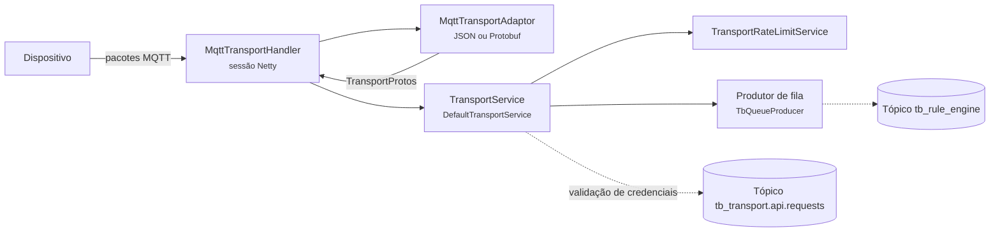
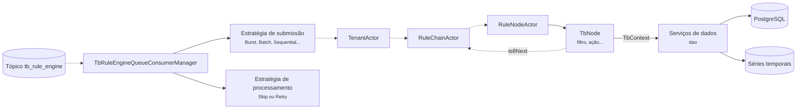
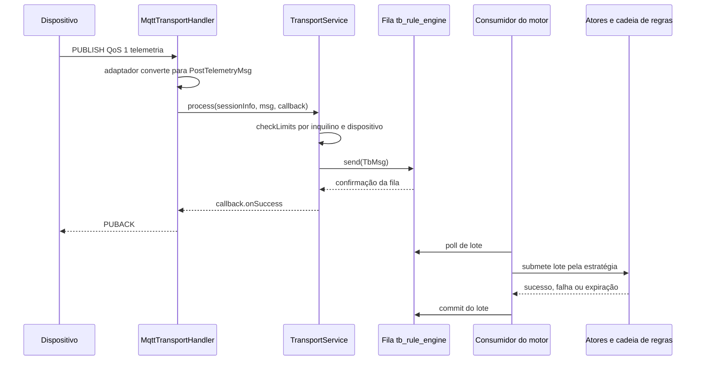
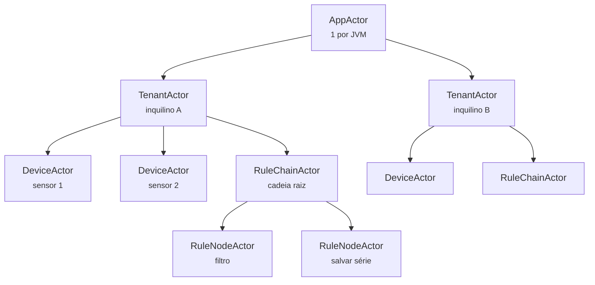
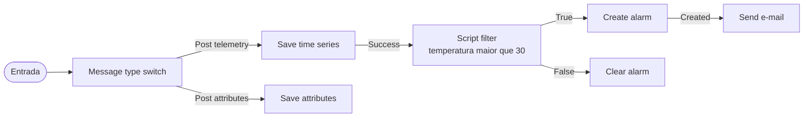
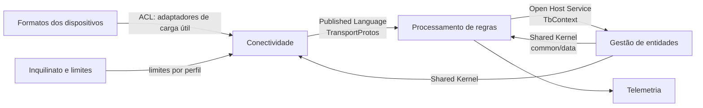

# 5.7 ThingsBoard: componentes e comunicação

10.000 pés

## 5.7.1 Dois *containers* em foco

A [Seção 4.7](../capitulo-4-50-mil-pes/thingsboard.md) mostrou que a fila particionada separa a
aceitação de uma mensagem do seu processamento. A 10.000 pés, a pergunta passa a ser como cada
lado dessa fronteira está organizado internamente. Esta seção examina dois *containers*: o
**transporte**, em particular o MQTT, que aceita mensagens de dispositivos e as publica na fila; e
o **nó ThingsBoard**, que as consome, as encaminha a atores e as processa por cadeias de regras. Os
nomes de classes e pacotes referem-se à *tag* `v4.3.1.6`; os trechos literais estão na [Seção
6.7](../capitulo-6-solo/thingsboard.md).

## 5.7.2 Componentes do transporte

O transporte MQTT, no módulo `common/transport/mqtt`, tem três componentes principais. O
**tratador de conexão** (`MqttTransportHandler`), construído sobre o Netty, trata os pacotes
`CONNECT`, `PUBLISH`, `SUBSCRIBE` e `PINGREQ` de cada sessão. Os **adaptadores de carga útil**
(`JsonMqttAdaptor` e `ProtoMqttAdaptor`, sob a interface `MqttTransportAdaptor`) convertem o
conteúdo da publicação em mensagens internas. O **serviço de transporte** (`TransportService`, com
implementação `DefaultTransportService` no módulo `common/transport/transport-api`) valida
credenciais, aplica limites de taxa e publica as mensagens na fila. Os demais transportes (CoAP,
HTTP, LwM2M e SNMP) têm tratadores e adaptadores próprios, mas reutilizam o mesmo serviço de
transporte. A Figura 5.7.1 apresenta esses componentes.

**Figura 5.7.1** – Componentes do *container* de transporte MQTT (C4, nível 3).

Fonte: elaborado pelo autor (2026), a partir do código da *tag* v4.3.1.6. Linhas contínuas:
comunicação síncrona; linhas tracejadas: comunicação assíncrona.

A representação interna comum é definida em Protocol Buffers: o arquivo
`common/proto/src/main/proto/queue.proto` declara a classe externa `TransportProtos` e mensagens
como `SessionInfoProto`, `PostTelemetryMsg` e `ToRuleEngineMsg`. Essa escolha tem consequência
arquitetural: o formato que circula na fila é um contrato binário versionável, independente do
protocolo do dispositivo e do formato da carga útil.

## 5.7.3 Componentes do nó ThingsBoard

No nó ThingsBoard, os componentes relevantes para a telemetria são o **consumidor da fila do motor
de regras** (`TbRuleEngineQueueConsumerManager`), que lê lotes do tópico e os submete ao sistema de
atores; o **sistema de atores** (módulo `common/actor`, com os atores de domínio em
`application/.../actors`); o **motor de regras**, cuja API está em `rule-engine/rule-engine-api` e
cujos nós estão em `rule-engine/rule-engine-components`; os **serviços de dados** (módulo `dao`),
que gravam entidades, atributos e séries temporais; e as **estratégias de fila**, em
`application/.../service/queue/processing`. A Figura 5.7.2 mostra suas relações.

**Figura 5.7.2** – Componentes do nó ThingsBoard no caminho da telemetria (C4, nível 3).

Fonte: elaborado pelo autor (2026), a partir do código da *tag* v4.3.1.6. Linhas contínuas:
comunicação síncrona; linhas tracejadas: comunicação assíncrona (inclusive mensagens entre atores).

## 5.7.4 Uma operação-chave: ingestão de telemetria

A Figura 5.7.3 apresenta a sequência de comunicação da operação mais frequente do sistema: um
dispositivo publica telemetria com QoS 1.

**Figura 5.7.3** – Sequência da ingestão de telemetria.

Fonte: elaborado pelo autor (2026), a partir do código da *tag* v4.3.1.6.

A sequência tem quatro pontos de controle de fluxo. No **transporte**, a mensagem é verificada
contra os limites de taxa antes de qualquer outra coisa; se excedidos, o *callback* recebe erro e,
no MQTT, a sessão é encerrada. No **produtor**, o `PUBACK` só é enviado depois que a fila confirma o
recebimento. No **consumidor**, os lotes só são confirmados depois de processados ou descartados
conforme a estratégia da fila; enquanto isso, o próximo lote não é lido. No **sistema de atores**,
cada ator processa um número limitado de mensagens antes de ceder a *thread* a outro.

Esses pontos realizam o conceito de ***backpressure*** (contrapressão): um estágio sobrecarregado
não aceita trabalho indefinidamente, mas faz a sobrecarga se manifestar como atraso ou rejeição
no estágio anterior. Richards e Ford (2020, p. 210) observam que acrescentar eventos a um estilo
arquitetural oferece um ponto de contrapressão quando as requisições se acumulam. As duas primeiras
etapas da sequência correspondem, ainda, às técnicas de prevenção de perda que os mesmos autores
descrevem. O envio do `PUBACK` só após a confirmação da fila é o **envio síncrono** a uma fila
persistente, que garante que a mensagem esteja com o produtor ou na fila, nunca em lugar nenhum
(RICHARDS; FORD, 2020, p. 201). O *commit* após o processamento do lote é o **modo de confirmação
pelo cliente** (*client acknowledge mode*), que mantém a mensagem na fila até que o consumidor
declare tê-la processado (RICHARDS; FORD, 2020, p. 202). O preço é a possibilidade de reprocessar um
lote se o consumidor cair entre o processamento e o *commit*, o que reforça a necessidade de
operações idempotentes discutida na [Seção 3.7](../capitulo-3-100-mil-pes/thingsboard.md).

## 5.7.5 O modelo de atores

O **modelo de atores** foi proposto por Hewitt, Bishop e Steiger (1973) como formalismo universal
para computação concorrente, em que o ator é a única primitiva e atores interagem exclusivamente
pelo envio de mensagens. Agha (1986) deu ao modelo uma semântica operacional precisa e o situou
como fundamento para sistemas distribuídos. Na formulação de Agha, um ator tem um endereço e uma
caixa de correio; as mensagens são assíncronas e armazenadas na caixa; e, ao processar uma
mensagem, o ator pode enviar um número finito de mensagens, criar um número finito de novos atores
e definir o comportamento com que tratará a próxima mensagem. Como cada ator processa uma mensagem
por vez e não compartilha estado, não há *locks*: a concorrência ocorre **entre** atores, nunca
**dentro** de um deles.

A correspondência com uma plataforma de IoT é quase literal. Cada dispositivo tem estado próprio
(sessões, RPCs pendentes, conectividade) e recebe eventos de várias fontes; modelá-lo como ator
transforma um problema de sincronização em um problema de roteamento de mensagens. A documentação
do ThingsBoard justifica a escolha nesses termos: cada ator tem caixa de correio privada e processa
uma mensagem por vez, o que evita *locks* e permite manter muitas entidades em um nó sem estado
mutável compartilhado; os atores são criados sob demanda e reconstroem seu estado a partir do banco
ao reiniciar (THINGSBOARD, 2026a). As notas da versão 2.5.2, de junho de 2020, registram a
substituição da biblioteca Akka por uma implementação própria, em Java puro, do sistema de atores
(THINGSBOARD, 2026b).

Os atores formam uma árvore de supervisão (Figura 5.7.4). O ator **App**, um por JVM, cria os
atores de inquilino. O ator **Tenant**, um por inquilino, cria os atores de dispositivo, de cadeia
de regras e de campos calculados. O ator **Device** trata sessões, RPC, conectividade e atividade.
O ator **Rule Chain** roteia mensagens pela cadeia, e cada **Rule Node** executa a lógica de um nó
(THINGSBOARD, 2026a). Cada tipo de ator executa em um *pool* de *threads* próprio (*dispatcher*),
para que uma carga não sufoque outra, e a documentação aponta o *dispatcher* do motor de regras
como o gargalo mais comum.

**Figura 5.7.4** – Hierarquia de atores do ThingsBoard.

Fonte: elaborado pelo autor (2026), com base em ThingsBoard (2026a).

O modelo tem limitações. A ausência de *locks* não elimina a contenção: o ator da cadeia raiz de um
inquilino com milhões de dispositivos é um ponto de serialização. Caixas de correio sem limite
crescem se a produção superar o consumo, o que exige contrapressão em outro ponto, como os limites
de taxa e a fila. E o estado em memória precisa ser reconstruído após falhas. O modelo de atores
resolve a concorrência **local** e precisa ser combinado com particionamento e filas para resolver
a escala **global**.

## 5.7.6 O motor de regras

O motor de regras processa cada mensagem por uma **cadeia de regras** (*rule chain*), um grafo cujos
vértices são **nós de regra** e cujas arestas são **relações** rotuladas, como `Success`,
`Failure`, `True`, `False` ou o tipo da mensagem (THINGSBOARD, 2026c). As categorias de nós são
filtros, enriquecimento, transformação, ação e integrações externas, e uma cadeia pode encaminhar
mensagens a outra. A Figura 5.7.5 mostra uma cadeia típica.

**Figura 5.7.5** – Exemplo de cadeia de regras para telemetria de temperatura.

Fonte: elaborado pelo autor (2026), com nomes de nós da documentação do ThingsBoard (2026c).

Cada nó é um componente que conhece apenas a mensagem e um contexto, e declara por qual relação a
mensagem sai; a cadeia resolve qual nó concreto a recebe. O desenho combina *Strategy* e *Chain of
Responsibility*, examinados no código na [Seção 6.7](../capitulo-6-solo/thingsboard.md), e é
também uma forma de **microkernel**: o motor é o núcleo, e os nós são extensões descobertas por
anotação. Em comparação, o motor de regras do AWS IoT Core seleciona e encaminha dados por uma
linguagem semelhante a SQL associada a tópicos MQTT (AMAZON WEB SERVICES, 2026). O modelo do
ThingsBoard favorece composição visual e lógica com estado, como alarmes criados e depois limpos, ao
custo de uma superfície maior para erros de configuração.

Além das filas de infraestrutura, o ThingsBoard expõe **filas do motor de regras**, configuráveis
pela interface, que determinam como os lotes são submetidos e o que acontece em caso de falha
(THINGSBOARD, 2026d). A **estratégia de submissão** pode ser *Burst* (todas as mensagens de uma vez),
*Batch* (sublotes de tamanho fixo), *Sequential by originator* (uma mensagem por entidade de cada
vez), *Sequential by tenant* ou *Sequential*. A documentação adverte que *Burst* e *Batch* não
garantem ordem por originador, porque nós como o de gravação de séries temporais fazem escritas
assíncronas cujas confirmações podem chegar fora de ordem. A **estratégia de processamento** define
se falhas e expirações são ignoradas ou reprocessadas. Três filas vêm configuradas: *Main*
(submissão *Burst*, falhas ignoradas), *HighPriority* (*Burst*, reprocessando falhas e expirações)
e *SequentialByOriginator*. A documentação adverte que, como *HighPriority* reprocessa
indefinidamente na configuração padrão, uma cadeia com erro lógico que faz toda mensagem falhar
paralisa aquela fila (THINGSBOARD, 2026d). É o problema clássico da **mensagem venenosa**, cuja
solução usual, uma fila de mensagens mortas, aparece como pendência em um comentário do código
(`//TODO: 3.1 Log it to dead letters queue;`, na linha 237 de
[`TenantActor.java`](https://github.com/thingsboard/thingsboard/blob/v4.3.1.6/application/src/main/java/org/thingsboard/server/actors/tenant/TenantActor.java#L237)).

## 5.7.7 Lentes: camadas, hexagonal e limpa

A Seção 1.8 apresentou uma família de arquiteturas centradas no domínio cujo princípio comum é
fazer as dependências apontarem para o núcleo. Aplicada ao ThingsBoard, a lente **hexagonal** é
reveladora no transporte. Os tratadores de protocolo e seus adaptadores são **adaptadores
primários**: traduzem o mundo externo (pacotes MQTT, requisições CoAP) para uma porta de entrada,
o `TransportService`, cujo contrato só fala em `TransportProtos`. A abstração de fila
(`TbQueueProducer` e `TbQueueConsumer`) é uma **porta secundária**, com adaptadores em memória e
para Kafka. A configuração `queue.type` escolhe o adaptador sem alterar quem usa a porta, que é a
promessa central da arquitetura hexagonal descrita por Cockburn (2005).

No motor de regras, a separação entre `rule-engine-api` e `rule-engine-components` é uma aplicação
da **regra de dependência** da arquitetura limpa (MARTIN, 2017): os nós concretos dependem da API, e
a API não depende dos nós; o núcleo da plataforma conhece apenas `TbNode` e `TbContext`. O
`TbContext` funciona como fachada: concentra em uma interface os serviços da plataforma que um nó
pode usar, de modo que o nó não precise conhecer os módulos de dados. A lente **em camadas**, por sua
vez, descreve bem o módulo `dao`, onde serviços de entidade (por exemplo, `DeviceServiceImpl`)
ficam acima de objetos de acesso a dados (`DeviceDao`, com implementação `JpaDeviceDao`) e de
repositórios Spring Data.

Do ponto de vista dos padrões de Fowler (2002), três aparecem nesta altitude. A camada de serviços
do módulo `dao` desempenha o papel de ***Service Layer***: define as operações disponíveis sobre
entidades e demarca transações. Os objetos de acesso a dados com entidades JPA separadas das
classes de dados compartilhadas realizam um ***Data Mapper***. E a fila com mensagens
autodescritivas é um caso de mensageria assíncrona entre processos, que Hohpe e Woolf (2003)
catalogaram. A identificação desses padrões no código, no formato *Known Uses*, está na [Seção
6.7](../capitulo-6-solo/thingsboard.md).

Argumenta-se aqui que a arquitetura do ThingsBoard **não** é limpa no sentido estrito em um ponto
importante: as classes de dados de entidades (`Device`, `DeviceProfile`) vivem no módulo
`common/data` e são usadas pelos transportes, pela API REST, pelo motor de regras e pelos serviços
de dados. Elas funcionam como um modelo compartilhado por toda a aplicação, e não como um núcleo
de domínio protegido. A decisão simplifica a serialização e o reúso, mas faz com que uma mudança
nessas classes atravesse todos os módulos.

## 5.7.8 DDD estratégico: contextos e mapa de contextos

O projeto não documenta contextos delimitados no sentido de Evans (2003, cap. 14). A Tabela 5.7.1
apresenta uma **reconstrução do autor**, baseada na organização dos módulos e no fluxo descrito na
documentação, que permite discutir as relações entre partes com modelos e linguagens distintos.

**Tabela 5.7.1** – Contextos delimitados reconstruídos.

| Contexto | Linguagem própria | Módulos principais |
|---|---|---|
| Conectividade | Sessão, credencial, tópico, QoS, carga útil | `common/transport/*` |
| Gestão de entidades | Inquilino, cliente, dispositivo, perfil, ativo, relação | `dao`, `common/data`, núcleo |
| Processamento de regras | Mensagem (`TbMsg`), cadeia, nó, relação, originador | `rule-engine/*`, atores de cadeia |
| Telemetria | Série, chave, carimbo de tempo, último valor, TTL | serviços de séries temporais em `dao` |
| Inquilinato e limites | Perfil de inquilino, limite de taxa, fila isolada | perfis, `transport-api/limits` |

Fonte: elaborado pelo autor (2026).

As relações entre esses contextos podem ser descritas com os padrões de Evans (2003, cap. 14). Entre
**Conectividade** e **Processamento de regras**, a relação é de **linguagem publicada** (*Published
Language*): o contrato é o conjunto de mensagens Protocol Buffers de `TransportProtos`, um formato
documentado, versionado e independente dos protocolos dos dispositivos. Os adaptadores de carga
útil funcionam, do lado da Conectividade, como uma **camada anticorrupção** (*Anticorruption
Layer*): impedem que formatos proprietários de dispositivos penetrem no restante da plataforma. Entre
**Processamento de regras** e **Gestão de entidades**, o `TbContext` oferece aos nós um **serviço
de anfitrião aberto** (*Open Host Service*), um conjunto de operações estáveis pelo qual os nós
acessam entidades, atributos e alarmes. Por fim, as classes de `common/data` são compartilhadas por
quase todos os contextos, o que caracteriza um **núcleo compartilhado** (*Shared Kernel*) amplo; a
observação da Seção 5.7.7 sobre o modelo compartilhado pode ser relida nesses termos. A Figura
5.7.6 resume o mapa.

**Figura 5.7.6** – Mapa de contextos reconstruído.

Fonte: elaborado pelo autor (2026), com base em Evans (2003, cap. 14).

## 5.7.9 Decisões e compromissos

A Tabela 5.7.2 resume as decisões desta altitude.

**Tabela 5.7.2** – Decisões a 10.000 pés e seus compromissos.

| Decisão | Favorece | Sacrifica |
|---|---|---|
| Adaptadores por protocolo e carga útil, convergindo em `TransportProtos` | Extensibilidade de protocolos; isolamento do núcleo | Uma conversão por mensagem; contrato binário a versionar |
| Confirmação ao dispositivo só após a fila | Durabilidade (nenhuma perda de mensagem confirmada) | Latência do `PUBACK` |
| *Commit* do lote após processamento | Prevenção de perda no consumidor | Reprocessamento possível; exige idempotência |
| Modelo de atores com caixa de correio por entidade | Concorrência sem *locks*; estado por dispositivo | Pontos de serialização; reconstrução de estado após falha |
| Cadeias de regras como grafo de nós | Configurabilidade por usuários; extensibilidade por nós | Depuração mais difícil; tráfego interno em ramificações |
| Estratégias de fila configuráveis | Ajuste entre ordem, vazão e confiabilidade por fila | Riscos de configuração, como a mensagem venenosa |

Fonte: elaborado pelo autor (2026).

## Referências

AGHA, G. **Actors**: a model of concurrent computation in distributed systems. Cambridge: MIT
Press, 1986.

AMAZON WEB SERVICES. **How AWS IoT works**. AWS IoT Core Developer Guide. 2026. Disponível em:
<https://docs.aws.amazon.com/iot/latest/developerguide/aws-iot-how-it-works.html>. Acesso em:
18 out. 2026.

COCKBURN, A. **Hexagonal architecture**. 2005. Disponível em:
<https://alistair.cockburn.us/hexagonal-architecture/>. Acesso em: 18 out. 2026.

EVANS, E. **Domain-driven design**: tackling complexity in the heart of software. Boston:
Addison-Wesley, 2003.

FOWLER, M. **Patterns of enterprise application architecture**. Boston: Addison-Wesley, 2002.

HEWITT, C.; BISHOP, P.; STEIGER, R. A universal modular ACTOR formalism for artificial
intelligence. *In*: INTERNATIONAL JOINT CONFERENCE ON ARTIFICIAL INTELLIGENCE (IJCAI), 3., 1973,
Stanford. **Proceedings** [...]. [S. l.: s. n.], 1973. p. 235-245. Disponível em:
<https://www.ijcai.org/Proceedings/73/Papers/027B.pdf>. Acesso em: 18 out. 2026.

HOHPE, G.; WOOLF, B. **Enterprise integration patterns**: designing, building, and deploying
messaging solutions. Boston: Addison-Wesley, 2003.

MARTIN, R. C. **Clean architecture**: a craftsman's guide to software structure and design.
Boston: Prentice Hall, 2017.

RICHARDS, M.; FORD, N. **Fundamentals of software architecture**: an engineering approach.
Sebastopol: O'Reilly, 2020.

THINGSBOARD. **Actor system**. ThingsBoard documentation. 2026a. Disponível em:
<https://thingsboard.io/docs/reference/architecture/actor-system/>. Acesso em: 18 out. 2026.

THINGSBOARD. **thingsboard/thingsboard**: repositório de código-fonte e notas de versão. GitHub,
2026b. Disponível em: <https://github.com/thingsboard/thingsboard>. Acesso em: 18 out. 2026.

THINGSBOARD. **Rule engine**. ThingsBoard documentation. 2026c. Disponível em:
<https://thingsboard.io/docs/user-guide/rule-engine/>. Acesso em: 18 out. 2026.

THINGSBOARD. **Rule engine queues**. ThingsBoard documentation. 2026d. Disponível em:
<https://thingsboard.io/docs/user-guide/rule-engine/queues/>. Acesso em: 18 out. 2026.
