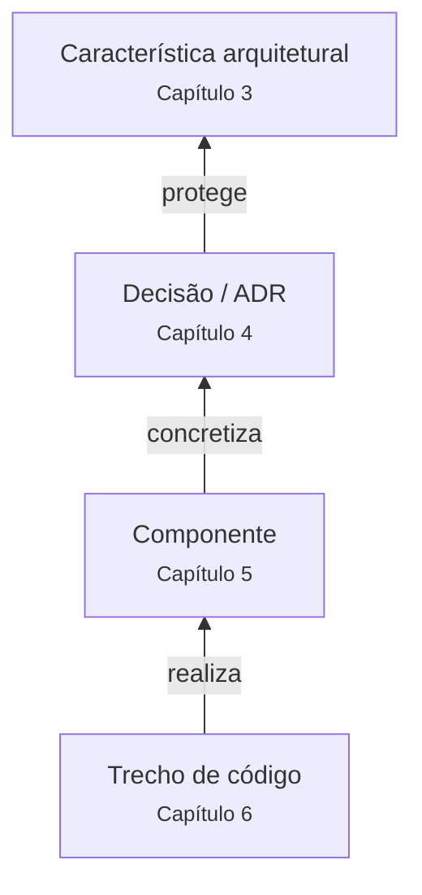

# Capítulo 6 - Solo: o código

!!! todo "Para desenvolver"
    Podcast do capítulo.

## Objetivos

Ao final deste capítulo, o leitor deverá ser capaz de:

- Ler o código de sistemas de grande porte de forma orientada por hipóteses arquiteturais.
- Reconhecer, em código real, o modelo de domínio e os blocos de construção do DDD tático.
- Identificar padrões de projeto (GoF) e padrões de aplicação corporativa (Fowler) e documentá-los
  no formato de ficha *Known Uses*.
- Executar a subida de verificação, ligando um trecho de código à característica arquitetural que
  ele protege.
- Expressar decisões arquiteturais como funções de aptidão executáveis.

## 6.1 Introdução: o pouso

### 6.1.1 O que se observa no solo

Depois de percorrer o contexto (Capítulo 3), os *containers* (Capítulo 4) e os componentes
(Capítulo 5), a análise chega ao nível em que todas as decisões finalmente se materializam: o
código. No modelo C4, este é o nível 4, de classes, interfaces e funções (BROWN, 2018). É também o
nível em que a arquitetura pode ser **verificada** ou **refutada**. Uma decisão que não deixa
rastro no código, ou que o código contradiz, é uma intenção, e não uma propriedade do sistema.
Perry e Wolf (1992) chamaram de **erosão arquitetural** a divergência entre a arquitetura
pretendida e a implementada, e é no solo que essa divergência se torna observável.

O pouso exige uma disciplina de leitura. Repositórios como os estudados neste livro têm centenas
de milhares de linhas e não podem ser lidos integralmente. Fox e Patterson (2021, cap. 9) propõem
explorar sistemas legados "de fora para dentro": executar o sistema, ler o esquema do banco de
dados, gerar diagramas, examinar os testes e só então ler o código das partes relevantes. O
Apêndice C adapta esse roteiro. Neste capítulo, a leitura é guiada pelas altitudes superiores: o
leitor procura no código as decisões identificadas nos Capítulos 4 e 5, e não o código em geral.

### 6.1.2 O modelo de domínio no código

Fowler (2002, cap. 2) descreve três formas principais de organizar a lógica de domínio. No
***Transaction Script***, cada operação de negócio é um procedimento que lê e grava dados
diretamente. No ***Table Module***, há uma classe por tabela que opera sobre conjuntos de
registros. No ***Domain Model***, há uma rede de objetos que representam conceitos do domínio, com
dados e comportamento. O autor argumenta que o *Domain Model* tem um custo inicial maior, mas
escala melhor à medida que a lógica se torna complexa.

O DDD tático (Seção 1.9.3) refina o *Domain Model* com os blocos de construção de Evans (2003,
caps. 5 e 6): entidades, objetos de valor, agregados com suas raízes e invariantes, repositórios,
fábricas, serviços de domínio e, na literatura posterior, eventos de domínio (VERNON, 2013). Ao
examinar o código dos sistemas, interessa saber **onde estão as regras de negócio**: nas
entidades, em serviços, nos controladores, em procedimentos do banco? E **quem garante as
invariantes**: a própria entidade, um serviço de aplicação ou uma validação dispersa? As respostas
revelam se o sistema segue um *Domain Model* rico, um modelo anêmico ou uma variante de
*Transaction Script*. A escolha não é necessariamente um defeito; como mostra Fowler, ela pode ser
adequada ao grau de complexidade do domínio.

### 6.1.3 Padrões no código: a ficha *Known Uses*

Gamma *et al.* (1994, cap. 1) descrevem cada padrão com um conjunto fixo de seções, entre as quais
*Known Uses*, os usos conhecidos em sistemas reais. Os exemplos do livro, de sistemas como ET++,
InterViews e Smalltalk-80, estão hoje datados. Este capítulo atualiza essa prática: em cada
sistema, os padrões encontrados são documentados numa ficha com a localização (*permalink* para
uma versão fixada do repositório), os participantes, o problema que o padrão resolve naquele
contexto, a característica arquitetural que ele protege e suas consequências. O modelo da ficha
está no Apêndice C. A Tabela 6.1 antecipa os principais padrões documentados.

**Tabela 6.1** – Padrões de destaque documentados nas seções de aplicação.

| Seção | Sistema | Padrões GoF e afins | Padrões de Fowler e DDD |
|---|---|---|---|
| [6.2](mastodon.md) | Mastodon | *Command* (*workers*), *Observer* (*callbacks*), disjuntor | *Active Record*, *Service Layer*, *Transaction Script* |
| [6.3](mattermost.md) | Mattermost | *Observer* e *Mediator* (*hub*), *Decorator*, *Proxy*, *Command* | *Repository*, *Idempotent Receiver* |
| [6.4](peertube.md) | PeerTube | *Chain of Responsibility*, *Template Method*, *Strategy* | *Active Record* |
| [6.5](nextcloud.md) | Nextcloud | *Adapter*, *Decorator*, *Composite*, *Observer* | *Plugin*, *Separated Interface* |
| [6.6](saleor.md) | Saleor | *Circuit Breaker* | *Transaction Script*, *Active Record*, *Remote Facade* e DTO, camada anticorrupção, chave de idempotência |
| [6.7](thingsboard.md) | ThingsBoard | *Strategy*, *Chain of Responsibility*, *Adapter* | *Service Layer*, *Data Mapper*, modelo de atores |
| [6.8](px4.md) | PX4 | *Observer* com *ChangeManager*, *Strategy* | Máquina de estados tabular |

Fonte: elaborado pelo autor (2026). Detalhamento e localização exata nas seções de cada sistema.

### 6.1.4 A subida de verificação

Cada seção de aplicação termina com a **subida de verificação** apresentada na Seção 1.11. Partindo
de um trecho de código, o analista percorre as altitudes no sentido inverso e responde a três
perguntas: que componente este código realiza (Capítulo 5)? Que decisão esse componente concretiza
(Capítulo 4)? Que característica arquitetural essa decisão protege (Capítulo 3)? A subida tem
valor diagnóstico. Quando a cadeia se completa, a arquitetura está compreendida e o código está
justificado. Quando ela se interrompe, há código acidental ou uma decisão não documentada, e ambos
os casos merecem atenção.

**Figura 6.1** – A subida de verificação.

Fonte: elaborado pelo autor (2026).

### 6.1.5 Decisões que se executam: funções de aptidão

Uma decisão verificada uma vez pode ser violada no dia seguinte. Ford, Parsons e Kua (2017)
propõem tornar as decisões arquiteturais **executáveis** na forma de funções de aptidão, e
Richards e Ford (2020, cap. 6) comparam essas funções às listas de verificação de pilotos. Em cada
sistema estudado, o leitor é convidado a formular a decisão principal de 10.000 pés como uma regra
verificável. As atividades práticas do livro, escritas em Java 17, fazem isso com a biblioteca
ArchUnit, e a nota de cada atividade inclui uma parcela atribuída exclusivamente ao respeito à
arquitetura. O Apêndice E apresenta a técnica e discute o exercício-modelo, um código legado de
pedidos cujas camadas devem ser restauradas até que as funções de aptidão sejam satisfeitas.

### 6.1.6 Os produtos da análise no solo

Cada seção de aplicação (6.2 a 6.8) apresenta:

1. trechos **literais** do código, curtos e com *permalink* para a versão estudada;
2. o **modelo de domínio** e os blocos de construção do DDD tático encontrados;
3. **fichas *Known Uses*** dos padrões de projeto e de aplicação identificados;
4. a **subida de verificação** completa;
5. **exercícios** do sistema, incluindo a atividade com correção automática.

## Diagramas e animações

O altímetro (Seção 1.11) mostra, no último passo, uma subida de verificação sobre o Mastodon.

<iframe src="../interativos/altimetro.html" title="Altímetro: do contexto ao código"
  style="width:100%; height:660px; border:1px solid #2A4468; border-radius:10px;"
  loading="lazy"></iframe>

## Vídeos

!!! todo "Para desenvolver"
    Vídeo (15 min) de leitura guiada de código em um dos sete repositórios.

## Exercícios

Os exercícios específicos de cada sistema estão ao final das Seções 6.2 a 6.8. Os exercícios
abaixo são transversais.

1. Escolha dois sistemas e compare onde estão as regras de negócio: nas entidades, em serviços ou
   em controladores. Classifique cada um segundo Fowler (*Transaction Script*, *Table Module* ou
   *Domain Model*).
2. Encontre, em qualquer um dos sete repositórios, um padrão GoF não documentado neste capítulo e
   preencha a ficha *Known Uses*.
3. Execute a subida de verificação para um trecho de código escolhido por você. A cadeia se
   completou? Se não, que hipótese explica a interrupção?
4. Para cada sistema, formule a decisão principal de 10.000 pés como uma regra que poderia ser
   verificada automaticamente.
5. Compare *Active Record* (Mastodon, Saleor) e repositórios (ThingsBoard) quanto à testabilidade
   das regras de negócio.

## Glossário do capítulo

`Erosão arquitetural`
:   Divergência progressiva entre a arquitetura pretendida e a arquitetura implementada.

`Domain Model`
:   Padrão em que a lógica de domínio é organizada numa rede de objetos com dados e comportamento.

`Modelo anêmico`
:   Modelo de domínio cujos objetos contêm dados, mas pouco ou nenhum comportamento, ficando as
    regras em serviços externos a eles.

`Known Uses`
:   Seção da descrição de um padrão que registra seus usos em sistemas reais.

`Subida de verificação`
:   Procedimento que liga um trecho de código ao componente, à decisão e à característica
    arquitetural que o justificam.

`Permalink`
:   Endereço permanente de um trecho de código numa versão fixa de um repositório.

## Referências

BROWN, S. **The C4 model for visualising software architecture**. 2018. Disponível em:
<https://c4model.com>. Acesso em: 18 out. 2026.

EVANS, E. **Domain-driven design**: tackling complexity in the heart of software. Boston:
Addison-Wesley, 2003.

FORD, N.; PARSONS, R.; KUA, P. **Building evolutionary architectures**: support constant change.
Sebastopol: O'Reilly, 2017.

FOWLER, M. **Patterns of enterprise application architecture**. Boston: Addison-Wesley, 2002.

FOX, A.; PATTERSON, D. **Engineering software as a service**: an agile approach using cloud
computing. 2. ed. San Francisco: Strawberry Canyon, 2021.

GAMMA, E. *et al.* **Design patterns**: elements of reusable object-oriented software. Reading:
Addison-Wesley, 1994.

PERRY, D. E.; WOLF, A. L. Foundations for the study of software architecture. **ACM SIGSOFT
Software Engineering Notes**, v. 17, n. 4, p. 40-52, 1992.

RICHARDS, M.; FORD, N. **Fundamentals of software architecture**: an engineering approach.
Sebastopol: O'Reilly, 2020.

VERNON, V. **Implementing domain-driven design**. Upper Saddle River: Addison-Wesley, 2013.

## Material complementar

!!! todo "Para desenvolver"
    Seleção de textos de acesso aberto sobre leitura de código e padrões em sistemas reais.
