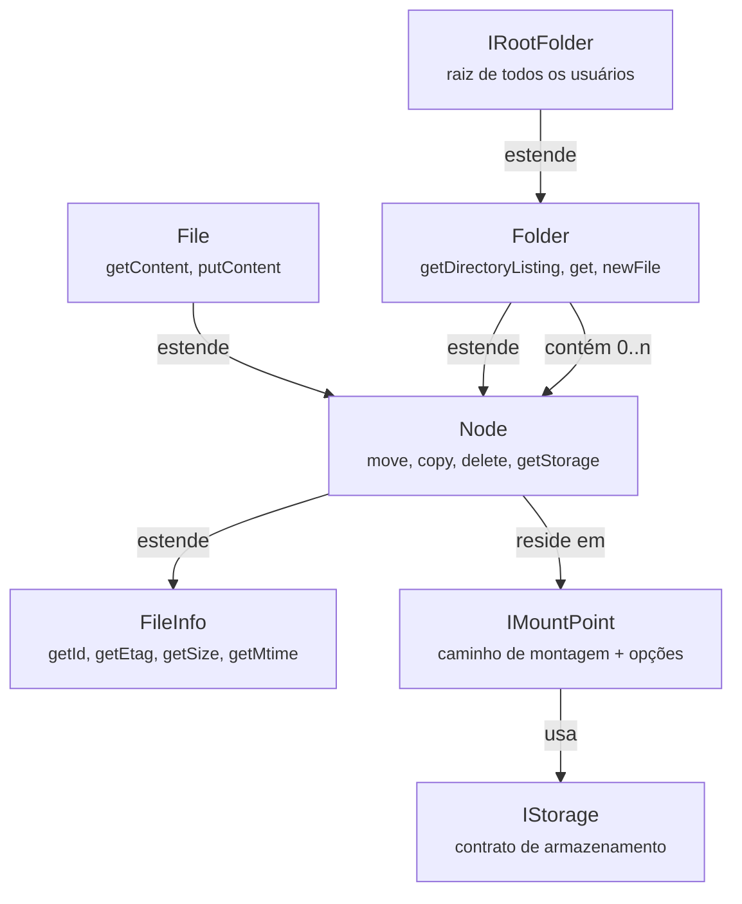

# 6.5 Nextcloud: o código

<span class="altitude solo">Solo</span>

Esta seção pousa no código do Nextcloud. Ela parte dos componentes descritos na
[Seção 5.5](../capitulo-5-10-mil-pes/nextcloud.md) e identifica onde as decisões das altitudes
superiores se materializam: o modelo de domínio de arquivos, o contrato de armazenamento, os
*Adapters* para serviços externos, o registro de *plug-ins*, os *Decorators* de cota e
criptografia, o *locking*, a propagação de *ETags* e a cópia em conflito do cliente. Todos os
trechos são **literais**, foram conferidos na *tag* `v35.0.2` do repositório `nextcloud/server` ou
na *tag* `v35.0.0` do repositório `nextcloud/desktop`, e trazem *link* para as linhas
correspondentes. A seção termina com a subida de verificação e com o exercício de correção
automática.

## 6.5.1 Mapa do território

**Tabela 6.5.1** – Caminhos do código estudados nesta seção.

| Caminho (`nextcloud/server`, `v35.0.2`) | Papel arquitetural |
|---|---|
| `lib/public/Files/Node.php`, `Folder.php`, `File.php` | modelo de domínio público de arquivos |
| `lib/public/Files/Storage/IStorage.php` | contrato público de armazenamento |
| `lib/private/Files/Storage/Common.php` | implementação base comum aos armazenamentos |
| `apps/files_external/lib/Lib/Storage/AmazonS3.php`, `SMB.php` | *Adapters* para S3 e SMB |
| `apps/files_external/lib/Lib/Backend/AmazonS3.php` | descritor do *backend* para o registro |
| `apps/files_external/lib/AppInfo/Application.php` | registro do *app* e de seus *backends* |
| `lib/public/AppFramework/Bootstrap/IBootstrap.php` | contrato de inicialização de *apps* |
| `lib/private/Files/Storage/Wrapper/Wrapper.php`, `Quota.php`, `Encryption.php` | *Decorators* de armazenamento |
| `lib/private/Files/SetupManager.php` | montagem da cadeia de *wrappers* |
| `lib/public/Lock/ILockingProvider.php` | contrato de *locking* |
| `lib/private/Files/Cache/Propagator.php` | propagação de *ETags* |
| `lib/private/Files/Node/Node.php` | emissão de eventos de arquivo |

Fonte: elaborado pelo autor (2026).

## 6.5.2 Modelo de domínio

O domínio do Nextcloud gira em torno de poucos conceitos, todos expostos no espaço público
`OCP\Files`. Um **nó** (`Node`) é qualquer item da árvore de arquivos; ele estende `FileInfo`, que
reúne os metadados, entre eles o identificador numérico (`getId`) e a *ETag* (`getEtag`). Um nó é
uma **pasta** (`Folder`) ou um **arquivo** (`File`). Uma pasta devolve seus filhos como nós por meio
de `getDirectoryListing`, e um arquivo oferece `getContent` e `putContent`. A raiz de tudo é
`IRootFolder`, que também estende `Folder`. Por baixo dos nós estão os **pontos de montagem**
(`IMountPoint`), que associam um caminho a um **armazenamento** (`IStorage`). A Figura 6.5.1
resume o modelo.

**Figura 6.5.1** – Modelo de domínio de arquivos do Nextcloud.



Fonte: elaborado pelo autor (2026), com base em `lib/public/Files/` (*tag* `v35.0.2`).

A relação "uma pasta contém nós, que podem ser pastas ou arquivos" é o padrão *Composite*, cuja
intenção é compor objetos em estruturas de árvore para representar hierarquias parte-todo e
permitir que os clientes tratem objetos individuais e composições de maneira uniforme (GAMMA
*et al.*, 1994, cap. 4). A assinatura de `getDirectoryListing` explicita a uniformidade: o retorno
é declarado como `\OCP\Files\Node[]`
([`Folder.php`, linhas 48-56](https://github.com/nextcloud/server/blob/v35.0.2/lib/public/Files/Folder.php#L48-L56)).

Pela lente do DDD tático (EVANS, 2003, cap. 5-6), o arquivo é uma **entidade**: sua identidade é o
identificador numérico, que sobrevive a renomeações e movimentações, e não o caminho. Essa escolha
é a mesma cuja ausência levou o Dropbox a reescrever seu motor de sincronização: o motor antigo não
tinha identificadores de arquivo estáveis através de movimentações (JAYAKAR, 2020). A *ETag*, ao
contrário, é um atributo que muda a cada alteração e funciona como marcador de versão. `IRootFolder`
cumpre papel semelhante ao de um **repositório**, pois é o ponto de acesso pelo qual os *apps*
obtêm nós, inclusive por identificador. Os eventos emitidos a cada escrita (Seção 6.5.8)
aproximam-se de **eventos de domínio**. O modelo, entretanto, é menos rico do que o de um sistema
de negócio: regras como cotas e permissões não ficam nos nós, mas nas camadas de armazenamento, como
se verá.

## 6.5.3 O contrato de armazenamento

O coração da abstração de arquivos é a interface `IStorage`, que define, com nomes inspirados nas
funções de arquivo do PHP, as operações que todo armazenamento deve oferecer: `mkdir`, `rmdir`,
`opendir`, `stat`, `file_get_contents`, `file_put_contents`, `unlink`, `rename`, `copy`, `fopen`,
`hash`, `free_space`, `getETag` e outras.

**Listagem 6.5.1** – Código real (PHP, Nextcloud v35.0.2): início da interface pública de armazenamento.

```php
/**
 * Provide a common interface to all different storage options
 *
 * All paths passed to the storage are relative to the storage and should NOT have a leading slash.
 *
 * @since 9.0.0
 * @since 31.0.0 Moved the constructor to IConstructableStorage so that wrappers can use DI
 */
interface IStorage {
	/**
	 * Get the identifier for the storage,
	 * the returned id should be the same for every storage object that is created with the same parameters
	 * and two storage objects with the same id should refer to two storages that display the same files.
	 *
	 * @return string
	 * @since 9.0.0
	 */
	public function getId();
```

Fonte: [`lib/public/Files/Storage/IStorage.php`, linhas 20-37](https://github.com/nextcloud/server/blob/v35.0.2/lib/public/Files/Storage/IStorage.php#L20-L37), *tag* `v35.0.2`.

Três detalhes merecem atenção. A primeira frase declara o propósito: fornecer uma interface comum
a todas as opções de armazenamento. As anotações `@since` documentam a história do contrato,
inclusive uma mudança feita na versão 31 para permitir que *wrappers* usem injeção de
dependências; mesmo contratos estáveis evoluem, desde que de forma registrada. E o espaço de nomes,
declarado nas linhas 8 a 11, é `OCP\Files\Storage`, precedido de um comentário segundo o qual
o espaço `OCP` reúne as classes consideradas públicas, que os *apps* devem usar no lugar das
internas.

Abaixo do contrato fica a classe abstrata
[`OC\Files\Storage\Common`](https://github.com/nextcloud/server/blob/v35.0.2/lib/private/Files/Storage/Common.php#L50-L61),
cujo comentário explica que ela nunca é usada diretamente: é estendida por todos os *backends*, que
sobrescrevem seus métodos e definem métodos específicos. `Common` implementa operações genéricas em
termos das operações primitivas de cada *backend*, aplicação do padrão *Template Method* (GAMMA
*et al.*, 1994, cap. 5), e é também um *Layer Supertype* (FOWLER, 2002, cap. 18), o supertipo de
todos os tipos de uma camada.

## 6.5.4 *Backends* externos como *Adapter*

O padrão *Adapter* converte a interface de uma classe em outra interface esperada pelos clientes,
permitindo que classes com interfaces incompatíveis trabalhem juntas (GAMMA *et al.*, 1994,
cap. 4). O núcleo espera um `IStorage`; o SDK da Amazon oferece `putObject` e `deleteObject` sobre
*buckets* e chaves; a biblioteca SMB oferece operações sobre compartilhamentos de rede. Cada classe
de `apps/files_external/lib/Lib/Storage/` traduz o contrato para o serviço externo.

**Listagem 6.5.2** – Código real (PHP, Nextcloud v35.0.2): o *Adapter* para S3 traduz `mkdir` em `putObject`.

```php
	#[\Override]
	public function mkdir(string $path): bool {
		$path = $this->normalizePath($path);

		if ($this->is_dir($path)) {
			return false;
		}

		try {
			$this->getConnection()->putObject([
				'Bucket' => $this->bucket,
				'Key' => $path . '/',
				'Body' => '',
				'ContentType' => FileInfo::MIMETYPE_FOLDER
			] + $this->getServerSideEncryptionParameters());
			$this->testTimeout();
		} catch (S3Exception $e) {
			$this->logger->error($e->getMessage(), [
				'app' => 'files_external',
				'exception' => $e,
			]);
			return false;
		}

		$this->invalidateCache($path);

		return true;
	}
```

Fonte: [`apps/files_external/lib/Lib/Storage/AmazonS3.php`, linhas 206-233](https://github.com/nextcloud/server/blob/v35.0.2/apps/files_external/lib/Lib/Storage/AmazonS3.php#L206-L233), *tag* `v35.0.2`.

O S3 não tem pastas: é um espaço plano de chaves. O *Adapter* simula uma pasta gravando um objeto
vazio cuja chave termina em barra e cujo tipo é o de pasta, e converte a exceção do SDK
(`S3Exception`) no valor de retorno previsto pelo contrato (`false`). A classe é declarada como
`class AmazonS3 extends Common`: herda o genérico e implementa o específico. O
[`mkdir` do *Adapter* SMB](https://github.com/nextcloud/server/blob/v35.0.2/apps/files_external/lib/Lib/Storage/SMB.php#L640-L651)
traduz a mesma operação para `$this->share->mkdir($path)` e converte a falha de conexão em
`StorageNotAvailableException`, do espaço público `OCP`. O contrato é o mesmo; as traduções,
completamente diferentes. Do ponto de vista de Fowler (2002, cap. 18), cada uma dessas classes é
também um *Gateway*, objeto que encapsula o acesso a um sistema externo.

## 6.5.5 O registro de *plug-ins*

O Nextcloud tem dois níveis de registro. No primeiro, cada *app* declara uma classe `Application`
que implementa a interface pública `IBootstrap`, com dois métodos: `register`, no qual o *app*
informa ao núcleo seus serviços e ouvintes de eventos por meio de um `IRegistrationContext`; e
`boot`, executado depois que todos os *apps* se registraram
([`IBootstrap.php`, linhas 15-34](https://github.com/nextcloud/server/blob/v35.0.2/lib/public/AppFramework/Bootstrap/IBootstrap.php#L15-L34)).
A separação em duas fases evita que um *app* dependa da ordem de carga dos demais, problema clássico
de sistemas de *plug-ins*.

No segundo nível, o *app* `files_external` mantém seu próprio registro de *backends*. Sua classe
`Application` implementa também `IBackendProvider` e, na fase de `boot`, registra-se no serviço de
*backends*.

**Listagem 6.5.3** – Código real (PHP, Nextcloud v35.0.2): o *app* `files_external` como registro de *backends*.

```php
	#[\Override]
	public function getBackends() {
		$container = $this->getContainer();

		$backends = [
			$container->get(Local::class),
			$container->get(FTP::class),
			$container->get(DAV::class),
			$container->get(OwnCloud::class),
			$container->get(SFTP::class),
			$container->get(AmazonS3::class),
			$container->get(Swift::class),
			$container->get(SFTP_Key::class),
			$container->get(SMB::class),
			$container->get(SMB_OC::class),
		];

		return $backends;
	}
```

Fonte: [`apps/files_external/lib/AppInfo/Application.php`, linhas 120-138](https://github.com/nextcloud/server/blob/v35.0.2/apps/files_external/lib/AppInfo/Application.php#L120-L138), *tag* `v35.0.2`.

As classes listadas são **descritores** de *backend*, em `Lib/Backend/`. O descritor do S3 define o
identificador `amazons3`, o nome exibido, os parâmetros de configuração, os esquemas de
autenticação aceitos e a classe que implementa o armazenamento, por meio de
`->setStorageClass('\OCA\Files_External\Lib\Storage\AmazonS3')`
([`Lib/Backend/AmazonS3.php`, linhas 19-27](https://github.com/nextcloud/server/blob/v35.0.2/apps/files_external/lib/Lib/Backend/AmazonS3.php#L19-L27)).
O descritor corresponde à entrada de registro de Richards e Ford (2020, p. 157), com nome, contrato
de dados e forma de acesso, e a classe referenciada pelo nome e instanciada sob demanda realiza o
padrão *Plugin* de Fowler (2002, cap. 18), em que a ligação ocorre na configuração, e não na
compilação. A lista da Listagem 6.5.3 é fixa no código do *app*, o que a torna um registro de
compilação, nos termos de Richards e Ford (2020, p. 154); o registro de primeiro nível, o dos
*apps*, é de execução, pois o administrador habilita e desabilita *apps* sem reinstalar o servidor.

## 6.5.6 *Wrappers* de armazenamento como *Decorator*

O padrão *Decorator* acrescenta responsabilidades a um objeto dinamicamente, como alternativa
flexível à herança; não por acaso, o nome alternativo registrado por Gamma *et al.* (1994, cap. 4)
é *Wrapper*. A classe
[`OC\Files\Storage\Wrapper\Wrapper`](https://github.com/nextcloud/server/blob/v35.0.2/lib/private/Files/Storage/Wrapper/Wrapper.php#L29-L67)
implementa o mesmo contrato de armazenamento, recebe no construtor o armazenamento a ser envolvido
e repassa cada operação a ele: `mkdir` chama `$this->getWrapperStorage()->mkdir($path)`, e assim
por diante. O diretório `Wrapper/` contém *wrappers* para disponibilidade, máscara de permissões,
codificação de nomes, criptografia, isolamento em subdiretório (`Jail`) e cota.

**Listagem 6.5.4** – Código real (PHP, Nextcloud v35.0.2): o *wrapper* de cota decide antes de delegar.

```php
	#[\Override]
	public function file_put_contents(string $path, mixed $data): int|float|false {
		if (!$this->hasQuota()) {
			return $this->getWrapperStorage()->file_put_contents($path, $data);
		}
		$free = $this->free_space($path);
		if ($free < 0 || strlen($data) < $free) {
			return $this->getWrapperStorage()->file_put_contents($path, $data);
		} else {
			return false;
		}
	}
```

Fonte: [`lib/private/Files/Storage/Wrapper/Quota.php`, linhas 98-109](https://github.com/nextcloud/server/blob/v35.0.2/lib/private/Files/Storage/Wrapper/Quota.php#L98-L109), *tag* `v35.0.2`.

A classe é declarada como `class Quota extends Wrapper`. O *wrapper* de criptografia
([`Encryption.php`](https://github.com/nextcloud/server/blob/v35.0.2/lib/private/Files/Storage/Wrapper/Encryption.php#L30))
segue a mesma estrutura. A montagem da cadeia ocorre na configuração do sistema de arquivos de cada
usuário: o `SetupManager` registra, com nome e prioridade, funções que recebem um armazenamento e
devolvem o mesmo armazenamento ou um *wrapper* sobre ele.

**Listagem 6.5.5** – Código real (PHP, Nextcloud v35.0.2): registro do *wrapper* de cota para as pastas pessoais.

```php
		$quotaIncludeExternal = $this->config->getSystemValue('quota_include_external_storage', false);
		$this->storageFactory->addStorageWrapper(Quota::class, function ($mountPoint, $storage, IMountPoint $mount) use ($quotaIncludeExternal) {
			// set up quota for home storages, even for other users
			// which can happen when using sharing
			if ($mount instanceof HomeMountPoint) {
				$user = $mount->getUser();
				return new Quota(['storage' => $storage, 'quotaCallback' => function () use ($user) {
					return $user->getQuotaBytes();
				}, 'root' => 'files', 'include_external_storage' => $quotaIncludeExternal]);
			}

			return $storage;
		}, 50, $existingMounts);
```

Fonte: [`lib/private/Files/SetupManager.php`, linhas 212-224](https://github.com/nextcloud/server/blob/v35.0.2/lib/private/Files/SetupManager.php#L212-L224), *tag* `v35.0.2`.

O registro de funções nomeadas, com prioridade, é ele próprio um pequeno microkernel: o *app* de
criptografia aplica o *wrapper* `Encryption` pela classe
[`EncryptionWrapper`](https://github.com/nextcloud/server/blob/v35.0.2/lib/private/Encryption/EncryptionWrapper.php#L54-L87).
A vantagem sobre a herança aparece quando se contam as combinações: com dez *backends* e cinco
responsabilidades opcionais, uma solução por herança exigiria uma subclasse por combinação útil;
com *decorators*, bastam dez *Adapters* e cinco *wrappers*, compostos em tempo de execução. A
Listagem 6.5.6 reproduz a ideia em Java.

**Listagem 6.5.6** – Modelo didático em Java: *Decorator* de cota sobre um contrato de armazenamento.

```java
public interface Armazenamento {                       // contrato do núcleo
    boolean gravar(String caminho, byte[] dados);
    long espacoLivre();
}

public abstract class Envoltorio implements Armazenamento {   // o "Wrapper"
    protected final Armazenamento interno;
    protected Envoltorio(Armazenamento interno) { this.interno = interno; }
    @Override public boolean gravar(String c, byte[] d) { return interno.gravar(c, d); }
    @Override public long espacoLivre() { return interno.espacoLivre(); }
}

public final class Cota extends Envoltorio {
    private final long limite;
    private long usado;
    public Cota(Armazenamento interno, long limite) { super(interno); this.limite = limite; }

    @Override public long espacoLivre() {
        return Math.min(interno.espacoLivre(), limite - usado);
    }
    @Override public boolean gravar(String c, byte[] d) {
        if (d.length > espacoLivre()) return false;     // responsabilidade acrescentada
        boolean ok = interno.gravar(c, d);              // delegação
        if (ok) usado += d.length;
        return ok;
    }
}
// Composição: new Cota(new Criptografia(new ArmazenamentoS3(...)), 10L << 30)
```

Fonte: elaborado pelo autor (2026), com base em Gamma *et al.* (1994) e no código do Nextcloud.

## 6.5.7 O contrato de *locking*

**Listagem 6.5.7** – Código real (PHP, Nextcloud v35.0.2): contrato público de *locking*.

```php
interface ILockingProvider {
	/**
	 * @since 8.1.0
	 */
	public const LOCK_SHARED = 1;
	/**
	 * @since 8.1.0
	 */
	public const LOCK_EXCLUSIVE = 2;

	/**
	 * @psalm-param self::LOCK_SHARED|self::LOCK_EXCLUSIVE $type
	 * @since 8.1.0
	 */
	public function isLocked(string $path, int $type): bool;

	/**
	 * @psalm-param self::LOCK_SHARED|self::LOCK_EXCLUSIVE $type
	 * @param ?string $readablePath A human-readable path to use in error messages, since 20.0.0
	 * @throws LockedException
	 * @since 8.1.0
	 */
	public function acquireLock(string $path, int $type, ?string $readablePath = null): void;
```

Fonte: [`lib/public/Lock/ILockingProvider.php`, linhas 20-42](https://github.com/nextcloud/server/blob/v35.0.2/lib/public/Lock/ILockingProvider.php#L20-L42), *tag* `v35.0.2`.

O comentário que precede a interface (linhas 12 a 19) esclarece que ela deve ser usada pelos
*apps*, e não implementada por eles: a implementação é do servidor. É uma interface consumível, no
sentido da Seção 5.5.7. As implementações ficam em `lib/private/Lock/`: `DBLockingProvider`,
`MemcacheLockingProvider`, usado com o Redis, e `NoopLockingProvider`; a escolha é configuração,
não código. Os armazenamentos participam pela interface
[`ILockingStorage`](https://github.com/nextcloud/server/blob/v35.0.2/lib/public/Files/Storage/ILockingStorage.php#L13-L21),
cujo comentário explica que os *backends* não precisam implementar *locking* próprio: basta mapear
caminhos internos para chaves de *lock* do provedor.

## 6.5.8 Eventos e propagação de *ETags*

Cada escrita em um nó gera eventos. O método `sendHooks` da implementação privada de `Node`
despacha, para cada gancho (`preWrite`, `postWrite`, `postDelete` etc.), um evento no despachante
do núcleo com o nome `\OCP\Files::` seguido do gancho
([`lib/private/Files/Node/Node.php`, linhas 101-118](https://github.com/nextcloud/server/blob/v35.0.2/lib/private/Files/Node/Node.php#L101-L118)).
Do outro lado, os *apps* assinam eventos pelo contexto de registro; o `files_external`, por exemplo,
registra ouvintes para a exclusão de usuários e grupos e para a criação de armazenamentos
([`Application.php`, linhas 84-101](https://github.com/nextcloud/server/blob/v35.0.2/apps/files_external/lib/AppInfo/Application.php#L84-L101)).
Tem-se o padrão *Observer* (GAMMA *et al.*, 1994, cap. 5): o núcleo não conhece os ouvintes, apenas
o despachante.

A detecção de mudanças descrita na Seção 5.5.5 é implementada na classe `Propagator`. Quando um
arquivo muda, o método `propagateChange` calcula os caminhos das pastas ancestrais e atualiza, em
uma única instrução SQL sobre a tabela `filecache`, a data de modificação e a *ETag* de todas elas.

**Listagem 6.5.8** – Código real (PHP, Nextcloud v35.0.2): atualização das pastas ancestrais com uma nova *ETag*.

```php
		$parentHashes = array_map('md5', $parents);
		sort($parentHashes); // Ensure rows are always locked in the same order
		$etag = uniqid(); // since we give all folders the same etag we don't ask the storage for the etag

		$builder = $this->connection->getQueryBuilder();
		$hashParams = array_map(static fn (string $hash): ILiteral => $builder->expr()->literal($hash), $parentHashes);

		$builder->update('filecache')
			->set('mtime', $builder->func()->greatest('mtime', $builder->createNamedParameter($time, IQueryBuilder::PARAM_INT)))
			->where($builder->expr()->eq('storage', $builder->createNamedParameter($storageId, IQueryBuilder::PARAM_INT)))
			->andWhere($builder->expr()->in('path_hash', $hashParams));
```

Fonte: [`lib/private/Files/Cache/Propagator.php`, linhas 77-87](https://github.com/nextcloud/server/blob/v35.0.2/lib/private/Files/Cache/Propagator.php#L77-L87), *tag* `v35.0.2`.

Dois comentários revelam decisões finas. O primeiro, na ordenação dos *hashes*, garante que as
linhas sejam sempre bloqueadas na mesma ordem, técnica clássica para evitar *deadlocks* entre
transações que atualizam pastas sobrepostas. O segundo explica que todas as pastas recebem a mesma
*ETag*, gerada localmente com `uniqid()`, sem consultar o armazenamento: a *ETag* não é um *hash*
do conteúdo, apenas um marcador de que algo mudou. As linhas 88 a 90 só gravam essa *ETag* quando o
armazenamento não implementa `IReliableEtagStorage`, isto é, quando não oferece *ETags* próprias
confiáveis.

## 6.5.9 A cópia em conflito no cliente

**Listagem 6.5.9** – Código real (C++, Nextcloud Desktop v35.0.0): geração do nome da cópia em conflito no cliente *desktop*.

```cpp
QString Utility::makeConflictFileName(
    const QString &fn, const QDateTime &dt, const QString &user)
{
    QString conflictFileName(fn);
    // Add conflict tag before the extension.
    int dotLocation = conflictFileName.lastIndexOf(QLatin1Char('.'));
    // If no extension, add it at the end  (take care of cases like foo/.hidden or foo.bar/file)
    if (dotLocation <= conflictFileName.lastIndexOf(QLatin1Char('/')) + 1) {
        dotLocation = conflictFileName.size();
    }

    QString conflictMarker = QStringLiteral(" (conflicted copy ");
    if (!user.isEmpty()) {
        // Don't allow parens in the user name, to ensure
        // we can find the beginning and end of the conflict tag.
        const auto userName = sanitizeForFileName(user).replace(QLatin1Char('('), QLatin1Char('_')).replace(QLatin1Char(')'), QLatin1Char('_'));;
        conflictMarker += userName + QLatin1Char(' ');
    }
    conflictMarker += dt.toString(QStringLiteral("yyyy-MM-dd hhmmss")) + QLatin1Char(')');

    conflictFileName.insert(dotLocation, conflictMarker);
    return conflictFileName;
}
```

Fonte: [`src/common/utility.cpp`, linhas 513-535](https://github.com/nextcloud/desktop/blob/v35.0.0/src/common/utility.cpp#L513-L535), repositório `nextcloud/desktop`, *tag* `v35.0.0`.

Um arquivo `relatorio.docx` em conflito, da usuária `ana`, produz uma cópia como
`relatorio (conflicted copy ana 2026-10-18 143000).docx`. A marca vem antes da extensão, para que o
arquivo continue abrindo no programa certo, e os parênteses são proibidos no nome do usuário para
que a função vizinha `isConflictFile` reconheça a marca depois. Codificar o estado "em conflito" no
próprio nome tem uma vantagem: o usuário o percebe em qualquer gerenciador de arquivos.

## 6.5.10 Padrões identificados

A Tabela 6.5.2 registra os padrões encontrados no formato da seção *Known Uses* dos catálogos de
padrões: onde, no código, cada padrão foi observado e com que papel.

**Tabela 6.5.2** – Usos conhecidos de padrões no Nextcloud (`v35.0.2`).

| Padrão (catálogo) | Uso conhecido | Participantes | Papel arquitetural |
|---|---|---|---|
| *Adapter* (GoF) | `files_external/lib/Lib/Storage/` | alvo `IStorage`; adaptados: SDK S3, biblioteca SMB | integrar armazenamentos heterogêneos |
| *Decorator* (GoF) | `lib/private/Files/Storage/Wrapper/` | componente `IStorage`; decoradores `Quota`, `Encryption`, `PermissionsMask` | responsabilidades transversais por configuração |
| *Composite* (GoF) | `OCP\Files\Folder`, `File`, `Node` | componente `Node`; composto `Folder`; folha `File` | tratar a árvore de arquivos uniformemente |
| *Template Method* (GoF) | `OC\Files\Storage\Common` | classe abstrata `Common`; concretas `Local`, `AmazonS3`, `SMB` | reutilizar algoritmos genéricos de armazenamento |
| *Observer* (GoF) | `Node::sendHooks`, `registerEventListener` | sujeito: despachante de eventos; observadores: ouvintes dos *apps* | desacoplar núcleo e *apps* |
| *Plugin* (PoEAA) | `IBootstrap`, `getBackends`, `setStorageClass` | tipo: `IStorage`; fábrica: serviço de *backends* | ligar implementações na configuração |
| *Separated Interface* (PoEAA) | `lib/public` (`OCP`) e `lib/private` (`OC`) | interfaces públicas; implementações privadas | estabilidade do contrato do microkernel |
| *Gateway* (PoEAA) | armazenamentos externos, `IObjectStore` | *gateway* para S3, Swift, SMB | encapsular sistemas externos |
| *Layer Supertype* (PoEAA) | `Common`, `Wrapper` | supertipos das camadas de armazenamento | concentrar comportamento comum |

Fonte: elaborado pelo autor (2026), com base em Gamma *et al.* (1994), Fowler (2002) e no repositório `nextcloud/server`.

## 6.5.11 Subida de verificação

A subida de verificação, descrita na Seção 1.11, parte de um trecho de código e pergunta, a cada
altitude, que componente ele realiza, que decisão concretiza e que característica protege. A
Tabela 6.5.3 aplica o procedimento a quatro trechos.

**Tabela 6.5.3** – Subida de verificação a partir de quatro trechos de código.

| Altitude | `AmazonS3::mkdir` (Listagem 6.5.2) | `Quota::file_put_contents` (Listagem 6.5.4) | `Propagator` (Listagem 6.5.8) | `makeConflictFileName` (Listagem 6.5.9) |
|---|---|---|---|---|
| Solo | traduz `mkdir` em `putObject` | verifica espaço antes de delegar | grava nova *ETag* nas pastas ancestrais | renomeia a versão local em conflito |
| 10.000 pés | *Adapter* de um *backend* do `files_external` | *Decorator* na cadeia de *wrappers* | componente de *cache* de metadados | reconciliação em três vias do cliente |
| 50.000 pés | microkernel: *plug-in* atrás de `IStorage` | responsabilidade composta por configuração | metadados no banco, conteúdo no armazenamento | borda eventualmente consistente |
| 100.000 pés | extensibilidade: armazenamentos de cada organização | controle administrativo e custo previsível | desempenho: consulta de mudança em custo constante | durabilidade: nenhuma edição é perdida |

Fonte: elaborado pelo autor (2026).

As quatro cadeias se completam, o que indica que os trechos não são acidentais, e cada uma termina
em uma característica ou cenário da [Seção 3.5](../capitulo-3-100-mil-pes/nextcloud.md). A
pergunta sobre o que a API pública estável protege, e por quanto tempo ela precisa durar, pode agora
ser respondida. A API `OCP` protege a **extensibilidade** e, por meio dela, o investimento dos
desenvolvedores de *apps* contra as mudanças internas do núcleo. A política de manter APIs
depreciadas por pelo menos três anos (NEXTCLOUD, 2026) é a resposta institucional à segunda
pergunta. Argumenta-se aqui que o prazo é coerente com o ciclo de vida de uma instalação
institucional, em que atualizações de versão principal são planejadas com antecedência e uma
extensão local pode ficar anos sem manutenção ativa.

A subida também expõe um custo. Interfaces como `IStorage`, marcadas `@since 9.0.0`, carregam
convenções antigas, como os tipos de retorno mistos (`int|float|false`), que não podem mudar sem
quebrar *backends* de terceiros. A estabilidade do contrato é, ao mesmo tempo, o principal ativo
do microkernel e uma forma de dívida técnica (Seção 1.10).

## 6.5.12 Exercício com correção automática: um microkernel de armazenamento

O exercício prático deste sistema, previsto em `atividades/README.md`, pede um microkernel com
*plug-ins* de armazenamento implementados como *Adapters*, em Java 17. A função de aptidão central,
verificada com ArchUnit, é que o núcleo não dependa de nenhum *plug-in*. A Listagem 6.5.10 mostra o
esqueleto do núcleo, com o contrato e o registro.

**Listagem 6.5.10** – Modelo didático em Java: núcleo, contrato e registro de um microkernel de armazenamento.

```java
package app.nucleo;

import java.util.*;

/** Contrato que todo plug-in de armazenamento implementa. */
public interface PluginDeArmazenamento {
    String identificador();                          // ex.: "s3", "smb", "local"
    void gravar(String caminho, byte[] dados);
    byte[] ler(String caminho);
}

/** Registro: o núcleo conhece plug-ins apenas pelo contrato. */
public final class RegistroDePlugins {
    private final Map<String, PluginDeArmazenamento> plugins = new HashMap<>();

    public void registrar(PluginDeArmazenamento p) { plugins.put(p.identificador(), p); }

    public PluginDeArmazenamento obter(String id) {
        return Optional.ofNullable(plugins.get(id))
                .orElseThrow(() -> new IllegalArgumentException("Plug-in ausente: " + id));
    }

    /** Descoberta em tempo de execução, sem import de nenhum plug-in concreto. */
    public void carregarDoClasspath() {
        ServiceLoader.load(PluginDeArmazenamento.class).forEach(this::registrar);
    }
}
```

Fonte: elaborado pelo autor (2026), com base em Richards e Ford (2020, cap. 12).

O `ServiceLoader`, mecanismo padrão da plataforma Java, cumpre o papel que no Nextcloud cabe a
`info.xml` e a `IBootstrap`: o núcleo descobre os *plug-ins* por configuração, sem mencioná-los no
código-fonte. Cada *plug-in* fica em um pacote próprio, como `app.plugin.s3`, seguindo a convenção
`app.plugin.<domínio>.<contexto>` sugerida por Richards e Ford (2020, p. 154).

**Listagem 6.5.11** – Modelo didático em Java (ArchUnit): funções de aptidão do microkernel.

```java
import com.tngtech.archunit.junit.*;
import com.tngtech.archunit.lang.ArchRule;
import static com.tngtech.archunit.lang.syntax.ArchRuleDefinition.noClasses;
import static com.tngtech.archunit.library.dependencies.SlicesRuleDefinition.slices;

@AnalyzeClasses(packages = "app")
class MicrokernelArquiteturaTest {

    @ArchTest   // o núcleo não conhece nenhum plug-in
    static final ArchRule nucleoIndependente =
        noClasses().that().resideInAPackage("app.nucleo..")
            .should().dependOnClassesThat().resideInAPackage("app.plugin..");

    @ArchTest   // plug-ins não dependem uns dos outros
    static final ArchRule pluginsIsolados =
        slices().matching("app.plugin.(*)..").should().notDependOnEachOther();
}
```

Fonte: elaborado pelo autor (2026).

As duas regras traduzem em teste as restrições essenciais do estilo: o núcleo depende apenas de
abstrações, e os *plug-ins* são independentes entre si (RICHARDS; FORD, 2020, p. 154). O uso do
ArchUnit é apresentado em detalhe no Apêndice E.

## Exercícios

1. Localize no repositório, na *tag* `v35.0.2`, duas implementações de `IStorage` diferentes das
   estudadas nesta seção (por exemplo, `SFTP` e `Swift`). Compare como cada uma implementa `mkdir`
   e `unlink` e identifique as exceções que cada uma converte.
2. Explique por que os *wrappers* de armazenamento do Nextcloud são *Decorators*, e não *Adapters*
   nem *Proxies*. Que critério do catálogo de Gamma *et al.* (1994) distingue os três?
3. Escolha três *apps* do diretório `apps/` e, para cada um, identifique no arquivo
   `lib/AppInfo/Application.php` o que ele registra no núcleo por meio de `IRegistrationContext`.
4. Explique o papel da ordenação dos *hashes* na Listagem 6.5.8. Construa um cenário com duas
   transações concorrentes em que, sem a ordenação, ocorreria um *deadlock*.
5. **Atividade com correção automática:** implemente, em Java 17, um microkernel com *plug-ins* de
   armazenamento (local, em memória e um "S3" simulado) segundo as Listagens 6.5.10 e 6.5.11. O
   núcleo não pode depender de nenhum *plug-in*, e os *plug-ins* não podem depender uns dos outros
   (ArchUnit). Acrescente um *Decorator* de cota, como na Listagem 6.5.6.
6. Usando a Listagem 5.5.2 da [Seção 5.5](../capitulo-5-10-mil-pes/nextcloud.md), trace a decisão de
   dois dispositivos que editaram o mesmo arquivo *offline*, nas duas ordens possíveis de
   reconexão. Proponha uma política para o caso em que um dispositivo edita e o outro apaga o
   arquivo.
7. Faça a subida de verificação, no formato da Tabela 6.5.3, a partir do método `finalizeUpload` de
   `apps/dav/lib/Connector/Sabre/File.php`.

## Termos

`Wrapper de armazenamento`
:   No Nextcloud, objeto que implementa o contrato de armazenamento envolvendo outro armazenamento
    e acrescentando uma responsabilidade, como cota ou criptografia; realização do padrão
    *Decorator*.

`API pública (OCP)`
:   Espaço de nomes do Nextcloud que reúne as interfaces e classes que os *apps* podem usar,
    mantidas estáveis segundo uma política de depreciação.

`Propagação de ETag`
:   Atribuição de uma nova *ETag* a todas as pastas ancestrais de um arquivo alterado, o que
    permite detectar mudanças em toda a árvore comparando apenas a *ETag* da raiz.

`Cópia em conflito`
:   Arquivo criado para preservar uma das versões de um arquivo modificado concorrentemente em dois
    lugares, de modo que nenhuma edição seja perdida.

`Locking transacional`
:   Mecanismo que impede gravações simultâneas sobre o mesmo arquivo por meio de *locks*
    compartilhados e exclusivos, independentemente do armazenamento.

## Referências

EVANS, E. **Domain-driven design**: tackling complexity in the heart of software. Boston:
Addison-Wesley, 2003.

FOWLER, M. **Patterns of enterprise application architecture**. Boston: Addison-Wesley, 2002.

GAMMA, E. *et al.* **Design patterns**: elements of reusable object-oriented software. Reading:
Addison-Wesley, 1994.

JAYAKAR, S. **Rewriting the heart of our sync engine**. Dropbox Tech Blog, 9 mar. 2020.
Disponível em: <https://dropbox.tech/infrastructure/rewriting-the-heart-of-our-sync-engine>.
Acesso em: 18 out. 2026.

NEXTCLOUD. **Deprecations**. Nextcloud Developer Manual, 2026. Disponível em:
<https://docs.nextcloud.com/server/stable/developer_manual/release_notes/deprecations.html>.
Acesso em: 18 out. 2026.

RICHARDS, M.; FORD, N. **Fundamentals of software architecture**: an engineering approach.
Sebastopol: O'Reilly, 2020.
