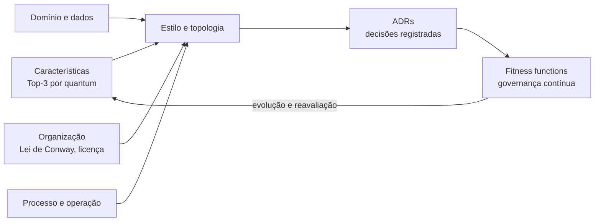
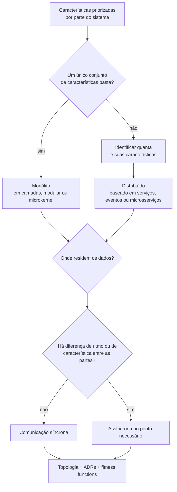
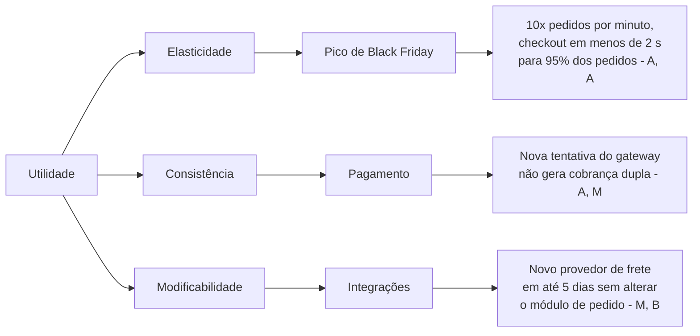
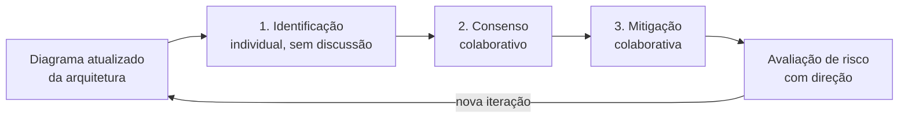

# Capítulo 7 - Escolha de estilos e arquitetura evolutiva

!!! todo "Para desenvolver"
    Podcast do capítulo (NotebookLM → SoundCloud), embutido aqui com o bloco
    `<figure class="podcast-capitulo">` (ver `docente/podcasts/README.md` no repositório privado `arqsw-docente`).

## Objetivos

Ao final deste capítulo, o leitor deverá ser capaz de:

- Comparar os sete sistemas analisados nos Capítulos 2 a 6 e explicar por que cada um chegou
  a um estilo arquitetural diferente, relacionando o estilo às características prioritárias.
- Aplicar os critérios de decisão de Richards e Ford (domínio, características, dados, fatores
  organizacionais, processo e isomorfismo entre domínio e arquitetura) para escolher um estilo
  em um contexto novo.
- Decidir, de modo fundamentado, entre arquitetura monolítica e distribuída, onde residem os
  dados e quando a comunicação deve ser assíncrona.
- Descrever os métodos de avaliação de arquitetura baseados em cenários (revisões ativas, SAAM e
  ATAM) e conduzir uma avaliação leve inspirada no ATAM.
- Explicar o conceito de arquitetura evolutiva e o papel das *fitness functions* (funções de
  aptidão) contínuas, da dívida técnica arquitetural e das métricas de entrega de software na
  governança de uma arquitetura ao longo do tempo.
- Reconhecer as habilidades não técnicas exigidas do arquiteto: diagramação e apresentação,
  condução de equipes, negociação, liderança e gestão da própria carreira.
- Projetar, documentar, verificar e defender a arquitetura de um sistema no projeto final da
  disciplina.

## Introdução

Os Capítulos 2 a 6 analisaram sete sistemas reais de grande porte, cada um pareado com um gêmeo de
código aberto, descendo as quatro altitudes do método apresentado na Seção 1.11. O Capítulo 2
apresentou os sistemas e suas fichas *kata*; o Capítulo 3, a 100.000 pés, revelou os requisitos e
as características prioritárias em conversas com o cliente; o Capítulo 4, a 50.000 pés, examinou
*containers*, implantação, quanta e decisões; o Capítulo 5, a 10.000 pés, os componentes e sua
comunicação; e o Capítulo 6, no solo, o código, encerrando cada análise com a subida de
verificação. Em cada capítulo, as seções .2 a .8 trataram, nesta ordem, do Mastodon, do
Mattermost, do PeerTube, do Nextcloud, do Saleor, do ThingsBoard e do PX4. Ao final dessa
trajetória, o leitor dispõe de sete arquiteturas bastante distintas: um monólito em camadas
federado, um núcleo monolítico com difusão orientada a eventos, um *pipeline* de processamento de
mídia, um microkernel extensível por *apps*, um monólito modular *headless* com integrações
externas, uma plataforma de ingestão de telemetria que pode ser implantada como monólito ou como
microsserviços e um sistema embarcado de tempo real organizado em torno de um barramento
*publish/subscribe*.

A pergunta que este capítulo enfrenta é simples de enunciar e difícil de responder: **por que
sete sistemas chegaram a sete estilos diferentes?** A resposta que se pretende sustentar é a de
que o estilo arquitetural não é uma preferência estética nem uma escolha tecnológica, mas uma
consequência das características arquiteturais priorizadas, do domínio, da forma dos dados, da
organização que constrói o sistema e do processo pelo qual ele é entregue. Richards e Ford (2020,
cap. 18) resumem essa posição ao abrir o capítulo sobre a escolha de estilos com a expressão
"*It depends!*": nada é mais dependente de contexto do que essa decisão. O quadro comparativo dos
sete sistemas é o instrumento que permite verificar essa tese de forma concreta.

Escolher um estilo, contudo, é apenas o começo. Uma arquitetura precisa ser avaliada antes de
consumir os recursos de sua implementação e precisa continuar adequada enquanto o domínio, a
tecnologia e a organização mudam. A segunda metade do capítulo trata, por isso, da **avaliação de
arquiteturas** baseada em cenários e da **arquitetura evolutiva**, que transforma parte dessa
avaliação em verificações automáticas e contínuas.

O capítulo está organizado da seguinte forma. A Seção 7.1 constrói e interpreta o quadro
comparativo dos sete sistemas. A Seção 7.2 apresenta os critérios de escolha de estilos e os casos
Silicon Sandwiches e Going, Going, Gone. A Seção 7.3 examina os métodos de avaliação, das
revisões ativas de Parnas e Weiss ao ATAM, e propõe um roteiro de mini-ATAM para sala de aula. A
Seção 7.4 trata da arquitetura evolutiva, das *fitness functions* contínuas, da dívida técnica
arquitetural e das métricas DORA. A Seção 7.5 discute as habilidades não técnicas do arquiteto.
Por fim, a Seção 7.6 especifica o projeto final da disciplina.

## 7.1 O quadro comparativo dos sete sistemas

### 7.1.1 Como construir o quadro

Comparar sistemas tão diferentes exige um conjunto pequeno de dimensões comuns, e as dimensões
adotadas aqui são as próprias altitudes. De cada seção do Capítulo 3 extrai-se o Top-3 de
características, escolhido segundo a recomendação de Richards e Ford (2020, cap. 5) de priorizar
poucas características em vez de maximizar todas. De cada seção do Capítulo 4 extraem-se o estilo
dominante, o número de **quanta arquiteturais** e a decisão mais importante, reconstruída como ADR.
De cada seção do Capítulo 5, a organização interna dos *containers* principais, lida pelas lentes
das camadas, da arquitetura hexagonal e da arquitetura limpa. De cada seção do Capítulo 6, os
padrões mais visíveis no código. Todas as afirmações sobre código referem-se às versões fixadas
naqueles capítulos: Mastodon v4.7.3, Mattermost v11.11.1, PeerTube v8.3.1, Nextcloud v35.0.2,
Saleor 3.23.42, ThingsBoard v4.3.1.6 e PX4 v1.17.0.

O conceito de quantum merece uma retomada, pois é ele que separa a pergunta "monólito ou
distribuído?" de discussões puramente tecnológicas. Richards e Ford (2020, p. 92) definem o
quantum arquitetural como um artefato implantável de forma independente, com alta coesão
funcional e conascência síncrona. Três consequências da definição são importantes para a leitura
do quadro. A primeira é que o banco de dados faz parte do quantum: sistemas implantados sobre um
único banco compartilhado formam, por definição, um único quantum, ainda que tenham vários
processos. A segunda é que chamadas síncronas "amarram" as características operacionais dos
participantes, de modo que um serviço que espera a resposta de outro não pode ter escalabilidade
ou disponibilidade radicalmente diferentes das dele. A terceira é que a comunicação assíncrona,
mediada por filas, é o mecanismo que permite separar quanta com características distintas. O
Apêndice D (Seção D.4) apresenta o conceito com mais detalhe.

As Tabelas 7.1 e 7.2 resumem os sete sistemas. A primeira reúne o que se decide nas altitudes
mais altas; a segunda, o que se observa nas mais baixas. Onde as seções de origem qualificam uma
contagem de quanta como interpretação do autor, a qualificação é mantida.

**Tabela 7.1** – Quadro comparativo dos sete sistemas: 100.000 e 50.000 pés.

| Sistema | Top-3 (Cap. 3) | Estilo dominante (Cap. 4) | Quanta (Cap. 4) | Decisão-chave (ADR reconstruído) |
|---|---|---|---|---|
| Mastodon (Twitter/X) | simplicidade operacional; interoperabilidade; desempenho de leitura da *timeline* | monólito em camadas com *jobs* assíncronos (Sidekiq); federação ActivityPub | 1 por instância (web, *workers* e *streaming* compartilham PostgreSQL e Redis); milhares na rede federada | ADR-M1: uma base de código Rails executada como processo web e como *workers* Sidekiq |
| Mattermost (Slack/WhatsApp) | segurança e privacidade, com soberania de dados; latência de entrega; disponibilidade | núcleo monolítico com camada de difusão orientada a eventos (WebSocket) e traços de microkernel | 1 (mesmo binário, mesmo banco, mesma versão em todos os nós); *plugins* como exceção parcial | ADR-MM-01: *plugins* de servidor em processos separados, via RPC |
| PeerTube (YouTube/Netflix) | custo; desempenho de entrega; elasticidade do processamento | *pipes and filters* por filas no processamento; cliente-servidor, CDN e P2P na entrega; federação | 1 com *workers* locais; 2 ou mais com *runners* remotos | ADR-PT-02: permitir *runners* remotos de transcodificação |
| Nextcloud (Dropbox/Drive) | durabilidade e confiabilidade; extensibilidade; segurança e privacidade | microkernel (núcleo `lib/` + *apps*) com clientes de sincronização | 1 (todos os *apps* no mesmo processo e no mesmo banco) | ADR-001: toda funcionalidade além do núcleo é um *app* |
| Saleor (Mercado Livre/Amazon) | elasticidade; consistência dos dados financeiros e de estoque; modificabilidade e integração | monólito modular *headless* com *apps* externas | vários, mas acoplados: o núcleo e cada *app*, ligados por *webhooks* síncronos no *checkout* | ADR-002: extensões como *apps* externas, e não como *plug-ins* no processo |
| ThingsBoard (AWS IoT) | escalabilidade; disponibilidade de aceitação; segurança | orientado a eventos com fila como espinha dorsal; mesmo código como monólito ou microsserviços | 1 no monólito, mesmo em *cluster*; argumenta-se 2 ou mais em microsserviços | ADR 4.7-B: uma base de código, duas topologias |
| PX4 (DJI) | segurança (*safety*); determinismo temporal; tolerância a falhas | arquitetura unitária com *publish/subscribe* interno (uORB) | 1 no controlador de voo; computador de missão e estação em solo são outros quanta | ADR-PX4-001: módulos comunicam-se apenas por tópicos uORB |

Fonte: elaborado pelo autor (2026), com base nas Seções 3.2 a 3.8 e 4.2 a 4.8.

**Tabela 7.2** – Quadro comparativo dos sete sistemas: 10.000 pés e solo.

| Sistema | Organização interna (Cap. 5) | Padrões mais visíveis no código (Cap. 6) |
|---|---|---|
| Mastodon | camadas abertas por convenção do Rails; sem inversão de dependência, exceto na fronteira do protocolo ActivityPub | *Active Record*, *Service Layer*/*Transaction Script*, *Command* (*workers*), *Observer* (*callbacks*), disjuntor na entrega federada |
| Mattermost | camadas `api4` → `app` → `store`, com camada de aplicação larga; portas no armazenamento, no *cluster* e nos *plugins* | *Observer* e *Mediator* no *hub*, *Decorator* sobre *Repository*, *Proxy* remoto para *plugins*, *Command*, *Idempotent Receiver* |
| PeerTube | camadas abertas; adaptadores nítidos (ffmpeg, armazenamento, ActivityPub) sem portas definidas pelo núcleo; *hooks* de *plugins* | *Chain of Responsibility* (*middlewares*), *Template Method*, *Strategy* (perfis de codificação), *Active Record* |
| Nextcloud | camadas fechadas no caminho de arquivos; hexagonal na fronteira com armazenamentos e *apps*; microkernel recursivo | *Adapter*, *Decorator* (*wrappers*), *Composite*, *Observer*, *Plugin*, *Separated Interface* |
| Saleor | módulos por domínio; hexagonal na escala do sistema (eventos síncronos como portas de saída), não no código | *Transaction Script*, *Active Record*, *Remote Facade* e DTO, saga em processo, chave de idempotência, camada anticorrupção, *Circuit Breaker* |
| ThingsBoard | hexagonal no transporte e na fila; regra de dependência no motor de regras; camadas no módulo `dao` | *Strategy* e *Chain of Responsibility* no motor de regras, *Adapter* nos transportes, modelo de atores, *Service Layer*, *Data Mapper* |
| PX4 | barramento, e não camadas; adaptadores (MAVLink, uXRCE-DDS, *drivers*) em torno de contratos de mensagens | *Observer* com *ChangeManager* (uORB), máquina de estados tabular no *commander*, *Strategy* na alocação de controle |

Fonte: elaborado pelo autor (2026), com base nas Seções 5.2 a 5.8 e 6.2 a 6.8.

### 7.1.2 O estilo segue das características

A primeira leitura do quadro é vertical, pela coluna do Top-3. Observa-se que nenhuma
característica aparece em todos os sistemas e que as poucas recorrentes, como disponibilidade e
segurança, mudam de significado conforme o contexto. Disponibilidade, no Mattermost, significa
que as conversas da organização continuam acessíveis; no ThingsBoard, é **disponibilidade de
aceitação**, isto é, nenhuma mensagem confirmada ao dispositivo pode ser perdida. A segurança do
Mattermost é sobretudo confidencialidade e soberania de dados, ao passo que a do PX4 é *safety*,
ausência de danos a pessoas e ao patrimônio. A variação confirma a advertência de Richards e Ford
(2020, cap. 4) de que as características só adquirem sentido quando definidas no contexto de um
sistema, e reforça a importância dos cenários de qualidade (Seção 1.4.2) como forma de
torná-las verificáveis.

O quadro revela também que o Top-3 do gêmeo nem sempre coincide com o do sistema real, e que a
diferença explica parte das escolhas. A Seção 3.2 mostra que o Top-3 do Twitter tem o desempenho
de leitura em primeiro lugar, enquanto o de uma instância Mastodon é encabeçado pela
**simplicidade operacional**: se qualquer organização, inclusive voluntários, deve poder manter um
servidor, o estilo precisa ser barato de implantar e de atualizar. O monólito em camadas, com uma
única base de código executada como processo web e como *workers* (Seção 4.2), é a resposta direta
a essa prioridade, e não uma limitação técnica. O desempenho de leitura, terceiro colocado, é
obtido por *timelines* pré-computadas no Redis, e a escala, pela federação: a rede obtém
isolamento de falhas e crescimento por adição de nós sem que cada instância pague o custo de uma
arquitetura distribuída. No Mattermost, a soberania de dados explica a implantação própria, e a
latência de entrega, as conexões WebSocket e a difusão de eventos entre os nós; a segurança, somada
à extensibilidade por terceiros, justifica isolar os *plugins* em processos separados, de modo que
um *panic* em uma extensão não derrube as conexões de toda a organização (Seção 4.3).

No PeerTube, o custo domina. Transcodificar vídeo consome muita CPU e chega em rajadas, de modo
que o processamento é organizado como um *pipeline* de filtros ligados por filas persistentes,
que podem ser executados fora do servidor principal, nos *runners* remotos (Seção 4.4). O
isomorfismo é evidente: o problema é uma sequência de transformações sobre um fluxo de dados, e o
estilo *pipes and filters* é precisamente essa forma (RICHARDS; FORD, 2020, cap. 11). A disponibilidade
é assimétrica: a reprodução precisa estar sempre disponível, mas o processamento de um vídeo novo
pode atrasar, e é essa assimetria que justifica separar o quantum de processamento. No Nextcloud,
a extensibilidade define o produto, pois cada organização quer funcionalidades diferentes. O
microkernel, em que um núcleo estável expõe contratos a *apps*, é o estilo cujos pontos fortes
coincidem com essa exigência (RICHARDS; FORD, 2020, cap. 12), enquanto a durabilidade orienta as
decisões de *locking*, de sincronização e de tratamento de conflitos.

O Saleor é o caso em que a modificabilidade convive com a consistência financeira. A Seção 3.6
mostra que vitrine e *checkout* têm conjuntos de características diferentes, e a Seção 4.6 tira
disso uma conclusão matizada: o núcleo permanece um monólito modular, porque pedido, pagamento e
estoque compartilham transações, enquanto os subdomínios genéricos, como pagamento, impostos e
frete, são empurrados para *apps* externas, porque mudam por razões alheias à loja. O preço é que
os eventos de pagamento, impostos e frete são **síncronos**, de modo que, durante o *checkout*, a
disponibilidade e a latência do núcleo dependem das *apps*, o que explica a presença de um
*Circuit Breaker* no código (Seção 6.6). No ThingsBoard, a vazão de mensagens e a disponibilidade
de aceitação levam a uma fila como espinha dorsal, e a possibilidade de implantar o mesmo código
como monólito ou como microsserviços materializa um princípio discutido adiante: a topologia deve
acompanhar a escala real, e não a escala imaginada.

O PX4, por fim, é o caso em que o determinismo temporal torna inaceitáveis as incertezas de uma
rede e de um sistema operacional de propósito geral. A Seção 3.8 define o determinismo como
característica própria e mostra que ele pode **conflitar com o desempenho médio**: um *cache*
melhora a média e piora a previsibilidade, e uma coleta de lixo automática simplifica o código ao
custo de pausas imprevisíveis. Por isso, o que importa não é a latência média, mas a existência de
um limite superior conhecido. A resposta arquitetural tem duas partes. Dentro do controlador de
voo, uma arquitetura unitária, em um único espaço de endereçamento, com módulos desacoplados por
tópicos tipados. Entre computadores, uma **partição por criticidade**: o que é crítico e precisa
de determinismo permanece no controlador de voo, e o que é complexo e tolerante a atrasos vai para
o computador de missão, com Linux e ROS 2 (Seção 4.8). Em todos os sete casos, portanto, a cadeia
causal parte das características, passa pela decisão registrada no ADR e termina no padrão
visível no código. É exatamente a cadeia que a subida de verificação percorre no sentido inverso.

**Figura 7.1** – Forças que determinam o estilo e o ciclo de governança que o protege.



Fonte: elaborado pelo autor (2026), com base em Richards e Ford (2020, cap. 18).

### 7.1.3 Mecanismos que se repetem entre os sistemas

Uma terceira leitura do quadro procura o que se repete apesar das diferenças. Quatro mecanismos
aparecem em vários sistemas, em escalas distintas, e merecem ser reconhecidos como recorrências e
não como coincidências.

O primeiro é o **assíncrono como amortecedor**. O *fanout* do Mastodon, a fila de transcodificação
do PeerTube e a fila de ingestão do ThingsBoard cumprem a mesma função: desacoplar o ritmo de quem
produz trabalho do ritmo de quem o consome, permitindo que a parte voltada ao usuário continue
respondendo enquanto a parte lenta processa no seu tempo. Richards e Ford (2020, p. 276) ilustram
o mesmo raciocínio no caso Going, Going, Gone, em que um serviço de pagamento capaz de processar uma
cobrança a cada 500 ms seria sobrecarregado se muitos leilões terminassem ao mesmo tempo e as
chamadas fossem síncronas. O Saleor oferece o contraexemplo instrutivo: onde a resposta da *app* é
necessária para concluir o *checkout*, como no cálculo de impostos ou na cobrança, a comunicação
continua síncrona, e a proteção passa a ser o disjuntor, e não a fila.

O segundo mecanismo é a **extensão por contrato, com inversão de dependência**. Os *plugins* do
Mattermost, os *apps* do Nextcloud, as *apps* do Saleor e os nós do motor de regras do ThingsBoard
são variações de uma mesma ideia: um núcleo define uma interface estável e terceiros a
implementam. O caso mais revelador é o do Mattermost. O núcleo aberto declara a interface
`ClusterInterface`, no pacote `einterfaces`, e o serviço de plataforma depende apenas dela; a
implementação concreta do protocolo de *cluster* não está entre os diretórios públicos e é
injetada quando há licença, e, sem ela, o servidor opera como nó único (Seções 5.3 e 6.3). O
princípio da inversão de dependência (Seção 1.5.4) deixa de ser apenas uma técnica de projeto e
torna-se o mecanismo que viabiliza um modelo de negócio *open core*: o núcleo aberto define a
abstração, e a implementação comercial a satisfaz, sem que o núcleo dependa dela. O Nextcloud
leva a extensão por contrato a outra forma, o **microkernel recursivo**: o *app* `dav` é um
*plug-in* do núcleo e contém, ele próprio, um microkernel, o servidor sabre/dav com seus
*plug-ins*, e o *app* `files_external` contém outro, com seu registro de *backends* de
armazenamento (Seção 5.5). A composição mantém cada contrato pequeno: o núcleo não precisa conhecer
o protocolo SMB, e o *app* não precisa conhecer os detalhes de autenticação do núcleo.

O terceiro mecanismo é o ***publish/subscribe* em várias escalas**. Ele aparece entre servidores,
na federação ActivityPub do Mastodon e do PeerTube, entre processos, na difusão de eventos entre
os nós do Mattermost e na fila do ThingsBoard, e dentro de um único processo embarcado, no uORB do
PX4. A recorrência sugere que o padrão *Observer* do catálogo GoF (Seção 1.6.3) é uma das ideias de
maior alcance da disciplina, pois a mesma relação entre publicador e assinantes resolve problemas
desde o nível das classes até o nível de sistemas inteiros. As variações são significativas: o
*hub* do Mattermost descarta o observador lento, e o uORB não executa o assinante na *thread* do
publicador, apenas o agenda em sua fila de trabalho, com sua prioridade (Seções 6.3 e 6.8).

O quarto mecanismo é a **separação de dados por natureza**: telemetria em banco de séries
temporais e entidades em PostgreSQL no ThingsBoard, *timelines* derivadas no Redis no Mastodon,
conteúdo de vídeo em disco ou armazenamento de objetos e metadados no banco no PeerTube e no
Nextcloud. A Tabela 7.3 organiza as recorrências.

**Tabela 7.3** – Mecanismos arquiteturais recorrentes nos sete sistemas.

| Mecanismo | Onde aparece | Característica que protege | Custo que impõe |
|---|---|---|---|
| Fila assíncrona como amortecedor | Mastodon (*fanout*), PeerTube (transcodificação), ThingsBoard (ingestão) | desempenho percebido, elasticidade, disponibilidade de aceitação | consistência eventual, depuração mais difícil, necessidade de idempotência |
| Extensão por contrato, com inversão de dependência | Mattermost (*plugins*, `einterfaces`), Nextcloud (*apps*, microkernel recursivo), Saleor (*apps*), ThingsBoard (nós de regra) | extensibilidade, modificabilidade, viabilidade do modelo de negócio | versionamento do contrato, testes de compatibilidade, superfície de ataque |
| *Publish/subscribe* | Mastodon e PeerTube (federação), Mattermost (eventos), ThingsBoard (fila), PX4 (uORB) | desacoplamento, evolutividade, substituibilidade | ordenação, rastreabilidade do fluxo, acoplamento semântico oculto |
| Separação de dados por natureza | ThingsBoard (séries temporais × entidades), Mastodon (Redis × PostgreSQL), PeerTube e Nextcloud (objetos × metadados) | desempenho, custo, escalabilidade | mais tecnologias a operar, consistência entre bancos |

Fonte: elaborado pelo autor (2026), com base nos Capítulos 4 a 6.

### 7.1.4 Contrafactuais: o que mudaria o estilo

O teste mais exigente da tese de que o estilo segue das características é o contrafactual:
alterar uma característica e verificar se o estilo deveria mudar. Se a tese estiver correta, uma
mudança relevante no Top-3 deve produzir uma mudança previsível na arquitetura. Se nada mudar, ou
a característica não era de fato prioritária, ou o estilo foi escolhido por outras razões, o que
também merece ser explicitado.

O quadro já contém dois contrafactuais reais. O primeiro é o par Mastodon e Twitter: quando o
desempenho de leitura e a elasticidade de um único serviço com centenas de milhões de usuários
sobem ao topo do Top-3, as características passam a variar entre partes do sistema, e o Twitter
abandonou o monólito Rails em favor de serviços (Seção 4.2). O segundo é o ThingsBoard, cuja
existência de duas topologias para o mesmo código é um contrafactual institucionalizado: o projeto
reconhece que a escalabilidade tem valores muito diferentes para um cliente com mil dispositivos e
para outro com um milhão, e a documentação recomenda migrar para microsserviços quando é preciso
escalar o transporte MQTT separadamente ou atualizar sem interrupção (Seção 4.7). A Tabela 7.4
propõe contrafactuais para os demais sistemas. O leitor deve tratá-los como hipóteses de trabalho,
e o exercício 2 do capítulo pede que sejam desenvolvidos em detalhe.

**Tabela 7.4** – Contrafactuais: mudanças nas características e seus efeitos prováveis no estilo.

| Sistema | Mudança hipotética nas características | Efeito provável no estilo |
|---|---|---|
| Mattermost | um único provedor atende milhares de organizações, como o Slack | roteamento de eventos por assinatura em vez de difusão a todos os nós; vários quanta |
| PeerTube | custo deixa de ser restrição e o volume cresce cem vezes | transcodificação em serviço elástico gerenciado e entrega exclusivamente por CDN |
| Nextcloud | um único cliente quer apenas sincronizar arquivos, sem extensões | monólito em camadas mais simples; o microkernel torna-se custo sem contrapartida |
| Saleor | dezenas de times independentes passam a evoluir o núcleo | extração de serviços por *bounded context*, sagas distribuídas entre Pedido, Pagamento e Estoque |
| PX4 | missão sem pessoas em solo e sem prazos rígidos | processos Linux comunicando-se por *middleware* de rede, como ROS 2, sem partição por criticidade |

Fonte: elaborado pelo autor (2026).

## 7.2 Escolhendo um estilo

### 7.2.1 A moda arquitetural e suas causas

Antes de apresentar critérios, Richards e Ford (2020, p. 267-268) observam que os estilos
preferidos mudam com o tempo, e enumeram as forças que produzem essa mudança: as lições de
experiências anteriores, que fazem cada novo estilo reagir às dores do anterior; as mudanças no
ecossistema, como o surgimento do Kubernetes; as novas capacidades, como a dos *containers*, que
mudaram paradigmas e não apenas ferramentas; a aceleração dessas mudanças; as mudanças no
domínio, por crescimento ou por fusões; as mudanças tecnológicas; e fatores externos, como o custo
de licenças. A conclusão dos autores é que o arquiteto precisa conhecer as tendências para decidir
de forma consciente quando segui-las e quando abrir exceções.

A observação tem uma consequência prática: os sistemas estudados carregam as marcas de suas
épocas, do monólito produtivo do Ruby on Rails no Mastodon à topologia de microsserviços oferecida
pelo ThingsBoard e à API GraphQL *headless* do Saleor. Reconhecer a moda não significa desprezá-la,
mas separar, em cada decisão, o que decorre das características e o que decorre do clima do
momento. Uma heurística útil, derivada da primeira lei de Richards e Ford (Seção 1.1.2), é
desconfiar de qualquer argumento a favor de um estilo que não mencione o que se perde ao adotá-lo.

### 7.2.2 Os critérios de decisão

Richards e Ford (2020, p. 269-270) organizam a escolha de um estilo em torno de seis conjuntos de
conhecimentos que o arquiteto deve ter ao entrar na decisão. A Tabela 7.5 os resume e associa a
cada um uma pergunta orientadora e um exemplo extraído dos sete sistemas.

**Tabela 7.5** – Critérios para a escolha de um estilo arquitetural.

| Critério | Pergunta orientadora | Exemplo nos sistemas |
|---|---|---|
| Domínio | Que aspectos do domínio afetam as características operacionais? | a assimetria leitura/escrita do microblog (Mastodon) |
| Características que afetam a estrutura | Quais características, priorizadas e com cenários, a estrutura precisa sustentar? | extensibilidade no Nextcloud; determinismo no PX4 |
| Arquitetura de dados | Que dados existem, com que volume, forma e exigência de consistência? | séries temporais × entidades no ThingsBoard |
| Fatores organizacionais | Que custos, fusões, contratos e estratégias limitam o desenho? | soberania de dados e implantação própria no Mattermost e no Nextcloud |
| Processo, equipes e operação | A organização tem maturidade de engenharia, testes e operação para o estilo? | instâncias Mastodon mantidas por voluntários exigem operação simples |
| Isomorfismo domínio/arquitetura | A topologia do problema coincide com a topologia de algum estilo? | transformações em sequência e *pipes and filters* no PeerTube |

Fonte: adaptado de Richards e Ford (2020, p. 269-270).

Dois critérios exigem comentário adicional. O primeiro é o de **processo, equipes e operação**. Os
autores advertem que, se a organização não tem maturidade nas práticas de engenharia ágil, estilos
que dependem dessas práticas terão dificuldades. Microsserviços sem integração contínua, testes
automatizados, implantação automatizada e observabilidade não são uma arquitetura moderna, mas um
monólito distribuído com todos os custos da distribuição e nenhum de seus benefícios. O caso do
Mastodon é instrutivo no sentido oposto: grande parte das instâncias é mantida por voluntários, e
um estilo que exigisse a operação de dezenas de serviços inviabilizaria a federação, que depende
justamente de que qualquer pessoa ou instituição possa manter seu próprio servidor.

O segundo é o **isomorfismo entre domínio e arquitetura**. Richards e Ford (2020, p. 269-270)
observam que alguns domínios coincidem com a topologia de um estilo, como a personalização,
que se encaixa no microkernel, e a análise genômica, que requer grande número de operações
discretas e se encaixa no estilo baseado em espaço. Observam também o caso inverso: um domínio com
forte acoplamento semântico, como um sistema de seguros com formulários de várias páginas que
dependem umas das outras, combina mal com uma arquitetura altamente desacoplada e distribuída, e
seria mais bem atendido por um estilo menos fragmentado, como o baseado em serviços. O isomorfismo
explica com particular clareza os casos do PeerTube (*pipeline*), do Nextcloud (microkernel) e do
PX4 (barramento de tópicos entre laços de controle). Ele também alerta para um erro frequente,
que é impor uma topologia que contraria a forma do problema por razões de moda.

Os fatores organizacionais incluem, por fim, um que raramente aparece nas discussões técnicas: a
**licença e a sustentabilidade econômica** das dependências. A Seção 2.7 registra que o código do
ThingsBoard foi distribuído sob a licença Apache 2.0 até a série 4.3, e que a *tag* `v4.4`, de
setembro de 2026, adotou a *Business Source License* 1.1, que condiciona o uso gratuito em produção
e prevê a conversão de cada versão para Apache 2.0 apenas quatro anos após sua publicação; por essa
razão, este livro fixou a *tag* `v4.3.1.6`. Para uma organização que tivesse escolhido o ThingsBoard
como plataforma, a mudança não altera nenhuma característica técnica, mas pode alterar a
viabilidade da escolha, forçando a permanência em uma versão antiga, a negociação de uma licença
comercial ou a migração. O exemplo confirma a observação de Richards e Ford (2020, p. 268) de que
fatores externos, como o custo de licenças, podem forçar mudanças mesmo quando a equipe está
satisfeita com a ferramenta, e sugere que a escolha de uma plataforma envolve também avaliar quem a
mantém, sob quais termos e com que modelo de negócio. O *open core* do Mattermost, discutido na
Seção 7.1.3, é outra resposta ao mesmo problema de sustentabilidade, com consequências diretas na
estrutura do código.

### 7.2.3 A Lei de Conway e a manobra inversa

Entre os fatores organizacionais, um merece destaque por sua influência sobre a estrutura dos
sistemas. Conway (1968) observou que as organizações que projetam sistemas tendem a produzir
desenhos que copiam suas próprias estruturas de comunicação (ver também a Seção E.3.3). Richards e Ford (2020, p. 103-104)
retomam a observação ao discutir o particionamento de componentes: organizações que separam as
pessoas por capacidade técnica, com um departamento de interface, outro de regras de negócio e
outro de banco de dados, tendem a produzir arquiteturas particionadas tecnicamente, como a
arquitetura em camadas. Organizações que formam equipes por domínio tendem a produzir
particionamento por domínio. Os autores registram ainda a **manobra inversa de Conway**, atribuída
a Jonny Leroy, da ThoughtWorks, que propõe evoluir a estrutura das equipes junto com a arquitetura
desejada.

Skelton e Pais (2019) desenvolveram essa ideia em um modelo de organização de equipes que
distingue equipes alinhadas a fluxos de valor, equipes de plataforma, equipes capacitadoras e
equipes de subsistemas complicados, e que trata a carga cognitiva de cada equipe como restrição
de projeto. Para o arquiteto, a consequência é direta: decidir por microsserviços em uma
organização com uma única equipe de oito pessoas cria fronteiras técnicas sem fronteiras
organizacionais correspondentes, e decidir por um monólito em uma organização com quarenta
equipes autônomas cria um gargalo de coordenação. Fox e Patterson (2021, seção 3.4) relatam a trajetória da
Amazon, comparada ao Saleor na Seção 4.6, que a partir de 2002 passou a exigir que cada subsistema
expusesse dados e funcionalidades apenas por interfaces de serviço, como exemplo de mudança organizacional e arquitetural
simultânea. O Twitter, comparado ao Mastodon na Seção 4.2, ilustra o mesmo vínculo: entre os
motivos relatados para abandonar o monólito Rails estava a dificuldade crescente de coordenar
cerca de duzentos engenheiros trabalhando sobre uma única base de código. Argumenta-se aqui que a pergunta "quantas equipes independentes evoluirão este
sistema nos próximos três anos?" é tão arquitetural quanto qualquer pergunta sobre vazão.

### 7.2.4 As três determinações: quanta, dados e comunicação

Uma vez reunidos os critérios, Richards e Ford (2020, p. 270) propõem que o arquiteto tome três
determinações, que funcionam como esqueleto da decisão de estilo.

A primeira é **monolítico ou distribuído**. A pergunta, formulada com o conceito de quantum, é se
um único conjunto de características basta para todo o sistema ou se partes diferentes exigem
características diferentes. Um único conjunto sugere um monólito, embora outros fatores possam
levar a uma arquitetura distribuída. Conjuntos diferentes sugerem distribuição. A formulação é
preciosa porque desloca a discussão das tecnologias para as características: não se distribui
porque microsserviços são modernos, mas porque o quantum do lance no leilão precisa de
elasticidade que o quantum do pagamento não precisa.

O PX4 acrescenta à primeira determinação um critério que os autores não enfatizam: a
**criticidade**. A divisão entre o controlador de voo e o computador de missão (Seção 4.8) não
decorre de escalabilidade nem de elasticidade, mas da necessidade de manter o software que exige
determinismo e o rigor máximo de verificação em um quantum pequeno, separado do software complexo
e tolerante a atrasos. A partição por criticidade reduz o volume de código que precisa das
garantias mais caras e impede que a falha do quantum menos crítico arraste o mais crítico. É uma
razão para distribuir que vale, com as devidas adaptações, para sistemas de informação: separar o
núcleo que movimenta dinheiro de funcionalidades experimentais é aplicar o mesmo raciocínio.

A segunda é **onde residem os dados**. Em um monólito, o pressuposto habitual é um banco
relacional ou poucos bancos. Em uma arquitetura distribuída, o arquiteto precisa decidir quais
serviços persistem dados e como os dados fluem entre eles para compor os fluxos de trabalho. Os
autores recomendam considerar simultaneamente estrutura e comportamento e não temer iterações no
desenho. O caso do ThingsBoard (Seção 4.7) mostra que a decisão sobre dados pode ser tomada mesmo dentro de um
monólito, separando a telemetria em um banco de séries temporais.

A terceira é **síncrono ou assíncrono**. A comunicação síncrona é mais conveniente na maioria dos
casos, mas pode prejudicar escalabilidade e confiabilidade. A assíncrona traz benefícios de
desempenho e de escala, mas também uma série de dificuldades, como sincronização de dados,
*deadlocks*, condições de corrida e depuração. Por isso, os autores recomendam:

!!! quote "Síncrono por padrão"
    "*Use synchronous by default, asynchronous when necessary.*" (RICHARDS; FORD, 2020, p. 271).

A recomendação é coerente com os sete sistemas. Nenhum dos sistemas estudados é assíncrono por inteiro:
em todos, a maior parte das interações é síncrona, e a assincronia aparece em pontos precisos,
justificados por uma característica. No Mastodon, a requisição de publicação responde ao usuário
de forma síncrona, e apenas o *fanout* é delegado à fila. No Saleor, os eventos enviados às *apps*
durante o *checkout*, como o cálculo de impostos e a cobrança, são síncronos, porque a resposta é
necessária para continuar o processamento, e apenas a notificação de fatos consumados, como a
criação de um pedido, é assíncrona (Seção 4.6). A Figura 7.2 organiza as três
determinações em um fluxo de decisão.

**Figura 7.2** – As três determinações na escolha de um estilo.



Fonte: adaptado de Richards e Ford (2020, p. 270-271).

O interativo a seguir percorre a Figura 7.2 a partir das partes de um sistema e do Top-3 de cada
uma. Duas partes são tratadas como o mesmo quantum quando compartilham a maior parte do Top-3 e o
mesmo nível de criticidade, ou quando compartilham um banco com transações entre si; os estilos da
família resultante são ordenados pelas tendências da Tabela D.11, e as diferenças de ritmo indicam
os pontos de assincronia, os ADRs e as *fitness functions* a escrever. Os sete sistemas vêm
pré-carregados com o Top-3 da Tabela 7.1, redistribuído entre as partes quando o texto as
distingue, o que permite confrontar a sugestão com o estilo real.
As divergências são instrutivas, pois revelam os fatores que a heurística não captura, como o
isomorfismo do PeerTube com *pipes and filters* e a escala variável do ThingsBoard. Trata-se de
uma heurística didática, e não de um procedimento de decisão.

<iframe src="../interativos/escolha-de-estilo.html" title="As três determinações na escolha de um estilo"
  style="width:100%; height:660px; border:1px solid #2A4468; border-radius:10px;"
  loading="lazy"></iframe>

O resultado do processo, segundo os autores, é uma topologia que combina o estilo escolhido e
suas hibridizações, ADRs para as partes do desenho que exigiram mais esforço e *fitness functions*
para proteger os princípios e as características operacionais mais importantes. Os três produtos
correspondem exatamente aos entregáveis do projeto final (Seção 7.6).

### 7.2.5 Dois casos de Richards e Ford

Os dois casos que encerram o capítulo 18 de Richards e Ford (2020) ilustram as duas saídas
principais da primeira determinação e funcionam como gabarito para a escolha de estilos em
situações novas.

O primeiro é o **Silicon Sandwiches**, uma rede nacional de lanchonetes franqueadas que deseja
oferecer pedidos *on-line*, com promoções nacionais e locais, pagamento em várias modalidades,
integração com serviços de mapas e planos de expansão internacional (RICHARDS; FORD, 2020, p.
69-75), já apresentada na Seção D.1.6. A análise das características concluiu que um único quantum bastava e que se tratava de
uma aplicação simples, sem grande orçamento, o que torna atraente a simplicidade de um monólito
(RICHARDS; FORD, 2020, p. 271). Os autores apresentam duas alternativas. Na primeira, um
**monólito modular** com componentes por domínio e um único banco relacional, a personalização
exigida pelos franqueados é tratada como parte do desenho do domínio, por meio de um componente de
sobrescrita que todos os demais componentes devem consultar, o que, observam os autores, seria uma
*fitness function* perfeita. Na segunda, um **microkernel**, escolhido por isomorfismo com a
exigência de personalização, cada customização é um *plug-in*, e a camada de API funciona como um
adaptador fino, com o padrão *Backends for Frontends* para cada tipo de dispositivo. Em ambas, a
comunicação pode ser síncrona, pois não há exigências extremas de desempenho ou elasticidade nem
operações demoradas.

O segundo caso, introduzido na Seção D.4.2, é o **Going, Going, Gone** (GGG), uma empresa de leilões que pretende levar seus
leilões para a internet em escala nacional, com lances em tempo real acompanhados por vídeo
(RICHARDS; FORD, 2020, p. 95-98). Aqui, a análise de quanta revelou que partes diferentes exigem
características diferentes. O leiloeiro, os licitantes e o fluxo de lances transmitido aos
participantes têm exigências distintas de disponibilidade, confiabilidade, escalabilidade e
elasticidade, e o fato de que a indisponibilidade do leiloeiro impede todos os lances torna sua
confiabilidade mais crítica do que a de qualquer licitante isolado. Entre as arquiteturas
distribuídas candidatas, os autores consideram que microsserviços acomodam melhor características
operacionais diferentes por parte do sistema, enquanto arquiteturas orientadas a eventos
tendem a se organizar pelo estilo de comunicação, e não por essas diferenças (RICHARDS; FORD,
2020, p. 274). O desenho resultante tem serviços como captura de lances, acompanhamento de lances,
transmissão de lances, captura do leiloeiro, sessão de leilão, pagamento e vídeo, e se resolve
em cinco quanta (RICHARDS; FORD, 2020, p. 276-277).

Dois aspectos do caso GGG merecem destaque. O primeiro é o uso deliberado e localizado da
assincronia: as entradas do serviço que acompanha os lances são assíncronas para que filas
absorvam ritmos de chegada muito diferentes, e a comunicação com o pagamento é assíncrona pelo
motivo já discutido na Seção 7.1.3. O segundo é a modéstia da conclusão. Os autores afirmam que
o desenho não é o "correto", nem o único, nem necessariamente o melhor, mas o que parece ter o
conjunto de compromissos menos ruim. A expressão retoma uma máxima que atravessa todo o livro dos
autores: não existe a melhor arquitetura, apenas a menos pior (RICHARDS; FORD, 2020, p. 75).

### 7.2.6 Monólito primeiro e o caminho de volta

Os dois casos sugerem uma regra prática que vários autores formularam de modo independente:
começar com a arquitetura mais simples compatível com as características e distribuir apenas
quando a análise de quanta o exigir. Fowler (2015) defende essa posição com o argumento de que as
fronteiras corretas entre serviços raramente são conhecidas no início de um projeto, e de que
errá-las em uma arquitetura distribuída é muito mais caro do que em um monólito, onde mover código
entre módulos é uma refatoração. O monólito modular, com fronteiras por domínio reforçadas por
*fitness functions*, é a forma que torna essa estratégia segura, porque mantém aberta a
possibilidade de extração futura. Richards e Ford (2020, p. 271) fazem recomendação semelhante ao
sugerir que, no Silicon Sandwiches, as tabelas do banco sejam separadas segundo os componentes de
domínio, para facilitar uma eventual migração.

O caminho inverso também existe e é igualmente instrutivo. Noonan (2018) relata como a equipe da
Segment consolidou em um único serviço e em um único repositório mais de 140 microsserviços,
um por destino de integração, depois que a divergência entre versões de bibliotecas
compartilhadas, a escala manual de cada serviço e o custo operacional cresceram com cada novo
destino. O relato registra também o que se perdeu com a consolidação, como parte do isolamento de
falhas. O caso não demonstra que microsserviços sejam um erro, mas que a granularidade dos
serviços precisa corresponder a diferenças reais de características: cem serviços com as mesmas
características, mantidos pela mesma equipe, formam na prática um único quantum que paga os custos
da distribuição sem colher seus benefícios.

!!! note "Definição 7.1 – Escolha de estilo"
    A escolha de um estilo arquitetural é a decisão, registrada e verificável, sobre a topologia
    de um sistema, tomada a partir das características priorizadas por quantum, da arquitetura de
    dados, dos fatores organizacionais e do processo de entrega, que estabelece se o sistema é
    monolítico ou distribuído, onde residem os dados e onde a comunicação é assíncrona.

## 7.3 Avaliação de arquiteturas

### 7.3.1 Por que e quando avaliar

Uma arquitetura é uma aposta sobre o futuro: as decisões que a compõem são tomadas antes que
o sistema exista e só se revelam boas ou ruins quando ele é submetido às cargas, às falhas e às
mudanças que motivaram essas decisões. Avaliar uma arquitetura é antecipar parte desse
julgamento, enquanto ainda é barato mudar. O guia de arquitetura de aplicações da Microsoft
apresenta a revisão de arquitetura como uma forma comprovada e de baixo custo de reduzir o custo
dos erros e a probabilidade de fracasso do projeto, e recomenda revisões frequentes, nos marcos
principais e sempre que houver mudanças arquiteturais significativas (MICROSOFT, 2009, p. 50).
O objetivo principal, segundo o guia, é determinar a viabilidade das arquiteturas de base e
candidatas e verificar se a arquitetura liga corretamente os requisitos funcionais e os atributos
de qualidade à solução técnica proposta.

O SWEBOK v4 trata o tema em uma seção própria da área de conhecimento de arquitetura (WASHIZAKI,
2024, cap. 2, seção 4). O guia distingue a **análise**, que ocorre continuamente durante a
criação e a manutenção da arquitetura, da **avaliação**, tipicamente conduzida por terceiros em
marcos determinados, como forma de verificação. Para caracterizar o que torna uma arquitetura
"boa", o SWEBOK recorre à tríade de Vitrúvio, *firmitas*, *utilitas* e *venustas* (solidez,
utilidade e beleza), e a traduz em perguntas: a arquitetura é robusta ao longo da vida e da
evolução do sistema? É adequada ao uso pretendido? É viável e econômico construir sistemas com
ela? É, se não bela, ao menos clara e compreensível para quem precisa construí-la, usá-la e
mantê-la? O guia observa ainda que uma boa arquitetura deve tratar não apenas os interesses
de cada *stakeholder*, mas as consequências de suas interações, pois uma arquitetura segura pode
ser cara demais para construir e verificar, e uma fácil de construir pode não ser manutenível.

Um ponto prático do SWEBOK é decisivo para quem avalia sistemas reais: a avaliação é mais eficaz
quando se apoia em descrições de arquitetura robustas, mas a documentação costuma estar
incompleta, desatualizada ou ausente, caso em que a avaliação depende do conhecimento dos
participantes (WASHIZAKI, 2024, cap. 2, seção 4.2). É a situação dos sistemas deste livro, em que a
arquitetura dos gêmeos precisou ser reconstruída a partir do código e da documentação dispersa.

### 7.3.2 As revisões ativas de Parnas e Weiss

Antes dos métodos baseados em cenários, Parnas e Weiss (1985) identificaram um problema que
continua atual: as revisões convencionais de projeto, em que um grupo grande recebe uma
documentação volumosa e é convidado a comentar, tendem a produzir pouco. Os revisores não leem
tudo, concentram-se nas partes que conhecem melhor, hesitam em fazer perguntas que pareçam
ingênuas e raramente são responsabilizados pelo que deixaram de ver. A proposta dos autores foi a
**revisão ativa de projeto** (*active design review*). Em vez de uma lista de verificação genérica,
cada revisor recebe uma tarefa específica que o obriga a usar a documentação para responder a
perguntas, como escrever um trecho de programa que use uma interface ou explicar como o projeto
trataria determinada situação. O SWEBOK resume a ideia ao observar que, nas revisões ativas, cada
item de avaliação implica uma atividade específica do revisor para obter a informação necessária
(WASHIZAKI, 2024, cap. 2, seção 4.3).

A contribuição de Parnas e Weiss é menos um método do que um princípio: uma revisão só é eficaz
quando o revisor precisa demonstrar, por uma ação, que compreendeu o que está revisando. O
princípio reaparece em métodos posteriores, como o ARID (*Active Reviews for Intermediate
Designs*), que combina a revisão ativa de projetos em andamento com o foco em cenários de
qualidade do SAAM e do ATAM (MICROSOFT, 2009, p. 51), e reaparece, de forma automatizada, nas
*fitness functions* discutidas na Seção 7.4: um teste ArchUnit é, em certo sentido, um revisor
ativo incansável, que "usa" a arquitetura a cada compilação para verificar se uma regra continua
válida. Observe-se que a sigla ADR, quando designa *Active Design Review*, nada tem a ver com o registro
de decisão arquitetural adotado neste livro.

### 7.3.3 SAAM: a análise por cenários

O primeiro método de avaliação baseado em cenários amplamente difundido foi o SAAM (*Software
Architecture Analysis Method*), proposto por Kazman *et al.* (1994) no SEI. O problema que o
motivou era a dificuldade de comparar arquiteturas com base em afirmações genéricas sobre
qualidade: descrições como "a arquitetura é modificável" não podem ser verificadas nem
contestadas. O SAAM substitui essas afirmações por **cenários**, isto é, descrições curtas de
usos ou de mudanças esperadas do sistema, e avalia a arquitetura pela forma como ela acomoda cada
cenário. O guia da Microsoft registra que o método foi concebido originalmente para avaliar a
modificabilidade e depois estendido a atributos como portabilidade, extensibilidade,
integrabilidade e cobertura funcional (MICROSOFT, 2009, p. 50-51).

O SAAM se organiza em poucas atividades: desenvolver cenários com os *stakeholders*; descrever a
arquitetura candidata em uma notação compreensível por todos; classificar os cenários em
**diretos**, que a arquitetura já suporta sem modificação, e **indiretos**, que exigem mudanças;
avaliar individualmente os cenários indiretos, estimando quais componentes e conexões precisariam
mudar e com que custo; avaliar a **interação entre cenários**, isto é, os componentes afetados
por muitos cenários indiretos não relacionados; e, por fim, produzir uma avaliação global,
ponderando os cenários pela sua importância. A interação entre cenários é a parte mais
reveladora, pois um componente atingido por mudanças de naturezas diferentes indica baixa coesão
ou uma separação de interesses deficiente, problema que Parnas (1972) já havia ensinado a
reconhecer.

### 7.3.4 ATAM: o método de análise de compromissos

O ATAM (*Architecture Tradeoff Analysis Method*) foi apresentado por Kazman, Klein e Clements
(2000) em relatório técnico do SEI como um método para avaliar arquiteturas em relação a vários
atributos de qualidade ao mesmo tempo, com ênfase nos **compromissos** (*trade-offs*) entre eles.
O guia da Microsoft o descreve como uma versão refinada e aprimorada do SAAM, que ajuda a revisar
as decisões arquiteturais à luz dos requisitos de atributos de qualidade e de quão bem elas
satisfazem metas de qualidade específicas (MICROSOFT, 2009, p. 51). A diferença essencial em
relação ao SAAM está no foco: enquanto o SAAM pergunta se a arquitetura acomoda um cenário, o
ATAM pergunta que decisões arquiteturais afetam cada atributo e onde a melhoria de um atributo
prejudica outro, que é precisamente a primeira lei de Richards e Ford (Seção 1.1.2) transformada
em procedimento.

O método organiza-se em nove passos, distribuídos, na formulação consolidada por Clements, Kazman
e Klein (2002), em fases: uma fase preparatória de parceria entre avaliadores e cliente, uma
primeira fase de avaliação com os responsáveis pelas decisões do projeto, uma segunda fase com
um grupo ampliado de *stakeholders* e uma fase de acompanhamento. A Tabela 7.6 resume os passos.

**Tabela 7.6** – Os nove passos do ATAM.

| Passo | Atividade | Produto principal |
|---|---|---|
| 1 | Apresentar o ATAM aos participantes | expectativas alinhadas |
| 2 | Apresentar os *direcionadores de negócio* | objetivos, restrições e atributos de qualidade prioritários |
| 3 | Apresentar a arquitetura | visões e decisões principais |
| 4 | Identificar as abordagens arquiteturais | lista de estilos, padrões e táticas empregados |
| 5 | Gerar a **árvore de utilidade** | cenários de qualidade priorizados por importância e dificuldade |
| 6 | Analisar as abordagens arquiteturais | riscos, não riscos, pontos de sensibilidade e de compromisso |
| 7 | Levantar e priorizar cenários com os *stakeholders* | cenários adicionais, votados pelo grupo ampliado |
| 8 | Analisar novamente as abordagens arquiteturais | análise estendida aos novos cenários |
| 9 | Apresentar os resultados | relatório com riscos e temas de risco |

Fonte: adaptado de Kazman, Klein e Clements (2000) e de Clements, Kazman e Klein (2002).

Dois instrumentos do ATAM merecem atenção. O primeiro é a **árvore de utilidade**, em que a raiz
representa a "utilidade" geral do sistema, os ramos do primeiro nível são atributos de qualidade,
os do segundo nível são refinamentos desses atributos e as folhas são cenários de qualidade
concretos, no formato de seis partes apresentado na Seção 1.4.2. Cada folha recebe duas notas,
alta, média ou baixa: uma para a importância do cenário para o negócio e outra para a dificuldade
de satisfazê-lo com a arquitetura. Os cenários marcados como de alta importância e alta
dificuldade são os primeiros a serem analisados no passo 6. A Figura 7.3 apresenta uma árvore de
utilidade resumida para o Saleor.

**Figura 7.3** – Árvore de utilidade resumida para o Saleor (importância, dificuldade).



Fonte: elaborado pelo autor (2026), com base no método de Kazman, Klein e Clements (2000).

O segundo instrumento é o vocabulário dos resultados. Um **risco** é uma decisão arquitetural
potencialmente problemática em relação a algum atributo, ou uma decisão importante ainda não
tomada. Um **não risco** é uma decisão considerada adequada, registrada com a justificativa. Um
**ponto de sensibilidade** é uma propriedade de um ou mais componentes que é crítica para que um
atributo seja alcançado, como o tamanho de um *pool* de conexões para o desempenho. Um **ponto de
compromisso** é um ponto de sensibilidade de mais de um atributo, em que melhorar um piora outro,
como o tempo de vida de um *cache*, que melhora o desempenho e piora a atualidade dos dados. Por
fim, os riscos são agrupados em **temas de risco**, que relacionam problemas da arquitetura aos
objetivos de negócio ameaçados. Essa última etapa é o que torna o resultado relevante para a
gestão, pois converte observações técnicas em ameaças a objetivos que os patrocinadores entendem.

Aplicado ao cenário S2 da Figura 7.3, o passo 6 poderia concluir que a ausência de chave de
idempotência nas chamadas ao *gateway* é um risco, que o uso de transações locais no agregado de
pagamento é um não risco, que o tempo limite da chamada ao *gateway* é um ponto de sensibilidade
para a disponibilidade do *checkout* e que a escolha entre confirmar o pedido de forma síncrona
ou assíncrona é um ponto de compromisso entre consistência percebida pelo comprador e
elasticidade. O caso de cobrança em duplicidade, discutido na caixa-preta da Seção 6.6, é o tipo
de incidente que um tema de risco como "integridade financeira sob falhas parciais" pretende
antecipar.

### 7.3.5 Uma família de métodos

O SAAM e o ATAM deram origem a uma família de métodos com propósitos específicos. O guia da
Microsoft enumera, além deles, a revisão ativa de projeto, mais adequada a arquiteturas
incompletas ou em andamento; o ARID, já mencionado; o CBAM (*Cost Benefit Analysis Method*), que
analisa custos, benefícios e implicações de cronograma das decisões; o ALMA (*Architecture Level
Modifiability Analysis*), voltado à modificabilidade de sistemas de informação empresariais; e o
FAAM (*Family Architecture Assessment Method*), voltado a arquiteturas de famílias de sistemas
(MICROSOFT, 2009, p. 51). O SWEBOK acrescenta que muitas organizações institucionalizaram
práticas de revisão e menciona o relatório SARA (*Software Architecture Review and Assessment*),
produzido por um grupo da indústria como arcabouço geral para definir, conduzir e documentar
revisões (WASHIZAKI, 2024, cap. 2, seção 4.3).

A Tabela 7.7 compara os métodos discutidos. Observa-se uma tendência clara: os métodos ganham
peso à medida que aumentam o número de atributos considerados e de *stakeholders* envolvidos.
Um ATAM completo mobiliza uma equipe de avaliação e dezenas de pessoas por vários dias, o que se
justifica em sistemas grandes e críticos, mas é desproporcional para a maioria dos projetos. Bass,
Clements e Kazman (2021, cap. 21) apresentam, por isso, variantes leves de avaliação, que preservam
a lógica dos cenários e da análise de compromissos com menor custo, e é nessa linha que se situa o
mini-ATAM proposto adiante.

**Tabela 7.7** – Comparação entre métodos de revisão e avaliação de arquiteturas.

| Método | Foco | Momento típico | Participantes | Custo relativo |
|---|---|---|---|---|
| Revisão ativa (PARNAS; WEISS, 1985) | uso efetivo da documentação por revisores com tarefas | projeto em andamento | revisores especialistas | baixo |
| SAAM (KAZMAN *et al.*, 1994) | acomodação de cenários, sobretudo de mudança | arquitetura candidata | arquitetos e *stakeholders* | médio |
| ATAM (KAZMAN; KLEIN; CLEMENTS, 2000) | compromissos entre vários atributos | antes de comprometer a implementação | equipe de avaliação, decisores e *stakeholders* | alto |
| ARID | revisão ativa com cenários | projeto intermediário | revisores e projetistas | médio |
| CBAM | custos e benefícios das decisões | após ATAM, para priorizar investimentos | decisores e arquitetos | médio |
| *Risk storming* (RICHARDS; FORD, 2020, cap. 20) | risco por dimensão sobre um diagrama | contínuo, a cada iteração | arquitetos, líderes técnicos e desenvolvedores | baixo |

Fonte: elaborado pelo autor (2026), com base em Microsoft (2009, p. 50-51) e nas obras citadas.

### 7.3.6 Matriz de risco e *risk storming*

Richards e Ford (2020, cap. 20) propõem, como apresentado na Seção D.8, uma abordagem mais leve, centrada no risco e não no
cenário, que complementa bem os métodos do SEI. O primeiro instrumento é a **matriz de risco**,
que qualifica cada risco em duas dimensões, o impacto e a probabilidade, cada uma com notas 1
(baixa), 2 (média) e 3 (alta). O produto das notas resulta em um número de 1 a 9: 1 e 2 indicam
risco baixo, 3 e 4 risco médio, e 6 a 9 risco alto (RICHARDS; FORD, 2020, p. 297). Os autores
recomendam avaliar primeiro o impacto e depois a probabilidade. No exemplo que apresentam, a
indisponibilidade do banco central tem impacto alto, mas, como o banco opera em *cluster* de alta
disponibilidade, a probabilidade é baixa, o que resulta em risco médio (3).

A partir da matriz constrói-se a **avaliação de risco**, uma tabela que cruza critérios, como
escalabilidade, disponibilidade, desempenho, segurança e integridade dos dados, com áreas de
domínio ou serviços. Os autores recomendam filtrar a tabela conforme o público, mostrando apenas
os riscos altos quando esse é o assunto da reunião, e indicar a **direção** do risco, se está
melhorando ou piorando. Observam que setas para cima ou para baixo são interpretadas de formas
opostas por diferentes pessoas, e preferem sinais de mais e de menos ou setas acompanhadas do
número para o qual o risco tende (RICHARDS; FORD, 2020, p. 299-301). Acrescentam que a direção do
risco pode ser determinada por medições contínuas feitas por *fitness functions*, ponto que liga
esta seção à seguinte.

O segundo instrumento é o ***risk storming***, um exercício colaborativo para identificar riscos
arquiteturais em uma dimensão específica, como tecnologia não comprovada, desempenho,
escalabilidade, disponibilidade, perda de dados, pontos únicos de falha ou segurança. Os autores
argumentam que nenhum arquiteto, sozinho, consegue determinar o risco de um sistema, porque pode
deixar escapar áreas e porque poucos conhecem todas as partes. Recomendam incluir, além dos
arquitetos, desenvolvedores seniores e líderes técnicos, que trazem a perspectiva da
implementação e, ao participar, compreendem melhor a arquitetura (RICHARDS; FORD, 2020, p. 302).
O exercício tem três atividades, representadas na Figura 7.4.

**Figura 7.4** – As três atividades do *risk storming*.



Fonte: adaptado de Richards e Ford (2020, cap. 20).

A **identificação** é sempre individual: cada participante marca, sobre o diagrama e sem
conversar com os demais, as áreas que considera arriscadas, com a nota da matriz. O isolamento
evita que os participantes se influenciem e que a atenção do grupo seja desviada para as áreas
preferidas dos mais eloquentes. O **consenso** é colaborativo: o grupo compara as marcações,
discute as divergências e chega a uma nota comum para cada área. As divergências são as partes
mais valiosas da sessão, pois revelam conhecimento que só um participante detinha. A **mitigação**,
também colaborativa, propõe mudanças na arquitetura para reduzir os riscos e discute seu custo com
os *stakeholders* de negócio. Os autores insistem em que o arquiteto responsável mantenha os
diagramas atualizados e acessíveis a todos, pois o diagrama é o terreno comum sobre o qual a
sessão acontece.

### 7.3.7 Um roteiro de mini-ATAM para sala de aula

Os métodos apresentados podem ser combinados em uma avaliação leve, adequada a uma aula de cem
minutos e às dimensões do projeto final. O roteiro a seguir, proposto pelo autor, preserva os
elementos essenciais do ATAM, isto é, direcionadores de negócio, árvore de utilidade, análise das
abordagens e vocabulário de resultados, e incorpora a identificação individual do *risk storming*
para reduzir a influência dos participantes mais falantes. Os papéis são distribuídos entre dois
grupos: o grupo **avaliado**, que apresenta sua arquitetura, e o grupo **avaliador**, que conduz a
análise. Um membro do grupo avaliador atua como facilitador e outro como relator.

**Tabela 7.8** – Roteiro de mini-ATAM em cem minutos.

| Tempo | Etapa | Responsável | Produto |
|---|---|---|---|
| 10 min | Direcionadores de negócio: ficha *kata*, *stakeholders* e Top-3 | avaliado | Top-3 justificado |
| 15 min | Apresentação da arquitetura: C4 de contexto e de *containers*, estilo, quanta e ADRs | avaliado | visão compartilhada |
| 10 min | Abordagens arquiteturais: lista de estilos, padrões e táticas | avaliador | lista validada pelo avaliado |
| 15 min | Árvore de utilidade: 5 a 8 cenários com importância e dificuldade | ambos | árvore priorizada |
| 10 min | Identificação individual de riscos sobre o diagrama, com a matriz 1-9 | avaliador | marcações individuais |
| 25 min | Análise dos 3 cenários (A, A): riscos, não riscos, pontos de sensibilidade e de compromisso | ambos | tabela de resultados |
| 10 min | Temas de risco e encaminhamentos: ADRs a revisar e *fitness functions* a criar | relator | relatório de uma página |
| 5 min | Retrospectiva do processo | todos | lições sobre a avaliação |

Fonte: elaborado pelo autor (2026), com base em Kazman, Klein e Clements (2000) e Richards e
Ford (2020, cap. 20).

Três regras tornam o exercício produtivo. A primeira é que todo cenário deve ter as seis partes da
Seção 1.4.2 e, sobretudo, uma medida da resposta; cenários vagos como "o sistema deve ser rápido"
são devolvidos ao grupo avaliado. A segunda, inspirada em Parnas e Weiss (1985), é que o grupo
avaliador deve **percorrer** cada cenário sobre o diagrama, indicando quais *containers* e
componentes participam e em que ordem, em vez de apenas opinar sobre ele. A terceira é que todo
risco classificado como alto deve terminar com um encaminhamento concreto: um ADR a escrever ou
revisar, uma *fitness function* a implementar ou um experimento a realizar. Sem encaminhamentos,
a avaliação produz apenas uma lista de preocupações, que a experiência mostra ser rapidamente
esquecida.

### 7.3.8 Limitações das avaliações pontuais

As avaliações baseadas em cenários têm limitações que precisam ser reconhecidas. São caras, de
modo que acontecem poucas vezes na vida de um sistema. São fotografias, que descrevem a
arquitetura em um momento e nada dizem sobre sua evolução posterior. Dependem da qualidade da
descrição disponível e do conhecimento dos participantes, como o próprio SWEBOK reconhece. E
avaliam a arquitetura **pretendida**, documentada nos diagramas, e não necessariamente a
arquitetura **implementada**, que pode ter se afastado dela por acúmulo de pequenas decisões
locais. Esse afastamento, frequentemente chamado de erosão ou deriva arquitetural, é justamente o
fenômeno que uma revisão a cada dois anos não consegue detectar a tempo.

Essas limitações não tornam as avaliações dispensáveis, pois elas continuam sendo o melhor
instrumento para examinar compromissos entre atributos e descobrir riscos que nenhuma ferramenta
detectaria, como uma premissa de negócio equivocada. Mas sugerem que parte do trabalho de avaliação
seja transferida para mecanismos contínuos, executados a cada mudança. É essa a proposta da arquitetura evolutiva.

## 7.4 Arquitetura evolutiva e governança contínua

### 7.4.1 Origem e definição

A noção de arquitetura evolutiva nasce de uma constatação incômoda para a visão tradicional da
disciplina: se a arquitetura é o que é difícil de mudar (Seção 1.1.1), e se tudo no ecossistema de
software muda o tempo todo, então a arquitetura precisa ser projetada para mudar. Ford, Parsons e
Kua (2017, cap. 1) definem uma arquitetura evolutiva como aquela que suporta mudança **guiada** e
**incremental** em **múltiplas dimensões**. Cada termo da definição é deliberado. *Incremental*
significa que a mudança acontece em passos pequenos, tanto no desenvolvimento quanto na implantação.
*Guiada* significa que a mudança é dirigida por critérios objetivos, e não por acaso ou por moda.
*Múltiplas dimensões* significa que a arquitetura não se reduz à estrutura do código: inclui dados,
segurança, operação, desempenho e quaisquer outras características relevantes.

Richards e Ford (2020, cap. 1) apresentam a ideia como resposta a um problema concreto: um projeto
precisa sobreviver tanto à implementação, que pode não respeitar o que foi desenhado, quanto às
mudanças inevitáveis do ecossistema. Os autores esclarecem que o termo "evolutivo" vem mais da
computação evolutiva do que da biologia. Em um algoritmo genético, as soluções sofrem mutações
sucessivas, e uma função objetiva, a função de aptidão, mede quão perto cada solução está do
objetivo, guiando a busca. A arquitetura evolutiva toma emprestada essa ideia para definir a
*fitness function* arquitetural (RICHARDS; FORD, 2020, p. 83):

!!! quote "Fitness function arquitetural"
    "*Any mechanism that provides an objective integrity assessment of some architecture
    characteristic or combination of architecture characteristics.*" (RICHARDS; FORD, 2020, p. 83).

A expressão "qualquer mecanismo" é o centro da definição. *Fitness functions* não são um
*framework* novo, mas uma nova perspectiva sobre ferramentas existentes: métricas, monitores,
bibliotecas de testes unitários e engenharia do caos, entre outras. O Capítulo 1 (Seção 1.10)
apresentou o conceito e o Apêndice E o aplicou à modularidade com a biblioteca ArchUnit. Este
capítulo o examina como instrumento de governança ao longo da vida do sistema.

### 7.4.2 Uma taxonomia das *fitness functions*

Ford, Parsons e Kua (2017, cap. 2) classificam as *fitness functions* segundo várias dimensões
independentes, que ajudam o arquiteto a decidir como e quando cada verificação deve ser executada.
Uma função é **atômica** quando verifica uma única característica em um contexto isolado, como uma
regra de dependência entre pacotes, e **holística** quando verifica uma combinação de
características em um contexto compartilhado, como o efeito de uma mudança de segurança sobre o
desempenho. É **disparada** quando executada em resposta a um evento, como um *commit* ou uma
implantação, e **contínua** quando executada permanentemente, como um monitor de latência em
produção. É **estática** quando tem um resultado fixo, como passar ou falhar, e **dinâmica** quando
seu limiar depende de um contexto variável, como a carga do momento. Pode ser **automatizada** ou
**manual**, quando algum passo exige julgamento humano, como uma revisão jurídica. Os autores
mencionam ainda as funções **temporais**, que disparam em uma data, como o lembrete de atualizar uma
biblioteca, a distinção entre funções **intencionais**, definidas no início do projeto, e
**emergentes**, descobertas durante sua evolução, e as funções **específicas de domínio**, ligadas
a exigências do negócio, como as regulatórias.

A Tabela 7.9 aplica a taxonomia a decisões dos sete sistemas. O exercício mostra que cada ADR
reconstruído no Capítulo 4 pode ser protegido por pelo menos uma *fitness function*, e que
a seção de conformidade do modelo de ADR do Apêndice B é o lugar natural para registrá-la.

**Tabela 7.9** – *Fitness functions* para decisões dos sete sistemas.

| Sistema | Decisão protegida (ADR) | *Fitness function* | Classificação |
|---|---|---|---|
| Mastodon | ADR-M1: *fanout* e entrega federada em *workers* | nenhum *controller* chama serviços de *fanout* ou de entrega diretamente; tempo entre publicação e presença na *timeline* abaixo de um limiar, medido em produção | disparada e atômica; contínua e holística |
| Mattermost | ADR-MM-01: *plugins* em processos separados | nenhum pacote do núcleo depende de *plugins* concretos; o núcleo depende de `einterfaces`, nunca de implementações (ArchUnit) | disparada, estática, atômica |
| PeerTube | ADR-PT-02: *runners* remotos | nenhum controlador de *upload* chama a transcodificação diretamente; filtros só dependem da interface comum (Seção 6.4) | disparada, estática, atômica |
| Nextcloud | ADR-001: funcionalidade como *app* | o núcleo não importa nenhum *app*; *apps* dependem apenas da API pública `OCP` (Seção 6.5) | disparada, estática, atômica |
| Saleor | ADR-002: extensões como *apps* externas | contextos só se comunicam pela camada anticorrupção; latência e taxa de falhas dos eventos síncronos monitoradas pelo disjuntor | disparada e atômica; contínua e dinâmica |
| ThingsBoard | ADR 4.7-B: duas topologias | regras não dependem do transporte; mesma bateria de testes nas duas topologias; vazão mínima em teste de carga | disparada; estática e dinâmica |
| PX4 | ADR-PX4-001: apenas tópicos uORB | nenhum módulo chama outro diretamente; laço de controle dentro do prazo em simulação | disparada, estática, holística |

Fonte: elaborado pelo autor (2026), com base em Ford, Parsons e Kua (2017, cap. 2) e nos
Capítulos 4 a 6.

### 7.4.3 *Fitness functions* no *pipeline* de entrega

Para que uma *fitness function* cumpra seu papel de governança, ela precisa ser executada com a
frequência adequada à decisão que protege. Richards e Ford (2020, cap. 1) observam a correlação
entre a frequência de execução e a qualidade do retorno, e lembram que práticas como integração
contínua e provisionamento automatizado tornam mais fácil construir arquiteturas resilientes. A
consequência é que o lugar natural das funções atômicas e disparadas é o *pipeline* de integração
contínua, ao lado dos testes de comportamento, enquanto as funções contínuas e holísticas residem
no monitoramento de produção. A Figura 7.5 representa essa distribuição.

**Figura 7.5** – *Fitness functions* ao longo do *pipeline* de entrega.

```mermaid
flowchart LR
    CM["Commit"] --> B["Build e testes<br/>de comportamento"]
    B --> AU["Fitness functions estruturais<br/>ArchUnit, ciclos, camadas"]
    AU --> CT["Testes de contrato<br/>e de compatibilidade da API"]
    CT --> PE["Testes de carga<br/>e de desempenho"]
    PE --> DP["Implantação"]
    DP --> MO["Monitores contínuos<br/>latência, erros, custo"]
    MO --> CH["Engenharia do caos"]
    CH -->|"alertas e direção do risco"| AR["Avaliação de risco<br/>e ADRs"]
```



Fonte: elaborado pelo autor (2026), com base em Ford, Parsons e Kua (2017) e Richards e Ford
(2020, cap. 6).

O exemplo canônico de *fitness function* contínua em produção é o conjunto de ferramentas da
Netflix conhecido como *Simian Army*. Richards e Ford (2020, p. 87-88) relatam que, ao migrar para
a nuvem, os arquitetos da empresa temiam perder o controle sobre a operação e criaram o *Chaos
Monkey*, que provocava falhas no ambiente de produção para verificar se o sistema as suportava.
Seguiram-se outras ferramentas: o *Conformity Monkey*, que verificava regras de governança em
produção; o *Security Monkey*, que procurava defeitos de segurança conhecidos, como portas abertas
indevidamente; e o *Janitor Monkey*, que encontrava instâncias às quais nenhum outro serviço mais
encaminhava requisições e as removia, reduzindo o custo. Os autores observam que a engenharia do
caos muda a pergunta de "se" algo vai falhar para "quando", e que antecipar essas falhas torna os
sistemas mais robustos. O caso se liga à Seção 4.4, cuja caixa-preta discute o incidente da
Netflix que motivou a migração para a nuvem.

No outro extremo estão as funções estruturais, que a disciplina pratica nas atividades com
correção automática. A Listagem 7.1 mostra como as decisões de um monólito modular, como o do
Saleor ou o exigido no projeto final, podem ser protegidas com ArchUnit. A primeira regra
garante a ausência de ciclos entre módulos de domínio, condição para que um módulo possa um dia
ser extraído. A segunda garante que a comunicação com provedores externos passe pela camada
anticorrupção. A terceira garante que o domínio não dependa de *frameworks*.

**Listagem 7.1** – *Fitness functions* que protegem um monólito modular (ArchUnit 1.3, Java 17).

```java
package br.edu.ifal.arqsw.loja;

import com.tngtech.archunit.core.domain.JavaClasses;
import com.tngtech.archunit.core.importer.ClassFileImporter;
import com.tngtech.archunit.core.importer.ImportOption;
import org.junit.jupiter.api.BeforeAll;
import org.junit.jupiter.api.Test;

import static com.tngtech.archunit.lang.syntax.ArchRuleDefinition.noClasses;
import static com.tngtech.archunit.library.dependencies.SlicesRuleDefinition.slices;

class ArquiteturaTest {

    private static final String BASE = "br.edu.ifal.arqsw.loja";
    private static JavaClasses classes;

    @BeforeAll
    static void importar() {
        classes = new ClassFileImporter()
                .withImportOption(ImportOption.Predefined.DO_NOT_INCLUDE_TESTS)
                .importPackages(BASE);
    }

    // ADR-002: módulos por domínio, sem ciclos (permite extração futura).
    @Test
    void modulosDeDominioSemCiclos() {
        slices().matching(BASE + ".(*)..").should().beFreeOfCycles().check(classes);
    }

    // ADR-003: pagamento externo só é acessado pela camada anticorrupção.
    @Test
    void gatewaySoPelaAcl() {
        noClasses().that().resideOutsideOfPackage(BASE + ".pagamento.acl..")
                .should().dependOnClassesThat().resideInAPackage("com.gateway.sdk..")
                .because("o modelo do gateway não deve vazar para o domínio (ADR-003)")
                .check(classes);
    }

    // ADR-001: o domínio não depende de frameworks nem de infraestrutura.
    @Test
    void dominioIndependente() {
        noClasses().that().resideInAPackage("..dominio..")
                .should().dependOnClassesThat()
                .resideInAnyPackage("org.springframework..", "jakarta.persistence..", "..infra..")
                .check(classes);
    }
}
```

Fonte: elaborado pelo autor (2026). O pacote `com.gateway.sdk` é fictício.

Funções que verificam características operacionais exigem outros instrumentos. A Listagem 7.2
mostra uma *fitness function* de desempenho, deliberadamente simples, que poderia ser executada em
um estágio específico do *pipeline*. Funções desse tipo são frágeis quando executadas em máquinas
compartilhadas e com tempos variáveis, razão pela qual, em projetos reais, costumam ser substituídas
por testes de carga com ferramentas especializadas ou por monitores em produção. O que importa,
para os fins deste capítulo, é a forma: uma característica do Top-3, um cenário com medida e um
teste que falha quando a medida não é atendida.

**Listagem 7.2** – *Fitness function* de desempenho (ilustrativa e simplificada).

```java
package br.edu.ifal.arqsw.loja;

import org.junit.jupiter.api.Tag;
import org.junit.jupiter.api.Test;

import java.time.Duration;
import java.util.Arrays;

import static org.junit.jupiter.api.Assertions.assertTrue;

@Tag("desempenho") // executada em estágio próprio do pipeline, não em todo commit
class DesempenhoCheckoutFitnessTest {

    private final ServicoDeCheckout checkout = Fixtures.checkoutComCatalogoDeTeste();

    @Test
    void p95DoCheckoutAbaixoDeDuzentosMilissegundos() {
        long[] tempos = new long[1_000];
        for (int i = 0; i < tempos.length; i++) {
            long inicio = System.nanoTime();
            checkout.finalizar(Fixtures.carrinhoComTresItens());
            tempos[i] = System.nanoTime() - inicio;
        }
        Arrays.sort(tempos);
        Duration p95 = Duration.ofNanos(tempos[(int) (tempos.length * 0.95)]);
        // Cenário de qualidade: 95% dos checkouts em menos de 200 ms (sem rede).
        assertTrue(p95.toMillis() < 200, "p95 do checkout = " + p95.toMillis() + " ms");
    }
}
```

Fonte: elaborado pelo autor (2026). As classes `ServicoDeCheckout` e `Fixtures` são
hipotéticas.

Richards e Ford (2020, p. 86) fazem uma advertência que vale para todas as listagens desta
seção: o propósito não é que um grupo de arquitetos se isole em uma torre de marfim e produza
*fitness functions* esotéricas que os desenvolvedores não entendem. Os arquitetos devem garantir
que os desenvolvedores compreendam o propósito da função antes de impô-la. Os autores comparam as
*fitness functions* às listas de verificação de pilotos e cirurgiões: não existem porque esses
profissionais desconheçam seu ofício, mas porque, em trabalhos detalhados e repetitivos, é fácil
que um detalhe escape (RICHARDS; FORD, 2020, p. 88-89). A analogia combina com a metáfora de voo
deste livro: a *fitness function* é o *checklist* que o piloto percorre antes de cada decolagem.

### 7.4.4 Dívida técnica arquitetural

A metáfora da dívida técnica, introduzida por Cunningham (1992) e discutida na Seção 1.10, ganha
contornos próprios no nível arquitetural. Kruchten, Nord e Ozkaya (2019) caracterizam a dívida
técnica como o conjunto de construções de projeto ou de implementação convenientes no curto prazo,
mas que criam um contexto técnico capaz de tornar mudanças futuras mais caras ou impossíveis, e
que afetam sobretudo qualidades internas, como a manutenibilidade e a evolutividade. Os autores
argumentam que a dívida de origem arquitetural tende a ser a mais custosa, pois decisões
estruturais inadequadas espalham seus efeitos por todo o sistema e exigem mudanças amplas para
serem corrigidas. O SWEBOK v4 incorpora o conceito ao tratar a arquitetura como conjunto de
decisões significativas, observando que decisões adiadas podem comprometer a manutenibilidade e a
evolutividade, e que a dívida terá de ser paga, tipicamente por outras pessoas que não as que a
contraíram (WASHIZAKI, 2024, cap. 2, seção 2.4). O exemplo do SWEBOK é eloquente: um projeto
pressionado pelo prazo entrega uma primeira versão com pouca modularidade, e a falta de
modularidade passa a encarecer todas as versões seguintes.

Fowler (2009) propôs um quadrante útil para classificar dívidas segundo dois eixos: **deliberada**
ou **inadvertida**, e **prudente** ou **imprudente**. A dívida deliberada e prudente é contraída
conscientemente para entregar mais cedo, com o custo futuro avaliado. A deliberada e imprudente
ocorre quando a equipe conhece as boas práticas e escolhe ignorá-las. A inadvertida e imprudente
resulta de desconhecimento. A inadvertida e prudente é a mais interessante: a equipe só descobre
qual teria sido o melhor desenho depois de construir o sistema, e Fowler argumenta que esse tipo
de dívida é inevitável mesmo para equipes excelentes. A distinção relevante, segundo o autor, não
é entre ter ou não ter dívida, mas entre dívida prudente e imprudente. Os ADRs são o instrumento
que transforma dívida deliberada em dívida prudente, pois registram o que se aceitou e por quê.

A gestão da dívida arquitetural envolve três atividades: torná-la **visível**, registrando-a em
ADRs e no *backlog* com a mesma seriedade das funcionalidades; **medi-la**, por meio de métricas
estruturais e de *fitness functions*; e **impedir que cresça** enquanto não é paga. A terceira
atividade é a mais negligenciada. Em sistemas existentes, uma *fitness function* nova costuma
falhar em dezenas de pontos já existentes, e a tentação é desistir dela. A biblioteca ArchUnit
oferece, para esse caso, as regras "congeladas", que registram as violações existentes e passam
a falhar apenas diante de violações novas. A Listagem 7.3 mostra a técnica, que converte uma
dívida difusa em uma dívida inventariada, cujo pagamento pode ser acompanhado ao longo do tempo.

**Listagem 7.3** – Regra congelada: a dívida existente é inventariada e não pode crescer.

```java
package br.edu.ifal.arqsw.loja;

import com.tngtech.archunit.core.domain.JavaClasses;
import com.tngtech.archunit.core.importer.ClassFileImporter;
import com.tngtech.archunit.lang.ArchRule;
import org.junit.jupiter.api.Test;

import static com.tngtech.archunit.lang.syntax.ArchRuleDefinition.noClasses;
import static com.tngtech.archunit.library.freeze.FreezingArchRule.freeze;

class DividaArquiteturalTest {

    private final JavaClasses classes =
            new ClassFileImporter().importPackages("br.edu.ifal.arqsw.loja");

    @Test
    void controladoresNaoAcessamRepositoriosDiretamente() {
        ArchRule regra = noClasses().that().resideInAPackage("..web..")
                .should().dependOnClassesThat().resideInAPackage("..infra..");
        // As violações atuais ficam registradas em um arquivo de inventário;
        // o teste falha apenas se uma violação NOVA aparecer.
        freeze(regra).check(classes);
    }
}
```

Fonte: elaborado pelo autor (2026), com a API `FreezingArchRule` da biblioteca ArchUnit.

### 7.4.5 Métricas de entrega: o programa DORA

As *fitness functions* verificam a arquitetura diretamente. Um segundo grupo de métricas a
verifica indiretamente, pelos efeitos que ela produz sobre a capacidade de entregar software. O
SWEBOK v4 registra que, em paradigmas de desenvolvimento contínuo como o DevOps, surgiram métricas
que não se concentram na arquitetura, mas na responsividade do processo, como o tempo de espera
para mudanças, a frequência de implantação, o tempo médio de restauração do serviço e a taxa de
falhas de mudanças, e que essas métricas são tomadas como indicativas do estado da arquitetura
(WASHIZAKI, 2024, cap. 2, seção 4.4). Na mesma seção, o guia lista as métricas arquiteturais
clássicas, muitas delas "elevadas" do projeto e do código: dependência entre componentes,
ciclicidade, complexidade, acoplamento e coesão de módulos e conformidade com padrões, estilos e
APIs.

As quatro métricas de entrega foram consolidadas pelo programa de pesquisa DORA (*DevOps Research
and Assessment*) e apresentadas por Forsgren, Humble e Kim (2018, cap. 2), que as usaram para
distinguir grupos de organizações com desempenho de entrega alto, médio e baixo a partir de
levantamentos com milhares de profissionais. A Tabela 7.10 as resume e relaciona cada uma a
decisões arquiteturais.

**Tabela 7.10** – As métricas de entrega e sua relação com a arquitetura.

| Métrica | O que mede | Decisões arquiteturais que a influenciam |
|---|---|---|
| Tempo de espera para mudanças (*lead time for changes*) | tempo entre o *commit* e a execução em produção | tamanho do quantum, acoplamento entre módulos, duração do *pipeline* |
| Frequência de implantação | número de implantações por período | implantabilidade independente, compatibilidade de contratos |
| Tempo de restauração do serviço | tempo para recuperar o serviço após uma falha | isolamento de falhas, observabilidade, capacidade de *rollback* |
| Taxa de falhas de mudanças | proporção de implantações que exigem correção imediata | testabilidade, *fitness functions*, tamanho das mudanças |

Fonte: adaptado de Forsgren, Humble e Kim (2018, cap. 2) e Washizaki (2024, cap. 2, seção 4.4).

O resultado mais relevante para a arquitetura é a associação, encontrada por Forsgren, Humble e
Kim (2018, cap. 5), entre o desempenho de entrega e arquiteturas fracamente acopladas, em que as
equipes conseguem testar e implantar suas partes sem depender de outras equipes e sem coordenação
extensa. Os autores enfatizam que o que importa é esse resultado, e não o tipo de sistema ou a
adoção de um estilo específico: é possível ter um sistema de microsserviços fortemente acoplado e
um monólito bem modularizado que permite trabalho independente. A observação reforça a tese da
Seção 7.2: o estilo é um meio, e a medida de sua adequação é o efeito que produz sobre as
características e sobre a capacidade da organização de evoluir o sistema.

O conjunto de métricas não permaneceu estático. A página de referência mantida pelo programa
DORA apresenta hoje cinco métricas, agrupadas em vazão e instabilidade, e substituiu o tempo médio
de restauração por uma métrica mais específica, o tempo de recuperação de implantações com falha,
além de acrescentar a taxa de retrabalho de implantações (DORA, 2026). A mudança é ela mesma um
exemplo de *fitness function* emergente: os critérios de avaliação evoluem à medida que se aprende
o que de fato importa medir. Essas métricas medem equipes e sistemas, não indivíduos, e medem efeitos, não causas: uma piora
no tempo de espera para mudanças é um sinal para investigar a arquitetura, e não um diagnóstico.

### 7.4.6 O ciclo completo da governança

As peças desta seção e da anterior compõem um ciclo. A escolha do estilo produz ADRs. Cada ADR
declara, em sua seção de conformidade, uma ou mais *fitness functions*. As *fitness functions* são
executadas no *pipeline* e em produção, produzindo medições que dão direção à avaliação de risco.
As métricas de entrega indicam se a arquitetura está facilitando ou dificultando a evolução do
sistema. As avaliações periódicas por cenários, como o mini-ATAM, examinam os compromissos que as
medições automáticas não alcançam e geram novos ADRs, que podem substituir os anteriores. A dívida
arquitetural, por fim, é o saldo visível desse ciclo, inventariado e acompanhado.

## 7.5 As habilidades não técnicas do arquiteto

Richards e Ford (2020, cap. 23) afirmam que cerca de metade do trabalho de um arquiteto efetivo
consiste em habilidades com pessoas, de facilitação e de liderança. Os capítulos 21 a 24 dos
autores tratam dessas habilidades, e esta seção resume os pontos mais diretamente ligados ao que
o livro discutiu.

### 7.5.1 Diagramar e apresentar

Uma ideia arquitetural que não é comunicada não chega a ser implementada. O conceito central de
Richards e Ford (2020, cap. 21) para diagramas e apresentações é a **consistência
representacional**: antes de mudar de visão, mostrar sempre a relação entre a parte detalhada e o
todo. É exatamente o princípio das altitudes deste livro e do modelo C4 (Apêndice A): ninguém
deveria ver um diagrama de componentes sem saber de que *container* ele faz parte. Os autores
recomendam também começar com artefatos de baixa fidelidade, como quadros brancos e notas
adesivas, para evitar o antipadrão que denominam **apego irracional ao artefato**, isto é, o apego
proporcional ao tempo gasto para produzir um diagrama, que impede a equipe de descartá-lo quando
deixa de servir. Quanto a padrões, observam que a UML sobrevive sobretudo nos diagramas de classes
e de sequência, e apresentam o C4 e o ArchiMate como alternativas.

Para apresentações, os autores recorrem ao catálogo de Ford, McCullough e Schutta (2012). O
antipadrão *Bullet-Riddled Corpse*, slides que reproduzem as anotações do apresentador,
sobrecarrega o canal visual e esvazia o verbal; a alternativa é construir as imagens de forma
incremental. Os autores distinguem ainda as apresentações, em que os slides são metade da
história, dos *infodecks*, documentos autossuficientes feitos para leitura individual, distinção
útil para o projeto final, que exige as duas formas.

### 7.5.2 Tornar as equipes efetivas

O arquiteto define os limites dentro dos quais os desenvolvedores implementam a arquitetura, e
esses limites podem ser apertados demais, frouxos demais ou adequados (RICHARDS; FORD, 2020, cap.
22). A cada tipo corresponde uma personalidade: o arquiteto **controlador**, que decide detalhes
de baixo nível e retira dos desenvolvedores a arte de programar; o arquiteto **de poltrona**, que
desenha de longe e deixa as decisões importantes para a equipe; e o arquiteto **efetivo**, que
fornece o nível certo de orientação e remove obstáculos. Inspirados na liderança elástica de
Osherove (2016), os autores propõem calibrar o grau de controle por cinco fatores: familiaridade
entre os membros da equipe, tamanho da equipe, experiência, complexidade e duração do projeto. O
último fator é contraintuitivo: projetos curtos pedem menos controle, porque a urgência já mobiliza
a equipe, e projetos longos pedem mais.

Os autores apontam três sinais de alerta de equipes grandes demais. A **perda de processo**,
associada à lei de Brooks (1975), é a diferença entre o potencial do grupo e sua produtividade
real, que se manifesta, por exemplo, em conflitos frequentes de *merge*. A **ignorância
pluralística** ocorre quando todos concordam publicamente com uma proposta que rejeitam em
privado, por medo de parecerem ingênuos. A **difusão de responsabilidade** ocorre quando ninguém
sabe quem é responsável por quê. Para cada sinal, o arquiteto efetivo tem uma resposta: criar
frentes de trabalho paralelas, perguntar diretamente a quem parece discordar e explicitar
responsabilidades. Os autores recomendam, por fim, o uso de *checklists* para tarefas em que
detalhes costumam escapar, com referência ao trabalho de Gawande (2009), e advertem contra listas
longas demais, que deixam de ser usadas.

### 7.5.3 Negociação e liderança

As decisões arquiteturais quase sempre exigem negociação. Richards e Ford (2020, cap. 23)
discutem o caso de um patrocinador que exige "cinco noves" de disponibilidade para um sistema em
que o arquiteto considera três noves suficientes, e extraem dele técnicas gerais. A primeira é
prestar atenção à linguagem: expressões como "precisamos de tempo zero de indisponibilidade" ou
"precisava disso para ontem" revelam as características que o interlocutor valoriza. A segunda é
reunir informação antes da negociação, por exemplo traduzindo os "noves" em tempo de
indisponibilidade: 99,9% correspondem a cerca de 8 horas e 46 minutos por ano, e 99,999% a cerca de
5 minutos e 35 segundos (RICHARDS; FORD, 2020, p. 349). A terceira é **dividir para conquistar**,
qualificando a exigência por parte do sistema, o que é exatamente a análise de quanta: talvez apenas
um quantum precise de cinco noves. A quarta, a ser usada por último, é expressar a questão em custo
e tempo.

Para a liderança, os autores propõem os **4 C**: comunicação, colaboração, clareza e concisão,
como antídoto à complexidade acidental que alguns arquitetos introduzem para demonstrar valor.
Recomendam também ser **pragmático, mas visionário**: planejar para o futuro sem perder de vista
orçamento, prazo e competências da equipe. As duas recomendações ecoam a regra "síncrono por
padrão" e a estratégia de monólito primeiro: a solução mais simples que atende às características
é, quase sempre, também a mais fácil de comunicar e de defender.

### 7.5.4 Carreira e radar tecnológico

Um arquiteto precisa de amplitude técnica, e a amplitude se perde rapidamente em um ecossistema
que muda a cada ano. Richards e Ford (2020, cap. 24) propõem a **regra dos 20 minutos**: dedicar
pelo menos vinte minutos por dia a aprender algo novo, de preferência logo no início do dia, antes
de abrir o *e-mail*. Propõem também que cada arquiteto mantenha um **radar tecnológico pessoal**,
inspirado no *Technology Radar* da ThoughtWorks (THOUGHTWORKS, 2026). O radar organiza tecnologias
em quatro quadrantes, ferramentas, linguagens e *frameworks*, técnicas e plataformas, e em quatro
anéis, do mais externo ao mais interno: **evitar** (*hold*), **avaliar** (*assess*), **experimentar**
(*trial*) e **adotar** (*adopt*). No uso pessoal, o anel "evitar" pode incluir hábitos que se deseja
abandonar, e o anel "experimentar" corresponde a pesquisa ativa, como experimentos em uma base de
código maior. O radar é, em escala individual, o mesmo exercício de consciência sobre a moda
arquitetural discutido na Seção 7.2.1.

## 7.6 Projeto final

### 7.6.1 Objetivo e escopo

O projeto final integra tudo o que o livro discutiu em um único exercício: realizar, sobre um
sistema novo, a descida completa que os Capítulos 3 a 6 realizaram sobre sistemas existentes,
acrescida das decisões, da verificação e da defesa. As equipes, de três a cinco estudantes, recebem
um *kata* de arquitetura ou propõem um sistema real da região, como um serviço público municipal,
um aplicativo de comércio local ou um sistema do IFAL. Os *katas* foram concebidos por Ted Neward
como laboratório para arquitetos em formação e adaptados por Richards e Ford (2020, p. 68), que os
usam como casos ao longo do livro. A proposta própria deve ser aprovada pelo docente com base em
três critérios: ter ao menos dois tipos de usuário, ter ao menos uma característica operacional
exigente e permitir um esqueleto executável em Java dentro do prazo.

### 7.6.2 Entregáveis por altitude

A Tabela 7.11 especifica os entregáveis, organizados pelas quatro altitudes. Todos ficam em um
único repositório Git, com a documentação em `docs/` e os ADRs em `docs/adr/`.

**Tabela 7.11** – Entregáveis do projeto final.

| Altitude | Entregável | Conteúdo mínimo |
|---|---|---|
| <span class="altitude a100">100.000 pés</span> | ficha *kata* e contexto | descrição, usuários, requisitos e contexto adicional; *stakeholders* e interesses; Top-3 justificado, com dois cenários de qualidade completos por característica; C4 de contexto |
| <span class="altitude a50">50.000 pés</span> | *containers* e estilo | C4 de *containers*; análise de quanta; estilo escolhido e alternativas descartadas com a Figura 7.2 como roteiro; ao menos três ADRs |
| <span class="altitude a10">10.000 pés</span> | componentes e domínio | C4 de componentes de um *container*; *bounded contexts* e mapa de contextos; padrões de dados e de integração |
| <span class="altitude solo">Solo</span> | esqueleto executável | projeto Java 17 com Maven, um fluxo principal funcionando e testado, e ao menos três *fitness functions* ArchUnit ligadas aos ADRs |
| Verificação | riscos e revisão | avaliação de risco após *risk storming*; relatório do mini-ATAM recebido; respostas aos riscos altos |
| Defesa | apresentação | quinze minutos de apresentação e dez de arguição |

Fonte: elaborado pelo autor (2026).

### 7.6.3 ADRs e *fitness functions*

Os ADRs seguem o modelo do Apêndice B. Pelo menos três devem tratar de decisões
arquiteturalmente significativas, no sentido de Nygard (2011): o estilo e a topologia, a
arquitetura de dados e a fronteira entre comunicação síncrona e assíncrona são candidatas naturais,
pois correspondem às três determinações da Seção 7.2.4. Cada ADR deve listar ao menos uma
alternativa descartada com o motivo, e sua seção de conformidade deve apontar a *fitness function*
que o protege ou justificar por que a verificação precisa ser manual.

As *fitness functions* seguem o formato das atividades com correção automática da disciplina
(`atividades/README.md`): um arquivo `ArquiteturaTest.java` com testes ArchUnit, ao lado de testes
de comportamento em JUnit 5. Cada teste deve citar, em comentário ou na cláusula `because`, o ADR
que protege, como na Listagem 7.1. Uma *fitness function* que não protege nenhuma decisão
registrada não conta para o mínimo, e uma decisão que afirma uma regra estrutural sem *fitness
function* correspondente é considerada incompleta. A exigência materializa a ligação entre
decisão e verificação que atravessa todo o capítulo.

### 7.6.4 *Risk storming*, revisão cruzada e defesa

Na penúltima semana, cada equipe conduz uma sessão de *risk storming* sobre seu próprio C4 de
*containers*, segundo a Seção 7.3.6, e registra a avaliação de risco resultante. Em seguida, as
equipes são pareadas para o mini-ATAM da Tabela 7.8, alternando os papéis de avaliada e
avaliadora. O relatório de uma página produzido pela equipe avaliadora integra a entrega da equipe
avaliada, que deve responder a cada risco alto com um novo ADR, uma nova *fitness function* ou uma
justificativa para aceitar o risco.

A apresentação final tem quinze minutos e deve seguir a consistência representacional da Seção
7.5.1: começar pelo contexto e descer as altitudes, terminando com a execução das *fitness
functions*. A arguição de dez minutos concentra-se nos compromissos: o que a arquitetura sacrifica,
que mudança nas características a invalidaria e qual seria a primeira evolução se o sistema
crescesse dez vezes. Uma boa resposta a essa última pergunta é a prova de que a equipe compreendeu
que arquitetura é uma decisão sobre o futuro.

### 7.6.5 Cronograma sugerido e rubrica

**Tabela 7.12** – Cronograma sugerido para o projeto final (seis semanas).

| Semana | Atividade | Marco |
|---|---|---|
| 1 | formação das equipes, escolha do *kata*, ficha e *stakeholders* | 100.000 pés revisado pelo docente |
| 2 | Top-3, cenários, C4 de contexto e de *containers*, análise de quanta | estilo escolhido |
| 3 | ADRs, C4 de componentes, *bounded contexts* | ADRs em estado "proposto" |
| 4 | esqueleto executável e *fitness functions* | *pipeline* verde |
| 5 | *risk storming* e mini-ATAM cruzado | relatório de avaliação |
| 6 | respostas aos riscos, ADRs aceitos, apresentação | defesa |

Fonte: elaborado pelo autor (2026).

A Tabela 7.13 apresenta a rubrica de avaliação. Os pesos privilegiam a coerência entre
características, decisões e verificação, e não a quantidade de diagramas ou de código.

**Tabela 7.13** – Rubrica de avaliação do projeto final.

| Critério (peso) | Insuficiente (0-49%) | Parcial (50-69%) | Proficiente (70-89%) | Exemplar (90-100%) |
|---|---|---|---|---|
| Contexto e Top-3 (15) | características genéricas, sem cenários | Top-3 sem justificativa ou cenários sem medida | Top-3 justificado e cenários completos | Top-3 por quantum, cenários completos e conflitos discutidos |
| Estilo e quanta (15) | estilo escolhido por preferência | estilo coerente, sem alternativas | estilo derivado das características, com alternativas | inclui contrafactual: que mudança alteraria o estilo |
| ADRs (15) | menos de três ou sem alternativas | três ADRs com contexto pobre | três ADRs completos com conformidade | ADRs ligados entre si e a *fitness functions*, com substituições após a revisão |
| Componentes e domínio (10) | componentes sem critério | contextos sem relações | mapa de contextos com relações nomeadas | padrões de integração justificados pelo mapa |
| Esqueleto e *fitness functions* (20) | não compila ou sem testes de arquitetura | menos de três *fitness functions* | três funções ligadas a ADRs, *pipeline* verde | inclui função operacional ou regra congelada para dívida |
| Riscos e revisão (10) | sem *risk storming* | avaliação sem mitigação | mitigação para riscos altos | resposta documentada a cada risco do mini-ATAM |
| Apresentação e arguição (15) | não sustenta as decisões | descreve sem justificar | justifica decisões e compromissos | antecipa evoluções e limitações com segurança |

Fonte: elaborado pelo autor (2026).

## Síntese do capítulo

Este capítulo comparou os sete sistemas analisados nos Capítulos 2 a 6 e sustentou que o estilo arquitetural segue das
características priorizadas, do domínio, dos dados, da organização e do processo. O quadro
comparativo mostrou que sistemas com Top-3 diferentes chegaram a estilos diferentes por razões
identificáveis e que mecanismos como a fila assíncrona, a extensão por contrato e o
*publish/subscribe* se repetem em escalas distintas. Os critérios de Richards e Ford foram
apresentados com as três determinações que estruturam a decisão: monolítico ou distribuído,
segundo a análise de quanta; onde residem os dados; e onde a comunicação deve ser assíncrona, sendo
a síncrona o padrão. Os casos Silicon Sandwiches e Going, Going, Gone, a estratégia de monólito
primeiro e o caminho de volta relatado pela Segment ilustraram que a granularidade deve
corresponder a diferenças reais de características.

Em seguida, examinaram-se os métodos de avaliação, das revisões ativas de Parnas e Weiss ao SAAM e
ao ATAM, com a árvore de utilidade e o vocabulário de riscos, pontos de sensibilidade e pontos de
compromisso, além da matriz de risco e do *risk storming*, combinados em um roteiro de mini-ATAM.
Reconhecidas as limitações das avaliações pontuais, apresentou-se a arquitetura evolutiva, cujas
*fitness functions*, executadas no *pipeline* e em produção, verificam continuamente as decisões
registradas, ao lado da gestão da dívida técnica arquitetural e das métricas de entrega do programa
DORA.

Por fim, o capítulo tratou das habilidades não técnicas do arquiteto e especificou o projeto
final, que pede às equipes a mesma cadeia percorrida em todo o livro: das características às
decisões, das decisões ao código e do código, pelas *fitness functions*, de volta às
características.

## Diagramas e animações

O altímetro do Capítulo 1 pode ser usado para revisar a cadeia entre altitudes que o projeto
final exige.

<iframe src="../interativos/altimetro.html" title="Altímetro: do contexto ao código"
  style="width:100%; height:660px; border:1px solid #2A4468; border-radius:10px;"
  loading="lazy"></iframe>

O quadro a seguir reúne as Tabelas 7.1 e 7.2 e permite filtrá-las por altitude e por sistema. A
leitura vertical, numa única altitude, compara os sete sistemas diante da mesma pergunta; a busca
por um termo, como *Observer* ou *eventos*, mostra em que sistemas um mesmo mecanismo reaparece
(Seção 7.1.3).

<iframe src="../interativos/quadro-sistemas.html" title="Quadro comparativo dos sete sistemas"
  style="width:100%; height:660px; border:1px solid #2A4468; border-radius:10px;"
  loading="lazy"></iframe>

O interativo seguinte apresenta a árvore de utilidade da Figura 7.3 em forma expansível. As notas
de importância e de dificuldade de cada cenário podem ser alteradas, e a ordem de análise do passo
6 do ATAM é recalculada; para o cenário S2, o painel lateral reproduz a classificação em risco,
não risco, ponto de sensibilidade e ponto de compromisso discutida na Seção 7.3.4. O exercício
serve de preparação para o mini-ATAM da Tabela 7.8.

<iframe src="../interativos/arvore-utilidade.html" title="Árvore de utilidade do ATAM"
  style="width:100%; height:660px; border:1px solid #2A4468; border-radius:10px;"
  loading="lazy"></iframe>

## Vídeos

!!! todo "Para desenvolver"
    Vídeo (10–15 min) sobre arquitetura evolutiva, com a execução das *fitness functions* da
    Listagem 7.1 em um *pipeline* de integração contínua.

<!-- Modelo de incorporacao (substituir VIDEO_ID):
<div class="video-wrapper"><iframe width="100%" height="400" src="https://www.youtube.com/embed/VIDEO_ID" title="..." frameborder="0" allowfullscreen></iframe></div> -->

## Exercícios

1. Reconstrua as Tabelas 7.1 e 7.2 a partir dos Capítulos 3 a 6, sem consultá-las. Compare com a versão
   do capítulo e justifique cada divergência, sobretudo na coluna de quanta.
2. Escolha dois sistemas com estilos diferentes e descreva a mudança nas características que faria um
   adotar o estilo do outro. Use a Tabela 7.4 como ponto de partida.
3. Explique, com base na definição de quantum, por que vários processos que compartilham um único
   banco de dados formam um único quantum. Dê um exemplo entre os sete sistemas.
4. Para o sistema acadêmico de uma instituição de ensino, aplique os seis critérios da Tabela 7.5
   e as três determinações da Figura 7.2. Registre a decisão em um ADR.
5. Releia o caso Going, Going, Gone e identifique os pontos em que a comunicação assíncrona foi
   escolhida. Para cada um, indique a característica que a justificou.
6. Discuta, com base em Fowler (2015) e Noonan (2018), em que condições a estratégia de monólito
   primeiro é preferível e em que condições ela seria um erro.
7. Construa uma árvore de utilidade com seis cenários para o ThingsBoard, atribuindo importância e
   dificuldade, e analise os dois cenários mais críticos com o vocabulário do ATAM.
8. Diferencie ponto de sensibilidade de ponto de compromisso, com um exemplo de cada em um dos
   sete sistemas.
9. Conduza o mini-ATAM da Tabela 7.8 sobre a arquitetura do projeto de outro grupo e entregue o
   relatório de uma página.
10. Classifique, segundo a taxonomia de Ford, Parsons e Kua (2017), três *fitness functions* da
    Tabela 7.9 e proponha uma quarta, contínua, para o sistema de sua escolha.
11. Escreva três *fitness functions* ArchUnit para o seu projeto e explique que decisão cada uma
    protege. Inclua uma regra congelada, como na Listagem 7.3, e justifique seu uso.
12. Classifique no quadrante de Fowler (2009) três dívidas técnicas que você já contraiu ou
    observou em projetos acadêmicos.
13. Relacione cada métrica da Tabela 7.10 a uma decisão arquitetural de um dos sete sistemas que tenderia a
    melhorá-la ou a piorá-la.
14. Transforme a exigência "o sistema nunca pode cair" em uma negociação, usando as técnicas da
    Seção 7.5.3 e a análise de quanta.
15. Monte seu radar tecnológico pessoal, com ao menos três itens em cada anel, e justifique a
    posição de dois deles.

## Glossário do capítulo

`Arquitetura evolutiva`
:   Arquitetura que suporta mudança guiada e incremental em múltiplas dimensões, protegida por
    *fitness functions*.

`Fitness function arquitetural`
:   Qualquer mecanismo que forneça uma avaliação objetiva da integridade de uma característica
    arquitetural ou de uma combinação delas. Também chamada de função de aptidão.

`Quantum arquitetural`
:   Artefato implantável de forma independente, com alta coesão funcional e conascência síncrona,
    que inclui os bancos de dados de que depende.

`Isomorfismo domínio/arquitetura`
:   Coincidência entre a forma de um problema e a topologia de um estilo arquitetural.

`Manobra inversa de Conway`
:   Evolução conjunta da estrutura das equipes e da arquitetura desejada.

`Avaliação de arquitetura`
:   Verificação, em geral pontual e com participação de terceiros, de que as soluções escolhidas
    satisfazem os requisitos arquiteturalmente significativos.

`Revisão ativa de projeto`
:   Revisão em que cada revisor executa uma tarefa específica que o obriga a usar a documentação.

`SAAM`
:   *Software Architecture Analysis Method*: método que avalia uma arquitetura pela forma como ela
    acomoda cenários, classificados em diretos e indiretos.

`ATAM`
:   *Architecture Tradeoff Analysis Method*: método de avaliação baseado em cenários de qualidade
    que identifica riscos, pontos de sensibilidade e pontos de compromisso.

`Árvore de utilidade`
:   Estrutura que refina a utilidade de um sistema em atributos, refinamentos e cenários,
    priorizados por importância e dificuldade.

`Ponto de sensibilidade`
:   Propriedade de um ou mais componentes crítica para que um atributo de qualidade seja alcançado.

`Ponto de compromisso`
:   Ponto de sensibilidade de mais de um atributo, em que melhorar um piora outro.

`Risk storming`
:   Exercício colaborativo de identificação individual, consenso e mitigação de riscos
    arquiteturais sobre um diagrama.

`Dívida técnica arquitetural`
:   Custo futuro gerado por decisões estruturais convenientes no curto prazo, que tornam mudanças
    posteriores mais caras ou impossíveis.

`Métricas DORA`
:   Métricas de desempenho de entrega de software, como tempo de espera para mudanças, frequência
    de implantação, tempo de recuperação e taxa de falhas de mudanças.

`Radar tecnológico`
:   Instrumento que posiciona tecnologias em quadrantes e anéis (evitar, avaliar, experimentar e
    adotar) para orientar decisões de investimento em aprendizado.

## Referências

BASS, L.; CLEMENTS, P.; KAZMAN, R. **Software architecture in practice**. 4. ed. Boston:
Addison-Wesley, 2021.

BROOKS, F. P. **The mythical man-month**: essays on software engineering. Reading:
Addison-Wesley, 1975.

CLEMENTS, P.; KAZMAN, R.; KLEIN, M. **Evaluating software architectures**: methods and case
studies. Boston: Addison-Wesley, 2002.

CONWAY, M. E. How do committees invent? **Datamation**, v. 14, n. 4, p. 28-31, 1968.

CUNNINGHAM, W. The WyCash portfolio management system. *In*: OBJECT-ORIENTED PROGRAMMING
SYSTEMS, LANGUAGES, AND APPLICATIONS (OOPSLA), 1992, Vancouver. **Addendum to the
proceedings**. New York: ACM, 1992. p. 29-30.

DORA. **DORA's software delivery performance metrics**. Google Cloud, 2026. Disponível em:
<https://dora.dev/guides/dora-metrics-four-keys/>. Acesso em: 18 out. 2026.

FORD, N.; McCULLOUGH, M.; SCHUTTA, N. **Presentation patterns**: techniques for crafting better
presentations. Upper Saddle River: Addison-Wesley, 2012.

FORD, N.; PARSONS, R.; KUA, P. **Building evolutionary architectures**: support constant
change. Sebastopol: O'Reilly, 2017.

FORSGREN, N.; HUMBLE, J.; KIM, G. **Accelerate**: the science of lean software and DevOps:
building and scaling high performing technology organizations. Portland: IT Revolution, 2018.

FOWLER, M. **Technical debt quadrant**. 2009. Disponível em:
<https://martinfowler.com/bliki/TechnicalDebtQuadrant.html>. Acesso em: 18 out. 2026.

FOWLER, M. **Monolith first**. 2015. Disponível em:
<https://martinfowler.com/bliki/MonolithFirst.html>. Acesso em: 18 out. 2026.

FOX, A.; PATTERSON, D. **Engineering software as a service**: an agile approach using cloud
computing. 2. ed. beta. [S. l.]: Strawberry Canyon, 2021.

GAWANDE, A. **The checklist manifesto**: how to get things right. New York: Metropolitan Books,
2009.

KAZMAN, R. *et al.* SAAM: a method for analyzing the properties of software architectures.
*In*: INTERNATIONAL CONFERENCE ON SOFTWARE ENGINEERING (ICSE), 16., 1994, Sorrento.
**Proceedings** [...]. Los Alamitos: IEEE Computer Society, 1994. p. 81-90.

KAZMAN, R.; KLEIN, M.; CLEMENTS, P. **ATAM**: method for architecture evaluation. Pittsburgh:
Software Engineering Institute, Carnegie Mellon University, 2000. (Technical Report
CMU/SEI-2000-TR-004). Disponível em:
<https://www.sei.cmu.edu/library/atam-method-for-architecture-evaluation/>. Acesso em:
18 out. 2026.

KRUCHTEN, P.; NORD, R.; OZKAYA, I. **Managing technical debt**: reducing friction in software
development. Boston: Addison-Wesley, 2019.

MICROSOFT. **Microsoft application architecture guide**. 2. ed. Redmond: Microsoft Press, 2009.

NOONAN, A. **Goodbye microservices**: from 100s of problem children to 1 superstar. Segment,
2018. Disponível em:
<https://www.twilio.com/en-us/blog/developers/best-practices/goodbye-microservices/>. Acesso em:
18 out. 2026.

NYGARD, M. **Documenting architecture decisions**. 2011. Disponível em:
<https://cognitect.com/blog/2011/11/15/documenting-architecture-decisions>. Acesso em:
18 out. 2026.

OSHEROVE, R. **Elastic leadership**: growing self-organizing teams. Shelter Island: Manning,
2016.

PARNAS, D. L. On the criteria to be used in decomposing systems into modules.
**Communications of the ACM**, v. 15, n. 12, p. 1053-1058, 1972.

PARNAS, D. L.; WEISS, D. M. Active design reviews: principles and practices. *In*:
INTERNATIONAL CONFERENCE ON SOFTWARE ENGINEERING (ICSE), 8., 1985, London. **Proceedings**
[...]. Los Alamitos: IEEE Computer Society, 1985. p. 215-222.

RICHARDS, M.; FORD, N. **Fundamentals of software architecture**: an engineering approach.
Sebastopol: O'Reilly, 2020.

SKELTON, M.; PAIS, M. **Team topologies**: organizing business and technology teams for fast
flow. Portland: IT Revolution, 2019.

THOUGHTWORKS. **Technology Radar**. 2026. Disponível em:
<https://www.thoughtworks.com/radar>. Acesso em: 18 out. 2026.

WASHIZAKI, H. (ed.). **Guide to the software engineering body of knowledge (SWEBOK Guide)**:
version 4.0. Los Alamitos: IEEE Computer Society, 2024.

## Material complementar

!!! todo "Para desenvolver"
    Seleção de textos e palestras de acesso aberto, com duração e um comentário: o relatório
    técnico do ATAM no sítio do SEI, a página de métricas do programa DORA, o relato da Segment
    sobre a consolidação de microsserviços e o *Technology Radar* da ThoughtWorks.
